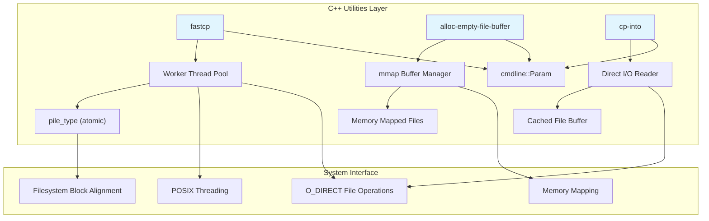
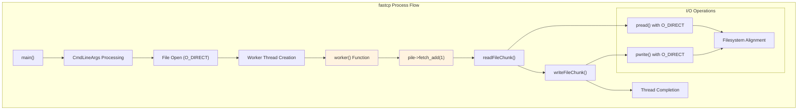
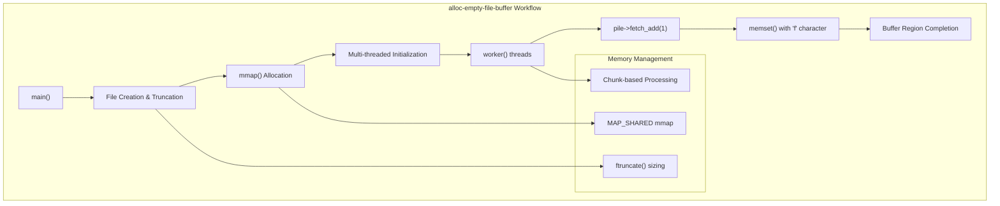
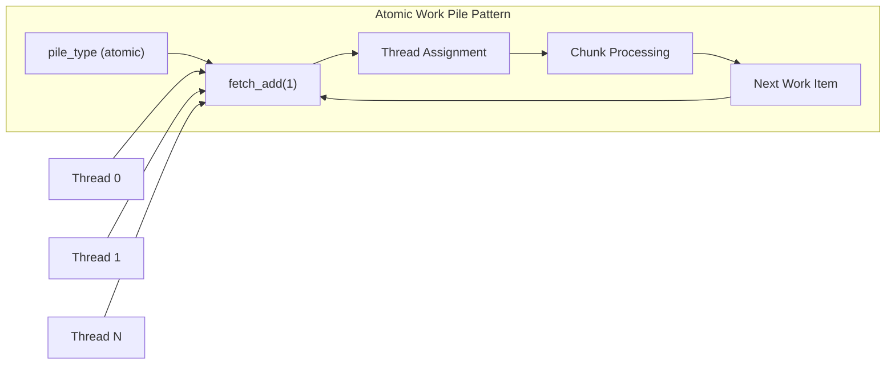

<!-- source: DeepWiki mcp.deepwiki.com · repo NVIDIA/mlperf-common · page 4.2 C++ Utilities · fetched 2026-10-26 -->

# C++ Utilities

<details>
<summary>Relevant source files</summary>

The following files were used as context for generating this wiki page:

- [src/alloc-empty-file-buffer.cpp](src/alloc-empty-file-buffer.cpp)
- [src/cp-into.cpp](src/cp-into.cpp)
- [src/fastcp.cpp](src/fastcp.cpp)

</details>


This document covers the native C++ utilities provided by the MLPerf Common repository for high-performance file operations. These utilities are performance-critical components designed to optimize I/O operations for MLPerf benchmarks, particularly for large-scale data movement and memory management tasks.

For information about the C++ build system configuration, see [Build Configuration](#4.1). For command line argument parsing utilities used by these tools, see [Command Line Parsing](#4.3).

## Overview

The C++ utilities consist of three main performance-optimized tools that leverage multi-threading, direct I/O, and memory mapping to achieve high throughput file operations:

| Utility | Purpose | Key Features |
|---------|---------|--------------|
| `fastcp` | Multi-threaded file copying | O_DIRECT support, worker thread pool, filesystem alignment |
| `alloc-empty-file-buffer` | Pre-allocate file buffers | mmap-based allocation, multi-threaded initialization |
| `cp-into` | Copy into existing files | Works with pre-allocated buffers, optimized for cached files |

## Architecture Overview



**Sources:** [src/fastcp.cpp:1-468](), [src/alloc-empty-file-buffer.cpp:1-168](), [src/cp-into.cpp:1-288]()

## Core Utilities

### fastcp - Multi-threaded File Copy

The `fastcp` utility implements a high-performance file copying mechanism using worker threads and direct I/O operations.



**Key Components:**

- **CmdLineArgs struct** [src/fastcp.cpp:43-51](): Defines command line parameters including buffer size and thread count
- **worker() function** [src/fastcp.cpp:305-353](): Main worker thread implementation using atomic work distribution
- **readFileChunk()/writeFileChunk()** [src/fastcp.cpp:170-303](): Handle direct I/O operations with proper alignment
- **UniqueBuffer** [src/fastcp.cpp:68-93](): RAII wrapper for aligned memory allocation using `posix_memalign`

**Sources:** [src/fastcp.cpp:43-468]()

### alloc-empty-file-buffer - Buffer Pre-allocation

This utility creates pre-allocated file buffers using memory mapping for optimal performance in subsequent operations.



**Key Features:**
- Uses `MAP_SHARED` mmap without `MAP_POPULATE` [src/alloc-empty-file-buffer.cpp:132-133]() for optimized random access
- Multi-threaded buffer initialization using atomic work distribution [src/alloc-empty-file-buffer.cpp:64-77]()
- Fills buffer regions with 'f' characters using `memset` [src/alloc-empty-file-buffer.cpp:75]()

**Sources:** [src/alloc-empty-file-buffer.cpp:1-168]()

### cp-into - Optimized Copy to Pre-allocated Files

The `cp-into` utility is designed to work with files created by `alloc-empty-file-buffer`, providing optimized copying into existing cached file buffers.

**Implementation Details:**

| Function | Purpose | Location |
|----------|---------|----------|
| `getFileSize()` | File size determination via `fstat` | [src/cp-into.cpp:59-69]() |
| `getFileSystemBlockSize()` | Block size for O_DIRECT alignment | [src/cp-into.cpp:72-82]() |
| `worker()` | Thread worker for chunk processing | [src/cp-into.cpp:90-167]() |

The utility uses direct I/O for reading with proper filesystem block alignment while writing to memory-mapped output buffers [src/cp-into.cpp:241-242]().

**Sources:** [src/cp-into.cpp:1-288]()

## Common Infrastructure

### Work Distribution Pattern

All three utilities use a consistent atomic work distribution pattern:



This pattern is implemented identically across:
- `fastcp::worker()` [src/fastcp.cpp:317]()
- `alloc-empty-file-buffer::worker()` [src/alloc-empty-file-buffer.cpp:71]()
- `cp-into::worker()` [src/cp-into.cpp:100]()

**Sources:** [src/fastcp.cpp:102](), [src/alloc-empty-file-buffer.cpp:55](), [src/cp-into.cpp:56]()

### Direct I/O Alignment

The utilities handle filesystem block alignment requirements for O_DIRECT operations:

```cpp
// Alignment calculation pattern used across utilities
off_t myReadSize = roundUp(chunkSize, inputFSBlockSize);
assert(myReadSize % inputFSBlockSize == 0);
assert(reinterpret_cast<intptr_t>(buf) % inputFSBlockSize == 0);
assert(offset % inputFSBlockSize == 0);
```

This alignment pattern ensures compatibility with direct I/O requirements on various filesystems [src/fastcp.cpp:186-190]().

**Sources:** [src/fastcp.cpp:135-157](), [src/cp-into.cpp:109]()

### Size Constants and Utilities

Common size definitions and utility functions are shared across the utilities:

| Constant/Function | Value/Purpose | Usage |
|-------------------|---------------|--------|
| `KiB, MiB, GiB, TiB, PiB` | Size unit constants | Buffer size calculations |
| `ceilDiv()` | Ceiling division template | Chunk count calculation |
| `roundUp()` | Round to multiple template | Block alignment |
| `isPowerOfTwo()` | Power-of-two validation | Alignment verification |

**Sources:** [src/fastcp.cpp:35-157](), [src/alloc-empty-file-buffer.cpp:33-61](), [src/cp-into.cpp:34-87]()

---

