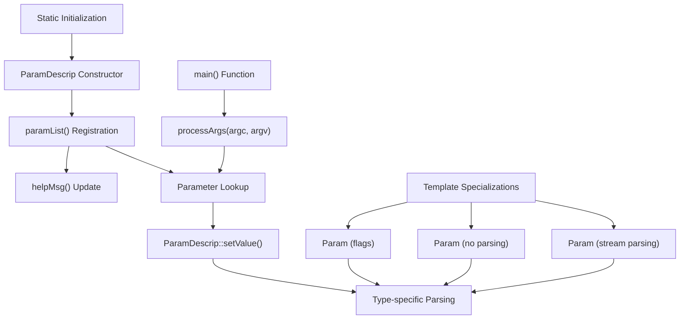
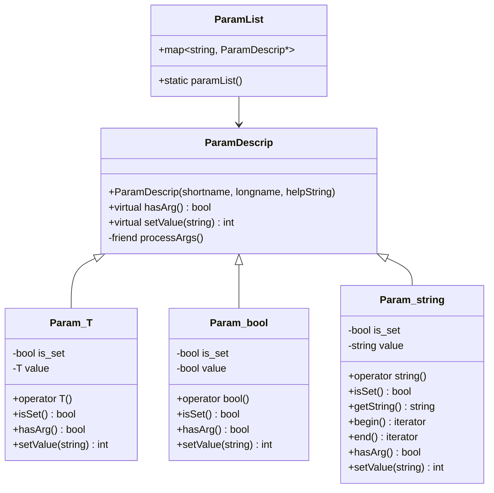
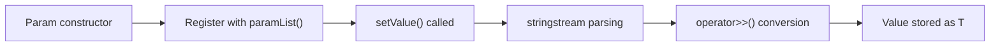
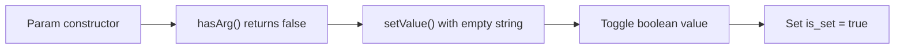
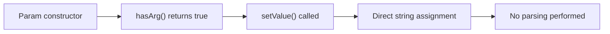
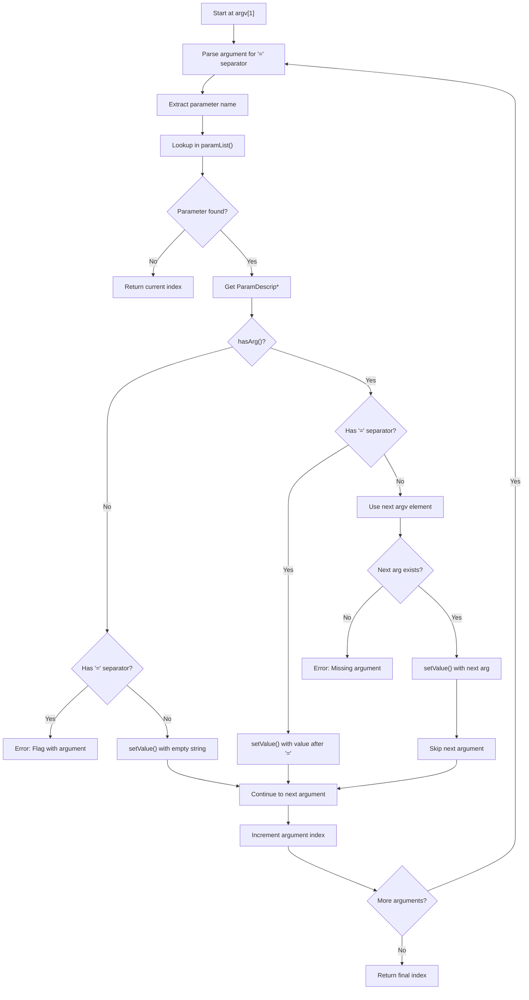

<!-- source: DeepWiki mcp.deepwiki.com · repo NVIDIA/mlperf-common · page 4.3 Command Line Parsing · fetched 2026-10-26 -->

# Command Line Parsing

Relevant source files

The following files were used as context for generating this wiki page:

- [src/cmdline.cpp](src/cmdline.cpp)
- [src/cmdline.h](src/cmdline.h)

This document covers the C++ command line argument parsing utilities provided by the MLPerf Common repository. This system provides a type-safe, template-based framework for parsing command line arguments in the native C++ utilities included in the package.

For information about the broader C++ build system and compiled utilities, see [Build Configuration](#4.1) and [C++ Utilities](#4.2).

## Purpose and Scope

The command line parsing system enables C++ utilities in the MLPerf Common repository to consistently handle command line arguments with automatic type conversion, help generation, and validation. The system is implemented in the `cmdline` namespace and provides a declarative approach to defining command line parameters through template specialization.

This system is used by native utilities such as `fastcp` and other performance-critical tools that require efficient argument processing without the overhead of external libraries.

## Architecture Overview

The command line parsing system follows a registration-based architecture where parameters are declared as global variables that automatically register themselves with a central parameter registry during static initialization.

### System Flow Diagram

**Sources:** [src/cmdline.h:60-71](), [src/cmdline.cpp:112-152](), [src/cmdline.cpp:93-99]()

### Core Components Class Diagram

**Sources:** [src/cmdline.h:60-71](), [src/cmdline.h:73-103](), [src/cmdline.h:106-130](), [src/cmdline.h:132-165]()

## Core Components

### Parameter Registry System

The system maintains a global registry of parameters using a singleton pattern implemented through static local variables:

| Function | Purpose | Location |
|----------|---------|----------|
| `paramList()` | Returns singleton map of parameter names to `ParamDescrip*` | [src/cmdline.cpp:93-99]() |
| `helpMsg()` | Returns singleton string containing accumulated help text | [src/cmdline.cpp:101-107]() |
| `processArgs()` | Main entry point for parsing command line arguments | [src/cmdline.cpp:112-152]() |

### Pattern Matching Utilities

The system includes glob pattern matching functionality for parameter name matching:

| Function | Purpose | Patterns Supported |
|----------|---------|-------------------|
| `globMatch()` | Matches single glob pattern against string | `*` (any string), `?` (any character) |
| `globListMatch()` | Matches colon-separated list of glob patterns | Multiple patterns separated by `:` |

**Sources:** [src/cmdline.cpp:30-57](), [src/cmdline.cpp:61-86]()

## Parameter Types and Specializations

The system provides three main parameter type implementations through template specialization:

### Generic Template Parameters

Generic `Param<T>` objects use `std::stringstream` for type conversion, supporting any type that implements `operator>>()`.

**Sources:** [src/cmdline.h:73-103]()

### Boolean Flag Specialization

Boolean parameters act as flags that don't require arguments and toggle their value when encountered.

**Sources:** [src/cmdline.h:106-130]()

### String Specialization

String parameters store the argument value directly without any parsing or conversion.

**Sources:** [src/cmdline.h:132-165]()

## Argument Processing Flow

The `processArgs()` function implements the main argument parsing logic:

### Processing Algorithm

**Sources:** [src/cmdline.cpp:112-152]()

## Integration with MLPerf Utilities

The command line parsing system is used by various C++ utilities in the MLPerf Common repository:

| Component | Usage Pattern | Integration Point |
|-----------|---------------|-------------------|
| `fastcp` utility | File operation parameters | Native C++ command line tool |
| Build system | Compilation flags | Makefile integration |
| Performance tools | Benchmark parameters | Direct linking with utilities |

The system provides a lightweight alternative to external argument parsing libraries, ensuring minimal dependencies and fast startup times for performance-critical utilities.

**Sources:** [src/cmdline.h:1-15](), [src/cmdline.cpp:1-15]()

---

