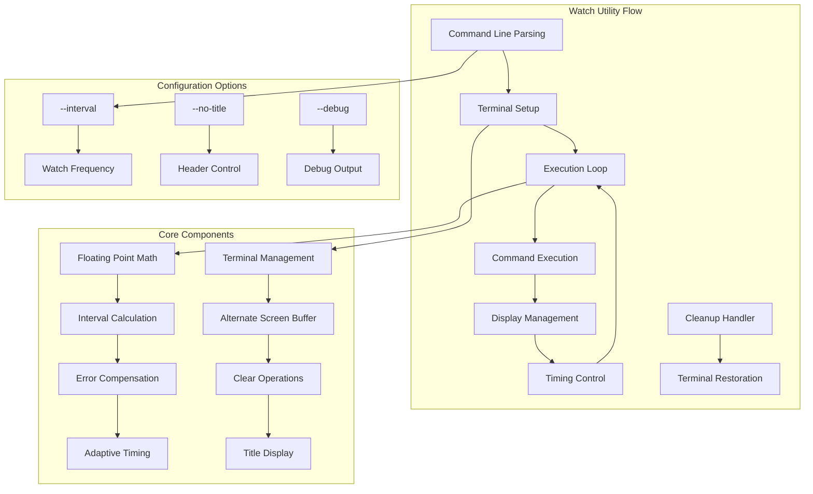
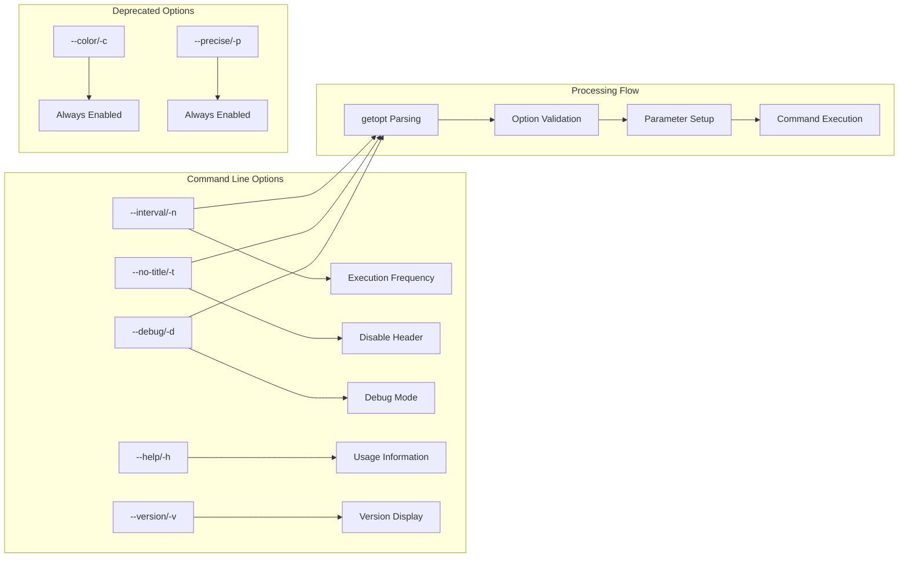
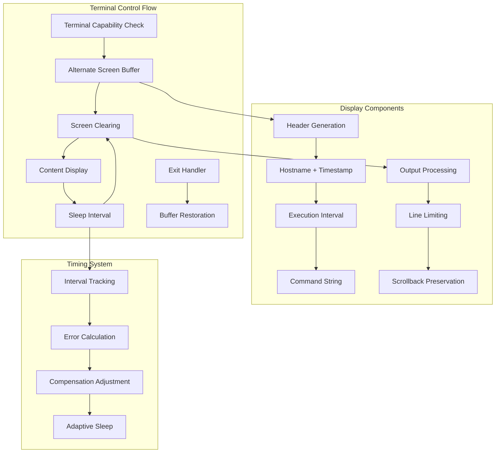
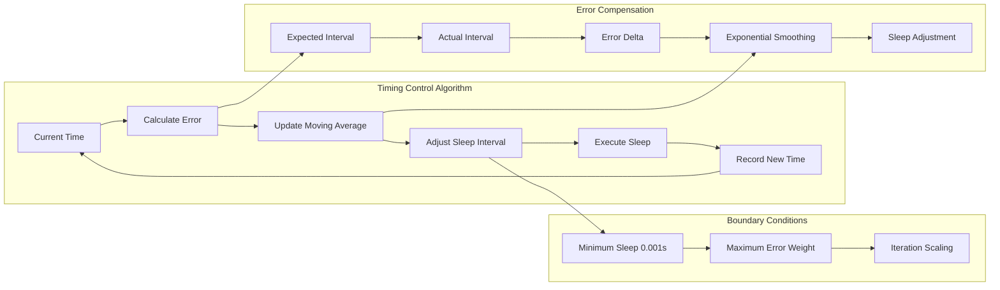

<!-- source: DeepWiki mcp.deepwiki.com · repo NVIDIA/mlperf-common · page 5 Development and Utilities · fetched 2026-10-26 -->

# Development and Utilities

<details>
<summary>Relevant source files</summary>

The following files were used as context for generating this wiki page:

- [LICENSE](LICENSE)
- [utils/watch](utils/watch)

</details>


This document covers additional development tools and miscellaneous utilities provided by the MLPerf Common repository that support development, monitoring, and operational activities. These utilities complement the core MLPerf systems and client utilities but serve more specialized or developmental purposes.

For information about core MLPerf systems and framework integration, see [Core MLPerf Systems](#2). For operational client utilities used in production workloads, see [Client Utilities](#3).

## Development Tools

The MLPerf Common repository includes specialized development tools designed for monitoring and debugging during development and testing phases.

### Watch Utility

The repository provides a custom implementation of the `watch` command at [utils/watch](), which offers enhanced functionality over standard system `watch` implementations. This utility repeatedly executes commands and displays their output with precise timing control and terminal management features.

#### Architecture and Features



Sources: [utils/watch:1-183]()

#### Floating Point Arithmetic System

The watch utility implements a comprehensive floating point arithmetic system using `bc` for precise timing calculations:

| Function | Purpose | Implementation |
|----------|---------|----------------|
| `minus()` | Subtraction | [utils/watch:34-36]() |
| `plus()` | Addition | [utils/watch:38-40]() |
| `times()` | Multiplication | [utils/watch:42-44]() |
| `div()` | Division | [utils/watch:46-48]() |
| `lt()` | Less-than comparison | [utils/watch:50-52]() |
| `min()` | Minimum value | [utils/watch:54-60]() |
| `max()` | Maximum value | [utils/watch:62-68]() |
| `exp_moving_avg()` | Exponential moving average | [utils/watch:70-76]() |

The exponential moving average function at [utils/watch:70-76]() calculates timing error compensation using the formula `alpha * sample + (1 - alpha) * prev_avg` to maintain precise execution intervals.

Sources: [utils/watch:34-76]()

#### Command Line Interface

The utility provides extensive command line options compatible with standard `watch` implementations:



Sources: [utils/watch:78-134]()

#### Terminal Management

The watch utility implements sophisticated terminal management to provide a clean, non-intrusive display experience:



The utility uses `tput smcup` and `tput rmcup` at [utils/watch:150-153]() to manage the alternate screen buffer, ensuring the terminal's scrollback history remains intact. The cleanup handler at [utils/watch:139-146]() ensures proper terminal restoration on all exit conditions.

Sources: [utils/watch:139-183]()

#### Precision Timing Implementation

The watch utility maintains precise execution intervals through error tracking and compensation:



The timing algorithm at [utils/watch:174-182]() uses an exponential moving average to track timing errors and adjusts the sleep interval to compensate, with a minimum sleep duration of 0.001 seconds to prevent system overload.

Sources: [utils/watch:156-182]()

## Licensing

The MLPerf Common repository is distributed under the Apache License, Version 2.0, as specified in the [LICENSE]() file. This license provides broad permissions for use, modification, and distribution while maintaining attribution requirements.

### License Summary

| Aspect | Details |
|--------|---------|
| License Type | Apache License 2.0 |
| Copyright | NVIDIA CORPORATION |
| Permissions | Use, modify, distribute, sublicense |
| Requirements | Include license notice, state changes |
| Limitations | No warranty, limited liability |

### Key License Terms

The Apache 2.0 license grants the following permissions:
- **Commercial Use**: The software may be used for commercial purposes
- **Modification**: The software may be modified
- **Distribution**: The software may be distributed
- **Patent Grant**: Express patent license granted for contributions
- **Private Use**: The software may be used privately

The license requires:
- **License Notice**: Include a copy of the license with distributions
- **State Changes**: Mark modified files with change notices
- **Preserve Attribution**: Retain copyright and attribution notices

Sources: [LICENSE:1-203]()

### Copyright Notice Template

All source files in the repository include a standardized copyright notice format as specified in the license appendix at [LICENSE:179-203](). The template requires:

```
Copyright [year] NVIDIA CORPORATION

Licensed under the Apache License, Version 2.0 (the "License");
you may not use this file except in compliance with the License.
You may obtain a copy of the License at

    http://www.apache.org/licenses/LICENSE-2.0
```

This notice appears in all source files throughout the repository, ensuring consistent attribution and license compliance.

Sources: [LICENSE:179-203]()

---

