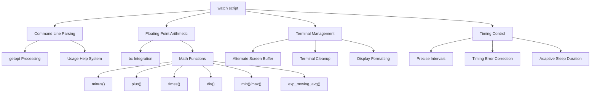
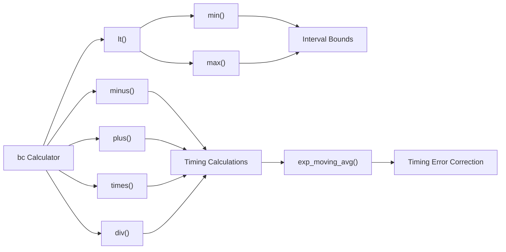
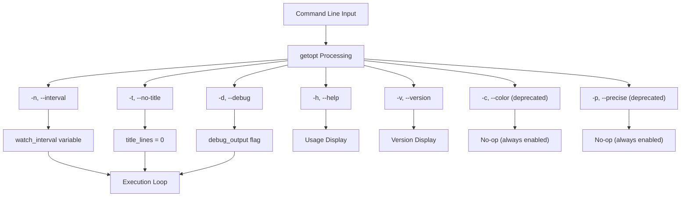
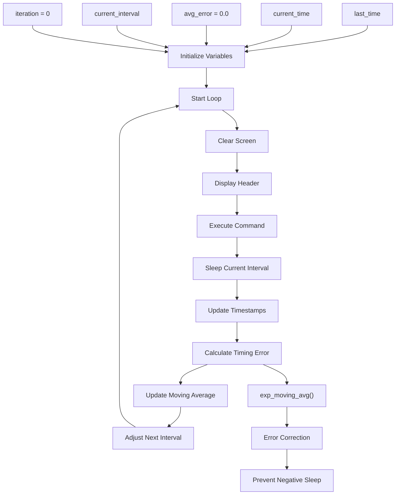
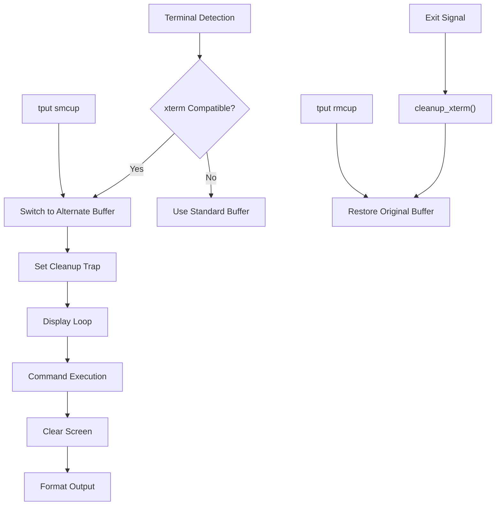

<!-- source: DeepWiki mcp.deepwiki.com · repo NVIDIA/mlperf-common · page 5.1 Development Tools · fetched 2026-10-26 -->

# Development Tools

Relevant source files

The following files were used as context for generating this wiki page:

- [utils/watch](utils/watch)

This document covers development utilities provided by the MLPerf Common repository for monitoring and debugging purposes during MLPerf benchmark development and execution.

The development tools in this repository are focused on operational monitoring and debugging capabilities that complement the core MLPerf systems. For information about build tools and C++ utilities, see [Build System and C++ Components](#4). For client utilities used during benchmark execution, see [Client Utilities](#3).

## Purpose and Scope

The development tools provide essential monitoring capabilities for developers working with MLPerf benchmarks, particularly in distributed and high-performance computing environments where standard system utilities may be limited or unavailable.

## Watch Utility

The primary development tool is a custom implementation of the `watch` command, designed specifically for HPC environments where the standard `watch` utility may not be available or may lack required precision for monitoring MLPerf workloads.

### Architecture

**Title:** Watch Utility Component Architecture

**Sources:** [utils/watch:1-183]()

### Core Features

The watch utility provides several advanced features beyond standard watch implementations:

| Feature | Description | Implementation |
|---------|-------------|----------------|
| Precise Timing | Exponential moving average for timing error correction | [utils/watch:174-181]() |
| Floating Point Intervals | Support for sub-second intervals using `bc` | [utils/watch:92-93](), [utils/watch:34-76]() |
| Terminal Management | Alternate screen buffer support for xterm | [utils/watch:139-153]() |
| Debug Mode | Optional debug output without screen clearing | [utils/watch:113-115](), [utils/watch:164]() |
| Adaptive Sleep | Dynamic interval adjustment based on execution timing | [utils/watch:180-181]() |

### Mathematical Functions

The utility implements a comprehensive set of floating-point arithmetic functions using `bc` for precise timing calculations:

**Title:** Floating Point Arithmetic System

**Sources:** [utils/watch:34-76]()

### Command Line Interface

The watch utility supports standard watch command options with some enhancements:

**Title:** Command Line Argument Processing Flow

**Sources:** [utils/watch:78-134]()

### Execution Loop

The main execution loop implements precise timing with adaptive interval adjustment:

**Title:** Main Execution Loop with Timing Correction

**Sources:** [utils/watch:156-182]()

### Terminal Management

The utility includes sophisticated terminal handling for improved user experience:

**Title:** Terminal Buffer Management

**Sources:** [utils/watch:139-153]()

## Usage Patterns

The watch utility is particularly useful for monitoring MLPerf training progress and system metrics:

- **Training Progress Monitoring**: Watch MLPerf log files or metric outputs
- **Resource Utilization**: Monitor GPU/CPU usage during benchmark execution  
- **Distributed Training**: Observe multiple node status in HPC environments
- **Debug Output**: Monitor debug logs with precise timing intervals

**Sources:** [utils/watch:16-28]()

## Dependencies

The watch utility has minimal dependencies but requires:

- `bc` command for floating-point arithmetic operations
- `getopt` for command-line argument parsing
- `tput` for terminal control (optional, for enhanced display)
- Standard POSIX shell utilities (`date`, `clear`, `tail`)

**Sources:** [utils/watch:78-79](), [utils/watch:31-33](), [utils/watch:150]()

---

