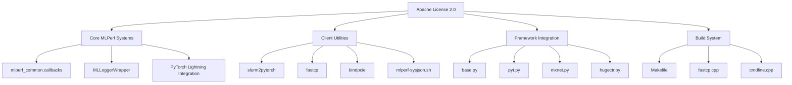
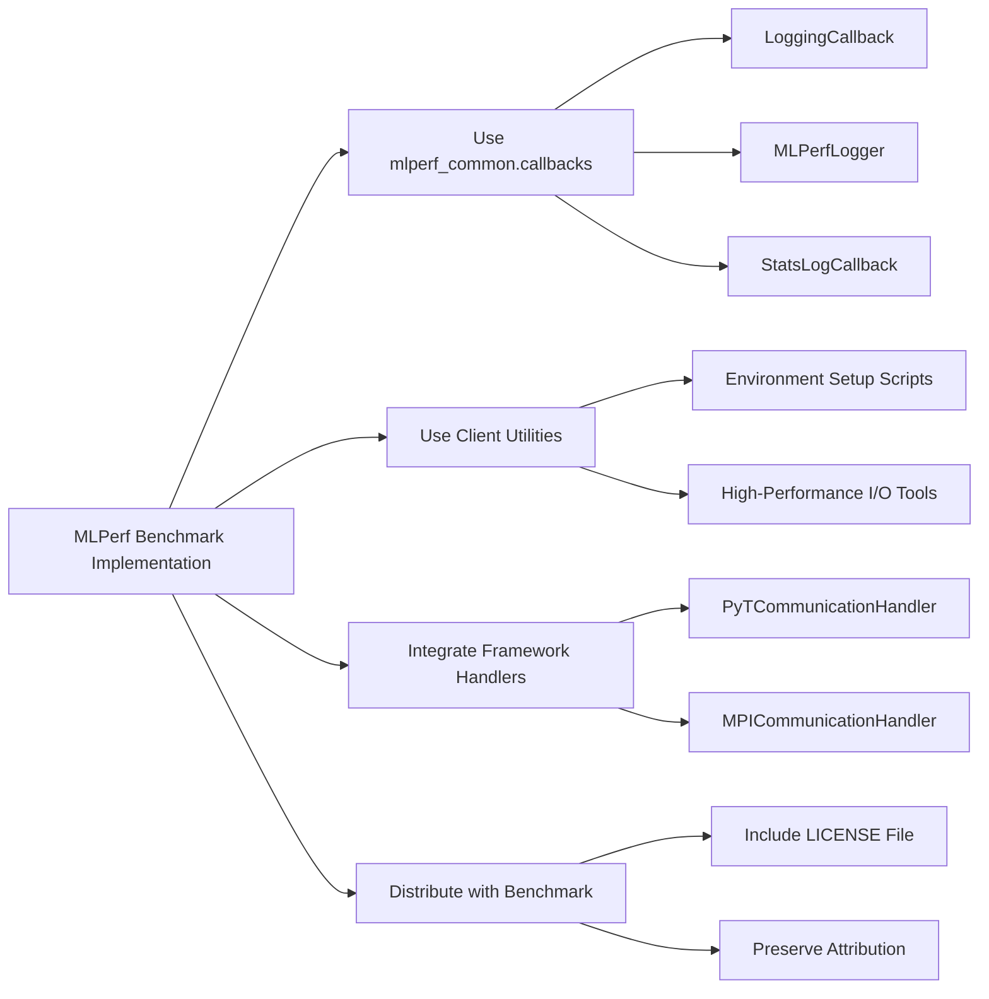

<!-- source: DeepWiki mcp.deepwiki.com · repo NVIDIA/mlperf-common · page 5.2 Licensing · fetched 2026-10-26 -->

# Licensing

Relevant source files

The following files were used as context for generating this wiki page:

- [LICENSE](LICENSE)

This document covers the licensing terms and conditions that apply to the MLPerf Common repository, including usage rights, distribution requirements, and contribution guidelines. This information is essential for users, contributors, and organizations using this codebase in their MLPerf benchmark implementations.

## License Overview

The MLPerf Common repository is licensed under the Apache License, Version 2.0. This is a permissive open source license that allows broad usage while maintaining certain requirements for attribution and distribution.

### Primary License Terms

The entire codebase is governed by the Apache License 2.0, as specified in [LICENSE:1-203](). This license provides the following key permissions:

| Permission | Description |
|------------|-------------|
| Commercial Use | Use the software for commercial purposes |
| Modification | Modify the source code |
| Distribution | Distribute the software |
| Patent Use | Use any patent claims in the code |
| Private Use | Use the software privately |

### License Requirements

Users and distributors must comply with the following requirements under the Apache 2.0 license:

| Requirement | Description |
|-------------|-------------|
| License Inclusion | Include a copy of the license with any distribution |
| Copyright Notice | Preserve copyright notices in redistributed code |
| State Changes | Document any modifications made to the original code |
| Attribution | Include attribution notices from the original NOTICE file (if present) |

## Repository Coverage

The Apache 2.0 license applies to all components of the MLPerf Common repository:

**License Coverage of Repository Components**

Sources: [LICENSE:1-203]()

## Usage Rights and Permissions

### For End Users

Under the Apache 2.0 license, users may:

- Use the MLPerf Common utilities in commercial and non-commercial projects
- Modify the source code to meet specific requirements
- Distribute modified or unmodified versions of the software
- Use the software in proprietary applications without releasing their own source code

### For MLPerf Benchmark Implementations

The license specifically enables:

**MLPerf Integration Under Apache 2.0 License**

Sources: [LICENSE:67-72](), [LICENSE:90-129]()

## Contribution Requirements

### Contributor License Grant

Contributors to the repository automatically grant licenses under the terms specified in [LICENSE:131-137](). This includes:

- Copyright license for their contributions
- Patent license for any patent claims in their contributions
- Agreement that contributions are submitted under the same Apache 2.0 terms

### Submission Process

All contributions are subject to the following license conditions:

| Condition | Requirement |
|-----------|-------------|
| License Compatibility | Contributions must be compatible with Apache 2.0 |
| Patent Grant | Contributors grant patent rights for their contributions |
| No Additional Terms | Contributions cannot impose additional licensing restrictions |

## Distribution and Redistribution

### Source Code Distribution

When distributing source code from this repository, the following must be included:

1. **License File**: A complete copy of [LICENSE:1-203]()
2. **Copyright Notices**: All original copyright notices from source files
3. **Attribution**: Any attribution notices from a NOTICE file (per [LICENSE:107-122]())
4. **Modification Notice**: Clear documentation of any changes made to the original code

### Binary Distribution

For compiled or binary distributions of components like `fastcp` or other C++ utilities, distributors must:

- Include the Apache 2.0 license text
- Provide attribution notices in documentation or about dialogs
- Clearly indicate if modifications were made to the original source

## Important License Provisions

### Warranty Disclaimer

The Apache 2.0 license includes a comprehensive warranty disclaimer in [LICENSE:144-152](). The software is provided "AS IS" without warranties of any kind, including:

- No warranty of merchantability
- No warranty of fitness for a particular purpose
- No warranty of non-infringement

### Limitation of Liability

Contributors and distributors have limited liability under [LICENSE:154-164](). Users assume all risks associated with using the software.

### Patent Protection

The license includes patent protection provisions in [LICENSE:74-88]() that:

- Grant patent rights for using the software
- Terminate patent grants if users initiate patent litigation related to the software
- Protect contributors from patent claims related to their contributions

Sources: [LICENSE:1-203]()