# Page: MLPerf Common Overview

# MLPerf Common Overview

<details>
<summary>Relevant source files</summary>

The following files were used as context for generating this wiki page:

- [README.md](README.md)
- [client/mlperf-sysjson.sh](client/mlperf-sysjson.sh)
- [setup.py](setup.py)

</details>


## Purpose and Scope

MLPerf Common is a collection of utilities and infrastructure components designed to support MLPerf benchmark submissions, particularly for NVIDIA hardware configurations. This repository provides standardized logging infrastructure, framework integration abstractions, distributed training utilities, and system management tools that ensure MLPerf compliance while optimizing performance across different ML frameworks and hardware setups.

The repository serves as a foundational toolkit for implementing MLPerf benchmarks with proper logging, distributed coordination, and system configuration management. For detailed information about specific subsystems, see [Core MLPerf Systems](#2) for logging and compliance infrastructure, [Framework Integration](#2.3) for multi-framework support, and [Client Utilities](#3) for operational tools.

## Repository Architecture

The MLPerf Common repository is organized into several interconnected layers that provide comprehensive support for MLPerf benchmark implementations:

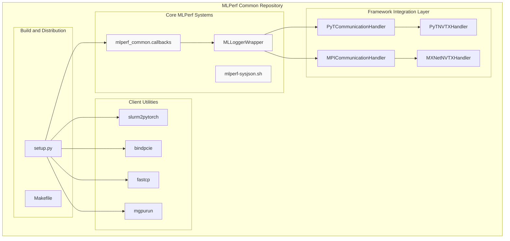

**Sources:** [setup.py:23-36](), [README.md:4-120](), [client/mlperf-sysjson.sh:1-260]()

## Core Components Overview

### MLPerf Logging Infrastructure

The repository's primary functionality centers around the `MLLoggerWrapper` class, which provides standardized MLPerf event logging with support for multiple communication backends. This system ensures compliance with MLPerf logging requirements while abstracting framework-specific communication mechanisms.

### Framework Integration Layer

The framework integration layer uses abstract base classes to support multiple ML frameworks through pluggable handlers:

| Framework | Communication Handler | Profiling Handler |
|-----------|----------------------|-------------------|
| PyTorch | `PyTCommunicationHandler` | `PyTNVTXHandler` |
| MXNet/Horovod | `MPICommunicationHandler` | `MXNetNVTXHandler` |
| HugeCTR | `MPICommunicationHandler` | Custom handlers |

### Client Utilities

The repository provides numerous command-line utilities for operational tasks, distributed as executable scripts through the package installation system.

**Sources:** [README.md:11-39](), [setup.py:33]()

## Package Distribution and Entry Points

The package distribution is managed through `setup.py` and provides both Python modules and command-line scripts:

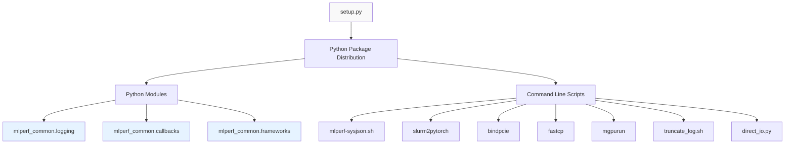

**Sources:** [setup.py:32-33]()

## Key Integration Patterns

### PyTorch Integration

For PyTorch-based MLPerf benchmarks using `torch.distributed`:

```python
from mlperf_common.logging import MLLoggerWrapper
from mlperf_common.frameworks.pyt import PyTCommunicationHandler

mllogger = MLLoggerWrapper(PyTCommunicationHandler(), value=None)
```

### MPI-Based Integration

For frameworks using MPI communication (Horovod, MXNet, HugeCTR):

```python
from mlperf_common.logging import MLLoggerWrapper  
from mlperf_common.frameworks.mxnet import MPICommunicationHandler

mllogger = MLLoggerWrapper(MPICommunicationHandler(), value=None)
```

**Sources:** [README.md:14-38]()

## System Description Generation

The `mlperf-sysjson.sh` script automatically generates MLPerf-compliant system description JSON files by detecting hardware configuration, software versions, and system characteristics. This script is essential for MLPerf submission compliance:

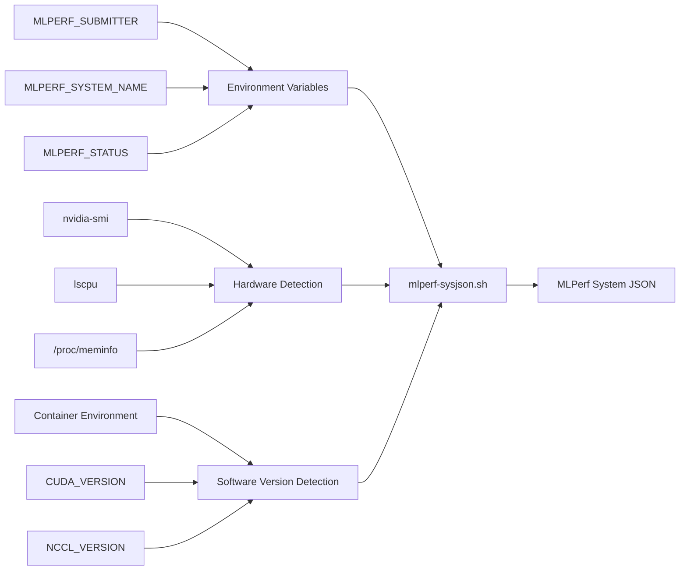

The script requires specific environment variables and automatically detects system characteristics to generate compliant metadata for MLPerf submissions.

**Sources:** [client/mlperf-sysjson.sh:27-61](), [client/mlperf-sysjson.sh:183-204](), [client/mlperf-sysjson.sh:207-259]()

## Component Relationships

The repository's components work together to provide a complete MLPerf benchmark infrastructure:

1. **Logging Infrastructure**: `MLLoggerWrapper` coordinates with framework-specific handlers to ensure compliant event logging
2. **Framework Abstraction**: Base handler classes enable consistent interfaces across different ML frameworks  
3. **System Management**: Client utilities handle environment setup, resource binding, and system configuration
4. **Compliance Tools**: System description generation ensures submission metadata requirements are met

This architecture allows MLPerf benchmark implementations to focus on model training logic while delegating infrastructure concerns to the common utilities, ensuring both performance optimization and submission compliance.

**Sources:** [setup.py:23-36](), [README.md:47-71](), [client/mlperf-sysjson.sh:1-20]()

---

# Page: Core MLPerf Systems

# Core MLPerf Systems

<details>
<summary>Relevant source files</summary>

The following files were used as context for generating this wiki page:

- [mlperf_common/callbacks/__init__.py](mlperf_common/callbacks/__init__.py)
- [mlperf_common/callbacks/logging.py](mlperf_common/callbacks/logging.py)
- [mlperf_common/logging.py](mlperf_common/logging.py)

</details>


## Purpose and Scope

This document covers the most critical systems in the MLPerf Common repository that enable MLPerf benchmark compliance, distributed training coordination, and performance logging. These systems provide the foundational infrastructure for running MLPerf benchmarks across different machine learning frameworks with standardized logging and metric tracking.

The core systems include PyTorch Lightning integration callbacks, the MLPerf logging wrapper infrastructure, and distributed training statistics collection. For framework-specific implementations and handlers, see [Framework Integration](#2.3). For command-line utilities and operational tools, see [Client Utilities](#3).

## System Architecture Overview

The core MLPerf systems form a layered architecture where PyTorch Lightning callbacks coordinate with the MLPerf logging infrastructure to ensure benchmark compliance across distributed training environments.

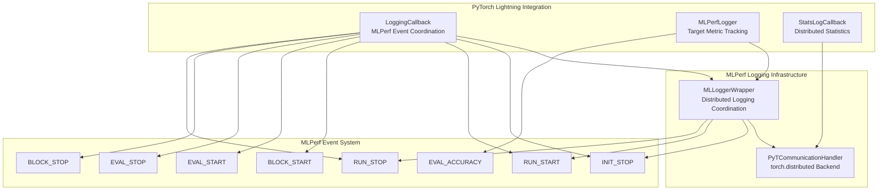

Sources: [mlperf_common/callbacks/logging.py:41-42](), [mlperf_common/logging.py:21-43]()

## PyTorch Lightning Callback System

The callback system provides MLPerf-compliant event logging throughout the training lifecycle. The `LoggingCallback` class integrates with PyTorch Lightning's training loop to emit required MLPerf events at precise timing points.

### LoggingCallback Core Functionality

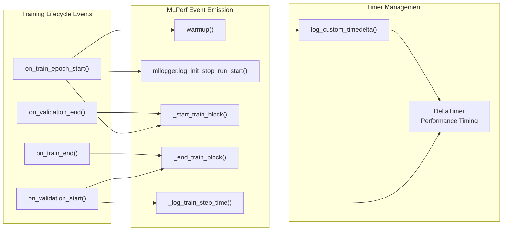

The `LoggingCallback` manages training blocks and validation cycles with precise timing measurements. Key responsibilities include:

- **Warmup Handling**: Executes one-time initialization logging via `warmup()` method
- **Block Management**: Coordinates `BLOCK_START` and `BLOCK_STOP` events around training intervals
- **Timing Measurement**: Uses `DeltaTimer` class for precise performance timing
- **Status Tracking**: Maintains `train_block_started` and `train_current_block` state

Sources: [mlperf_common/callbacks/logging.py:57-219]()

### MLPerfLogger Target Validation

The `MLPerfLogger` extends PyTorch Lightning's `Logger` interface to provide target metric tracking and early stopping functionality.

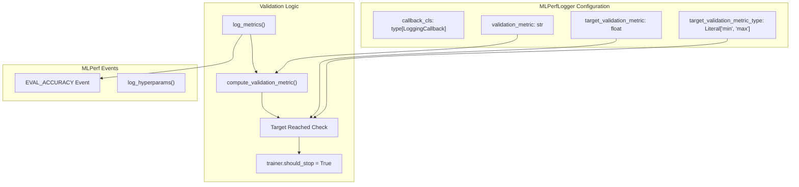

The logger automatically stops training when validation metrics reach target thresholds, ensuring MLPerf compliance for convergence criteria.

Sources: [mlperf_common/callbacks/logging.py:221-327]()

## MLPerf Logging Infrastructure

The `MLLoggerWrapper` provides distributed logging coordination with communication handlers for different frameworks. It wraps the official MLPerf logger with additional synchronization and distributed coordination capabilities.

### MLLoggerWrapper Core Methods

| Method | Purpose | Synchronization |
|--------|---------|----------------|
| `start()` | Log time interval start | Configurable via `sync` parameter |
| `end()` | Log time interval end | Configurable via `sync` parameter |
| `event()` | Log point-in-time event | Configurable via `sync` parameter |
| `log_init_stop_run_start()` | Log INIT_STOP and RUN_START | Full barrier synchronization |
| `log_run_stop()` | Log RUN_STOP with status | Configurable synchronization |

The wrapper supports several key distributed coordination features:

- **Unique Logging**: Only `unique_log_rank` process logs when `unique=True`
- **Barrier Synchronization**: Calls `comm_handler.barrier()` before logging when `sync=True`
- **Stack Trace Offset**: Maintains proper call stack attribution with `default_stack_offset`

Sources: [mlperf_common/logging.py:44-90]()

### Communication Handler Integration

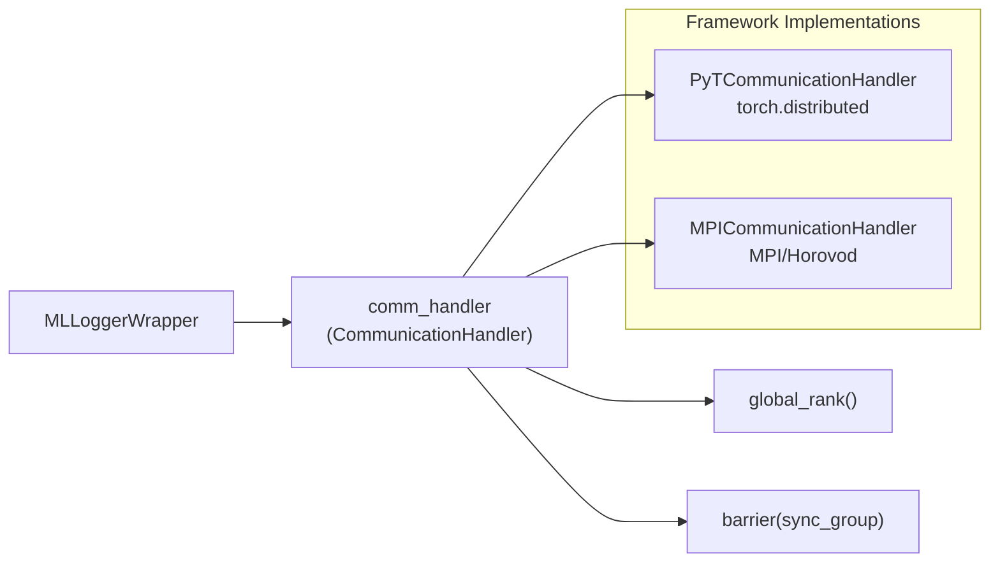

The communication handler abstraction allows the same logging infrastructure to work across different distributed training frameworks.

Sources: [mlperf_common/logging.py:75-85]()

## Distributed Statistics Collection

The `StatsLogCallback` provides comprehensive statistics collection for distributed training environments, supporting tensor parallel, pipeline parallel, and data parallel configurations.

### Statistics Collection Architecture

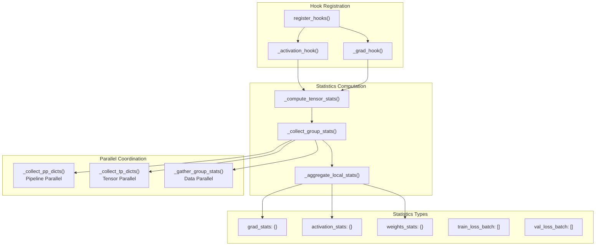

### Key Statistics Features

The `StatsLogCallback` supports advanced distributed training configurations:

- **Virtual Pipeline Parallelism**: Handles multi-chunk models with `use_vp` and `set_layer_vp_chunk()`
- **Tensor Parallelism**: Configurable reduction via `REDUCE_TP` environment variable
- **Selective Logging**: Controlled via `LOG_EVERY_N_BATCHES` and `RUN_N_ITERS` environment variables
- **Hook Management**: Automatic registration/removal of forward and backward hooks

Statistics collected include tensor mean, variance, min, max, and L2 norm across all parallel dimensions.

Sources: [mlperf_common/callbacks/logging.py:329-741]()

## Code Entity Mapping

The following diagram maps the natural language system concepts to specific code entities that developers can search for in the codebase:

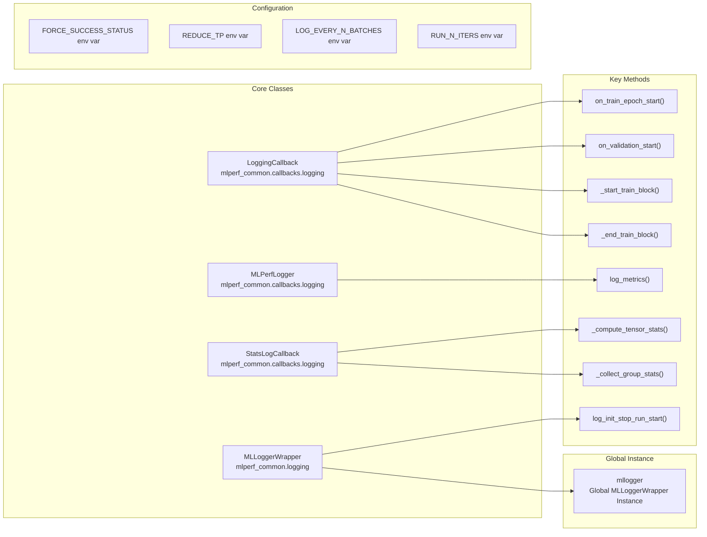

Sources: [mlperf_common/callbacks/__init__.py:16](), [mlperf_common/callbacks/logging.py:41](), [mlperf_common/callbacks/logging.py:348-351]()

---

# Page: PyTorch Lightning Callbacks

# PyTorch Lightning Callbacks

<details>
<summary>Relevant source files</summary>

The following files were used as context for generating this wiki page:

- [mlperf_common/callbacks/__init__.py](mlperf_common/callbacks/__init__.py)
- [mlperf_common/callbacks/logging.py](mlperf_common/callbacks/logging.py)

</details>


This document covers the PyTorch Lightning callback system provided by MLPerf Common, which implements MLPerf-compliant logging, performance tracking, and distributed training statistics collection. These callbacks integrate with PyTorch Lightning trainers to automatically handle MLPerf benchmark requirements including timing, validation metric tracking, and early stopping criteria.

For information about the underlying MLPerf logging infrastructure, see [MLPerf Logging Infrastructure](#2.2). For framework integration details, see [Framework Integration](#2.3).

## Architecture Overview

The PyTorch Lightning callbacks system consists of three main components that work together to provide comprehensive MLPerf compliance and performance monitoring:

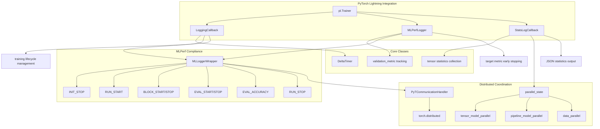

Sources: [mlperf_common/callbacks/logging.py:1-741](), [mlperf_common/callbacks/__init__.py:1-17]()

## LoggingCallback Class

The `LoggingCallback` class is the primary callback for MLPerf compliance, handling training lifecycle events and logging required MLPerf timing markers.

### Core Functionality

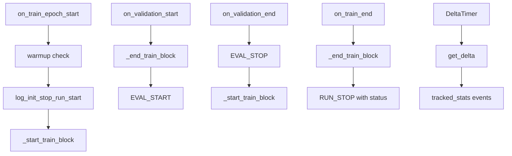

The `LoggingCallback` manages several key responsibilities:

- **Training Block Management**: Tracks training blocks between validation phases using `_start_train_block()` and `_end_train_block()` methods [mlperf_common/callbacks/logging.py:182-201]()
- **Timing Measurements**: Uses `DeltaTimer` to measure elapsed time for warmup, initialization, validation, and training steps [mlperf_common/callbacks/logging.py:44-54]()
- **MLPerf Event Logging**: Emits required MLPerf events through the `mllogger` instance [mlperf_common/callbacks/logging.py:83-113]()

### Key Methods

| Method | Purpose | MLPerf Events |
|--------|---------|---------------|
| `on_train_epoch_start` | Initialize warmup and first training block | `INIT_STOP`, `RUN_START`, `BLOCK_START` |
| `on_validation_start` | End training block, start evaluation | `BLOCK_STOP`, `EVAL_START` |
| `on_validation_end` | End evaluation, restart training | `EVAL_STOP`, `BLOCK_START` |
| `on_train_end` | Final training block end and run completion | `BLOCK_STOP`, `RUN_STOP` |

Sources: [mlperf_common/callbacks/logging.py:71-113](), [mlperf_common/callbacks/logging.py:115-160]()

## MLPerfLogger Class

The `MLPerfLogger` extends PyTorch Lightning's `Logger` interface to provide MLPerf-specific validation metric tracking and early stopping functionality.

### Validation Metric Tracking

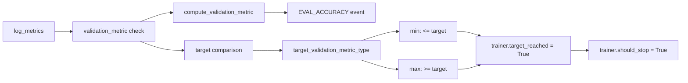

The logger implements automatic target detection and early stopping:

- **Metric Computation**: Processes validation metrics and logs `EVAL_ACCURACY` events [mlperf_common/callbacks/logging.py:265-281]()
- **Target Detection**: Compares computed metrics against target values with configurable comparison type [mlperf_common/callbacks/logging.py:283-292]()
- **Early Stopping**: Sets trainer flags to stop training when target is reached [mlperf_common/callbacks/logging.py:290-292]()

### Constructor Parameters

| Parameter | Type | Purpose |
|-----------|------|---------|
| `callback_cls` | `type[LoggingCallback]` | Callback class to instantiate |
| `validation_metric` | `str` | Name of metric to track |
| `target_validation_metric` | `float` | Target value for early stopping |
| `target_validation_metric_type` | `"min"` or `"max"` | Whether target is minimum or maximum |

Sources: [mlperf_common/callbacks/logging.py:221-260](), [mlperf_common/callbacks/logging.py:299-325]()

## StatsLogCallback Class

The `StatsLogCallback` provides comprehensive statistics collection for distributed training debugging and analysis, particularly for large-scale models using tensor parallelism and pipeline parallelism.

### Statistics Collection Architecture

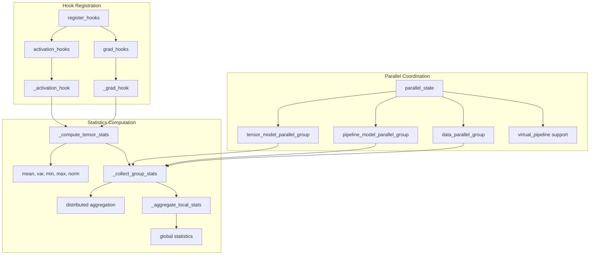

### Key Features

- **Multi-Level Parallelism Support**: Handles tensor parallelism, pipeline parallelism, data parallelism, and virtual pipeline parallelism [mlperf_common/callbacks/logging.py:588-614]()
- **Comprehensive Statistics**: Collects mean, variance, min, max, and norm for tensors [mlperf_common/callbacks/logging.py:356-382]()
- **Distributed Aggregation**: Coordinates statistics across parallel groups using `torch.distributed` [mlperf_common/callbacks/logging.py:388-444]()
- **Configurable Logging**: Supports environment variables for logging frequency and iteration limits [mlperf_common/callbacks/logging.py:348-354]()

### Statistics Categories

| Category | Hook Type | Scope |
|----------|-----------|-------|
| `activation_stats` | Forward hook | Per-module activations during forward pass |
| `grad_stats` | Backward hook | Per-module gradients during backward pass |
| `weights_stats` | Parameter iteration | Model weights at epoch start and batch end |
| `train_loss_batch` | Output extraction | Training loss per batch |
| `val_loss_batch` | Output extraction | Validation loss per batch |

### Environment Configuration

| Variable | Default | Purpose |
|----------|---------|---------|
| `REDUCE_TP` | `"True"` | Whether to reduce across tensor parallel groups |
| `LOG_EVERY_N_BATCHES` | `"1"` | Frequency of statistics collection |
| `RUN_N_ITERS` | `"0"` | Maximum iterations before disabling (0 = unlimited) |
| `SEED` | `"1"` | Seed value for output file naming |

Sources: [mlperf_common/callbacks/logging.py:329-354](), [mlperf_common/callbacks/logging.py:571-617](), [mlperf_common/callbacks/logging.py:732-740]()

## Integration Patterns

### Basic Usage Pattern

The callbacks are designed to integrate seamlessly with PyTorch Lightning trainers:

```python
# Typical integration pattern referenced in the code
trainer = pl.Trainer(
    logger=MLPerfLogger(
        callback_cls=LoggingCallback,
        model=model,
        validation_metric="accuracy",
        target_validation_metric=0.95,
        target_validation_metric_type="max"
    ),
    callbacks=[
        trainer.logger.callback,  # LoggingCallback instance
        StatsLogCallback(save_path="/results/stats.json")
    ]
)
```

### Distributed Training Coordination

The callbacks coordinate across distributed training setups through the `parallel_state` module from Megatron-LM and PyTorch's distributed communication:

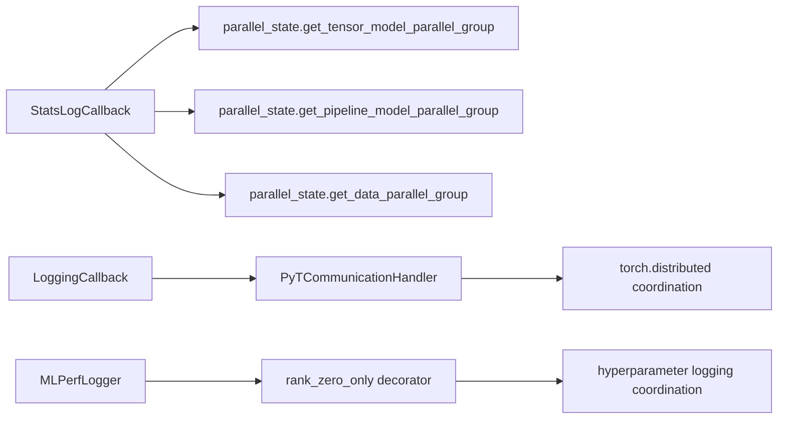

Sources: [mlperf_common/callbacks/logging.py:38-41](), [mlperf_common/callbacks/logging.py:332-333](), [mlperf_common/callbacks/logging.py:294-297]()

---

# Page: MLPerf Logging Infrastructure

# MLPerf Logging Infrastructure

<details>
<summary>Relevant source files</summary>

The following files were used as context for generating this wiki page:

- [mlperf_common/logging.py](mlperf_common/logging.py)

</details>


## Purpose and Scope

This document covers the core MLPerf logging infrastructure provided by the `MLLoggerWrapper` class, which serves as the central component for MLPerf-compliant logging across distributed training workloads. The system provides a standardized interface for timing events, synchronization across distributed processes, and automated compliance with MLPerf logging requirements.

For information about PyTorch Lightning integration and callback-based logging, see [PyTorch Lightning Callbacks](#2.1). For framework-specific communication handlers used by this logging system, see [Framework Integration](#2.3).

## MLLoggerWrapper Overview

The `MLLoggerWrapper` class in [mlperf_common/logging.py:21-135]() serves as the primary interface for all MLPerf logging operations. It wraps the official MLPerf logger (`mlperf_logging.mllog`) and adds distributed coordination, synchronization, and convenience methods for common logging patterns.

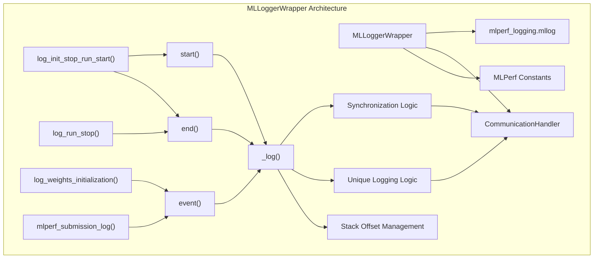

**Core MLLoggerWrapper Class Structure**

Sources: [mlperf_common/logging.py:21-40]()

## Core Logging Primitives

The wrapper provides three fundamental logging primitives that correspond directly to MLPerf logging requirements:

| Method | Purpose | MLPerf Usage |
|--------|---------|--------------|
| `start()` | Log time interval start | Beginning of training phases, evaluation phases |
| `end()` | Log time interval end | End of training phases, evaluation phases |
| `event()` | Log point-in-time event | Configuration settings, metrics, status updates |

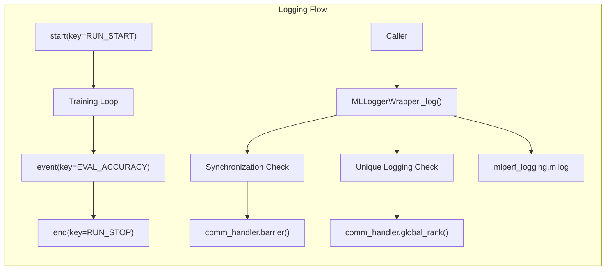

**MLPerf Logging Primitive Flow**

All primitives delegate to the internal `_log()` method at [mlperf_common/logging.py:56-79](), which handles distributed coordination and filtering.

Sources: [mlperf_common/logging.py:44-54]()

## Distributed Coordination Features

The logging infrastructure includes sophisticated distributed coordination to ensure consistent logging across multi-node, multi-GPU training runs:

### Synchronization Control

The `sync` parameter in `_log()` triggers a barrier operation before logging, ensuring all processes reach the logging point simultaneously:

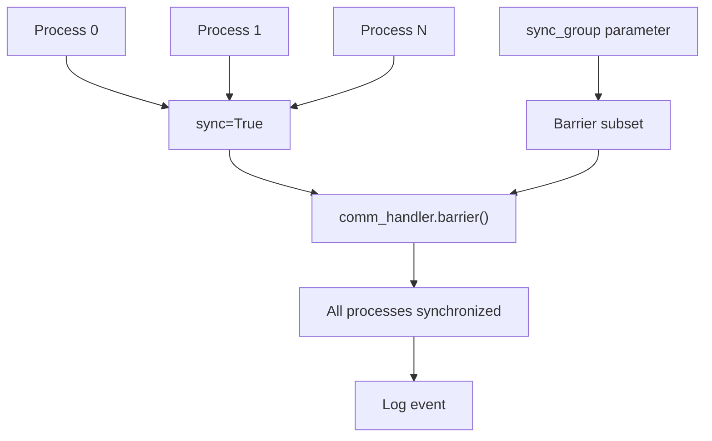

**Distributed Synchronization Flow**

### Unique Logging

The `unique` parameter controls which processes actually write log entries, preventing duplicate logs in distributed settings:

- `unique=True`: Only the process with rank `unique_log_rank` logs
- `unique=False`: All processes log (used for process-specific metrics)
- Default `unique_log_rank=0`: Primary process handles unique logs

Sources: [mlperf_common/logging.py:56-79]()

## Helper Methods for Common Patterns

The wrapper provides several helper methods that implement common MLPerf logging patterns with correct synchronization:

### Training Lifecycle Events

The `log_init_stop_run_start()` method at [mlperf_common/logging.py:81-85]() handles the critical transition from initialization to training:

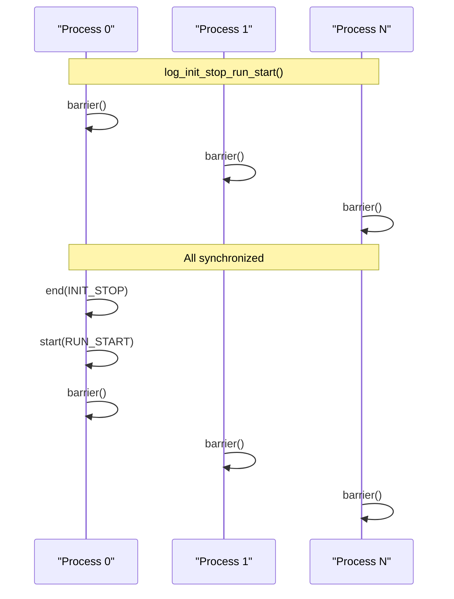

**Training Lifecycle Synchronization**

### Submission Metadata Logging

The `mlperf_submission_log()` method at [mlperf_common/logging.py:97-134]() automatically logs required submission metadata:

| Constant | Source | Default |
|----------|--------|---------|
| `SUBMISSION_BENCHMARK` | Parameter | Required |
| `SUBMISSION_ORG` | `MLPERF_SUBMISSION_ORG` env var | Placeholder |
| `SUBMISSION_PLATFORM` | `MLPERF_SUBMISSION_PLATFORM` env var | Placeholder |
| `SUBMISSION_DIVISION` | Hard-coded | `CLOSED` |
| `SUBMISSION_STATUS` | Hard-coded | `ONPREM` |

Sources: [mlperf_common/logging.py:81-95](), [mlperf_common/logging.py:97-134]()

## Integration with Communication Handlers

The logging infrastructure depends on framework-specific communication handlers that provide distributed coordination primitives:

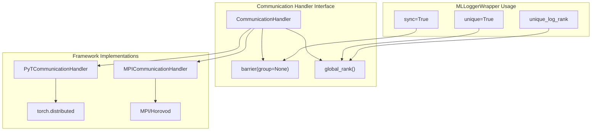

**Communication Handler Integration**

The communication handler is passed to the `MLLoggerWrapper` constructor at [mlperf_common/logging.py:22-26]() and enables the logging system to work across different distributed training frameworks.

## Stack Offset Management

The logging infrastructure includes automatic stack offset management to ensure accurate source location tracking in logs. The `default_stack_offset` parameter accounts for the additional call stack depth introduced by the wrapper methods.

Internal calls (like helper methods) automatically increment the stack offset by 1 via the `internal_call=True` parameter at [mlperf_common/logging.py:72-73]().

Sources: [mlperf_common/logging.py:21-40](), [mlperf_common/logging.py:56-79]()

---

# Page: Framework Integration

# Framework Integration

<details>
<summary>Relevant source files</summary>

The following files were used as context for generating this wiki page:

- [mlperf_common/frameworks/base.py](mlperf_common/frameworks/base.py)
- [mlperf_common/frameworks/mxnet.py](mlperf_common/frameworks/mxnet.py)
- [mlperf_common/frameworks/pyt.py](mlperf_common/frameworks/pyt.py)

</details>


## Purpose and Scope

The Framework Integration system provides a unified abstraction layer for integrating different machine learning frameworks with MLPerf common utilities. This system enables framework-agnostic implementations of distributed communication, profiling, and synchronization operations essential for MLPerf benchmarks.

The integration layer consists of abstract base interfaces and framework-specific implementations that handle communication coordination and performance profiling across PyTorch, MXNet, HugeCTR, and other supported frameworks. For specific framework implementations, see [PyTorch Integration](#2.3.2) and [MXNet and Other Frameworks](#2.3.3). For the logging systems that utilize these handlers, see [MLPerf Logging Infrastructure](#2.2).

## Architecture Overview

The framework integration system follows a plugin architecture where abstract base classes define common interfaces, and framework-specific handlers implement the required functionality for each supported ML framework.

### Framework Handler Architecture

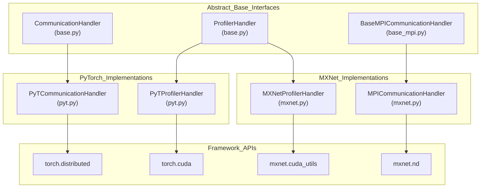

Sources: [mlperf_common/frameworks/base.py:15-36](), [mlperf_common/frameworks/pyt.py:19-46](), [mlperf_common/frameworks/mxnet.py:21-36]()

## Base Interface Definitions

The framework integration system defines two primary abstract base classes that establish the contract for framework-specific implementations.

### CommunicationHandler Interface

The `CommunicationHandler` class defines the interface for distributed training coordination and synchronization operations:

| Method | Purpose | Parameters |
|--------|---------|------------|
| `global_rank()` | Returns the global rank of the current process | None |
| `barrier(sync_group=None)` | Synchronizes processes across the distributed group | Optional synchronization group |
| `device_sync()` | Synchronizes device operations (GPU kernels) | None |

### ProfilerHandler Interface

The `ProfilerHandler` class defines the interface for performance profiling and NVTX integration:

| Method | Purpose | Parameters |
|--------|---------|------------|
| `profiler_start()` | Initiates CUDA profiler collection | None |
| `profiler_stop()` | Stops CUDA profiler collection | None |
| `push_nvtx(tag)` | Pushes NVTX range marker | Tag string for identification |
| `pop_nvtx()` | Pops NVTX range marker | None |

All methods in both base classes raise `NotImplementedError` and must be overridden by framework-specific implementations.

Sources: [mlperf_common/frameworks/base.py:15-36]()

## Framework Implementation Pattern

### Communication Handler Implementation Flow

```mermaid
graph LR
    subgraph "Initialization_Check"
        is_distributed["is_distributed()"]
        framework_available["Framework Available?"]
        framework_initialized["Framework Initialized?"]
    end
    
    subgraph "Operation_Execution"
        global_rank_op["global_rank()"]
        barrier_op["barrier()"]
        device_sync_op["device_sync()"]
    end
    
    subgraph "Framework_Specific_Calls"
        torch_get_rank["torch.distributed.get_rank()"]
        torch_barrier["torch.distributed.barrier()"]
        torch_cuda_sync["torch.cuda.synchronize()"]
        mxnet_waitall["mx.nd.waitall()"]
    end
    
    is_distributed --> framework_available
    framework_available --> framework_initialized
    framework_initialized --> global_rank_op
    framework_initialized --> barrier_op
    framework_initialized --> device_sync_op
    
    global_rank_op --> torch_get_rank
    barrier_op --> torch_barrier
    device_sync_op --> torch_cuda_sync
    device_sync_op --> mxnet_waitall
```

Sources: [mlperf_common/frameworks/pyt.py:19-33](), [mlperf_common/frameworks/mxnet.py:21-23]()

## PyTorch Integration Implementation

The PyTorch integration provides concrete implementations for both communication and profiling handlers using PyTorch's native distributed and CUDA APIs.

### PyTCommunicationHandler

The `PyTCommunicationHandler` class implements distributed communication using `torch.distributed`:

- **Distributed Detection**: Uses `torch.distributed.is_available()` and `torch.distributed.is_initialized()` to determine if distributed training is active [mlperf_common/frameworks/pyt.py:29-30]()
- **Rank Management**: Returns `torch.distributed.get_rank()` for global rank identification [mlperf_common/frameworks/pyt.py:20-23]()
- **Synchronization**: Implements barrier synchronization with optional sync groups [mlperf_common/frameworks/pyt.py:25-27]()
- **Device Coordination**: Uses `torch.cuda.synchronize()` for GPU kernel completion [mlperf_common/frameworks/pyt.py:32-33]()

### PyTProfilerHandler

The `PyTProfilerHandler` class implements profiling using PyTorch's CUDA and NVTX integration:

- **CUDA Profiler Control**: Uses `torch.cuda.cudart().cudaProfilerStart()` and `cudaProfilerStop()` [mlperf_common/frameworks/pyt.py:36-40]()
- **NVTX Integration**: Implements `torch.cuda.nvtx.range_push()` and `range_pop()` for performance annotation [mlperf_common/frameworks/pyt.py:42-46]()

Sources: [mlperf_common/frameworks/pyt.py:19-46]()

## MXNet Integration Implementation

The MXNet integration follows a similar pattern but uses MXNet-specific APIs and extends the MPI-based communication handler for distributed coordination.

### MPICommunicationHandler

The `MPICommunicationHandler` extends `BaseMPICommunicationHandler` and implements MXNet-specific device synchronization:

- **MPI Foundation**: Inherits distributed communication capabilities from the base MPI handler [mlperf_common/frameworks/mxnet.py:21]()
- **Device Synchronization**: Uses `mx.nd.waitall()` to ensure all MXNet NDArray operations complete [mlperf_common/frameworks/mxnet.py:22-23]()

### MXNetProfilerHandler

The `MXNetProfilerHandler` implements profiling using MXNet's CUDA utilities:

- **CUDA Profiler**: Uses `cu.cuda_profiler_start()` and `cuda_profiler_stop()` from `mxnet.cuda_utils` [mlperf_common/frameworks/mxnet.py:26-30]()
- **NVTX Support**: Implements `cu.nvtx_range_push()` and `nvtx_range_pop()` for performance tracking [mlperf_common/frameworks/mxnet.py:32-36]()

Sources: [mlperf_common/frameworks/mxnet.py:21-36](), [mlperf_common/frameworks/base_mpi.py:19]()

## Integration Usage Patterns

The framework handlers are designed to be instantiated and used by higher-level MLPerf systems, particularly the logging infrastructure. The abstraction allows the same logging and coordination code to work across different frameworks by swapping the appropriate handler implementation.

### Handler Selection Pattern

Framework-specific handlers are typically selected at runtime based on the detected framework environment, enabling the MLPerf common utilities to operate transparently across different machine learning frameworks while maintaining consistent behavior for distributed coordination and performance profiling.

Sources: [mlperf_common/frameworks/base.py:15-36](), [mlperf_common/frameworks/pyt.py:19-46](), [mlperf_common/frameworks/mxnet.py:21-36]()

---

# Page: Base Interfaces

# Base Interfaces

<details>
<summary>Relevant source files</summary>

The following files were used as context for generating this wiki page:

- [mlperf_common/frameworks/base.py](mlperf_common/frameworks/base.py)
- [mlperf_common/frameworks/base_mpi.py](mlperf_common/frameworks/base_mpi.py)

</details>


## Purpose and Scope

This document covers the abstract base classes that define standardized interfaces for communication and profiling operations across different machine learning frameworks in the MLPerf Common repository. These interfaces enable framework-agnostic integration with the MLPerf logging and distributed training systems.

The base interfaces provide the foundation for framework-specific implementations. For PyTorch-specific implementations, see [PyTorch Integration](#2.3.2). For MXNet and other framework implementations, see [MXNet and Other Frameworks](#2.3.3).

## Abstract Interface Architecture

The base interfaces define two primary abstraction layers: communication handling for distributed operations and profiler handling for performance monitoring. These abstractions allow the MLPerf logging system to work uniformly across different frameworks.

```mermaid
classDiagram
    class CommunicationHandler {
        <<abstract>>
        +global_rank() int
        +barrier(sync_group=None)
        +device_sync()
    }
    
    class ProfilerHandler {
        <<abstract>>
        +profiler_start()
        +profiler_stop()
        +push_nvtx(tag)
        +pop_nvtx()
    }
    
    class BaseMPICommunicationHandler {
        -comm
        +__init__(comm=None, **kwargs)
        +_get_comm()
        +barrier(sync_group=None)
        +global_rank() int
    }
    
    CommunicationHandler <|-- BaseMPICommunicationHandler
    
    note for CommunicationHandler "Defines distributed communication contract"
    note for ProfilerHandler "Defines profiling and NVTX contract" 
    note for BaseMPICommunicationHandler "MPI-based implementation using mpi4py"
```

**Sources:** [mlperf_common/frameworks/base.py:15-36](), [mlperf_common/frameworks/base_mpi.py:19-41]()

## CommunicationHandler Interface

The `CommunicationHandler` class defines the abstract interface for distributed communication operations required by the MLPerf logging system. Framework-specific implementations must provide concrete implementations of these methods.

| Method | Purpose | Parameters |
|--------|---------|------------|
| `global_rank()` | Returns the rank of the current process in the global communicator | None |
| `barrier(sync_group=None)` | Synchronizes all processes in the specified group | `sync_group`: Optional communicator group |
| `device_sync()` | Synchronizes the current device (GPU/accelerator) | None |

The interface supports both global and group-specific synchronization operations, which are essential for coordinating distributed training and ensuring accurate timing measurements for MLPerf compliance.

**Sources:** [mlperf_common/frameworks/base.py:15-23]()

## ProfilerHandler Interface

The `ProfilerHandler` class defines the abstract interface for profiling operations and NVIDIA Tools Extension (NVTX) integration. This enables performance analysis and debugging across different frameworks.

| Method | Purpose | Parameters |
|--------|---------|------------|
| `profiler_start()` | Initiates profiling session | None |
| `profiler_stop()` | Terminates profiling session | None |
| `push_nvtx(tag)` | Pushes an NVTX range with specified tag | `tag`: String identifier for the range |
| `pop_nvtx()` | Pops the current NVTX range | None |

The NVTX methods enable detailed performance tracing that can be visualized in NVIDIA profiling tools, providing insights into training performance bottlenecks.

**Sources:** [mlperf_common/frameworks/base.py:25-36]()

## MPI Base Implementation

The `BaseMPICommunicationHandler` provides a concrete implementation of `CommunicationHandler` using MPI (Message Passing Interface) through the `mpi4py` library. This implementation can be used directly or extended by frameworks that use MPI for distributed communication.

```mermaid
sequenceDiagram
    participant Client
    participant BaseMPICommunicationHandler
    participant MPI_COMM_WORLD
    
    Client->>BaseMPICommunicationHandler: __init__(comm=None)
    Client->>BaseMPICommunicationHandler: barrier()
    BaseMPICommunicationHandler->>BaseMPICommunicationHandler: _get_comm()
    alt comm is None
        BaseMPICommunicationHandler->>MPI_COMM_WORLD: Import MPI.COMM_WORLD
    end
    BaseMPICommunicationHandler->>MPI_COMM_WORLD: Allreduce(val, result)
    Note over BaseMPICommunicationHandler,MPI_COMM_WORLD: Uses Allreduce instead of Barrier for reliability
    
    Client->>BaseMPICommunicationHandler: global_rank()
    BaseMPICommunicationHandler->>MPI_COMM_WORLD: Get_rank()
    MPI_COMM_WORLD-->>Client: rank
```

### Key Implementation Details

The MPI implementation includes several important design decisions:

- **Lazy MPI Initialization**: The MPI communicator is only imported and initialized when first needed via `_get_comm()` [mlperf_common/frameworks/base_mpi.py:24-29]()
- **Barrier Reliability**: Uses `MPI_Allreduce` instead of `MPI_Barrier` for improved reliability at scale [mlperf_common/frameworks/base_mpi.py:33-37]()
- **Numpy Integration**: Uses numpy arrays for MPI operations to ensure proper data type handling

**Sources:** [mlperf_common/frameworks/base_mpi.py:19-41]()

## Integration with MLPerf System

These base interfaces serve as the foundation for the MLPerf logging infrastructure, enabling framework-agnostic distributed coordination and profiling. The interfaces are consumed by the MLLoggerWrapper and related systems documented in [MLPerf Logging Infrastructure](#2.2).

```mermaid
graph TB
    subgraph "MLPerf Logging System"
        MLLoggerWrapper["MLLoggerWrapper"]
        CallbackSystem["PyTorch Lightning Callbacks"]
    end
    
    subgraph "Base Interfaces"
        CommunicationHandler["CommunicationHandler"]
        ProfilerHandler["ProfilerHandler"]
        BaseMPICommunicationHandler["BaseMPICommunicationHandler"]
    end
    
    subgraph "Framework Implementations"
        PyTorchHandlers["PyTorch Handlers"]
        MXNetHandlers["MXNet Handlers"]
        HugeCTRHandlers["HugeCTR Handlers"]
    end
    
    MLLoggerWrapper --> CommunicationHandler
    CallbackSystem --> ProfilerHandler
    
    CommunicationHandler <--> PyTorchHandlers
    CommunicationHandler <--> MXNetHandlers
    CommunicationHandler <--> HugeCTRHandlers
    
    ProfilerHandler <--> PyTorchHandlers
    ProfilerHandler <--> MXNetHandlers
    
    BaseMPICommunicationHandler --> MXNetHandlers
    BaseMPICommunicationHandler --> HugeCTRHandlers
```

The abstraction allows the MLPerf system to perform distributed coordination and profiling operations without being tied to any specific framework's implementation details.

**Sources:** [mlperf_common/frameworks/base.py:15-36](), [mlperf_common/frameworks/base_mpi.py:17-41]()

---

# Page: PyTorch Integration

# PyTorch Integration

<details>
<summary>Relevant source files</summary>

The following files were used as context for generating this wiki page:

- [mlperf_common/frameworks/pyt.py](mlperf_common/frameworks/pyt.py)

</details>


## Purpose and Scope

This document covers the PyTorch-specific implementations of the framework integration layer in MLPerf Common. The PyTorch integration provides concrete implementations of communication and profiling handlers that interface with PyTorch's distributed training and CUDA profiling APIs.

For information about the abstract base interfaces these implementations inherit from, see [Base Interfaces](#2.3.1). For details about other framework integrations, see [MXNet and Other Frameworks](#2.3.3).

## Overview

The PyTorch integration consists of two primary handler classes that implement framework-specific functionality for distributed communication and performance profiling. These handlers enable MLPerf benchmarks to leverage PyTorch's built-in distributed training capabilities and NVIDIA profiling tools.

### PyTorch Handler Classes

```mermaid
graph TD
    subgraph "Base Interfaces"
        A["CommunicationHandler"]
        B["ProfilerHandler"]
    end
    
    subgraph "PyTorch Implementations"
        C["PyTCommunicationHandler"]
        D["PyTProfilerHandler"]
    end
    
    subgraph "PyTorch APIs"
        E["torch.distributed"]
        F["torch.cuda"]
        G["torch.cuda.nvtx"]
    end
    
    A --> C
    B --> D
    C --> E
    D --> F
    D --> G
```

**Sources:** [mlperf_common/frameworks/pyt.py:17-47]()

## Communication Handler Implementation

The `PyTCommunicationHandler` class provides PyTorch-specific distributed communication functionality by wrapping PyTorch's distributed training APIs.

### Core Communication Methods

| Method | Purpose | PyTorch API Used |
|--------|---------|------------------|
| `global_rank()` | Get process rank in distributed setup | `torch.distributed.get_rank()` |
| `barrier()` | Synchronize all processes | `torch.distributed.barrier()` |
| `is_distributed()` | Check if distributed training is active | `torch.distributed.is_available/is_initialized()` |
| `device_sync()` | Synchronize CUDA device | `torch.cuda.synchronize()` |

### Distributed Training Integration

```mermaid
graph LR
    subgraph "MLPerf Logging"
        A["MLLoggerWrapper"]
    end
    
    subgraph "PyTCommunicationHandler"
        B["global_rank()"]
        C["barrier()"]
        D["is_distributed()"]
        E["device_sync()"]
    end
    
    subgraph "PyTorch Distributed"
        F["torch.distributed.get_rank()"]
        G["torch.distributed.barrier()"]
        H["torch.distributed.is_available()"]
        I["torch.cuda.synchronize()"]
    end
    
    A --> B
    A --> C
    B --> F
    C --> G
    D --> H
    E --> I
```

The handler implements rank-aware operations and synchronization primitives essential for coordinated logging across distributed training processes. The `global_rank()` method [mlperf_common/frameworks/pyt.py:20-23]() returns the process rank when distributed training is active, falling back to rank 0 for single-process execution.

**Sources:** [mlperf_common/frameworks/pyt.py:19-33]()

## Profiler Handler Implementation

The `PyTProfilerHandler` class provides integration with NVIDIA's CUDA profiling tools and NVTX (NVIDIA Tools Extension) for performance analysis during MLPerf benchmark execution.

### Profiling Methods

```mermaid
graph TD
    subgraph "PyTProfilerHandler Methods"
        A["profiler_start()"]
        B["profiler_stop()"]
        C["push_nvtx()"]
        D["pop_nvtx()"]
    end
    
    subgraph "CUDA Profiling APIs"
        E["torch.cuda.cudart().cudaProfilerStart()"]
        F["torch.cuda.cudart().cudaProfilerStop()"]
        G["torch.cuda.nvtx.range_push()"]
        H["torch.cuda.nvtx.range_pop()"]
    end
    
    A --> E
    B --> F
    C --> G
    D --> H
```

### NVTX Range Management

The NVTX integration allows for hierarchical performance annotation through range markers. The `push_nvtx()` and `pop_nvtx()` methods [mlperf_common/frameworks/pyt.py:42-46]() enable nested timing regions that can be visualized in NVIDIA profiling tools like Nsight Systems.

| Profiling Feature | Implementation | Use Case |
|-------------------|----------------|----------|
| Global profiling control | `profiler_start()/stop()` | Benchmark-wide profiling sessions |
| Hierarchical timing | `push_nvtx()/pop_nvtx()` | Fine-grained performance analysis |
| CUDA integration | `torch.cuda.cudart()` | GPU kernel profiling |

**Sources:** [mlperf_common/frameworks/pyt.py:35-47]()

## Integration Architecture

The PyTorch handlers integrate into the broader MLPerf framework through inheritance from base classes and usage by the logging infrastructure.

### Handler Registration and Usage

```mermaid
graph TD
    subgraph "MLPerf Callbacks"
        A["LoggingCallback"]
        B["StatsLogCallback"] 
    end
    
    subgraph "MLLoggerWrapper"
        C["MLLoggerWrapper"]
    end
    
    subgraph "Handler Selection"
        D["Handler Factory"]
    end
    
    subgraph "PyTorch Handlers"
        E["PyTCommunicationHandler"]
        F["PyTProfilerHandler"]
    end
    
    A --> C
    B --> C
    C --> D
    D --> E
    D --> F
```

The handlers are instantiated and used by the MLPerf logging system to provide framework-specific implementations of distributed communication and profiling operations. This design allows the same MLPerf logging code to work across different ML frameworks by selecting appropriate handler implementations.

**Sources:** [mlperf_common/frameworks/pyt.py:15-17]()

## Key Dependencies

The PyTorch integration relies on several PyTorch modules:

- **torch.distributed**: Provides multi-process distributed training coordination
- **torch.cuda**: Enables CUDA device synchronization and profiler control
- **torch.cuda.nvtx**: Supplies NVTX range annotation capabilities

The implementation assumes PyTorch is available with CUDA support and that distributed training may or may not be initialized depending on the execution context.

**Sources:** [mlperf_common/frameworks/pyt.py:15]()

---

# Page: MXNet and Other Frameworks

# MXNet and Other Frameworks

<details>
<summary>Relevant source files</summary>

The following files were used as context for generating this wiki page:

- [mlperf_common/frameworks/hugectr.py](mlperf_common/frameworks/hugectr.py)
- [mlperf_common/frameworks/mxnet.py](mlperf_common/frameworks/mxnet.py)

</details>


## Purpose and Scope

This document covers the framework-specific implementations for MXNet and HugeCTR within the MLPerf Common framework integration system. These implementations provide concrete handlers for communication and profiling operations that extend the abstract base interfaces documented in [Base Interfaces](#2.3.1). For PyTorch-specific implementations, see [PyTorch Integration](#2.3.2).

The framework handlers enable MLPerf logging and distributed training capabilities across different deep learning frameworks by implementing standardized interfaces for device synchronization, profiling, and communication coordination.

## MXNet Framework Implementation

The MXNet implementation provides two main handler classes that implement the base framework interfaces for MXNet-specific operations.

### MPICommunicationHandler

The `MPICommunicationHandler` class extends `BaseMPICommunicationHandler` to provide MXNet-specific device synchronization capabilities:

```mermaid
graph TD
    A["BaseMPICommunicationHandler"] --> B["MPICommunicationHandler"]
    B --> C["device_sync()"]
    C --> D["mx.nd.waitall()"]
    
    B --> E["MPI Communication<br/>Inherited Methods"]
    E --> F["get_rank()"]
    E --> G["get_size()"] 
    E --> H["barrier()"]
```

The key method implementation:
- `device_sync()` - Synchronizes all MXNet NDArray operations using [mlperf_common/frameworks/mxnet.py:23]()

### MXNetProfilerHandler  

The `MXNetProfilerHandler` class extends `ProfilerHandler` to provide CUDA profiling and NVTX range support for MXNet workloads:

```mermaid
graph TD
    A["ProfilerHandler"] --> B["MXNetProfilerHandler"]
    B --> C["profiler_start()"]
    B --> D["profiler_stop()"]
    B --> E["push_nvtx()"]
    B --> F["pop_nvtx()"]
    
    C --> G["cu.cuda_profiler_start()"]
    D --> H["cu.cuda_profiler_stop()"]
    E --> I["cu.nvtx_range_push()"]
    F --> J["cu.nvtx_range_pop()"]
```

The implementation uses MXNet's `cuda_utils` module for:
- CUDA profiler control via `cu.cuda_profiler_start()` and `cu.cuda_profiler_stop()` [mlperf_common/frameworks/mxnet.py:27-30]()
- NVTX range annotations via `cu.nvtx_range_push()` and `cu.nvtx_range_pop()` [mlperf_common/frameworks/mxnet.py:33-36]()

Sources: [mlperf_common/frameworks/mxnet.py:21-37]()

## HugeCTR Framework Implementation

The HugeCTR implementation provides a minimal communication handler for the HugeCTR recommendation system framework.

### HCTRCommunicationHandler

The `HCTRCommunicationHandler` extends `BaseMPICommunicationHandler` but does not override any methods, relying entirely on the base MPI implementation:

```mermaid
graph TD
    A["BaseMPICommunicationHandler"] --> B["HCTRCommunicationHandler"] 
    B --> C["No Custom Methods"]
    C --> D["Uses Base MPI Implementation"]
    
    A --> E["get_rank()"]
    A --> F["get_size()"]
    A --> G["barrier()"]
    A --> H["device_sync()"]
```

This minimal implementation indicates that HugeCTR uses standard MPI communication patterns without requiring framework-specific device synchronization logic.

Sources: [mlperf_common/frameworks/hugectr.py:17-18]()

## Framework Handler Architecture

The following diagram illustrates how the different framework implementations fit into the overall handler architecture:

```mermaid
graph TB
    subgraph "Abstract Base Classes"
        A["ProfilerHandler<br/>(base.py)"]
        B["BaseMPICommunicationHandler<br/>(base_mpi.py)"]
    end
    
    subgraph "PyTorch Implementations"
        C["PyTCommunicationHandler<br/>(pyt.py)"]
        D["PyTProfilerHandler<br/>(pyt.py)"]
    end
    
    subgraph "MXNet Implementations"
        E["MPICommunicationHandler<br/>(mxnet.py)"]
        F["MXNetProfilerHandler<br/>(mxnet.py)"]
    end
    
    subgraph "HugeCTR Implementations"
        G["HCTRCommunicationHandler<br/>(hugectr.py)"]
    end
    
    A --> D
    A --> F
    B --> C
    B --> E
    B --> G
    
    F --> H["MXNet CUDA Utils<br/>cu.cuda_profiler_*<br/>cu.nvtx_range_*"]
    E --> I["MXNet NDArray<br/>mx.nd.waitall()"]
    G --> J["Standard MPI<br/>No Custom Logic"]
```

## Framework Capability Comparison

| Framework | Communication Handler | Profiler Handler | Device Sync Method | Notes |
|-----------|----------------------|------------------|-------------------|-------|
| PyTorch | `PyTCommunicationHandler` | `PyTProfilerHandler` | `torch.cuda.synchronize()` | Full featured |
| MXNet | `MPICommunicationHandler` | `MXNetProfilerHandler` | `mx.nd.waitall()` | CUDA utils integration |
| HugeCTR | `HCTRCommunicationHandler` | None | Base MPI default | Minimal implementation |

The table shows that MXNet provides comprehensive handler implementations similar to PyTorch, while HugeCTR uses a minimal approach that relies on base MPI functionality.

Sources: [mlperf_common/frameworks/mxnet.py:1-37](), [mlperf_common/frameworks/hugectr.py:1-19]()

---

# Page: Client Utilities

# Client Utilities

<details>
<summary>Relevant source files</summary>

The following files were used as context for generating this wiki page:

- [client/fastcp](client/fastcp)
- [client/mlperf-sysjson.sh](client/mlperf-sysjson.sh)
- [client/slurm2pytorch](client/slurm2pytorch)
- [setup.py](setup.py)

</details>


This page documents the command-line utilities and scripts provided by the MLPerf Common package for operational tasks in MLPerf benchmark environments. These utilities handle environment setup, high-performance I/O operations, system management, and multi-GPU execution coordination.

For information about the core MLPerf logging and compliance systems, see [Core MLPerf Systems](#2). For details about framework integration layers, see [Framework Integration](#2.3).

## Overview

The client utilities form a comprehensive toolkit for managing MLPerf benchmark execution across diverse hardware configurations and cluster environments. These tools are distributed as executable scripts through the package's [setup.py:33]() and are designed to work seamlessly with SLURM, containerized environments, and high-performance computing clusters.

### Client Utilities Architecture

```mermaid
graph TB
    subgraph "MLPerf Benchmark Execution"
        A["Benchmark Launch"]
        B["Training Execution"]
        C["Results Collection"]
    end
    
    subgraph "Environment Setup"
        D["slurm2pytorch"]
        E["bindpcie"]
        F["mgpurun"]
    end
    
    subgraph "High-Performance I/O"
        G["fastcp"]
        H["direct_io.py"]
        I["fastmd5"]
        J["dropcache"]
    end
    
    subgraph "System Management"
        K["mlperf-sysjson.sh"]
        L["mountcheck.py"]
        M["truncate_log.sh"]
    end
    
    A --> D
    A --> E
    A --> F
    A --> K
    
    B --> G
    B --> H
    B --> I
    
    C --> L
    C --> M
    C --> J
    
    D --> N["PyTorch Distributed Variables"]
    E --> O["CPU/GPU/IB Affinity"]
    F --> P["Multi-GPU Coordination"]
    G --> Q["Direct I/O File Operations"]
    K --> R["System Description JSON"]
```

Sources: [setup.py:33](), [client/slurm2pytorch](), [client/fastcp](), [client/mlperf-sysjson.sh]()

## Environment Configuration

Environment configuration utilities prepare distributed training environments and manage resource allocation across nodes and accelerators.

### slurm2pytorch

The `slurm2pytorch` script translates SLURM job environment variables into PyTorch distributed training variables required for multi-node execution.

#### Key Environment Variables Set

| Variable | Purpose | Default Source |
|----------|---------|----------------|
| `MASTER_ADDR` | Primary node address | `MLPERF_SLURM_FIRSTNODE` or `127.0.0.1` |
| `MASTER_PORT` | Communication port | `29500` |
| `WORLD_SIZE` | Total processes | `SLURM_NTASKS` or `OMPI_COMM_WORLD_SIZE` |
| `RANK` | Process rank | `SLURM_PROCID` or `OMPI_COMM_WORLD_RANK` |
| `LOCAL_RANK` | Local GPU ID | `SLURM_LOCALID` or `OMPI_COMM_WORLD_LOCAL_RANK` |

The script automatically configures `OMP_NUM_THREADS=1` for multi-GPU scenarios to prevent threading conflicts [client/slurm2pytorch:73-75]().

```mermaid
graph LR
    subgraph "SLURM Environment"
        A["SLURM_NTASKS"]
        B["SLURM_PROCID"]
        C["SLURM_LOCALID"]
        D["SLURM_NTASKS_PER_NODE"]
    end
    
    subgraph "slurm2pytorch Transformation"
        E["Environment Variable Mapping"]
        F["Port Assignment Logic"]
        G["OMP Thread Configuration"]
    end
    
    subgraph "PyTorch Distributed"
        H["WORLD_SIZE"]
        I["RANK"]
        J["LOCAL_RANK"]
        K["MASTER_ADDR/PORT"]
    end
    
    A --> E
    B --> E
    C --> E
    D --> E
    
    E --> H
    E --> I
    E --> J
    F --> K
    G --> L["OMP_NUM_THREADS=1"]
```

Sources: [client/slurm2pytorch:64-69](), [client/slurm2pytorch:73-75]()

### Resource Affinity Management

The `bindpcie` utility manages CPU, GPU, and InfiniBand affinity to optimize performance in multi-accelerator systems. Additional GPU affinity management is handled through Python modules in the `mlperf_common.affinity` package.

Sources: [setup.py:33]()

## High-Performance I/O Utilities

High-performance I/O utilities provide optimized file operations critical for dataset management and checkpoint handling in benchmark environments.

### fastcp Multi-threaded File Copy

The `fastcp` utility implements high-performance file copying using multiple threads and direct I/O operations to bypass system caches and maximize throughput.

#### Implementation Architecture

```mermaid
graph TD
    subgraph "fastcp Main Process"
        A["parse_and_validate_args()"]
        B["plan_copy_operations()"]
        C["File Size Detection"]
        D["Buffer Allocation"]
    end
    
    subgraph "Multi-threaded Execution"
        E["Work Queue Creation"]
        F["Thread Pool Launch"]
        G["copy_worker() Functions"]
    end
    
    subgraph "Direct I/O Operations"
        H["direct_io.pread()"]
        I["direct_io.pwrite()"]
        J["Aligned Buffer Management"]
    end
    
    A --> B
    B --> C
    C --> D
    D --> E
    E --> F
    F --> G
    G --> H
    G --> I
    H --> J
    I --> J
```

Sources: [client/fastcp:46-107](), [client/fastcp:28-44]()

#### Key Features

- **Direct I/O**: Uses `O_DIRECT` flags to bypass system caches [client/fastcp:54,59]()
- **Thread Pool**: Configurable number of worker threads (default: 16) [client/fastcp:126-127]()
- **Aligned Buffers**: 2MB-aligned buffers for optimal performance [client/fastcp:74-77]()
- **Work Queue**: Lock-free work distribution using `queue.Queue` [client/fastcp:81-83]()

The copy operation divides files into chunks distributed across worker threads, each using aligned buffers for direct I/O operations [client/fastcp:28-44]().

### Direct I/O Module

The `direct_io.py` module provides low-level direct I/O operations and aligned memory management used by `fastcp` and other performance-critical utilities.

Sources: [setup.py:33](), [client/fastcp:25-26]()

## System Management Tools

System management utilities handle MLPerf compliance requirements and operational management tasks.

### mlperf-sysjson.sh System Description Generator

The `mlperf-sysjson.sh` script automatically generates system description JSON files required for MLPerf submissions by collecting hardware and software configuration information.

#### Required Environment Variables

| Variable | Purpose | Example |
|----------|---------|---------|
| `MLPERF_SUBMITTER` | Organization name | "NVIDIA" |
| `MLPERF_SYSTEM_NAME` | System identifier | "DGX-H100x8" |
| `MLPERF_STATUS` | Availability status | "Available on-premise" |

#### Automatic Detection Capabilities

```mermaid
graph LR
    subgraph "Hardware Detection"
        A["nvidia-smi GPU Query"]
        B["lscpu CPU Information"]
        C["Memory Configuration"]
        D["Network Topology"]
    end
    
    subgraph "Software Stack Detection"
        E["CUDA Versions"]
        F["Library Versions"]
        G["Container Information"]
        H["Kernel Versions"]
    end
    
    subgraph "JSON Generation"
        I["System Description Schema"]
        J["Compliance Validation"]
        K["Formatted Output"]
    end
    
    A --> I
    B --> I
    C --> I
    D --> I
    E --> I
    F --> I
    G --> I
    H --> I
    
    I --> J
    J --> K
```

Sources: [client/mlperf-sysjson.sh:193-203](), [client/mlperf-sysjson.sh:207-259]()

The script performs automatic hardware detection including GPU models, CPU specifications, and memory configurations [client/mlperf-sysjson.sh:193-203](), then generates compliant JSON output [client/mlperf-sysjson.sh:207-259]().

#### Status Validation

The script validates MLPerf status categories and provides backward compatibility for legacy status strings [client/mlperf-sysjson.sh:109-134]():

- "Available on-premise"
- "Available cloud" 
- "Preview"
- "Research, Development, or Internal (RDI)"

### Additional Management Utilities

- **mountcheck.py**: Filesystem verification and validation
- **truncate_log.sh**: Log file management and rotation
- **dropcache**: System cache eviction for consistent performance measurements

Sources: [setup.py:33]()

## Multi-GPU Execution

### mgpurun Multi-GPU Launcher

The `mgpurun` utility provides standardized multi-GPU job launching with proper environment setup and resource coordination across multiple accelerators.

Sources: [setup.py:33]()

## Integration with MLPerf Workflows

Client utilities integrate seamlessly with the broader MLPerf ecosystem:

```mermaid
graph TB
    subgraph "Pre-Execution Phase"
        A["mlperf-sysjson.sh"]
        B["slurm2pytorch"]
        C["bindpcie"]
    end
    
    subgraph "Execution Phase"
        D["mgpurun"]
        E["fastcp Data Loading"]
        F["MLPerf Callbacks System"]
    end
    
    subgraph "Post-Execution Phase"
        G["truncate_log.sh"]
        H["mountcheck.py"]
        I["Result Validation"]
    end
    
    A --> J["System Description JSON"]
    B --> K["PyTorch Distributed Env"]
    C --> L["Optimal Resource Affinity"]
    
    J --> F
    K --> F
    L --> F
    
    D --> F
    E --> F
    
    F --> I
    G --> I
    H --> I
```

Sources: [client/mlperf-sysjson.sh](), [client/slurm2pytorch](), [setup.py:33]()

The utilities work together to provide a complete operational environment for MLPerf benchmark execution, from initial system characterization through final result collection and validation.

---

# Page: Environment Configuration

# Environment Configuration

<details>
<summary>Relevant source files</summary>

The following files were used as context for generating this wiki page:

- [client/bindpcie](client/bindpcie)
- [client/slurm2pytorch](client/slurm2pytorch)
- [mlperf_common/affinity/gpu_affinity.py](mlperf_common/affinity/gpu_affinity.py)

</details>


This document covers the tools and utilities for setting up distributed training environments in MLPerf Common. The focus is on SLURM integration, resource affinity management, and environment variable configuration needed for distributed PyTorch training across multiple nodes and GPUs.

For information about multi-GPU execution utilities, see [Multi-GPU Execution](#3.4). For system description and hardware detection tools, see [System Management Tools](#3.3).

## Purpose and Scope

Environment configuration tools handle the complex setup required for distributed machine learning training, particularly in HPC environments using SLURM workload managers. These utilities manage:

- Environment variable derivation from SLURM job parameters
- CPU, memory, and network device affinity binding
- Process-to-resource mapping for optimal performance
- Cross-framework compatibility (PyTorch, MXNet, MPI-based frameworks)

## SLURM to PyTorch Environment Translation

The primary environment configuration tool is `slurm2pytorch`, which translates SLURM job parameters into the environment variables required by PyTorch's distributed training system.

### Environment Variable Mapping

```mermaid
flowchart TD
    subgraph "SLURM Environment"
        A["SLURM_JOB_NODELIST"]
        B["SLURM_NTASKS"]
        C["SLURM_PROCID"]
        D["SLURM_LOCALID"]
        E["SLURM_NTASKS_PER_NODE"]
    end
    
    subgraph "slurm2pytorch Script"
        F["slurm2pytorch"]
    end
    
    subgraph "PyTorch Environment"
        G["MASTER_ADDR"]
        H["MASTER_PORT"] 
        I["WORLD_SIZE"]
        J["RANK"]
        K["LOCAL_RANK"]
        L["LOCAL_WORLD_SIZE"]
        M["OMP_NUM_THREADS"]
    end
    
    subgraph "MPI Fallback"
        N["OMPI_COMM_WORLD_SIZE"]
        O["OMPI_COMM_WORLD_RANK"]
        P["OMPI_COMM_WORLD_LOCAL_RANK"]
        Q["OMPI_COMM_WORLD_LOCAL_SIZE"]
    end
    
    A --> F
    B --> F
    C --> F
    D --> F
    E --> F
    N --> F
    O --> F
    P --> F
    Q --> F
    
    F --> G
    F --> H
    F --> I
    F --> J
    F --> K
    F --> L
    F --> M
```

Sources: [client/slurm2pytorch:1-87]()

### Key Environment Variables

| PyTorch Variable | SLURM Source | MPI Fallback | Default | Purpose |
|-----------------|--------------|--------------|---------|---------|
| `MASTER_ADDR` | `MLPERF_SLURM_FIRSTNODE` | - | `127.0.0.1` | Coordinator node address |
| `MASTER_PORT` | - | - | `29500` | Coordinator port |
| `WORLD_SIZE` | `SLURM_NTASKS` | `OMPI_COMM_WORLD_SIZE` | `1` | Total number of processes |
| `RANK` | `SLURM_PROCID` | `OMPI_COMM_WORLD_RANK` | `0` | Global process rank |
| `LOCAL_RANK` | `SLURM_LOCALID` | `OMPI_COMM_WORLD_LOCAL_RANK` | `0` | Local process rank |
| `LOCAL_WORLD_SIZE` | `SLURM_NTASKS_PER_NODE` | `OMPI_COMM_WORLD_LOCAL_SIZE` | `1` | Processes per node |

The script automatically sets `OMP_NUM_THREADS=1` when `LOCAL_WORLD_SIZE > 1` to prevent CPU oversubscription in multi-GPU setups, following PyTorch distributed best practices [client/slurm2pytorch:73-75]().

Sources: [client/slurm2pytorch:28-80]()

## Resource Affinity Management

The `bindpcie` utility provides comprehensive resource binding capabilities for optimal distributed training performance. It assumes one rank per GPU and supports multiple binding strategies.

### Binding Architecture

```mermaid
flowchart TD
    subgraph "System Discovery"
        A["nvidia-smi"]
        B["lscpu"]
        C["ibv_devinfo"]
    end
    
    subgraph "bindpcie Process"
        D["Argument Parsing"]
        E["Topology Analysis"]
        F["Affinity Calculation"]
        G["numactl Command Generation"]
    end
    
    subgraph "Binding Targets"
        H["CPU Cores"]
        I["NUMA Memory"]
        J["InfiniBand Devices"]
    end
    
    subgraph "Environment Variables"
        K["LOCAL_RANK"]
        L["SLURM_LOCALID"]
        M["OMPI_COMM_WORLD_LOCAL_RANK"]
    end
    
    A --> E
    B --> E
    C --> E
    K --> D
    L --> D
    M --> D
    
    D --> E
    E --> F
    F --> G
    G --> H
    G --> I
    G --> J
```

Sources: [client/bindpcie:1-213]()

### CPU Binding Modes

The `bindpcie` script supports several CPU affinity strategies:

| Mode | Description | Use Case |
|------|-------------|----------|
| `exclusive` | Bind to exclusive cores with hyperthreading | Maximum isolation |
| `exclusive,nosmt` | Bind to exclusive cores without hyperthreading | Avoid SMT interference |
| `node` | Bind to all cores in NUMA node | Balanced performance (default) |
| `*.sh` | Custom binding from configuration file | Complex topologies |
| `off` | No CPU binding | Debugging or special cases |

The exclusive modes calculate core assignments based on system topology [client/bindpcie:119-133]():

```bash
# exclusive mode calculation
cores_per_gpu = cores_per_node / gpus_per_node
start_core = local_rank * cores_per_gpu
end_core = (local_rank + 1) * cores_per_gpu - 1
```

Sources: [client/bindpcie:119-156]()

### Memory and Network Binding

Memory binding follows NUMA topology for optimal memory bandwidth [client/bindpcie:158-178]():

- `node`: Bind to nearest NUMA node (default)
- `*.sh`: Custom memory binding from configuration file
- `off`: No memory binding

InfiniBand device binding ensures optimal network performance [client/bindpcie:180-201]():

- `single`: Bind each rank to one IB device near its GPU
- `off`: No IB binding (default)

The script validates that the number of GPUs can be evenly mapped to IB devices and sets appropriate UCX and OpenMPI environment variables.

Sources: [client/bindpcie:158-201]()

## GPU Affinity Management

The `gpu_affinity.py` module provides programmatic GPU affinity management using NVIDIA's NVML library.

### GPU Affinity Architecture

```mermaid
classDiagram
    class pynvml {
        +nvmlInit()
        +nvmlDeviceGetCount()
        +nvmlDeviceGetHandleByIndex()
        +nvmlDeviceGetCpuAffinity()
    }
    
    class device {
        -handle: nvmlDeviceHandle
        -_nvml_affinity_elements: int
        +__init__(device_idx)
        +getName()
        +getCpuAffinity()
    }
    
    class "Affinity Functions" {
        +set_affinity(gpu_id)
        +systemGetDriverVersion()
        +deviceGetCount()
    }
    
    pynvml --> device
    device --> "Affinity Functions"
    "Affinity Functions" --> os_sched_setaffinity
```

Sources: [mlperf_common/affinity/gpu_affinity.py:1-87]()

### Affinity Setting Process

The `set_affinity()` function performs the following steps [mlperf_common/affinity/gpu_affinity.py:72-86]():

1. Gets GPU ID from `LOCAL_RANK` environment variable
2. Queries GPU CPU affinity using NVML
3. Converts NVML affinity bitmask to CPU core list
4. Sets process CPU affinity using `os.sched_setaffinity()`

The module handles the conversion from NVML's 64-bit integer affinity representation to a list of CPU core indices [mlperf_common/affinity/gpu_affinity.py:60-70]().

Sources: [mlperf_common/affinity/gpu_affinity.py:41-87]()

## Integration with Distributed Training

These environment configuration tools work together to provide optimal resource allocation for distributed training:

```mermaid
sequenceDiagram
    participant S as "SLURM/MPI"
    participant SP as "slurm2pytorch"
    participant BP as "bindpcie"
    participant GA as "gpu_affinity"
    participant PT as "PyTorch Process"
    
    S->>SP: Job environment variables
    SP->>BP: Set distributed env vars
    BP->>GA: Launch with resource binding
    GA->>PT: Set GPU affinity
    PT->>PT: Initialize distributed group
    
    Note over SP,GA: Environment setup phase
    Note over PT: Training execution phase
```

Sources: [client/slurm2pytorch:1-87](), [client/bindpcie:1-213](), [mlperf_common/affinity/gpu_affinity.py:1-87]()

## Usage Patterns

### Basic SLURM Integration

```bash
# Typical usage in SLURM job script
srun --ntasks-per-node=8 \
     slurm2pytorch \
     bindpcie --cpu=exclusive --mem=node \
     python train.py
```

### Custom Affinity Configuration

```bash
# Using custom affinity files
bindpcie --cpu=custom_cpu.sh --mem=custom_mem.sh -- \
         python -c "import mlperf_common.affinity.gpu_affinity; \
                    mlperf_common.affinity.gpu_affinity.set_affinity()"
```

The tools are designed to be composable and work with various HPC schedulers and container runtimes, particularly with NVIDIA's Enroot/Pyxis container system.

Sources: [client/slurm2pytorch:25-34](), [client/bindpcie:18-39](), [mlperf_common/affinity/gpu_affinity.py:8-39]()

---

# Page: High-Performance I/O Utilities

# High-Performance I/O Utilities

<details>
<summary>Relevant source files</summary>

The following files were used as context for generating this wiki page:

- [client/direct_io.py](client/direct_io.py)
- [client/dropcache](client/dropcache)
- [client/fastcp](client/fastcp)
- [client/fastmd5](client/fastmd5)

</details>


This section documents the high-performance file system utilities provided by the MLPerf Common repository. These utilities are designed to maximize I/O throughput and minimize filesystem cache interference during benchmark operations, which is critical for reproducible performance measurements.

The utilities focus on direct I/O operations, multi-threaded processing, and cache management to achieve optimal performance when handling large datasets typical in MLPerf benchmarks. For environment configuration tools like SLURM integration, see [Environment Configuration](#3.1). For system monitoring utilities, see [System Management Tools](#3.3).

## Architecture Overview

The high-performance I/O utilities are built around a shared direct I/O infrastructure with specialized tools for different operations:

**I/O Utilities Architecture**
```mermaid
graph TB
    subgraph "Direct I/O Infrastructure"
        A[direct_io.py] --> B["allocate_aligned_buffers()"]
        A --> C["pread()"]
        A --> D["pwrite()"]
        A --> E["round_up()"]
    end
    
    subgraph "File Operations"
        F[fastcp] --> G["copy_worker()"]
        F --> H["fastcp()"]
        F --> I["plan_copy_operations()"]
    end
    
    subgraph "Cache Management"
        J[dropcache] --> K["advise_dontneed()"]
        J --> L["walk_and_advise()"]
    end
    
    subgraph "Checksums"
        M[fastmd5] --> N["checksum_worker()"]
        M --> O["enqueue_file_chunks()"]
    end
    
    F --> A
    M --> A
    J --> P["posix_fadvise()"]
    
    B --> Q["Aligned Memory Buffers"]
    C --> R["O_DIRECT Reads"]
    D --> S["O_DIRECT Writes"]
```

Sources: [client/direct_io.py:1-151](), [client/fastcp:1-233](), [client/dropcache:1-59](), [client/fastmd5:1-114]()

## Core Direct I/O Infrastructure

The `direct_io.py` module provides the foundation for all high-performance I/O operations through direct I/O operations that bypass the operating system's page cache.

### Aligned Buffer Management

Direct I/O requires memory-aligned buffers to function efficiently. The `allocate_aligned_buffers()` function creates multiple aligned memory regions for multi-threaded operations:

| Function | Purpose | Key Parameters |
|----------|---------|----------------|
| `allocate_aligned_buffers()` | Creates aligned memory buffers | `buffer_size`, `alignment`, `num_bufs` |
| `round_up()` | Rounds values to alignment boundaries | `value`, `multiple` |

The alignment is typically set to 2MB (Linux huge page size) to ensure optimal performance with filesystem block sizes [client/direct_io.py:26-58]().

### Direct I/O Operations

The module provides retry-capable direct I/O operations that handle interrupts and partial reads/writes:

**Direct I/O Operation Flow**
```mermaid
graph TD
    A["pread(fd, buffer, count, offset)"] --> B{"Read Complete?"}
    B -->|Yes| C["Return bytes_read"]
    B -->|No| D{"Interrupted?"}
    D -->|Yes| A
    D -->|No| E{"Partial Read?"}
    E -->|Yes| A
    E -->|No| F["Raise RuntimeError"]
    
    G["pwrite(fd, buffer, count, offset)"] --> H{"Write Complete?"}
    H -->|Yes| I["Return count"]
    H -->|No| J{"Interrupted?"}
    J -->|Yes| G
    J -->|No| K{"Partial Write?"}
    K -->|Yes| G
    K -->|No| L["Raise RuntimeError"]
```

Sources: [client/direct_io.py:66-107](), [client/direct_io.py:108-151]()

Both `pread()` and `pwrite()` automatically handle filesystem block size alignment by padding operations to the next block boundary [client/direct_io.py:76-77](), [client/direct_io.py:119-120]().

## Multi-threaded File Copy (`fastcp`)

The `fastcp` utility implements high-performance file copying using a workpile algorithm with multiple threads performing direct I/O operations.

### Copy Architecture

**fastcp Threading Model**
```mermaid
graph TB
    A["parse_and_validate_args()"] --> B["plan_copy_operations()"]
    B --> C["fastcp()"]
    C --> D["allocate_aligned_buffers()"]
    C --> E["Create workpile Queue"]
    
    E --> F["Thread 1: copy_worker()"]
    E --> G["Thread 2: copy_worker()"]
    E --> H["Thread N: copy_worker()"]
    
    F --> I["pread(fd_src)"]
    G --> J["pread(fd_src)"]
    H --> K["pread(fd_src)"]
    
    I --> L["pwrite(fd_dst)"]
    J --> M["pwrite(fd_dst)"]
    K --> N["pwrite(fd_dst)"]
    
    D --> O["Aligned Buffers"]
    O --> F
    O --> G
    O --> H
```

Sources: [client/fastcp:46-107](), [client/fastcp:28-44]()

### Command Line Interface

The `fastcp` utility supports cp-like command line syntax with performance optimizations:

| Parameter | Default | Purpose |
|-----------|---------|---------|
| `--num-threads` | 16 | Number of worker threads |
| `--buffer-size` | 256MB | Buffer size (must be 2MB multiple) |
| `--recursive` | - | Copy directories recursively |
| `--force` | - | Overwrite existing files |

The utility automatically opens files with `O_DIRECT` flags and aligns operations to filesystem block boundaries [client/fastcp:52-61]().

### Copy Planning

The `plan_copy_operations()` function determines the complete set of file operations needed, handling both single file copies and recursive directory operations [client/fastcp:185-210]().

## Cache Management (`dropcache`)

The `dropcache` utility provides cache eviction capabilities to ensure clean filesystem cache state for benchmark measurements.

### Cache Eviction Process

The utility uses the POSIX `posix_fadvise()` system call with `POSIX_FADV_DONTNEED` to hint the kernel to evict specific files from the page cache:

**Cache Eviction Flow**
```mermaid
graph TD
    A["dropcache <paths>"] --> B["walk_and_advise()"]
    B --> C{"Directory?"}
    C -->|Yes| D["os.walk() recursively"]
    C -->|No| E["advise_dontneed()"]
    D --> E
    
    E --> F["os.open(O_RDONLY)"]
    F --> G["os.fstat() for size"]
    G --> H["posix_fadvise(POSIX_FADV_DONTNEED)"]
    H --> I["os.close()"]
```

Sources: [client/dropcache:31-42](), [client/dropcache:43-52]()

The utility loads `libc.so.6` directly using ctypes to access the `posix_fadvise()` system call [client/dropcache:22-29]().

## Parallel Checksum Computation (`fastmd5`)

The `fastmd5` utility computes MD5 checksums using multi-threaded direct I/O for optimal performance on large files.

### Checksum Architecture

Files are processed in 1GB chunks with each chunk handled by worker threads using aligned buffers:

**fastmd5 Processing Model**
```mermaid
graph TB
    A["enqueue_file_chunks()"] --> B["1GB chunks in workpile"]
    B --> C["Thread 1: checksum_worker()"]
    B --> D["Thread 2: checksum_worker()"]
    B --> E["Thread N: checksum_worker()"]
    
    C --> F["pread() with direct_io"]
    D --> G["pread() with direct_io"]
    E --> H["pread() with direct_io"]
    
    F --> I["hashlib.md5.update()"]
    G --> J["hashlib.md5.update()"]
    H --> K["hashlib.md5.update()"]
    
    I --> L["Print: filepath offset size md5"]
    J --> L
    K --> L
```

Sources: [client/fastmd5:42-48](), [client/fastmd5:50-74]()

### Output Format

The utility outputs tab-separated values for each 1GB chunk:
- Filepath
- Offset within file
- Chunk size
- MD5 hexdigest

This format enables verification of large files by comparing checksums of individual chunks [client/fastmd5:73]().

## Common Design Patterns

### Buffer Size Requirements

All utilities enforce specific buffer size constraints:
- Must be multiples of 2MB for alignment with Linux huge pages
- For `fastmd5`, must evenly divide 1GB for consistent chunk processing
- Default buffer size is 256MB across utilities

### Error Handling

The utilities implement consistent error handling patterns:
- Retry loops for interrupted system calls
- Validation of return values from direct I/O operations
- Graceful handling of filesystem-specific constraints

### Threading Model

All multi-threaded utilities use a producer-consumer pattern with:
- Main thread populating a work queue
- Worker threads consuming from the queue
- Thread-local aligned buffers to avoid contention
- Synchronization through queue operations rather than explicit locks

Sources: [client/fastcp:79-96](), [client/fastmd5:101-110]()

---

# Page: System Management Tools

# System Management Tools

<details>
<summary>Relevant source files</summary>

The following files were used as context for generating this wiki page:

- [client/mlperf-sysjson.sh](client/mlperf-sysjson.sh)
- [client/truncate_log.sh](client/truncate_log.sh)
- [mlperf_common/mountcheck.py](mlperf_common/mountcheck.py)
- [setup.py](setup.py)

</details>


This document covers the system management utilities provided by the MLPerf Common package for operational tasks including system description generation, file system verification, and log management. These tools are primarily focused on ensuring proper system configuration and monitoring for MLPerf benchmark submissions.

For environment configuration and distributed training setup, see [Environment Configuration](#3.1). For high-performance I/O operations, see [High-Performance I/O Utilities](#3.2).

## Purpose and Scope

The system management tools provide essential operational capabilities for MLPerf benchmarking environments:

- **System Description Generation**: Automated collection of hardware and software specifications for MLPerf compliance
- **File System Verification**: Validation of mount points, data integrity, and expected file structures
- **Log Management**: Utilities for managing large log files in long-running benchmark scenarios

## System Description Generation

The primary system management tool is `mlperf-sysjson.sh`, which automatically generates standardized JSON system descriptions required for MLPerf submissions.

### MLPerf System JSON Generator Architecture

```mermaid
graph TD
    A[mlperf-sysjson.sh] --> B["Environment Variables"]
    A --> C["Hardware Detection"]
    A --> D["Software Stack Detection"]
    
    B --> E["MLPERF_SUBMITTER"]
    B --> F["MLPERF_SYSTEM_NAME"] 
    B --> G["MLPERF_STATUS"]
    B --> H["MLPERF_NUM_NODES"]
    
    C --> I["nvidia-smi queries"]
    C --> J["lscpu --json"]
    C --> K["/proc/meminfo"]
    C --> L["/etc/os-release"]
    
    D --> M["CUDA_VERSION"]
    D --> N["NVIDIA_PRODUCT_NAME"]
    D --> O["Container Environment"]
    
    I --> P["GPU Model & Memory"]
    J --> Q["CPU Sockets & Cores"]
    K --> R["Host Memory"]
    L --> S["OS Information"]
    
    M --> T["Software Stack JSON"]
    N --> T
    O --> T
    
    P --> U["MLPerf System JSON"]
    Q --> U
    R --> U
    S --> U
    T --> U
```

Sources: [client/mlperf-sysjson.sh:1-260](), [setup.py:33]()

### Key Components

The system description generator operates through several distinct phases:

**Environment Variable Processing**: The script requires specific environment variables for MLPerf compliance and provides defaults where possible. Required variables include `MLPERF_SUBMITTER`, `MLPERF_SYSTEM_NAME`, and `MLPERF_STATUS`.

**Hardware Detection**: Automated collection of system specifications using standard Linux utilities:
- GPU information via `nvidia-smi` queries [client/mlperf-sysjson.sh:193-196]()
- CPU details through `lscpu --json` parsing [client/mlperf-sysjson.sh:183-191]()
- Memory capacity from `/proc/meminfo` [client/mlperf-sysjson.sh:201]()

**Software Stack Detection**: Collection of framework and library versions from container environment variables [client/mlperf-sysjson.sh:163-173]().

### Usage Pattern

The tool is designed to be invoked in containerized MLPerf environments where NVIDIA container environment variables are available:

```bash
export MLPERF_SUBMITTER="My Organization"
export MLPERF_SYSTEM_NAME="DGX-H100x8"
export MLPERF_STATUS="Available on-premise"
mlperf-sysjson.sh > system_description.json
```

The script validates status values against MLPerf rules and supports backward compatibility with shortened status strings [client/mlperf-sysjson.sh:107-134]().

Sources: [client/mlperf-sysjson.sh:21-61](), [client/mlperf-sysjson.sh:85-98]()

## File System Verification

The `mountcheck.py` module provides comprehensive file system verification capabilities for ensuring data integrity across distributed training environments.

### Mount Check Architecture

```mermaid
graph TD
    A[mountcheck.py] --> B["Initialization Mode"]
    A --> C["Verification Mode"]
    
    B --> D["scan()"]
    B --> E["filter_out()"]
    B --> F["save_csv()"]
    
    C --> G["load_csv()"]
    C --> H["scan()"]
    C --> I["verify_actual_mounts()"]
    
    D --> J["Recursive Directory Traversal"]
    J --> K["File Size Collection"]
    J --> L["File Count Aggregation"]
    
    G --> M["Expected Mounts CSV"]
    H --> N["Actual Mount State"]
    
    I --> O["Size Comparison"]
    I --> P["File Count Comparison"]
    I --> Q["Missing Path Detection"]
    
    O --> R["Verification Report"]
    P --> R
    Q --> R
```

Sources: [mlperf_common/mountcheck.py:1-273]()

### Core Functionality

**Baseline Creation**: The `initialize_expected_mounts()` function creates a baseline CSV file containing expected file system structure, sizes, and counts [mlperf_common/mountcheck.py:120-130]().

**Verification Process**: The `verify_actual_mounts()` function compares current file system state against the baseline, detecting mismatches in file sizes, counts, or missing paths [mlperf_common/mountcheck.py:132-199]().

**Filtering Support**: The tool supports filtering specific file extensions to manage large datasets while maintaining verification integrity [mlperf_common/mountcheck.py:100-113]().

### Mount Check Data Model

The verification system uses a structured data model for tracking file system state:

| Field | Type | Description |
|-------|------|-------------|
| `key` | string | Mount identifier |
| `type` | string | "file" or "dir" |
| `relative_path` | string | Path relative to mount root |
| `full_path` | string | Absolute path |
| `num_files` | int | File count (for directories) |
| `num_bytes` | int | Total size in bytes |

Sources: [mlperf_common/mountcheck.py:64-91](), [mlperf_common/mountcheck.py:21-31]()

## Log Management

The `truncate_log.sh` utility provides intelligent log file size management for long-running MLPerf benchmarks.

### Log Truncation Process

```mermaid
graph LR
    A["truncate_log.sh"] --> B["Size Check"]
    B --> C{"Size > Threshold?"}
    C -->|No| D["Skip File"]
    C -->|Yes| E["Calculate Segments"]
    
    E --> F["HEAD_SIZE = 90%"]
    E --> G["TAIL_SIZE = 10%"]
    
    F --> H["head -c HEAD_SIZE"]
    G --> I["tail -c TAIL_SIZE"]
    
    H --> J["Truncated Log"]
    I --> J
    
    J --> K["Add Removal Message"]
    K --> L["Replace Original"]
```

Sources: [client/truncate_log.sh:1-40]()

### Implementation Details

The log truncation utility preserves both the beginning and end of log files while removing the middle portion:

**Size Calculation**: The script calculates preservation segments as 90% from the beginning and 10% from the end of the original file [client/truncate_log.sh:16-17]().

**Safe Replacement**: Original files are preserved with `.original` extension before replacement [client/truncate_log.sh:28]().

**Usage Pattern**:
```bash
truncate_log.sh 100 /results/training.log /results/validation.log
```

This truncates any log files larger than 100MB while preserving critical information from both ends of the execution.

Sources: [client/truncate_log.sh:19-39](), [setup.py:33]()

## Integration with MLPerf Workflow

These system management tools integrate into the broader MLPerf benchmark execution pipeline:

1. **Pre-execution**: `mlperf-sysjson.sh` generates system descriptions for submission compliance
2. **Runtime**: `mountcheck.py` verifies data integrity before training begins
3. **Post-execution**: `truncate_log.sh` manages log file sizes for storage efficiency

The tools are distributed as executable scripts via the package setup configuration, making them available system-wide after installation.

Sources: [setup.py:33]()

---

# Page: Multi-GPU Execution

# Multi-GPU Execution

<details>
<summary>Relevant source files</summary>

The following files were used as context for generating this wiki page:

- [client/mgpurun](client/mgpurun)

</details>


This document covers the multi-GPU execution utilities provided by the MLPerf Common repository. These tools enable launching and coordinating workloads across multiple GPUs, which is essential for distributed MLPerf benchmarks.

For information about distributed training coordination and logging across multiple GPUs, see [PyTorch Lightning Callbacks](#2.1). For environment configuration and resource affinity settings, see [Environment Configuration](#3.1).

## Overview

The multi-GPU execution system provides a unified interface for launching distributed workloads across different execution backends. The primary component is the `mgpurun` utility, which automatically selects the appropriate backend based on the execution environment.

```mermaid
graph TD
    A["mgpurun command"] --> B["Command Line Parsing"]
    B --> C["Environment Detection"]
    C --> D{"NVIDIA_PYTORCH_VERSION exists?"}
    D -->|Yes| E["torchrun backend"]
    D -->|No| F["mpirun backend"]
    E --> G["Multi-GPU Process Launch"]
    F --> G
    G --> H["User Command Execution"]
```

**Execution Backend Selection**
The system automatically chooses between two execution backends based on environment detection.

Sources: [client/mgpurun:109-113]()

## Command Line Interface

The `mgpurun` utility provides a simple command-line interface for specifying the number of GPU processes and the command to execute.

| Option | Description | Default |
|--------|-------------|---------|
| `-n, --ngpus=n` | Number of processes to execute | 1 |
| `-h, --help` | Display help message | - |
| `-v, --version` | Output version information | - |
| `--usage` | Display brief usage message | - |

### Command Structure

```
mgpurun --ngpus=<n> [--] command [args]
```

The `--` separator is optional and allows clear separation between `mgpurun` options and the user command with its arguments.

```mermaid
graph LR
    A["mgpurun"] --> B["--ngpus=4"]
    B --> C["--"]
    C --> D["python train.py"]
    D --> E["--batch-size=32"]
    E --> F["--epochs=10"]
```

**Command Line Parsing Flow**
The utility uses enhanced getopt for robust argument parsing.

Sources: [client/mgpurun:42-51](), [client/mgpurun:64-99]()

## Argument Processing

The utility implements robust command-line argument processing with validation and error handling.

### Helper Functions

The script defines several utility functions for input validation:

- `is_int()`: Validates decimal integer arguments [client/mgpurun:22-26]()
- `have_command()`: Checks if a command is available [client/mgpurun:31-33]()
- `have_enhanced_getopt()`: Verifies enhanced getopt availability [client/mgpurun:38-40]()

### Validation Logic

```mermaid
graph TD
    A["Parse --ngpus argument"] --> B["is_int validation"]
    B --> C{"Valid integer?"}
    C -->|No| D["Exit with error"]
    C -->|Yes| E{"Greater than 0?"}
    E -->|No| D
    E -->|Yes| F["Proceed to execution"]
```

**Argument Validation Process**
Input validation ensures the ngpus parameter is a positive integer before proceeding.

Sources: [client/mgpurun:101-105]()

## Execution Backends

The system supports two execution backends, automatically selected based on the runtime environment.

### PyTorch Backend (torchrun)

When the `NVIDIA_PYTORCH_VERSION` environment variable is present, indicating execution within an NVIDIA PyTorch container, the system uses `torchrun`:

```bash
torchrun --standalone --no_python --nproc_per_node="${ngpus}" "${@}"
```

**torchrun Parameters:**
- `--standalone`: Run in standalone mode without requiring a master process
- `--no_python`: Execute the command directly without Python wrapper
- `--nproc_per_node`: Number of processes per node (set to ngpus value)

### MPI Backend (mpirun)

For non-PyTorch container environments, the system falls back to MPI execution:

```bash
mpirun --allow-run-as-root --bind-to none -np "${@}"
```

**mpirun Parameters:**
- `--allow-run-as-root`: Allow execution as root user
- `--bind-to none`: Disable automatic process binding
- `-np`: Number of processes parameter

```mermaid
graph TB
    A["Environment Check"] --> B{"NVIDIA_PYTORCH_VERSION set?"}
    B -->|Yes| C["torchrun_backend"]
    B -->|No| D["mpirun_backend"]
    
    C --> E["torchrun --standalone --no_python --nproc_per_node=ngpus command"]
    D --> F["mpirun --allow-run-as-root --bind-to none -np command"]
    
    E --> G["Distributed Process Launch"]
    F --> G
```

**Backend Selection Logic**
Environment-based automatic selection between PyTorch and MPI execution backends.

Sources: [client/mgpurun:109-113]()

## Integration with MLPerf Workflows

The `mgpurun` utility integrates with the broader MLPerf ecosystem by providing a consistent interface for launching distributed training workloads that utilize other MLPerf Common components.

### Typical Usage Pattern

```bash
# Launch distributed training with 8 GPUs
mgpurun --ngpus=8 python train_resnet.py --data=/path/to/data
```

This command would:
1. Parse the `--ngpus=8` parameter
2. Detect the execution environment 
3. Launch 8 processes using the appropriate backend
4. Execute the training script with MLPerf logging and callbacks

The launched processes would typically utilize:
- MLPerf logging callbacks for compliance tracking
- Distributed communication handlers for coordination
- Performance monitoring and statistics collection

Sources: [client/mgpurun:1-114]()

## Debug and Development Support

The utility includes debugging support through environment variables:

- `DEBUG=1`: Enable verbose execution tracing with `set -x`

When debugging is enabled, the script outputs the parsed ngpus value and remaining command arguments before execution.

Sources: [client/mgpurun:59](), [client/mgpurun:107]()

---

# Page: Build System and C++ Components

# Build System and C++ Components

<details>
<summary>Relevant source files</summary>

The following files were used as context for generating this wiki page:

- [src/Makefile](src/Makefile)
- [src/cmdline.cpp](src/cmdline.cpp)
- [src/fastcp.cpp](src/fastcp.cpp)

</details>


This document covers the native C++ components of the MLPerf Common repository, including the build system, compiled utilities, and supporting libraries. These components provide performance-critical functionality that cannot be efficiently implemented in Python, particularly for high-throughput I/O operations and system-level utilities.

For information about Python-based client utilities, see [Client Utilities](#3). For details about the package distribution system, see [MLPerf Common Overview](#1).

## Purpose and Scope

The C++ components serve three primary functions:
- **High-performance I/O utilities** for large-scale data movement operations
- **System-level tools** for resource allocation and management  
- **Shared infrastructure** for command-line argument parsing across native utilities

The build system uses a traditional Makefile approach optimized for HPC environments where performance and minimal dependencies are critical.

## Build Configuration

The build system is implemented through a single Makefile that compiles three main utilities sharing common infrastructure.

### Build Architecture

```mermaid
graph TD
    subgraph "Source Files"
        A["fastcp.cpp"]
        B["alloc-empty-file-buffer.cpp"]
        C["cp-into.cpp"]
        D["cmdline.cpp"]
        E["cmdline.h"]
    end
    
    subgraph "Object Files"
        F["fastcp.o"]
        G["alloc-empty-file-buffer.o"]
        H["cp-into.o"]
        I["cmdline.o"]
    end
    
    subgraph "Executables"
        J["fastcp"]
        K["alloc-empty-file-buffer"]
        L["cp-into"]
    end
    
    A --> F
    B --> G
    C --> H
    D --> I
    E --> F
    E --> G
    E --> H
    E --> I
    
    F --> J
    I --> J
    G --> K
    I --> K
    H --> L
    I --> L
    
    style J fill:#ffebcd
    style K fill:#ffebcd
    style L fill:#ffebcd
```

**Sources:** [src/Makefile:1-53]()

### Build Targets and Configuration

The Makefile defines three main programs with shared dependencies:

| Program | Object Files | Purpose |
|---------|-------------|---------|
| `fastcp` | `fastcp.o`, `cmdline.o` | Multi-threaded file copy utility |
| `alloc-empty-file-buffer` | `alloc-empty-file-buffer.o`, `cmdline.o` | Memory buffer allocation tool |
| `cp-into` | `cp-into.o`, `cmdline.o` | Specialized copy utility |

**Build Configuration:**
- **Compiler flags:** `-O3 -Wall` for optimized release builds [src/Makefile:28]()
- **Linker flags:** `-s` for stripped binaries [src/Makefile:27]()
- **Libraries:** `-lpthread` for multi-threading support [src/Makefile:29]()
- **Installation prefix:** Configurable via `prefix` variable, defaults to `/usr/local` [src/Makefile:17-19]()

**Sources:** [src/Makefile:21-29](), [src/Makefile:42-49]()

## C++ Utilities

### FastCP Multi-threaded File Copy

The `fastcp` utility implements a high-performance, multi-threaded file copy operation optimized for large files and high-throughput storage systems.

#### FastCP Architecture

```mermaid
graph TB
    subgraph "Main Thread"
        A["main()"]
        B["CmdLineArgs"]
        C["File Descriptors"]
    end
    
    subgraph "Worker Pool"
        D["worker() Thread 0"]
        E["worker() Thread 1"]
        F["worker() Thread N"]
    end
    
    subgraph "Shared State"
        G["pile_type (atomic<int>)"]
        H["Input File Chunks"]
        I["Output File Chunks"]
    end
    
    subgraph "I/O Operations"
        J["readFileChunk()"]
        K["writeFileChunk()"]
        L["O_DIRECT Operations"]
    end
    
    A --> B
    A --> C
    A --> D
    A --> E
    A --> F
    
    D --> G
    E --> G
    F --> G
    
    D --> J
    E --> J
    F --> J
    
    J --> K
    
    J --> L
    K --> L
    
    G --> H
    H --> I
```

**Core Components:**

- **Work Distribution:** Uses `std::atomic<int>` pile for lock-free work stealing [src/fastcp.cpp:102]()
- **Buffer Management:** `UniqueBuffer` with aligned memory allocation via `posix_memalign()` [src/fastcp.cpp:70-93]()
- **Direct I/O:** Supports `O_DIRECT` operations with filesystem block size alignment [src/fastcp.cpp:387-395](), [src/fastcp.cpp:417-419]()
- **Error Handling:** Robust retry logic for partial reads/writes and `EINTR` signals [src/fastcp.cpp:208-240](), [src/fastcp.cpp:277-302]()

**Configuration Parameters:**
- `--buffer-size` (`-b`): Buffer size per thread, default 16MB [src/fastcp.cpp:46-47]()
- `--num-threads` (`-n`): Thread count, defaults to `hardware_concurrency()` [src/fastcp.cpp:48-50]()

**Sources:** [src/fastcp.cpp:43-51](), [src/fastcp.cpp:305-353](), [src/fastcp.cpp:355-467]()

### Memory and System Utilities

The build system also produces specialized utilities for system resource management:

#### Utility Programs

```mermaid
graph LR
    subgraph "Resource Management"
        A["alloc-empty-file-buffer"]
        B["Memory Allocation"]
    end
    
    subgraph "File Operations"
        C["cp-into"]
        D["Specialized Copy"]
    end
    
    subgraph "Shared Infrastructure"
        E["cmdline Framework"]
        F["Parameter Parsing"]
    end
    
    A --> B
    C --> D
    
    A --> E
    C --> E
    E --> F
```

Both utilities leverage the shared `cmdline` framework for consistent argument processing across the native tool suite.

**Sources:** [src/Makefile:21](), [src/Makefile:23-25]()

## Command Line Parsing Framework

The `cmdline` module provides a template-based parameter parsing system used by all C++ utilities.

### Parameter Framework Architecture

```mermaid
graph TD
    subgraph "Parameter Definition"
        A["Param<T> Template"]
        B["ParamDescrip Base"]
        C["Parameter Registration"]
    end
    
    subgraph "Argument Processing"
        D["processArgs()"]
        E["Parameter Lookup"]
        F["Value Conversion"]
    end
    
    subgraph "Storage and Access"
        G["paramList() Registry"]
        H["helpMsg() Generator"]
        I["Type-safe Values"]
    end
    
    A --> B
    B --> C
    C --> G
    
    D --> E
    E --> F
    F --> I
    
    G --> E
    C --> H
    
    style A fill:#e6f3ff
    style D fill:#e6f3ff
    style G fill:#fff2e6
```

**Core Classes and Functions:**

- **`Param<T>`:** Template class for type-safe parameter definitions [src/cmdline.cpp:196-199]()
- **`ParamDescrip`:** Base class managing parameter metadata and help text [src/cmdline.cpp:156-183]()
- **`processArgs()`:** Main argument parsing function with robust error handling [src/cmdline.cpp:112-152]()
- **`paramList()`:** Global registry using singleton pattern for parameter storage [src/cmdline.cpp:93-99]()

**Advanced Features:**
- **Glob matching:** Pattern-based parameter matching with `*` and `?` wildcards [src/cmdline.cpp:30-57]()
- **Flexible syntax:** Supports both `--param=value` and `--param value` formats [src/cmdline.cpp:127-141]()
- **Automatic help generation:** Dynamic help text construction from parameter definitions [src/cmdline.cpp:168-182]()

**Example Usage Pattern:**
```cpp
struct CmdLineArgs {
    cmdline::Param<bool>    help       {"-?", "--help", "this message"};
    cmdline::Param<ssize_t> bufSize    {"-b", "--buffer-size", "buffer size", 16*MiB};
    cmdline::Param<int>     numThreads {"-n", "--num-threads", "number of threads", 
                                        static_cast<int>(std::thread::hardware_concurrency())};
};
```

**Sources:** [src/cmdline.cpp:26-86](), [src/cmdline.cpp:112-152](), [src/cmdline.cpp:156-183](), [src/fastcp.cpp:43-51]()

---

# Page: Build Configuration

# Build Configuration

<details>
<summary>Relevant source files</summary>

The following files were used as context for generating this wiki page:

- [src/Makefile](src/Makefile)

</details>


## Purpose and Scope

This document covers the build configuration system for the C++ utilities in the MLPerf Common repository. The build system is implemented using a GNU Makefile that compiles native performance-critical utilities from C++ source code. These utilities are primarily focused on high-performance I/O operations and file system management.

For information about the actual C++ utility implementations, see [C++ Utilities](#4.2). For details about the command line parsing framework used by these utilities, see [Command Line Parsing](#4.3). For information about how these utilities are used in practice, see [High-Performance I/O Utilities](#3.2).

## Build Targets and Programs

The build system produces three main executable programs, each serving specific performance-critical functions:

| Program | Purpose | Object Files |
|---------|---------|--------------|
| `alloc-empty-file-buffer` | Allocates empty file buffers for optimized I/O operations | `alloc-empty-file-buffer.o`, `cmdline.o` |
| `cp-into` | Specialized copy utility for moving files into directories | `cp-into.o`, `cmdline.o` |
| `fastcp` | Multi-threaded file copy utility for high-performance data transfer | `fastcp.o`, `cmdline.o` |

All programs share the `cmdline` module which provides standardized command-line argument parsing functionality.

**Build System Architecture**
```mermaid
graph TD
    A["Makefile"] --> B["alloc-empty-file-buffer"]
    A --> C["cp-into"] 
    A --> D["fastcp"]
    
    E["alloc-empty-file-buffer.o"] --> B
    F["cmdline.o"] --> B
    F --> C
    F --> D
    G["cp-into.o"] --> C
    H["fastcp.o"] --> D
    
    I["cmdline.h"] --> E
    I --> F
    I --> G
    I --> H
    
    J["cmdline.cpp"] --> F
    K["alloc-empty-file-buffer.cpp"] --> E
    L["cp-into.cpp"] --> G
    M["fastcp.cpp"] --> H
```

Sources: [src/Makefile:21-25](), [src/Makefile:40](), [src/Makefile:42-49]()

## Build Configuration Details

### Compiler and Linker Settings

The build system uses specific compiler and linker flags optimized for performance:

| Setting | Value | Purpose |
|---------|-------|---------|
| `CXXFLAGS` | `-O3 -Wall` | Maximum optimization with all warnings enabled |
| `LDFLAGS` | `-s` | Strip symbol table for smaller binaries |
| `LDLIBS` | `-lpthread` | Link pthread library for multi-threading support |

**Build Process Flow**
```mermaid
graph LR
    A[".cpp files"] --> B["Object Files (.o)"]
    C["cmdline.h"] --> B
    B --> D["Link with pthread"]
    D --> E["Strip symbols"]
    E --> F["Final Executables"]
    
    G["CXXFLAGS: -O3 -Wall"] --> B
    H["LDFLAGS: -s"] --> E
    I["LDLIBS: -lpthread"] --> D
```

Sources: [src/Makefile:27-29]()

### Installation Configuration

The build system supports configurable installation paths using standard GNU conventions:

- **prefix**: Base installation directory (default: `/usr/local`)
- **exec_prefix**: Executable installation root (default: `$(prefix)`)
- **bindir**: Binary installation directory (default: `$(exec_prefix)/bin`)

The installation process creates necessary directories and installs all built programs with appropriate permissions.

Sources: [src/Makefile:17-19](), [src/Makefile:34-38]()

## Make Targets

The Makefile provides several targets for different build and maintenance operations:

| Target | Description | Dependencies |
|--------|-------------|--------------|
| `all` | Build all programs (default target) | `$(PROGRAMS)` |
| `install` | Install programs to system directories | `all`, `installdirs` |
| `installdirs` | Create installation directories | None |
| `clean` | Remove all built files and objects | None |

**Target Dependency Graph**
```mermaid
graph TD
    A["make (default)"] --> B["all"]
    B --> C["alloc-empty-file-buffer"]
    B --> D["cp-into"]
    B --> E["fastcp"]
    
    F["make install"] --> G["install"]
    G --> B
    G --> H["installdirs"]
    
    I["make clean"] --> J["clean"]
    J --> K["Remove $(PROGRAMS)"]
    J --> L["Remove all .o files"]
```

Sources: [src/Makefile:31-32](), [src/Makefile:34-38](), [src/Makefile:51-52]()

## Shared Dependencies

All C++ programs depend on the shared command-line parsing infrastructure:

- **Header**: `cmdline.h` provides interface definitions
- **Implementation**: `cmdline.o` compiled from `cmdline.cpp`
- **Dependency**: All object files explicitly depend on `cmdline.h`

This shared dependency ensures consistent command-line argument handling across all utilities and simplifies maintenance of the parsing logic.

Sources: [src/Makefile:40]()

## Integration with Package Distribution

The build system integrates with the broader MLPerf Common package distribution through the Python `setup.py` system. The compiled C++ utilities are distributed as executable scripts that can be installed system-wide alongside the Python components, providing a complete toolkit for high-performance MLPerf benchmark operations.

Sources: [src/Makefile:37-38]()

---

# Page: C++ Utilities

# C++ Utilities

<details>
<summary>Relevant source files</summary>

The following files were used as context for generating this wiki page:

- [src/alloc-empty-file-buffer.cpp](src/alloc-empty-file-buffer.cpp)
- [src/cp-into.cpp](src/cp-into.cpp)
- [src/fastcp.cpp](src/fastcp.cpp)

</details>


This document covers the native C++ utilities provided by the MLPerf Common repository for high-performance file operations. These utilities are performance-critical components designed to optimize I/O operations for MLPerf benchmarks, particularly for large-scale data movement and memory management tasks.

For information about the C++ build system configuration, see [Build Configuration](#4.1). For command line argument parsing utilities used by these tools, see [Command Line Parsing](#4.3).

## Overview

The C++ utilities consist of three main performance-optimized tools that leverage multi-threading, direct I/O, and memory mapping to achieve high throughput file operations:

| Utility | Purpose | Key Features |
|---------|---------|--------------|
| `fastcp` | Multi-threaded file copying | O_DIRECT support, worker thread pool, filesystem alignment |
| `alloc-empty-file-buffer` | Pre-allocate file buffers | mmap-based allocation, multi-threaded initialization |
| `cp-into` | Copy into existing files | Works with pre-allocated buffers, optimized for cached files |

## Architecture Overview

```mermaid
graph TB
    subgraph "C++ Utilities Layer"
        A[fastcp] --> B["Worker Thread Pool"]
        C[alloc-empty-file-buffer] --> D["mmap Buffer Manager"]
        E[cp-into] --> F["Direct I/O Reader"]
        
        B --> G["pile_type (atomic<int>)"]
        D --> H["Memory Mapped Files"]
        F --> I["Cached File Buffer"]
        
        A --> J["cmdline::Param"]
        C --> J
        E --> J
    end
    
    subgraph "System Interface"
        K["O_DIRECT File Operations"]
        L["POSIX Threading"]
        M["Memory Mapping"]
        N["Filesystem Block Alignment"]
    end
    
    B --> L
    B --> K
    D --> M
    F --> K
    G --> N
    
    style A fill:#e1f5fe
    style C fill:#e1f5fe
    style E fill:#e1f5fe
```

**Sources:** [src/fastcp.cpp:1-468](), [src/alloc-empty-file-buffer.cpp:1-168](), [src/cp-into.cpp:1-288]()

## Core Utilities

### fastcp - Multi-threaded File Copy

The `fastcp` utility implements a high-performance file copying mechanism using worker threads and direct I/O operations.

```mermaid
graph TD
    subgraph "fastcp Process Flow"
        A["main()"] --> B["CmdLineArgs Processing"]
        B --> C["File Open (O_DIRECT)"]
        C --> D["Worker Thread Creation"]
        
        D --> E["worker() Function"]
        E --> F["pile->fetch_add(1)"]
        F --> G["readFileChunk()"]
        G --> H["writeFileChunk()"]
        H --> I["Thread Completion"]
        
        subgraph "I/O Operations"
            J["pread() with O_DIRECT"]
            K["pwrite() with O_DIRECT"]
            L["Filesystem Alignment"]
        end
        
        G --> J
        H --> K
        J --> L
        K --> L
    end
    
    style E fill:#fff3e0
    style F fill:#fff3e0
```

**Key Components:**

- **CmdLineArgs struct** [src/fastcp.cpp:43-51](): Defines command line parameters including buffer size and thread count
- **worker() function** [src/fastcp.cpp:305-353](): Main worker thread implementation using atomic work distribution
- **readFileChunk()/writeFileChunk()** [src/fastcp.cpp:170-303](): Handle direct I/O operations with proper alignment
- **UniqueBuffer** [src/fastcp.cpp:68-93](): RAII wrapper for aligned memory allocation using `posix_memalign`

**Sources:** [src/fastcp.cpp:43-468]()

### alloc-empty-file-buffer - Buffer Pre-allocation

This utility creates pre-allocated file buffers using memory mapping for optimal performance in subsequent operations.

```mermaid
graph TD
    subgraph "alloc-empty-file-buffer Workflow"
        A["main()"] --> B["File Creation & Truncation"]
        B --> C["mmap() Allocation"]
        C --> D["Multi-threaded Initialization"]
        
        D --> E["worker() threads"]
        E --> F["pile->fetch_add(1)"]
        F --> G["memset() with 'f' character"]
        G --> H["Buffer Region Completion"]
        
        subgraph "Memory Management"
            I["MAP_SHARED mmap"]
            J["ftruncate() sizing"]
            K["Chunk-based Processing"]
        end
        
        C --> I
        B --> J
        E --> K
    end
```

**Key Features:**
- Uses `MAP_SHARED` mmap without `MAP_POPULATE` [src/alloc-empty-file-buffer.cpp:132-133]() for optimized random access
- Multi-threaded buffer initialization using atomic work distribution [src/alloc-empty-file-buffer.cpp:64-77]()
- Fills buffer regions with 'f' characters using `memset` [src/alloc-empty-file-buffer.cpp:75]()

**Sources:** [src/alloc-empty-file-buffer.cpp:1-168]()

### cp-into - Optimized Copy to Pre-allocated Files

The `cp-into` utility is designed to work with files created by `alloc-empty-file-buffer`, providing optimized copying into existing cached file buffers.

**Implementation Details:**

| Function | Purpose | Location |
|----------|---------|----------|
| `getFileSize()` | File size determination via `fstat` | [src/cp-into.cpp:59-69]() |
| `getFileSystemBlockSize()` | Block size for O_DIRECT alignment | [src/cp-into.cpp:72-82]() |
| `worker()` | Thread worker for chunk processing | [src/cp-into.cpp:90-167]() |

The utility uses direct I/O for reading with proper filesystem block alignment while writing to memory-mapped output buffers [src/cp-into.cpp:241-242]().

**Sources:** [src/cp-into.cpp:1-288]()

## Common Infrastructure

### Work Distribution Pattern

All three utilities use a consistent atomic work distribution pattern:

```mermaid
graph LR
    subgraph "Atomic Work Pile Pattern"
        A["pile_type (atomic<int>)"] --> B["fetch_add(1)"]
        B --> C["Thread Assignment"]
        C --> D["Chunk Processing"]
        D --> E["Next Work Item"]
        E --> B
    end
    
    F["Thread 0"] --> B
    G["Thread 1"] --> B  
    H["Thread N"] --> B
```

This pattern is implemented identically across:
- `fastcp::worker()` [src/fastcp.cpp:317]()
- `alloc-empty-file-buffer::worker()` [src/alloc-empty-file-buffer.cpp:71]()
- `cp-into::worker()` [src/cp-into.cpp:100]()

**Sources:** [src/fastcp.cpp:102](), [src/alloc-empty-file-buffer.cpp:55](), [src/cp-into.cpp:56]()

### Direct I/O Alignment

The utilities handle filesystem block alignment requirements for O_DIRECT operations:

```cpp
// Alignment calculation pattern used across utilities
off_t myReadSize = roundUp(chunkSize, inputFSBlockSize);
assert(myReadSize % inputFSBlockSize == 0);
assert(reinterpret_cast<intptr_t>(buf) % inputFSBlockSize == 0);
assert(offset % inputFSBlockSize == 0);
```

This alignment pattern ensures compatibility with direct I/O requirements on various filesystems [src/fastcp.cpp:186-190]().

**Sources:** [src/fastcp.cpp:135-157](), [src/cp-into.cpp:109]()

### Size Constants and Utilities

Common size definitions and utility functions are shared across the utilities:

| Constant/Function | Value/Purpose | Usage |
|-------------------|---------------|--------|
| `KiB, MiB, GiB, TiB, PiB` | Size unit constants | Buffer size calculations |
| `ceilDiv()` | Ceiling division template | Chunk count calculation |
| `roundUp()` | Round to multiple template | Block alignment |
| `isPowerOfTwo()` | Power-of-two validation | Alignment verification |

**Sources:** [src/fastcp.cpp:35-157](), [src/alloc-empty-file-buffer.cpp:33-61](), [src/cp-into.cpp:34-87]()

---

# Page: Command Line Parsing

# Command Line Parsing

<details>
<summary>Relevant source files</summary>

The following files were used as context for generating this wiki page:

- [src/cmdline.cpp](src/cmdline.cpp)
- [src/cmdline.h](src/cmdline.h)

</details>


This document covers the C++ command line argument parsing utilities provided by the MLPerf Common repository. This system provides a type-safe, template-based framework for parsing command line arguments in the native C++ utilities included in the package.

For information about the broader C++ build system and compiled utilities, see [Build Configuration](#4.1) and [C++ Utilities](#4.2).

## Purpose and Scope

The command line parsing system enables C++ utilities in the MLPerf Common repository to consistently handle command line arguments with automatic type conversion, help generation, and validation. The system is implemented in the `cmdline` namespace and provides a declarative approach to defining command line parameters through template specialization.

This system is used by native utilities such as `fastcp` and other performance-critical tools that require efficient argument processing without the overhead of external libraries.

## Architecture Overview

The command line parsing system follows a registration-based architecture where parameters are declared as global variables that automatically register themselves with a central parameter registry during static initialization.

### System Flow Diagram

```mermaid
flowchart TD
    A["Static Initialization"] --> B["ParamDescrip Constructor"]
    B --> C["paramList() Registration"]
    C --> D["helpMsg() Update"]
    
    E["main() Function"] --> F["processArgs(argc, argv)"]
    F --> G["Parameter Lookup"]
    G --> H["ParamDescrip::setValue()"]
    H --> I["Type-specific Parsing"]
    
    J["Template Specializations"] --> K["Param<bool> (flags)"]
    J --> L["Param<string> (no parsing)"]
    J --> M["Param<T> (stream parsing)"]
    
    C --> G
    K --> I
    L --> I
    M --> I
```

**Sources:** [src/cmdline.h:60-71](), [src/cmdline.cpp:112-152](), [src/cmdline.cpp:93-99]()

### Core Components Class Diagram

```mermaid
classDiagram
    class ParamDescrip {
        +ParamDescrip(shortname, longname, helpString)
        +virtual hasArg() bool
        +virtual setValue(string) int
        -friend processArgs()
    }
    
    class Param_T {
        -bool is_set
        -T value
        +operator T()
        +isSet() bool
        +hasArg() bool
        +setValue(string) int
    }
    
    class Param_bool {
        -bool is_set
        -bool value
        +operator bool()
        +isSet() bool
        +hasArg() bool
        +setValue(string) int
    }
    
    class Param_string {
        -bool is_set
        -string value
        +operator string()
        +isSet() bool
        +getString() string
        +begin() iterator
        +end() iterator
        +hasArg() bool
        +setValue(string) int
    }
    
    class ParamList {
        +map~string, ParamDescrip*~
        +static paramList()
    }
    
    ParamDescrip <|-- Param_T
    ParamDescrip <|-- Param_bool
    ParamDescrip <|-- Param_string
    ParamList --> ParamDescrip
```

**Sources:** [src/cmdline.h:60-71](), [src/cmdline.h:73-103](), [src/cmdline.h:106-130](), [src/cmdline.h:132-165]()

## Core Components

### Parameter Registry System

The system maintains a global registry of parameters using a singleton pattern implemented through static local variables:

| Function | Purpose | Location |
|----------|---------|----------|
| `paramList()` | Returns singleton map of parameter names to `ParamDescrip*` | [src/cmdline.cpp:93-99]() |
| `helpMsg()` | Returns singleton string containing accumulated help text | [src/cmdline.cpp:101-107]() |
| `processArgs()` | Main entry point for parsing command line arguments | [src/cmdline.cpp:112-152]() |

### Pattern Matching Utilities

The system includes glob pattern matching functionality for parameter name matching:

| Function | Purpose | Patterns Supported |
|----------|---------|-------------------|
| `globMatch()` | Matches single glob pattern against string | `*` (any string), `?` (any character) |
| `globListMatch()` | Matches colon-separated list of glob patterns | Multiple patterns separated by `:` |

**Sources:** [src/cmdline.cpp:30-57](), [src/cmdline.cpp:61-86]()

## Parameter Types and Specializations

The system provides three main parameter type implementations through template specialization:

### Generic Template Parameters

```mermaid
flowchart LR
    A["Param<T> constructor"] --> B["Register with paramList()"]
    B --> C["setValue() called"]
    C --> D["stringstream parsing"]
    D --> E["operator>>() conversion"]
    E --> F["Value stored as T"]
```

Generic `Param<T>` objects use `std::stringstream` for type conversion, supporting any type that implements `operator>>()`.

**Sources:** [src/cmdline.h:73-103]()

### Boolean Flag Specialization

```mermaid
flowchart LR
    A["Param<bool> constructor"] --> B["hasArg() returns false"]
    B --> C["setValue() with empty string"]
    C --> D["Toggle boolean value"]
    D --> E["Set is_set = true"]
```

Boolean parameters act as flags that don't require arguments and toggle their value when encountered.

**Sources:** [src/cmdline.h:106-130]()

### String Specialization

```mermaid
flowchart LR
    A["Param<string> constructor"] --> B["hasArg() returns true"]
    B --> C["setValue() called"]
    C --> D["Direct string assignment"]
    D --> E["No parsing performed"]
```

String parameters store the argument value directly without any parsing or conversion.

**Sources:** [src/cmdline.h:132-165]()

## Argument Processing Flow

The `processArgs()` function implements the main argument parsing logic:

### Processing Algorithm

```mermaid
flowchart TD
    A["Start at argv[1]"] --> B["Parse argument for '=' separator"]
    B --> C["Extract parameter name"]
    C --> D["Lookup in paramList()"]
    D --> E{"Parameter found?"}
    
    E -->|No| F["Return current index"]
    E -->|Yes| G["Get ParamDescrip*"]
    
    G --> H{"hasArg()?"}
    H -->|No| I{"Has '=' separator?"}
    H -->|Yes| J{"Has '=' separator?"}
    
    I -->|Yes| K["Error: Flag with argument"]
    I -->|No| L["setValue() with empty string"]
    
    J -->|Yes| M["setValue() with value after '='"]
    J -->|No| N["Use next argv element"]
    
    L --> O["Continue to next argument"]
    M --> O
    N --> P{"Next arg exists?"}
    P -->|No| Q["Error: Missing argument"]
    P -->|Yes| R["setValue() with next arg"]
    R --> S["Skip next argument"]
    S --> O
    
    O --> T["Increment argument index"]
    T --> U{"More arguments?"}
    U -->|Yes| B
    U -->|No| V["Return final index"]
```

**Sources:** [src/cmdline.cpp:112-152]()

## Integration with MLPerf Utilities

The command line parsing system is used by various C++ utilities in the MLPerf Common repository:

| Component | Usage Pattern | Integration Point |
|-----------|---------------|-------------------|
| `fastcp` utility | File operation parameters | Native C++ command line tool |
| Build system | Compilation flags | Makefile integration |
| Performance tools | Benchmark parameters | Direct linking with utilities |

The system provides a lightweight alternative to external argument parsing libraries, ensuring minimal dependencies and fast startup times for performance-critical utilities.

**Sources:** [src/cmdline.h:1-15](), [src/cmdline.cpp:1-15]()

---

# Page: Development and Utilities

# Development and Utilities

<details>
<summary>Relevant source files</summary>

The following files were used as context for generating this wiki page:

- [LICENSE](LICENSE)
- [utils/watch](utils/watch)

</details>


This document covers additional development tools and miscellaneous utilities provided by the MLPerf Common repository that support development, monitoring, and operational activities. These utilities complement the core MLPerf systems and client utilities but serve more specialized or developmental purposes.

For information about core MLPerf systems and framework integration, see [Core MLPerf Systems](#2). For operational client utilities used in production workloads, see [Client Utilities](#3).

## Development Tools

The MLPerf Common repository includes specialized development tools designed for monitoring and debugging during development and testing phases.

### Watch Utility

The repository provides a custom implementation of the `watch` command at [utils/watch](), which offers enhanced functionality over standard system `watch` implementations. This utility repeatedly executes commands and displays their output with precise timing control and terminal management features.

#### Architecture and Features

```mermaid
graph TB
    subgraph "Watch Utility Flow"
        A["Command Line Parsing"] --> B["Terminal Setup"]
        B --> C["Execution Loop"]
        C --> D["Command Execution"]
        D --> E["Display Management"]
        E --> F["Timing Control"]
        F --> C
        
        G["Cleanup Handler"] --> H["Terminal Restoration"]
    end
    
    subgraph "Core Components"
        I["Floating Point Math"] --> J["Interval Calculation"]
        J --> K["Error Compensation"]
        K --> L["Adaptive Timing"]
        
        M["Terminal Management"] --> N["Alternate Screen Buffer"]
        N --> O["Clear Operations"]
        O --> P["Title Display"]
    end
    
    subgraph "Configuration Options"
        Q["--interval"] --> R["Watch Frequency"]
        S["--no-title"] --> T["Header Control"]
        U["--debug"] --> V["Debug Output"]
    end
    
    C --> I
    B --> M
    A --> Q
```

Sources: [utils/watch:1-183]()

#### Floating Point Arithmetic System

The watch utility implements a comprehensive floating point arithmetic system using `bc` for precise timing calculations:

| Function | Purpose | Implementation |
|----------|---------|----------------|
| `minus()` | Subtraction | [utils/watch:34-36]() |
| `plus()` | Addition | [utils/watch:38-40]() |
| `times()` | Multiplication | [utils/watch:42-44]() |
| `div()` | Division | [utils/watch:46-48]() |
| `lt()` | Less-than comparison | [utils/watch:50-52]() |
| `min()` | Minimum value | [utils/watch:54-60]() |
| `max()` | Maximum value | [utils/watch:62-68]() |
| `exp_moving_avg()` | Exponential moving average | [utils/watch:70-76]() |

The exponential moving average function at [utils/watch:70-76]() calculates timing error compensation using the formula `alpha * sample + (1 - alpha) * prev_avg` to maintain precise execution intervals.

Sources: [utils/watch:34-76]()

#### Command Line Interface

The utility provides extensive command line options compatible with standard `watch` implementations:

```mermaid
graph LR
    subgraph "Command Line Options"
        A["--interval/-n"] --> B["Execution Frequency"]
        C["--no-title/-t"] --> D["Disable Header"]
        E["--debug/-d"] --> F["Debug Mode"]
        G["--help/-h"] --> H["Usage Information"]
        I["--version/-v"] --> J["Version Display"]
    end
    
    subgraph "Deprecated Options"
        K["--color/-c"] --> L["Always Enabled"]
        M["--precise/-p"] --> N["Always Enabled"]
    end
    
    subgraph "Processing Flow"
        O["getopt Parsing"] --> P["Option Validation"]
        P --> Q["Parameter Setup"]
        Q --> R["Command Execution"]
    end
    
    A --> O
    C --> O
    E --> O
```

Sources: [utils/watch:78-134]()

#### Terminal Management

The watch utility implements sophisticated terminal management to provide a clean, non-intrusive display experience:

```mermaid
graph TB
    subgraph "Terminal Control Flow"
        A["Terminal Capability Check"] --> B["Alternate Screen Buffer"]
        B --> C["Screen Clearing"]
        C --> D["Content Display"]
        D --> E["Sleep Interval"]
        E --> C
        
        F["Exit Handler"] --> G["Buffer Restoration"]
    end
    
    subgraph "Display Components"
        H["Header Generation"] --> I["Hostname + Timestamp"]
        I --> J["Execution Interval"]
        J --> K["Command String"]
        
        L["Output Processing"] --> M["Line Limiting"]
        M --> N["Scrollback Preservation"]
    end
    
    subgraph "Timing System"
        O["Interval Tracking"] --> P["Error Calculation"]
        P --> Q["Compensation Adjustment"]
        Q --> R["Adaptive Sleep"]
    end
    
    B --> H
    C --> L
    E --> O
```

The utility uses `tput smcup` and `tput rmcup` at [utils/watch:150-153]() to manage the alternate screen buffer, ensuring the terminal's scrollback history remains intact. The cleanup handler at [utils/watch:139-146]() ensures proper terminal restoration on all exit conditions.

Sources: [utils/watch:139-183]()

#### Precision Timing Implementation

The watch utility maintains precise execution intervals through error tracking and compensation:

```mermaid
graph LR
    subgraph "Timing Control Algorithm"
        A["Current Time"] --> B["Calculate Error"]
        B --> C["Update Moving Average"]
        C --> D["Adjust Sleep Interval"]
        D --> E["Execute Sleep"]
        E --> F["Record New Time"]
        F --> A
    end
    
    subgraph "Error Compensation"
        G["Expected Interval"] --> H["Actual Interval"]
        H --> I["Error Delta"]
        I --> J["Exponential Smoothing"]
        J --> K["Sleep Adjustment"]
    end
    
    subgraph "Boundary Conditions"
        L["Minimum Sleep 0.001s"] --> M["Maximum Error Weight"]
        M --> N["Iteration Scaling"]
    end
    
    B --> G
    C --> J
    D --> L
```

The timing algorithm at [utils/watch:174-182]() uses an exponential moving average to track timing errors and adjusts the sleep interval to compensate, with a minimum sleep duration of 0.001 seconds to prevent system overload.

Sources: [utils/watch:156-182]()

## Licensing

The MLPerf Common repository is distributed under the Apache License, Version 2.0, as specified in the [LICENSE]() file. This license provides broad permissions for use, modification, and distribution while maintaining attribution requirements.

### License Summary

| Aspect | Details |
|--------|---------|
| License Type | Apache License 2.0 |
| Copyright | NVIDIA CORPORATION |
| Permissions | Use, modify, distribute, sublicense |
| Requirements | Include license notice, state changes |
| Limitations | No warranty, limited liability |

### Key License Terms

The Apache 2.0 license grants the following permissions:
- **Commercial Use**: The software may be used for commercial purposes
- **Modification**: The software may be modified
- **Distribution**: The software may be distributed
- **Patent Grant**: Express patent license granted for contributions
- **Private Use**: The software may be used privately

The license requires:
- **License Notice**: Include a copy of the license with distributions
- **State Changes**: Mark modified files with change notices
- **Preserve Attribution**: Retain copyright and attribution notices

Sources: [LICENSE:1-203]()

### Copyright Notice Template

All source files in the repository include a standardized copyright notice format as specified in the license appendix at [LICENSE:179-203](). The template requires:

```
Copyright [year] NVIDIA CORPORATION

Licensed under the Apache License, Version 2.0 (the "License");
you may not use this file except in compliance with the License.
You may obtain a copy of the License at

    http://www.apache.org/licenses/LICENSE-2.0
```

This notice appears in all source files throughout the repository, ensuring consistent attribution and license compliance.

Sources: [LICENSE:179-203]()

---

# Page: Development Tools

# Development Tools

<details>
<summary>Relevant source files</summary>

The following files were used as context for generating this wiki page:

- [utils/watch](utils/watch)

</details>


This document covers development utilities provided by the MLPerf Common repository for monitoring and debugging purposes during MLPerf benchmark development and execution.

The development tools in this repository are focused on operational monitoring and debugging capabilities that complement the core MLPerf systems. For information about build tools and C++ utilities, see [Build System and C++ Components](#4). For client utilities used during benchmark execution, see [Client Utilities](#3).

## Purpose and Scope

The development tools provide essential monitoring capabilities for developers working with MLPerf benchmarks, particularly in distributed and high-performance computing environments where standard system utilities may be limited or unavailable.

## Watch Utility

The primary development tool is a custom implementation of the `watch` command, designed specifically for HPC environments where the standard `watch` utility may not be available or may lack required precision for monitoring MLPerf workloads.

### Architecture

```mermaid
graph TD
    A["watch script"] --> B["Command Line Parsing"]
    A --> C["Floating Point Arithmetic"]
    A --> D["Terminal Management"]
    A --> E["Timing Control"]
    
    B --> F["getopt Processing"]
    B --> G["Usage Help System"]
    
    C --> H["bc Integration"]
    C --> I["Math Functions"]
    I --> J["minus()"]
    I --> K["plus()"]
    I --> L["times()"]
    I --> M["div()"]
    I --> N["min()/max()"]
    I --> O["exp_moving_avg()"]
    
    D --> P["Alternate Screen Buffer"]
    D --> Q["Terminal Cleanup"]
    D --> R["Display Formatting"]
    
    E --> S["Precise Intervals"]
    E --> T["Timing Error Correction"]
    E --> U["Adaptive Sleep Duration"]
```

**Title:** Watch Utility Component Architecture

**Sources:** [utils/watch:1-183]()

### Core Features

The watch utility provides several advanced features beyond standard watch implementations:

| Feature | Description | Implementation |
|---------|-------------|----------------|
| Precise Timing | Exponential moving average for timing error correction | [utils/watch:174-181]() |
| Floating Point Intervals | Support for sub-second intervals using `bc` | [utils/watch:92-93](), [utils/watch:34-76]() |
| Terminal Management | Alternate screen buffer support for xterm | [utils/watch:139-153]() |
| Debug Mode | Optional debug output without screen clearing | [utils/watch:113-115](), [utils/watch:164]() |
| Adaptive Sleep | Dynamic interval adjustment based on execution timing | [utils/watch:180-181]() |

### Mathematical Functions

The utility implements a comprehensive set of floating-point arithmetic functions using `bc` for precise timing calculations:

```mermaid
graph LR
    A["bc Calculator"] --> B["minus()"]
    A --> C["plus()"]
    A --> D["times()"]
    A --> E["div()"]
    A --> F["lt()"]
    
    B --> G["Timing Calculations"]
    C --> G
    D --> G
    E --> G
    
    F --> H["min()"]
    F --> I["max()"]
    
    H --> J["Interval Bounds"]
    I --> J
    
    G --> K["exp_moving_avg()"]
    K --> L["Timing Error Correction"]
```

**Title:** Floating Point Arithmetic System

**Sources:** [utils/watch:34-76]()

### Command Line Interface

The watch utility supports standard watch command options with some enhancements:

```mermaid
graph TD
    A["Command Line Input"] --> B["getopt Processing"]
    
    B --> C["-n, --interval"]
    B --> D["-t, --no-title"]
    B --> E["-d, --debug"]
    B --> F["-h, --help"]
    B --> G["-v, --version"]
    B --> H["-c, --color (deprecated)"]
    B --> I["-p, --precise (deprecated)"]
    
    C --> J["watch_interval variable"]
    D --> K["title_lines = 0"]
    E --> L["debug_output flag"]
    F --> M["Usage Display"]
    G --> N["Version Display"]
    H --> O["No-op (always enabled)"]
    I --> P["No-op (always enabled)"]
    
    J --> Q["Execution Loop"]
    K --> Q
    L --> Q
```

**Title:** Command Line Argument Processing Flow

**Sources:** [utils/watch:78-134]()

### Execution Loop

The main execution loop implements precise timing with adaptive interval adjustment:

```mermaid
graph TD
    A["Initialize Variables"] --> B["Start Loop"]
    B --> C["Clear Screen"]
    C --> D["Display Header"]
    D --> E["Execute Command"]
    E --> F["Sleep Current Interval"]
    F --> G["Update Timestamps"]
    G --> H["Calculate Timing Error"]
    H --> I["Update Moving Average"]
    I --> J["Adjust Next Interval"]
    J --> B
    
    K["last_time"] --> A
    L["current_time"] --> A
    M["avg_error = 0.0"] --> A
    N["current_interval"] --> A
    O["iteration = 0"] --> A
    
    H --> P["exp_moving_avg()"]
    P --> Q["Error Correction"]
    Q --> R["Prevent Negative Sleep"]
```

**Title:** Main Execution Loop with Timing Correction

**Sources:** [utils/watch:156-182]()

### Terminal Management

The utility includes sophisticated terminal handling for improved user experience:

```mermaid
graph TD
    A["Terminal Detection"] --> B{"xterm Compatible?"}
    B -->|Yes| C["Switch to Alternate Buffer"]
    B -->|No| D["Use Standard Buffer"]
    
    C --> E["Set Cleanup Trap"]
    E --> F["Display Loop"]
    F --> G["Command Execution"]
    G --> H["Clear Screen"]
    H --> I["Format Output"]
    
    J["Exit Signal"] --> K["cleanup_xterm()"]
    K --> L["Restore Original Buffer"]
    
    M["tput smcup"] --> C
    N["tput rmcup"] --> L
```

**Title:** Terminal Buffer Management

**Sources:** [utils/watch:139-153]()

## Usage Patterns

The watch utility is particularly useful for monitoring MLPerf training progress and system metrics:

- **Training Progress Monitoring**: Watch MLPerf log files or metric outputs
- **Resource Utilization**: Monitor GPU/CPU usage during benchmark execution  
- **Distributed Training**: Observe multiple node status in HPC environments
- **Debug Output**: Monitor debug logs with precise timing intervals

**Sources:** [utils/watch:16-28]()

## Dependencies

The watch utility has minimal dependencies but requires:

- `bc` command for floating-point arithmetic operations
- `getopt` for command-line argument parsing
- `tput` for terminal control (optional, for enhanced display)
- Standard POSIX shell utilities (`date`, `clear`, `tail`)

**Sources:** [utils/watch:78-79](), [utils/watch:31-33](), [utils/watch:150]()

---

# Page: Licensing

# Licensing

<details>
<summary>Relevant source files</summary>

The following files were used as context for generating this wiki page:

- [LICENSE](LICENSE)

</details>


This document covers the licensing terms and conditions that apply to the MLPerf Common repository, including usage rights, distribution requirements, and contribution guidelines. This information is essential for users, contributors, and organizations using this codebase in their MLPerf benchmark implementations.

## License Overview

The MLPerf Common repository is licensed under the Apache License, Version 2.0. This is a permissive open source license that allows broad usage while maintaining certain requirements for attribution and distribution.

### Primary License Terms

The entire codebase is governed by the Apache License 2.0, as specified in [LICENSE:1-203](). This license provides the following key permissions:

| Permission | Description |
|------------|-------------|
| Commercial Use | Use the software for commercial purposes |
| Modification | Modify the source code |
| Distribution | Distribute the software |
| Patent Use | Use any patent claims in the code |
| Private Use | Use the software privately |

### License Requirements

Users and distributors must comply with the following requirements under the Apache 2.0 license:

| Requirement | Description |
|-------------|-------------|
| License Inclusion | Include a copy of the license with any distribution |
| Copyright Notice | Preserve copyright notices in redistributed code |
| State Changes | Document any modifications made to the original code |
| Attribution | Include attribution notices from the original NOTICE file (if present) |

## Repository Coverage

The Apache 2.0 license applies to all components of the MLPerf Common repository:

```mermaid
graph TD
    A["Apache License 2.0"] --> B["Core MLPerf Systems"]
    A --> C["Client Utilities"]
    A --> D["Framework Integration"]
    A --> E["Build System"]
    
    B --> F["mlperf_common.callbacks"]
    B --> G["MLLoggerWrapper"]
    B --> H["PyTorch Lightning Integration"]
    
    C --> I["slurm2pytorch"]
    C --> J["fastcp"]
    C --> K["bindpcie"]
    C --> L["mlperf-sysjson.sh"]
    
    D --> M["base.py"]
    D --> N["pyt.py"]
    D --> O["mxnet.py"]
    D --> P["hugectr.py"]
    
    E --> Q["Makefile"]
    E --> R["fastcp.cpp"]
    E --> S["cmdline.cpp"]
```

**License Coverage of Repository Components**

Sources: [LICENSE:1-203]()

## Usage Rights and Permissions

### For End Users

Under the Apache 2.0 license, users may:

- Use the MLPerf Common utilities in commercial and non-commercial projects
- Modify the source code to meet specific requirements
- Distribute modified or unmodified versions of the software
- Use the software in proprietary applications without releasing their own source code

### For MLPerf Benchmark Implementations

The license specifically enables:

```mermaid
flowchart LR
    A["MLPerf Benchmark Implementation"] --> B["Use mlperf_common.callbacks"]
    A --> C["Use Client Utilities"]
    A --> D["Integrate Framework Handlers"]
    A --> E["Distribute with Benchmark"]
    
    B --> F["LoggingCallback"]
    B --> G["MLPerfLogger"] 
    B --> H["StatsLogCallback"]
    
    C --> I["Environment Setup Scripts"]
    C --> J["High-Performance I/O Tools"]
    
    D --> K["PyTCommunicationHandler"]
    D --> L["MPICommunicationHandler"]
    
    E --> M["Include LICENSE File"]
    E --> N["Preserve Attribution"]
```

**MLPerf Integration Under Apache 2.0 License**

Sources: [LICENSE:67-72](), [LICENSE:90-129]()

## Contribution Requirements

### Contributor License Grant

Contributors to the repository automatically grant licenses under the terms specified in [LICENSE:131-137](). This includes:

- Copyright license for their contributions
- Patent license for any patent claims in their contributions
- Agreement that contributions are submitted under the same Apache 2.0 terms

### Submission Process

All contributions are subject to the following license conditions:

| Condition | Requirement |
|-----------|-------------|
| License Compatibility | Contributions must be compatible with Apache 2.0 |
| Patent Grant | Contributors grant patent rights for their contributions |
| No Additional Terms | Contributions cannot impose additional licensing restrictions |

## Distribution and Redistribution

### Source Code Distribution

When distributing source code from this repository, the following must be included:

1. **License File**: A complete copy of [LICENSE:1-203]()
2. **Copyright Notices**: All original copyright notices from source files
3. **Attribution**: Any attribution notices from a NOTICE file (per [LICENSE:107-122]())
4. **Modification Notice**: Clear documentation of any changes made to the original code

### Binary Distribution

For compiled or binary distributions of components like `fastcp` or other C++ utilities, distributors must:

- Include the Apache 2.0 license text
- Provide attribution notices in documentation or about dialogs
- Clearly indicate if modifications were made to the original source

## Important License Provisions

### Warranty Disclaimer

The Apache 2.0 license includes a comprehensive warranty disclaimer in [LICENSE:144-152](). The software is provided "AS IS" without warranties of any kind, including:

- No warranty of merchantability
- No warranty of fitness for a particular purpose
- No warranty of non-infringement

### Limitation of Liability

Contributors and distributors have limited liability under [LICENSE:154-164](). Users assume all risks associated with using the software.

### Patent Protection

The license includes patent protection provisions in [LICENSE:74-88]() that:

- Grant patent rights for using the software
- Terminate patent grants if users initiate patent litigation related to the software
- Protect contributors from patent claims related to their contributions

Sources: [LICENSE:1-203]()