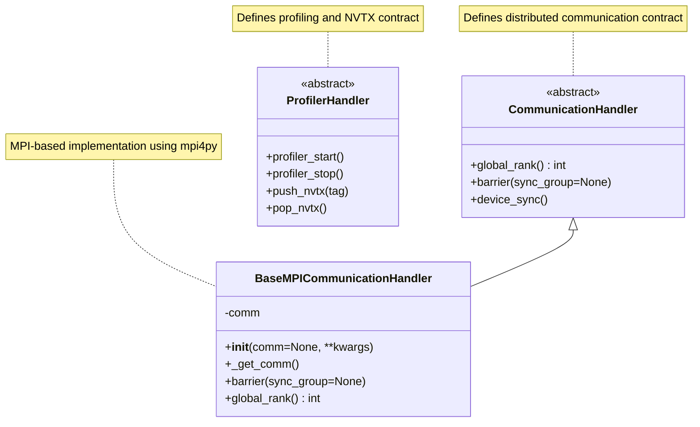
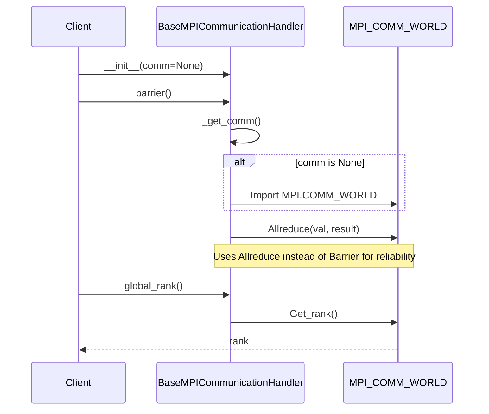
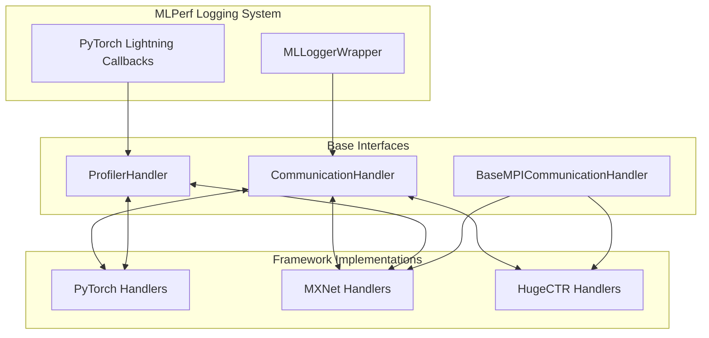

<!-- source: DeepWiki mcp.deepwiki.com · repo NVIDIA/mlperf-common · extra page Base Interfaces · fetched 2026-10-26 -->

# Base Interfaces

Relevant source files

The following files were used as context for generating this wiki page:

- [mlperf_common/frameworks/base.py](mlperf_common/frameworks/base.py)
- [mlperf_common/frameworks/base_mpi.py](mlperf_common/frameworks/base_mpi.py)

## Purpose and Scope

This document covers the abstract base classes that define standardized interfaces for communication and profiling operations across different machine learning frameworks in the MLPerf Common repository. These interfaces enable framework-agnostic integration with the MLPerf logging and distributed training systems.

The base interfaces provide the foundation for framework-specific implementations. For PyTorch-specific implementations, see [PyTorch Integration](#2.3.2). For MXNet and other framework implementations, see [MXNet and Other Frameworks](#2.3.3).

## Abstract Interface Architecture

The base interfaces define two primary abstraction layers: communication handling for distributed operations and profiler handling for performance monitoring. These abstractions allow the MLPerf logging system to work uniformly across different frameworks.

**Sources:** [mlperf_common/frameworks/base.py:15-36](), [mlperf_common/frameworks/base_mpi.py:19-41]()

## CommunicationHandler Interface

The `CommunicationHandler` class defines the abstract interface for distributed communication operations required by the MLPerf logging system. Framework-specific implementations must provide concrete implementations of these methods.

| Method | Purpose | Parameters |
|--------|---------|------------|
| `global_rank()` | Returns the rank of the current process in the global communicator | None |
| `barrier(sync_group=None)` | Synchronizes all processes in the specified group | `sync_group`: Optional communicator group |
| `device_sync()` | Synchronizes the current device (GPU/accelerator) | None |

The interface supports both global and group-specific synchronization operations, which are essential for coordinating distributed training and ensuring accurate timing measurements for MLPerf compliance.

**Sources:** [mlperf_common/frameworks/base.py:15-23]()

## ProfilerHandler Interface

The `ProfilerHandler` class defines the abstract interface for profiling operations and NVIDIA Tools Extension (NVTX) integration. This enables performance analysis and debugging across different frameworks.

| Method | Purpose | Parameters |
|--------|---------|------------|
| `profiler_start()` | Initiates profiling session | None |
| `profiler_stop()` | Terminates profiling session | None |
| `push_nvtx(tag)` | Pushes an NVTX range with specified tag | `tag`: String identifier for the range |
| `pop_nvtx()` | Pops the current NVTX range | None |

The NVTX methods enable detailed performance tracing that can be visualized in NVIDIA profiling tools, providing insights into training performance bottlenecks.

**Sources:** [mlperf_common/frameworks/base.py:25-36]()

## MPI Base Implementation

The `BaseMPICommunicationHandler` provides a concrete implementation of `CommunicationHandler` using MPI (Message Passing Interface) through the `mpi4py` library. This implementation can be used directly or extended by frameworks that use MPI for distributed communication.

### Key Implementation Details

The MPI implementation includes several important design decisions:

- **Lazy MPI Initialization**: The MPI communicator is only imported and initialized when first needed via `_get_comm()` [mlperf_common/frameworks/base_mpi.py:24-29]()
- **Barrier Reliability**: Uses `MPI_Allreduce` instead of `MPI_Barrier` for improved reliability at scale [mlperf_common/frameworks/base_mpi.py:33-37]()
- **Numpy Integration**: Uses numpy arrays for MPI operations to ensure proper data type handling

**Sources:** [mlperf_common/frameworks/base_mpi.py:19-41]()

## Integration with MLPerf System

These base interfaces serve as the foundation for the MLPerf logging infrastructure, enabling framework-agnostic distributed coordination and profiling. The interfaces are consumed by the MLLoggerWrapper and related systems documented in [MLPerf Logging Infrastructure](#2.2).

The abstraction allows the MLPerf system to perform distributed coordination and profiling operations without being tied to any specific framework's implementation details.

**Sources:** [mlperf_common/frameworks/base.py:15-36](), [mlperf_common/frameworks/base_mpi.py:17-41]()

---

