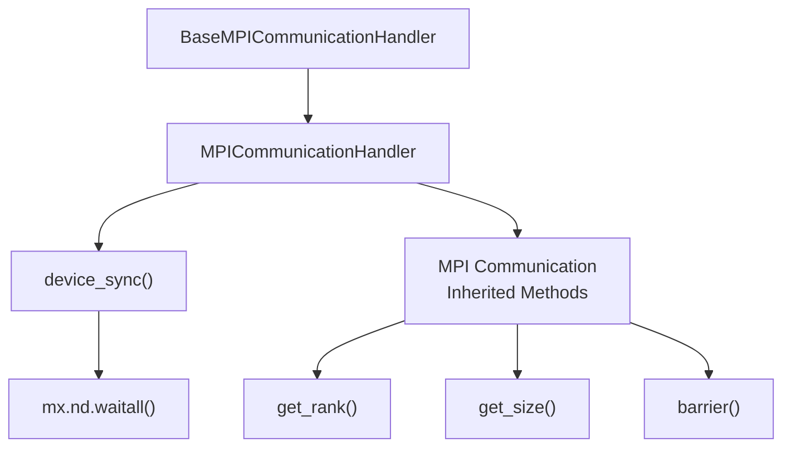
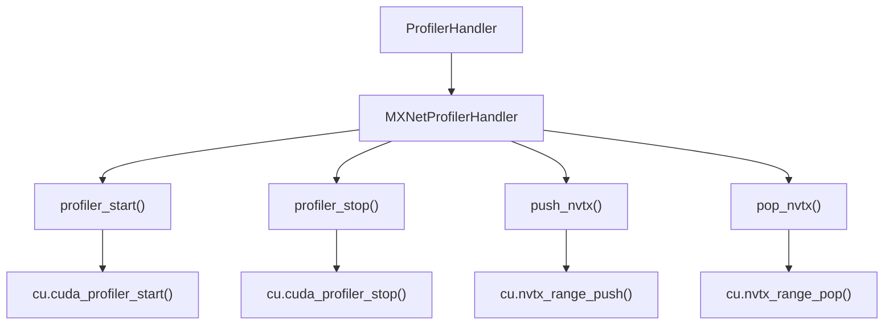
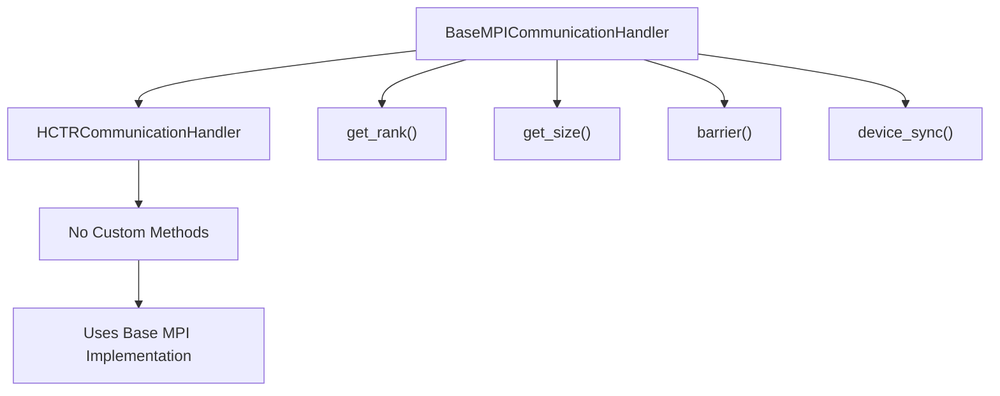
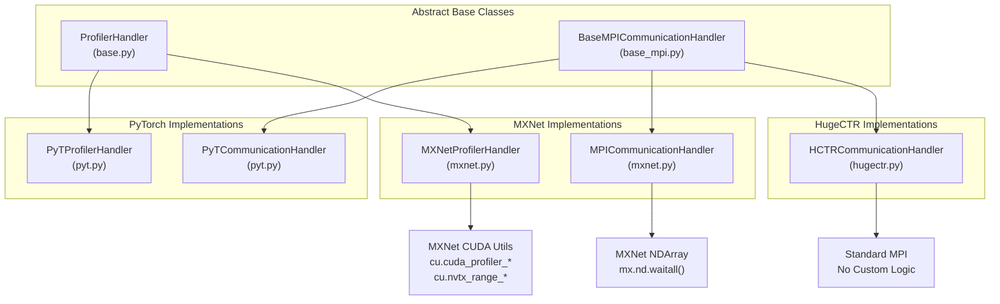

<!-- source: DeepWiki mcp.deepwiki.com · repo NVIDIA/mlperf-common · extra page MXNet and Other Frameworks · fetched 2026-10-26 -->

# MXNet and Other Frameworks

Relevant source files

The following files were used as context for generating this wiki page:

- [mlperf_common/frameworks/hugectr.py](mlperf_common/frameworks/hugectr.py)
- [mlperf_common/frameworks/mxnet.py](mlperf_common/frameworks/mxnet.py)

## Purpose and Scope

This document covers the framework-specific implementations for MXNet and HugeCTR within the MLPerf Common framework integration system. These implementations provide concrete handlers for communication and profiling operations that extend the abstract base interfaces documented in [Base Interfaces](#2.3.1). For PyTorch-specific implementations, see [PyTorch Integration](#2.3.2).

The framework handlers enable MLPerf logging and distributed training capabilities across different deep learning frameworks by implementing standardized interfaces for device synchronization, profiling, and communication coordination.

## MXNet Framework Implementation

The MXNet implementation provides two main handler classes that implement the base framework interfaces for MXNet-specific operations.

### MPICommunicationHandler

The `MPICommunicationHandler` class extends `BaseMPICommunicationHandler` to provide MXNet-specific device synchronization capabilities:

The key method implementation:
- `device_sync()` - Synchronizes all MXNet NDArray operations using [mlperf_common/frameworks/mxnet.py:23]()

### MXNetProfilerHandler  

The `MXNetProfilerHandler` class extends `ProfilerHandler` to provide CUDA profiling and NVTX range support for MXNet workloads:

The implementation uses MXNet's `cuda_utils` module for:
- CUDA profiler control via `cu.cuda_profiler_start()` and `cu.cuda_profiler_stop()` [mlperf_common/frameworks/mxnet.py:27-30]()
- NVTX range annotations via `cu.nvtx_range_push()` and `cu.nvtx_range_pop()` [mlperf_common/frameworks/mxnet.py:33-36]()

Sources: [mlperf_common/frameworks/mxnet.py:21-37]()

## HugeCTR Framework Implementation

The HugeCTR implementation provides a minimal communication handler for the HugeCTR recommendation system framework.

### HCTRCommunicationHandler

The `HCTRCommunicationHandler` extends `BaseMPICommunicationHandler` but does not override any methods, relying entirely on the base MPI implementation:

This minimal implementation indicates that HugeCTR uses standard MPI communication patterns without requiring framework-specific device synchronization logic.

Sources: [mlperf_common/frameworks/hugectr.py:17-18]()

## Framework Handler Architecture

The following diagram illustrates how the different framework implementations fit into the overall handler architecture:

## Framework Capability Comparison

| Framework | Communication Handler | Profiler Handler | Device Sync Method | Notes |
|-----------|----------------------|------------------|-------------------|-------|
| PyTorch | `PyTCommunicationHandler` | `PyTProfilerHandler` | `torch.cuda.synchronize()` | Full featured |
| MXNet | `MPICommunicationHandler` | `MXNetProfilerHandler` | `mx.nd.waitall()` | CUDA utils integration |
| HugeCTR | `HCTRCommunicationHandler` | None | Base MPI default | Minimal implementation |

The table shows that MXNet provides comprehensive handler implementations similar to PyTorch, while HugeCTR uses a minimal approach that relies on base MPI functionality.

Sources: [mlperf_common/frameworks/mxnet.py:1-37](), [mlperf_common/frameworks/hugectr.py:1-19]()

---

