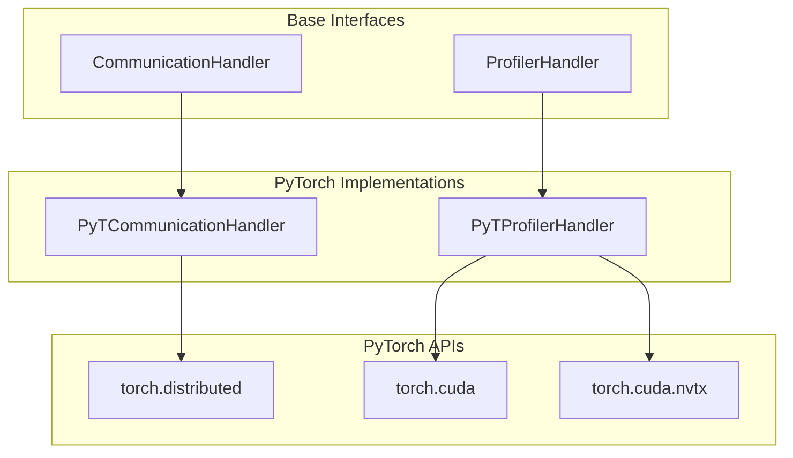
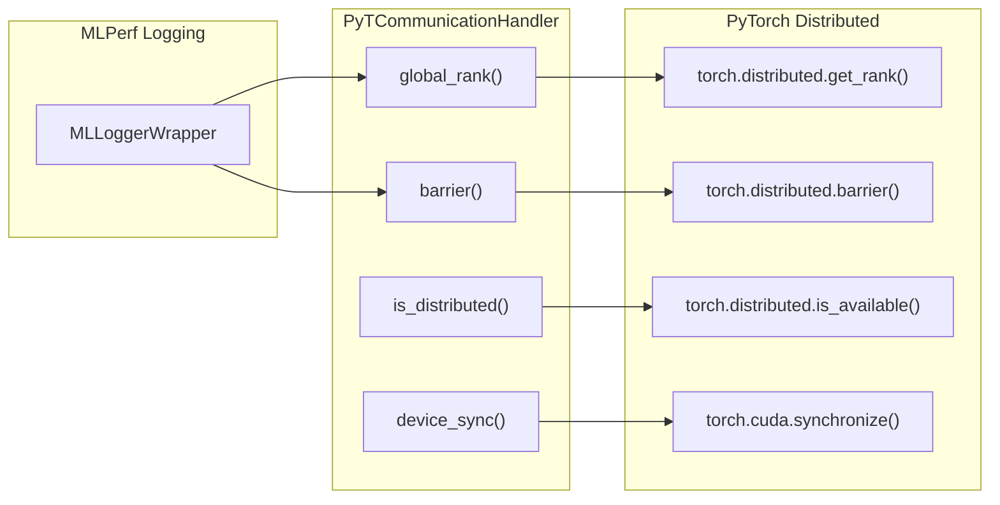
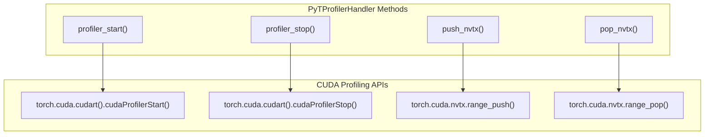
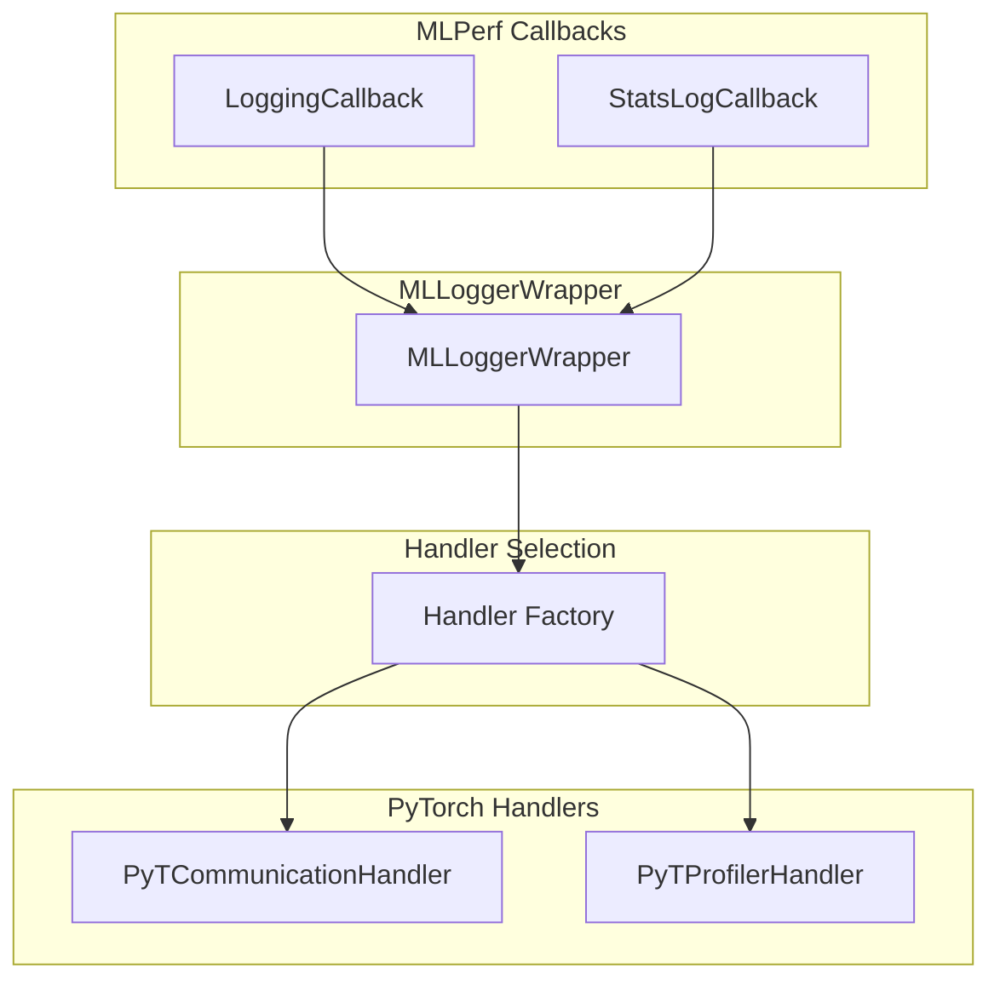

<!-- source: DeepWiki mcp.deepwiki.com · repo NVIDIA/mlperf-common · extra page PyTorch Integration · fetched 2026-10-26 -->

# PyTorch Integration

Relevant source files

The following files were used as context for generating this wiki page:

- [mlperf_common/frameworks/pyt.py](mlperf_common/frameworks/pyt.py)

## Purpose and Scope

This document covers the PyTorch-specific implementations of the framework integration layer in MLPerf Common. The PyTorch integration provides concrete implementations of communication and profiling handlers that interface with PyTorch's distributed training and CUDA profiling APIs.

For information about the abstract base interfaces these implementations inherit from, see [Base Interfaces](#2.3.1). For details about other framework integrations, see [MXNet and Other Frameworks](#2.3.3).

## Overview

The PyTorch integration consists of two primary handler classes that implement framework-specific functionality for distributed communication and performance profiling. These handlers enable MLPerf benchmarks to leverage PyTorch's built-in distributed training capabilities and NVIDIA profiling tools.

### PyTorch Handler Classes

**Sources:** [mlperf_common/frameworks/pyt.py:17-47]()

## Communication Handler Implementation

The `PyTCommunicationHandler` class provides PyTorch-specific distributed communication functionality by wrapping PyTorch's distributed training APIs.

### Core Communication Methods

| Method | Purpose | PyTorch API Used |
|--------|---------|------------------|
| `global_rank()` | Get process rank in distributed setup | `torch.distributed.get_rank()` |
| `barrier()` | Synchronize all processes | `torch.distributed.barrier()` |
| `is_distributed()` | Check if distributed training is active | `torch.distributed.is_available/is_initialized()` |
| `device_sync()` | Synchronize CUDA device | `torch.cuda.synchronize()` |

### Distributed Training Integration

The handler implements rank-aware operations and synchronization primitives essential for coordinated logging across distributed training processes. The `global_rank()` method [mlperf_common/frameworks/pyt.py:20-23]() returns the process rank when distributed training is active, falling back to rank 0 for single-process execution.

**Sources:** [mlperf_common/frameworks/pyt.py:19-33]()

## Profiler Handler Implementation

The `PyTProfilerHandler` class provides integration with NVIDIA's CUDA profiling tools and NVTX (NVIDIA Tools Extension) for performance analysis during MLPerf benchmark execution.

### Profiling Methods

### NVTX Range Management

The NVTX integration allows for hierarchical performance annotation through range markers. The `push_nvtx()` and `pop_nvtx()` methods [mlperf_common/frameworks/pyt.py:42-46]() enable nested timing regions that can be visualized in NVIDIA profiling tools like Nsight Systems.

| Profiling Feature | Implementation | Use Case |
|-------------------|----------------|----------|
| Global profiling control | `profiler_start()/stop()` | Benchmark-wide profiling sessions |
| Hierarchical timing | `push_nvtx()/pop_nvtx()` | Fine-grained performance analysis |
| CUDA integration | `torch.cuda.cudart()` | GPU kernel profiling |

**Sources:** [mlperf_common/frameworks/pyt.py:35-47]()

## Integration Architecture

The PyTorch handlers integrate into the broader MLPerf framework through inheritance from base classes and usage by the logging infrastructure.

### Handler Registration and Usage

The handlers are instantiated and used by the MLPerf logging system to provide framework-specific implementations of distributed communication and profiling operations. This design allows the same MLPerf logging code to work across different ML frameworks by selecting appropriate handler implementations.

**Sources:** [mlperf_common/frameworks/pyt.py:15-17]()

## Key Dependencies

The PyTorch integration relies on several PyTorch modules:

- **torch.distributed**: Provides multi-process distributed training coordination
- **torch.cuda**: Enables CUDA device synchronization and profiler control
- **torch.cuda.nvtx**: Supplies NVTX range annotation capabilities

The implementation assumes PyTorch is available with CUDA support and that distributed training may or may not be initialized depending on the execution context.

**Sources:** [mlperf_common/frameworks/pyt.py:15]()

---

