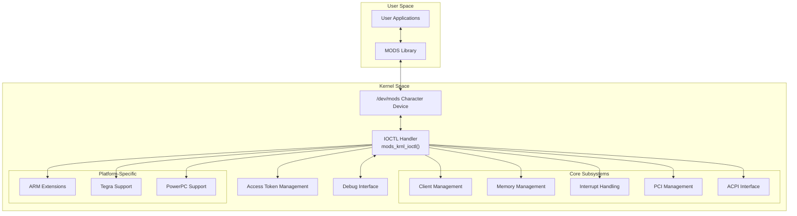
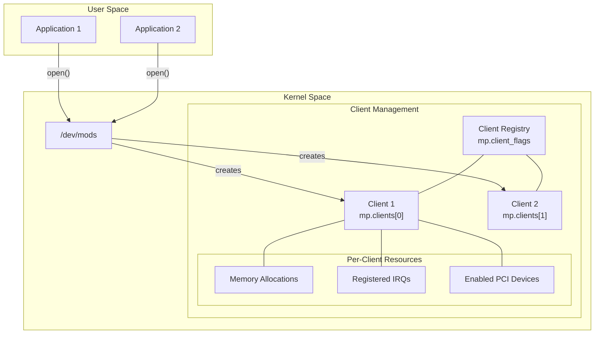
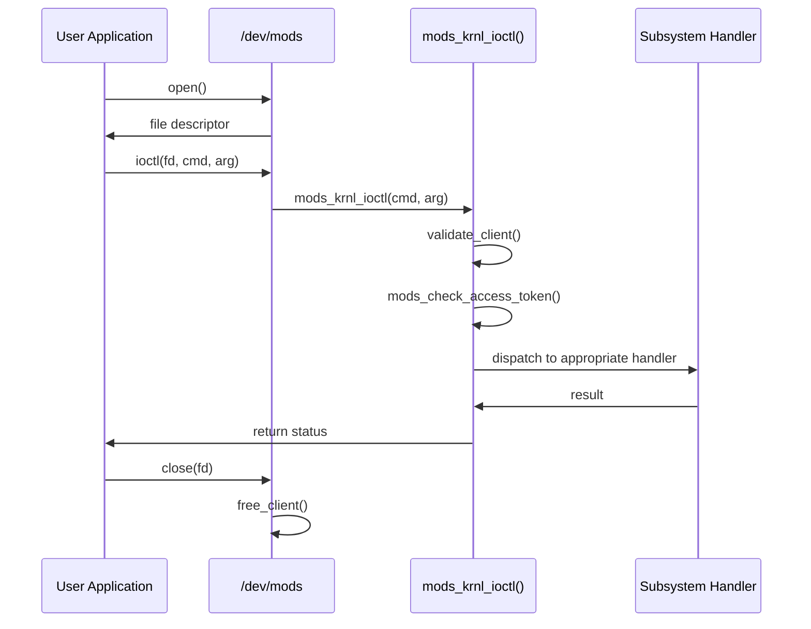
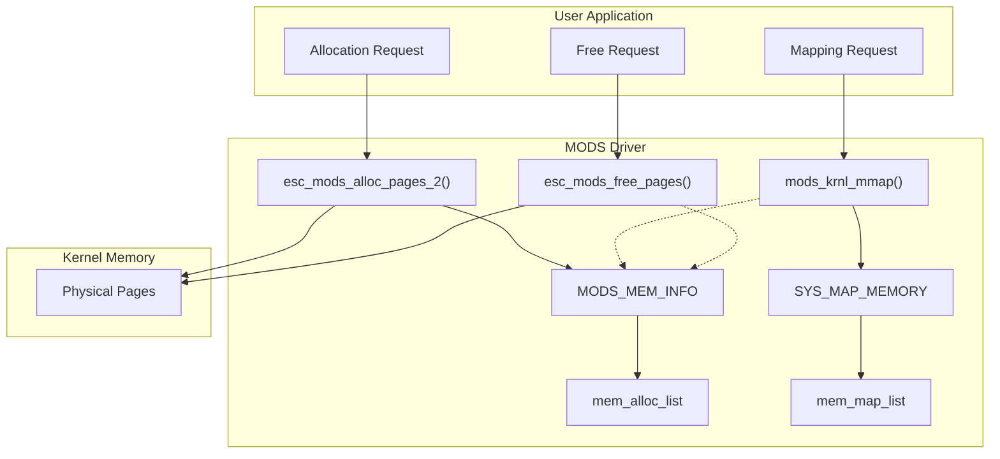
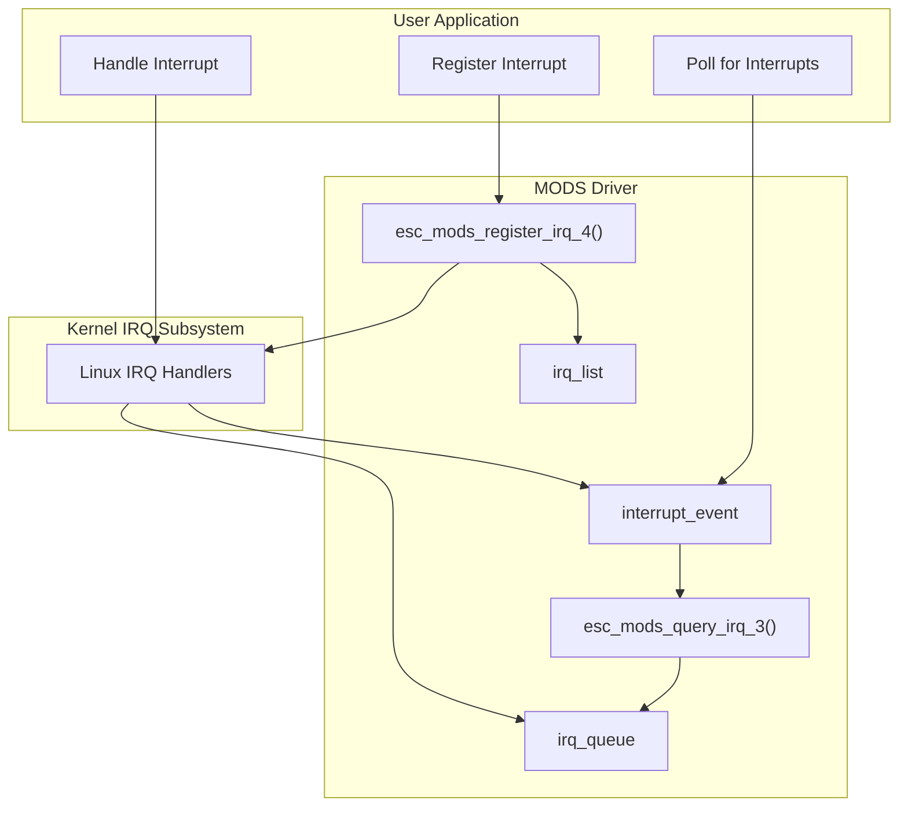
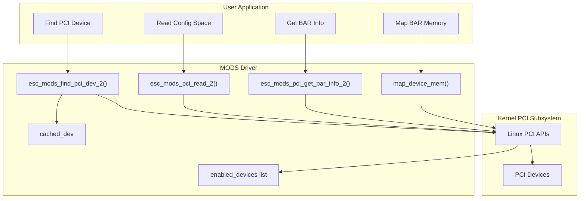
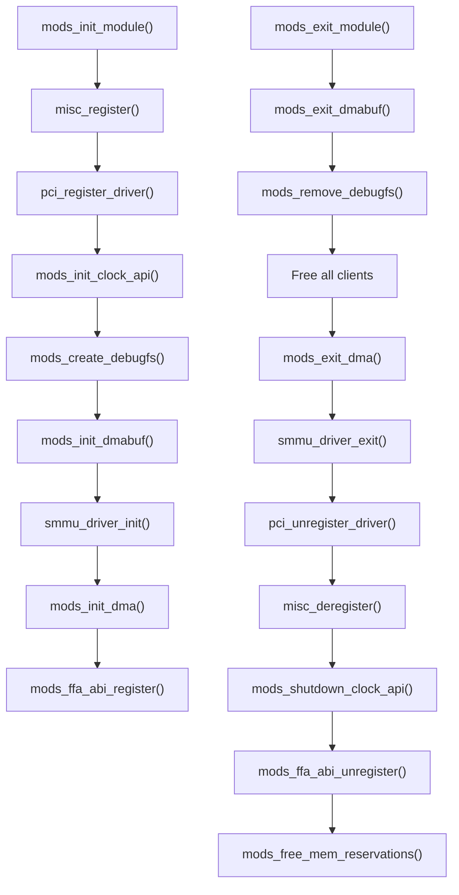
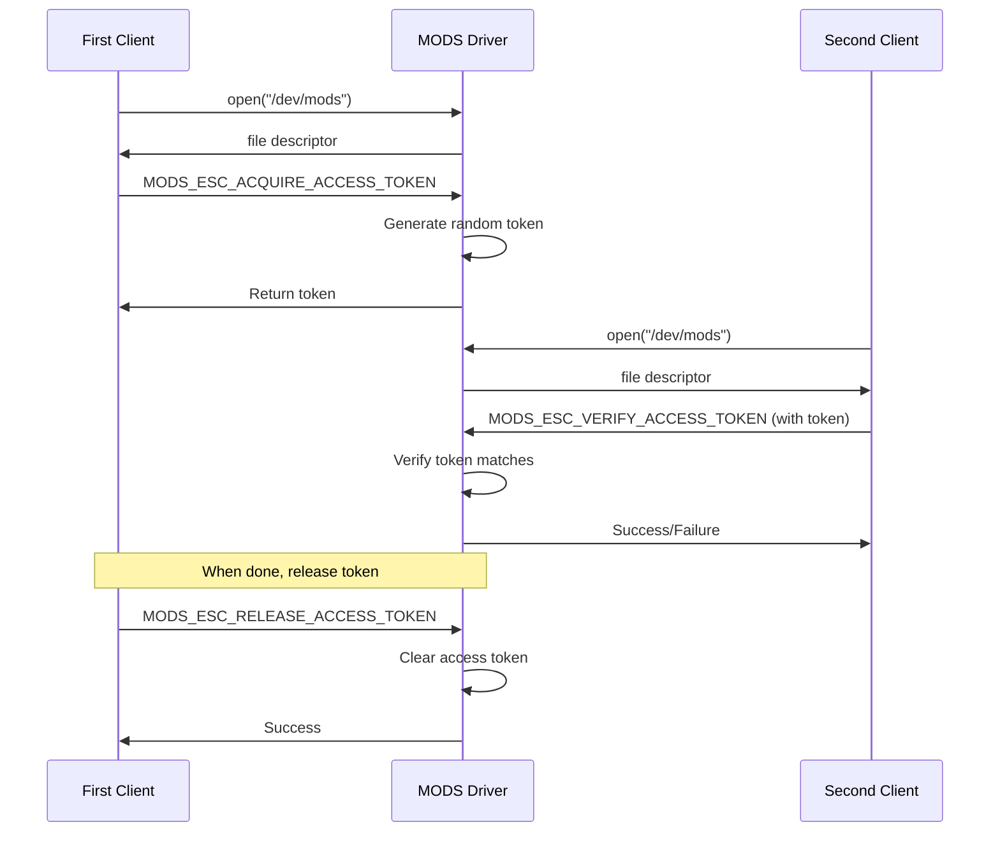

<!-- source: DeepWiki mcp.deepwiki.com · repo NVIDIA/mods-kernel-driver · page 1 Overview · fetched 2026-10-26 -->

# Overview

Relevant source files

The following files were used as context for generating this wiki page:

- [mods.h](mods.h)
- [mods_internal.h](mods_internal.h)
- [mods_krnl.c](mods_krnl.c)

The NVIDIA MODS (Module Overlay and Driver Support) kernel driver is a low-level system software component that provides direct hardware access capabilities to userspace applications. It serves as a diagnostic and development tool designed to support hardware debugging, testing, and development for NVIDIA hardware across multiple platforms.

This driver acts as a bridge between userspace applications and hardware resources, providing controlled and secure access to hardware functionality that is typically restricted to kernel code. For detailed information about the driver's architecture, see [Architecture](#1.1).

## Purpose and Scope

The MODS kernel driver enables several key capabilities:

1. **Direct memory management** - Allocation, mapping, and manipulation of system memory with specific cache attributes
2. **PCI device interaction** - Device enumeration, configuration, and control
3. **Interrupt handling** - Registration and servicing of hardware interrupts from userspace
4. **ACPI methods execution** - Invocation of ACPI methods from userspace
5. **Platform-specific functionality** - Support for ARM, Tegra, and Power architectures

The driver is not intended for production use in end-user environments but rather serves as a development and debugging tool for hardware engineers and system software developers.

Sources: [mods_krnl.c:602-605](), [mods.h:9-14]()

## System Architecture

The MODS driver follows a modular design with a clear separation between core functionality and platform-specific extensions.

Sources: [mods_krnl.c:36-55](), [mods_internal.h:81-110](), [mods_krnl.c:494-522]()

## Client Management

The driver supports multiple client connections simultaneously (configurable at load time). Each client represents a unique userspace process or application that communicates with the driver. The driver tracks resources associated with each client and ensures proper cleanup when a client disconnects.

Sources: [mods_krnl.c:431-475](), [mods_krnl.c:1063-1080](), [mods_internal.h:426-500]()

## Communication Interface

All communication between userspace and the MODS driver occurs through IOCTL commands. The driver defines over 100 different IOCTL commands to support various operations. These commands are categorized into several groups:

| Category | Description | Examples |
|----------|-------------|----------|
| Memory Management | Allocation, mapping, and attribute control | `MODS_ESC_ALLOC_PAGES`, `MODS_ESC_FREE_PAGES` |
| PCI Management | Device discovery, configuration, BAR access | `MODS_ESC_FIND_PCI_DEVICE_2`, `MODS_ESC_PCI_READ_2` |
| Interrupt Handling | Registration, waiting, and servicing | `MODS_ESC_REGISTER_IRQ_4`, `MODS_ESC_QUERY_IRQ_3` |
| ACPI Interface | Method evaluation and device discovery | `MODS_ESC_EVAL_ACPI_METHOD`, `MODS_ESC_ACPI_GET_DDC_2` |
| Platform-Specific | Architecture-specific functionality | `MODS_ESC_FLUSH_CPU_CACHE_RANGE`, `MODS_ESC_BPMP_SET_PCIE_STATE` |

The communication flow follows this pattern:

Sources: [mods_krnl.c:2019-2775](), [mods.h:2017-2015]()

## Memory Management

The MODS driver provides extensive memory management capabilities, allowing userspace applications to allocate and map physical memory with specific cache attributes. It supports both contiguous and non-contiguous memory allocations and provides mechanisms to map these allocations into userspace virtual address space.

Key memory allocation features:
- Contiguous and non-contiguous allocations
- Custom cache attributes (cached, uncached, write-combine)
- NUMA-aware allocations
- DMA-mappable memory for device access
- 32-bit and 64-bit physical address support

Sources: [mods_internal.h:136-171](), [mods_krnl.c:733-761](), [mods.h:75-136]()

## Interrupt Management

The MODS driver allows userspace applications to register and handle hardware interrupts, which is typically restricted to kernel code. Applications can register for various types of interrupts (legacy, MSI, MSI-X) and receive notifications when these interrupts occur.

Supported interrupt types:
- Legacy PCI interrupts (INTx)
- Message Signaled Interrupts (MSI)
- Extended Message Signaled Interrupts (MSI-X)
- CPU interrupts (on Tegra platforms)

Sources: [mods_krnl.c:1158-1181](), [mods.h:774-927](), [mods_internal.h:289-307]()

## PCI Management

The MODS driver provides comprehensive PCI device management capabilities, allowing userspace applications to discover, configure, and interact with PCI devices.

Key PCI management features:
- PCI device discovery by vendor/device ID or class code
- PCI configuration space read/write access
- PCI BAR information retrieval and mapping
- PCI device reset and hot-plug support
- SR-IOV configuration and management

Sources: [mods_krnl.c:97-171](), [mods.h:60-66](), [mods.h:404-419]()

## Platform-Specific Extensions

The MODS driver includes support for various platforms with platform-specific features:

### ARM and ARM64
- Cache management operations
- ARM Firmware Framework for Arm (FFA) interface
- CPU idle states management

### Tegra
- BPMP (Boot and Power Management Processor) communication
- Clock and reset control
- DMA operations
- ADSP (Audio DSP) management
- Display controller configuration

### PowerPC
- TCE (Translation Control Entry) bypass for DMA
- NVLink system memory configuration
- ATS (Address Translation Services) management

Sources: [mods_internal.h:178-204](), [mods_krnl.c:387-399](), [mods.h:1896-1915]()

## Driver Initialization and Cleanup

The MODS driver follows a standard Linux kernel module initialization and cleanup process:

Sources: [mods_krnl.c:552-612](), [mods_krnl.c:614-652]()

## Access Control

The MODS driver implements an access token mechanism to control which applications can use the driver. This helps prevent unauthorized access to hardware resources.

Sources: [mods.h:26-58](), [mods_krnl.c:523-546](), [mods_krnl.c:1706-1777]()

## Security Considerations

The MODS driver provides powerful capabilities that can potentially impact system stability and security. It is designed for use in controlled development environments by trusted applications. Key security measures include:

1. Access token mechanism to prevent unauthorized access
2. Per-client resource tracking to prevent resource leaks
3. Restrictions on memory access to prevent system corruption
4. Validation of IOCTL parameters to prevent exploitation

The driver is not intended for use in production environments or by untrusted applications.

Sources: [mods_krnl.c:602-605](), [mods_krnl.c:507-546]()

## Compatibility

The MODS driver is designed to work across multiple Linux kernel versions and hardware platforms. Compatibility is maintained through preprocessor conditionals and architecture-specific implementations.

| Feature | Supported Platforms | Notes |
|---------|---------------------|-------|
| Core functionality | All | Basic memory, PCI, and interrupt operations |
| ARM extensions | ARM, ARM64 | Cache management, FFA interface |
| Tegra extensions | Tegra SoCs | BPMP, clock, DMA, etc. |
| PowerPC extensions | PowerPC64 | TCE bypass, NVLink, ATS |
| ACPI interface | x86, x86_64 | ACPI method evaluation |

Sources: [mods_internal.h:16-28](), [mods_krnl.c:324-385](), [mods_krnl.c:667-679]()

---

