<!-- source: DeepWiki mcp.deepwiki.com · repo NVIDIA/mods-kernel-driver · page 1.1 Architecture · fetched 2026-10-26 -->

# Architecture

Relevant source files

The following files were used as context for generating this wiki page:

- [mods_config.h](mods_config.h)
- [mods_internal.h](mods_internal.h)
- [mods_krnl.c](mods_krnl.c)

This document describes the architecture of the NVIDIA MODS (Module Overlay and Driver Support) kernel driver. It explains the high-level design, core components, and their interactions. For specific implementation details about individual subsystems, please refer to their respective documentation pages in this wiki.

## Purpose and Scope

The MODS kernel driver provides low-level hardware access capabilities to userspace applications for debugging, diagnostics, and development of NVIDIA hardware across multiple platforms. It serves as a system-level interface between userspace debugging tools and hardware, exposing functionality that is typically only available to kernel-mode drivers.

## High-Level Architecture

The MODS driver follows a client-based architecture where each userspace application opens the driver and receives a dedicated client context for tracking resources and operations.

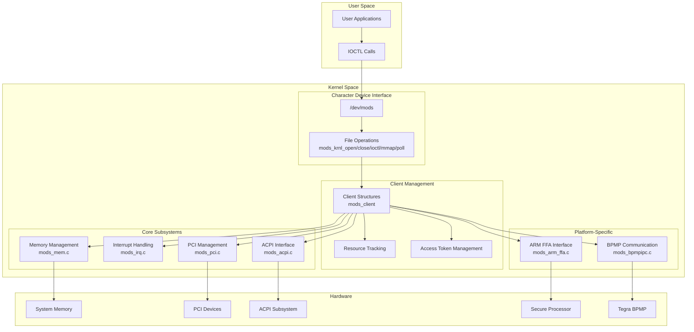

Sources: [mods_krnl.c:36-47](), [mods_krnl.c:552-612](), [mods_internal.h:82-110]()

## Character Device Interface

The core of the MODS driver is the `/dev/mods` character device interface, which provides the connection point between userspace and kernel functionality.

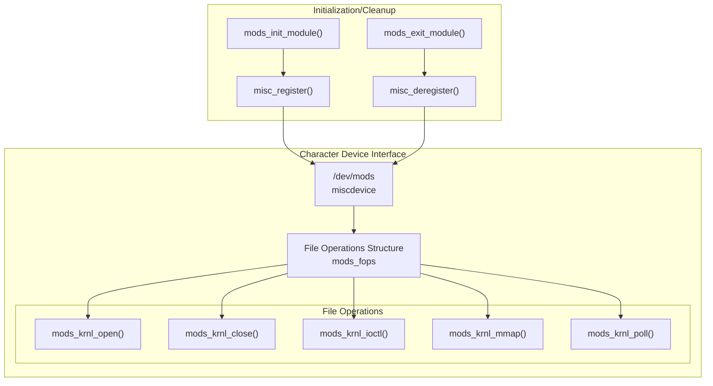

Sources: [mods_krnl.c:36-47](), [mods_krnl.c:49-55](), [mods_krnl.c:552-570](), [mods_krnl.c:614-641]()

### Key Components

1. **Device Registration**: The driver registers a miscellaneous character device at initialization
2. **File Operations**: Defines handlers for standard file operations
3. **Client Association**: Each file handle is associated with a client context

## Client Management

The MODS driver uses a client-based architecture to track resources and operations per user application. Each time a user opens the `/dev/mods` device, a new client is allocated with a unique client ID.

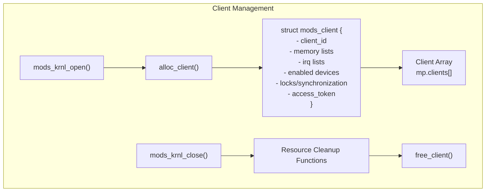

Sources: [mods_internal.h:82-110](), [mods_krnl.c:431-475](), [mods_krnl.c:477-500](), [mods_krnl.c:1063-1081](), [mods_krnl.c:1083-1156]()

### Key Client Features

1. **Resource Tracking**: Each client tracks its own memory allocations, IRQ registrations, and enabled devices
2. **Client Isolation**: Resources from one client are isolated from others
3. **Cleanup on Close**: All resources are automatically freed when a client closes the device

## IOCTL Interface

The primary method for user applications to interact with the MODS driver is through IOCTL calls. The driver supports a wide range of commands for different hardware operations.

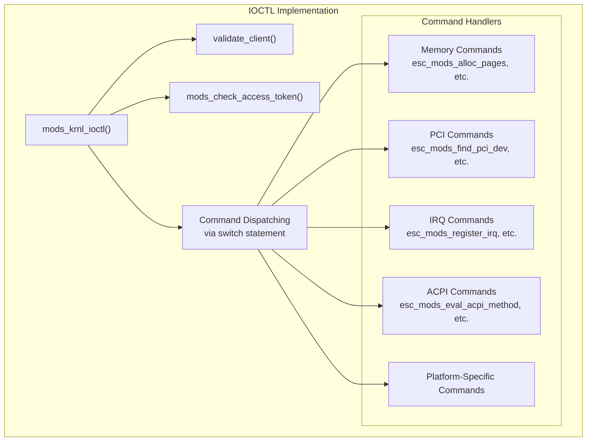

Sources: [mods_krnl.c:2019-2066](), [mods_krnl.c:2116-2013]()

### IOCTL Command Flow

1. **Validation**: Verify client and access token
2. **Command Decoding**: Decode IOCTL command
3. **Parameter Handling**: Copy parameters from user space
4. **Command Execution**: Dispatch to appropriate handler function
5. **Result Return**: Copy results back to user space

## Memory Management

The MODS driver provides comprehensive memory management for user applications, allowing them to allocate and map different types of memory with various caching attributes.

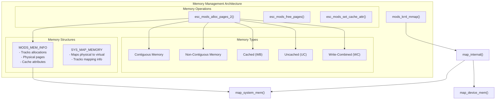

Sources: [mods_internal.h:137-163](), [mods_internal.h:174-186](), [mods_krnl.c:733-761](), [mods_krnl.c:1184-1391]()

### Memory Management Features

1. **Allocation Types**: Support for contiguous and non-contiguous memory
2. **Cache Control**: Configurable cache attributes (cached, uncached, write-combined)
3. **Memory Mapping**: Map allocated memory to user space
4. **Device Memory**: Map physical device memory to user space

## Interrupt Management

The interrupt management subsystem allows user applications to register for and handle hardware interrupts from userspace.

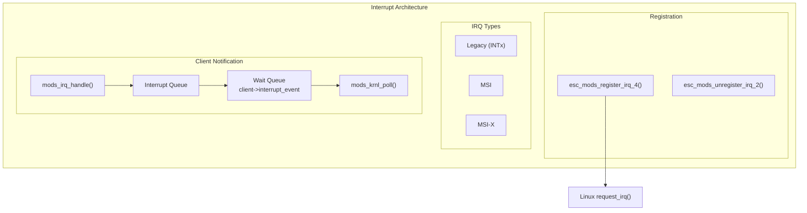

Sources: [mods_internal.h:290-308](), [mods_krnl.c:1158-1182]()

### Interrupt Features

1. **IRQ Types**: Support for legacy INTx, MSI, and MSI-X interrupts
2. **IRQ Queuing**: Interrupts are queued for the client to process
3. **Notification**: Clients are notified of interrupts via polling
4. **Masking Control**: Support for interrupt masking/unmasking

## PCI Management

The PCI management subsystem provides access to PCI devices, including device discovery, register access, and configuration.

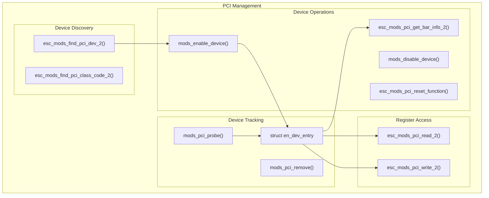

Sources: [mods_internal.h:47-58](), [mods_krnl.c:97-118](), [mods_krnl.c:120-156](), [mods_krnl.c:162-171]()

### PCI Features

1. **Device Discovery**: Find PCI devices by ID or class code
2. **Device Access**: Read and write PCI registers, access BARs
3. **Device Management**: Enable, disable, and reset devices
4. **Hot Reset**: Support for PCI hot reset functionality
5. **Device Tracking**: Track enabled devices per client

## Access Control Mechanism

For environments where security is important, MODS provides an access token system that can be used to limit driver access.

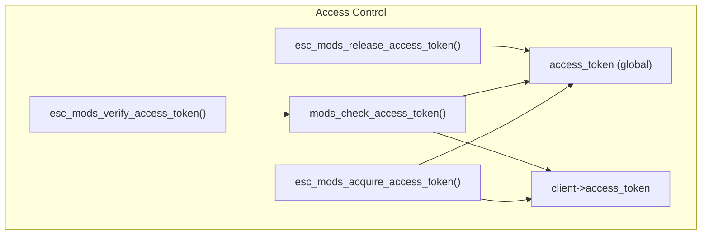

Sources: [mods_krnl.c:502-547](), [mods_krnl.c:1706-1776]()

### Access Control Features

1. **Token Generation**: Random token generation for access control
2. **Token Verification**: Validate token before allowing operations
3. **Token Release**: Release token to allow other clients to acquire it
4. **Multi-Instance Override**: Token system is disabled when multi-instance mode is enabled

## Platform-Specific Extensions

MODS supports platform-specific extensions for specialized hardware access, particularly for NVIDIA Tegra platforms and ARM-based systems.

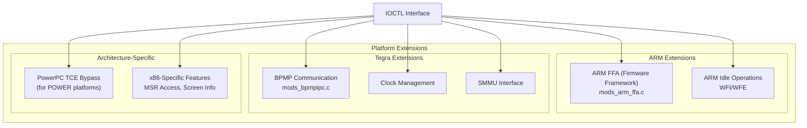

Sources: [mods_krnl.c:387-398](), [mods_krnl.c:572-594](), [mods_krnl.c:1963-1992](), [mods_internal.h:695-700]()

## Driver Initialization and Cleanup

The driver follows a standard Linux kernel module initialization and cleanup pattern, registering devices and initializing subsystems.

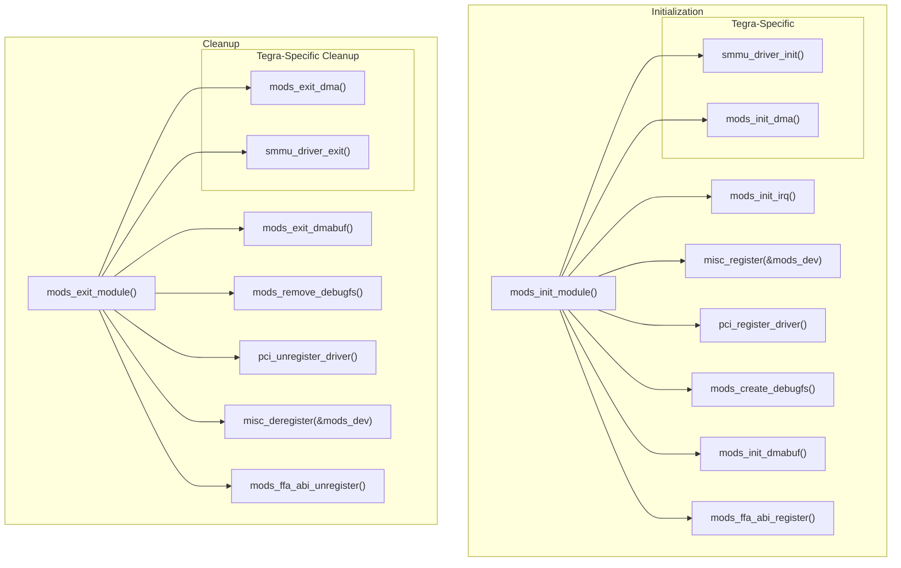

Sources: [mods_krnl.c:552-612](), [mods_krnl.c:614-652]()

## Configuration System

The MODS driver uses a configuration system to handle kernel version differences and platform-specific features, allowing a single codebase to work across multiple kernel versions and architectures.

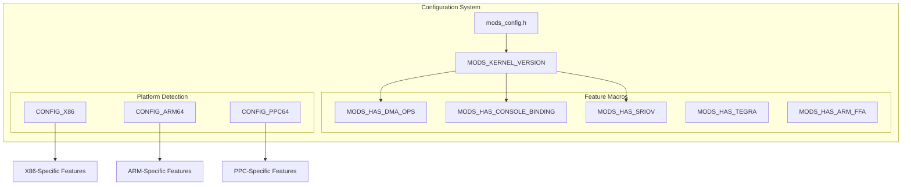

Sources: [mods_config.h:1-129]()

## Conclusion

The NVIDIA MODS kernel driver provides a flexible architecture for low-level hardware access, with key features including:

1. **Client-Based Design**: Resource tracking and isolation per client
2. **Comprehensive Hardware Access**: Memory, PCI, IRQs, and platform-specific features
3. **Extensible Interface**: IOCTL-based command dispatch system
4. **Cross-Platform Support**: Architecture spanning x86, ARM, and PowerPC
5. **Debug Capabilities**: Special interfaces for hardware debugging and diagnostics

The driver is designed to be a development and diagnostic tool rather than a production driver, providing capabilities that would otherwise be unavailable to userspace applications.

---

