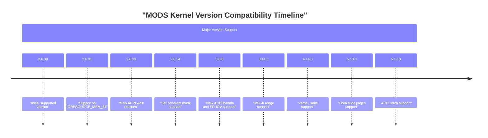
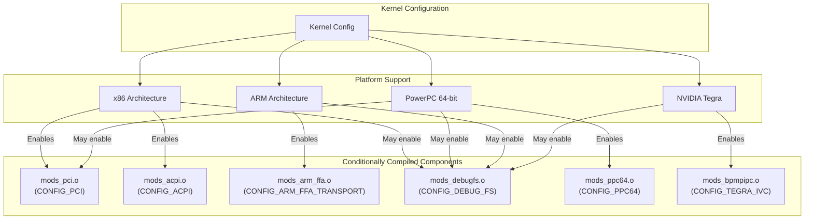
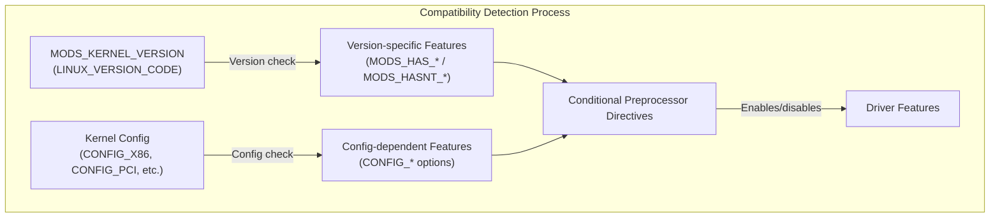

<!-- source: DeepWiki mcp.deepwiki.com · repo NVIDIA/mods-kernel-driver · page 1.2 Compatibility · fetched 2026-10-26 -->

# Compatibility

Relevant source files

The following files were used as context for generating this wiki page:

- [Makefile](Makefile)
- [mods_config.h](mods_config.h)

This page details the kernel version compatibility and feature configuration options supported by the NVIDIA MODS kernel driver. It documents how the driver adapts to different Linux kernel versions, platform architectures, and available kernel features through its compatibility layer.

For information about building the driver with specific configurations, see [Building the Driver](#6.1).

## 1. Kernel Version Compatibility

The MODS kernel driver supports a wide range of Linux kernel versions through a comprehensive compatibility layer implemented in `mods_config.h`. This compatibility layer uses preprocessor macros to detect the kernel version and enable or disable features accordingly.

The driver defines `MODS_KERNEL_VERSION` which is set to the Linux kernel version code to make version-specific adaptations throughout the codebase.

Sources: [mods_config.h:7-7]()

## 2. Version-Dependent Feature Detection

MODS uses conditional compilation to adapt to API changes across different kernel versions:

| Feature Flag | Kernel Version | Description |
|--------------|----------------|-------------|
| `MODS_HAS_DMA_OPS` | 2.6.30 - 4.16.0 (x86) | DMA operations API support |
| `MODS_HASNT_PCI_RESCAN_BUS` | < 2.6.30 | PCI bus rescan not available |
| `MODS_HAS_IORESOURCE_MEM_64` | ≥ 2.6.31 | 64-bit memory resource support |
| `MODS_HAS_NEW_ACPI_WALK` | ≥ 2.6.33 | Updated ACPI walk routines |
| `MODS_HAS_SET_COHERENT_MASK` | ≥ 2.6.34 | Support for setting coherent DMA mask |
| `MODS_HAS_CONSOLE_LOCK` | ≥ 2.6.38 (x86) | Console locking mechanism |
| `MODS_HAS_NEW_ACPI_HANDLE` | ≥ 3.8.0 | Updated ACPI handle API |
| `MODS_HAS_SRIOV` | ≥ 3.8.0 | SR-IOV support |
| `MODS_HAS_REINIT_COMPLETION` | ≥ 3.13.0 | Completion reinit function |
| `MODS_HAS_MSIX_RANGE` | ≥ 3.14.0 | MSI-X range allocation |
| `MODS_HAS_DEV_PROPS` | ≥ 3.19.0 | Device properties support |
| `MODS_HAS_KERNEL_WRITE` | ≥ 4.14.0 | Kernel write function |
| `MODS_HAS_POLL_T` | ≥ 4.16.0 | Poll_t data type |
| `MODS_HAS_DMA_ALLOC_PAGES` | ≥ 5.10.0 | DMA page allocation |
| `MODS_HAS_ACPI_FETCH` | ≥ 5.17.0 | ACPI fetch API |

These flags enable the driver to compensate for API differences across kernel versions and maintain backward compatibility.

Sources: [mods_config.h:9-104]()

## 3. Platform-Specific Compatibility

The MODS driver adapts to different hardware platforms and architectures through conditional compilation:

Architecture-specific macros in `mods_config.h` enable features for specific platforms:

1. **x86-specific features**:
   - `MODS_HAS_CONSOLE_LOCK` (2.6.38+)
   - `MODS_HAS_ASM_SET_MEMORY_HEADER` (4.12.0 - 4.13.0)
   - `MODS_HAS_PGPROT_DECRYPTED` (4.14.0+)

2. **PowerPC-specific features**:
   - `MODS_HAS_PNV_PCI_GET_NPU_DEV` (4.5.0+)

3. **ARM-specific features**:
   - ARM FFA (Firmware Framework for Arm) transport

4. **Tegra-specific features**:
   - `MODS_ENABLE_BPMP_MRQ_API` (5.1.0+)

Sources: [mods_config.h:33-108](), [Makefile:8-30]()

## 4. Conditional Component Compilation

The MODS driver compiles different components based on kernel configuration options:

| Component | Kernel Config | Purpose |
|-----------|---------------|---------|
| mods_krnl.o | Always | Core kernel interface |
| mods_mem.o | Always | Memory management |
| mods_irq.o | Always | Interrupt handling |
| mods_pci.o | CONFIG_PCI | PCI device management |
| mods_acpi.o | CONFIG_ACPI | ACPI interface |
| mods_arm_ffa.o | CONFIG_ARM_FFA_TRANSPORT | ARM FFA interface |
| mods_debugfs.o | CONFIG_DEBUG_FS | Debug interface |
| mods_ppc64.o | CONFIG_PPC64 | PowerPC 64-bit support |
| mods_bpmpipc.o | CONFIG_TEGRA_IVC | Tegra BPMP IPC |

This conditional compilation ensures that the driver only includes components relevant to the target platform and kernel configuration, minimizing its footprint and avoiding dependencies on unavailable features.

Sources: [Makefile:21-30]()

## 5. Compatibility Layer Implementation

The compatibility layer is implemented in `mods_config.h` through preprocessor macros that check kernel version and configuration options. This approach uses conditional compilation to adapt the driver's behavior without runtime overhead.

When the compatibility layer detects that a kernel feature is missing, it provides alternative implementations or disables certain driver features while maintaining core functionality.

Sources: [mods_config.h:1-128]()

## 6. Distribution-Specific Compatibility

The driver includes compatibility checks for specific Linux distributions:

- `CONFIG_RHEL_DIFFERENCES` - Detects Red Hat Enterprise Linux kernels
- `CONFIG_CHROME_PLATFORMS` - Detects Chrome OS kernels

These checks enable special handling for distribution-specific kernel modifications, particularly for the framebuffer suspend handling (`MODS_HAS_FB_SET_SUSPEND`).

Sources: [mods_config.h:110-118]()

---

