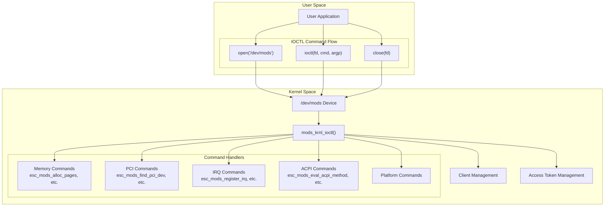
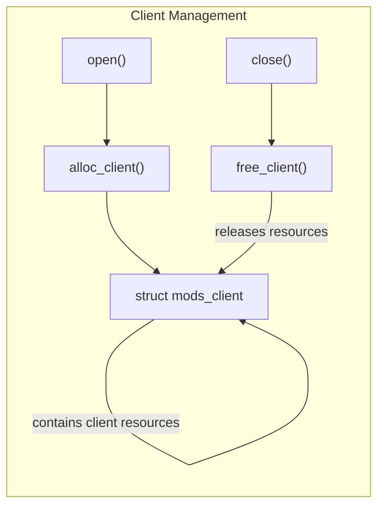
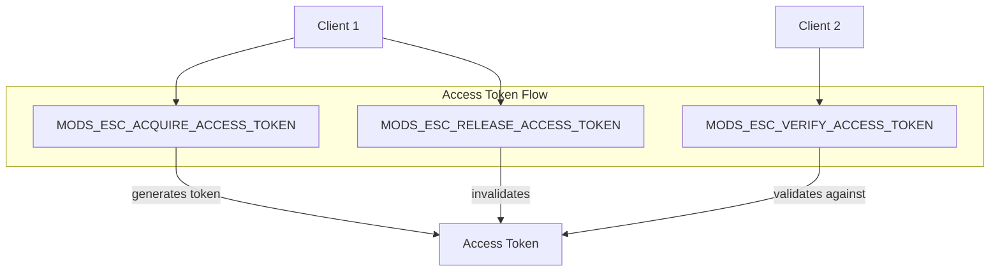
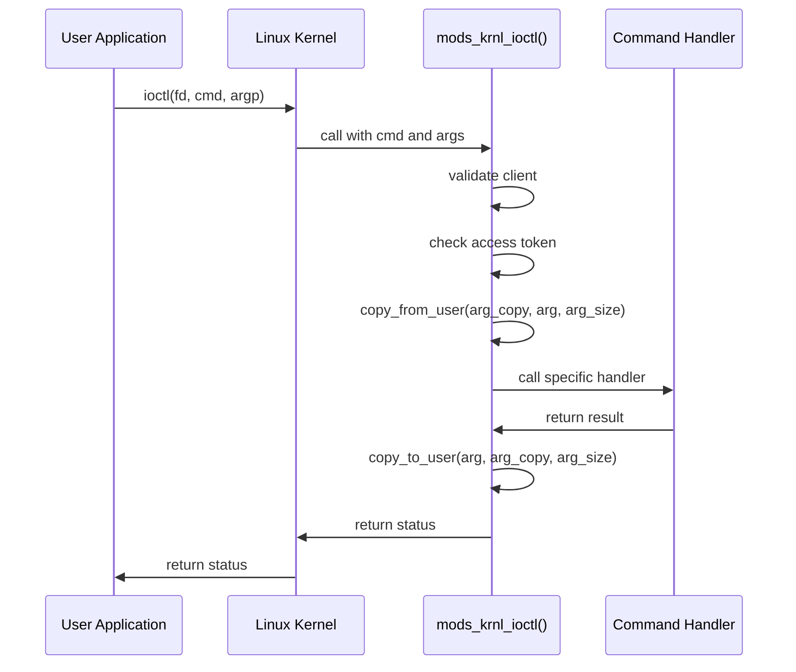
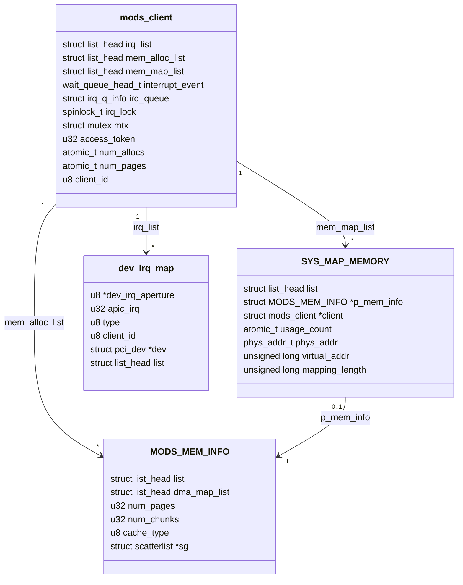
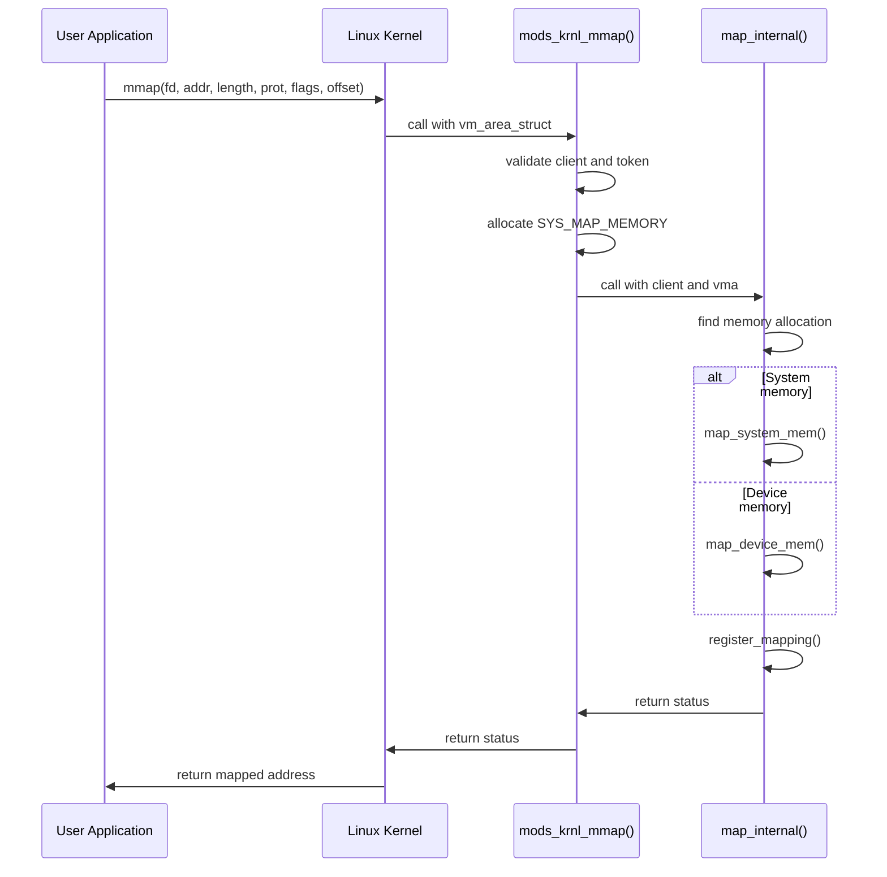
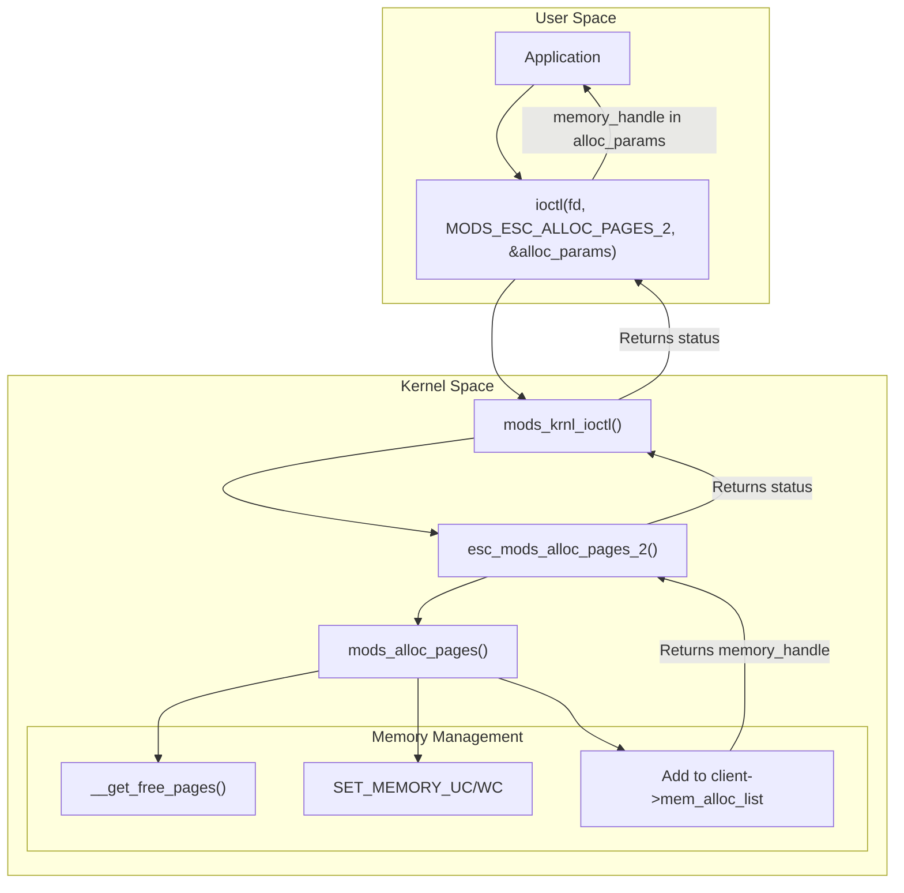

<!-- source: DeepWiki mcp.deepwiki.com · repo NVIDIA/mods-kernel-driver · page 2 IOCTL Interface · fetched 2026-10-26 -->

# IOCTL Interface

Relevant source files

The following files were used as context for generating this wiki page:

- [mods.h](mods.h)
- [mods_internal.h](mods_internal.h)
- [mods_krnl.c](mods_krnl.c)

The IOCTL (Input/Output Control) interface is the primary method for userspace applications to interact with the MODS kernel driver. It provides a comprehensive set of operations for accessing hardware resources, managing memory, controlling PCI devices, handling interrupts, and performing platform-specific functions.

## Interface Overview

The MODS driver exposes a character device (`/dev/mods`) through which applications issue IOCTL commands. Each command is identified by a unique code and takes a command-specific data structure as an argument.

Sources: [mods_krnl.c:19-44](), [mods_krnl.c:2019-2115]()

## Client and Access Management

### Client Management

The MODS driver supports multiple client connections through a client management system that tracks resources per client. Each client is identified by a unique ID assigned when the device is opened.

Sources: [mods_krnl.c:431-475](), [mods_krnl.c:477-500](), [mods_internal.h:82-110]()

### Access Token Management

To control concurrent access, the driver implements an access token system. The first client can acquire a token, and subsequent clients must verify this token to use the driver.

Sources: [mods.h:26-59](), [mods_krnl.c:1706-1777]()

## IOCTL Command Processing

The driver processes IOCTL commands through the `mods_krnl_ioctl()` function, which handles parameter validation, copying data between user and kernel space, and dispatching to appropriate handler functions.

Sources: [mods_krnl.c:2019-2115](), [mods_krnl.c:2086-2114]()

## IOCTL Command Categories

The MODS driver supports over 100 IOCTL commands, organized into several functional categories:

### Memory Management Commands

Commands for allocating, freeing, and managing system memory for hardware access.

| Command | Purpose | Key Structure |
|---------|---------|--------------|
| MODS_ESC_ALLOC_PAGES_2 | Allocate system memory | MODS_ALLOC_PAGES_2 |
| MODS_ESC_FREE_PAGES | Free allocated memory | MODS_FREE_PAGES |
| MODS_ESC_GET_PHYSICAL_ADDRESS_2 | Get physical address of allocation | MODS_GET_PHYSICAL_ADDRESS_3 |
| MODS_ESC_DMA_MAP_MEMORY | Map memory to device via IOMMU | MODS_DMA_MAP_MEMORY |
| MODS_ESC_SET_MEMORY_TYPE | Set memory caching attributes | MODS_MEMORY_TYPE |

Sources: [mods.h:75-204](), [mods.h:2022-2204]()

### PCI Management Commands

Commands for discovering, configuring, and accessing PCI devices.

| Command | Purpose | Key Structure |
|---------|---------|--------------|
| MODS_ESC_FIND_PCI_DEVICE_2 | Find PCI device by vendor/device ID | MODS_FIND_PCI_DEVICE_2 |
| MODS_ESC_PCI_READ_2 | Read from PCI config space | MODS_PCI_READ_2 |
| MODS_ESC_PCI_WRITE_2 | Write to PCI config space | MODS_PCI_WRITE_2 |
| MODS_ESC_PCI_GET_BAR_INFO_2 | Get PCI BAR information | MODS_PCI_GET_BAR_INFO_2 |
| MODS_ESC_PCI_BUS_RESCAN | Initiate PCI bus rescan | MODS_PCI_BUS_RESCAN |

Sources: [mods.h:404-613](), [mods.h:2106-2202]()

### Interrupt Handling Commands

Commands for registering, querying, and handling hardware interrupts.

| Command | Purpose | Key Structure |
|---------|---------|--------------|
| MODS_ESC_REGISTER_IRQ_4 | Register for interrupt notification | MODS_REGISTER_IRQ_4 |
| MODS_ESC_UNREGISTER_IRQ_2 | Unregister interrupt notification | MODS_REGISTER_IRQ_2 |
| MODS_ESC_QUERY_IRQ_3 | Query pending interrupts | MODS_QUERY_IRQ_3 |
| MODS_ESC_IRQ_HANDLED_2 | Indicate interrupt was handled | MODS_REGISTER_IRQ_2 |

Sources: [mods.h:729-935](), [mods.h:2445-2475]()

### ACPI Method Commands

Commands for evaluating ACPI methods and accessing ACPI-related information.

| Command | Purpose | Key Structure |
|---------|---------|--------------|
| MODS_ESC_EVAL_ACPI_METHOD | Evaluate ACPI method | MODS_EVAL_ACPI_METHOD |
| MODS_ESC_EVAL_DEV_ACPI_METHOD_3 | Evaluate ACPI method for PCI device | MODS_EVAL_DEV_ACPI_METHOD_3 |
| MODS_ESC_ACPI_GET_DDC_2 | Get EDID data via ACPI _DDC method | MODS_ACPI_GET_DDC_2 |
| MODS_ESC_GET_ACPI_DEV_CHILDREN | Get ACPI device children | MODS_GET_ACPI_DEV_CHILDREN |

Sources: [mods.h:1033-1163](), [mods.h:2043-2124]()

### Platform-Specific Commands

Commands specific to particular hardware platforms, such as ARM or Tegra.

| Command | Purpose | Key Structure |
|---------|---------|--------------|
| MODS_ESC_ARM_FFA_CMD | ARM FF-A interface commands | MODS_FFA_PARAMS |
| MODS_ESC_GET_CLOCK_HANDLE | Get Tegra clock handle | MODS_GET_CLOCK_HANDLE |
| MODS_ESC_BPMP_SET_PCIE_STATE | Set PCIe state via BPMP | MODS_SET_PCIE_STATE |
| MODS_ESC_FLUSH_CPU_CACHE_RANGE | Flush CPU cache on ARM | MODS_FLUSH_CPU_CACHE_RANGE |

Sources: [mods.h:328-338](), [mods.h:425-439](), [mods.h:1439-1502](), [mods.h:1897-1905]()

## Client Data Structures

The driver maintains per-client data structures to track resources and state.

Sources: [mods_internal.h:82-110](), [mods_internal.h:136-172](), [mods_internal.h:173-186](), [mods_internal.h:290-309]()

## Memory Mapping Interface

In addition to IOCTL commands, the driver supports memory mapping through the `mmap()` system call, allowing direct access to allocated memory or device regions.

Sources: [mods_krnl.c:887-1061](), [mods_krnl.c:1184-1391]()

## Example IOCTL Command Flow

Below is a detailed example of how a memory allocation IOCTL flows through the system:

Sources: [mods_krnl.c:2019-2115](), [mods_krnl.c:2282-2286]()

## Error Handling

The IOCTL interface uses standard Linux error codes to indicate the status of operations. Common error conditions include:

| Error Code | Description | Typical Causes |
|------------|-------------|----------------|
| -EINVAL | Invalid argument | Incorrect parameters, unsupported operation |
| -ENOMEM | Out of memory | Failed memory allocation |
| -ENODEV | No such device | Device not found or not supported |
| -EFAULT | Bad address | Failed to copy data between user and kernel space |
| -EBUSY | Device or resource busy | Resource already in use |
| -EINTR | Interrupted system call | Operation interrupted by signal |

Sources: [mods_krnl.c:2019-2115](), [mods_internal.h:507-591]()

## Security Considerations

The MODS driver provides low-level hardware access and should be used carefully as it can potentially affect system stability. Key security measures include:

1. Access token system to control concurrent access
2. Client resource tracking to prevent leaks
3. Validation of IOCTL parameters
4. Permission checks for sensitive operations

Since the driver provides direct hardware access, it should only be used by trusted applications with appropriate privileges.

Sources: [mods_krnl.c:431-547](), [mods_krnl.c:1706-1777]()

## Conclusion

The IOCTL interface is the primary method for interacting with the MODS kernel driver, providing a comprehensive set of commands for hardware access and management. Understanding this interface is essential for developing applications that need low-level access to NVIDIA hardware for debugging, diagnostics, or development purposes.

For more details on specific subsystems, refer to:
- Memory Management IOCTLs [Memory Management IOCTLs](#2.1)
- PCI Management IOCTLs [PCI Management IOCTLs](#2.2)
- Interrupt Handling IOCTLs [Interrupt Handling IOCTLs](#2.3)
- ACPI Method IOCTLs [ACPI Method IOCTLs](#2.4)

---

