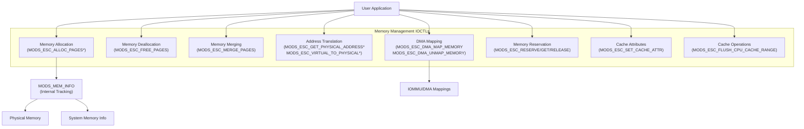
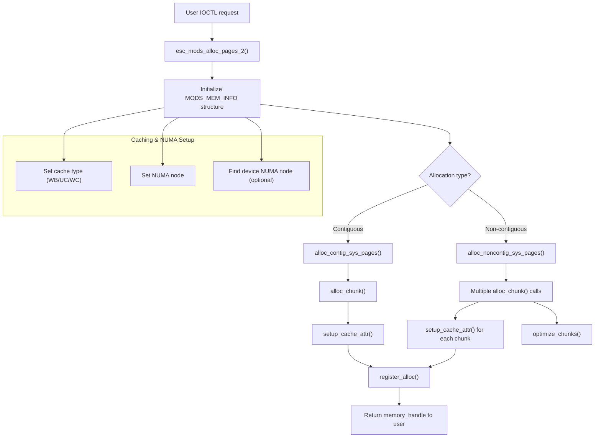
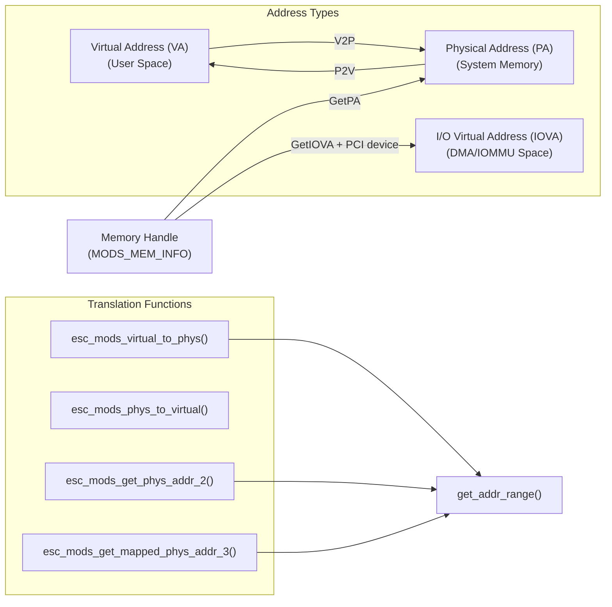
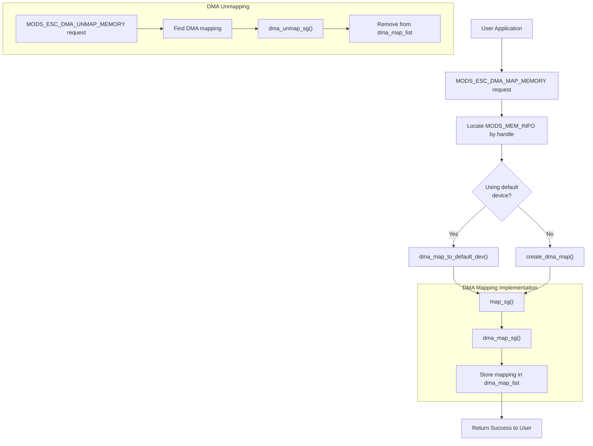
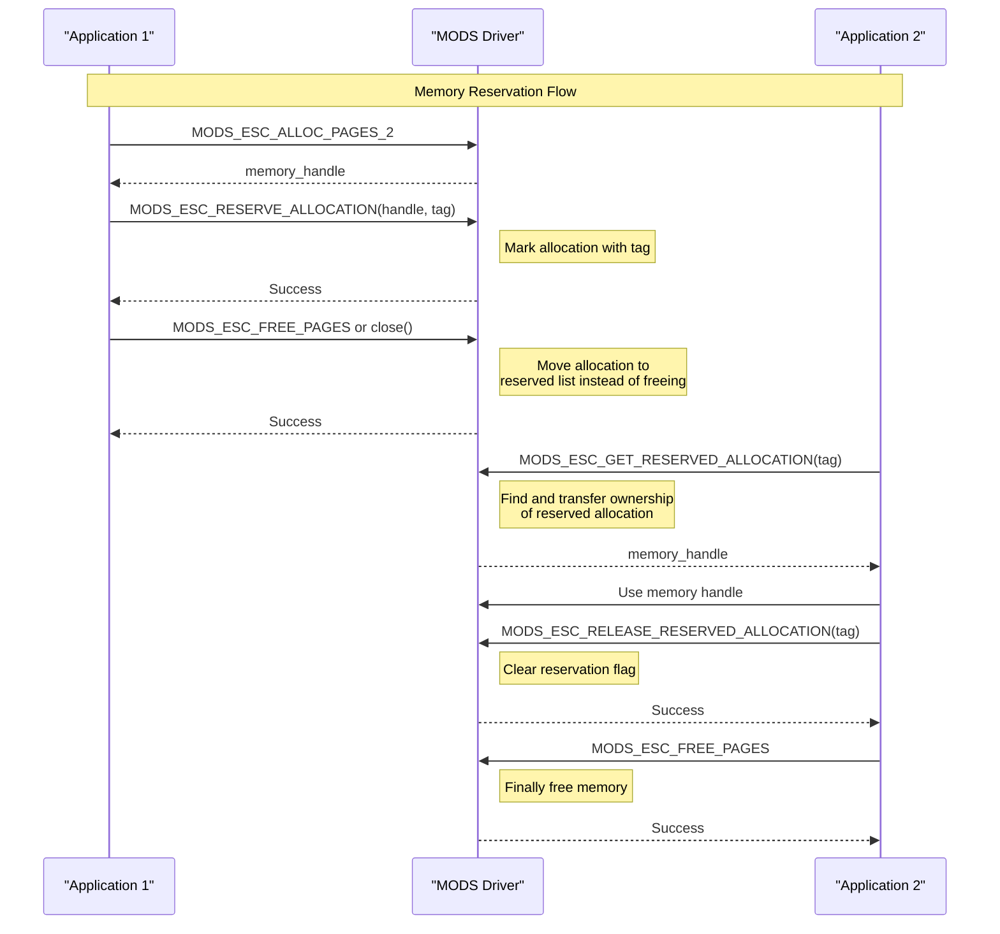
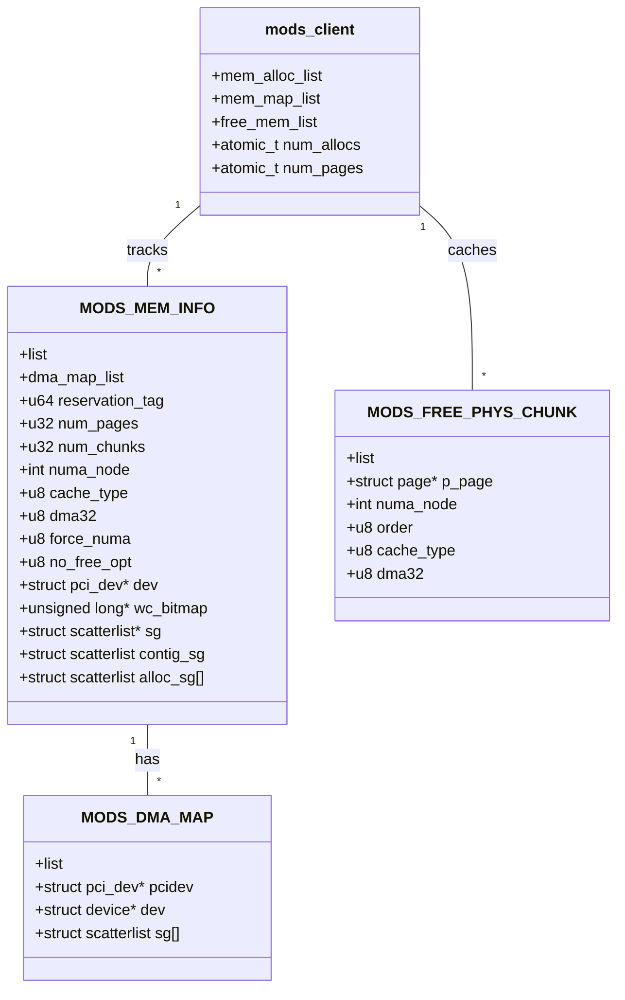

<!-- source: DeepWiki mcp.deepwiki.com · repo NVIDIA/mods-kernel-driver · page 2.1 Memory Management IOCTLs · fetched 2026-10-26 -->

# Memory Management IOCTLs

Relevant source files

The following files were used as context for generating this wiki page:

- [mods.h](mods.h)
- [mods_internal.h](mods_internal.h)
- [mods_mem.c](mods_mem.c)

This page documents the Input/Output Control (IOCTL) interfaces for memory management provided by the NVIDIA MODS kernel driver. These IOCTLs enable user applications to allocate, map, and manage system memory for hardware access in a way that's optimized for debugging and diagnostic purposes. For information about the overall IOCTL interface, see [IOCTL Interface](#2).

## Overview

The MODS kernel driver provides a comprehensive set of memory management IOCTLs that allow user applications to:

1. Allocate system memory with different caching attributes
2. Map memory for DMA access by devices
3. Translate between physical and virtual addresses
4. Perform memory reservations for sharing between processes
5. Manage CPU cache for memory regions

These operations are essential for hardware diagnostics, debugging, and development applications that need direct access to physical memory and hardware resources.

Sources: [mods.h:1-2017](), [mods_mem.c:1-2929]()

## Memory Allocation and Deallocation

### Allocation Types and Parameters

The MODS driver provides several IOCTLs for memory allocation with different parameters:

| IOCTL | Description | Structure | 
|-------|-------------|-----------|
| `MODS_ESC_ALLOC_PAGES_2` | Modern allocation with full options | `MODS_ALLOC_PAGES_2` |
| `MODS_ESC_DEVICE_ALLOC_PAGES_2` | Allocation with device affinity | `MODS_DEVICE_ALLOC_PAGES_2` |
| `MODS_ESC_ALLOC_PAGES` | Legacy allocation | `MODS_ALLOC_PAGES` |
| `MODS_ESC_DEVICE_ALLOC_PAGES` | Legacy device allocation | `MODS_DEVICE_ALLOC_PAGES` |
| `MODS_ESC_FREE_PAGES` | Release allocated memory | `MODS_FREE_PAGES` |
| `MODS_ESC_MERGE_PAGES` | Combine multiple allocations | `MODS_MERGE_PAGES` |

Key allocation flags (`MODS_ALLOC_PAGES_2.flags`):

| Flag | Purpose |
|------|---------|
| `MODS_ALLOC_CACHED` | Default writeback caching |
| `MODS_ALLOC_UNCACHED` | Uncached memory (UC) |
| `MODS_ALLOC_WRITECOMBINE` | Write-combined memory (WC) |
| `MODS_ALLOC_DMA32` | Force 32-bit physical addresses |
| `MODS_ALLOC_CONTIGUOUS` | Allocate physically contiguous memory |
| `MODS_ALLOC_USE_NUMA` | Use specified NUMA node |
| `MODS_ALLOC_FORCE_NUMA` | Force allocation from specified NUMA node |
| `MODS_ALLOC_MAP_DEV` | Automatically DMA map to device |
| `MODS_ALLOC_DMA_PAGES` | Allocate from DMA region |

Sources: [mods.h:74-136](), [mods_mem.c:1368-1700]()

### Memory Allocation Flow

Sources: [mods_mem.c:1368-1570](), [mods_mem.c:807-963](), [mods_mem.c:976-988]()

### Memory Deallocation and Clean-up

When memory is freed with `MODS_ESC_FREE_PAGES`, the driver performs several important operations:

1. Locates the corresponding memory handle in the client's allocation list
2. Unmaps any DMA mappings associated with the allocation
3. For non-cached memory (UC/WC), may save the chunks for later reuse to avoid expensive cache attribute changes
4. Restores default cache attributes for the memory
5. Releases the physical memory pages
6. Removes the allocation from the client's tracking list

Memory with writecombine (WC) or uncached (UC) attributes is cached by the driver after freeing to optimize future allocations because changing CPU cache attributes is an expensive operation.

Sources: [mods_mem.c:1701-1716](), [mods_mem.c:991-1040](), [mods_mem.c:497-557]()

## Memory Address Translation

The MODS driver provides several IOCTLs to translate between different types of memory addresses:

| IOCTL | Description | Structure |
|-------|-------------|-----------|
| `MODS_ESC_GET_PHYSICAL_ADDRESS_2` | Get physical address from memory handle | `MODS_GET_PHYSICAL_ADDRESS_3` |
| `MODS_ESC_GET_MAPPED_PHYSICAL_ADDRESS_3` | Get DMA/IOVA address for device | `MODS_GET_PHYSICAL_ADDRESS_3` |
| `MODS_ESC_VIRTUAL_TO_PHYSICAL` | Convert virtual to physical address | `MODS_VIRTUAL_TO_PHYSICAL` |
| `MODS_ESC_PHYSICAL_TO_VIRTUAL` | Convert physical to virtual address | `MODS_PHYSICAL_TO_VIRTUAL` |

Sources: [mods.h:244-319](), [mods_mem.c:1068-1192](), [mods_mem.c:2076-2199](), [mods_mem.c:2201-2280]()

## DMA Memory Mapping

DMA mapping enables devices to access system memory through IOMMU or direct physical memory access. The MODS driver provides IOCTLs to manage these mappings:

| IOCTL | Description | Structure |
|-------|-------------|-----------|
| `MODS_ESC_DMA_MAP_MEMORY` | Map memory to a device for DMA | `MODS_DMA_MAP_MEMORY` |
| `MODS_ESC_DMA_UNMAP_MEMORY` | Unmap memory from a device | `MODS_DMA_MAP_MEMORY` |
| `MODS_ESC_IOMMU_DMA_MAP_MEMORY` | Map memory through IOMMU (Tegra) | `MODS_IOMMU_DMA_MAP_MEMORY` |
| `MODS_ESC_IOMMU_DMA_UNMAP_MEMORY` | Unmap IOMMU mappings (Tegra) | `MODS_IOMMU_DMA_MAP_MEMORY` |
| `MODS_ESC_PCI_SET_DMA_MASK` | Set device DMA capabilities | `MODS_PCI_DMA_MASK` |

Sources: [mods.h:338-376](), [mods_mem.c:60-266](), [mods_mem.c:2370-2480](), [mods_mem.c:2483-2606]()

### Memory Types for DMA

The MODS driver supports different memory caching modes, crucial for DMA operations:

1. **Cached (WB)**: Normal write-back caching, default for CPU access but may require cache maintenance for DMA.
2. **Uncached (UC)**: No caching, slower for CPU but safe for coherent DMA.
3. **Write-combine (WC)**: Write combined caching, good for DMA with optimized write performance.

When allocating memory with `MODS_ALLOC_MAP_DEV`, the driver automatically maps the memory to the device for DMA, avoiding the need for separate `DMA_MAP_MEMORY` calls.

Sources: [mods.h:116-121](), [mods_mem.c:419-469]()

## Memory Reservation System

The memory reservation system allows memory allocations to be "reserved" and later claimed by another process or context. This feature is useful for sharing memory between different applications:

| IOCTL | Description | Structure |
|-------|-------------|-----------|
| `MODS_ESC_RESERVE_ALLOCATION` | Reserve a memory allocation with a tag | `MODS_RESERVE_ALLOCATION` |
| `MODS_ESC_GET_RESERVED_ALLOCATION` | Claim a previously reserved allocation | `MODS_RESERVE_ALLOCATION` |
| `MODS_ESC_RELEASE_RESERVED_ALLOCATION` | Release a reservation | `MODS_RESERVE_ALLOCATION` |

Sources: [mods.h:1983-2013](), [mods_mem.c:2609-2792](), [mods_mem.c:2898-2928]()

## Cache Management

Cache management is essential for CPU and device memory coherency. The MODS driver provides IOCTLs to control cache attributes and operations:

| IOCTL | Description | Structure |
|-------|-------------|-----------|
| `MODS_ESC_SET_CACHE_ATTR` | Modify caching attributes | `MODS_SET_CACHE_ATTR` |
| `MODS_ESC_SET_MEMORY_TYPE` | Set memory type for I/O ranges | `MODS_MEMORY_TYPE` |
| `MODS_ESC_FLUSH_CPU_CACHE_RANGE` | Flush CPU cache for memory range (ARM64) | `MODS_FLUSH_CPU_CACHE_RANGE` |

The cache attributes available are:
- `MODS_ALLOC_CACHED` (5): Normal write-back caching
- `MODS_ALLOC_UNCACHED` (1): No caching
- `MODS_ALLOC_WRITECOMBINE` (2): Write-combined caching

Changing cache attributes requires special handling in the kernel, which might involve:
1. Mapping pages in the kernel
2. Calling architecture-specific functions like `set_memory_uc()` or `set_memory_wc()`
3. On ARM64, using specific cache maintenance instructions

Sources: [mods.h:217-223](), [mods_mem.c:1717-1784](), [mods_mem.c:2794-2896](), [mods.h:1193-1204]()

## Internal Memory Tracking

The MODS driver uses several important internal structures to track memory allocations:

Key internal functions for memory management:

| Function | Purpose |
|----------|---------|
| `get_mem_handle()` | Validates and retrieves memory info from a handle |
| `register_alloc()` | Adds allocation to client tracking list |
| `unregister_and_free_alloc()` | Removes and deallocates memory |
| `setup_cache_attr()` | Configures CPU cache attributes for memory |
| `alloc_chunk()` | Allocates a single memory chunk |
| `alloc_contig_sys_pages()` | Allocates contiguous memory |
| `alloc_noncontig_sys_pages()` | Allocates non-contiguous memory |
| `dma_map_all()` | Maps all memory chunks for DMA |
| `dma_unmap_all()` | Unmaps all DMA mappings |
| `create_dma_map()` | Creates a new DMA mapping |

Sources: [mods_internal.h:137-163](), [mods_mem.c:24-144](), [mods_mem.c:267-420]()

## Architecture-Specific Considerations

The memory management IOCTLs have some architecture-specific behaviors:

### x86/x86_64
- Full support for all memory types (UC, WC, WB)
- Uses `set_memory_uc()`, `set_memory_wc()`, and `set_memory_wb()` for cache type changes

### ARM64
- Provides `MODS_ESC_FLUSH_CPU_CACHE_RANGE` for explicit cache maintenance
- Uses ARM-specific cache maintenance instructions for UC/WC memory
- May require explicit cache flushing for DMA coherency on non-coherent systems

### PowerPC (ppc64le)
- Special handling for NVLink address compression
- Uses TCE bypass mode for certain operations
- Limited cache type support compared to x86

Sources: [mods_mem.c:2794-2896](), [mods_mem.c:82-103](), [mods_internal.h:327-338]()

## Best Practices

1. **Memory Allocation**:
   - Use `MODS_ESC_ALLOC_PAGES_2` for new code (most flexible)
   - Prefer non-contiguous allocations for large memory regions
   - Specify appropriate cache attributes based on usage

2. **DMA Mapping**:
   - Use `MODS_ALLOC_MAP_DEV` flag during allocation when possible
   - Explicitly unmap DMA mappings before freeing memory
   - Set appropriate DMA mask with `MODS_ESC_PCI_SET_DMA_MASK` for >32-bit addressing

3. **Cache Management**:
   - Use WC memory for device-to-memory transfers when possible
   - Use uncached memory for bidirectional DMA when coherency is a concern
   - On ARM64, use `MODS_ESC_FLUSH_CPU_CACHE_RANGE` when necessary

4. **Memory Reservations**:
   - Use unique, non-zero tags for reservations
   - Always release reservations when no longer needed
   - Don't DMA-map reserved memory (not supported)

Sources: [mods_mem.c:1368-1570](), [mods_mem.c:2370-2480](), [mods_mem.c:2609-2792]()

---

