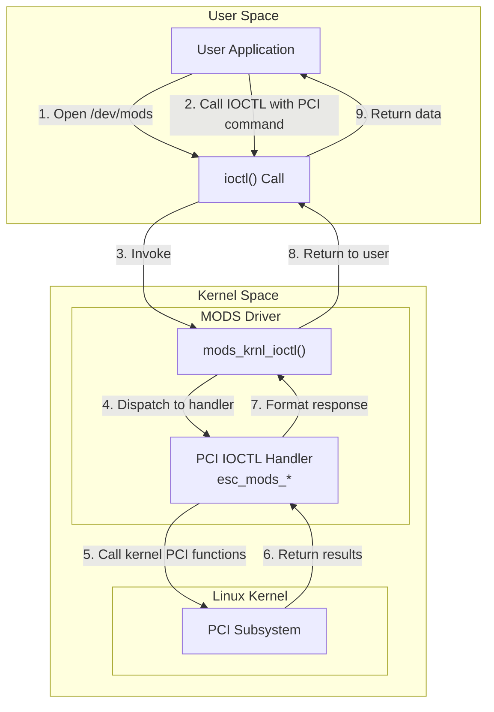
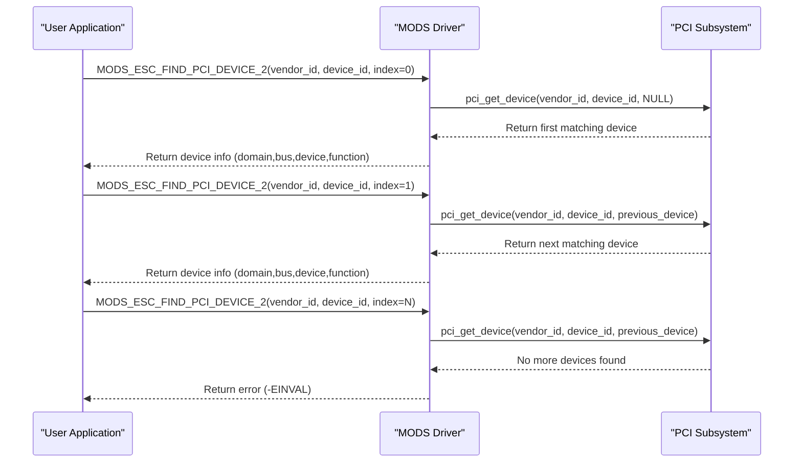
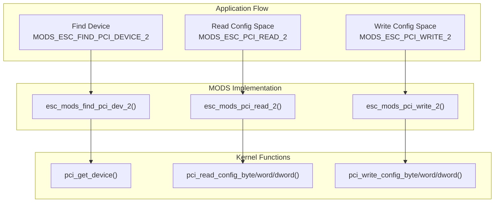
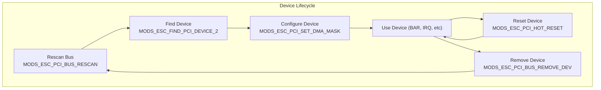

<!-- source: DeepWiki mcp.deepwiki.com · repo NVIDIA/mods-kernel-driver · page 2.2 PCI Management IOCTLs · fetched 2026-10-26 -->

# PCI Management IOCTLs

<details>
<summary>Relevant source files</summary>

The following files were used as context for generating this wiki page:

- [mods.h](mods.h)
- [mods_internal.h](mods_internal.h)
- [mods_pci.c](mods_pci.c)

</details>


The PCI Management IOCTLs provide mechanisms for user applications to discover, query and interact with PCI devices through the MODS (Module Overlay and Driver Support) kernel driver. This page documents the IOCTLs related to PCI device discovery, configuration space access, resource information retrieval, bus management, and other PCI-related operations.

For memory management operations related to PCI devices, see [Memory Management IOCTLs](#2.1). For interrupt handling specific to PCI devices, see [Interrupt Handling IOCTLs](#2.3).

## PCI IOCTL Overview

The MODS driver exposes several PCI-related IOCTLs that allow user applications to perform operations such as:

- Finding PCI devices by vendor ID, device ID, or class code
- Reading and writing PCI configuration space registers
- Obtaining information about PCI resources (BARs, IRQs)
- Scanning PCI buses for devices
- Removing PCI devices from the bus
- Setting DMA properties for PCI devices
- Resetting PCI functions
- Reading device properties from firmware

The following diagram illustrates the flow of PCI-related IOCTLs through the MODS driver:



Sources: [mods_internal.h:414-414](), [mods_pci.c:19-996]()

## PCI Device Representation

PCI devices in the MODS driver are represented using the `mods_pci_dev_2` structure:

```
struct mods_pci_dev_2 {
    __u16 domain;
    __u16 bus;
    __u16 device;
    __u16 function;
};
```

This structure contains all the components necessary to uniquely identify a PCI device in the system, including the PCI domain, bus number, device number, and function number.

Sources: [mods.h:61-66]()

## Available PCI Management IOCTLs

The following table lists the available PCI Management IOCTLs and their purposes:

| IOCTL Command | Purpose | Input/Output Structure |
|---------------|---------|------------------------|
| `MODS_ESC_FIND_PCI_DEVICE_2` | Find a PCI device by vendor and device ID | `MODS_FIND_PCI_DEVICE_2` |
| `MODS_ESC_FIND_PCI_CLASS_CODE_2` | Find a PCI device by class code | `MODS_FIND_PCI_CLASS_CODE_2` |
| `MODS_ESC_PCI_READ_2` | Read from PCI configuration space | `MODS_PCI_READ_2` |
| `MODS_ESC_PCI_WRITE_2` | Write to PCI configuration space | `MODS_PCI_WRITE_2` |
| `MODS_ESC_PCI_GET_BAR_INFO_2` | Get BAR information for a PCI device | `MODS_PCI_GET_BAR_INFO_2` |
| `MODS_ESC_PCI_GET_IRQ_2` | Get IRQ information for a PCI device | `MODS_PCI_GET_IRQ_2` |
| `MODS_ESC_PCI_BUS_RESCAN` | Rescan a PCI bus for devices | `MODS_PCI_BUS_RESCAN` |
| `MODS_ESC_PCI_BUS_REMOVE_DEV` | Remove a PCI device from the bus | `MODS_PCI_BUS_REMOVE_DEV` |
| `MODS_ESC_PCI_HOT_RESET` | Perform a hot reset on a PCI device | `MODS_PCI_HOT_RESET` |
| `MODS_ESC_PCI_SET_DMA_MASK` | Set the DMA mask for a PCI device | `MODS_PCI_DMA_MASK` |
| `MODS_ESC_GET_IOMMU_STATE_2` | Get IOMMU state for a PCI device | `MODS_GET_IOMMU_STATE` |
| `MODS_ESC_READ_DEV_PROPERTY` | Read a device property from firmware | `MODS_READ_DEV_PROPERTY` |

Sources: [mods.h:2018-2185]()

## PCI Device Discovery

The MODS driver provides IOCTLs for discovering PCI devices by vendor/device ID or by PCI class code.

### Finding Devices by Vendor and Device ID

The `MODS_ESC_FIND_PCI_DEVICE_2` IOCTL is used to find PCI devices with a specific vendor ID and device ID:



To enumerate all PCI devices with a specific vendor and device ID:
1. Start with `index = 0`
2. Call `MODS_ESC_FIND_PCI_DEVICE_2` with the vendor ID, device ID, and index
3. Increment the index and repeat until the IOCTL returns an error

Sources: [mods.h:411-419](), [mods_pci.c:130-134]()

### Finding Devices by Class Code

The `MODS_ESC_FIND_PCI_CLASS_CODE_2` IOCTL works similarly but finds devices by PCI class code instead:

```
struct MODS_FIND_PCI_CLASS_CODE_2 {
    /* IN */
    __u32 class_code;       /* PCI class code to search for */
    __u32 index;            /* Device index (0-based) */
    
    /* OUT */
    struct mods_pci_dev_2 pci_device;  /* Found device */
};
```

The enumeration process is the same as with `MODS_ESC_FIND_PCI_DEVICE_2`.

Sources: [mods.h:460-467](), [mods_pci.c:198-202]()

## PCI Configuration Space Access

The MODS driver provides IOCTLs for reading from and writing to PCI configuration space.



### Reading from Configuration Space

The `MODS_ESC_PCI_READ_2` IOCTL is used to read from PCI configuration space:

```
struct MODS_PCI_READ_2 {
    /* IN */
    struct mods_pci_dev_2 pci_device;  /* Target PCI device */
    __u32 address;                     /* Register offset in config space */
    __u32 data_size;                   /* Size to read (1, 2, or 4 bytes) */
    
    /* OUT */
    __u32 data;                        /* Data read from register */
};
```

Key points:
- `address` must be less than or equal to `MODS_MAX_PCI_CFG_ADDR` (0xFFF)
- `data_size` must be 1, 2, or 4 bytes
- For 1-byte reads, only the lower 8 bits of `data` are valid
- For 2-byte reads, only the lower 16 bits of `data` are valid

Sources: [mods.h:536-544](), [mods_pci.c:370-449]()

### Writing to Configuration Space

The `MODS_ESC_PCI_WRITE_2` IOCTL is used to write to PCI configuration space:

```
struct MODS_PCI_WRITE_2 {
    /* IN */
    struct mods_pci_dev_2 pci_device;  /* Target PCI device */
    __u32 address;                     /* Register offset in config space */
    __u32 data;                        /* Data to write */
    __u32 data_size;                   /* Size to write (1, 2, or 4 bytes) */
};
```

The same constraints apply as with `MODS_ESC_PCI_READ_2`.

Sources: [mods.h:565-571](), [mods_pci.c:484-546]()

## PCI Resource Management

The MODS driver provides IOCTLs for retrieving information about PCI resources such as BARs (Base Address Registers) and IRQs.

### PCI BAR Information

The `MODS_ESC_PCI_GET_BAR_INFO_2` IOCTL retrieves information about a PCI BAR:

```
struct MODS_PCI_GET_BAR_INFO_2 {
    /* IN */
    struct mods_pci_dev_2 pci_device;  /* Target PCI device */
    __u32 bar_index;                   /* BAR index (0-5) */
    
    /* OUT */
    __u64 base_address;                /* Physical base address of the BAR */
    __u64 bar_size;                    /* Size of the BAR region */
};
```

The implementation handles 64-bit BARs, which occupy two consecutive BAR registers.

Sources: [mods.h:485-493](), [mods_pci.c:224-298]()

### PCI IRQ Information

The `MODS_ESC_PCI_GET_IRQ_2` IOCTL retrieves the IRQ number assigned to a PCI device:

```
struct MODS_PCI_GET_IRQ_2 {
    /* IN */
    struct mods_pci_dev_2 pci_device;  /* Target PCI device */
    
    /* OUT */
    __u32 irq;                         /* IRQ number */
};
```

This returns the legacy IRQ number. For MSI or MSI-X interrupts, see [Interrupt Handling IOCTLs](#2.3).

Sources: [mods.h:513-519](), [mods_pci.c:322-349]()

## PCI Bus Management

The MODS driver provides IOCTLs for managing PCI buses and devices.



### Rescanning a PCI Bus

The `MODS_ESC_PCI_BUS_RESCAN` IOCTL initiates a rescan of a PCI bus to discover new devices:

```
struct MODS_PCI_BUS_RESCAN {
    /* IN */
    __u16 domain;  /* PCI domain */
    __u16 bus;     /* PCI bus number */
};
```

This is useful after hot-plugging a PCI device.

Sources: [mods.h:609-613](), [mods_pci.c:592-626]()

### Removing a PCI Device

The `MODS_ESC_PCI_BUS_REMOVE_DEV` IOCTL stops and removes a PCI device from the bus:

```
struct MODS_PCI_BUS_REMOVE_DEV {
    /* IN */
    struct mods_pci_dev_2 pci_device;  /* PCI device to remove */
};
```

This is useful before hot-unplugging a PCI device.

Sources: [mods.h:598-601](), [mods_pci.c:628-663]()

### Setting a DMA Mask

The `MODS_ESC_PCI_SET_DMA_MASK` IOCTL sets the DMA mask for a PCI device:

```
struct MODS_PCI_DMA_MASK {
    /* IN */
    struct mods_pci_dev_2 pci_device;  /* Target PCI device */
    __u32 num_bits;                    /* Number of bits in DMA mask (e.g., 32, 64) */
};
```

This tells the kernel that the PCI device supports a DMA address of the given bit width. By default, the kernel assumes every device supports 32-bit addresses.

Sources: [mods.h:376-380](), [mods_pci.c:923-996]()

## IOMMU State Querying

The `MODS_ESC_GET_IOMMU_STATE_2` IOCTL attempts to determine whether IOMMU has been enabled for a given PCI device:

```
struct MODS_GET_IOMMU_STATE {
    /* IN */
    struct mods_pci_dev_2 pci_device;  /* Target PCI device */
    
    /* OUT */
    __u32 state;                       /* IOMMU state */
};
```

The `state` field can have one of the following values:
- `MODS_SWIOTLB_DISABLED` (0): Hardware IOMMU may be enabled
- `MODS_SWIOTLB_ACTIVE` (1): Hardware IOMMU is disabled
- `MODS_SWIOTLB_INDETERMINATE` (2): Unable to determine the state of SWIOTLB

Sources: [mods.h:392-397](), [mods_pci.c:889-921]()

## Hot Reset Function

The `MODS_ESC_PCI_HOT_RESET` IOCTL performs a function-level reset on a PCI device:

```
struct MODS_PCI_HOT_RESET {
    /* IN */
    struct mods_pci_dev_2 pci_device;  /* Target PCI device */
};
```

This functionality is currently implemented only for the ppc64le architecture.

Sources: [mods.h:589-592](), [mods_pci.c:998-1018]()

## Device Property Reading

The `MODS_ESC_READ_DEV_PROPERTY` IOCTL reads a device property from firmware:

```
struct MODS_READ_DEV_PROPERTY {
    /* IN */
    struct mods_pci_dev_2 pci_device;          /* Target PCI device */
    char prop_name[MODS_MAX_PROP_NAME_LEN];    /* Property name */
    __u32 array_size;                          /* Size of output array */
    __u8 type;                                 /* Property type (currently only MODS_PROP_TYPE_U64) */
    __u8 dummy_align[3];                       /* Alignment padding */
    
    /* OUT */
    __u8 output[MODS_MAX_PROP_SIZE];           /* Output buffer for property value */
};
```

Currently, only 64-bit unsigned integer properties (`MODS_PROP_TYPE_U64`) are supported.

Sources: [mods.h:1924-1938](), [mods_pci.c:1079-1131]()

## Legacy IOCTLs

Several of the PCI-related IOCTLs have legacy versions that are maintained for backward compatibility:

| Modern IOCTL | Legacy IOCTL |
|--------------|--------------|
| `MODS_ESC_FIND_PCI_DEVICE_2` | `MODS_ESC_FIND_PCI_DEVICE` |
| `MODS_ESC_FIND_PCI_CLASS_CODE_2` | `MODS_ESC_FIND_PCI_CLASS_CODE` |
| `MODS_ESC_PCI_READ_2` | `MODS_ESC_PCI_READ` |
| `MODS_ESC_PCI_WRITE_2` | `MODS_ESC_PCI_WRITE` |
| `MODS_ESC_PCI_GET_BAR_INFO_2` | `MODS_ESC_PCI_GET_BAR_INFO` |
| `MODS_ESC_PCI_GET_IRQ_2` | `MODS_ESC_PCI_GET_IRQ` |
| `MODS_ESC_GET_IOMMU_STATE_2` | `MODS_ESC_GET_IOMMU_STATE` |
| `MODS_ESC_PCI_BUS_RESCAN` | `MODS_ESC_PCI_BUS_ADD_DEVICES` |

The legacy versions generally use the older `mods_pci_dev` structure (without the domain field) and have different internal implementations. New applications should use the modern versions.

Sources: [mods.h:69-73](), [mods.h:440-479]()

---

