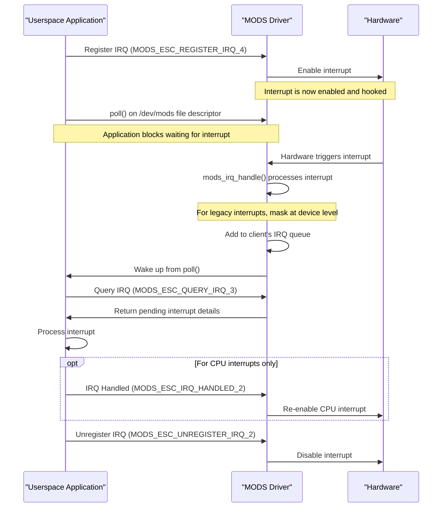
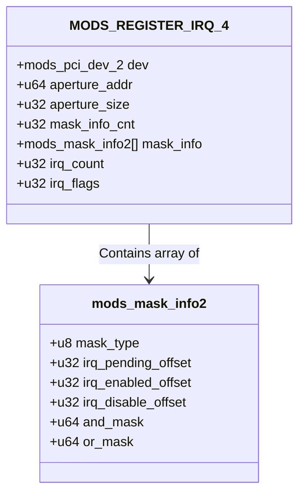
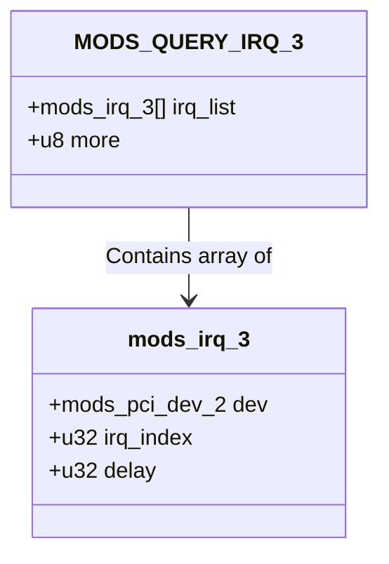
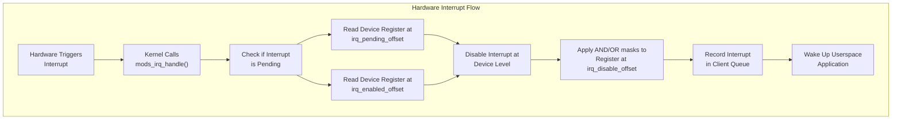

<!-- source: DeepWiki mcp.deepwiki.com · repo NVIDIA/mods-kernel-driver · page 2.3 Interrupt Handling IOCTLs · fetched 2026-10-26 -->

# Interrupt Handling IOCTLs

Relevant source files

The following files were used as context for generating this wiki page:

- [mods.h](mods.h)
- [mods_internal.h](mods_internal.h)
- [mods_irq.c](mods_irq.c)

This page documents the MODS kernel driver's interface for interrupt handling. These IOCTLs allow userspace applications to register for hardware interrupts, wait for them to occur, query their details, and handle them appropriately. This functionality is essential for hardware debugging, diagnostics, and development work involving NVIDIA hardware.

For information on other related subsystems, see [Core Implementation](#3) and [Interrupt Management](#5.2).

## Interrupt Types Supported

The MODS driver supports several types of hardware interrupts:

| Interrupt Type | Description | Platform Availability | Characteristics |
|----------------|-------------|------------------------|-----------------|
| Legacy (INTx) | Traditional PCI interrupts (INTA, INTB, INTC, INTD) | x86 only | Level-triggered, can be shared between devices |
| MSI | Message Signaled Interrupts | All platforms | Edge-triggered, not shared, requires PCI 2.2+ |
| MSI-X | Extended MSI | All platforms | Multiple vectors per device, requires PCI 3.0+ |
| CPU | Direct processor interrupts | Primarily Tegra | Platform-specific interrupts |

Sources: [mods.h:828-832]()

## Interrupt Handling Flow

The typical workflow for interrupt handling via MODS follows this sequence:

Sources: [mods_irq.c:313-356](), [mods_irq.c:647-660](), [mods_irq.c:1351-1436]()

## Registration IOCTLs

### MODS_ESC_REGISTER_IRQ_4

The current recommended way to register interrupts. It supports all interrupt types with the most flexibility.

**Structure**: `MODS_REGISTER_IRQ_4`

**Key Fields**:
- `dev`: PCI device for which interrupt is being hooked (for PCI interrupts) or CPU interrupt index (for CPU interrupts)
- `aperture_addr`: Physical address of memory region to map for legacy interrupt masking
- `aperture_size`: Size of the mapped region
- `mask_info_cnt`: Number of entries in mask_info array
- `mask_info`: Array of structures defining how to mask interrupts at the device level
- `irq_count`: Number of interrupt vectors to allocate (must be 1 except for MSI-X)
- `irq_flags`: Defines the interrupt type and other flags

**Interrupt Types** (`irq_flags` field):
- `MODS_IRQ_TYPE_INT` (0): Legacy interrupt
- `MODS_IRQ_TYPE_MSI` (1): MSI
- `MODS_IRQ_TYPE_CPU` (2): CPU interrupt vector
- `MODS_IRQ_TYPE_MSIX` (3): MSI-X

Sources: [mods.h:792-825](), [mods.h:828-832]()

### MODS_ESC_REGISTER_IRQ_3

An older version of the register IRQ IOCTL, superseded by MODS_ESC_REGISTER_IRQ_4.

**Structure**: `MODS_REGISTER_IRQ_3`

Sources: [mods.h:838-847](), [mods_irq.c:1237-1266]()

### MODS_ESC_REGISTER_IRQ_2

An even older version of the register IRQ IOCTL, still supported for backward compatibility.

**Structure**: `MODS_REGISTER_IRQ_2`

Sources: [mods.h:856-860](), [mods_irq.c:1268-1308]()

### MODS_ESC_REGISTER_IRQ

The legacy version of the register IRQ IOCTL.

**Structure**: `MODS_REGISTER_IRQ`

Sources: [mods.h:867-871](), [mods_irq.c:1310-1322]()

## Unregistration IOCTLs

### MODS_ESC_UNREGISTER_IRQ_2

The current recommended way to unregister interrupts.

**Structure**: `MODS_REGISTER_IRQ_2` (same as registration)

**Implementation**:
- For PCI devices, calls `mods_unregister_pci_irq()`
- For CPU interrupts, calls `mods_unregister_cpu_irq()`
- Frees all resources associated with the interrupt

Sources: [mods.h:856-860](), [mods_irq.c:1324-1334]()

### MODS_ESC_UNREGISTER_IRQ

The legacy version of the unregister IRQ IOCTL.

**Structure**: `MODS_REGISTER_IRQ`

Sources: [mods.h:867-871](), [mods_irq.c:1336-1348]()

## Query IOCTLs

### MODS_ESC_QUERY_IRQ_3

The current recommended way to query pending interrupts.

**Structure**: `MODS_QUERY_IRQ_3`

**Key Fields**:
- `irq_list`: Array of pending interrupt information structures
  - `dev`: Device which generated the interrupt
  - `irq_index`: Index of MSI-X interrupt, or 0 for other types
  - `delay`: Microseconds since the interrupt occurred
- `more`: Flag indicating if more interrupts are pending that couldn't fit in the array

**Usage**:
1. Application calls `poll()` on the MODS file descriptor
2. When interrupted, application calls this IOCTL to retrieve pending interrupt details
3. If `more` is set, application should call the IOCTL again to retrieve additional pending interrupts

Sources: [mods.h:917-922](), [mods.h:874-878](), [mods_irq.c:1350-1433]()

### MODS_ESC_QUERY_IRQ_2

An older version of the query IRQ IOCTL.

**Structure**: `MODS_QUERY_IRQ_2`

Sources: [mods.h:924-928](), [mods_irq.c:1435-1451]()

### MODS_ESC_QUERY_IRQ

The legacy version of the query IRQ IOCTL.

**Structure**: `MODS_QUERY_IRQ`

Sources: [mods.h:932-935](), [mods_irq.c:1453-1483]()

## Handling IOCTLs

### MODS_ESC_IRQ_HANDLED_2

Used to mark a CPU interrupt as handled. Only applicable for CPU interrupts.

**Structure**: `MODS_REGISTER_IRQ_2` (same as registration)

**Implementation**:
- Re-enables the CPU interrupt using `enable_irq()`
- Only valid for interrupt type `MODS_IRQ_TYPE_CPU`

Sources: [mods.h:856-860](), [mods_irq.c:1485-1523]()

### MODS_ESC_IRQ_HANDLED

The legacy version of the IRQ handled IOCTL.

**Structure**: `MODS_REGISTER_IRQ`

Sources: [mods.h:867-871](), [mods_irq.c:1525-1537]()

## Interrupt Masking Mechanism

For legacy interrupts, which are level-triggered, the MODS driver implements a masking mechanism to prevent interrupt storms (repeated triggering of the same interrupt). This is handled through the `mods_mask_info2` structure:

The masking process:
1. When an interrupt occurs, MODS reads the device register at `irq_pending_offset` to check if the interrupt is pending
2. It also reads the register at `irq_enabled_offset` to check if the interrupt is enabled
3. If both conditions are true, it:
   - Reads the register at `irq_disable_offset`
   - Applies the AND mask (`value &= and_mask`)
   - Applies the OR mask (`value |= or_mask`)
   - Writes the result back to the register at `irq_disable_offset`
4. This effectively disables the interrupt at the device level
5. The userspace application is responsible for clearing the interrupt condition and re-enabling it

Sources: [mods.h:758-767](), [mods_irq.c:142-176](), [mods_irq.c:201-229]()

## Client Ownership and Cleanup

Each registered interrupt is associated with the client (file descriptor) that registered it. When a client closes its file descriptor, all of its registered interrupts are automatically unregistered through the `mods_free_client_interrupts()` function. This ensures proper cleanup even if a userspace application crashes or terminates unexpectedly.

Sources: [mods_irq.c:772-788]()

---

