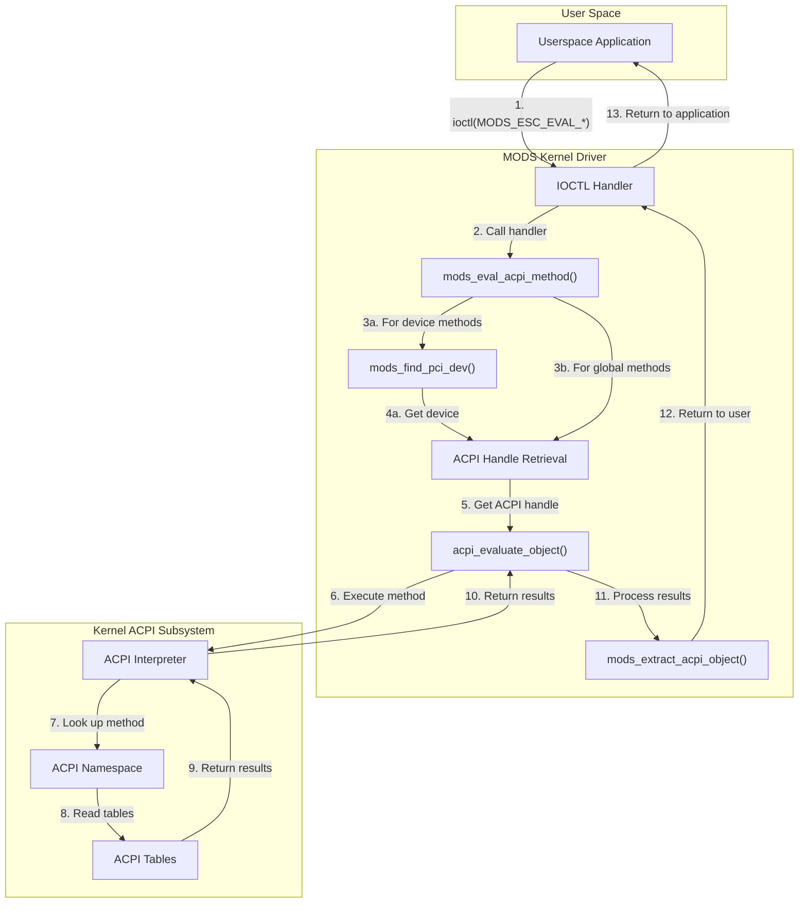
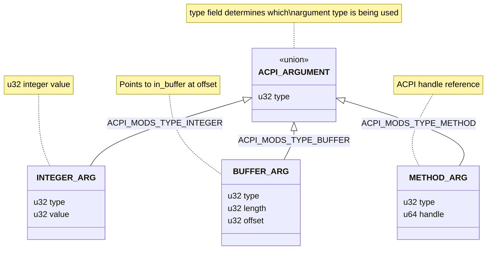

<!-- source: DeepWiki mcp.deepwiki.com · repo NVIDIA/mods-kernel-driver · page 2.4 ACPI Method IOCTLs · fetched 2026-10-26 -->

# ACPI Method IOCTLs

<details>
<summary>Relevant source files</summary>

The following files were used as context for generating this wiki page:

- [mods.h](mods.h)
- [mods_acpi.c](mods_acpi.c)
- [mods_internal.h](mods_internal.h)

</details>


This page documents the ACPI (Advanced Configuration and Power Interface) method IOCTLs provided by the MODS kernel driver. These IOCTLs allow userspace applications to interact with the ACPI subsystem, evaluate ACPI methods, retrieve device information, and query device relationships. For information about the general ACPI interfaces in the driver, see [ACPI Interface](#5.3).

## Overview

The MODS driver provides several IOCTLs for interacting with the ACPI subsystem:

- **ACPI Method Evaluation** - Evaluate arbitrary ACPI methods
- **DDC Data Retrieval** - Get EDID data from display devices
- **Device Hierarchy** - Query ACPI device relationships
- **NUMA Information** - Map proximity domains to NUMA nodes

These IOCTLs enable hardware diagnostics, power management, device enumeration, and system configuration capabilities for userspace applications.

Sources: [mods_acpi.c:579-697](). [mods.h:1033-1164]()

## ACPI Method Evaluation Flow



Sources: [mods_acpi.c:270-444]()

## ACPI Method IOCTLs and Data Structures

```mermaid
classDiagram
    class "MODS_ESC_EVAL_ACPI_METHOD" {
        IOCTL Code: 16
        Evaluates any ACPI method
    }
    
    class "MODS_ESC_EVAL_DEV_ACPI_METHOD_3" {
        IOCTL Code: 69
        Evaluates ACPI method on PCI device
        with specific ACPI ID
    }
    
    class "MODS_ESC_EVAL_DEV_ACPI_METHOD_2" {
        IOCTL Code: 69
        Evaluates ACPI method on PCI device
    }
    
    class "MODS_ESC_ACPI_GET_DDC_2" {
        IOCTL Code: 71
        Gets EDID data from display
    }
    
    class "MODS_ESC_GET_ACPI_DEV_CHILDREN" {
        IOCTL Code: N/A
        Gets child devices
    }
    
    class "ACPI_ARGUMENT" {
        union type
        integer: value
        buffer: length, offset
        method: handle
    }
    
    class "MODS_EVAL_ACPI_METHOD" {
        method_name: char[12]
        argument_count: u32
        argument: ACPI_ARGUMENT[12]
        in_buffer: u8[4096]
        out_data_size: u32
        out_buffer: u8[4096]
        out_status: u32
    }
    
    class "MODS_EVAL_DEV_ACPI_METHOD_3" {
        method: MODS_EVAL_ACPI_METHOD
        device: mods_pci_dev_2
        acpi_id: u32
    }
    
    class "MODS_EVAL_DEV_ACPI_METHOD_2" {
        method: MODS_EVAL_ACPI_METHOD
        device: mods_pci_dev_2
    }
    
    class "MODS_ACPI_GET_DDC_2" {
        out_data_size: u32
        out_buffer: u8[4096]
        device: mods_pci_dev_2
    }
    
    class "MODS_GET_ACPI_DEV_CHILDREN" {
        num_children: u32
        children: u32[16]
        device: mods_pci_dev_2
    }
    
    "MODS_ESC_EVAL_ACPI_METHOD" -- "MODS_EVAL_ACPI_METHOD"
    "MODS_ESC_EVAL_DEV_ACPI_METHOD_3" -- "MODS_EVAL_DEV_ACPI_METHOD_3"
    "MODS_ESC_EVAL_DEV_ACPI_METHOD_2" -- "MODS_EVAL_DEV_ACPI_METHOD_2"
    "MODS_ESC_ACPI_GET_DDC_2" -- "MODS_ACPI_GET_DDC_2"
    "MODS_ESC_GET_ACPI_DEV_CHILDREN" -- "MODS_GET_ACPI_DEV_CHILDREN"
    "MODS_EVAL_ACPI_METHOD" -- "ACPI_ARGUMENT"
```

Sources: [mods.h:1033-1164](), [mods_acpi.c:579-697]()

## Evaluating ACPI Methods

The MODS driver provides several IOCTLs for evaluating ACPI methods, with different variants for global methods and device-specific methods.

### MODS_ESC_EVAL_ACPI_METHOD

This IOCTL evaluates any ACPI method in the system's ACPI tables. It's typically used for evaluating methods that aren't attached to specific devices (e.g., global methods in the DSDT or SSDT).

**Structure**: `MODS_EVAL_ACPI_METHOD`

| Field | Type | Description |
|-------|------|-------------|
| method_name | char[12] | Name of the ACPI method to evaluate |
| argument_count | u32 | Number of arguments to pass |
| argument | ACPI_ARGUMENT[12] | Array of arguments |
| in_buffer | u8[4096] | Buffer data for arguments |
| out_data_size | u32 | Size of returned data |
| out_buffer | u8[4096] | Buffer for returned data |
| out_status | u32 | Status of the evaluation |

**Implementation**: `esc_mods_eval_acpi_method()` [mods_acpi.c:580-584]()

### MODS_ESC_EVAL_DEV_ACPI_METHOD_3

This IOCTL evaluates an ACPI method on a specific PCI device with a specific ACPI device ID.

**Structure**: `MODS_EVAL_DEV_ACPI_METHOD_3`

| Field | Type | Description |
|-------|------|-------------|
| method | MODS_EVAL_ACPI_METHOD | Method to evaluate |
| device | mods_pci_dev_2 | PCI device specification |
| acpi_id | u32 | ACPI device ID (use ACPI_MODS_IGNORE_ACPI_ID to ignore) |

**Implementation**: `esc_mods_eval_dev_acpi_method_3()` [mods_acpi.c:586-593]()

### MODS_ESC_EVAL_DEV_ACPI_METHOD_2

This IOCTL evaluates an ACPI method on a specific PCI device.

**Structure**: `MODS_EVAL_DEV_ACPI_METHOD_2`

| Field | Type | Description |
|-------|------|-------------|
| method | MODS_EVAL_ACPI_METHOD | Method to evaluate |
| device | mods_pci_dev_2 | PCI device specification |

**Implementation**: `esc_mods_eval_dev_acpi_method_2()` [mods_acpi.c:595-602]()

### Legacy: MODS_ESC_EVAL_DEV_ACPI_METHOD

Legacy variant that uses the older PCI device structure.

**Implementation**: `esc_mods_eval_dev_acpi_method()` [mods_acpi.c:604-615]()

Sources: [mods_acpi.c:270-444](), [mods_acpi.c:579-602](), [mods.h:1069-1128]()

## ACPI Argument Types

The `ACPI_ARGUMENT` union supports three types of arguments:



The argument types are defined as:

| Type Constant | Value | Description |
|---------------|-------|-------------|
| ACPI_MODS_TYPE_INTEGER | 1 | 32-bit integer argument |
| ACPI_MODS_TYPE_BUFFER | 2 | Buffer argument (refers to in_buffer) |
| ACPI_MODS_TYPE_METHOD | 3 | ACPI method handle reference |

Sources: [mods.h:1033-1057](), [mods_acpi.c:357-403]()

## DDC/EDID Data Retrieval

The MODS driver provides IOCTLs to retrieve EDID data from display devices connected to graphics adapters using the ACPI _DDC method.

### MODS_ESC_ACPI_GET_DDC_2

This IOCTL retrieves EDID data from a display device connected to a specified PCI device.

**Structure**: `MODS_ACPI_GET_DDC_2`

| Field | Type | Description |
|-------|------|-------------|
| out_data_size | u32 | Size of returned EDID data |
| out_buffer | u8[4096] | Buffer for EDID data |
| device | mods_pci_dev_2 | PCI device specification |

**Implementation Flow**:

1. Finds the specified PCI device
2. Gets the ACPI handle for the device
3. Searches for display devices (LCD panels) attached to the device
4. Calls the _DDC method to retrieve EDID data
5. Returns the EDID data to the user

**Implementation**: `esc_mods_acpi_get_ddc_2()` [mods_acpi.c:617-621]()

### Legacy: MODS_ESC_ACPI_GET_DDC

Legacy variant that uses the older PCI device structure.

**Implementation**: `esc_mods_acpi_get_ddc()` [mods_acpi.c:623-635]()

Sources: [mods_acpi.c:446-574](), [mods.h:1130-1153]()

## ACPI Device Children Query

### MODS_ESC_GET_ACPI_DEV_CHILDREN

This IOCTL retrieves the list of child ACPI devices for a specified PCI device.

**Structure**: `MODS_GET_ACPI_DEV_CHILDREN`

| Field | Type | Description |
|-------|------|-------------|
| num_children | u32 | Number of child devices found |
| children | u32[16] | Array of child device ACPI IDs |
| device | mods_pci_dev_2 | PCI device specification |

**Implementation Flow**:

1. Finds the specified PCI device
2. Gets the ACPI handle for the device
3. Enumerates all child devices in the ACPI namespace
4. Returns the list of ACPI device IDs

**Implementation**: `esc_mods_get_acpi_dev_children()` [mods_acpi.c:637-688]()

Sources: [mods_acpi.c:20-98](), [mods.h:1154-1163](), [mods_acpi.c:637-688]()

## NUMA and Proximity Mapping

On systems with NUMA (Non-Uniform Memory Access) architecture, the MODS driver provides an IOCTL to convert proximity IDs to NUMA node IDs.

### MODS_ESC_PROXIMITY_TO_NUMA_NODE

This IOCTL maps a proximity domain ID to a NUMA node ID.

**Structure**: `MODS_PROXIMITY_TO_NUMA_NODE`

| Field | Type | Description |
|-------|------|-------------|
| proximity | s32 | Proximity domain ID (input) |
| numa_node | s32 | NUMA node ID (output) |

**Implementation**: `esc_mods_proximity_to_numa_node()` [mods_acpi.c:691-696]()

This IOCTL is only available when the kernel is built with `CONFIG_ACPI_PXM_TO_NODE` support.

Sources: [mods_acpi.c:691-696](), [mods_internal.h:507-510]()

## Common Use Cases

### Evaluating ACPI Power Management Methods

The ACPI method evaluation IOCTLs can be used to evaluate power management methods like `_PSx` (power states) and `_DSM` (device-specific methods) to control device power states and behavior.

### Retrieving Display Information

The DDC IOCTLs are commonly used to retrieve EDID data from connected displays to determine their capabilities, supported resolutions, and other characteristics.

### Device Topology Discovery

The device children query IOCTLs help applications discover the topology of ACPI devices, which is useful for system management and diagnostics tools.

### System Architecture Information

The NUMA mapping IOCTL helps applications optimize memory allocations on NUMA systems by providing information about the system's memory architecture.

## Error Handling

ACPI method IOCTLs can return the following error codes:

| Error Code | Description |
|------------|-------------|
| -EINVAL | Invalid argument |
| -ENXIO | ACPI method not found |
| -EIO | ACPI method execution failed |
| -ENODEV | PCI device not found |
| -ENOBUFS | Output buffer too small |
| -EALREADY | Special code used internally (should not be seen by applications) |

Applications should check return values and handle errors appropriately.

Sources: [mods_acpi.c:270-444]()

---

