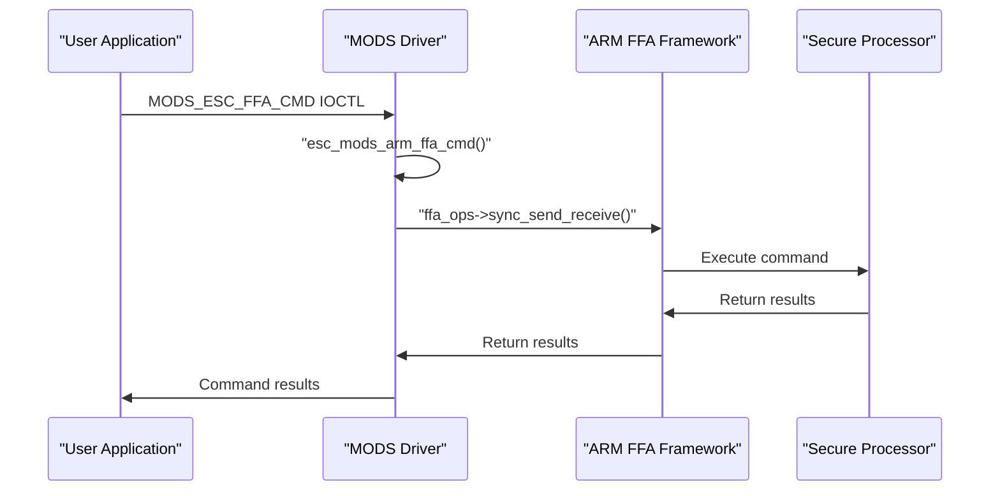
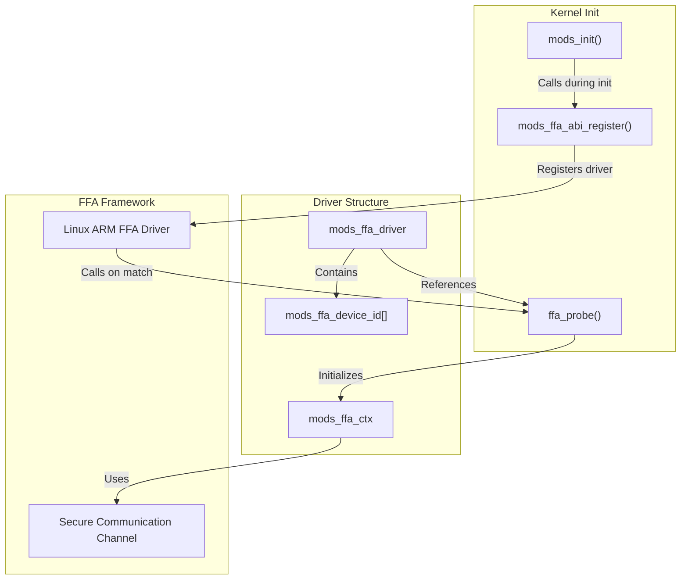
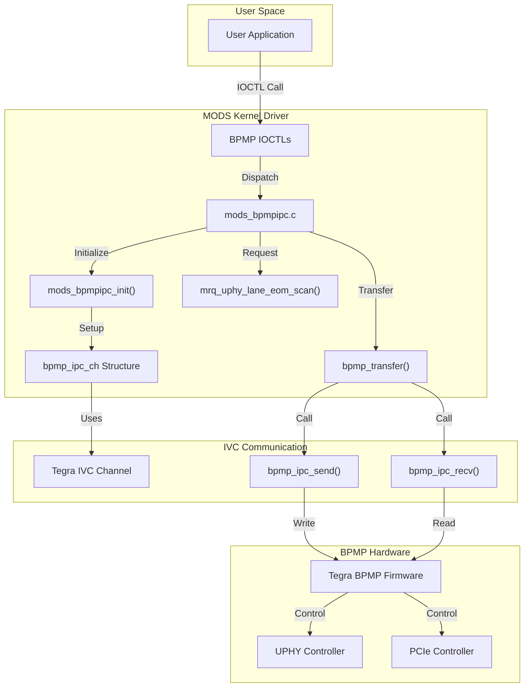
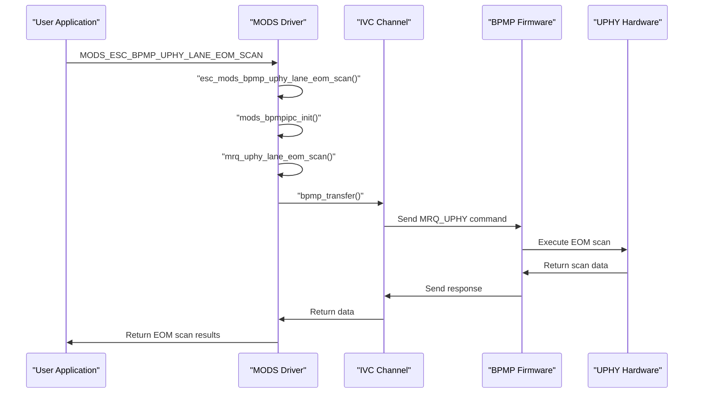
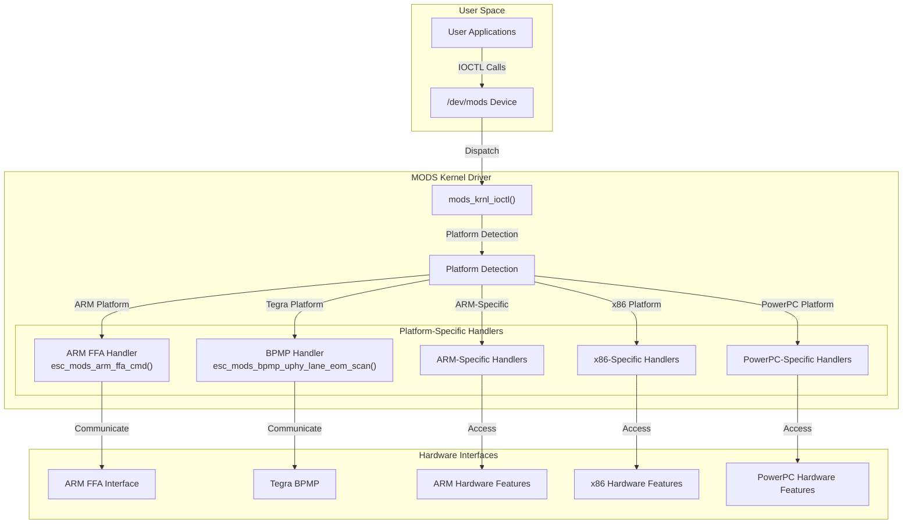

<!-- source: DeepWiki mcp.deepwiki.com · repo NVIDIA/mods-kernel-driver · page 2.5 Platform-Specific IOCTLs · fetched 2026-10-26 -->

# Platform-Specific IOCTLs

<details>
<summary>Relevant source files</summary>

The following files were used as context for generating this wiki page:

- [mods.h](mods.h)
- [mods_arm_ffa.c](mods_arm_ffa.c)
- [mods_bpmpipc.c](mods_bpmpipc.c)

</details>


This page documents the IOCTLs that are specific to particular hardware platforms in the NVIDIA MODS kernel driver. These IOCTLs provide access to platform-unique hardware features and capabilities not commonly available across all supported systems.

The MODS driver implements platform-specific interfaces for:
1. ARM Firmware Framework for ARM (FFA) - For secure processor communication
2. Boot and Power Management Processor (BPMP) - For Tegra platform hardware control
3. Additional platform-specific functionality for ARM, x86, and PowerPC architectures

For information about general-purpose IOCTLs such as memory management or PCI device operations, see [Memory Management IOCTLs](#2.1) and [PCI Management IOCTLs](#2.2).

## ARM FFA Interface

The ARM Firmware Framework for ARM (FFA) interface provides a standardized communication mechanism between normal and secure worlds on ARM platforms. MODS exposes this interface through IOCTLs to allow userspace applications to communicate with secure processors.

### FFA Architecture and Command Flow



Sources: [mods_arm_ffa.c:83-186]()

### Available FFA Commands

The FFA interface supports various command types, specified in the `cmd` field of the `MODS_FFA_PARAMS` structure:

| Command Type | Value | Description |
|--------------|-------|-------------|
| MODS_FFA_CMD_READ_REG | 0 | Read register from secure processor |
| MODS_FFA_CMD_WRITE_REG | 1 | Write value to secure processor register |
| MODS_FFA_CMD_READ_VER | 2 | Read secure processor version information |
| MODS_FFA_CMD_SE_TESTS | 3 | Run Security Engine tests |
| MODS_FFA_CMD_SE_KEY_MOVER | 4 | Key management operations |
| MODS_FFA_CMD_HSS_TEST | 5 | Hardware Security Services test |
| MODS_FFA_CMD_C2C_TEST | 6 | Chip-to-Chip communication test |
| MODS_FFA_CMD_MISC | 7 | Miscellaneous commands |

Sources: [mods.h:1905-1915](), [mods_arm_ffa.c:101-136]()

### FFA IOCTL Usage

The FFA interface is accessed using the `MODS_ESC_FFA_CMD` IOCTL with the `MODS_FFA_PARAMS` structure:

```
struct MODS_FFA_PARAMS {
    /* IN */
    __u64 cmd;        // Command type from MODS_SP_FFA_CMD_TYPE enum
    __u64 indata[4];  // Command-specific input parameters
    /* OUT */
    __u64 outdata[4]; // Command results
};
```

Sources: [mods.h:1897-1903]()

#### FFA Driver Registration

The MODS driver registers with the ARM FFA framework during initialization to establish the communication channel with secure processors. This is done through the Linux ARM FFA driver interface.



Sources: [mods_arm_ffa.c:14-81]()

## BPMP Communication Interface

The Boot and Power Management Processor (BPMP) is a specialized processor found in NVIDIA Tegra systems that manages power, clocks, and various hardware subsystems. MODS provides IOCTLs to communicate with the BPMP for platform-specific operations.

### BPMP IVC Communication Architecture



Sources: [mods_bpmpipc.c:10-54](), [mods_bpmpipc.c:150-186]()

### Available BPMP IOCTLs

The MODS driver provides the following BPMP-related IOCTLs:

| IOCTL | Description | Structure |
|-------|-------------|-----------|
| MODS_ESC_BPMP_SET_PCIE_STATE | Set PCIe controller state through BPMP | MODS_SET_PCIE_STATE |
| MODS_ESC_BPMP_INIT_PCIE_EP_PLL | Initialize PCIe EP PLL through BPMP | MODS_INIT_PCIE_EP_PLL |
| MODS_ESC_BPMP_UPHY_LANE_EOM_SCAN | Get EOM data from UPHY lane | MODS_BPMP_UPHY_LANE_EOM_SCAN_PARAMS |

Sources: [mods.h:424-438](), [mods.h:1956-1970]()

### UPHY Lane EOM Scanning

The `MODS_ESC_BPMP_UPHY_LANE_EOM_SCAN` IOCTL provides access to the Eye Opening Monitor (EOM) functionality on UPHY lanes, which is important for diagnosing PCIe signal integrity issues.



Sources: [mods_bpmpipc.c:177-215](), [mods_bpmpipc.c:361-388]()

The IOCTL takes a `MODS_BPMP_UPHY_LANE_EOM_SCAN_PARAMS` structure:

```
struct MODS_BPMP_UPHY_LANE_EOM_SCAN_PARAMS {
    /* IN */
    __u64 db_phys_addr;    // Doorbell physical address
    __u64 req_phys_addr;   // Request buffer physical address
    __u64 resp_phys_addr;  // Response buffer physical address
    __u32 brick;           // UPHY brick number
    __u32 lane;            // Lane number within the brick
    __u32 pcie_gen5;       // Flag for PCIe Gen5 (1) or earlier (0)

    /* OUT */
    __u32 data;            // EOM scan data
};
```

Sources: [mods.h:1956-1970]()

## Additional Platform-Specific IOCTLs

The MODS driver includes several additional IOCTLs that are specific to certain hardware platforms.

### ARM-Specific IOCTLs

| IOCTL | Description | Structure |
|-------|-------------|-----------|
| MODS_ESC_FLUSH_CPU_CACHE_RANGE | Flush or invalidate CPU cache for a memory range | MODS_FLUSH_CPU_CACHE_RANGE |

Sources: [mods.h:328-337]()

### Tegra-Specific IOCTLs

| IOCTL | Description | Structure |
|-------|-------------|-----------|
| MODS_ESC_MAP_INTERRUPT | Find GIC interrupt number from device tree | MODS_DT_INFO |
| MODS_ESC_MAP_GPIO | Find GIC interrupt for GPIO | MODS_GPIO_INFO |
| MODS_ESC_DMABUF_GET_PHYSICAL_ADDRESS | Get physical address for dmabuf | MODS_DMABUF_GET_PHYSICAL_ADDRESS |
| MODS_ESC_GET_CLOCK_HANDLE | Get clock handle for device | MODS_GET_CLOCK_HANDLE |
| MODS_ESC_ENABLE_CLOCK / MODS_ESC_DISABLE_CLOCK | Enable/disable clock | MODS_CLOCK_HANDLE |
| MODS_ESC_SET_CLOCK_RATE / MODS_ESC_GET_CLOCK_RATE | Set/get clock rate | MODS_CLOCK_RATE |
| MODS_ESC_CLOCK_RESET_ASSERT / MODS_ESC_CLOCK_RESET_DEASSERT | Assert/deassert clock reset | MODS_CLOCK_HANDLE |

Sources: [mods.h:983-1030](), [mods.h:1433-1501]()

### x86-Specific IOCTLs

| IOCTL | Description | Structure |
|-------|-------------|-----------|
| MODS_ESC_PIO_READ | Read from x86 I/O port | MODS_PIO_READ |
| MODS_ESC_PIO_WRITE | Write to x86 I/O port | MODS_PIO_WRITE |
| MODS_ESC_READ_MSR | Read x86 Model-Specific Register | MODS_MSR |
| MODS_ESC_WRITE_MSR | Write to x86 Model-Specific Register | MODS_MSR |
| MODS_ESC_GET_SCREEN_INFO_2 | Get framebuffer console information | MODS_SCREEN_INFO_2 |

Sources: [mods.h:662-697](), [mods.h:1297-1320]()

### PowerPC-Specific IOCTLs

| IOCTL | Description | Structure |
|-------|-------------|-----------|
| MODS_ESC_SET_PPC_TCE_BYPASS | Configure TCE bypass | MODS_SET_PPC_TCE_BYPASS |
| MODS_ESC_GET_ATS_ADDRESS_RANGE | Get NPU device location and ATS info | MODS_GET_ATS_ADDRESS_RANGE |
| MODS_ESC_GET_NVLINK_LINE_RATE | Get NVLINK speed from device tree | MODS_GET_NVLINK_LINE_RATE |
| MODS_ESC_SET_NVLINK_SYSMEM_TRAINED | Set NVLINK system memory training status | MODS_SET_NVLINK_SYSMEM_TRAINED |

Sources: [mods.h:1327-1389]()

## Platform Integration Architecture

The diagram below illustrates how platform-specific functionality integrates within the overall MODS driver architecture:



Sources: [mods_arm_ffa.c:83-186](), [mods_bpmpipc.c:361-388]()

## Summary

Platform-specific IOCTLs extend the MODS driver's capabilities to interface with unique hardware features available on different architectures. These IOCTLs provide controlled access to specialized hardware interfaces like ARM's secure processors via FFA or Tegra's BPMP, while maintaining a consistent IOCTL-based programming model across all platforms.

The implementation is modular, with platform-specific code separated into dedicated files (such as `mods_arm_ffa.c` and `mods_bpmpipc.c`), which allows the driver to support multiple platforms while minimizing code duplication and maintaining maintainability.

---

