<!-- source: DeepWiki mcp.deepwiki.com · repo NVIDIA/mods-kernel-driver · page 3 Core Implementation · fetched 2026-10-26 -->

# Core Implementation

Relevant source files

The following files were used as context for generating this wiki page:

- [mods_internal.h](mods_internal.h)
- [mods_krnl.c](mods_krnl.c)

The Core Implementation of the NVIDIA MODS (Module Overlay and Driver Support) kernel driver defines the fundamental framework that enables all other subsystems. This page documents the central architecture, kernel interfaces, client management system, and command processing mechanisms that form the foundation of the driver. For specific subsystem implementations such as memory management or hardware interfaces, see their dedicated pages.

## Core Architecture

The MODS driver core implements a character device interface that userspace applications can access through file operations. This interface primarily uses IOCTL commands to communicate with the driver. The core maintains client state and provides mechanisms for securely handling multiple concurrent clients.

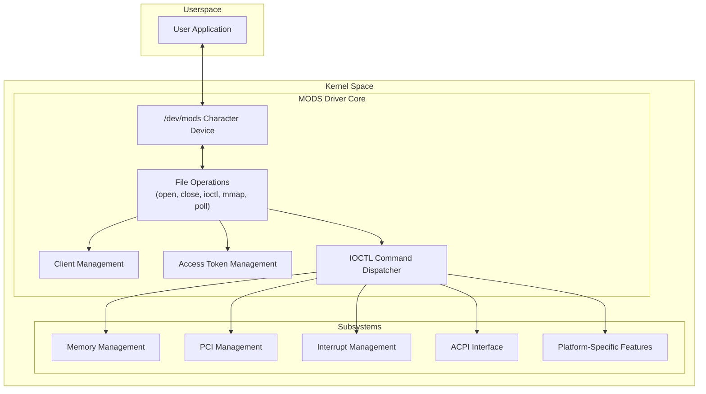

Sources: [mods_krnl.c:36-47](), [mods_krnl.c:49-55](), [mods_internal.h:82-110]()

## Character Device Interface

The MODS driver is exposed to userspace as a character device named `/dev/mods`. Applications interact with this device through standard file operations such as open, close, ioctl, mmap, and poll. The driver's file operations are registered with the Linux kernel when the module is initialized.

### File Operations Structure

The file operations structure defines the entry points from the kernel to the driver:

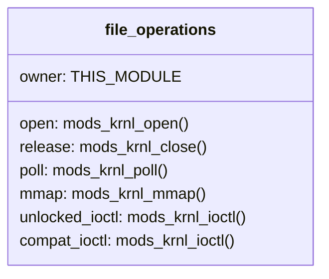

Sources: [mods_krnl.c:36-47]()

### Device Registration

The driver registers a miscellaneous device with the kernel to create the `/dev/mods` device node:

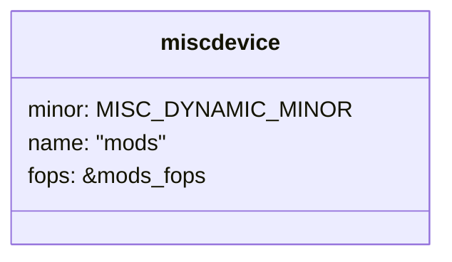

Sources: [mods_krnl.c:49-55]()

## Client Management

The MODS driver maintains separate state for each application that opens the device. This allows multiple applications to use the driver concurrently without interfering with each other.

### Client Structure

Each client has its own context maintained by the `mods_client` structure. This structure holds client-specific resources such as:

- Interrupt handling queues
- Memory allocations
- Device mappings
- Locks and synchronization primitives
- Client identifier

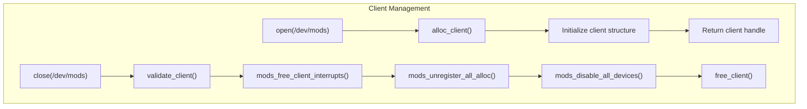

Sources: [mods_krnl.c:428-500](), [mods_krnl.c:1063-1156](), [mods_internal.h:82-110]()

### Client Allocation and Initialization

When a userspace application opens the device, the driver allocates a new client structure with a unique identifier and initializes all client-specific resources. The structure is stored in the file's private data field to associate it with subsequent operations on the file descriptor.

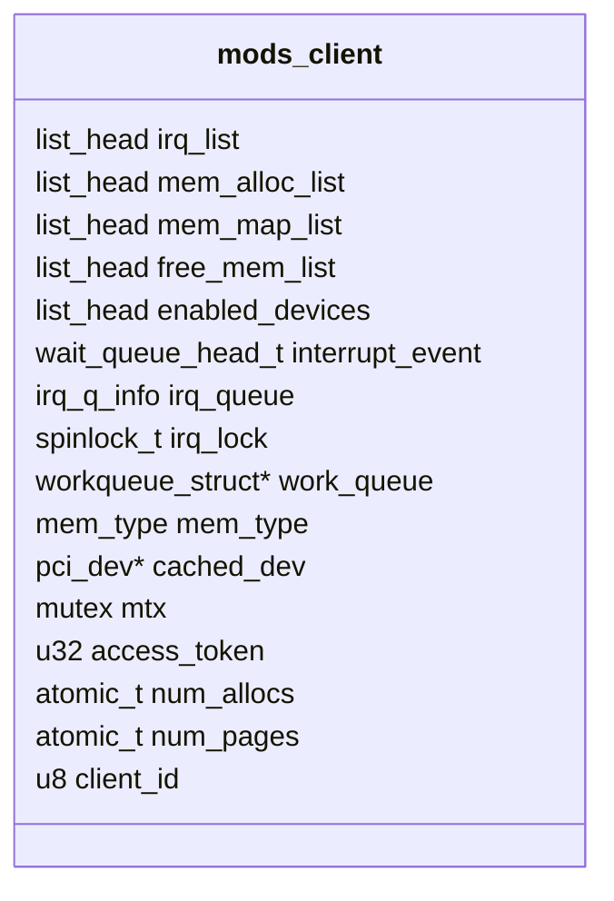

Sources: [mods_internal.h:82-110](), [mods_krnl.c:431-475]()

### Client Validation

Before processing any operation, the driver validates that the client structure is valid and that the client identifier is still allocated.

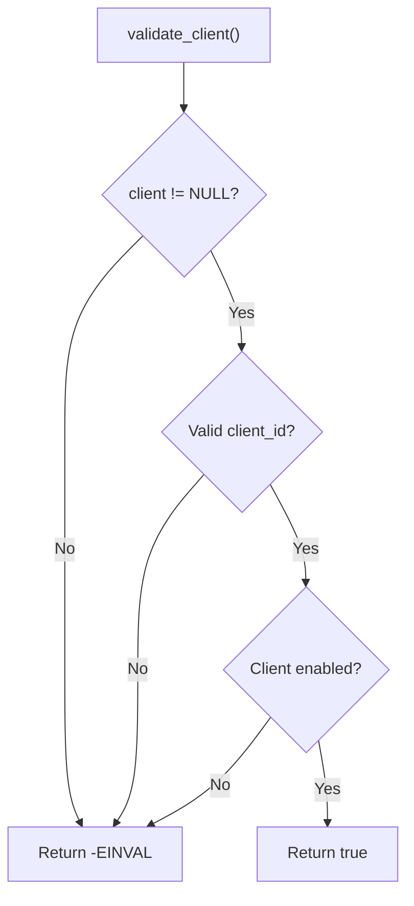

Sources: [mods_krnl.c:507-522]()

## IOCTL Command Processing

IOCTL commands are the primary method for userspace applications to interact with the driver. The driver implements a large number of IOCTL commands for various operations.

### IOCTL Command Flow

The `mods_krnl_ioctl` function serves as the entry point for all IOCTL commands. It:
1. Validates the client
2. Checks access tokens if required
3. Copies input data from userspace
4. Dispatches to the appropriate command handler
5. Copies output data back to userspace

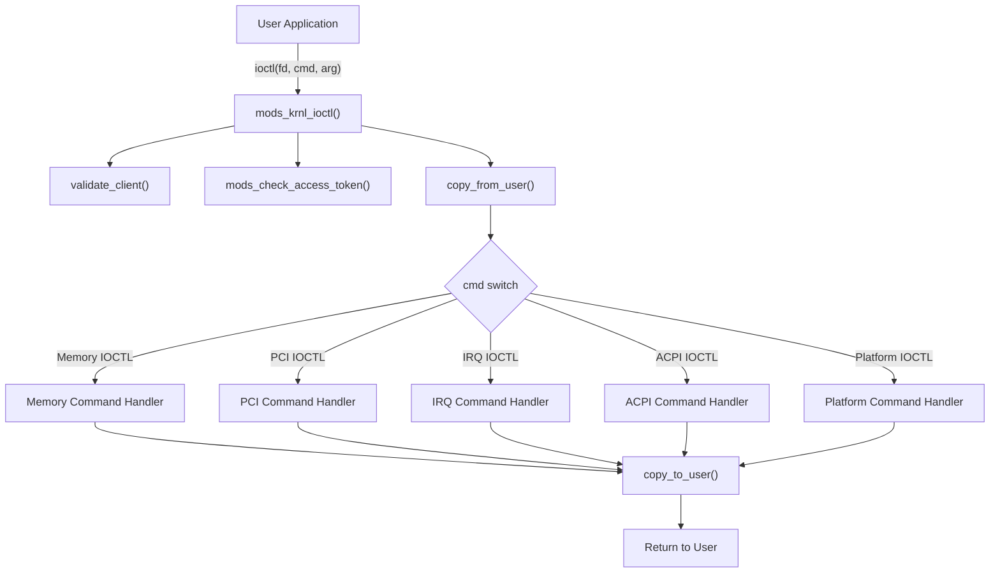

Sources: [mods_krnl.c:2019-2924]()

### Command Macros

The driver uses macros to standardize the handling of different types of IOCTL commands:

- `MODS_IOCTL`: For commands that return data to userspace
- `MODS_IOCTL_NORETVAL`: For commands that don't return data
- `MODS_IOCTL_VOID`: For commands that take no arguments

These macros handle common operations like input validation, debug logging, error checking, and copying data between userspace and kernel space.

Sources: [mods_krnl.c:2068-2114]()

## Access Token Management

The MODS driver implements an access token mechanism to control concurrent access when multi-instance mode is disabled. This allows only authorized clients to interact with the driver.

### Token Lifecycle

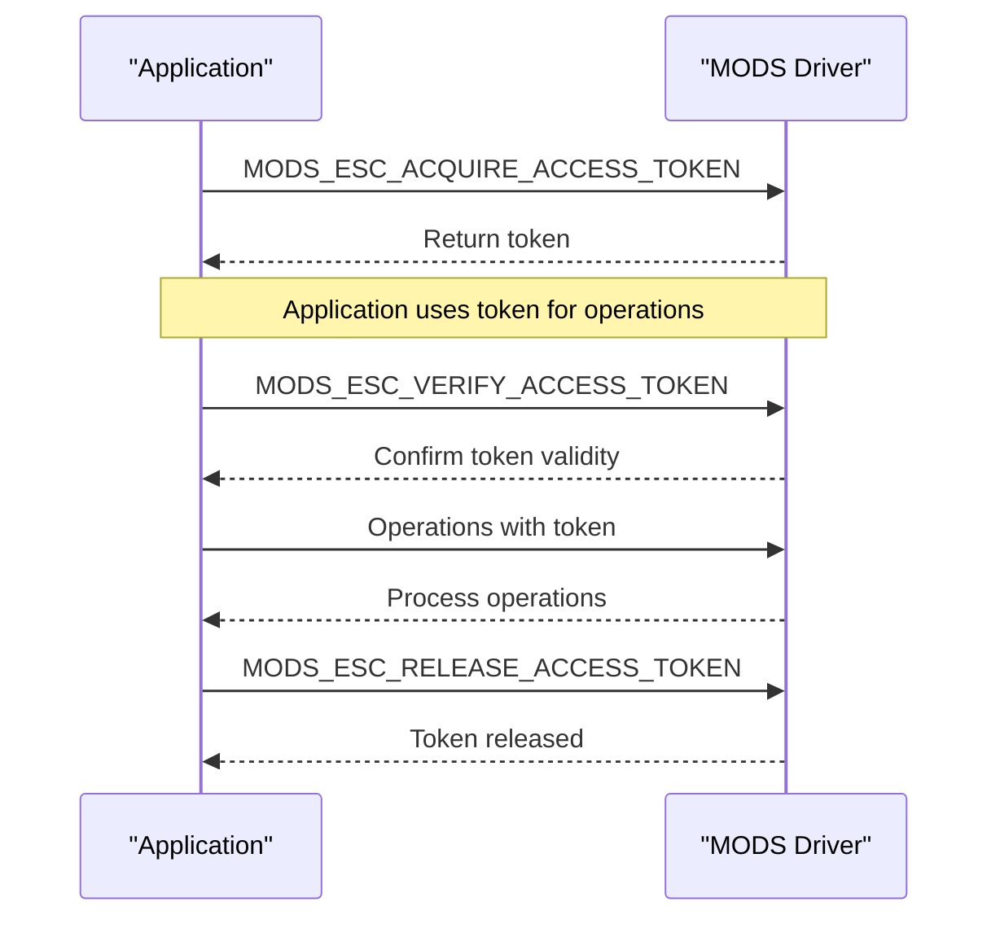

Sources: [mods_krnl.c:1706-1777]()

### Token Implementation

The access token system uses atomic operations to ensure that only one client can acquire the token at a time. This prevents race conditions when multiple clients try to access exclusive resources.

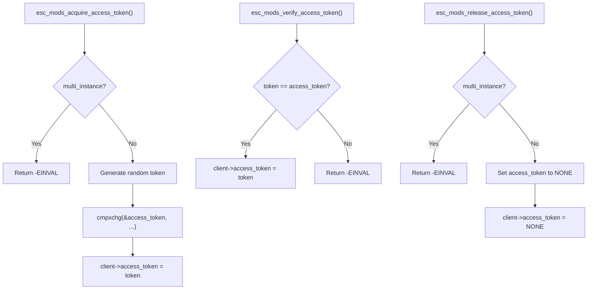

Sources: [mods_krnl.c:524-547](), [mods_krnl.c:1706-1777]()

## Initialization and Cleanup

The driver's initialization and cleanup functions set up and tear down the necessary resources for the driver to function.

### Module Initialization

The `mods_init_module` function is called when the driver is loaded. It:
1. Initializes the IRQ subsystem
2. Registers the miscellaneous device
3. Registers the PCI driver (if enabled)
4. Initializes platform-specific subsystems
5. Creates debugfs entries
6. Initializes other subsystems like DMA buffer support

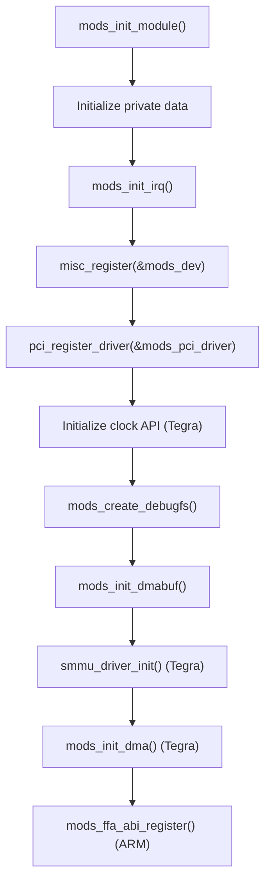

Sources: [mods_krnl.c:552-612]()

### Module Cleanup

The `mods_exit_module` function is called when the driver is unloaded. It performs the reverse of the initialization process, cleaning up all resources:
1. Frees all client resources
2. Unregisters the PCI driver
3. Unregisters the miscellaneous device
4. Cleans up platform-specific subsystems
5. Removes debugfs entries

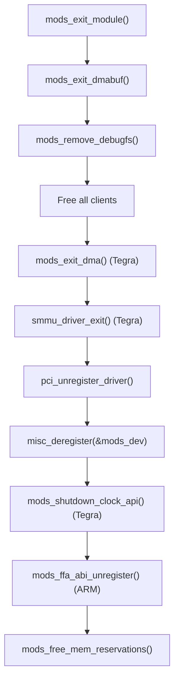

Sources: [mods_krnl.c:614-652]()

## Module Parameters

The driver supports several module parameters that control its behavior:

| Parameter | Type | Default | Description |
|-----------|------|---------|-------------|
| debug     | int  | 0       | Debug level bitflags |
| multi_instance | int | Platform-dependent | Allows multiple clients to open the driver |
| ppc_tce_bypass | int | MODS_PPC_TCE_BYPASS_ON | PPC TCE bypass mode (PowerPC only) |

Sources: [mods_krnl.c:667-679](), [mods_krnl.c:185-187]()

## PCI Device Management

The MODS driver registers a PCI driver to manage NVIDIA devices. This allows it to receive notifications when devices are added or removed from the system.

### PCI Driver Registration

The driver registers with the PCI subsystem to handle NVIDIA display and bridge devices:

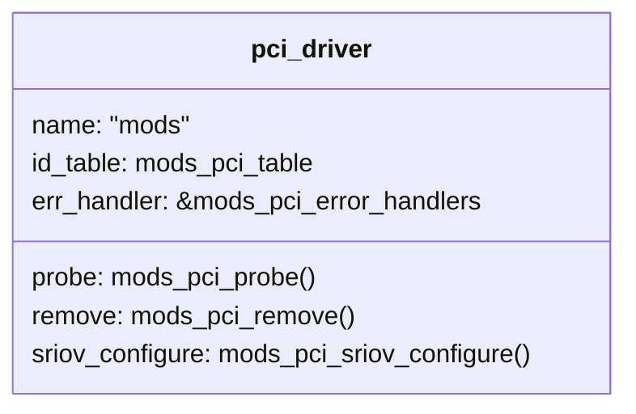

Sources: [mods_krnl.c:162-171](), [mods_krnl.c:69-95]()

### PCI Device Lifecycle

When a supported PCI device is detected, the driver's probe function is called to initialize it. Similarly, when a device is removed, the remove function is called to clean it up.

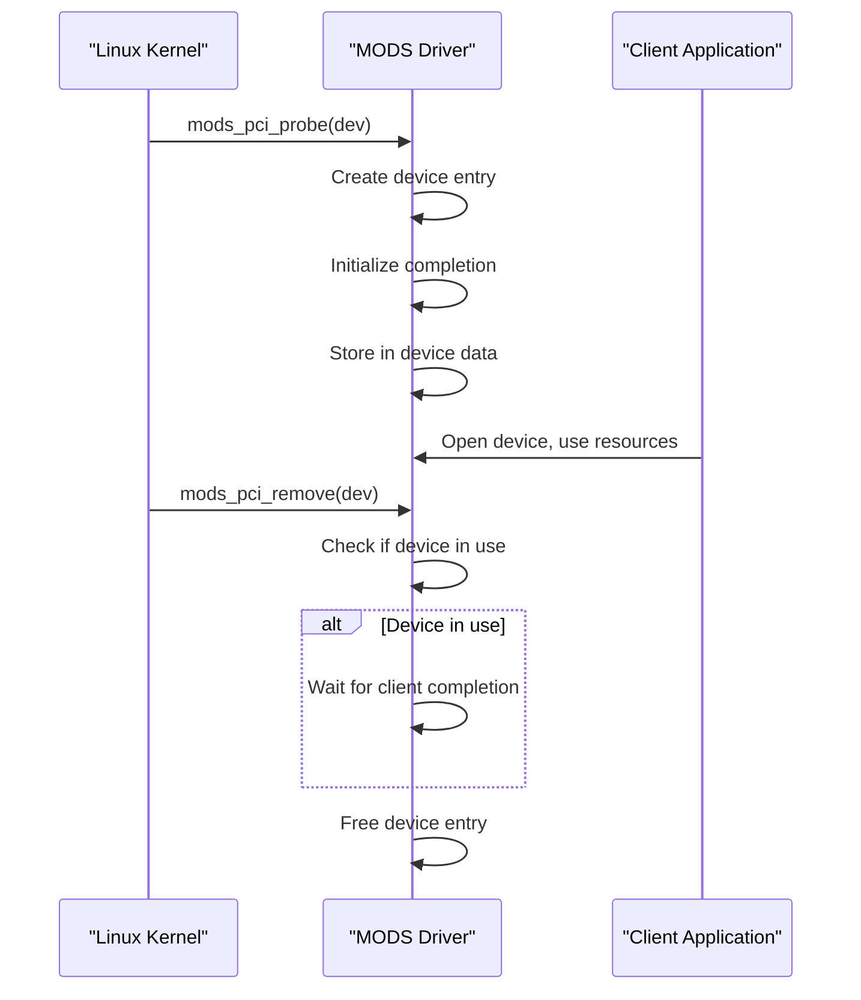

Sources: [mods_krnl.c:97-156]()

## Memory Management System

The MODS driver provides a comprehensive memory management system for allocating and mapping memory for user applications and devices. This is handled through the memory IOCTLs and the mmap interface. For complete details, see [Memory Management](#4).

### Memory Mapping

The driver implements the `mmap` file operation to allow userspace applications to map kernel memory into their address space. This is used for both system memory allocations and device memory.

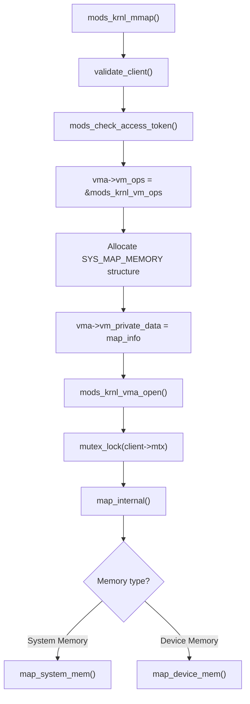

Sources: [mods_krnl.c:1187-1231](), [mods_krnl.c:1375-1391]()

## Conclusion

The MODS driver core implementation provides a robust foundation for exposing hardware functionality to userspace applications. It handles client management, command processing, device access, and resource management. The driver is designed to support multiple clients and provide secure access to hardware resources.

The core components discussed in this page form the framework that all other subsystems build upon. For detailed information about specific subsystems, refer to their dedicated pages:

- [Memory Management](#4) for details on memory allocation and mapping
- [Hardware Interfaces](#5) for information about PCI, interrupt, and ACPI interfaces
- [IOCTL Interface](#2) for a complete list of supported commands

---

