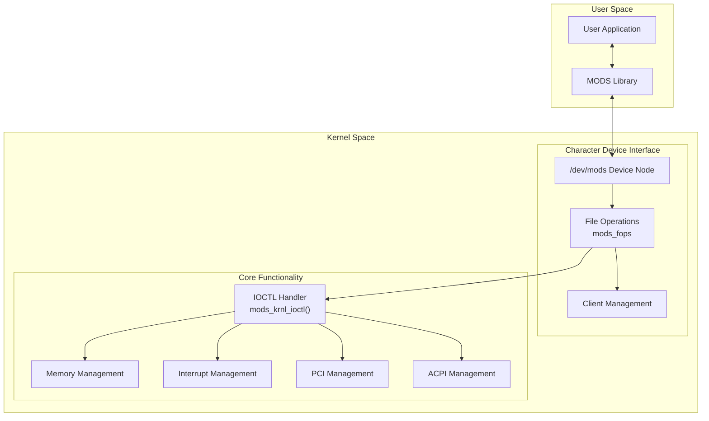
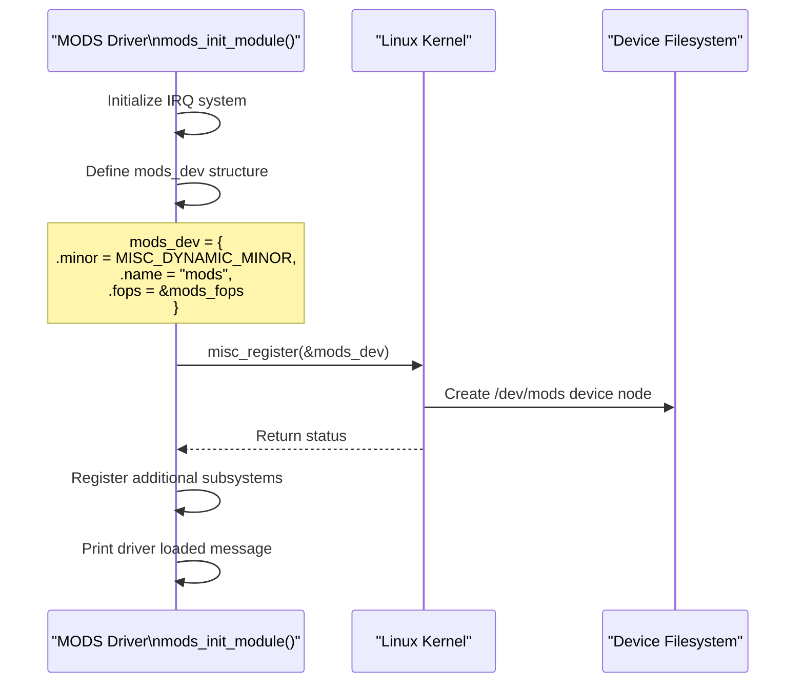
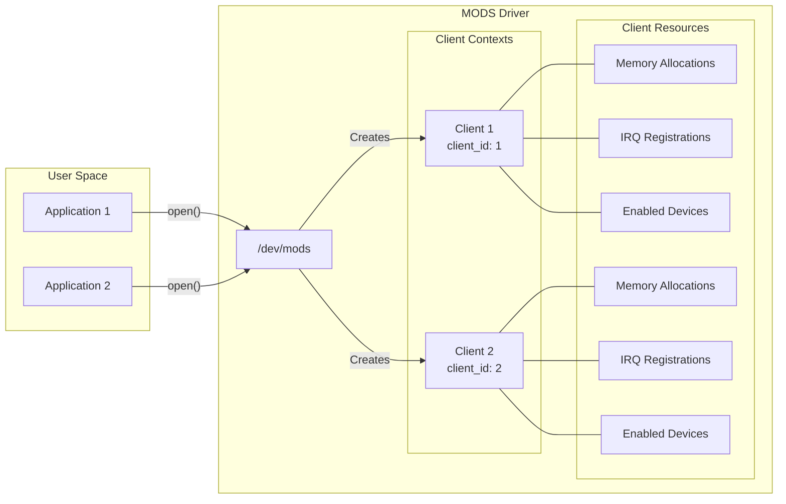
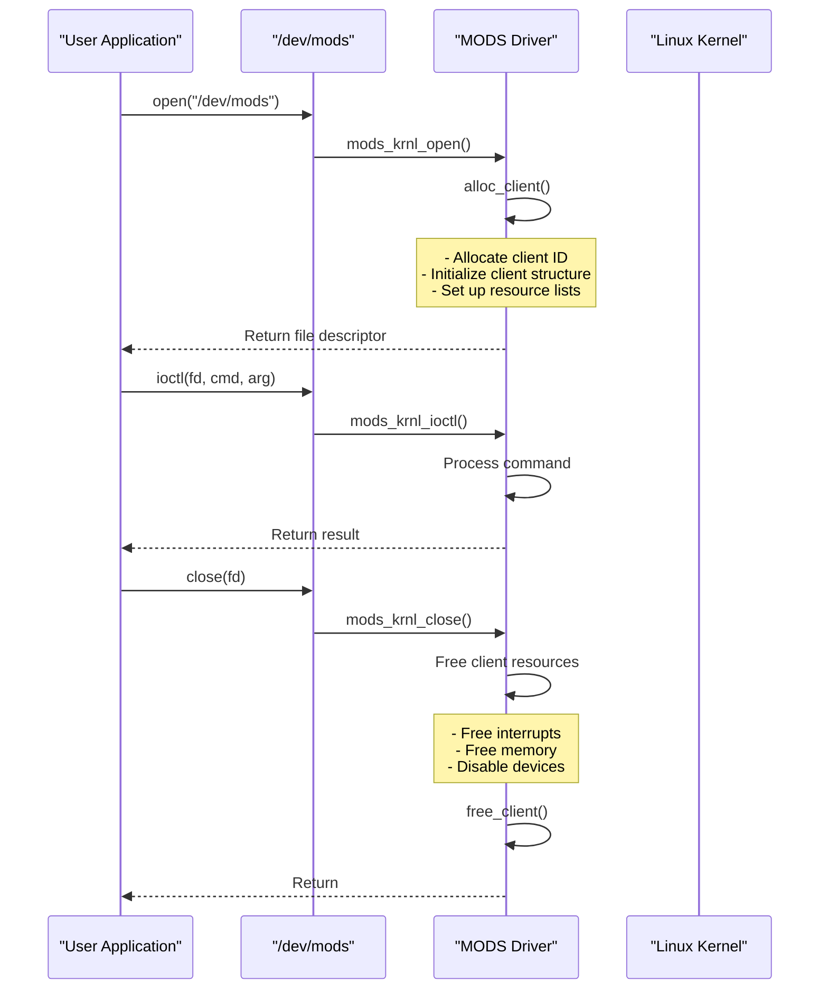
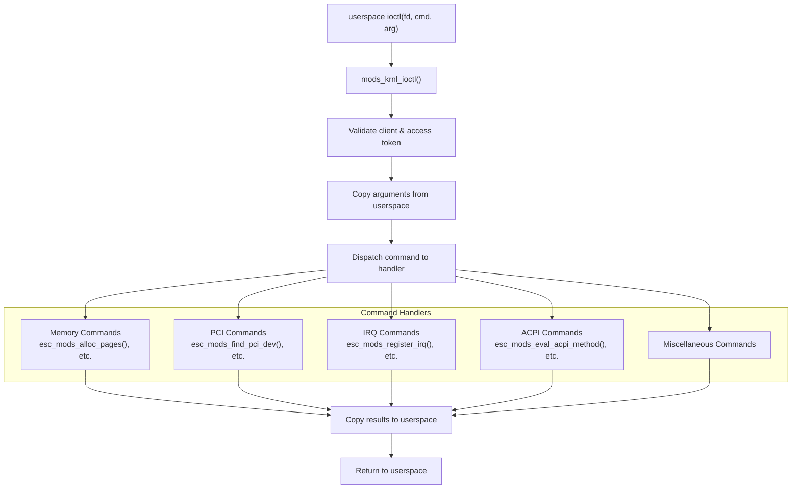
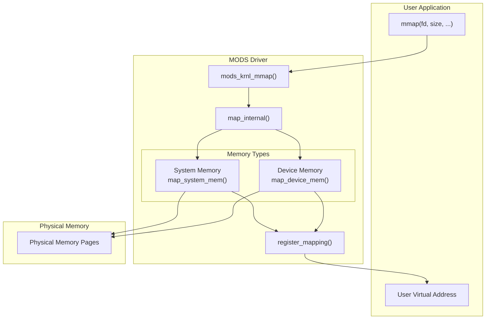
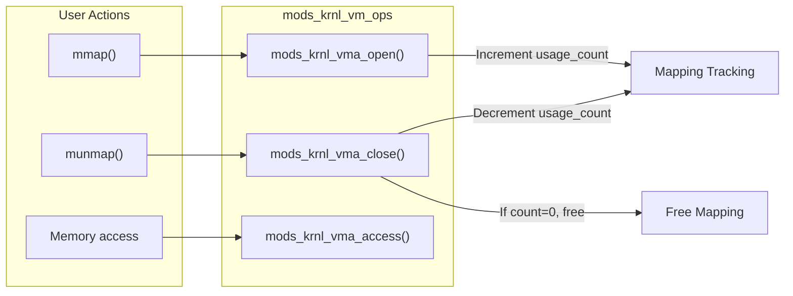

<!-- source: DeepWiki mcp.deepwiki.com · repo NVIDIA/mods-kernel-driver · page 3.1 Character Device Interface · fetched 2026-10-26 -->

# Character Device Interface

<details>
<summary>Relevant source files</summary>

The following files were used as context for generating this wiki page:

- [mods_internal.h](mods_internal.h)
- [mods_krnl.c](mods_krnl.c)

</details>


This page documents the character device interface (`/dev/mods`) implemented by the NVIDIA MODS kernel driver. The interface allows userspace applications to access and control various hardware functionality through IOCTLs, memory mapping, and other file operations.

For information about the IOCTL-specific command definitions, see [IOCTL Interface](#2).

## Overview

The MODS driver creates a character device `/dev/mods` to provide a communication interface between userspace applications and the driver's functionality. This interface is implemented using the Linux miscellaneous device framework and supports standard file operations like open, close, poll, and mmap, with the primary interaction method being IOCTL commands.



Sources: [mods_krnl.c:37-47](), [mods_krnl.c:51-55]()

## Device Registration

The MODS driver registers a character device named "mods" using the Linux miscellaneous device framework. This creates the `/dev/mods` device node that userspace applications can open.



Sources: [mods_krnl.c:49-55](), [mods_krnl.c:552-612]()

## File Operations

The character device implements the following file operations to support various interactions with userspace:

| Operation | Function | Description |
|-----------|----------|-------------|
| `open` | `mods_krnl_open` | Creates a new client context for the file descriptor |
| `release` | `mods_krnl_close` | Cleans up client resources when file descriptor is closed |
| `poll` | `mods_krnl_poll` | Supports polling for interrupt events |
| `mmap` | `mods_krnl_mmap` | Maps driver-allocated or device memory into userspace |
| `unlocked_ioctl` | `mods_krnl_ioctl` | Handles IOCTL commands from userspace |
| `compat_ioctl` | `mods_krnl_ioctl` | Same handler for 32-bit userspace on 64-bit kernel |

These operations are registered with the kernel through the `mods_fops` structure:

Sources: [mods_krnl.c:30-34](), [mods_krnl.c:37-47]()

## Client Management

When a userspace application opens the `/dev/mods` device, a client context is created to track resources and state specific to that file descriptor. Multiple clients can open the device simultaneously, each with its own isolated context.



### Client Structure

Each client is represented by a `mods_client` structure that contains:

- Lists of allocated resources (memory, IRQs, devices)
- Interrupt event queue
- Access token for concurrency control
- Resource tracking counters
- Client-specific mutex for thread safety

Sources: [mods_internal.h:82-110](), [mods_krnl.c:431-490]()

### Client Lifecycle

The client lifecycle begins when a userspace application opens the `/dev/mods` device and ends when the file descriptor is closed:



Sources: [mods_krnl.c:1063-1156]()

## Opening and Closing the Device

### Device Open

When a userspace application opens the `/dev/mods` device, the `mods_krnl_open` function:

1. Allocates a new client structure with a unique client ID
2. Initializes resource lists and synchronization primitives
3. Stores the client pointer in the file private data
4. Returns a file descriptor to userspace

```c
int mods_krnl_open(struct inode *ip, struct file *fp)
{
    struct mods_client *client = alloc_client();
    if (!client)
        return -EBUSY;
    
    fp->private_data = client;
    return 0;
}
```

Sources: [mods_krnl.c:1063-1081]()

### Device Close

When the device is closed, the `mods_krnl_close` function:

1. Frees all interrupts registered by the client
2. Restores console if needed
3. Frees all memory allocations
4. Disables all devices enabled by the client
5. Releases the client context

Sources: [mods_krnl.c:1083-1156]()

## IOCTL Interface

The primary method of communication with the MODS driver is through IOCTL commands. The driver implements a large number of commands to support various hardware operations.



### IOCTL Handler

The `mods_krnl_ioctl` function handles all IOCTL requests from userspace:

1. Validates the client and access token
2. Copies arguments from userspace
3. Dispatches the command to the appropriate handler
4. Copies results back to userspace
5. Returns status to the caller

Sources: [mods_krnl.c:2019-2924]()

### Access Token Management

The MODS driver implements an access token system to control concurrent access:

- By default, only one client can use the driver at a time
- Multiple clients can be enabled with the `multi_instance` module parameter
- Access tokens allow controlled concurrent access when multiple clients need to use the driver

Sources: [mods_krnl.c:186-187](), [mods_krnl.c:503-547]()

## Memory Mapping

The MODS driver supports memory mapping to give userspace applications direct access to device memory or driver-allocated system memory.



### Memory Mapping Process

When a userspace application calls `mmap()` on the `/dev/mods` device, the `mods_krnl_mmap` function:

1. Creates a mapping structure (`SYS_MAP_MEMORY`) to track the mapping
2. Determines if the requested address is system memory or device memory
3. Maps the appropriate memory type to the userspace virtual address
4. Registers the mapping for cleanup when unmapped

The driver supports mapping both:
- System memory (allocated by the driver)
- Device memory (physical addresses, like PCI BARs)

Sources: [mods_krnl.c:1184-1231](), [mods_krnl.c:1233-1373]()

## Interrupt Handling

The MODS driver provides a polling interface that allows userspace applications to wait for and handle interrupts.

### Poll Interface

The `mods_krnl_poll` function:

1. Validates the client
2. Checks access token
3. Waits for interrupts if requested
4. Returns if interrupts are pending

This allows userspace applications to use `select()`, `poll()`, or `epoll()` to wait for interrupts.

Sources: [mods_krnl.c:1158-1182]()

## Module Parameters

The MODS driver supports the following module parameters:

| Parameter | Default | Description |
|-----------|---------|-------------|
| `debug` | 0 | Debug level bitflags |
| `multi_instance` | Platform-dependent | Allow multiple clients |
| `ppc_tce_bypass` | 1 (PPC only) | PPC TCE bypass configuration |

The default `multi_instance` value is 1 for Tegra platforms and 0 for others.

Sources: [mods_krnl.c:185-187](), [mods_krnl.c:667-678]()

## Character Device VM Operations

The driver defines custom virtual memory operations to handle memory mappings:



These operations track mapped memory and ensure proper cleanup when unmapped:

- `mods_krnl_vma_open`: Tracks mapping by incrementing usage count
- `mods_krnl_vma_close`: Cleans up mapping when usage count reaches zero
- `mods_krnl_vma_access`: Handles direct memory access from debuggers (if supported)

Sources: [mods_krnl.c:887-1053](), [mods_krnl.c:1055-1061]()

## Summary

The character device interface of the MODS driver provides a comprehensive set of operations for userspace applications to interact with hardware. The primary methods of interaction are:

1. **IOCTL Commands**: For issuing specific commands to the driver
2. **Memory Mapping**: For direct access to memory allocations or device memory
3. **Polling**: For waiting on hardware interrupts

The interface supports multiple clients through isolated client contexts and provides access control mechanisms to manage concurrent access when needed.

For specific details about the available IOCTL commands, refer to the [IOCTL Interface](#2) page.

---

