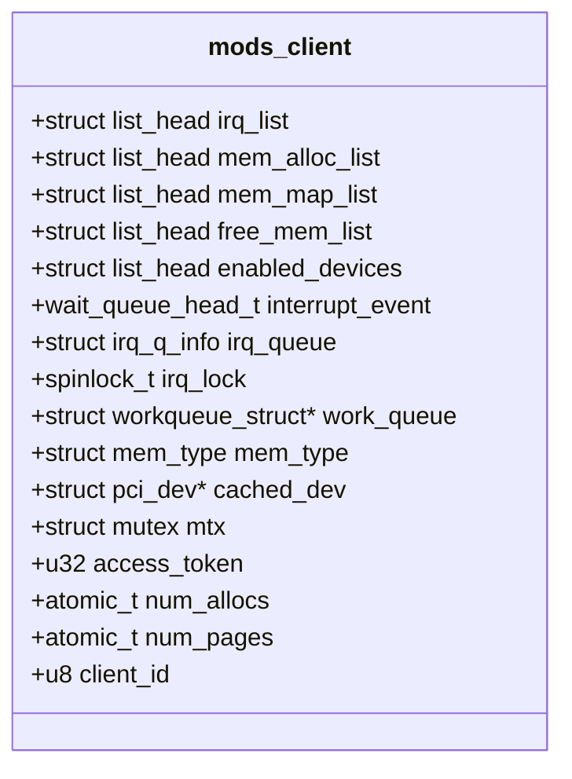
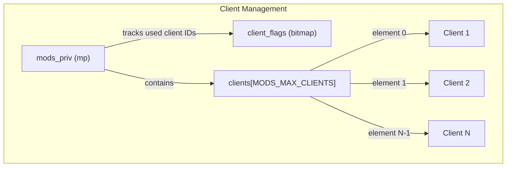
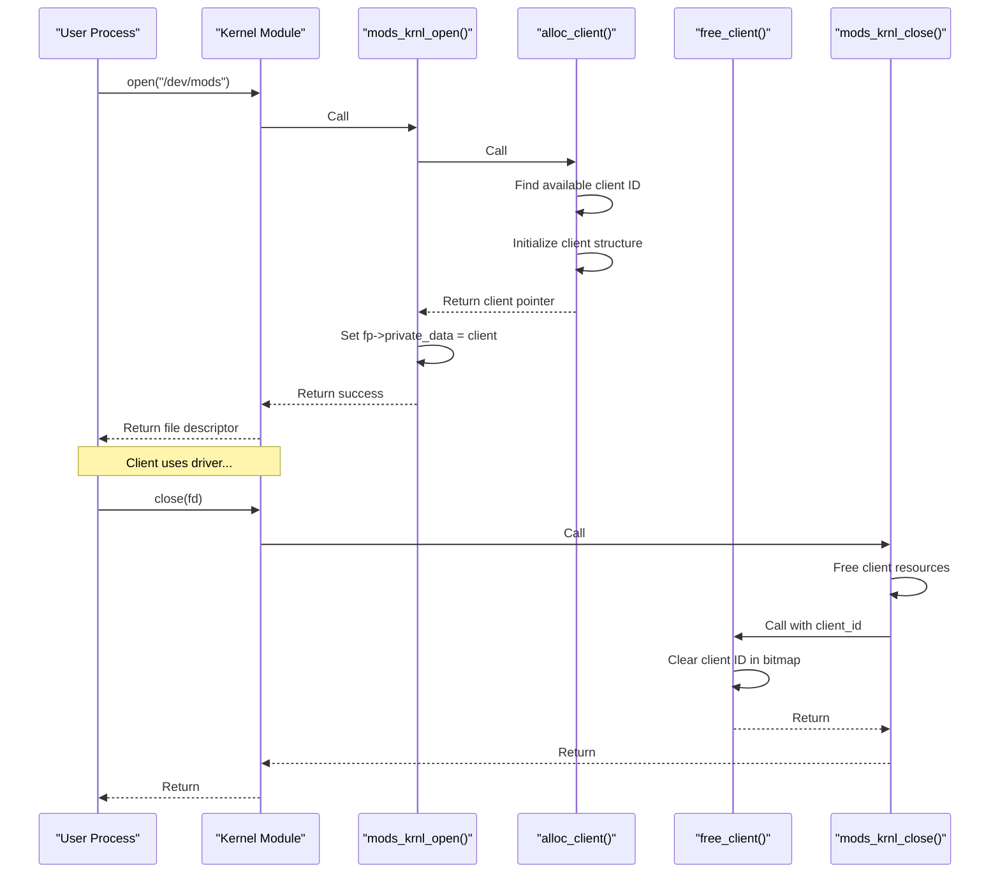
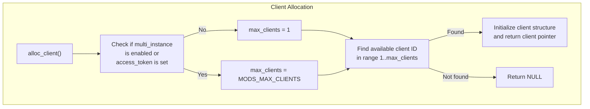
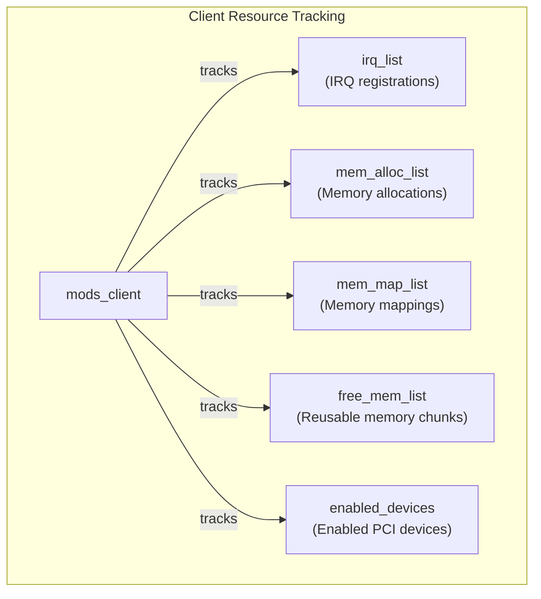
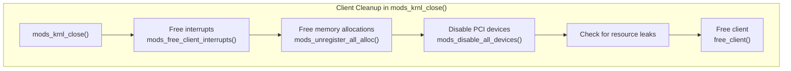
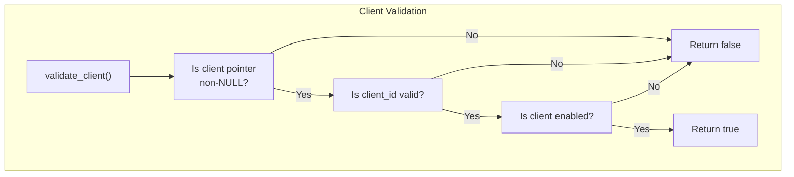
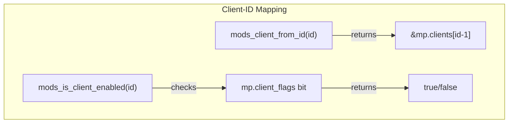
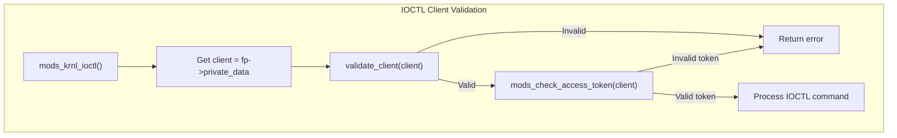

<!-- source: DeepWiki mcp.deepwiki.com · repo NVIDIA/mods-kernel-driver · page 3.2 Client Management · fetched 2026-10-26 -->

# Client Management

<details>
<summary>Relevant source files</summary>

The following files were used as context for generating this wiki page:

- [mods_internal.h](mods_internal.h)
- [mods_krnl.c](mods_krnl.c)
- [mods_mem.c](mods_mem.c)

</details>


This document explains how the MODS kernel driver manages client resources and state. In the MODS driver, each user-space process that opens the `/dev/mods` device file is considered a client. The client management system tracks all resources allocated by each client and ensures proper cleanup when clients close the driver.

For information about how access tokens control concurrent driver access, see [Access Token Management](#3.3).

## Client Structure and Lifecycle

### Client Structure

Each client is represented by a `mods_client` structure that tracks all resources allocated by that client. These include memory allocations, memory mappings, IRQ registrations, enabled devices, and other client-specific state.



Sources: [mods_internal.h:82-110]()

### Client Tracking

All clients are tracked in a global `mods_priv` structure that contains:
- A bitmap (`client_flags`) to track which client IDs are in use
- An array of `mods_client` structures for each possible client



Sources: [mods_krnl.c:429](), [mods_internal.h:311-317]()

### Client Lifecycle

The client lifecycle begins when a process opens the `/dev/mods` device and ends when the process closes it:



Sources: [mods_krnl.c:431-475](), [mods_krnl.c:477-490](), [mods_krnl.c:1063-1081](), [mods_krnl.c:1083-1156]()

## Multi-instance Mode

The MODS driver can operate in two modes:

1. **Single-instance mode**: Only one client can use the driver at a time
2. **Multi-instance mode**: Multiple clients can use the driver simultaneously

The mode is controlled by the `multi_instance` module parameter, which can be set when loading the driver or changed at runtime.



Sources: [mods_krnl.c:431-475](), [mods_krnl.c:186-187](), [mods_krnl.c:416-424]()

## Client Resource Tracking

Each client maintains separate linked lists to track different types of resources:



When a client closes the driver, all its resources are freed:



Sources: [mods_krnl.c:1083-1156](), [mods_internal.h:82-110](), [mods_krnl.c:684-722]()

## Client Validation

Before performing operations, the driver validates the client using the `validate_client` function. This ensures that:
- The client pointer is not NULL
- The client ID is valid (between 1 and `MODS_MAX_CLIENTS`)
- The client is currently enabled (present in the `client_flags` bitmap)



Sources: [mods_krnl.c:507-522](), [mods_krnl.c:497-500]()

## Client-to-ID Mapping

The driver provides functions to convert between client IDs and client structure pointers:

- `mods_client_from_id()`: Returns the client structure for a given client ID
- `mods_is_client_enabled()`: Checks if a client ID is currently in use

These functions allow for easy lookup of client structures and validation of client IDs.



Sources: [mods_krnl.c:492-496](), [mods_krnl.c:497-500]()

## Implementation Details

### Client Allocation

The `alloc_client()` function allocates a new client:

1. Determines maximum number of clients based on multi-instance mode
2. Finds the first available client ID
3. Initializes the client structure:
   - Sets client ID
   - Initializes mutex and lock
   - Initializes wait queues and linked lists
   - Resets counters and state variables

```c
static struct mods_client *alloc_client(void)
{
    unsigned int idx;
    unsigned int max_clients = 1;

    if (mods_get_multi_instance() ||
        (mods_get_access_token() != MODS_ACCESS_TOKEN_NONE))
        max_clients = MODS_MAX_CLIENTS;

    for (idx = 1; idx <= max_clients; idx++) {
        if (!test_and_set_bit(idx - 1U, &mp.client_flags)) {
            struct mods_client *client = mods_client_from_id(idx);
            
            /* Initialize client structure... */
            
            return client;
        }
    }
    
    return NULL;
}
```

Sources: [mods_krnl.c:431-475]()

### Client Release

The `free_client()` function releases a client:

1. Clears the client structure
2. Clears the client's bit in the client_flags bitmap

```c
static void free_client(u8 client_id)
{
    struct mods_client *client = mods_client_from_id(client_id);

    memset(client, 0, sizeof(*client));

    /* Indicate the client_id is free */
    clear_bit((unsigned int)client_id - 1U, &mp.client_flags);
}
```

Sources: [mods_krnl.c:477-490]()

## Relationship with IOCTL Handling

Each IOCTL call validates the client before performing operations. The validation flow is as follows:



Sources: [mods_krnl.c:2019-2984](), [mods_krnl.c:507-522](), [mods_krnl.c:539-547]()

## Summary

The client management system in the MODS kernel driver:
- Allocates and tracks client IDs
- Initializes client-specific data structures
- Tracks resources allocated by each client
- Provides validation mechanisms
- Ensures proper resource cleanup

This infrastructure allows the driver to support both single-instance and multi-instance operation modes, providing flexibility while maintaining resource isolation between clients.

Sources: [mods_krnl.c:426-548](), [mods_internal.h:82-110](), [mods_internal.h:311-317]()

---

