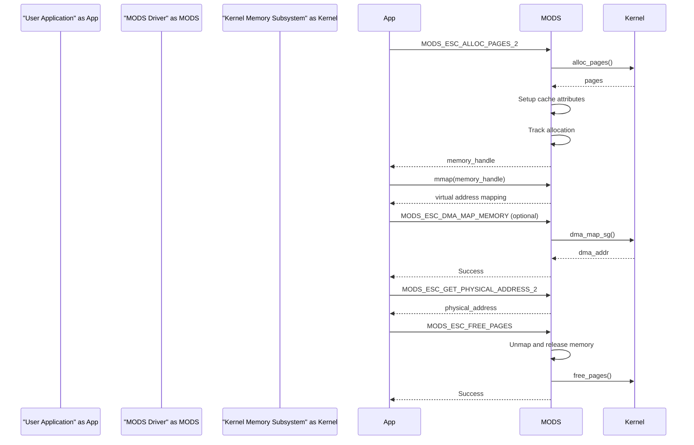
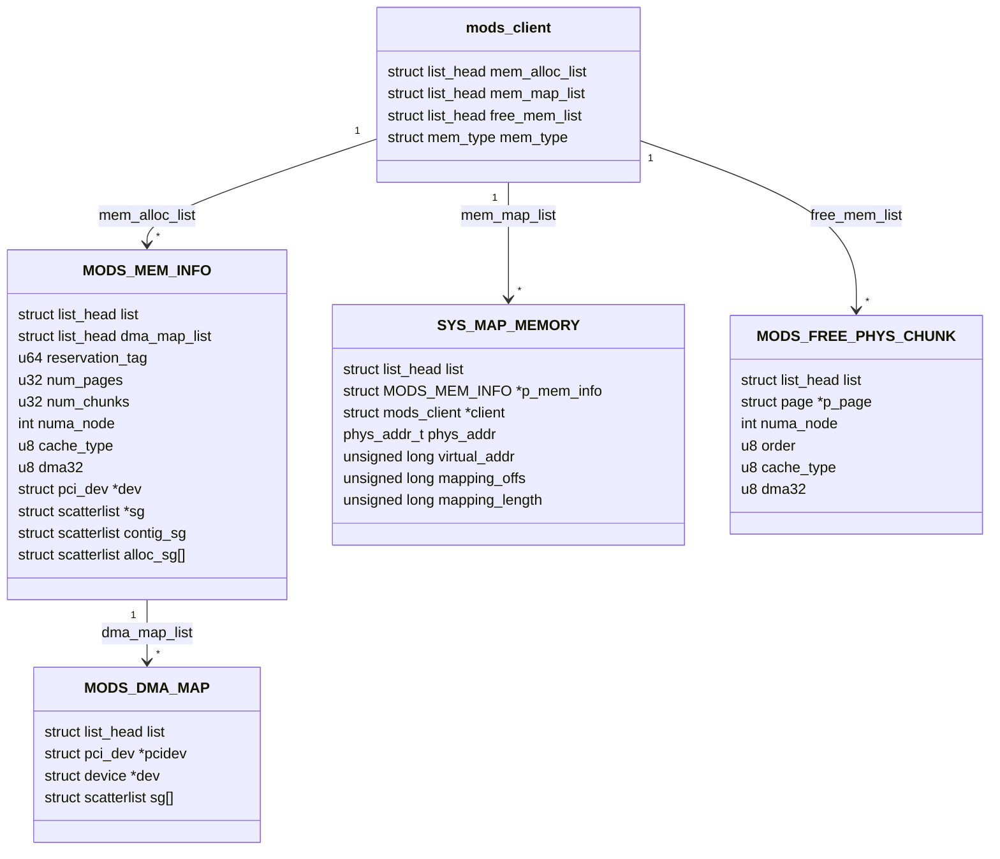
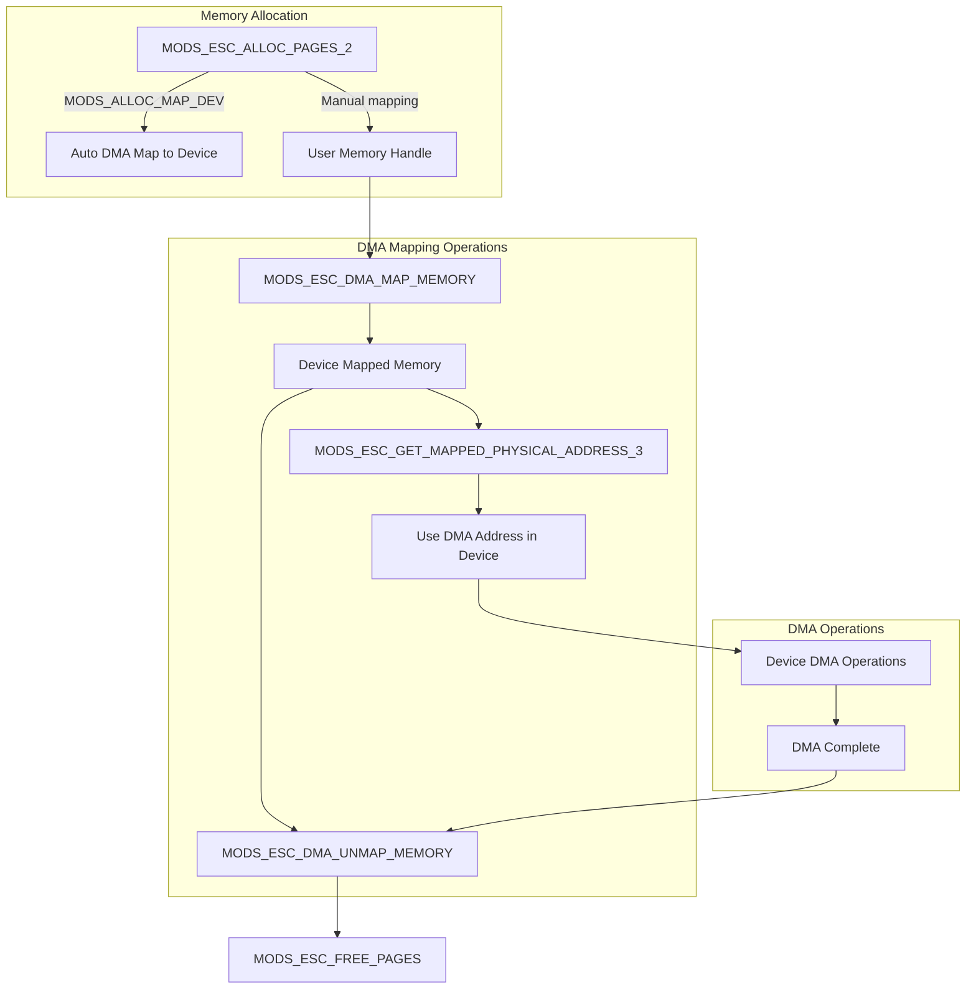

<!-- source: DeepWiki mcp.deepwiki.com · repo NVIDIA/mods-kernel-driver · page 4 Memory Management · fetched 2026-10-26 -->

# Memory Management

<details>
<summary>Relevant source files</summary>

The following files were used as context for generating this wiki page:

- [mods.h](mods.h)
- [mods_internal.h](mods_internal.h)
- [mods_mem.c](mods_mem.c)

</details>


The MODS Memory Management subsystem provides capabilities for allocating, mapping, and managing system memory for both CPU and device access. It handles various allocation types, cache attributes, and device DMA mappings to facilitate hardware debugging and diagnostics by userspace applications.

This document explains how the MODS driver manages memory resources and the interfaces it provides to userspace. For information about PCI device management, see [PCI Device Management](#5.1). For information about interrupt management on allocated memory, see [Interrupt Management](#5.2).

## Memory Management Architecture

The memory management subsystem in MODS provides several key capabilities:

- System memory allocation in both contiguous and non-contiguous forms
- Control over memory caching attributes (cached, uncached, write-combined)
- DMA mapping for device access
- Physical/virtual address translation
- NUMA-aware memory allocation
- Memory reservation mechanism

These capabilities are exposed to userspace through IOCTLs, with memory operations typically following this pattern:



Memory allocations are tracked per client to ensure proper cleanup if a client process terminates unexpectedly.

Sources: [mods_mem.c:25-1066](), [mods.h:75-147]()

## Memory Allocation Types

MODS supports two primary types of memory allocation:

1. **Contiguous Memory**: All pages are physically adjacent in memory, which is required for certain hardware operations. The driver uses a single allocation with the appropriate size.

2. **Non-contiguous Memory**: Pages may be physically fragmented throughout memory, which is more memory-efficient for large allocations but may not be suitable for all hardware operations.

Memory allocations can be customized with various flags:

| Flag | Description |
|------|-------------|
| `MODS_ALLOC_CACHED` | Use normal write-back caching (default) |
| `MODS_ALLOC_UNCACHED` | No caching for memory access |
| `MODS_ALLOC_WRITECOMBINE` | Use write-combining caching |
| `MODS_ALLOC_DMA32` | Force 32-bit physical addresses |
| `MODS_ALLOC_CONTIGUOUS` | Force physically contiguous memory |
| `MODS_ALLOC_USE_NUMA` | Use explicit NUMA node selection |
| `MODS_ALLOC_FORCE_NUMA` | Force memory from specified NUMA node |
| `MODS_ALLOC_MAP_DEV` | Automatically DMA map to specified device |

The allocation subsystem also supports optimizations such as caching non-writeback memory chunks for reuse to avoid expensive cache attribute changes.

Sources: [mods.h:116-135](), [mods_mem.c:810-959](), [mods_mem.c:1371-1569]()

## Memory Management Internals

The internal memory management architecture consists of several key components that work together to track and manage memory allocations:



The memory management system uses a per-client tracking approach:

1. `mem_alloc_list`: Tracks all memory allocations owned by the client
2. `mem_map_list`: Tracks memory-mapped regions accessible to the client
3. `free_mem_list`: Maintains a cache of freed memory chunks with special attributes for reuse
4. `MODS_MEM_INFO`: Primary structure that stores all information about a memory allocation
5. `MODS_DMA_MAP`: Tracks DMA mappings of memory allocations to devices
6. `SYS_MAP_MEMORY`: Links user virtual addresses to physical memory or `MODS_MEM_INFO` entries

Sources: [mods_internal.h:59-119](), [mods_internal.h:135-186](), [mods_mem.c:23-57]()

## Memory Caching Attributes

MODS supports three memory caching attributes that control how memory is cached by the CPU:

1. **Cached (MODS_ALLOC_CACHED)**: Normal writeback caching, which is suitable for most general-purpose allocations. This is the default.

2. **Uncached (MODS_ALLOC_UNCACHED)**: No caching is used, ensuring all reads come directly from memory and all writes go directly to memory. This is useful for memory-mapped I/O regions or when cache coherency is problematic.

3. **Write-Combined (MODS_ALLOC_WRITECOMBINE)**: Allows the CPU to combine multiple writes to adjacent memory locations into a single memory transaction, improving performance for certain workloads like display framebuffers.

Setting cache attributes is done during allocation or can be changed later with `MODS_ESC_SET_CACHE_ATTR`. The driver uses architecture-specific functions like `set_memory_uc()` and `set_memory_wc()` to implement these attributes.

On ARM architectures, the driver includes special handling for cache flushing and invalidation through the `MODS_ESC_FLUSH_CPU_CACHE_RANGE` ioctl.

Sources: [mods.h:117-120](), [mods_mem.c:424-469](), [mods_mem.c:1718-1784](), [mods_mem.c:2794-2896]()

## DMA Mapping

MODS provides robust support for DMA (Direct Memory Access) mapping, allowing devices to access memory directly without CPU intervention. Key features include:



The MODS driver supports:

1. **Automatic DMA mapping** during allocation with the `MODS_ALLOC_MAP_DEV` flag
2. **Manual DMA mapping** after allocation using `MODS_ESC_DMA_MAP_MEMORY`
3. **IOMMU support** for virtual-to-physical address translation
4. **Multiple device mappings** for a single allocation
5. **Architecture-specific handling** such as TCE bypass on PowerPC and NVLink address compression

DMA mappings are tracked per allocation and are automatically cleaned up when the allocation is freed or when the client closes its connection to the driver.

Sources: [mods.h:338-366](), [mods_mem.c:61-264](), [mods_mem.c:2371-2481]()

## Memory Reservations

MODS supports a memory reservation system that allows memory allocations to persist beyond the lifetime of a client process. This feature enables memory sharing between multiple client processes without the need to reallocate the memory.

The reservation system uses a tag-based approach:

1. A client allocates memory normally with `MODS_ESC_ALLOC_PAGES_2`
2. The client reserves the allocation with `MODS_ESC_RESERVE_ALLOCATION` and assigns a tag value
3. When the client closes or explicitly releases the allocation with `MODS_ESC_FREE_PAGES`, the memory isn't freed but becomes available for reservation claims
4. Another client can claim the reserved memory using `MODS_ESC_GET_RESERVED_ALLOCATION` with the same tag value
5. Memory reservations can be permanently released with `MODS_ESC_RELEASE_RESERVED_ALLOCATION`

This mechanism is useful for scenarios where memory needs to persist across application restarts or be shared between different components of a system without exposing the actual memory address spaces.

Sources: [mods.h:1984-2013](), [mods_mem.c:2609-2792](), [mods_mem.c:2898-2928]()

## Key Data Structures

### MODS_MEM_INFO

This is the core structure that tracks a memory allocation:

```
struct MODS_MEM_INFO {
    struct list_head list;             // For linking in mem_alloc_list
    struct list_head dma_map_list;     // List of DMA mappings
    u64 reservation_tag;               // Non-zero if reserved
    u32 num_pages;                     // Total number of allocated pages
    u32 num_chunks;                    // Number of contiguous chunks
    int numa_node;                     // NUMA node for the allocation
    u8 cache_type : 2;                 // MODS_ALLOC_* cache type
    u8 dma32 : 1;                      // Restricted to 32-bit addresses
    u8 force_numa : 1;                 // Force allocation on specified NUMA node
    struct pci_dev *dev;               // PCI device this allocation is for
    unsigned long *wc_bitmap;          // Tracks which chunks use WC/UC
    struct scatterlist *sg;            // Current list of chunks
    struct scatterlist contig_sg;      // For contiguous merged chunk
    struct scatterlist alloc_sg[];     // Array of allocated chunks
};
```

### MODS_ALLOC_PAGES_2

This structure is used for the `MODS_ESC_ALLOC_PAGES_2` IOCTL:

```
struct MODS_ALLOC_PAGES_2 {
    // Input
    u64 num_bytes;                     // Number of bytes to allocate
    u32 flags;                         // MODS_ALLOC_* flags
    s32 numa_node;                     // NUMA node or MODS_ANY_NUMA_NODE
    struct mods_pci_dev_2 pci_device;  // PCI device for mapping
    
    // Output
    u64 memory_handle;                 // Handle to allocated memory
};
```

### MODS_GET_PHYSICAL_ADDRESS_3

Used to get physical or DMA addresses for allocated memory:

```
struct MODS_GET_PHYSICAL_ADDRESS_3 {
    // Input
    u64 memory_handle;                 // Memory allocation handle
    u64 offset;                        // Offset from allocation start
    struct mods_pci_dev_2 pci_device;  // PCI device (for DMA addresses)
    
    // Output
    u64 physical_address;              // Physical or DMA address
};
```

Sources: [mods_internal.h:135-163](), [mods.h:100-109](), [mods.h:259-269]()

## Key Operations

The Memory Management subsystem provides several key operations through IOCTLs:

| Operation | IOCTL | Description |
|-----------|-------|-------------|
| Allocation | `MODS_ESC_ALLOC_PAGES_2` | Allocate system memory |
| Freeing | `MODS_ESC_FREE_PAGES` | Free allocated memory |
| Get Physical Address | `MODS_ESC_GET_PHYSICAL_ADDRESS_2` | Get physical address for allocated memory |
| DMA Mapping | `MODS_ESC_DMA_MAP_MEMORY` | Map memory for DMA access |
| DMA Unmapping | `MODS_ESC_DMA_UNMAP_MEMORY` | Unmap DMA-mapped memory |
| Get DMA Address | `MODS_ESC_GET_MAPPED_PHYSICAL_ADDRESS_3` | Get DMA address for mapped memory |
| Virtual to Physical | `MODS_ESC_VIRTUAL_TO_PHYSICAL` | Translate virtual to physical address |
| Physical to Virtual | `MODS_ESC_PHYSICAL_TO_VIRTUAL` | Translate physical to virtual address |
| Set Cache Attributes | `MODS_ESC_SET_CACHE_ATTR` | Change memory caching attributes |
| Merge Allocations | `MODS_ESC_MERGE_PAGES` | Merge multiple allocations |
| Reserve Allocation | `MODS_ESC_RESERVE_ALLOCATION` | Reserve memory allocation |
| Get Reserved Allocation | `MODS_ESC_GET_RESERVED_ALLOCATION` | Claim reserved allocation |
| Release Reserved Allocation | `MODS_ESC_RELEASE_RESERVED_ALLOCATION` | Release reserved allocation |

Memory that has been allocated through these IOCTLs can be mapped into userspace using the standard `mmap()` system call on the MODS device file descriptor.

Sources: [mods.h:2020-2238](), [mods_mem.c:1369-2896]()

## Implementation Details

### Memory Allocation Process

When a client requests memory through `MODS_ESC_ALLOC_PAGES_2`, the driver follows this process:

1. Validates input parameters
2. Determines allocation method (contiguous or non-contiguous)
3. Allocates a `MODS_MEM_INFO` structure to track the allocation
4. For contiguous allocation, calls `alloc_contig_sys_pages()`
5. For non-contiguous allocation, calls `alloc_noncontig_sys_pages()`
6. Sets up cache attributes as requested
7. Registers the allocation with the client
8. If requested, maps the allocation to the specified device
9. Returns the memory handle to userspace

The driver supports NUMA-aware allocations by respecting the `numa_node` parameter or inferring the appropriate NUMA node from the PCI device's location.

For non-contiguous allocations, the driver uses a chunk-based approach, allocating memory in power-of-2 sized chunks to balance allocation efficiency and memory fragmentation.

Sources: [mods_mem.c:1369-1569](), [mods_mem.c:810-959]()

### Memory Cleanup

The MODS driver implements robust memory cleanup:

1. When a client explicitly frees memory with `MODS_ESC_FREE_PAGES`, the allocation is removed from tracking and pages are released
2. When a client disconnects without freeing memory, the driver automatically calls `mods_unregister_all_alloc()` to clean up
3. Special handling exists for memory with custom cache attributes to optimize future allocations
4. DMA mappings are automatically unmapped during cleanup
5. Reserved memory is handled separately according to the reservation rules

This approach ensures that kernel memory leaks are prevented even if userspace applications crash or terminate unexpectedly.

Sources: [mods_mem.c:557-670](), [mods_mem.c:1043-1066](), [mods_mem.c:2898-2928]()

---

