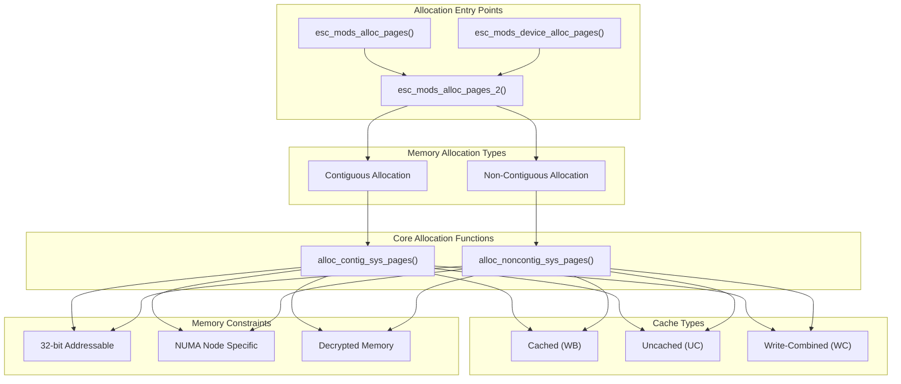
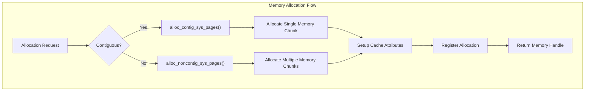
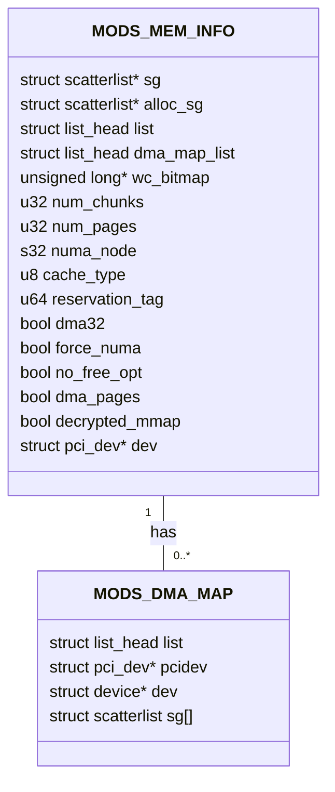
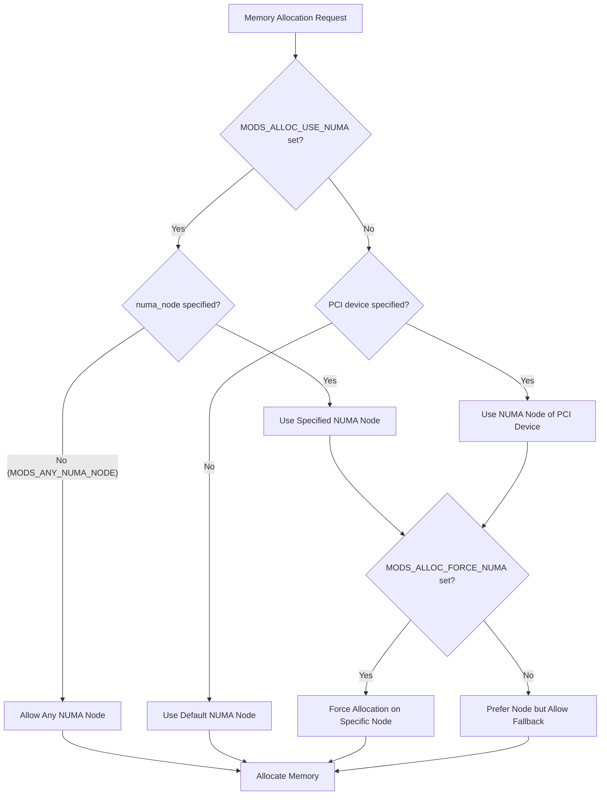
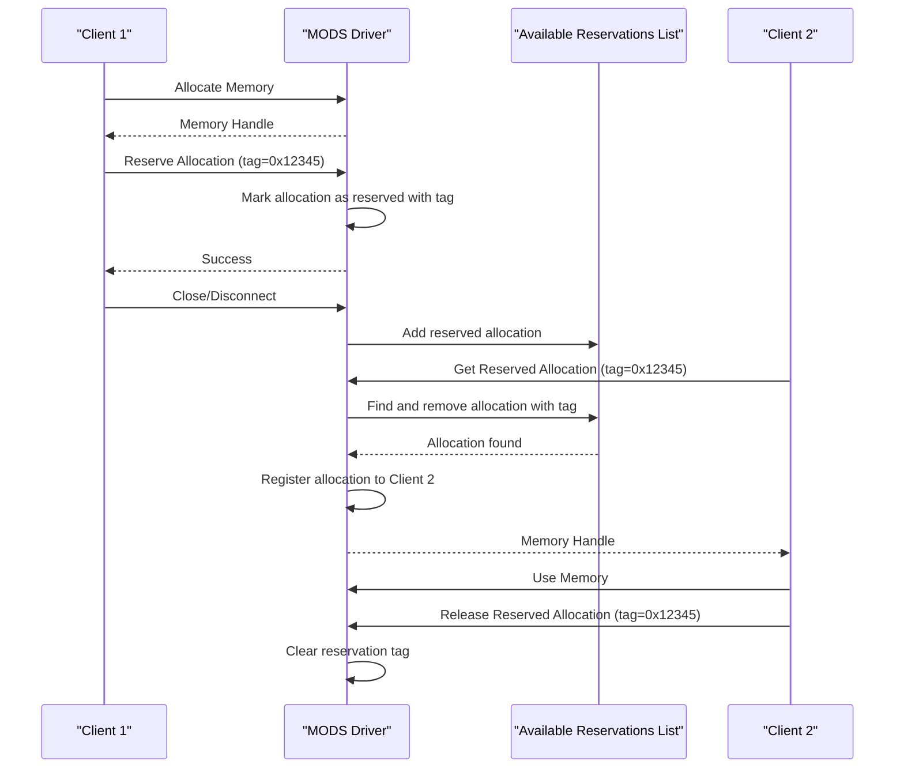
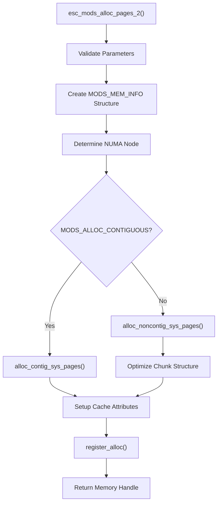

<!-- source: DeepWiki mcp.deepwiki.com · repo NVIDIA/mods-kernel-driver · page 4.1 Memory Allocation Types · fetched 2026-10-26 -->

# Memory Allocation Types

Relevant source files

The following files were used as context for generating this wiki page:

- [mods.h](mods.h)
- [mods_mem.c](mods_mem.c)

This page describes the memory allocation types supported by the MODS kernel driver. The driver provides flexible memory allocation capabilities with various cache attributes, physical memory constraints, and device mapping options to support hardware debugging and diagnostic operations.

For information about DMA mapping of allocated memory, see [DMA Mapping](#4.2), and for details about memory caching attributes, see [Memory Caching](#4.3).

## Overview

The MODS driver allows userspace applications to allocate system memory with specific attributes tailored to hardware debugging needs. These allocations can be tuned for different cache behaviors, memory constraints, and device interactions. The system supports both contiguous and non-contiguous memory allocations with options for NUMA node affinity and DMA device mapping.

Sources: [mods_mem.c:809-869](), [mods_mem.c:878-973](), [mods.h:117-120](), [mods.h:122-135]()

## Allocation Types and Flags

Memory allocations in MODS are controlled through a set of flags that specify the desired memory characteristics. These flags can be combined to achieve specific behaviors.

### Cache Attribute Flags

Cache attributes determine how memory is cached by the CPU:

| Flag | Value | Description |
|------|-------|-------------|
| `MODS_ALLOC_CACHED` | 0 | Default write-back cache attributes |
| `MODS_ALLOC_UNCACHED` | (1 << 0) | Uncached memory, bypasses CPU cache |
| `MODS_ALLOC_WRITECOMBINE` | (1 << 1) | Write-combined memory, optimized for sequential writes |
| `MODS_ALLOC_CACHE_MASK` | 7 | Mask to extract cache attributes |

### Memory Constraint Flags

These flags control physical memory constraints:

| Flag | Value | Description |
|------|-------|-------------|
| `MODS_ALLOC_DMA32` | (1 << 3) | Force 32-bit physical addresses |
| `MODS_ALLOC_CONTIGUOUS` | (1 << 4) | Force physically contiguous memory allocation |
| `MODS_ALLOC_USE_NUMA` | (1 << 5) | Use NUMA node specified instead of PCI device |
| `MODS_ALLOC_FORCE_NUMA` | (1 << 6) | Force memory from a specific NUMA node |
| `MODS_ALLOC_MAP_DEV` | (1 << 7) | Map memory to PCI device using DMA |
| `MODS_ALLOC_NO_FREE_OPTIMIZATION` | (1 << 8) | Don't cache surfaces on free |
| `MODS_ALLOC_DMA_PAGES` | (1 << 9) | Allocate memory from DMA region |
| `MODS_ALLOC_DECRYPTED_MMAP` | (1 << 10) | Allocate decrypted memory for mapping |

Sources: [mods.h:117-120](), [mods.h:122-135]()

## Contiguous vs. Non-Contiguous Allocation

The MODS driver supports two primary allocation modes:

### Contiguous Allocation

Contiguous allocations provide a physically contiguous memory region. These allocations are required for certain hardware operations that need to access a range of memory with a single DMA operation.

- Enabled with `MODS_ALLOC_CONTIGUOUS` flag
- Limited in size by kernel (typically max ~2MB)
- Implemented in `alloc_contig_sys_pages()`
- More efficient for hardware access but harder to allocate in large sizes

### Non-Contiguous Allocation

Non-contiguous allocations consist of multiple physically separate memory chunks. They're more flexible for larger allocations but require additional handling for device access.

- Default when `MODS_ALLOC_CONTIGUOUS` is not specified
- Can accommodate much larger total sizes
- Implemented in `alloc_noncontig_sys_pages()`
- May require scatter-gather lists for device access
- Memory is allocated in chunks of varying sizes based on available contiguous regions

Sources: [mods_mem.c:809-869](), [mods_mem.c:878-973](), [mods_mem.c:1370-1570]()

## Memory Data Structure

The `MODS_MEM_INFO` structure maintains the state of memory allocations with the following key components:

- Memory chunks (`alloc_sg`): Array of scatter-gather entries representing memory chunks
- Cache type information
- NUMA node information
- Allocation flags (DMA32, contiguous, etc.)
- DMA mapping list for device mappings
- Number of pages

The allocation is tracked in a linked list in the client context and referenced by a handle (which is essentially a pointer to the `MODS_MEM_INFO` structure).

Sources: [mods_mem.c:24-36](), [mods_mem.c:58-283](), [mods_mem.c:1288-1363]()

## NUMA Support

MODS provides NUMA (Non-Uniform Memory Access) awareness to optimize memory allocations:

- Memory can be allocated from a specific NUMA node using `MODS_ALLOC_USE_NUMA` and `numa_node` parameter
- Memory can be forced to a specific NUMA node with `MODS_ALLOC_FORCE_NUMA`
- When allocating memory for a PCI device, the driver can automatically select the NUMA node where the device is connected
- NUMA affinity is particularly important for performance-sensitive or latency-sensitive operations

Sources: [mods_mem.c:1450-1527](), [mods.h:114](), [mods.h:125-131]()

## Memory Reservation System

The MODS driver implements a memory reservation system that allows allocations to be reserved and later claimed by different clients:

1. **Reserve Allocation**: A client can reserve an existing allocation with a specific tag
2. **Get Reserved Allocation**: Another client can claim ownership of a reserved allocation by providing the same tag
3. **Release Reserved Allocation**: Reserved allocations can be explicitly released

This system allows memory allocations to persist even when the original allocating client disconnects, enabling cross-client memory sharing.

Sources: [mods_mem.c:1609-1792](), [mods_mem.c:2901-2928]()

## Allocation Process

The allocation process involves several steps to create and register a memory allocation:

1. Parse and validate allocation flags
2. Create a `MODS_MEM_INFO` structure to track the allocation
3. Determine NUMA node affinity
4. Allocate memory (contiguous or non-contiguous)
5. Set up cache attributes
6. Register the allocation with the client
7. Return a memory handle to the userspace application

Sources: [mods_mem.c:1370-1570](), [mods_mem.c:976-989]()

## Memory Allocation APIs

The MODS driver provides several APIs for memory allocation, each serving different use cases:

### Primary Allocation API

- `esc_mods_alloc_pages_2`: Main allocation function with full feature support

### Legacy Allocation APIs

- `esc_mods_alloc_pages`: Legacy function for allocating memory without device affinity
- `esc_mods_device_alloc_pages_2`: Allocate memory with device affinity
- `esc_mods_device_alloc_pages`: Legacy device memory allocation

### Freeing and Management APIs

- `esc_mods_free_pages`: Free allocated memory
- `esc_mods_merge_pages`: Merge multiple memory allocations
- `esc_mods_set_cache_attr`: Modify caching attributes of an allocation

### Memory Reservation APIs

- `esc_mods_reserve_allocation`: Reserve an allocation
- `esc_mods_get_reserved_allocation`: Claim a reserved allocation
- `esc_mods_release_reserved_allocation`: Release a reserved allocation

Sources: [mods_mem.c:1370-1570](), [mods_mem.c:1571-1699](), [mods_mem.c:1700-1792](), [mods_mem.c:1609-1792]()

## Summary

The MODS driver provides a flexible memory allocation system with support for different cache attributes, memory constraints, and device interaction patterns. The supported allocation types and features allow for sophisticated hardware debugging and diagnostic operations while managing system memory efficiently.

Key features of the memory allocation system include:
- Multiple cache attribute options (cached, uncached, write-combined)
- Contiguous and non-contiguous allocation support
- NUMA-aware allocation for performance optimization
- DMA mapping capabilities for device interaction
- Memory reservation system for cross-client sharing
- Special memory types (DMA32, decrypted memory)

These capabilities are essential for hardware debugging, where precise control over memory attributes and physical location is required for proper hardware interaction.

---

