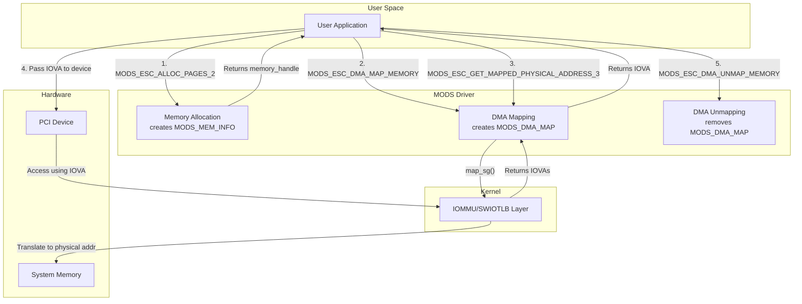
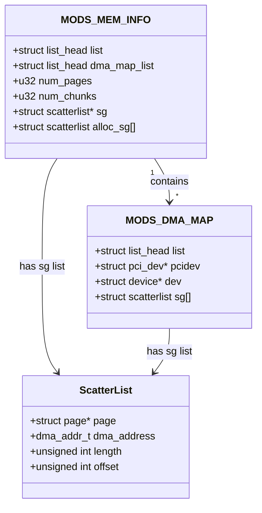
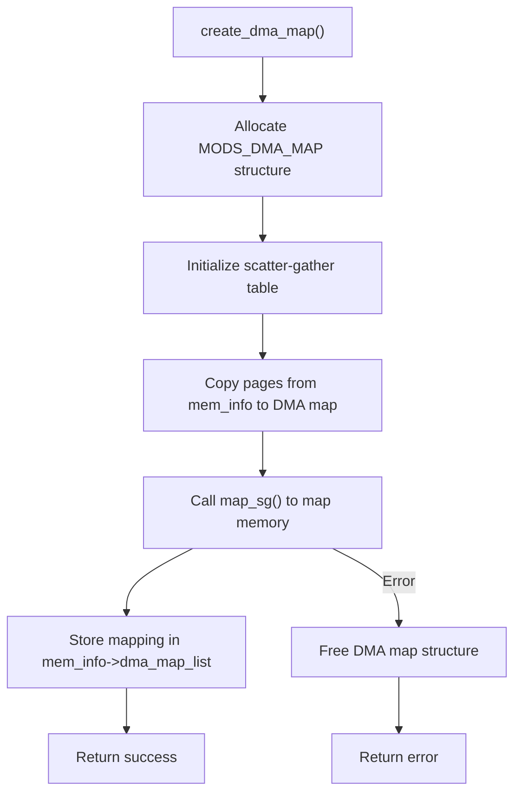
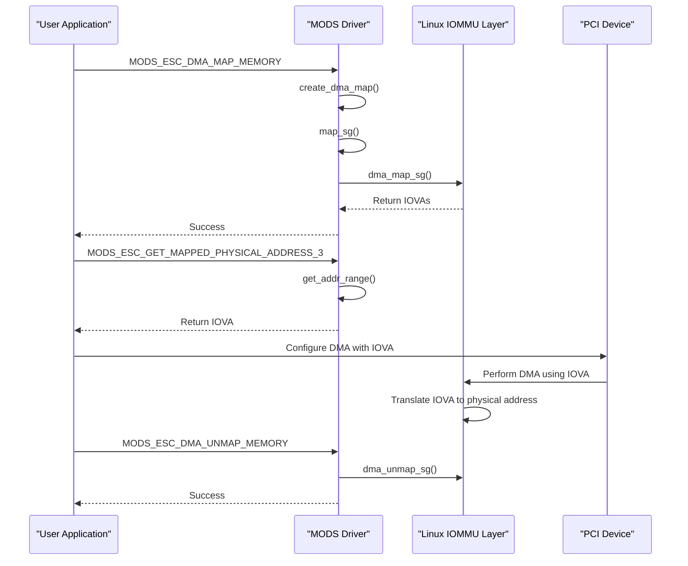

<!-- source: DeepWiki mcp.deepwiki.com · repo NVIDIA/mods-kernel-driver · page 4.2 DMA Mapping · fetched 2026-10-26 -->

# DMA Mapping

<details>
<summary>Relevant source files</summary>

The following files were used as context for generating this wiki page:

- [mods.h](mods.h)
- [mods_internal.h](mods_internal.h)
- [mods_mem.c](mods_mem.c)

</details>


DMA (Direct Memory Access) mapping in the MODS kernel driver provides mechanisms for making memory accessible to devices for direct memory access operations. This wiki page explains how memory allocations are made available to devices through DMA mapping, both with and without IOMMU (Input-Output Memory Management Unit) involvement.

For information about memory allocation types that can be mapped, see [Memory Allocation Types](#4.1).

## Overview of DMA Mapping

DMA mapping in MODS enables devices (particularly PCI devices) to directly access system memory without CPU intervention. The mapping process establishes the relationship between physical memory addresses visible to the CPU and device-visible addresses (also known as I/O virtual addresses or IOVAs) that a device uses to access that memory.

Key concepts involved in DMA mapping include:

- **Physical Address**: The CPU's view of memory addresses
- **DMA Address (IOVA)**: The device's view of memory addresses
- **IOMMU**: Hardware that translates device-visible addresses to physical addresses
- **DMA Mask**: Defines the addressing capabilities of a device (e.g., 32-bit or 64-bit)

### DMA Mapping Architecture



Sources: 
- [mods_mem.c:167-230]()
- [mods_mem.c:233-264]()
- [mods_mem.c:322-378]()
- [mods_internal.h:123-134]()

## DMA Mapping Data Structures

MODS uses several structures to track and manage DMA mappings:

### Main DMA Mapping Structures



1. **MODS_MEM_INFO**: Represents a memory allocation and contains a list of DMA mappings
   ```c
   struct MODS_MEM_INFO {
       struct list_head list;
       struct list_head dma_map_list;  // List of DMA mappings
       // ... other fields ...
   };
   ```

2. **MODS_DMA_MAP**: Tracks DMA mappings for a specific device
   ```c
   struct MODS_DMA_MAP {
       struct list_head list;
       struct pci_dev *pcidev;     // PCI device (can be NULL)
       struct device *dev;         // Device these mappings are for
       struct scatterlist sg[];    // Scatter-gather list for mappings
   };
   ```

3. **MODS_DMA_MAP_MEMORY**: Used for IOCTL calls to map/unmap memory for DMA
   ```c
   struct MODS_DMA_MAP_MEMORY {
       __u64 memory_handle;
       struct mods_pci_dev_2 pci_device;
   };
   ```

4. **Scatter-gather lists**: Used to track memory chunks and their DMA addresses

Sources:
- [mods_internal.h:123-134]()
- [mods_internal.h:137-163]() 
- [mods.h:362-366]()

## DMA Mapping Process

The DMA mapping process in MODS involves several steps:

### Mapping Workflow

1. **User allocates memory** using `MODS_ESC_ALLOC_PAGES_2` IOCTL
2. **User requests DMA mapping** via `MODS_ESC_DMA_MAP_MEMORY` IOCTL
3. **Driver creates DMA mapping** using `create_dma_map()` function
4. **Scatter-gather list is mapped** using `map_sg()` function
5. **IOMMU translates addresses** (if present) and returns IOVAs
6. **User retrieves mapped address** using `MODS_ESC_GET_MAPPED_PHYSICAL_ADDRESS_3` IOCTL
7. **Device performs DMA operations** using the mapped addresses
8. **User unmaps memory** when done via `MODS_ESC_DMA_UNMAP_MEMORY` IOCTL

### Creating a DMA Mapping

The function `create_dma_map()` is responsible for creating a DMA mapping:



Sources:
- [mods_mem.c:322-378]()
- [mods_mem.c:2371-2441]()
- [mods_mem.c:2443-2481]()

## IOMMU Integration

MODS integrates with the IOMMU (Input-Output Memory Management Unit) system in the Linux kernel to provide address translation for DMA operations.

### Key Benefits of IOMMU

- **Address Translation**: Allows devices to access memory using their own address space
- **Memory Protection**: Restricts device access to only explicitly mapped memory regions
- **Extended Addressing**: Allows 32-bit devices to access memory beyond 4GB

### IOMMU Mapping Flow



### IOMMU State Query

The IOCTL `MODS_ESC_GET_IOMMU_STATE_2` can be used to determine if the IOMMU is active for a device. The result can be one of:

- `MODS_SWIOTLB_DISABLED`: Hardware IOMMU may be enabled (normal operation)
- `MODS_SWIOTLB_ACTIVE`: Hardware IOMMU is disabled (using software IOMMU/SWIOTLB)
- `MODS_SWIOTLB_INDETERMINATE`: Unable to determine the IOMMU state

Sources:
- [mods_mem.c:167-230]()
- [mods.h:392-402]()

## DMA Mapping IOCTLs

The MODS driver provides several IOCTLs for DMA mapping operations:

### DMA Mapping IOCTL Summary

| IOCTL | Structure | Purpose |
|-------|-----------|---------|
| `MODS_ESC_DMA_MAP_MEMORY` | `MODS_DMA_MAP_MEMORY` | Maps memory to a PCI device for DMA |
| `MODS_ESC_DMA_UNMAP_MEMORY` | `MODS_DMA_MAP_MEMORY` | Unmaps memory from a PCI device |
| `MODS_ESC_PCI_SET_DMA_MASK` | `MODS_PCI_DMA_MASK` | Sets DMA addressing capability (bits) |
| `MODS_ESC_GET_IOMMU_STATE_2` | `MODS_GET_IOMMU_STATE` | Queries IOMMU state for a device |

### Using DMA Mapping IOCTLs

The typical flow of using these IOCTLs is:

1. **Allocate memory**: Use `MODS_ESC_ALLOC_PAGES_2` to allocate memory
2. **Set DMA mask** (optional): Use `MODS_ESC_PCI_SET_DMA_MASK` if the device needs >32-bit addressing
3. **Map memory**: Use `MODS_ESC_DMA_MAP_MEMORY` to map memory to the device
4. **Get mapped address**: Use `MODS_ESC_GET_MAPPED_PHYSICAL_ADDRESS_3` to get the IOVA
5. **Unmap memory**: Use `MODS_ESC_DMA_UNMAP_MEMORY` when done

```mermaid
flowchart LR
    Alloc["MODS_ESC_ALLOC_PAGES_2"] --> SetMask["MODS_ESC_PCI_SET_DMA_MASK"]
    SetMask --> Map["MODS_ESC_DMA_MAP_MEMORY"]
    Map --> GetAddr["MODS_ESC_GET_MAPPED_PHYSICAL_ADDRESS_3"]
    GetAddr --> UseMemory["Use memory for DMA"]
    UseMemory --> Unmap["MODS_ESC_DMA_UNMAP_MEMORY"]
    Unmap --> Free["MODS_ESC_FREE_PAGES"]
```



Sources:
- [mods.h:362-366]()
- [mods.h:376-380]()
- [mods.h:392-402]()
- [mods_mem.c:2371-2441]()
- [mods_mem.c:2443-2481]()

## Platform-Specific Considerations

The MODS driver includes platform-specific optimizations for DMA mapping:

### PowerPC with NVLink

On PowerPC systems with NVLink, DMA addresses for NVLink are compressed to allow GPUs to access all of system memory using their 47-bit physical address space. The `compress_nvlink_addr()` function performs this compression.

```c
static dma_addr_t compress_nvlink_addr(struct pci_dev *dev, dma_addr_t addr)
{
    // PowerPC-specific address compression for NVLink
    // This allows 56-bit real addresses to be accessed by GPUs with 47-bit addressing
}
```

### ARM64 Cache Management

On ARM64 systems, cache management is critical for DMA operations. The MODS driver includes:

- `clear_contiguous_cache()`: Flushes CPU cache for a memory range
- `esc_mods_flush_cpu_cache_range()`: IOCTL handler for cache flushing

### DMA Allocation Flags

Memory allocations can be optimized for DMA using these flags:

- `MODS_ALLOC_DMA32`: Forces 32-bit DMA addresses
- `MODS_ALLOC_MAP_DEV`: Automatically maps memory to the specified PCI device
- `MODS_ALLOC_DMA_PAGES`: Allocates memory from DMA region

Sources:
- [mods_mem.c:82-103]()
- [mods_mem.c:2794-2896]()
- [mods.h:122-135]()

## Best Practices and Limitations

When using DMA mapping in MODS, keep in mind:

1. **DMA Mask Setting**: For devices that need to access memory above 4GB, set the appropriate DMA mask before mapping memory.

2. **IOMMU Considerations**: Check the IOMMU state if your device has specific requirements.

3. **Multiple Mappings**: A memory allocation can be mapped to multiple devices simultaneously.

4. **Automatic Cleanup**: DMA mappings are automatically unmapped when:
   - The mapping is explicitly unmapped via `MODS_ESC_DMA_UNMAP_MEMORY`
   - The memory is freed via `MODS_ESC_FREE_PAGES`
   - The client closes the MODS device file

5. **Reserved Memory**: Memory with a reservation tag cannot be DMA-mapped.

6. **Large Allocations**: For allocations exceeding 4GB, the driver splits them into multiple mappings due to dma_length field limitations.

Sources:
- [mods_mem.c:170-207]()
- [mods_mem.c:287-319]()
- [mods_mem.c:392-397]()

## Summary

DMA mapping in the MODS kernel driver provides a flexible interface for mapping memory for device DMA operations. It integrates with the Linux IOMMU subsystem, supports various platforms with architecture-specific optimizations, and offers a comprehensive set of IOCTLs for userspace control.

The mapping process handles both contiguous and non-contiguous memory allocations and supports various DMA addressing capabilities. When properly utilized, it enables high-performance data transfer between system memory and devices, which is especially important for NVIDIA GPUs and other PCI devices.

---

