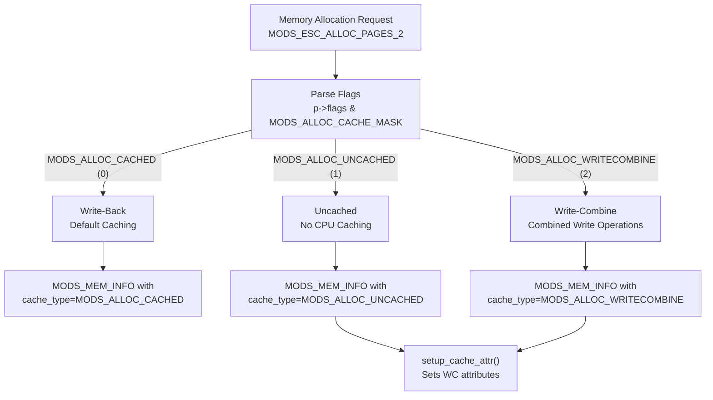
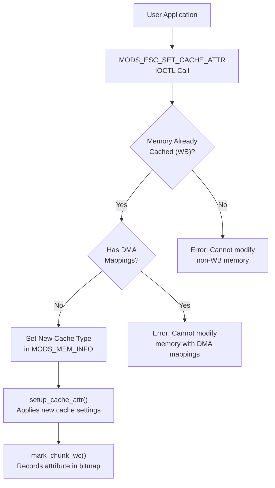
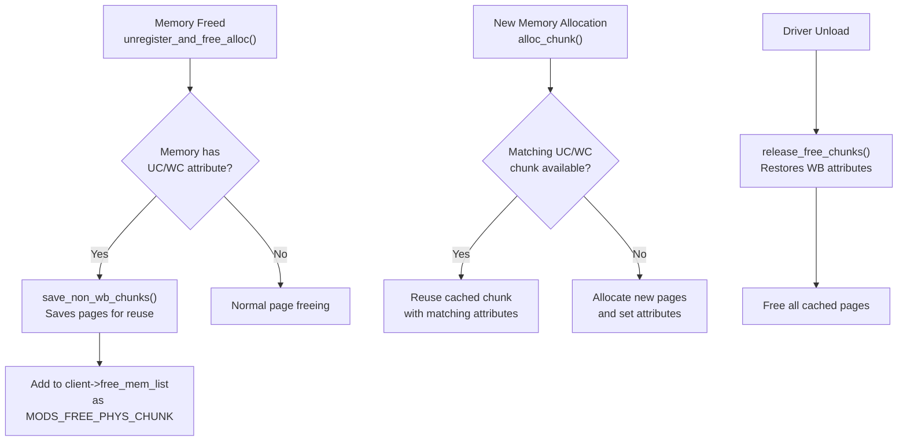
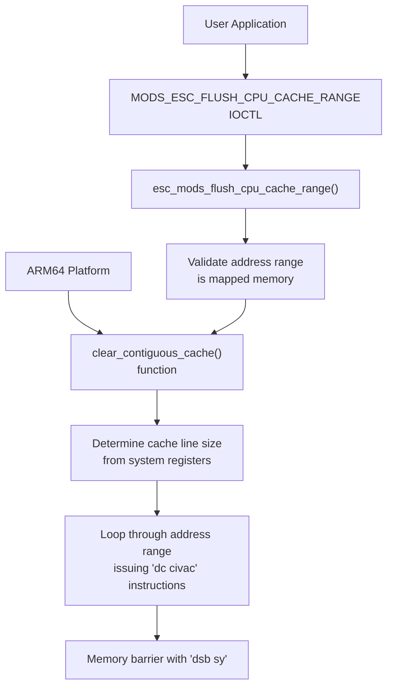

<!-- source: DeepWiki mcp.deepwiki.com · repo NVIDIA/mods-kernel-driver · page 4.3 Memory Caching · fetched 2026-10-26 -->

# Memory Caching

Relevant source files

The following files were used as context for generating this wiki page:

- [mods.h](mods.h)
- [mods_mem.c](mods_mem.c)

This page documents the memory caching system in the MODS kernel driver, explaining how memory caching attributes are managed for allocations created through the driver. For information about general memory management, see [Memory Management](#4) and [Memory Allocation Types](#4.1).

## Overview of Memory Caching Attributes

The MODS driver supports three memory caching attributes that control how memory accesses are cached by the CPU:

| Cache Attribute | Flag Value | Description |
|----------------|------------|-------------|
| Cached (WB) | `MODS_ALLOC_CACHED` (0) | Default write-back caching - both reads and writes are cached |
| Uncached (UC) | `MODS_ALLOC_UNCACHED` (1) | No caching - memory reads and writes directly access physical memory |
| Write-Combine (WC) | `MODS_ALLOC_WRITECOMBINE` (2) | Write operations are combined to improve performance |

These attributes are specified when allocating memory through the `flags` parameter in allocation functions and are stored in the `cache_type` field of the `MODS_MEM_INFO` structure.

Sources: [mods.h:117-120](), [mods_mem.c:118-120]()

## Specifying Cache Attributes

### During Memory Allocation

Cache attributes are primarily set during memory allocation via the `flags` parameter to functions like `esc_mods_alloc_pages_2`. The relevant bits in the flags field determine the caching behavior:

Sources: [mods.h:117-120](), [mods_mem.c:1370-1453]()

### Post-Allocation Cache Modification

After allocation, memory cache attributes can be modified using the `MODS_ESC_SET_CACHE_ATTR` IOCTL, which allows changing from Cached (WB) to either Uncached (UC) or Write-Combine (WC). This operation is implemented in the `esc_mods_set_cache_attr` function.

Important limitations:
- Only memory allocated with `MODS_ALLOC_CACHED` can have its cache type changed
- The memory cannot have active DMA mappings
- The target cache type must be either `MODS_ALLOC_UNCACHED` or `MODS_ALLOC_WRITECOMBINE`

Sources: [mods.h:210-222](), [mods_mem.c:1718-1784]()

## Cache Attribute Implementation

### Setting Cache Attributes

When UC or WC cache attributes are requested, the driver sets these attributes by modifying the CPU's memory management unit (MMU) settings for the allocated pages. This is done through the `setup_cache_attr` function which:

1. Maps each page using `MODS_KMAP`
2. Applies the requested cache attribute using architecture-specific functions:
   - On x86: `MODS_SET_MEMORY_UC` or `MODS_SET_MEMORY_WC`
   - On ARM64: `clear_contiguous_cache` to flush the cache
3. Marks the page as having special caching with `mark_chunk_wc`

Sources: [mods_mem.c:427-469]()

### Tracking Cache Attributes

The driver tracks which chunks of memory have non-default caching using a bitmap:

- The `wc_bitmap` field in `MODS_MEM_INFO` stores which chunks have UC or WC attributes
- The `mark_chunk_wc` function sets bits in this bitmap
- The `is_chunk_wc` function checks the bitmap

This tracking is important for proper cache restoration when memory is freed and for the caching optimization system.

Sources: [mods_mem.c:134-144]()

## Memory Caching Optimization

Changing memory caching attributes (especially to UC or WC) is an expensive operation on some CPUs. To optimize this, the MODS driver implements a caching system for pages with non-default attributes:

Key aspects of this optimization:

1. When memory with UC or WC attributes is freed, `save_non_wb_chunks` moves the pages to a free list instead of immediately releasing them
2. When allocating memory with UC or WC attributes, `alloc_chunk` first checks if suitable pages exist in the free list
3. When the driver is unloaded, `release_free_chunks` restores the default cache attributes and frees all cached pages

This optimization significantly improves performance when repeatedly allocating and freeing memory with UC or WC attributes.

Sources: [mods_mem.c:490-557](), [mods_mem.c:734-807]()

## Restoring Cache Attributes

When memory with non-default cache attributes is freed or when the driver is unloaded, the driver must restore the default (WB) cache attributes:

1. The `restore_cache` function is called for each allocation being freed
2. It iterates through all chunks with non-default attributes (tracked in `wc_bitmap`)
3. For each chunk, it calls `restore_cache_one_chunk` to restore the default WB attributes
4. This ensures memory is returned to the system in its default state

Sources: [mods_mem.c:641-670](), [mods_mem.c:559-582]()

## Platform-Specific Considerations

### ARM64

On ARM64 platforms, cache management is handled differently:

- Instead of using `MODS_SET_MEMORY_*` functions, ARM64 uses ARM-specific cache control instructions
- The `clear_contiguous_cache` function issues `dc civac` and `dsb sy` instructions to clean the cache
- ARM64 provides an additional IOCTL, `MODS_ESC_FLUSH_CPU_CACHE_RANGE`, which allows userspace to explicitly flush cache ranges

Sources: [mods_mem.c:2794-2834](), [mods_mem.c:2836-2896]()

### PPC64 (PowerPC)

On PowerPC systems, there are additional limitations:

- Only default cached (WB) attributes are supported
- Attempting to set UC or WC attributes will result in an error
- This limitation is checked during memory allocation in `esc_mods_alloc_pages_2`

Sources: [mods_mem.c:1442-1450]()

## Cache Attributes and DMA

There's an important relationship between memory caching and DMA (Direct Memory Access):

- Memory with non-default cache attributes cannot be mapped for DMA after its attributes have been changed
- Memory that is already mapped for DMA cannot have its cache attributes changed
- If memory will be used for both CPU access and DMA, cache attributes must be set at allocation time

The driver enforces these restrictions in the `esc_mods_set_cache_attr` function.

Sources: [mods_mem.c:1763-1767]()

---

