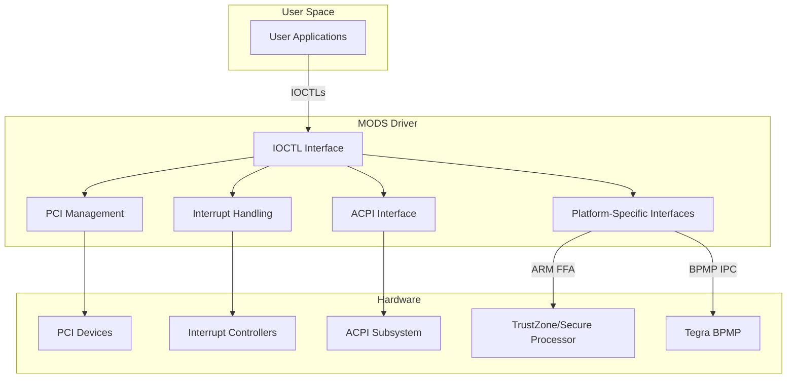
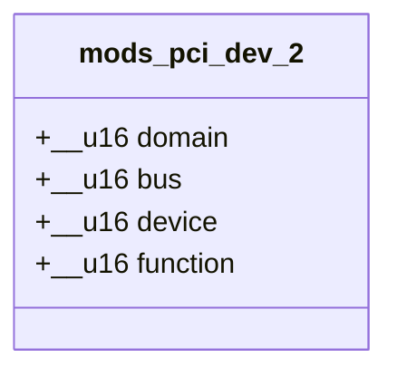
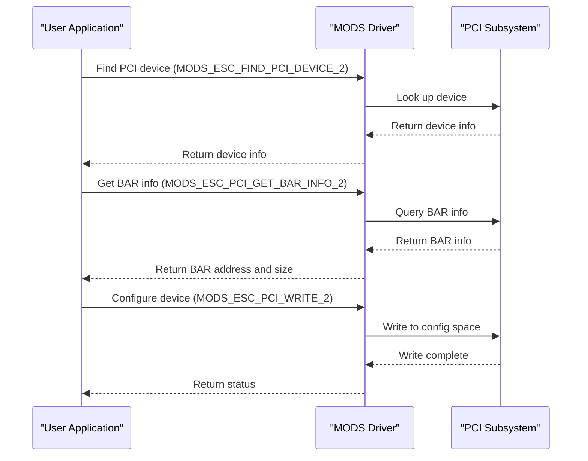
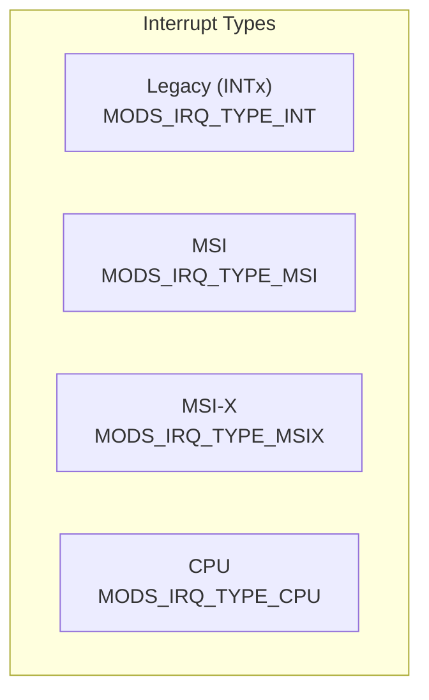
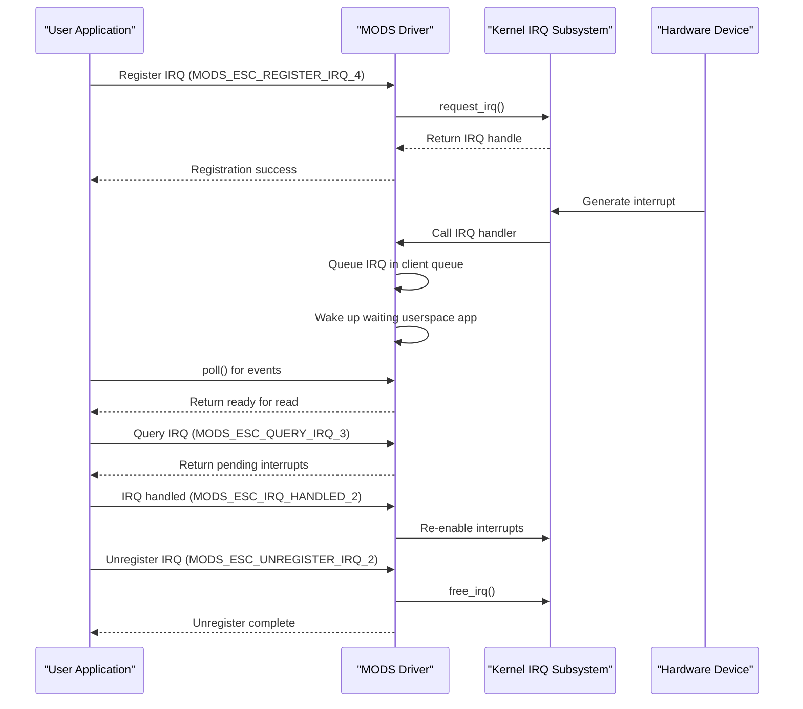
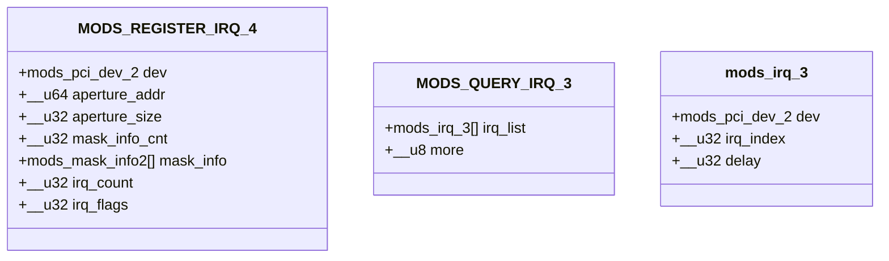
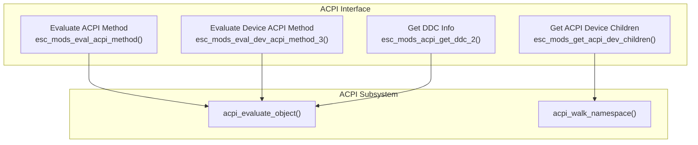
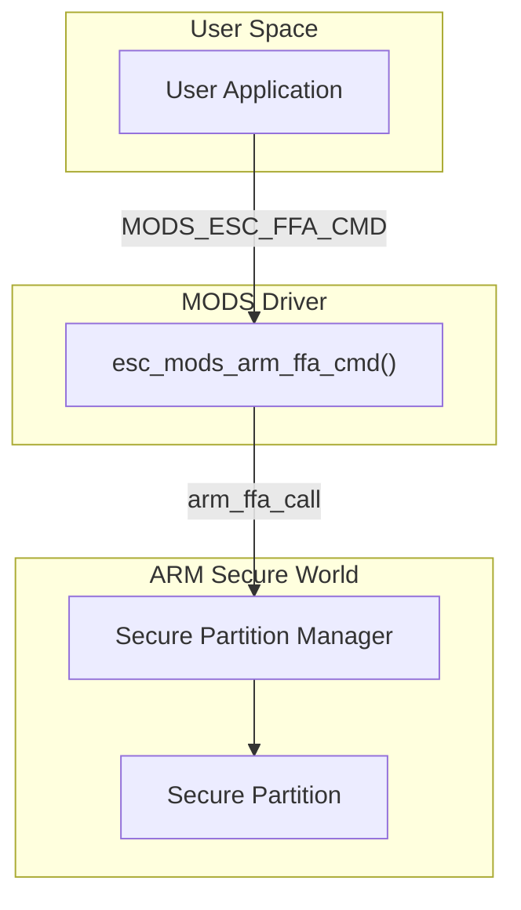
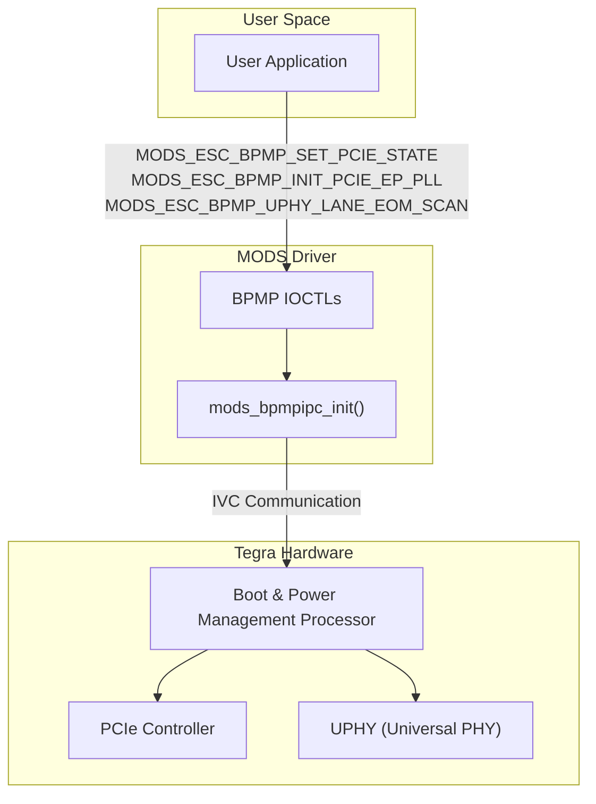
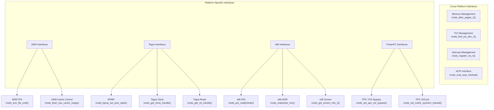

<!-- source: DeepWiki mcp.deepwiki.com · repo NVIDIA/mods-kernel-driver · page 5 Hardware Interfaces · fetched 2026-10-26 -->

# Hardware Interfaces

<details>
<summary>Relevant source files</summary>

The following files were used as context for generating this wiki page:

- [mods.h](mods.h)
- [mods_internal.h](mods_internal.h)
- [mods_krnl.c](mods_krnl.c)

</details>


The MODS (Module Overlay and Driver Support) kernel driver provides a set of interfaces to interact with various hardware components. This page documents the core hardware interfaces implemented by the driver, explaining how they allow user applications to interact with system memory, PCI devices, interrupt controllers, ACPI subsystems, and platform-specific hardware. For memory management details, see [Memory Management](#4).

## Overview of Hardware Interface Architecture

The MODS driver handles hardware interfaces through a layered architecture, exposing functionality to userspace through IOCTLs while abstracting hardware-specific details.



Sources: [mods_internal.h:391-408](), [mods.h:61-94]()

## PCI Device Management

The PCI management interface provides capabilities for discovery, configuration, and control of PCI devices in the system. It allows applications to:

1. Find PCI devices by vendor/device ID or class code
2. Read and write PCI configuration space
3. Get information about BAR (Base Address Register) regions
4. Manage device IRQs
5. Enable and disable SR-IOV capabilities

### PCI Device Representation

PCI devices are represented using the `mods_pci_dev_2` structure:



Sources: [mods.h:61-66]()

### Primary PCI Management Functions

| IOCTL | Description | Structure | Code Reference |
|-------|-------------|-----------|----------------|
| MODS_ESC_FIND_PCI_DEVICE_2 | Find a PCI device by vendor/device ID | MODS_FIND_PCI_DEVICE_2 | [mods_krnl.c:2125-2128]() |
| MODS_ESC_FIND_PCI_CLASS_CODE_2 | Find a PCI device by class code | MODS_FIND_PCI_CLASS_CODE_2 | [mods_krnl.c:2137-2140]() |
| MODS_ESC_PCI_READ_2 | Read from PCI config space | MODS_PCI_READ_2 | [mods_krnl.c:2171-2173]() |
| MODS_ESC_PCI_WRITE_2 | Write to PCI config space | MODS_PCI_WRITE_2 | [mods_krnl.c:2181-2184]() |
| MODS_ESC_PCI_GET_BAR_INFO_2 | Get BAR address and size | MODS_PCI_GET_BAR_INFO_2 | [mods_krnl.c:2149-2152]() |
| MODS_ESC_PCI_SET_DMA_MASK | Set DMA mask for a device | MODS_PCI_DMA_MASK | [mods_krnl.c:2245-2248]() |
| MODS_ESC_SET_NUM_VF | Enable/disable SR-IOV | MODS_SET_NUM_VF | [mods_krnl.c:253-309]() |

Sources: [mods_krnl.c:2118-2264](), [mods_internal.h:514-562]()

### PCI Device Enablement Process



Sources: [mods_krnl.c:397-383](), [mods_internal.h:514-562]()

## Interrupt Management

The interrupt management interface allows users to register for and handle hardware interrupts. It supports:

1. Legacy (INTx) interrupts (x86 only)
2. MSI (Message Signaled Interrupts)
3. MSI-X (Extended MSI)
4. CPU interrupts (Tegra only)

### Interrupt Types



Sources: [mods.h:828-832]()

### Interrupt Registration and Handling



Sources: [mods.h:775-922](), [mods_internal.h:576-591]()

### Key Interrupt Management Structures



Sources: [mods.h:792-825](), [mods.h:874-935]()

## ACPI Interface

The ACPI interface allows access to ACPI functionality, including:

1. Evaluating ACPI methods
2. Accessing ACPI device information
3. Getting DDC (Display Data Channel) information via ACPI

### ACPI Method Evaluation



Sources: [mods_internal.h:492-511](), [mods.h:1033-1163]()

### Key ACPI Structures

```mermaid
classDiagram
    class MODS_EVAL_ACPI_METHOD {
        +char method_name[12]
        +__u32 argument_count
        +ACPI_ARGUMENT[] argument
        +__u8[] in_buffer
        +__u32 out_data_size
        +__u8[] out_buffer
        +__u32 out_status
    }
    
    class MODS_EVAL_DEV_ACPI_METHOD_3 {
        +MODS_EVAL_ACPI_METHOD method
        +mods_pci_dev_2 device
        +__u32 acpi_id
    }
    
    class ACPI_ARGUMENT {
        +__u32 type
        +union {
            integer
            buffer
            method
        }
    }
```

Sources: [mods.h:1033-1104]()

## ARM FFA Interface (Platform-Specific)

The ARM Firmware Framework for Arm (FFA) interface provides a standardized way to communicate with secure firmware (TrustZone) on ARM platforms.



### FFA Command Types

The FFA interface supports several command types defined in the `MODS_SP_FFA_CMD_TYPE` enum:

| Command Type | Purpose |
|--------------|---------|
| MODS_FFA_CMD_READ_REG | Read secure register |
| MODS_FFA_CMD_WRITE_REG | Write secure register |
| MODS_FFA_CMD_READ_VER | Read version information |
| MODS_FFA_CMD_SE_TESTS | Security engine tests |
| MODS_FFA_CMD_SE_KEY_MOVER | Security engine key mover operation |
| MODS_FFA_CMD_HSS_TEST | Hardware security suite test |
| MODS_FFA_CMD_C2C_TEST | Chip-to-chip test |
| MODS_FFA_CMD_MISC | Miscellaneous commands |

Sources: [mods.h:1896-1915](), [mods_internal.h:697-700]()

## BPMP Communication (Tegra-Specific)

The Boot and Power Management Processor (BPMP) communication interface provides access to Tegra-specific hardware features, including:

1. PCIe state management
2. UPHY lane control
3. PCIe EP PLL initialization



### Key BPMP Interface Functions

| IOCTL | Description | Structure |
|-------|-------------|-----------|
| MODS_ESC_BPMP_SET_PCIE_STATE | Set PCIe controller state | MODS_SET_PCIE_STATE |
| MODS_ESC_BPMP_INIT_PCIE_EP_PLL | Initialize PCIe endpoint PLL | MODS_INIT_PCIE_EP_PLL |
| MODS_ESC_BPMP_UPHY_LANE_EOM_SCAN | Perform EOM scan on UPHY lane | MODS_BPMP_UPHY_LANE_EOM_SCAN_PARAMS |

Sources: [mods.h:421-438](), [mods_internal.h:595-599](), [mods_internal.h:733-739]()

## Cross-Platform and Legacy Hardware Support



Sources: [mods_internal.h:390-746](), [mods_krnl.c:387-384](), [mods_krnl.c:1934-1994]()

The MODS driver provides both platform-agnostic hardware interfaces and platform-specific ones, with conditional compilation to support a wide range of hardware architectures.

---

