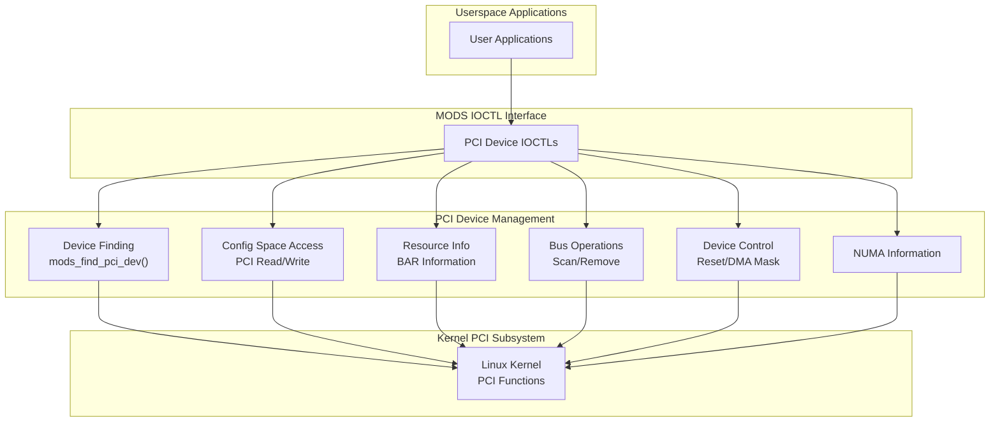
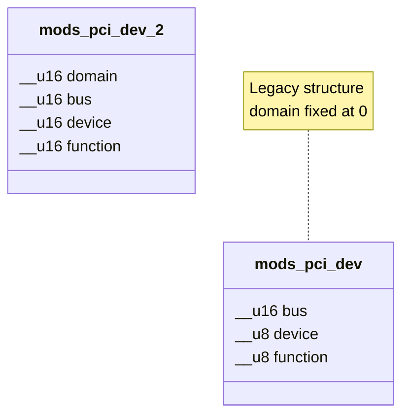
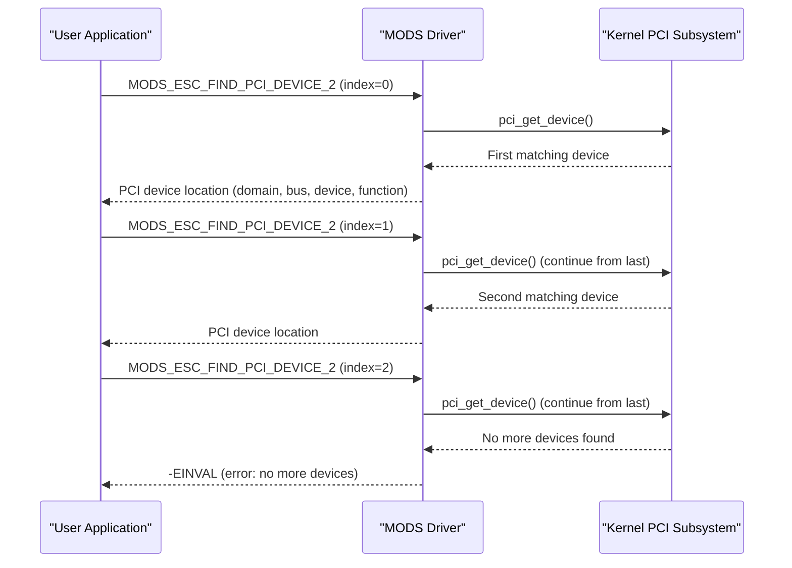
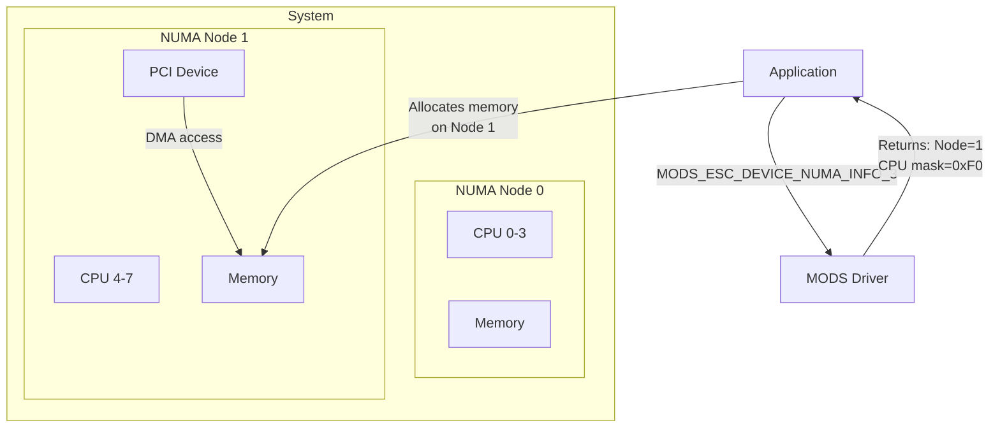
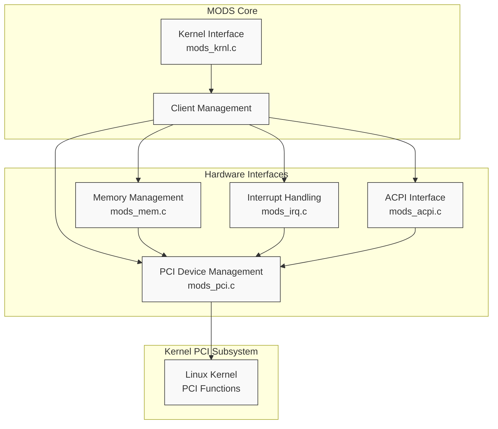

<!-- source: DeepWiki mcp.deepwiki.com · repo NVIDIA/mods-kernel-driver · page 5.1 PCI Device Management · fetched 2026-10-26 -->

# PCI Device Management

Relevant source files

The following files were used as context for generating this wiki page:

- [mods.h](mods.h)
- [mods_internal.h](mods_internal.h)
- [mods_pci.c](mods_pci.c)

The PCI Device Management subsystem in the NVIDIA MODS kernel driver provides a comprehensive set of functions for discovering, configuring, and controlling PCI devices. This subsystem enables userspace applications to perform low-level hardware operations on PCI devices for debugging, diagnostics, and development purposes.

## Overview

PCI Device Management provides the following core capabilities:

1. **Device Discovery** - Finding PCI devices by vendor/device ID or class code
2. **Configuration Space Access** - Reading and writing PCI configuration registers
3. **Resource Information** - Obtaining information about PCI BARs (Base Address Registers)
4. **Bus Operations** - Scanning for new devices, removing devices
5. **Device Control** - Resetting devices, setting DMA masks
6. **NUMA Information** - Retrieving NUMA node information for PCI devices

These capabilities are exposed to userspace applications through the IOCTL interface of the MODS driver.

Sources: [mods_pci.c:1-67](), [mods.h:61-66](), [mods.h:404-419]()

## PCI Device Management Architecture

Sources: [mods_pci.c:1-67](), [mods_internal.h:396-414]()

## PCI Device Representation

The MODS driver represents PCI devices using the `mods_pci_dev_2` structure for newer code and the `mods_pci_dev` structure for legacy compatibility:

The `mods_pci_dev_2` structure extends the legacy `mods_pci_dev` structure by adding support for PCI domains, allowing for systems with multiple PCI host bridges.

Sources: [mods.h:61-73]()

## Device Discovery

The MODS driver provides functions to find PCI devices by vendor/device ID or class code. These are exposed to userspace via IOCTLs:

### Key Functions

- `mods_find_pci_dev()` - Internal function to find a PCI device by domain, bus, device, and function
- `esc_mods_find_pci_dev_2()` - IOCTL handler for finding devices by vendor/device ID
- `esc_mods_find_pci_class_code_2()` - IOCTL handler for finding devices by class code

### IOCTLs

- `MODS_ESC_FIND_PCI_DEVICE_2` - Find a PCI device by vendor/device ID
- `MODS_ESC_FIND_PCI_CLASS_CODE_2` - Find a PCI device by class code

These IOCTLs use a "progressive enumeration" pattern where the caller first starts with index 0 and then increments the index for each successful call until no more matching devices are found.

Sources: [mods_pci.c:22-155](), [mods_pci.c:157-222](), [mods.h:404-479]()

## Configuration Space Access

The MODS driver provides functions to read and write PCI configuration space registers:

### Key Functions

- `esc_mods_pci_read_2()` - IOCTL handler for reading PCI configuration registers
- `esc_mods_pci_write_2()` - IOCTL handler for writing PCI configuration registers

### IOCTLs

- `MODS_ESC_PCI_READ_2` - Read a PCI configuration register
- `MODS_ESC_PCI_WRITE_2` - Write a PCI configuration register

These functions support reading and writing 1, 2, or 4 bytes at specified addresses within the PCI configuration space (up to 0xFFF).

Sources: [mods_pci.c:370-574](), [mods.h:530-582]()

## Resource Information

The MODS driver provides functions to get information about PCI BARs (Base Address Registers):

### Key Functions

- `esc_mods_pci_get_bar_info_2()` - IOCTL handler for getting BAR information

### IOCTLs

- `MODS_ESC_PCI_GET_BAR_INFO_2` - Get information about a PCI BAR

This function returns the physical address and size of the specified BAR. It correctly handles 64-bit BARs.

Sources: [mods_pci.c:224-319](), [mods.h:481-504]()

## Bus Operations

The MODS driver provides functions for PCI bus operations like scanning and removing devices:

### Key Functions

- `esc_mods_pci_bus_rescan()` - IOCTL handler for rescanning a PCI bus
- `esc_mods_pci_bus_remove_dev()` - IOCTL handler for removing a PCI device

### IOCTLs

- `MODS_ESC_PCI_BUS_RESCAN` - Rescan a PCI bus for new devices
- `MODS_ESC_PCI_BUS_REMOVE_DEV` - Remove a PCI device from the bus

These functions are useful for hot-plug operations where devices are added or removed from the system dynamically.

Sources: [mods_pci.c:576-663](), [mods.h:594-620]()

## Device Control

The MODS driver provides functions for controlling PCI devices:

### Key Functions

- `esc_mods_pci_set_dma_mask()` - IOCTL handler for setting PCI device DMA mask
- `esc_mods_pci_reset_function()` - IOCTL handler for resetting a PCI device

### IOCTLs

- `MODS_ESC_PCI_SET_DMA_MASK` - Set DMA mask for a PCI device

These functions allow for controlling aspects of PCI device behavior, such as DMA addressing capabilities and device reset.

Sources: [mods_pci.c:923-1077](), [mods.h:376-380]()

## NUMA Information

The MODS driver provides functions to get NUMA information for PCI devices:

### Key Functions

- `esc_mods_device_numa_info_3()` - IOCTL handler for getting NUMA node information

### IOCTLs

- `MODS_ESC_DEVICE_NUMA_INFO_3` - Get NUMA node information for a PCI device

This function returns the NUMA node to which a PCI device is physically attached, along with information about CPUs in that NUMA node. This is useful for optimizing memory allocations for device DMA.

Sources: [mods_pci.c:722-875](), [mods.h:1207-1272]()

## PCI IOMMU State

The MODS driver provides functions to determine if IOMMU is enabled for a PCI device:

### Key Functions

- `esc_mods_get_iommu_state_2()` - IOCTL handler for getting IOMMU state

### IOCTLs

- `MODS_ESC_GET_IOMMU_STATE_2` - Get IOMMU state for a PCI device

This function attempts to determine whether IOMMU is enabled for a given PCI device by checking if SWIOTLB is being used.

Sources: [mods_pci.c:878-921](), [mods.h:392-402]()

## Device Properties

On newer kernels, the MODS driver provides a function to read device properties:

### Key Functions

- `esc_mods_read_dev_property()` - IOCTL handler for reading device properties

### IOCTLs

- `MODS_ESC_READ_DEV_PROPERTY` - Read a device property from firmware

This function allows reading device properties from firmware (e.g., device tree or ACPI).

Sources: [mods_pci.c:1079-1131](), [mods.h:1919-1938]()

## IOCTL Interface for PCI Device Management

The following table summarizes the main IOCTLs available for PCI device management:

| IOCTL | Purpose |
|-------|---------|
| `MODS_ESC_FIND_PCI_DEVICE_2` | Find a PCI device by vendor/device ID |
| `MODS_ESC_FIND_PCI_CLASS_CODE_2` | Find a PCI device by class code |
| `MODS_ESC_PCI_READ_2` | Read a PCI configuration register |
| `MODS_ESC_PCI_WRITE_2` | Write a PCI configuration register |
| `MODS_ESC_PCI_GET_BAR_INFO_2` | Get information about a PCI BAR |
| `MODS_ESC_PCI_GET_IRQ_2` | Get IRQ number assigned to a PCI device |
| `MODS_ESC_PCI_BUS_RESCAN` | Rescan a PCI bus for new devices |
| `MODS_ESC_PCI_BUS_REMOVE_DEV` | Remove a PCI device from the bus |
| `MODS_ESC_PCI_SET_DMA_MASK` | Set DMA mask for a PCI device |
| `MODS_ESC_GET_IOMMU_STATE_2` | Get IOMMU state for a PCI device |
| `MODS_ESC_DEVICE_NUMA_INFO_3` | Get NUMA node information for a PCI device |
| `MODS_ESC_READ_DEV_PROPERTY` | Read a device property from firmware |

Sources: [mods.h:2017-2187]()

## Integration with Other MODS Subsystems

The PCI Device Management subsystem integrates with other MODS subsystems:

The PCI Device Management subsystem is used by:

1. **Memory Management** - For DMA mapping and NUMA-aware memory allocation
2. **Interrupt Handling** - For PCI device interrupts (MSI/MSI-X)
3. **ACPI Interface** - For ACPI methods related to PCI devices

Sources: [mods_internal.h:396-414](), [mods_internal.h:514-562]()

## Summary

The PCI Device Management subsystem provides a comprehensive set of capabilities for discovering, configuring, and controlling PCI devices. It forms a core part of the MODS driver's hardware interface capabilities, enabling userspace applications to perform low-level hardware operations for debugging and diagnostics.

---

