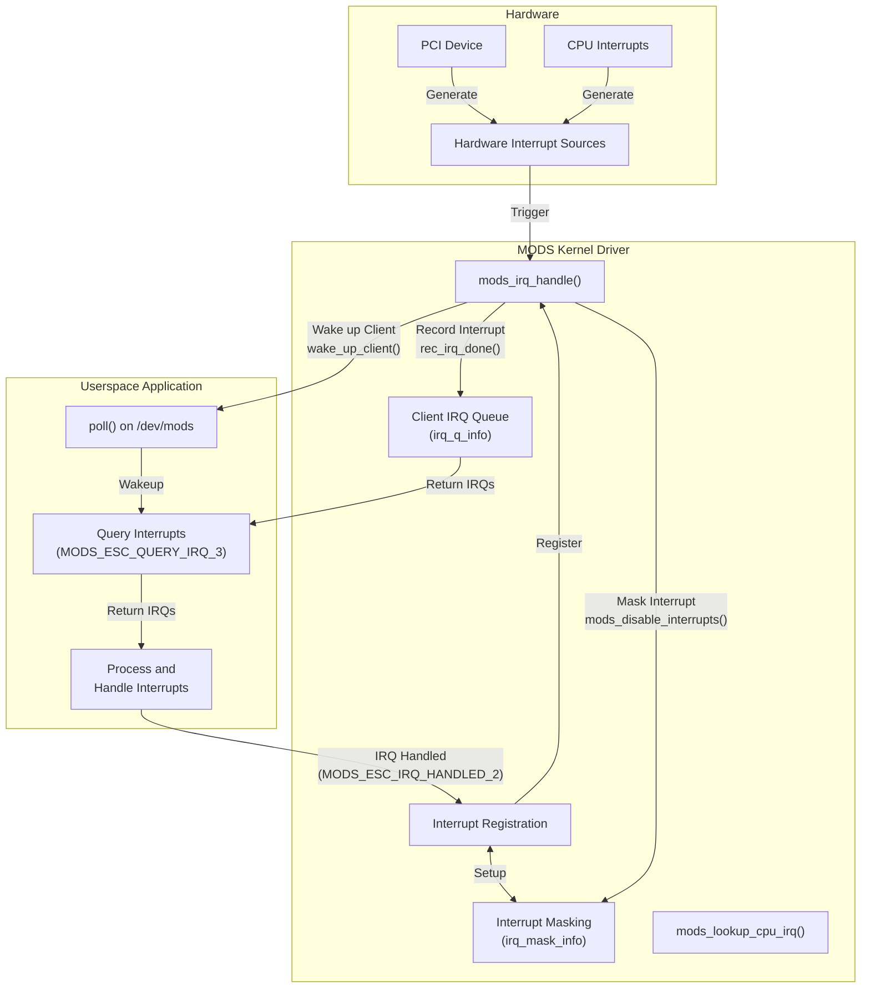
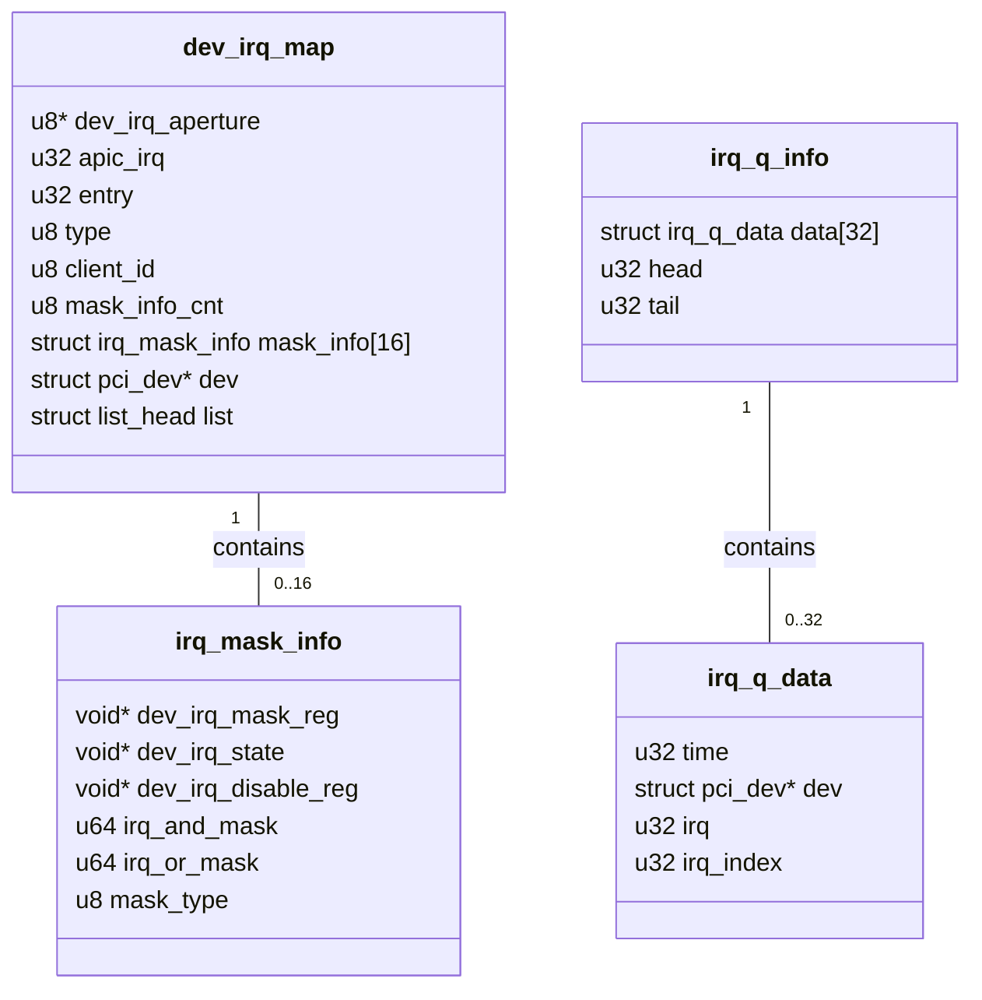
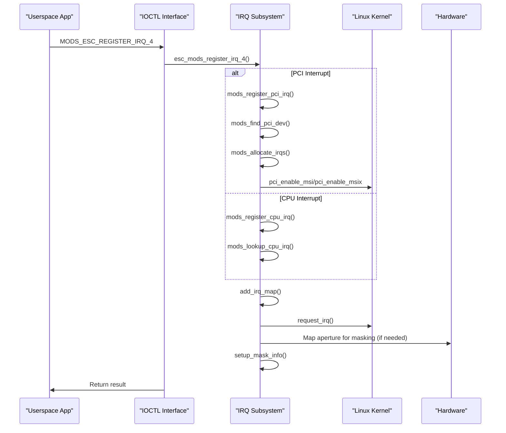
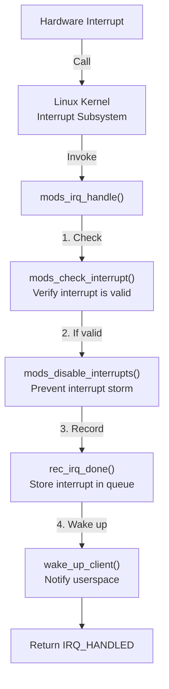
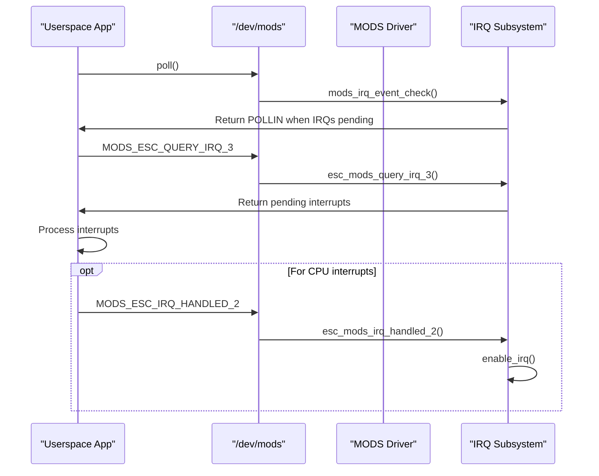
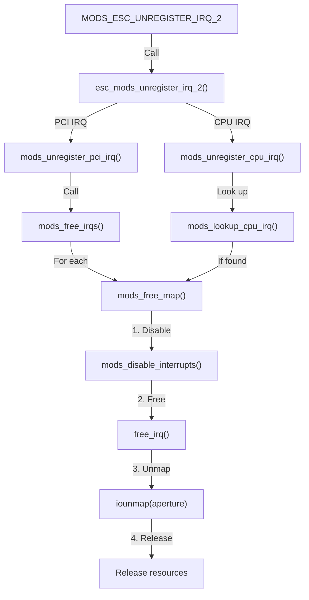
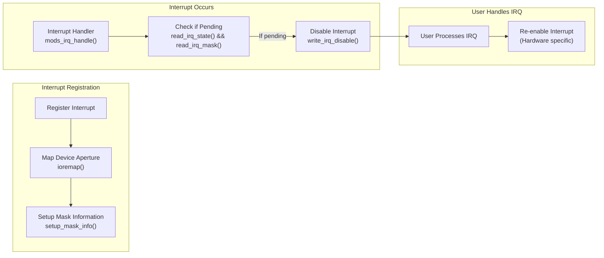
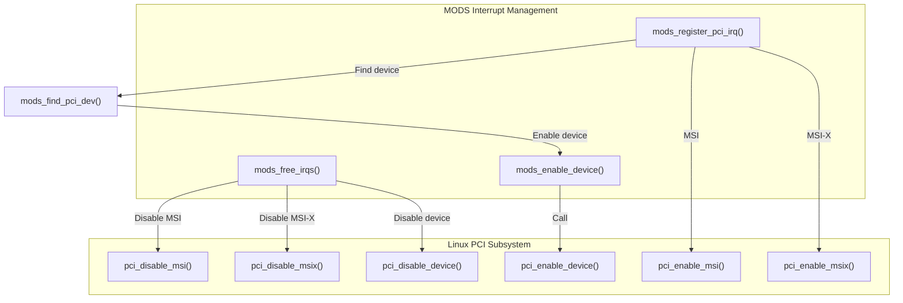

<!-- source: DeepWiki mcp.deepwiki.com · repo NVIDIA/mods-kernel-driver · page 5.2 Interrupt Management · fetched 2026-10-26 -->

# Interrupt Management

Relevant source files

The following files were used as context for generating this wiki page:

- [mods.h](mods.h)
- [mods_internal.h](mods_internal.h)
- [mods_irq.c](mods_irq.c)

## Introduction

The MODS kernel driver provides a comprehensive interrupt management system that allows userspace applications to register, handle, and query hardware interrupts. This page documents the internal architecture of the interrupt subsystem, the supported interrupt types, and the mechanisms for interrupt handling in the MODS driver.

The interrupt management system in MODS enables userspace applications to receive and process hardware interrupts from PCI devices and CPU sources, providing a bridge between hardware-generated signals and userspace interrupt handlers.

Sources: [mods_irq.c:1-1684](), [mods_internal.h:289-310]()

## Interrupt System Architecture

The MODS interrupt management system follows a producer-consumer pattern where:
1. Hardware generates interrupts (producer)
2. The MODS kernel driver catches and records these interrupts in a queue
3. Userspace applications poll and process these interrupts (consumer)

Sources: [mods_irq.c:314-357](), [mods_irq.c:583-601](), [mods_irq.c:850-917]()

## Interrupt Types and Structures

The MODS driver supports four primary types of interrupts:

| Interrupt Type | Flag Value | Description |
|----------------|------------|-------------|
| MODS_IRQ_TYPE_INT | 0 | Legacy PCI Interrupts (INTx) |
| MODS_IRQ_TYPE_MSI | 1 | Message Signaled Interrupts |
| MODS_IRQ_TYPE_CPU | 2 | CPU Interrupt Vectors |
| MODS_IRQ_TYPE_MSIX | 3 | Extended Message Signaled Interrupts |

### Core Data Structures

Sources: [mods_internal.h:289-310](), [mods.h:825-834](), [mods.h:873-893]()

## Interrupt Registration Process

Registering an interrupt in MODS involves several steps:

1. User submits a registration request using the MODS_ESC_REGISTER_IRQ_4 IOCTL
2. The driver validates the request and the target device
3. For PCI devices, the appropriate interrupt mechanism (INTx, MSI, MSI-X) is configured
4. The interrupt is hooked into the Linux kernel's interrupt subsystem
5. For legacy interrupts, masking registers are configured

Sources: [mods_irq.c:1222-1306](), [mods_irq.c:447-603](), [mods_irq.c:791-1000]()

## Interrupt Handling

When a hardware interrupt occurs, the Linux kernel invokes the MODS interrupt handler, which processes the interrupt and notifies userspace:

The interrupt handler performs these key operations:
1. Verifies the interrupt is valid and pending
2. Disables the interrupt source to prevent an interrupt storm
3. Records the interrupt in the client's interrupt queue
4. Wakes up the userspace application waiting on the queue

For legacy (INTx) interrupts, the driver uses hardware-specific masking to prevent interrupt storms by:
1. Reading interrupt pending and interrupt enabled registers
2. Applying AND/OR masks to the interrupt disable register
3. Keeping the interrupt disabled until userspace acknowledges it

Sources: [mods_irq.c:314-357](), [mods_irq.c:142-221](), [mods_irq.c:257-310]()

## Interrupt Querying and Processing

Userspace applications interact with the interrupt system through a polling mechanism:

Key points about interrupt querying:
1. The client's IRQ queue can hold up to 32 pending interrupts
2. Each entry contains device information, IRQ details, and timestamps
3. The `more` field indicates if there are additional interrupts pending
4. For CPU interrupts, userspace must explicitly acknowledge handling

Sources: [mods_irq.c:647-659](), [mods_irq.c:1350-1433](), [mods_irq.c:1484-1537]()

## Interrupt Unregistration

When interrupts are no longer needed, they must be unregistered:

When a client disconnects or the driver is unloaded, all registered interrupts are automatically freed via `mods_free_client_interrupts()`.

Sources: [mods_irq.c:1324-1347](), [mods_irq.c:606-633](), [mods_irq.c:772-790]()

## IOCTL Interface

The MODS driver exposes the following IOCTLs for interrupt management:

| IOCTL Command | Structure | Description |
|---------------|-----------|-------------|
| MODS_ESC_REGISTER_IRQ_4 | MODS_REGISTER_IRQ_4 | Register an interrupt with extended capabilities |
| MODS_ESC_UNREGISTER_IRQ_2 | MODS_REGISTER_IRQ_2 | Unregister a previously registered interrupt |
| MODS_ESC_QUERY_IRQ_3 | MODS_QUERY_IRQ_3 | Query pending interrupts |
| MODS_ESC_IRQ_HANDLED_2 | MODS_REGISTER_IRQ_2 | Indicate CPU interrupt has been handled |

Older, deprecated IOCTL commands are also supported for backward compatibility.

Sources: [mods.h:792-936](), [mods.h:2019-2192]()

## Interrupt Masking for Legacy Interrupts

For legacy PCI interrupts (INTx), the MODS driver implements interrupt masking to prevent interrupt storms. This works by:

The mask configuration includes:
1. Pointers to interrupt state, mask, and disable registers
2. AND/OR masks to apply to these registers
3. Mask type (32-bit or 64-bit)

Sources: [mods_irq.c:178-221](), [mods_irq.c:407-444](), [mods.h:758-771]()

## Integration with PCI Subsystem

The MODS driver integrates with the Linux PCI subsystem to manage PCI device interrupts:

The driver maintains a list of enabled devices per client in `client->enabled_devices` and tracks the client that owns each device through the `en_dev_entry` structure.

Sources: [mods_irq.c:44-133](), [mods_internal.h:47-58](), [mods_irq.c:791-1000]()

## Platform-Specific Extensions

On Tegra platforms with Device Tree support, the MODS driver provides additional functionality for GPIO and Device Tree interrupt mapping:

| Function | Description |
|----------|-------------|
| esc_mods_map_irq() | Maps Device Tree node to GIC interrupt |
| esc_mods_map_irq_to_gpio() | Maps GPIO to GIC interrupt |

These functions allow userspace applications to find and use platform-specific interrupts that are described in the Device Tree rather than through PCI configuration.

Sources: [mods_irq.c:1539-1683]()

---

