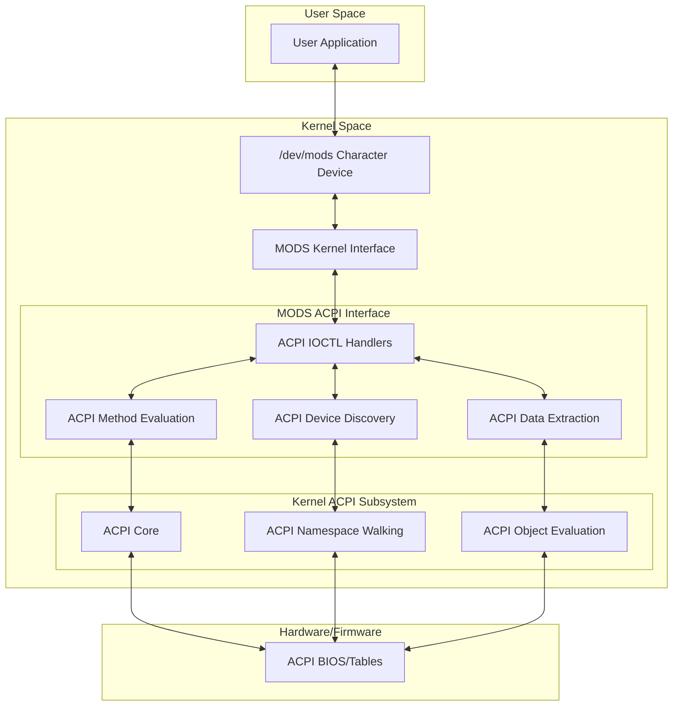
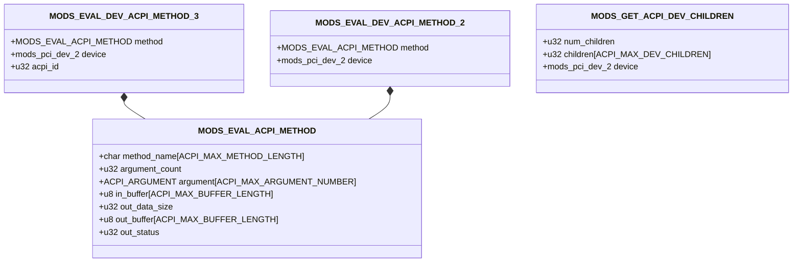
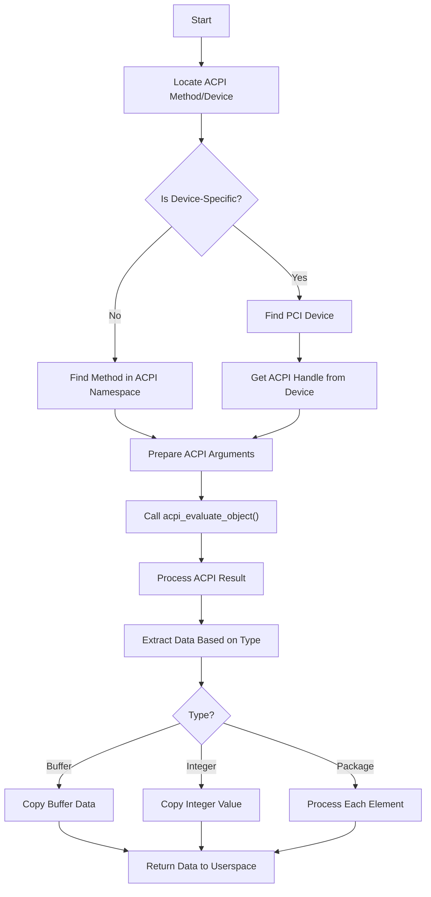
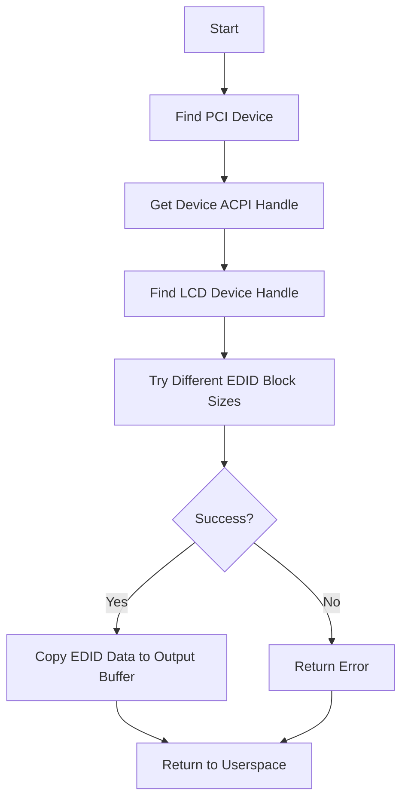

<!-- source: DeepWiki mcp.deepwiki.com · repo NVIDIA/mods-kernel-driver · page 5.3 ACPI Interface · fetched 2026-10-26 -->

# ACPI Interface

<details>
<summary>Relevant source files</summary>

The following files were used as context for generating this wiki page:

- [mods.h](mods.h)
- [mods_acpi.c](mods_acpi.c)
- [mods_internal.h](mods_internal.h)

</details>


The ACPI Interface in the NVIDIA MODS kernel driver provides a mechanism for userspace applications to interact with the system's ACPI subsystem. This interface enables applications to evaluate ACPI methods, retrieve ACPI device information, get display EDID data, and perform other ACPI-related operations through the kernel.

## 1. Overview

The ACPI Interface acts as a bridge between userspace applications and the kernel's ACPI subsystem, exposing functionality through a set of IOCTL calls. These calls allow applications to:

- Evaluate generic ACPI methods
- Evaluate device-specific ACPI methods
- Retrieve EDID data via ACPI _DDC method
- Find ACPI device children
- Map ACPI proximity domains to NUMA nodes

### Architecture Diagram: ACPI Interface in MODS Driver



Sources: [mods_acpi.c:1-698](), [mods.h:1032-1164]()

## 2. Core ACPI Data Structures

### 2.1 ACPI Argument Types

The ACPI Interface supports three types of arguments when calling ACPI methods:

```mermaid
classDiagram
    class ACPI_ARGUMENT {
        <<union>>
        +u32 type
        +struct integer {
            u32 type
            u32 value
        }
        +struct buffer {
            u32 type
            u32 length
            u32 offset
        }
        +struct method {
            u32 type
            u64 handle
        }
    }
    
    class ArgumentType {
        <<enumeration>>
        ACPI_MODS_TYPE_INTEGER = 1
        ACPI_MODS_TYPE_BUFFER = 2
        ACPI_MODS_TYPE_METHOD = 3
    }
    
    ACPI_ARGUMENT --> ArgumentType
```

Sources: [mods.h:1033-1051](), [mods.h:1054-1056]()

### 2.2 ACPI Method Evaluation Structures



Sources: [mods.h:1070-1083](), [mods.h:1092-1099](), [mods.h:1113-1119](), [mods.h:1156-1163]()

## 3. ACPI Method Evaluation Process

The ACPI method evaluation is a key component of the ACPI Interface. It follows a specific process flow to execute ACPI methods and retrieve their results.

### Method Evaluation Flow



Sources: [mods_acpi.c:270-442](), [mods_acpi.c:169-268]()

## 4. Key ACPI Interface Functions

The ACPI Interface provides several key functions that handle different aspects of ACPI interaction:

| Function | Purpose | IOCTL |
|----------|---------|-------|
| `esc_mods_eval_acpi_method` | Evaluates a generic ACPI method | `MODS_ESC_EVAL_ACPI_METHOD` |
| `esc_mods_eval_dev_acpi_method_3` | Evaluates a device-specific ACPI method with ACPI ID | `MODS_ESC_EVAL_DEV_ACPI_METHOD_3` |
| `esc_mods_eval_dev_acpi_method_2` | Evaluates a device-specific ACPI method | `MODS_ESC_EVAL_DEV_ACPI_METHOD_2` |
| `esc_mods_acpi_get_ddc_2` | Retrieves EDID data from display via ACPI _DDC method | `MODS_ESC_ACPI_GET_DDC_2` |
| `esc_mods_get_acpi_dev_children` | Gets all child devices of a specific ACPI device | `MODS_ESC_GET_ACPI_DEV_CHILDREN` |
| `esc_mods_proximity_to_numa_node` | Maps an ACPI proximity domain to a NUMA node | `MODS_ESC_PROXIMITY_TO_NUMA_NODE` |

Sources: [mods_acpi.c:580-697](), [mods_internal.h:492-510]()

## 5. ACPI Method Evaluation

### 5.1 Generic Method Evaluation

The driver can evaluate any ACPI method in the ACPI namespace using `esc_mods_eval_acpi_method()`. This function:

1. Locates the ACPI method by name using `mods_acpi_handle_init()`
2. Prepares arguments based on the provided input
3. Calls the kernel's `acpi_evaluate_object()` function
4. Processes and extracts the result into a format usable by userspace

Sources: [mods_acpi.c:580-584](), [mods_acpi.c:270-444]()

### 5.2 Device-Specific Method Evaluation

For methods that belong to a specific device, the driver provides variant functions that first find the device and then evaluate the method within that device's scope:

1. `esc_mods_eval_dev_acpi_method_3()` - Evaluates a method on a specific device with an optional ACPI ID
2. `esc_mods_eval_dev_acpi_method_2()` - Evaluates a method on a specific device
3. `esc_mods_eval_dev_acpi_method()` - Legacy version for backward compatibility

These functions find the PCI device, get its ACPI handle, and then execute the specified method on that device.

Sources: [mods_acpi.c:586-615]()

## 6. ACPI DDC (EDID) Retrieval

The ACPI Interface includes specialized functionality for retrieving Extended Display Identification Data (EDID) from connected displays using the ACPI _DDC method.

### EDID Retrieval Process



The DDC retrieval process:
1. Searches for display devices with specific ACPI IDs (0x0110, 0x0118, 0x0400, 0xa450)
2. Once found, calls the _DDC method with different buffer sizes (1-4 blocks)
3. Copies the retrieved EDID data to the output buffer

Sources: [mods_acpi.c:446-574](), [mods_acpi.c:617-635]()

## 7. ACPI Device Discovery

### 7.1 Finding ACPI Devices

The driver provides functionality to find ACPI devices and their children:

1. `mods_acpi_handle_init()` - Searches the ACPI namespace for a method/device
2. `acpi_get_dev_children()` - Enumerates child devices of a specific ACPI device

Sources: [mods_acpi.c:132-163](), [mods_acpi.c:100-128]()

### 7.2 Device Children Enumeration

The `esc_mods_get_acpi_dev_children()` function allows userspace applications to enumerate all child devices of a specific PCI device:

1. Finds the PCI device using its bus/device/function identifiers
2. Gets the ACPI handle for that device
3. Enumerates all children by traversing the ACPI namespace
4. Returns the ACPI IDs of all child devices

Sources: [mods_acpi.c:637-688]()

## 8. NUMA Node Mapping

On systems with Non-Uniform Memory Access (NUMA) architecture, the function `esc_mods_proximity_to_numa_node()` converts an ACPI proximity domain to a corresponding NUMA node. This functionality is dependent on the `MODS_HAS_PXM_TO_NODE` kernel configuration option.

Sources: [mods_acpi.c:691-697]()

## 9. Implementation Details

### 9.1 ACPI Object Data Extraction

The ACPI interface processes different types of ACPI objects returned from method evaluation:

- Buffer objects: Copied directly to the output buffer
- Integer objects: Converted to 32-bit values
- Package objects: Each element is processed recursively
- Reference objects: Handle values are extracted

This extraction is performed by the `mods_extract_acpi_object()` function.

Sources: [mods_acpi.c:169-268]()

### 9.2 ACPI Device Children Processing

Finding ACPI device children involves:

1. Getting the ACPI device from the handle
2. Iterating through all children using `device_for_each_child()`
3. For each child, evaluating the _ADR method to get the device ID
4. Processing each device according to a callback function

Sources: [mods_acpi.c:79-98](), [mods_acpi.c:100-128]()

## 10. Summary

The ACPI Interface in the MODS kernel driver provides comprehensive access to the system's ACPI functionality from userspace applications. Through a set of well-defined IOCTLs and data structures, it enables applications to interact with the ACPI subsystem, evaluate methods, retrieve device information, and access display data via standard ACPI interfaces.

This functionality is essential for hardware debugging, device management, and system control applications that need low-level access to ACPI functionality that is normally only available to the kernel.

---

