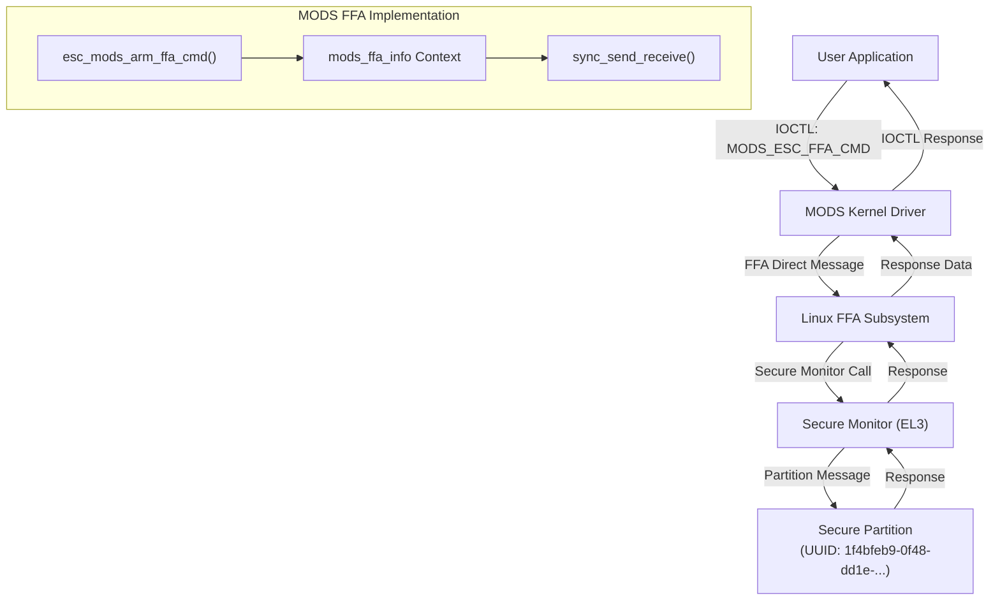
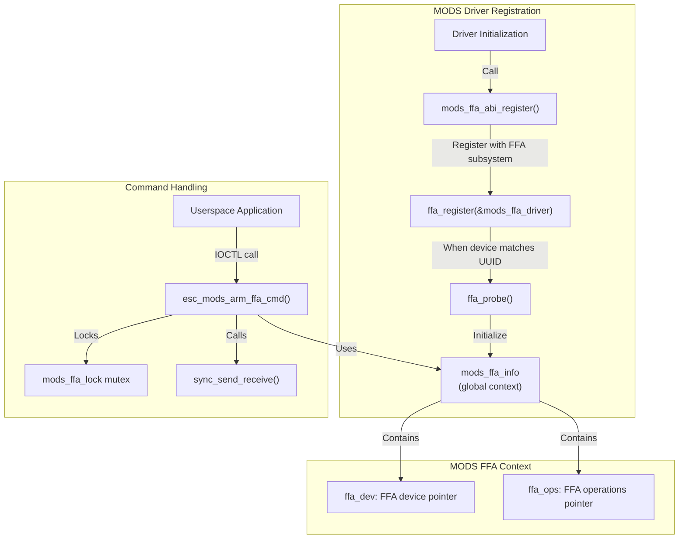
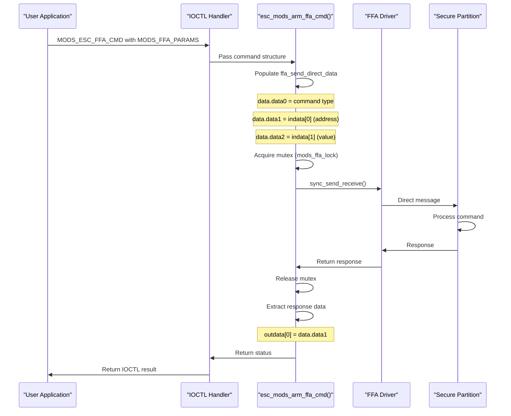

<!-- source: DeepWiki mcp.deepwiki.com · repo NVIDIA/mods-kernel-driver · page 5.4 ARM FFA Interface · fetched 2026-10-26 -->

# ARM FFA Interface

<details>
<summary>Relevant source files</summary>

The following files were used as context for generating this wiki page:

- [mods.h](mods.h)
- [mods_arm_ffa.c](mods_arm_ffa.c)
- [mods_internal.h](mods_internal.h)

</details>


## Purpose and Overview

The ARM Firmware Framework for Arm (FFA) interface in the NVIDIA MODS kernel driver provides a standardized mechanism for communication between the normal world (where the MODS driver runs) and secure partitions in the secure world on ARM-based systems. This implementation enables privileged operations to be securely executed while maintaining proper isolation between security domains.

The FFA interface allows userspace applications to:
- Read from and write to secure registers
- Execute security-related tests and operations
- Access secure partition version information
- Interact with hardware security components

Sources: [mods_arm_ffa.c:1-13]()

## Architecture Overview

The MODS FFA implementation follows a client-server model where the MODS driver acts as a client that communicates with services running in secure partitions:



The MODS driver registers with the Linux FFA subsystem using a specific UUID to identify the secure partition it needs to communicate with. The secure partition matching this UUID will receive and process the commands from MODS.

Sources: [mods_arm_ffa.c:14-17](), [mods_arm_ffa.c:83-86]()

## Implementation Details

### Driver Registration and Context

The MODS FFA implementation uses the following key components:



1. **Device Identification**:
   - A specific UUID (1f4bfeb9-0f48-dd1e-119c-2c86c9140322) identifies the secure partition
   - This UUID is used during driver registration to connect to the correct partition

2. **Context Management**:
   - The `mods_ffa_ctx` structure maintains references to the FFA device and operations
   - Different kernel versions are supported through version-specific code paths

3. **Driver Lifecycle Functions**:
   - `mods_ffa_abi_register()`: Registers the MODS FFA driver with the Linux FFA subsystem
   - `ffa_probe()`: Called when the matching FFA device is discovered, initializes the context
   - `ffa_remove()`: Cleans up resources when the driver is unloaded
   - `mods_ffa_abi_unregister()`: Unregisters the driver from the FFA subsystem

Sources: [mods_arm_ffa.c:14-27](), [mods_arm_ffa.c:33-57](), [mods_arm_ffa.c:65-70](), [mods_arm_ffa.c:72-81]()

### Command Interface

Commands are sent from userspace using the `MODS_ESC_FFA_CMD` IOCTL with a `MODS_FFA_PARAMS` structure defined in the MODS driver:

```
struct MODS_FFA_PARAMS {
    /* IN */
    __u64 cmd;          // Command type (MODS_FFA_CMD_*)
    __u64 indata[4];    // Input data (parameters)
    
    /* OUT */
    __u64 outdata[4];   // Output data (results)
};
```

The FFA interface supports several command types:

| Command Type | Purpose |
|--------------|---------|
| MODS_FFA_CMD_READ_REG | Read value from a secure register |
| MODS_FFA_CMD_WRITE_REG | Write value to a secure register |
| MODS_FFA_CMD_READ_VER | Read version information from secure partition |
| MODS_FFA_CMD_SE_TESTS | Run Security Engine tests |
| MODS_FFA_CMD_SE_KEY_MOVER | Perform key operations with Security Engine |
| MODS_FFA_CMD_HSS_TEST | Hardware Security Suite tests |
| MODS_FFA_CMD_C2C_TEST | Chip-to-Chip communication tests |
| MODS_FFA_CMD_MISC | Miscellaneous operations |

Sources: [mods.h:1897-1903](), [mods.h:1905-1915]()

### Command Processing Flow

The command processing flow in the FFA implementation follows this sequence:



When a userspace application issues an FFA command:

1. The `esc_mods_arm_ffa_cmd()` function receives the command parameters
2. Parameters are mapped into the FFA direct message format:
   - `data.data0` contains the command type
   - `data.data1` contains the primary parameter (typically an address)
   - `data.data2` contains the secondary parameter (typically a value for write operations)
3. A mutex is acquired to ensure exclusive access to the FFA interface
4. The command is sent via `sync_send_receive()` to the secure partition
5. The response is processed and returned to userspace:
   - Error status is checked from both the FFA call and the secure partition response
   - Response data is extracted from `data.data1` and placed in `outdata[0]`

Sources: [mods_arm_ffa.c:83-186](), [mods_arm_ffa.c:29](), [mods_arm_ffa.c:142-144]()

## Command Support and Handling

The MODS FFA implementation provides support for several command types, each handled differently in the `esc_mods_arm_ffa_cmd()` function:

1. **Register Read (MODS_FFA_CMD_READ_REG)**:
   - Input: Register physical address in `indata[0]`
   - Output: Register value in `outdata[0]`

2. **Register Write (MODS_FFA_CMD_WRITE_REG)**:
   - Input: Register physical address in `indata[0]`, value to write in `indata[1]`
   - Output: Status only

3. **Version Read (MODS_FFA_CMD_READ_VER)**:
   - Input: None required
   - Output: Version information in `outdata[0]`

4. **Security Engine Tests (MODS_FFA_CMD_SE_TESTS)**:
   - Input: Test parameters in `indata[0]` (algorithm and engine ID)
   - Output: Test results in `outdata[0]`

5. **Security Engine Key Operations (MODS_FFA_CMD_SE_KEY_MOVER)**:
   - Input: Key operation parameters in `indata[0]`
   - Output: Operation results in `outdata[0]`

6. **Hardware Security Suite Tests (MODS_FFA_CMD_HSS_TEST)**:
   - Input: Test parameters (if any) in `indata[0]`
   - Output: Test results in `outdata[0]`

7. **Chip-to-Chip Tests (MODS_FFA_CMD_C2C_TEST)**:
   - Input: Test parameters (if any) in `indata[0]`
   - Output: Test results in `outdata[0]`

8. **Miscellaneous Operations (MODS_FFA_CMD_MISC)**:
   - Input: Operation-specific parameters in `indata[]`
   - Output: Operation-specific results in `outdata[0]`

Sources: [mods_arm_ffa.c:101-138](), [mods_arm_ffa.c:146-184]()

## Usage Examples

### Reading a Secure Register

A userspace application can read from a secure register using:

```c
struct MODS_FFA_PARAMS params = {0};
params.cmd = MODS_FFA_CMD_READ_REG;
params.indata[0] = register_physical_address;

if (ioctl(fd, MODS_ESC_FFA_CMD, &params) == 0) {
    uint64_t register_value = params.outdata[0];
    // Process the register value
}
```

### Writing to a Secure Register

To write to a secure register:

```c
struct MODS_FFA_PARAMS params = {0};
params.cmd = MODS_FFA_CMD_WRITE_REG;
params.indata[0] = register_physical_address;
params.indata[1] = value_to_write;

ioctl(fd, MODS_ESC_FFA_CMD, &params);
```

### Reading Secure Partition Version

To query the secure partition version:

```c
struct MODS_FFA_PARAMS params = {0};
params.cmd = MODS_FFA_CMD_READ_VER;

if (ioctl(fd, MODS_ESC_FFA_CMD, &params) == 0) {
    uint64_t version = params.outdata[0];
    // Use version information
}
```

## Security Considerations

The FFA interface provides a controlled channel for communication between the normal world and secure world, with several security measures:

1. **Access Control**: Only privileged processes can open the MODS device and use the FFA interface
2. **Secure Partitions**: Operations run in isolated secure partitions
3. **Limited Interface**: Only specific, well-defined operations are exposed
4. **Error Handling**: Both Linux and secure partition errors are properly propagated
5. **Mutual Exclusion**: A mutex (`mods_ffa_lock`) ensures thread-safe access to the FFA interface

Sources: [mods_arm_ffa.c:29](), [mods_arm_ffa.c:142-144](), [mods_arm_ffa.c:176-184]()

---

