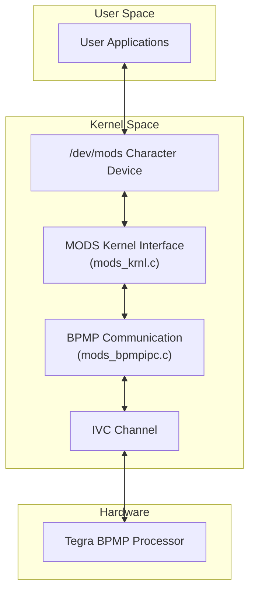
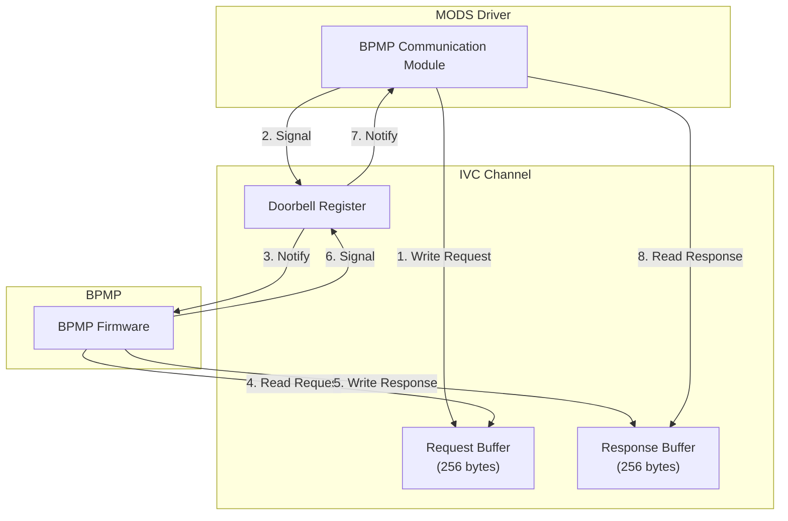
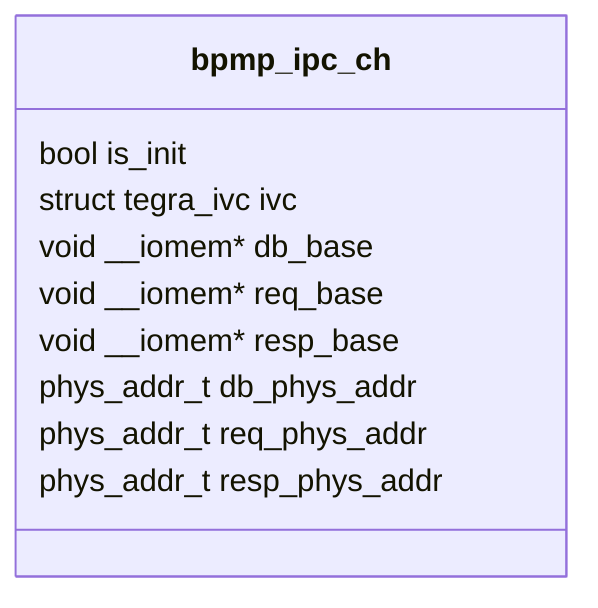
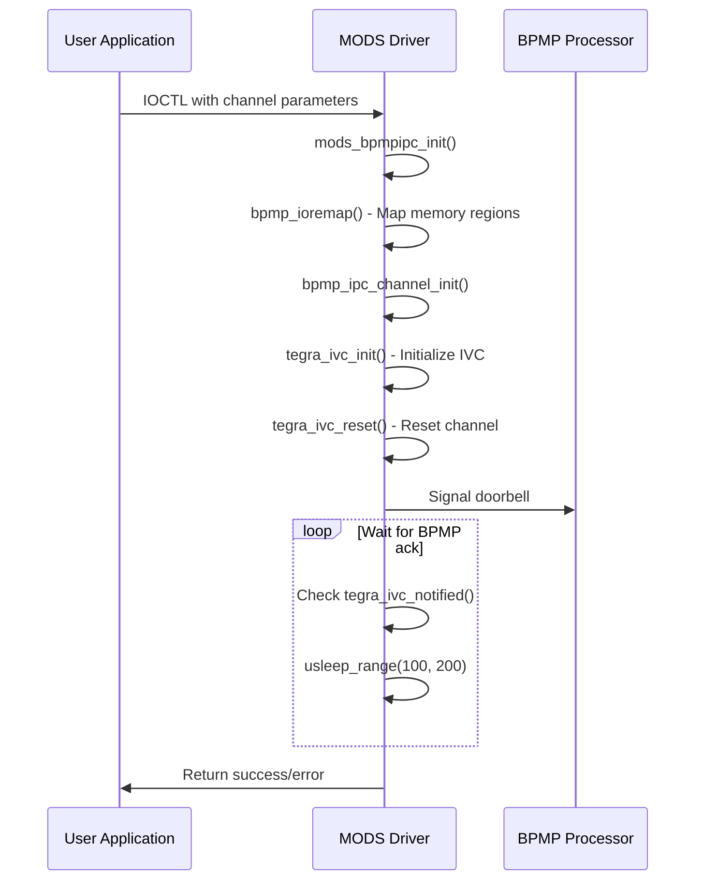
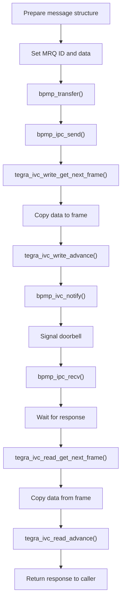
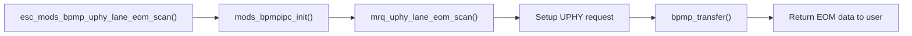

<!-- source: DeepWiki mcp.deepwiki.com · repo NVIDIA/mods-kernel-driver · page 5.5 BPMP Communication · fetched 2026-10-26 -->

# BPMP Communication

<details>
<summary>Relevant source files</summary>

The following files were used as context for generating this wiki page:

- [mods.h](mods.h)
- [mods_bpmpipc.c](mods_bpmpipc.c)
- [mods_internal.h](mods_internal.h)

</details>


## Purpose and Overview

This document describes the BPMP (Boot and Power Management Processor) communication module within the NVIDIA MODS kernel driver. The module provides an interface for the MODS driver to interact with the BPMP on Tegra platforms, enabling control of various hardware functions managed by the BPMP, such as power management, clocks, and UPHY (Universal PHY) operations.

The BPMP is a dedicated processor in NVIDIA Tegra SoCs that manages boot and power management functions. It runs its own firmware and provides services to the main CPU complex through a message-passing interface.

Sources: [mods_bpmpipc.c:1-5]()

## BPMP Communication Architecture

### High-Level Architecture

The diagram below shows how the BPMP communication module fits into the overall MODS driver architecture:



Sources: [mods_internal.h:732-740](), [mods_bpmpipc.c:10-16]()

### IVC Communication Channel

The MODS driver communicates with the BPMP using an IVC (Inter-VM Communication) channel. This is a shared memory mechanism with doorbell registers for signaling between the application processor and the BPMP.



Sources: [mods_bpmpipc.c:14-16](), [mods_bpmpipc.c:42-53]()

## Implementation Details

### IPC Channel Structure

The BPMP IPC channel is implemented using a structure that holds information about the communication channel:



Sources: [mods_bpmpipc.c:42-53]()

### Message Protocol

BPMP communication uses a request-response protocol with specific message structures:

```mermaid
classDiagram
    class tegra_bpmp_message {
        u32 mrq
        struct tx {
            void* data
            size_t size
        }
        struct rx {
            void* data
            size_t size
            int ret
        }
    }
    
    class mods_mrq_uphy_request {
        u16 lane
        u16 cmd
        struct mods_cmd_uphy_lane_eom_scan_request lane_eom_scan
    }
    
    class mods_mrq_uphy_response {
        struct mods_cmd_uphy_lane_eom_scan_response eom_status
    }
    
    class mods_cmd_uphy_lane_eom_scan_request {
        u32 brick
        u32 lane
        u32 pcie_gen5
    }
    
    class mods_cmd_uphy_lane_eom_scan_response {
        u32 data
    }
    
    tegra_bpmp_message --> mods_mrq_uphy_request : tx.data
    tegra_bpmp_message --> mods_mrq_uphy_response : rx.data
    mods_mrq_uphy_request --> mods_cmd_uphy_lane_eom_scan_request : contains
    mods_mrq_uphy_response --> mods_cmd_uphy_lane_eom_scan_response : contains
```

Sources: [mods_bpmpipc.c:22-40](), [mods_bpmpipc.c:187-198]()

## Initialization and Communication Flow

### Channel Initialization

The communication channel is initialized through the following process:



Sources: [mods_bpmpipc.c:263-314](), [mods_bpmpipc.c:316-349]()

### Message Transfer Process

When sending a command to the BPMP, the following steps occur:



Sources: [mods_bpmpipc.c:150-175](), [mods_bpmpipc.c:62-148]()

## Supported Operations

Currently, the BPMP communication module provides the following operations:

### 1. UPHY Lane EOM Scan

This operation allows scanning the eye diagram of high-speed UPHY (Universal PHY) lanes, which is useful for debugging and optimizing PCIe links.



Parameters:
- `brick`: Physical UPHY brick ID
- `lane`: Lane number within the brick
- `pcie_gen5`: Flag indicating PCIe Gen5 mode

Sources: [mods_bpmpipc.c:177-215](), [mods_bpmpipc.c:361-388]()

### 2. Set PCIe State

This operation allows controlling the PCIe controller state through the BPMP UPHY driver.

| Parameter   | Description                      |
|-------------|----------------------------------|
| controller  | PCIe controller ID               |
| enable      | Flag to enable/disable the state |

Sources: [mods.h:421-429](), [mods_internal.h:595-597]()

### 3. Initialize PCIe EP PLL

This operation initializes the PCIe Endpoint PLL through the BPMP UPHY driver.

| Parameter   | Description            |
|-------------|------------------------|
| ep_id       | PCIe endpoint ID       |

Sources: [mods.h:431-438](), [mods_internal.h:597-598]()

## IOCTL Interface

The BPMP communication functionality is exposed to userspace applications through IOCTLs:

### UPHY Lane EOM Scan

```c
struct MODS_BPMP_UPHY_LANE_EOM_SCAN_PARAMS {
    /* IN */
    u64 db_phys_addr;    // Doorbell physical address
    u64 req_phys_addr;   // Request buffer physical address
    u64 resp_phys_addr;  // Response buffer physical address
    u32 brick;           // UPHY brick ID
    u32 lane;            // Lane number
    u32 pcie_gen5;       // PCIe Gen5 flag

    /* OUT */
    u32 data;            // EOM scan data
};
```

Sources: [mods_bpmpipc.c:361-388](), [mods_internal.h:732-735]()

### Set PCIe State

```c
struct MODS_SET_PCIE_STATE {
    /* IN */
    u32 controller;      // PCIe controller ID
    u32 enable;          // Enable flag
};
```

Sources: [mods.h:421-429]()

### Initialize PCIe EP PLL

```c
struct MODS_INIT_PCIE_EP_PLL {
    /* IN */
    u32 ep_id;           // PCIe endpoint ID
};
```

Sources: [mods.h:431-438]()

## Mutex Protection

The BPMP communication module uses a mutex to ensure thread safety during IPC operations:

```c
static DEFINE_MUTEX(mods_bpmpipc_lock);
```

This mutex is used in the `esc_mods_bpmp_uphy_lane_eom_scan` function to protect the initialization and communication sequence.

Sources: [mods_bpmpipc.c:18](), [mods_bpmpipc.c:366-386]()

## Constants and Configuration

The BPMP communication module defines several important constants:

| Constant           | Value  | Description                                     |
|--------------------|---------|-------------------------------------------------|
| IVC_CHANNEL_SIZE   | 256    | Size of IVC channel buffers                     |
| MRQ_MSG_SIZE       | 128    | Maximum message size                            |
| BPMP_MAIL_DO_ACK   | 1<<0   | Flag indicating acknowledgment is required      |
| BPMP_IVC_TIMEOUT   | 120000 | Timeout in ms (large for simulation platforms)  |
| MRQ_UPHY           | -      | MRQ ID for UPHY subsystem                       |

Sources: [mods_bpmpipc.c:14-16]()

## Error Handling

The module implements error handling at multiple levels:

1. Memory mapping errors during initialization
2. IVC initialization errors
3. Timeout errors during channel synchronization
4. Transfer errors during message sending/receiving
5. BPMP firmware error codes returned in responses

Each error is logged and propagated back to the caller with appropriate error codes.

Sources: [mods_bpmpipc.c:228-247](), [mods_bpmpipc.c:289-304](), [mods_bpmpipc.c:382-383]()

---

