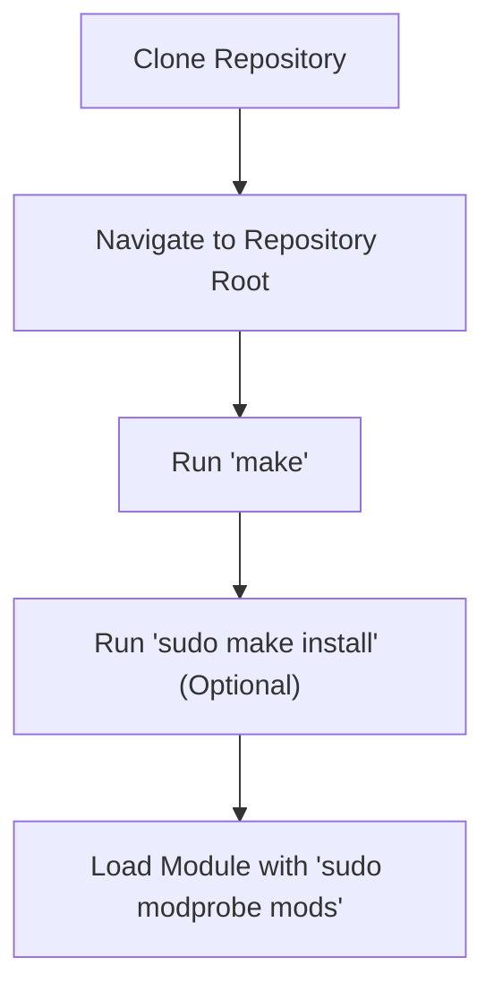
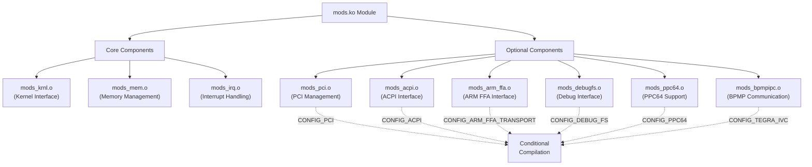
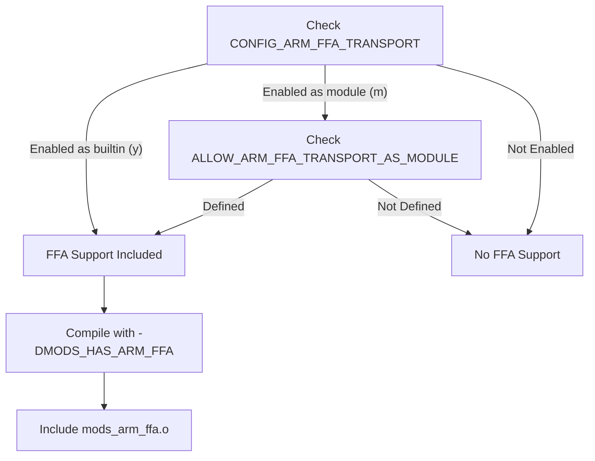
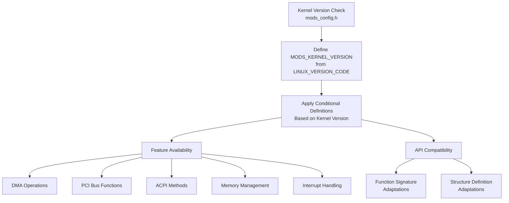

<!-- source: DeepWiki mcp.deepwiki.com · repo NVIDIA/mods-kernel-driver · page 6.1 Building the Driver · fetched 2026-10-26 -->

# Building the Driver

<details>
<summary>Relevant source files</summary>

The following files were used as context for generating this wiki page:

- [Makefile](Makefile)
- [mods_config.h](mods_config.h)

</details>


This page provides detailed instructions for building the NVIDIA MODS (Module Overlay and Driver Support) kernel driver. For information about the driver's overall architecture, see [Architecture](#1.1), and for configuration options, see [Configuration Options](#6.3).

## Prerequisites

Before building the MODS kernel driver, you need to set up the following:

1. Linux kernel development environment
2. Kernel headers matching your running kernel
3. Build tools (GCC, Make)

For a standard Linux distribution, you can install these with:

```bash
# Debian/Ubuntu
sudo apt-get install build-essential linux-headers-$(uname -r)

# RHEL/CentOS
sudo yum groupinstall "Development Tools"
sudo yum install kernel-devel kernel-headers
```

Sources: [Makefile:35-36]()

## Basic Build Process

The MODS driver uses a standard Linux kernel module build system. The build process is straightforward:



### Building the Module

To build the MODS kernel driver:

1. Clone the repository or extract the source package
2. Navigate to the source directory
3. Run the following commands:

```bash
make
sudo make install    # Optional, installs the module
```

The `make` command will build the driver module (`mods.ko`) using the kernel build system located at `/lib/modules/$(uname -r)/build` by default.

Sources: [Makefile:35-43]()

### Specifying Custom Kernel Directory

If you need to build against a custom kernel or kernel headers, you can specify the kernel directory:

```bash
make KERNELDIR=/path/to/your/kernel/source
```

Sources: [Makefile:35]()

## Driver Components

The MODS driver is composed of several components that are compiled based on kernel configuration:



The diagram shows which source files are compiled into the module, with optional components dependent on kernel configuration.

Sources: [Makefile:21-30]()

## Platform-Specific Considerations

### ARM FFA Support

For ARM platforms with Firmware Framework for ARM (FFA) support, there are specific build requirements:

- The CONFIG_ARM_FFA_TRANSPORT must be enabled in the kernel configuration
- It can be built as a module (m) or built into the kernel (y)
- For module-based FFA transport, the ALLOW_ARM_FFA_TRANSPORT_AS_MODULE flag must be set



Sources: [Makefile:8-19]()

### Tegra Platform Support

For Tegra platforms with IVC (Inter-VM Communication) support:

- CONFIG_TEGRA_IVC must be enabled in the kernel
- This enables BPMP (Boot and Power Management Processor) communication

Sources: [Makefile:30](), [mods_config.h:106-108]()

## Kernel Version Compatibility

The MODS driver is designed to work with multiple kernel versions. The `mods_config.h` file contains various conditional definitions to ensure compatibility across different kernel versions:



The compatibility layer ensures that the driver can be built on kernel versions ranging from 2.6.30 to the latest releases.

Sources: [mods_config.h:7-118]()

## Compiling with Debug Support

To enable debugging capabilities, ensure your kernel has CONFIG_DEBUG_FS enabled. This will compile the `mods_debugfs.o` component, which provides debugging information through the debugfs filesystem.

For more information about the debugging interface, see [Debugging Interface](#6.2).

Sources: [Makefile:28]()

## Installation and Verification

After building the module, you can install it using:

```bash
sudo make install
```

This will install the module to the kernel modules directory. You can then load the module using:

```bash
sudo modprobe mods
```

To verify that the module is loaded correctly:

```bash
lsmod | grep mods
dmesg | grep mods
```

After loading, the driver creates a character device at `/dev/mods` that userspace applications can interact with.

Sources: [Makefile:40-41]()

## Troubleshooting Build Issues

### Kernel Version Mismatch

If you encounter errors about undefined symbols, check if your kernel headers match your running kernel:

```bash
uname -r                    # Running kernel version
ls /lib/modules/            # Available kernel headers
```

### Missing Kernel Configuration Options

Some features require specific kernel configuration options. If you're missing certain functionality, verify your kernel configuration includes the necessary options:

```bash
# Check if your kernel has a specific config option
grep CONFIG_DEBUG_FS /boot/config-$(uname -r)
```

### Compilation Errors

If you encounter compilation errors related to specific kernel APIs, it may indicate an unsupported kernel version or missing configuration options. Check the compatibility section in `mods_config.h` to see if your kernel version is supported.

Sources: [mods_config.h:9-118]()

---

