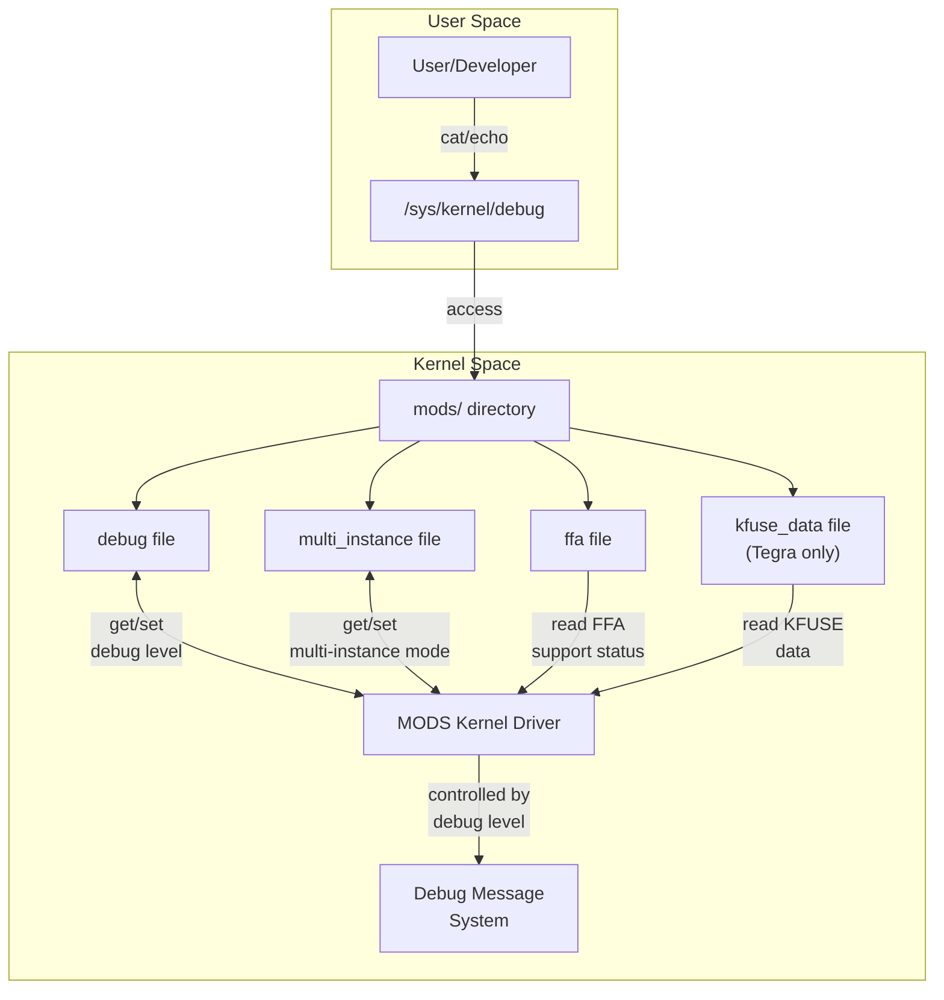
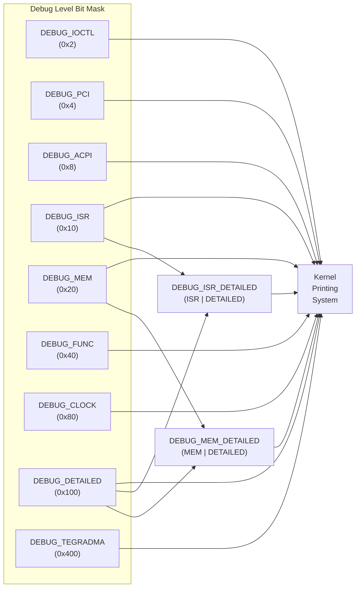
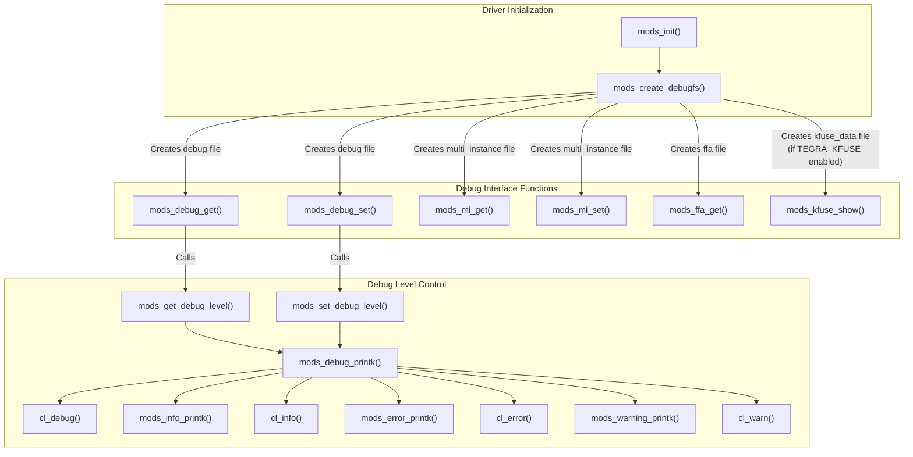

<!-- source: DeepWiki mcp.deepwiki.com · repo NVIDIA/mods-kernel-driver · page 6.2 Debugging Interface · fetched 2026-10-26 -->

# Debugging Interface

<details>
<summary>Relevant source files</summary>

The following files were used as context for generating this wiki page:

- [mods_debugfs.c](mods_debugfs.c)
- [mods_internal.h](mods_internal.h)

</details>


The NVIDIA MODS kernel driver provides a debugging interface through the Linux debugfs filesystem. This interface allows users and developers to monitor and configure various aspects of the driver's behavior at runtime, facilitating troubleshooting and development work.

## Overview

The debugging interface is implemented through the Linux kernel's debugfs mechanism, which provides a simple way to create virtual files that can be used to interact with kernel code. The MODS driver creates a debugfs directory named after the device, containing several files that expose driver state and allow configuration of debug settings.



Sources: [mods_debugfs.c:95-142](), [mods_internal.h:238-251]()

## Debugging Directory Structure

When the MODS driver is loaded, it creates a directory in the debugfs filesystem. The directory creation is handled by the `mods_create_debugfs()` function, which is called during driver initialization.

### Available Debug Files

The following files are created in the MODS debugfs directory:

| File Name | Access Mode | Purpose |
|-----------|-------------|---------|
| `debug` | Read/Write | Get or set the debug message level |
| `multi_instance` | Read/Write | Get or set multi-instance mode |
| `ffa` | Read-only | Check if ARM FFA (Firmware Framework for Arm) support is enabled |
| `kfuse_data` | Read-only | Access KFUSE data (only available on Tegra platforms with CONFIG_TEGRA_KFUSE enabled) |

Sources: [mods_debugfs.c:107-135]()

## Debug Levels

The debug level is a bit mask that controls which types of debug messages are printed by the driver. It can be viewed or modified through the `debug` file in the debugfs interface.



Sources: [mods_internal.h:238-251]()

The debug levels are defined as follows:

| Debug Flag | Value | Description |
|------------|-------|-------------|
| `DEBUG_IOCTL` | 0x2 | IOCTL-related debug messages |
| `DEBUG_PCI` | 0x4 | PCI subsystem debug messages |
| `DEBUG_ACPI` | 0x8 | ACPI subsystem debug messages |
| `DEBUG_ISR` | 0x10 | Interrupt handling debug messages |
| `DEBUG_MEM` | 0x20 | Memory management debug messages |
| `DEBUG_FUNC` | 0x40 | Function entry/exit debug messages |
| `DEBUG_CLOCK` | 0x80 | Clock subsystem debug messages |
| `DEBUG_DETAILED` | 0x100 | Detailed debug information |
| `DEBUG_TEGRADMA` | 0x400 | Tegra DMA debug messages |
| `DEBUG_ISR_DETAILED` | 0x110 | Detailed interrupt handling messages |
| `DEBUG_MEM_DETAILED` | 0x120 | Detailed memory management messages |
| `DEBUG_ALL` | 0x5FE | All debug messages enabled |

Sources: [mods_internal.h:238-251]()

## Debug Interface Implementation

The debug interface is implemented using the Linux kernel's debugfs facility. The implementation includes functions for creating and removing the debugfs entries, as well as get/set operations for the debug values.



Sources: [mods_debugfs.c:51-88](), [mods_internal.h:254-285]()

### Key Implementation Details

1. **Debug Level Control Functions:**
   - `mods_set_debug_level()` and `mods_get_debug_level()` - Set and get the global debug level
   - `mods_check_debug_level()` - Check if a specific debug flag is enabled

2. **Print Macros:**
   - `mods_debug_printk()` - Prints debug messages if the specified level is enabled
   - `cl_debug()` - Client-specific debug messages
   - `mods_info_printk()` - General information messages
   - `cl_info()` - Client-specific information messages
   - `mods_error_printk()` - Error messages
   - `cl_error()` - Client-specific error messages
   - `mods_warning_printk()` - Warning messages
   - `cl_warn()` - Client-specific warning messages

Sources: [mods_internal.h:198-200](), [mods_internal.h:254-285]()

3. **DebugFS File Operations:**
   - Each file in the debugfs interface has associated get/set functions
   - The `debug` file uses `mods_debug_get()` and `mods_debug_set()`
   - The `multi_instance` file uses `mods_mi_get()` and `mods_mi_set()`
   - The `ffa` file uses `mods_ffa_get()` (read-only)
   - The `kfuse_data` file uses a sequence file interface with `mods_kfuse_show()` (Tegra only)

Sources: [mods_debugfs.c:51-88](), [mods_debugfs.c:20-49]()

## Using the Debug Interface

### Accessing the Debug Interface

To access the MODS debug interface, the debugfs filesystem must be mounted. This is typically done automatically by the system, but if not, it can be mounted with:

```bash
mount -t debugfs none /sys/kernel/debug
```

The MODS debug files can then be accessed at `/sys/kernel/debug/mods/`.

### Reading and Setting Debug Levels

To view the current debug level:

```bash
cat /sys/kernel/debug/mods/debug
```

To set a new debug level (combination of the debug flags):

```bash
echo 0x42 > /sys/kernel/debug/mods/debug  # Enables DEBUG_IOCTL (0x2) and DEBUG_FUNC (0x40)
```

To enable all debug messages:

```bash
echo 0x5FE > /sys/kernel/debug/mods/debug  # Enables DEBUG_ALL
```

### Multi-Instance Mode

To check if multi-instance mode is enabled:

```bash
cat /sys/kernel/debug/mods/multi_instance
```

To enable or disable multi-instance mode:

```bash
echo 1 > /sys/kernel/debug/mods/multi_instance  # Enable
echo 0 > /sys/kernel/debug/mods/multi_instance  # Disable
```

### Checking FFA Support

To check if ARM FFA support is enabled:

```bash
cat /sys/kernel/debug/mods/ffa
```

This will return `1` if FFA support is enabled, or `0` if not.

### Accessing KFUSE Data (Tegra Only)

On Tegra platforms with KFUSE support, the KFUSE data can be read with:

```bash
cat /sys/kernel/debug/mods/kfuse_data
```

This will display the KFUSE data in hexadecimal format.

## Debugging Best Practices

1. **Start with Focused Debugging:**
   Begin with specific debug flags related to the subsystem you're troubleshooting, rather than enabling all debug messages.

2. **Combine Debug Flags:**
   Combine debug flags for more targeted debugging. For example, `0x110` enables both `DEBUG_ISR` and `DEBUG_DETAILED` for detailed interrupt information.

3. **Use dmesg for Viewing Output:**
   Debug messages are printed to the kernel log, which can be viewed using the `dmesg` command:
   ```bash
   dmesg | grep "mods debug"
   ```

4. **Clear the Log Before Testing:**
   Clear the kernel log before reproducing an issue to make it easier to find relevant messages:
   ```bash
   dmesg -C
   ```

5. **Monitor System Performance:**
   Enabling high verbosity debug output can impact system performance. Use with caution in production environments.

---

