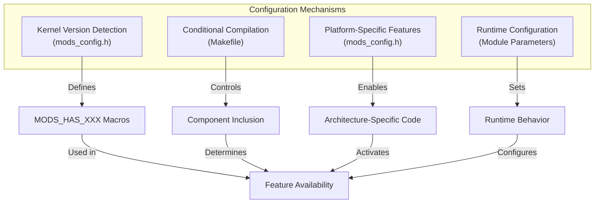
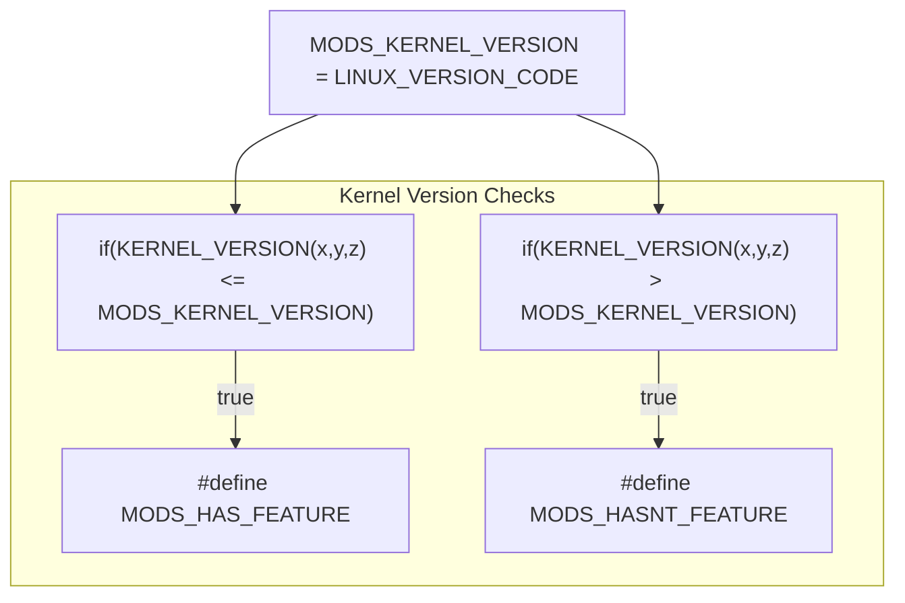
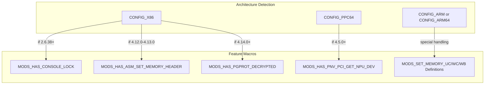
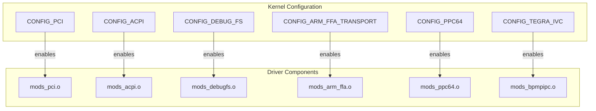
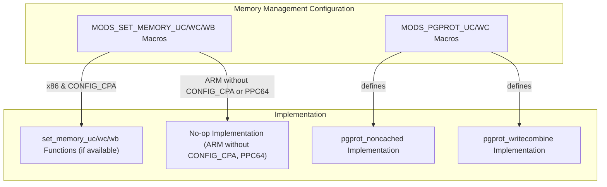
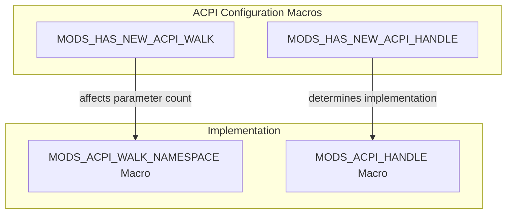
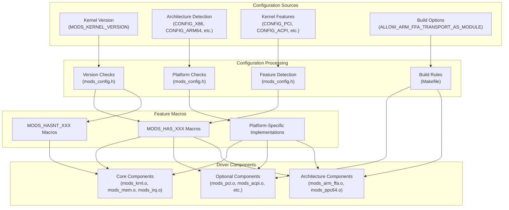

<!-- source: DeepWiki mcp.deepwiki.com · repo NVIDIA/mods-kernel-driver · page 6.3 Configuration Options · fetched 2026-10-26 -->

# Configuration Options

<details>
<summary>Relevant source files</summary>

The following files were used as context for generating this wiki page:

- [Makefile](Makefile)
- [mods_config.h](mods_config.h)
- [mods_internal.h](mods_internal.h)

</details>


This page documents the configuration options available in the NVIDIA MODS kernel driver. The driver employs various configuration mechanisms to support different kernel versions and platforms. This includes feature detection based on kernel version, conditional compilation for platform-specific features, and runtime configuration options.

## Overview of the Configuration System

The MODS driver uses a hierarchy of configuration mechanisms to ensure compatibility across different Linux kernels and hardware platforms. The primary configuration happens through the following mechanisms:



Sources: [mods_config.h:1-128](), [Makefile:1-44]()

## Kernel Version Compatibility

The MODS driver supports a wide range of kernel versions with automatic feature detection based on the running kernel version. This is primarily handled in `mods_config.h` through version checks.

### Kernel Version Detection

The driver defines `MODS_KERNEL_VERSION` to match the Linux kernel version and uses this value to conditionally define feature macros:



Sources: [mods_config.h:7-7]()

### Compatibility Features

The table below shows some of the key compatibility features and the kernel versions they depend on:

| Feature Macro | Required Kernel Version | Description |
|---------------|-------------------------|-------------|
| `MODS_HAS_DMA_OPS` | 2.6.30 - 4.16.0 (x86 only) | DMA operations support |
| `MODS_HAS_IORESOURCE_MEM_64` | ≥ 2.6.31 | 64-bit memory resource support |
| `MODS_HAS_NEW_ACPI_WALK` | ≥ 2.6.33 | Updated ACPI namespace walk API |
| `MODS_HAS_SET_COHERENT_MASK` | ≥ 2.6.34 | DMA coherent mask setting support |
| `MODS_HAS_CONSOLE_LOCK` | ≥ 2.6.38 (x86 only) | Console locking support |
| `MODS_HAS_SRIOV` | ≥ 3.8.0 | SR-IOV virtualization support |
| `MODS_HAS_MSIX_RANGE` | ≥ 3.14.0 | MSI-X interrupt range support |
| `MODS_HAS_DEV_PROPS` | ≥ 3.19.0 | Device properties support |
| `MODS_HAS_DMA_ALLOC_PAGES` | ≥ 5.10.0 | DMA page allocation API |

Sources: [mods_config.h:9-104]()

## Platform-Specific Configuration

The MODS driver includes specialized configuration options for different hardware architectures and platforms.

### Architecture-Specific Features



Sources: [mods_config.h:33-37](), [mods_config.h:67-69](), [mods_config.h:71-88](), [mods_internal.h:325-334]()

### Tegra-Specific Features

The driver includes special support for NVIDIA Tegra platforms:

| Feature Macro | Required Configuration | Description |
|---------------|-------------------------|-------------|
| `MODS_HAS_TEGRA` | Build-time define | Enables Tegra-specific code |
| `MODS_ENABLE_BPMP_MRQ_API` | `MODS_HAS_TEGRA` + Kernel ≥ 5.1.0 | BPMP MRQ API support |

Sources: [mods_config.h:106-108](), [mods_internal.h:26-28](), [mods_internal.h:593-681]()

## Conditional Component Compilation

The MODS driver uses conditional compilation to include or exclude major components based on the kernel configuration.

### Component Selection



Sources: [Makefile:22-30]()

## Feature Implementation Through Configuration

Configuration macros control the implementation of various features throughout the code. Here are some examples of how these macros affect the driver's functionality.

### Memory Management Configuration



Sources: [mods_internal.h:325-338]()

### ACPI Interface Configuration



Sources: [mods_internal.h:339-352]()

## Building the Driver with Different Configurations

When building the MODS kernel driver, there are several ways to influence the configuration:

1. **Kernel Version**: The driver automatically adapts to the kernel version it's built against
2. **Kernel Configuration**: The driver components are conditionally compiled based on kernel config
3. **Build Flags**: Some features can be enabled/disabled through build flags

### ARM FFA Support Example

The driver handles ARM FFA (Firmware Framework for Arm) support conditionally:

```
If CONFIG_ARM_FFA_TRANSPORT=m and ALLOW_ARM_FFA_TRANSPORT_AS_MODULE is defined:
    Enable MODS_HAS_ARM_FFA and include mods_arm_ffa.o

If CONFIG_ARM_FFA_TRANSPORT=y:
    Enable MODS_HAS_ARM_FFA and include mods_arm_ffa.o
```

Sources: [Makefile:8-19](), [Makefile:27-27]()

## Runtime Debug Configuration

The MODS driver includes debug configuration that can be controlled at runtime through debug level masks.

### Debug Level Masks

The following debug level masks can be combined to enable different types of debug output:

| Debug Mask | Value | Description |
|------------|-------|-------------|
| `DEBUG_IOCTL` | 0x2 | IOCTL debugging |
| `DEBUG_PCI` | 0x4 | PCI subsystem debugging |
| `DEBUG_ACPI` | 0x8 | ACPI subsystem debugging |
| `DEBUG_ISR` | 0x10 | Interrupt handling debugging |
| `DEBUG_MEM` | 0x20 | Memory management debugging |
| `DEBUG_FUNC` | 0x40 | Function entry/exit tracing |
| `DEBUG_CLOCK` | 0x80 | Clock operations debugging |
| `DEBUG_DETAILED` | 0x100 | Verbose debugging |
| `DEBUG_TEGRADMA` | 0x400 | Tegra DMA debugging |
| `DEBUG_ALL` | 0x5FF | All debug options |

Sources: [mods_internal.h:237-251]()

### Debug Helper Macros

The driver provides helper macros for consistent debug output:

| Macro | Description |
|-------|-------------|
| `mods_debug_printk(level, fmt, args...)` | Print debug message if level is enabled |
| `cl_debug(level, fmt, args...)` | Client-specific debug message |
| `LOG_ENT()` | Log function entry (uses `DEBUG_FUNC`) |
| `LOG_EXT()` | Log function exit (uses `DEBUG_FUNC`) |

Sources: [mods_internal.h:253-267]()

## Configuration Flow and Feature Activation

The following diagram illustrates how configuration options flow through the driver to activate features:



Sources: [mods_config.h:1-128](), [mods_internal.h:17-17](), [Makefile:21-30]()

## Related Topics

For information about building the driver with different configurations, see [Building the Driver](#6.1).

For details on using the debugging interface, see [Debugging Interface](#6.2).