# Page: Overview

# Overview

<details>
<summary>Relevant source files</summary>

The following files were used as context for generating this wiki page:

- [mods.h](mods.h)
- [mods_internal.h](mods_internal.h)
- [mods_krnl.c](mods_krnl.c)

</details>


The NVIDIA MODS (Module Overlay and Driver Support) kernel driver is a low-level system software component that provides direct hardware access capabilities to userspace applications. It serves as a diagnostic and development tool designed to support hardware debugging, testing, and development for NVIDIA hardware across multiple platforms.

This driver acts as a bridge between userspace applications and hardware resources, providing controlled and secure access to hardware functionality that is typically restricted to kernel code. For detailed information about the driver's architecture, see [Architecture](#1.1).

## Purpose and Scope

The MODS kernel driver enables several key capabilities:

1. **Direct memory management** - Allocation, mapping, and manipulation of system memory with specific cache attributes
2. **PCI device interaction** - Device enumeration, configuration, and control
3. **Interrupt handling** - Registration and servicing of hardware interrupts from userspace
4. **ACPI methods execution** - Invocation of ACPI methods from userspace
5. **Platform-specific functionality** - Support for ARM, Tegra, and Power architectures

The driver is not intended for production use in end-user environments but rather serves as a development and debugging tool for hardware engineers and system software developers.

Sources: [mods_krnl.c:602-605](), [mods.h:9-14]()

## System Architecture

The MODS driver follows a modular design with a clear separation between core functionality and platform-specific extensions.

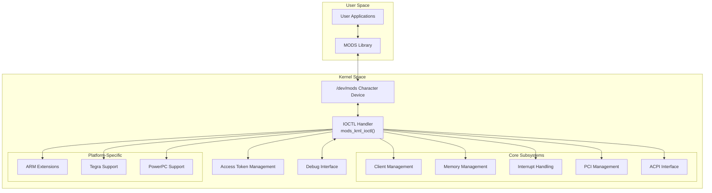

Sources: [mods_krnl.c:36-55](), [mods_internal.h:81-110](), [mods_krnl.c:494-522]()

## Client Management

The driver supports multiple client connections simultaneously (configurable at load time). Each client represents a unique userspace process or application that communicates with the driver. The driver tracks resources associated with each client and ensures proper cleanup when a client disconnects.

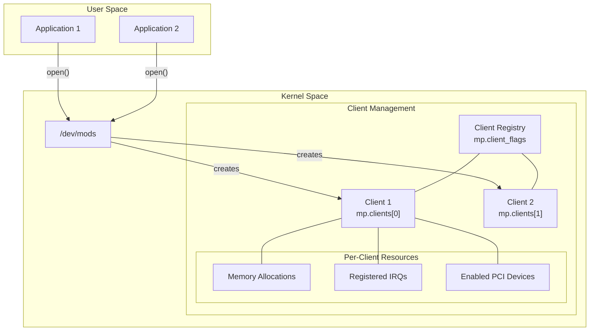

Sources: [mods_krnl.c:431-475](), [mods_krnl.c:1063-1080](), [mods_internal.h:426-500]()

## Communication Interface

All communication between userspace and the MODS driver occurs through IOCTL commands. The driver defines over 100 different IOCTL commands to support various operations. These commands are categorized into several groups:

| Category | Description | Examples |
|----------|-------------|----------|
| Memory Management | Allocation, mapping, and attribute control | `MODS_ESC_ALLOC_PAGES`, `MODS_ESC_FREE_PAGES` |
| PCI Management | Device discovery, configuration, BAR access | `MODS_ESC_FIND_PCI_DEVICE_2`, `MODS_ESC_PCI_READ_2` |
| Interrupt Handling | Registration, waiting, and servicing | `MODS_ESC_REGISTER_IRQ_4`, `MODS_ESC_QUERY_IRQ_3` |
| ACPI Interface | Method evaluation and device discovery | `MODS_ESC_EVAL_ACPI_METHOD`, `MODS_ESC_ACPI_GET_DDC_2` |
| Platform-Specific | Architecture-specific functionality | `MODS_ESC_FLUSH_CPU_CACHE_RANGE`, `MODS_ESC_BPMP_SET_PCIE_STATE` |

The communication flow follows this pattern:

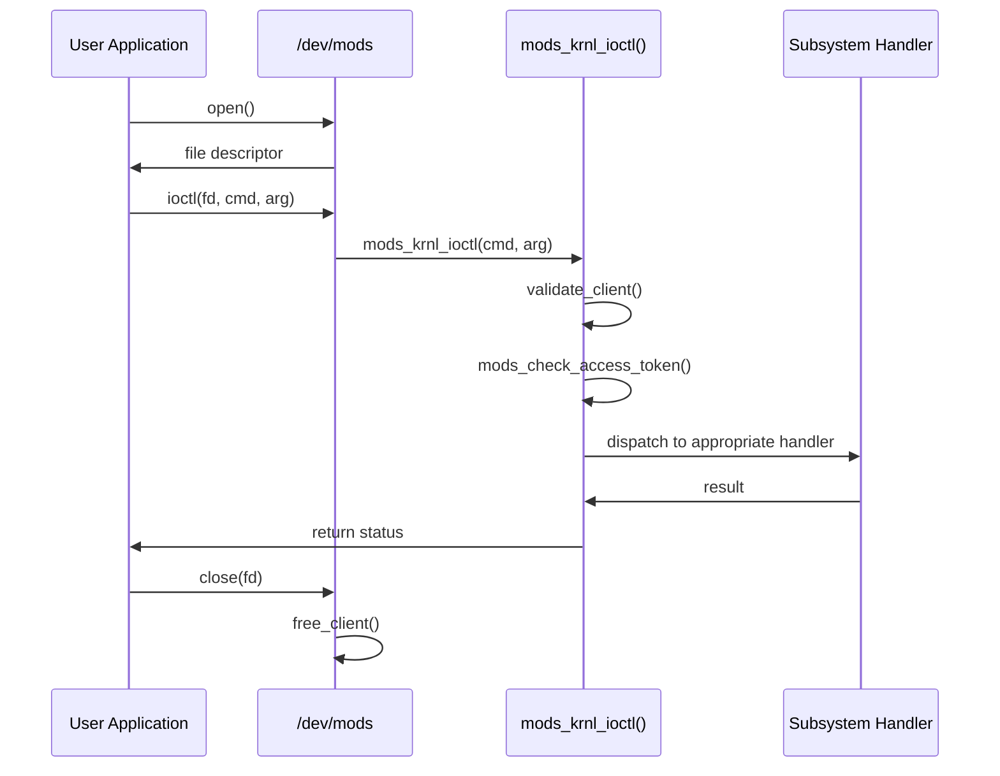

Sources: [mods_krnl.c:2019-2775](), [mods.h:2017-2015]()

## Memory Management

The MODS driver provides extensive memory management capabilities, allowing userspace applications to allocate and map physical memory with specific cache attributes. It supports both contiguous and non-contiguous memory allocations and provides mechanisms to map these allocations into userspace virtual address space.

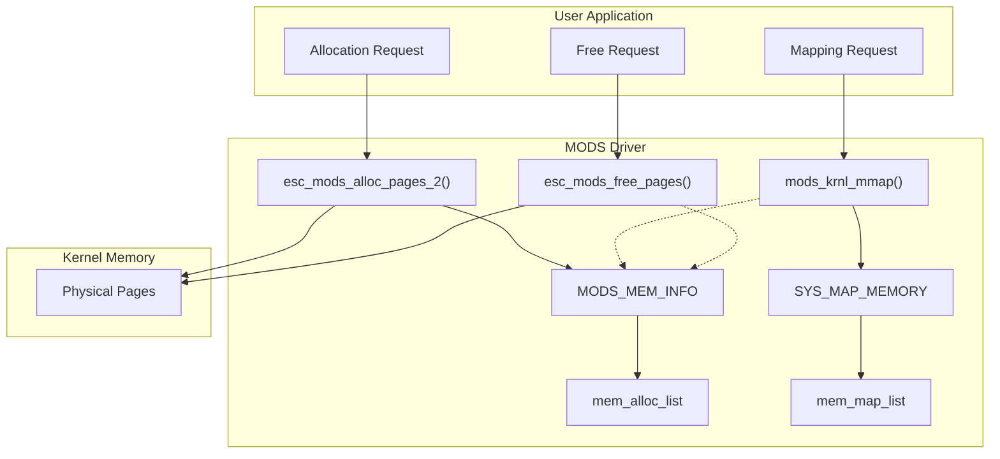

Key memory allocation features:
- Contiguous and non-contiguous allocations
- Custom cache attributes (cached, uncached, write-combine)
- NUMA-aware allocations
- DMA-mappable memory for device access
- 32-bit and 64-bit physical address support

Sources: [mods_internal.h:136-171](), [mods_krnl.c:733-761](), [mods.h:75-136]()

## Interrupt Management

The MODS driver allows userspace applications to register and handle hardware interrupts, which is typically restricted to kernel code. Applications can register for various types of interrupts (legacy, MSI, MSI-X) and receive notifications when these interrupts occur.

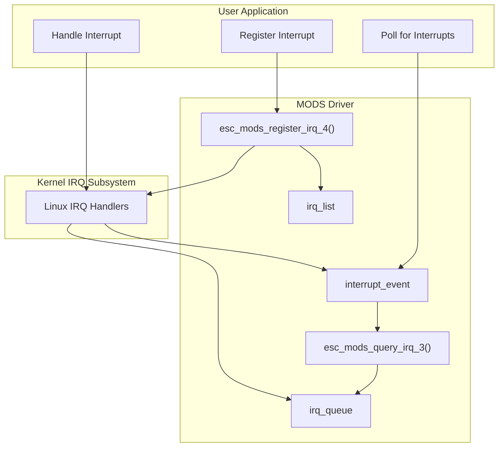

Supported interrupt types:
- Legacy PCI interrupts (INTx)
- Message Signaled Interrupts (MSI)
- Extended Message Signaled Interrupts (MSI-X)
- CPU interrupts (on Tegra platforms)

Sources: [mods_krnl.c:1158-1181](), [mods.h:774-927](), [mods_internal.h:289-307]()

## PCI Management

The MODS driver provides comprehensive PCI device management capabilities, allowing userspace applications to discover, configure, and interact with PCI devices.

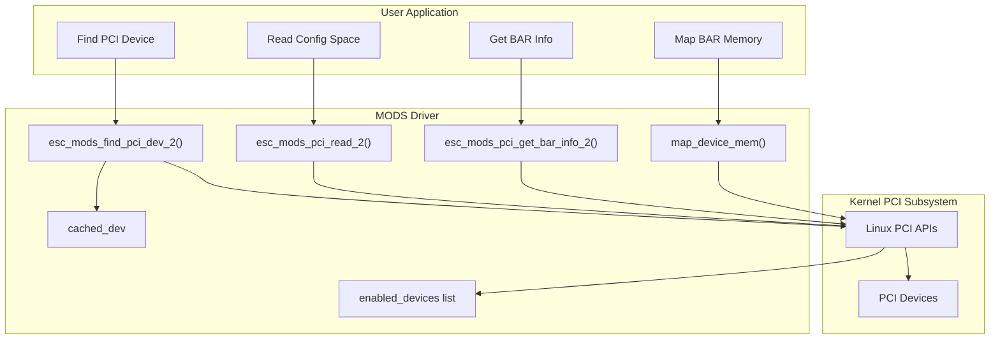

Key PCI management features:
- PCI device discovery by vendor/device ID or class code
- PCI configuration space read/write access
- PCI BAR information retrieval and mapping
- PCI device reset and hot-plug support
- SR-IOV configuration and management

Sources: [mods_krnl.c:97-171](), [mods.h:60-66](), [mods.h:404-419]()

## Platform-Specific Extensions

The MODS driver includes support for various platforms with platform-specific features:

### ARM and ARM64
- Cache management operations
- ARM Firmware Framework for Arm (FFA) interface
- CPU idle states management

### Tegra
- BPMP (Boot and Power Management Processor) communication
- Clock and reset control
- DMA operations
- ADSP (Audio DSP) management
- Display controller configuration

### PowerPC
- TCE (Translation Control Entry) bypass for DMA
- NVLink system memory configuration
- ATS (Address Translation Services) management

Sources: [mods_internal.h:178-204](), [mods_krnl.c:387-399](), [mods.h:1896-1915]()

## Driver Initialization and Cleanup

The MODS driver follows a standard Linux kernel module initialization and cleanup process:

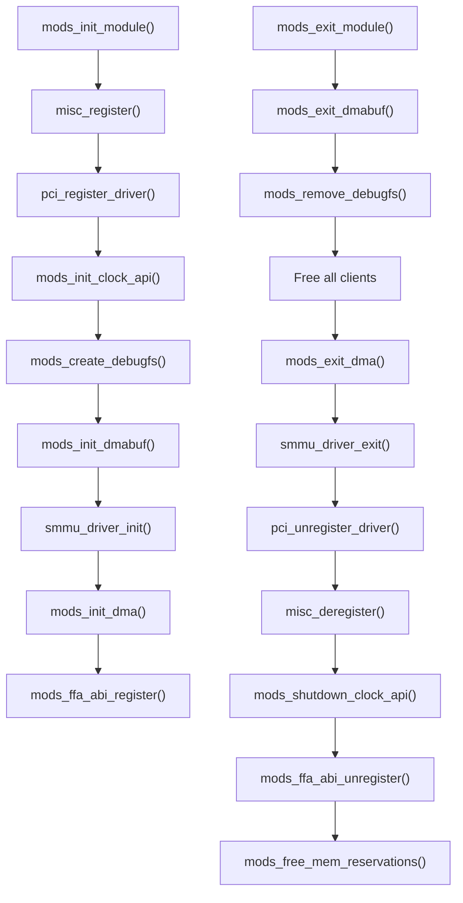

Sources: [mods_krnl.c:552-612](), [mods_krnl.c:614-652]()

## Access Control

The MODS driver implements an access token mechanism to control which applications can use the driver. This helps prevent unauthorized access to hardware resources.

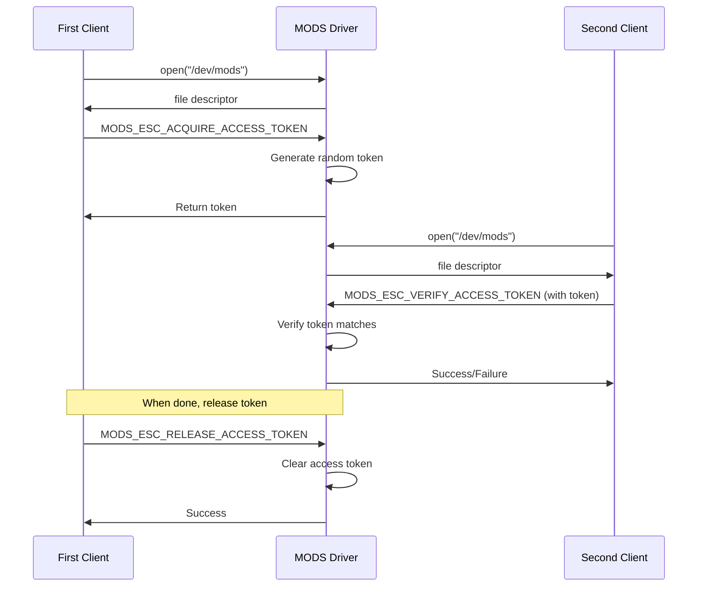

Sources: [mods.h:26-58](), [mods_krnl.c:523-546](), [mods_krnl.c:1706-1777]()

## Security Considerations

The MODS driver provides powerful capabilities that can potentially impact system stability and security. It is designed for use in controlled development environments by trusted applications. Key security measures include:

1. Access token mechanism to prevent unauthorized access
2. Per-client resource tracking to prevent resource leaks
3. Restrictions on memory access to prevent system corruption
4. Validation of IOCTL parameters to prevent exploitation

The driver is not intended for use in production environments or by untrusted applications.

Sources: [mods_krnl.c:602-605](), [mods_krnl.c:507-546]()

## Compatibility

The MODS driver is designed to work across multiple Linux kernel versions and hardware platforms. Compatibility is maintained through preprocessor conditionals and architecture-specific implementations.

| Feature | Supported Platforms | Notes |
|---------|---------------------|-------|
| Core functionality | All | Basic memory, PCI, and interrupt operations |
| ARM extensions | ARM, ARM64 | Cache management, FFA interface |
| Tegra extensions | Tegra SoCs | BPMP, clock, DMA, etc. |
| PowerPC extensions | PowerPC64 | TCE bypass, NVLink, ATS |
| ACPI interface | x86, x86_64 | ACPI method evaluation |

Sources: [mods_internal.h:16-28](), [mods_krnl.c:324-385](), [mods_krnl.c:667-679]()

---

# Page: Architecture

# Architecture

<details>
<summary>Relevant source files</summary>

The following files were used as context for generating this wiki page:

- [mods_config.h](mods_config.h)
- [mods_internal.h](mods_internal.h)
- [mods_krnl.c](mods_krnl.c)

</details>


This document describes the architecture of the NVIDIA MODS (Module Overlay and Driver Support) kernel driver. It explains the high-level design, core components, and their interactions. For specific implementation details about individual subsystems, please refer to their respective documentation pages in this wiki.

## Purpose and Scope

The MODS kernel driver provides low-level hardware access capabilities to userspace applications for debugging, diagnostics, and development of NVIDIA hardware across multiple platforms. It serves as a system-level interface between userspace debugging tools and hardware, exposing functionality that is typically only available to kernel-mode drivers.

## High-Level Architecture

The MODS driver follows a client-based architecture where each userspace application opens the driver and receives a dedicated client context for tracking resources and operations.

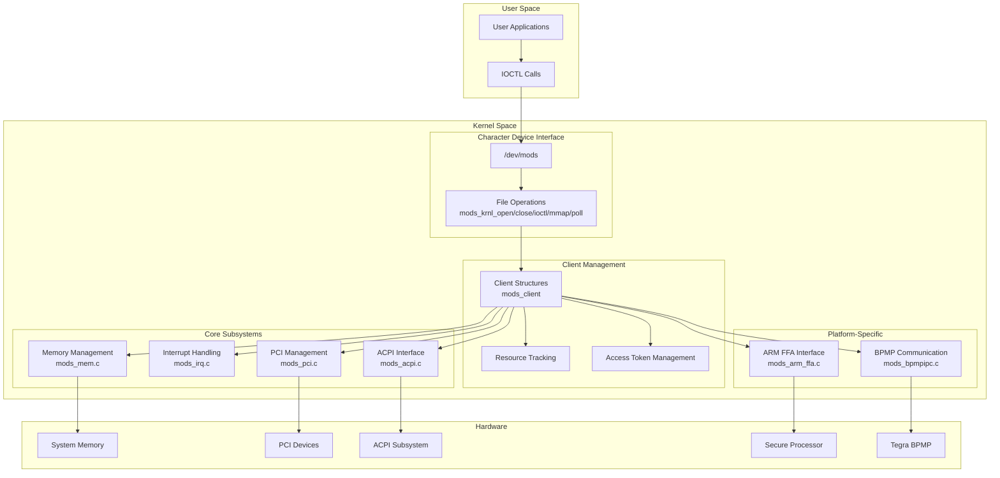

Sources: [mods_krnl.c:36-47](), [mods_krnl.c:552-612](), [mods_internal.h:82-110]()

## Character Device Interface

The core of the MODS driver is the `/dev/mods` character device interface, which provides the connection point between userspace and kernel functionality.

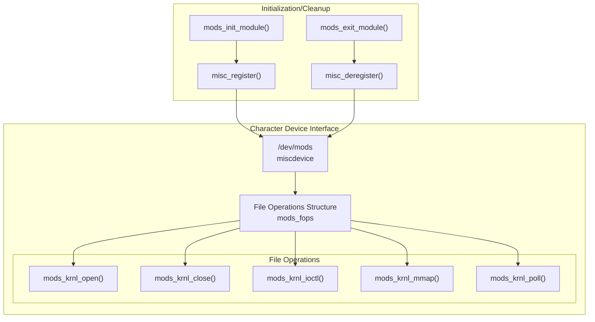

Sources: [mods_krnl.c:36-47](), [mods_krnl.c:49-55](), [mods_krnl.c:552-570](), [mods_krnl.c:614-641]()

### Key Components

1. **Device Registration**: The driver registers a miscellaneous character device at initialization
2. **File Operations**: Defines handlers for standard file operations
3. **Client Association**: Each file handle is associated with a client context

## Client Management

The MODS driver uses a client-based architecture to track resources and operations per user application. Each time a user opens the `/dev/mods` device, a new client is allocated with a unique client ID.

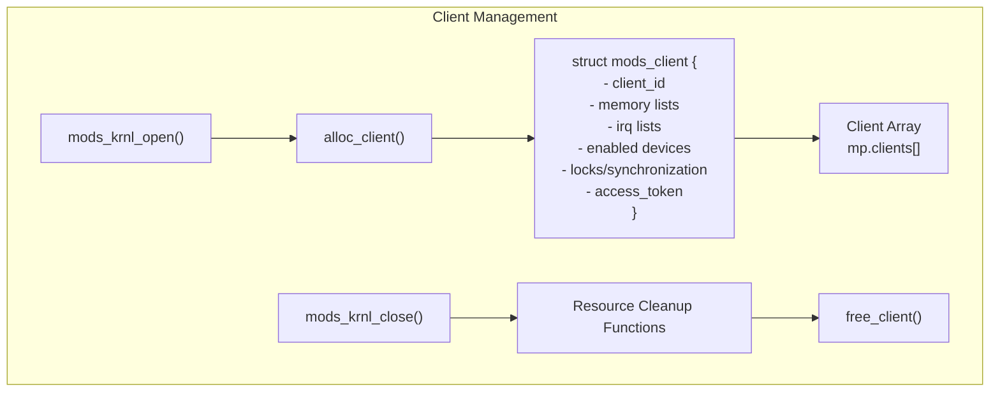

Sources: [mods_internal.h:82-110](), [mods_krnl.c:431-475](), [mods_krnl.c:477-500](), [mods_krnl.c:1063-1081](), [mods_krnl.c:1083-1156]()

### Key Client Features

1. **Resource Tracking**: Each client tracks its own memory allocations, IRQ registrations, and enabled devices
2. **Client Isolation**: Resources from one client are isolated from others
3. **Cleanup on Close**: All resources are automatically freed when a client closes the device

## IOCTL Interface

The primary method for user applications to interact with the MODS driver is through IOCTL calls. The driver supports a wide range of commands for different hardware operations.

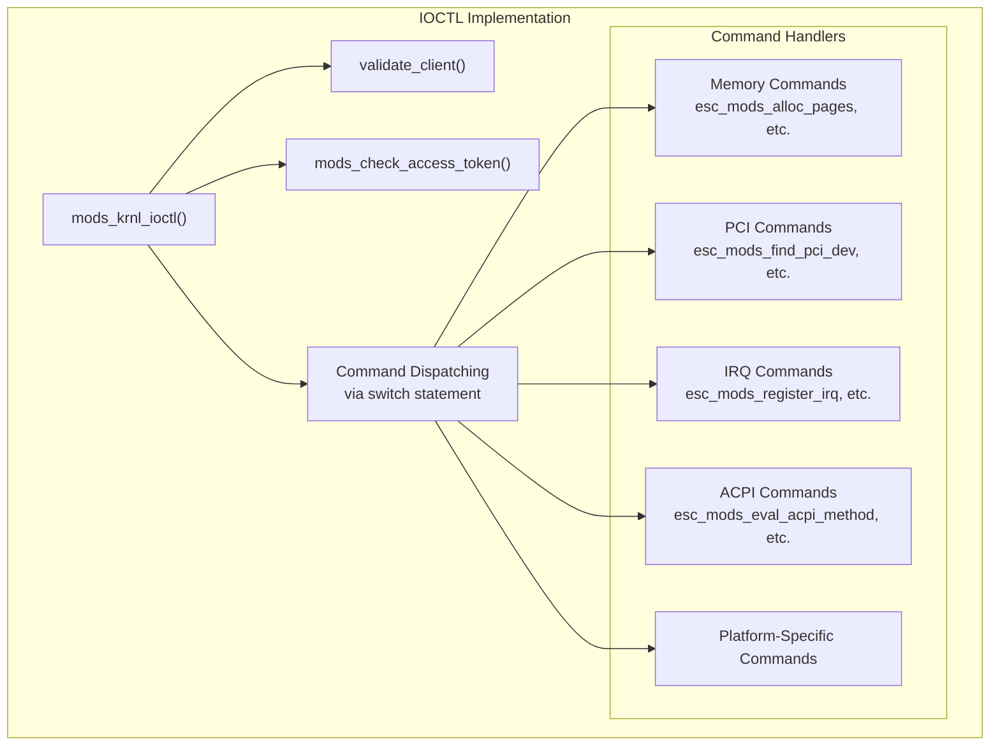

Sources: [mods_krnl.c:2019-2066](), [mods_krnl.c:2116-2013]()

### IOCTL Command Flow

1. **Validation**: Verify client and access token
2. **Command Decoding**: Decode IOCTL command
3. **Parameter Handling**: Copy parameters from user space
4. **Command Execution**: Dispatch to appropriate handler function
5. **Result Return**: Copy results back to user space

## Memory Management

The MODS driver provides comprehensive memory management for user applications, allowing them to allocate and map different types of memory with various caching attributes.

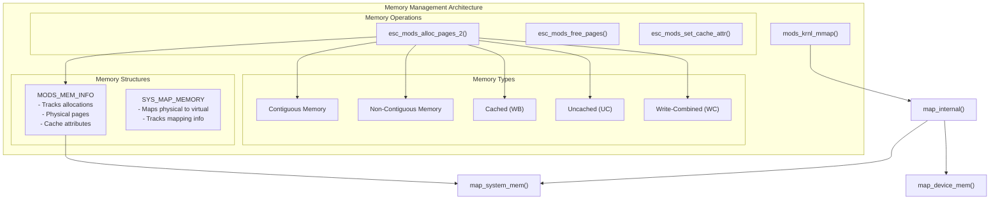

Sources: [mods_internal.h:137-163](), [mods_internal.h:174-186](), [mods_krnl.c:733-761](), [mods_krnl.c:1184-1391]()

### Memory Management Features

1. **Allocation Types**: Support for contiguous and non-contiguous memory
2. **Cache Control**: Configurable cache attributes (cached, uncached, write-combined)
3. **Memory Mapping**: Map allocated memory to user space
4. **Device Memory**: Map physical device memory to user space

## Interrupt Management

The interrupt management subsystem allows user applications to register for and handle hardware interrupts from userspace.

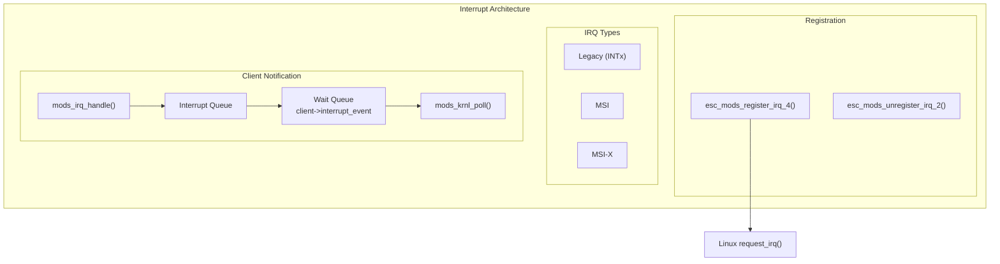

Sources: [mods_internal.h:290-308](), [mods_krnl.c:1158-1182]()

### Interrupt Features

1. **IRQ Types**: Support for legacy INTx, MSI, and MSI-X interrupts
2. **IRQ Queuing**: Interrupts are queued for the client to process
3. **Notification**: Clients are notified of interrupts via polling
4. **Masking Control**: Support for interrupt masking/unmasking

## PCI Management

The PCI management subsystem provides access to PCI devices, including device discovery, register access, and configuration.

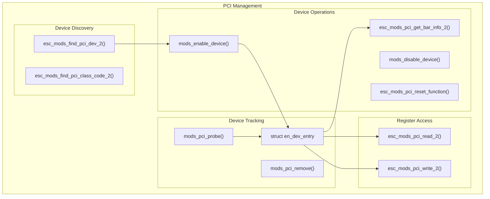

Sources: [mods_internal.h:47-58](), [mods_krnl.c:97-118](), [mods_krnl.c:120-156](), [mods_krnl.c:162-171]()

### PCI Features

1. **Device Discovery**: Find PCI devices by ID or class code
2. **Device Access**: Read and write PCI registers, access BARs
3. **Device Management**: Enable, disable, and reset devices
4. **Hot Reset**: Support for PCI hot reset functionality
5. **Device Tracking**: Track enabled devices per client

## Access Control Mechanism

For environments where security is important, MODS provides an access token system that can be used to limit driver access.

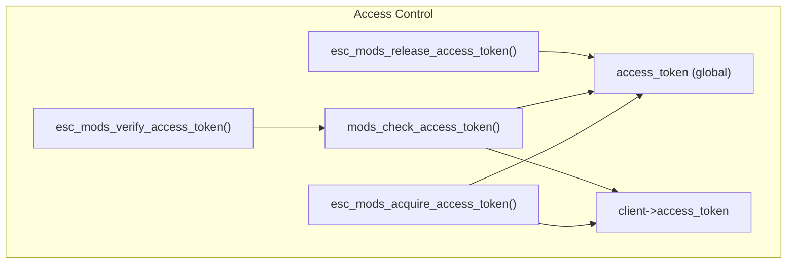

Sources: [mods_krnl.c:502-547](), [mods_krnl.c:1706-1776]()

### Access Control Features

1. **Token Generation**: Random token generation for access control
2. **Token Verification**: Validate token before allowing operations
3. **Token Release**: Release token to allow other clients to acquire it
4. **Multi-Instance Override**: Token system is disabled when multi-instance mode is enabled

## Platform-Specific Extensions

MODS supports platform-specific extensions for specialized hardware access, particularly for NVIDIA Tegra platforms and ARM-based systems.

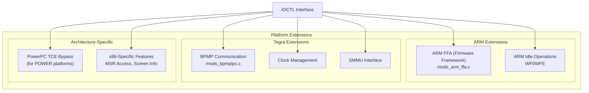

Sources: [mods_krnl.c:387-398](), [mods_krnl.c:572-594](), [mods_krnl.c:1963-1992](), [mods_internal.h:695-700]()

## Driver Initialization and Cleanup

The driver follows a standard Linux kernel module initialization and cleanup pattern, registering devices and initializing subsystems.

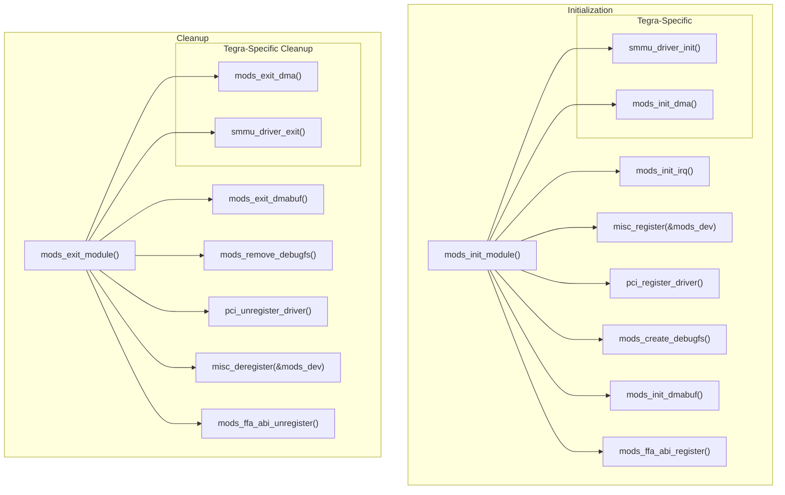

Sources: [mods_krnl.c:552-612](), [mods_krnl.c:614-652]()

## Configuration System

The MODS driver uses a configuration system to handle kernel version differences and platform-specific features, allowing a single codebase to work across multiple kernel versions and architectures.

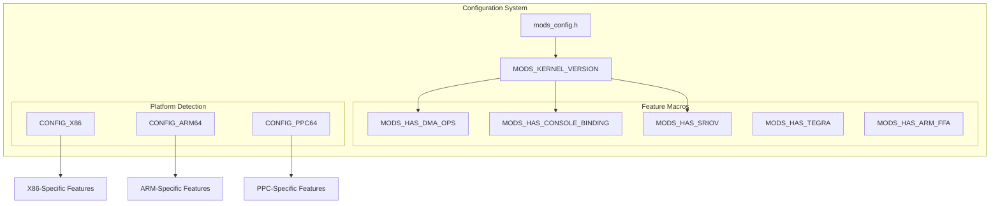

Sources: [mods_config.h:1-129]()

## Conclusion

The NVIDIA MODS kernel driver provides a flexible architecture for low-level hardware access, with key features including:

1. **Client-Based Design**: Resource tracking and isolation per client
2. **Comprehensive Hardware Access**: Memory, PCI, IRQs, and platform-specific features
3. **Extensible Interface**: IOCTL-based command dispatch system
4. **Cross-Platform Support**: Architecture spanning x86, ARM, and PowerPC
5. **Debug Capabilities**: Special interfaces for hardware debugging and diagnostics

The driver is designed to be a development and diagnostic tool rather than a production driver, providing capabilities that would otherwise be unavailable to userspace applications.

---

# Page: Compatibility

# Compatibility

<details>
<summary>Relevant source files</summary>

The following files were used as context for generating this wiki page:

- [Makefile](Makefile)
- [mods_config.h](mods_config.h)

</details>


This page details the kernel version compatibility and feature configuration options supported by the NVIDIA MODS kernel driver. It documents how the driver adapts to different Linux kernel versions, platform architectures, and available kernel features through its compatibility layer.

For information about building the driver with specific configurations, see [Building the Driver](#6.1).

## 1. Kernel Version Compatibility

The MODS kernel driver supports a wide range of Linux kernel versions through a comprehensive compatibility layer implemented in `mods_config.h`. This compatibility layer uses preprocessor macros to detect the kernel version and enable or disable features accordingly.

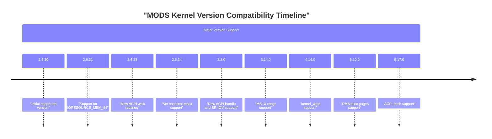

The driver defines `MODS_KERNEL_VERSION` which is set to the Linux kernel version code to make version-specific adaptations throughout the codebase.

Sources: [mods_config.h:7-7]()

## 2. Version-Dependent Feature Detection

MODS uses conditional compilation to adapt to API changes across different kernel versions:

| Feature Flag | Kernel Version | Description |
|--------------|----------------|-------------|
| `MODS_HAS_DMA_OPS` | 2.6.30 - 4.16.0 (x86) | DMA operations API support |
| `MODS_HASNT_PCI_RESCAN_BUS` | < 2.6.30 | PCI bus rescan not available |
| `MODS_HAS_IORESOURCE_MEM_64` | ≥ 2.6.31 | 64-bit memory resource support |
| `MODS_HAS_NEW_ACPI_WALK` | ≥ 2.6.33 | Updated ACPI walk routines |
| `MODS_HAS_SET_COHERENT_MASK` | ≥ 2.6.34 | Support for setting coherent DMA mask |
| `MODS_HAS_CONSOLE_LOCK` | ≥ 2.6.38 (x86) | Console locking mechanism |
| `MODS_HAS_NEW_ACPI_HANDLE` | ≥ 3.8.0 | Updated ACPI handle API |
| `MODS_HAS_SRIOV` | ≥ 3.8.0 | SR-IOV support |
| `MODS_HAS_REINIT_COMPLETION` | ≥ 3.13.0 | Completion reinit function |
| `MODS_HAS_MSIX_RANGE` | ≥ 3.14.0 | MSI-X range allocation |
| `MODS_HAS_DEV_PROPS` | ≥ 3.19.0 | Device properties support |
| `MODS_HAS_KERNEL_WRITE` | ≥ 4.14.0 | Kernel write function |
| `MODS_HAS_POLL_T` | ≥ 4.16.0 | Poll_t data type |
| `MODS_HAS_DMA_ALLOC_PAGES` | ≥ 5.10.0 | DMA page allocation |
| `MODS_HAS_ACPI_FETCH` | ≥ 5.17.0 | ACPI fetch API |

These flags enable the driver to compensate for API differences across kernel versions and maintain backward compatibility.

Sources: [mods_config.h:9-104]()

## 3. Platform-Specific Compatibility

The MODS driver adapts to different hardware platforms and architectures through conditional compilation:

```mermaid
graph TD
    subgraph "Kernel Configuration"
        KC["Kernel Config"]
    end

    subgraph "Platform Support"
        X86["x86 Architecture"]
        PPC64["PowerPC 64-bit"]
        ARM["ARM Architecture"]
        Tegra["NVIDIA Tegra"]
    end

    subgraph "Conditionally Compiled Components"
        PCI["mods_pci.o\n(CONFIG_PCI)"]
        ACPI["mods_acpi.o\n(CONFIG_ACPI)"]
        ARMFFA["mods_arm_ffa.o\n(CONFIG_ARM_FFA_TRANSPORT)"]
        DebugFS["mods_debugfs.o\n(CONFIG_DEBUG_FS)"]
        PPC["mods_ppc64.o\n(CONFIG_PPC64)"]
        BPMP["mods_bpmpipc.o\n(CONFIG_TEGRA_IVC)"]
    end

    KC --> X86
    KC --> PPC64
    KC --> ARM
    KC --> Tegra

    X86 -->|"Enables"| PCI
    X86 -->|"Enables"| ACPI
    X86 -->|"May enable"| DebugFS
    
    PPC64 -->|"Enables"| PPC
    PPC64 -->|"May enable"| PCI
    PPC64 -->|"May enable"| DebugFS
    
    ARM -->|"Enables"| ARMFFA
    ARM -->|"May enable"| DebugFS
    
    Tegra -->|"Enables"| BPMP
    Tegra -->|"May enable"| DebugFS
```

Architecture-specific macros in `mods_config.h` enable features for specific platforms:

1. **x86-specific features**:
   - `MODS_HAS_CONSOLE_LOCK` (2.6.38+)
   - `MODS_HAS_ASM_SET_MEMORY_HEADER` (4.12.0 - 4.13.0)
   - `MODS_HAS_PGPROT_DECRYPTED` (4.14.0+)

2. **PowerPC-specific features**:
   - `MODS_HAS_PNV_PCI_GET_NPU_DEV` (4.5.0+)

3. **ARM-specific features**:
   - ARM FFA (Firmware Framework for Arm) transport

4. **Tegra-specific features**:
   - `MODS_ENABLE_BPMP_MRQ_API` (5.1.0+)

Sources: [mods_config.h:33-108](), [Makefile:8-30]()

## 4. Conditional Component Compilation

The MODS driver compiles different components based on kernel configuration options:

| Component | Kernel Config | Purpose |
|-----------|---------------|---------|
| mods_krnl.o | Always | Core kernel interface |
| mods_mem.o | Always | Memory management |
| mods_irq.o | Always | Interrupt handling |
| mods_pci.o | CONFIG_PCI | PCI device management |
| mods_acpi.o | CONFIG_ACPI | ACPI interface |
| mods_arm_ffa.o | CONFIG_ARM_FFA_TRANSPORT | ARM FFA interface |
| mods_debugfs.o | CONFIG_DEBUG_FS | Debug interface |
| mods_ppc64.o | CONFIG_PPC64 | PowerPC 64-bit support |
| mods_bpmpipc.o | CONFIG_TEGRA_IVC | Tegra BPMP IPC |

This conditional compilation ensures that the driver only includes components relevant to the target platform and kernel configuration, minimizing its footprint and avoiding dependencies on unavailable features.

Sources: [Makefile:21-30]()

## 5. Compatibility Layer Implementation

The compatibility layer is implemented in `mods_config.h` through preprocessor macros that check kernel version and configuration options. This approach uses conditional compilation to adapt the driver's behavior without runtime overhead.

```mermaid
flowchart TD
    subgraph "Compatibility Detection Process"
        KV["MODS_KERNEL_VERSION\n(LINUX_VERSION_CODE)"]
        KC["Kernel Config\n(CONFIG_X86, CONFIG_PCI, etc.)"]
        
        KV -->|"Version check"| VF["Version-specific Features\n(MODS_HAS_* / MODS_HASNT_*)"]
        KC -->|"Config check"| CF["Config-dependent Features\n(CONFIG_* options)"]
        
        VF --> CP["Conditional Preprocessor Directives"]
        CF --> CP
        
        CP -->|"Enables/disables"| FF["Driver Features"]
    end
```

When the compatibility layer detects that a kernel feature is missing, it provides alternative implementations or disables certain driver features while maintaining core functionality.

Sources: [mods_config.h:1-128]()

## 6. Distribution-Specific Compatibility

The driver includes compatibility checks for specific Linux distributions:

- `CONFIG_RHEL_DIFFERENCES` - Detects Red Hat Enterprise Linux kernels
- `CONFIG_CHROME_PLATFORMS` - Detects Chrome OS kernels

These checks enable special handling for distribution-specific kernel modifications, particularly for the framebuffer suspend handling (`MODS_HAS_FB_SET_SUSPEND`).

Sources: [mods_config.h:110-118]()

---

# Page: IOCTL Interface

# IOCTL Interface

<details>
<summary>Relevant source files</summary>

The following files were used as context for generating this wiki page:

- [mods.h](mods.h)
- [mods_internal.h](mods_internal.h)
- [mods_krnl.c](mods_krnl.c)

</details>


The IOCTL (Input/Output Control) interface is the primary method for userspace applications to interact with the MODS kernel driver. It provides a comprehensive set of operations for accessing hardware resources, managing memory, controlling PCI devices, handling interrupts, and performing platform-specific functions.

## Interface Overview

The MODS driver exposes a character device (`/dev/mods`) through which applications issue IOCTL commands. Each command is identified by a unique code and takes a command-specific data structure as an argument.

```mermaid
flowchart TD
    subgraph "User Space"
        UserApp["User Application"]
        
        subgraph "IOCTL Command Flow"
            Open["open('/dev/mods')"]
            Ioctl["ioctl(fd, cmd, argp)"]
            Close["close(fd)"]
        end
    end
    
    subgraph "Kernel Space"
        Dev["/dev/mods Device"]
        Dispatch["mods_krnl_ioctl()"]
        
        subgraph "Command Handlers"
            MemCmd["Memory Commands\nesc_mods_alloc_pages, etc."]
            PciCmd["PCI Commands\nesc_mods_find_pci_dev, etc."]
            IrqCmd["IRQ Commands\nesc_mods_register_irq, etc."]
            AcpiCmd["ACPI Commands\nesc_mods_eval_acpi_method, etc."]
            PlatCmd["Platform Commands"]
        end
        
        ClientMgr["Client Management"]
        TokenMgr["Access Token Management"]
    end
    
    UserApp --> Open
    Open --> Dev
    UserApp --> Ioctl
    Ioctl --> Dev
    UserApp --> Close
    Close --> Dev
    
    Dev --> Dispatch
    Dispatch --> ClientMgr
    Dispatch --> TokenMgr
    Dispatch --> MemCmd
    Dispatch --> PciCmd
    Dispatch --> IrqCmd
    Dispatch --> AcpiCmd
    Dispatch --> PlatCmd
```

Sources: [mods_krnl.c:19-44](), [mods_krnl.c:2019-2115]()

## Client and Access Management

### Client Management

The MODS driver supports multiple client connections through a client management system that tracks resources per client. Each client is identified by a unique ID assigned when the device is opened.

```mermaid
flowchart LR
    subgraph "Client Management"
        Open["open()"]
        Close["close()"]
        ClientAlloc["alloc_client()"]
        ClientStruct["struct mods_client"]
        FreeClient["free_client()"]
    end
    
    Open --> ClientAlloc
    ClientAlloc --> ClientStruct
    ClientStruct --> |"contains client resources"| ClientStruct
    Close --> FreeClient
    FreeClient --> |"releases resources"| ClientStruct
```

Sources: [mods_krnl.c:431-475](), [mods_krnl.c:477-500](), [mods_internal.h:82-110]()

### Access Token Management

To control concurrent access, the driver implements an access token system. The first client can acquire a token, and subsequent clients must verify this token to use the driver.

```mermaid
flowchart TD
    subgraph "Access Token Flow"
        Acquire["MODS_ESC_ACQUIRE_ACCESS_TOKEN"]
        Verify["MODS_ESC_VERIFY_ACCESS_TOKEN"]
        Release["MODS_ESC_RELEASE_ACCESS_TOKEN"]
    end
    
    Client1["Client 1"] --> Acquire
    Acquire --> |"generates token"| Token["Access Token"]
    Client2["Client 2"] --> Verify
    Verify --> |"validates against"| Token
    Client1 --> Release
    Release --> |"invalidates"| Token
```

Sources: [mods.h:26-59](), [mods_krnl.c:1706-1777]()

## IOCTL Command Processing

The driver processes IOCTL commands through the `mods_krnl_ioctl()` function, which handles parameter validation, copying data between user and kernel space, and dispatching to appropriate handler functions.

```mermaid
sequenceDiagram
    participant App as User Application
    participant Kernel as Linux Kernel
    participant Ioctl as mods_krnl_ioctl()
    participant Handler as Command Handler
    
    App->>Kernel: ioctl(fd, cmd, argp)
    Kernel->>Ioctl: call with cmd and args
    Ioctl->>Ioctl: validate client
    Ioctl->>Ioctl: check access token
    Ioctl->>Ioctl: copy_from_user(arg_copy, arg, arg_size)
    Ioctl->>Handler: call specific handler
    Handler->>Ioctl: return result
    Ioctl->>Ioctl: copy_to_user(arg, arg_copy, arg_size)
    Ioctl->>Kernel: return status
    Kernel->>App: return status
```

Sources: [mods_krnl.c:2019-2115](), [mods_krnl.c:2086-2114]()

## IOCTL Command Categories

The MODS driver supports over 100 IOCTL commands, organized into several functional categories:

### Memory Management Commands

Commands for allocating, freeing, and managing system memory for hardware access.

| Command | Purpose | Key Structure |
|---------|---------|--------------|
| MODS_ESC_ALLOC_PAGES_2 | Allocate system memory | MODS_ALLOC_PAGES_2 |
| MODS_ESC_FREE_PAGES | Free allocated memory | MODS_FREE_PAGES |
| MODS_ESC_GET_PHYSICAL_ADDRESS_2 | Get physical address of allocation | MODS_GET_PHYSICAL_ADDRESS_3 |
| MODS_ESC_DMA_MAP_MEMORY | Map memory to device via IOMMU | MODS_DMA_MAP_MEMORY |
| MODS_ESC_SET_MEMORY_TYPE | Set memory caching attributes | MODS_MEMORY_TYPE |

Sources: [mods.h:75-204](), [mods.h:2022-2204]()

### PCI Management Commands

Commands for discovering, configuring, and accessing PCI devices.

| Command | Purpose | Key Structure |
|---------|---------|--------------|
| MODS_ESC_FIND_PCI_DEVICE_2 | Find PCI device by vendor/device ID | MODS_FIND_PCI_DEVICE_2 |
| MODS_ESC_PCI_READ_2 | Read from PCI config space | MODS_PCI_READ_2 |
| MODS_ESC_PCI_WRITE_2 | Write to PCI config space | MODS_PCI_WRITE_2 |
| MODS_ESC_PCI_GET_BAR_INFO_2 | Get PCI BAR information | MODS_PCI_GET_BAR_INFO_2 |
| MODS_ESC_PCI_BUS_RESCAN | Initiate PCI bus rescan | MODS_PCI_BUS_RESCAN |

Sources: [mods.h:404-613](), [mods.h:2106-2202]()

### Interrupt Handling Commands

Commands for registering, querying, and handling hardware interrupts.

| Command | Purpose | Key Structure |
|---------|---------|--------------|
| MODS_ESC_REGISTER_IRQ_4 | Register for interrupt notification | MODS_REGISTER_IRQ_4 |
| MODS_ESC_UNREGISTER_IRQ_2 | Unregister interrupt notification | MODS_REGISTER_IRQ_2 |
| MODS_ESC_QUERY_IRQ_3 | Query pending interrupts | MODS_QUERY_IRQ_3 |
| MODS_ESC_IRQ_HANDLED_2 | Indicate interrupt was handled | MODS_REGISTER_IRQ_2 |

Sources: [mods.h:729-935](), [mods.h:2445-2475]()

### ACPI Method Commands

Commands for evaluating ACPI methods and accessing ACPI-related information.

| Command | Purpose | Key Structure |
|---------|---------|--------------|
| MODS_ESC_EVAL_ACPI_METHOD | Evaluate ACPI method | MODS_EVAL_ACPI_METHOD |
| MODS_ESC_EVAL_DEV_ACPI_METHOD_3 | Evaluate ACPI method for PCI device | MODS_EVAL_DEV_ACPI_METHOD_3 |
| MODS_ESC_ACPI_GET_DDC_2 | Get EDID data via ACPI _DDC method | MODS_ACPI_GET_DDC_2 |
| MODS_ESC_GET_ACPI_DEV_CHILDREN | Get ACPI device children | MODS_GET_ACPI_DEV_CHILDREN |

Sources: [mods.h:1033-1163](), [mods.h:2043-2124]()

### Platform-Specific Commands

Commands specific to particular hardware platforms, such as ARM or Tegra.

| Command | Purpose | Key Structure |
|---------|---------|--------------|
| MODS_ESC_ARM_FFA_CMD | ARM FF-A interface commands | MODS_FFA_PARAMS |
| MODS_ESC_GET_CLOCK_HANDLE | Get Tegra clock handle | MODS_GET_CLOCK_HANDLE |
| MODS_ESC_BPMP_SET_PCIE_STATE | Set PCIe state via BPMP | MODS_SET_PCIE_STATE |
| MODS_ESC_FLUSH_CPU_CACHE_RANGE | Flush CPU cache on ARM | MODS_FLUSH_CPU_CACHE_RANGE |

Sources: [mods.h:328-338](), [mods.h:425-439](), [mods.h:1439-1502](), [mods.h:1897-1905]()

## Client Data Structures

The driver maintains per-client data structures to track resources and state.

```mermaid
classDiagram
    class mods_client {
        struct list_head irq_list
        struct list_head mem_alloc_list
        struct list_head mem_map_list
        wait_queue_head_t interrupt_event
        struct irq_q_info irq_queue
        spinlock_t irq_lock
        struct mutex mtx
        u32 access_token
        atomic_t num_allocs
        atomic_t num_pages
        u8 client_id
    }
    
    class MODS_MEM_INFO {
        struct list_head list
        struct list_head dma_map_list
        u32 num_pages
        u32 num_chunks
        u8 cache_type
        struct scatterlist *sg
    }
    
    class SYS_MAP_MEMORY {
        struct list_head list
        struct MODS_MEM_INFO *p_mem_info
        struct mods_client *client
        atomic_t usage_count
        phys_addr_t phys_addr
        unsigned long virtual_addr
        unsigned long mapping_length
    }
    
    class dev_irq_map {
        u8 *dev_irq_aperture
        u32 apic_irq
        u8 type
        u8 client_id
        struct pci_dev *dev
        struct list_head list
    }
    
    mods_client "1" --> "*" MODS_MEM_INFO : mem_alloc_list
    mods_client "1" --> "*" SYS_MAP_MEMORY : mem_map_list
    mods_client "1" --> "*" dev_irq_map : irq_list
    SYS_MAP_MEMORY "0..1" --> "1" MODS_MEM_INFO : p_mem_info
```

Sources: [mods_internal.h:82-110](), [mods_internal.h:136-172](), [mods_internal.h:173-186](), [mods_internal.h:290-309]()

## Memory Mapping Interface

In addition to IOCTL commands, the driver supports memory mapping through the `mmap()` system call, allowing direct access to allocated memory or device regions.

```mermaid
sequenceDiagram
    participant App as User Application
    participant Kernel as Linux Kernel
    participant Mmap as mods_krnl_mmap()
    participant MapInternal as map_internal()
    
    App->>Kernel: mmap(fd, addr, length, prot, flags, offset)
    Kernel->>Mmap: call with vm_area_struct
    Mmap->>Mmap: validate client and token
    Mmap->>Mmap: allocate SYS_MAP_MEMORY
    Mmap->>MapInternal: call with client and vma
    MapInternal->>MapInternal: find memory allocation
    alt System memory
        MapInternal->>MapInternal: map_system_mem()
    else Device memory
        MapInternal->>MapInternal: map_device_mem()
    end
    MapInternal->>MapInternal: register_mapping()
    MapInternal->>Mmap: return status
    Mmap->>Kernel: return status
    Kernel->>App: return mapped address
```

Sources: [mods_krnl.c:887-1061](), [mods_krnl.c:1184-1391]()

## Example IOCTL Command Flow

Below is a detailed example of how a memory allocation IOCTL flows through the system:

```mermaid
flowchart TD
    subgraph "User Space"
        App["Application"]
        IOCTL["ioctl(fd, MODS_ESC_ALLOC_PAGES_2, &alloc_params)"]
    end
    
    subgraph "Kernel Space"
        KrnlIOCTL["mods_krnl_ioctl()"]
        ESCAlloc["esc_mods_alloc_pages_2()"]
        AllocPages["mods_alloc_pages()"]
        
        subgraph "Memory Management"
            PageAlloc["__get_free_pages()"]
            CacheConfig["SET_MEMORY_UC/WC"]
            MemTracking["Add to client->mem_alloc_list"]
        end
    end
    
    App --> IOCTL
    IOCTL --> KrnlIOCTL
    KrnlIOCTL --> ESCAlloc
    ESCAlloc --> AllocPages
    AllocPages --> PageAlloc
    AllocPages --> CacheConfig
    AllocPages --> MemTracking
    MemTracking --> |"Returns memory_handle"| ESCAlloc
    ESCAlloc --> |"Returns status"| KrnlIOCTL
    KrnlIOCTL --> |"Returns status"| IOCTL
    IOCTL --> |"memory_handle in alloc_params"| App
```

Sources: [mods_krnl.c:2019-2115](), [mods_krnl.c:2282-2286]()

## Error Handling

The IOCTL interface uses standard Linux error codes to indicate the status of operations. Common error conditions include:

| Error Code | Description | Typical Causes |
|------------|-------------|----------------|
| -EINVAL | Invalid argument | Incorrect parameters, unsupported operation |
| -ENOMEM | Out of memory | Failed memory allocation |
| -ENODEV | No such device | Device not found or not supported |
| -EFAULT | Bad address | Failed to copy data between user and kernel space |
| -EBUSY | Device or resource busy | Resource already in use |
| -EINTR | Interrupted system call | Operation interrupted by signal |

Sources: [mods_krnl.c:2019-2115](), [mods_internal.h:507-591]()

## Security Considerations

The MODS driver provides low-level hardware access and should be used carefully as it can potentially affect system stability. Key security measures include:

1. Access token system to control concurrent access
2. Client resource tracking to prevent leaks
3. Validation of IOCTL parameters
4. Permission checks for sensitive operations

Since the driver provides direct hardware access, it should only be used by trusted applications with appropriate privileges.

Sources: [mods_krnl.c:431-547](), [mods_krnl.c:1706-1777]()

## Conclusion

The IOCTL interface is the primary method for interacting with the MODS kernel driver, providing a comprehensive set of commands for hardware access and management. Understanding this interface is essential for developing applications that need low-level access to NVIDIA hardware for debugging, diagnostics, or development purposes.

For more details on specific subsystems, refer to:
- Memory Management IOCTLs [Memory Management IOCTLs](#2.1)
- PCI Management IOCTLs [PCI Management IOCTLs](#2.2)
- Interrupt Handling IOCTLs [Interrupt Handling IOCTLs](#2.3)
- ACPI Method IOCTLs [ACPI Method IOCTLs](#2.4)

---

# Page: Memory Management IOCTLs

# Memory Management IOCTLs

<details>
<summary>Relevant source files</summary>

The following files were used as context for generating this wiki page:

- [mods.h](mods.h)
- [mods_internal.h](mods_internal.h)
- [mods_mem.c](mods_mem.c)

</details>


This page documents the Input/Output Control (IOCTL) interfaces for memory management provided by the NVIDIA MODS kernel driver. These IOCTLs enable user applications to allocate, map, and manage system memory for hardware access in a way that's optimized for debugging and diagnostic purposes. For information about the overall IOCTL interface, see [IOCTL Interface](#2).

## Overview

The MODS kernel driver provides a comprehensive set of memory management IOCTLs that allow user applications to:

1. Allocate system memory with different caching attributes
2. Map memory for DMA access by devices
3. Translate between physical and virtual addresses
4. Perform memory reservations for sharing between processes
5. Manage CPU cache for memory regions

These operations are essential for hardware diagnostics, debugging, and development applications that need direct access to physical memory and hardware resources.

```mermaid
flowchart TB
    subgraph "Memory Management IOCTLs"
        direction TB
        Allocation["Memory Allocation\n(MODS_ESC_ALLOC_PAGES*)"]
        Free["Memory Deallocation\n(MODS_ESC_FREE_PAGES)"]
        Merge["Memory Merging\n(MODS_ESC_MERGE_PAGES)"]
        Translation["Address Translation\n(MODS_ESC_GET_PHYSICAL_ADDRESS*\nMODS_ESC_VIRTUAL_TO_PHYSICAL*)"]
        DMAMap["DMA Mapping\n(MODS_ESC_DMA_MAP_MEMORY\nMODS_ESC_DMA_UNMAP_MEMORY)"]
        Reservation["Memory Reservation\n(MODS_ESC_RESERVE/GET/RELEASE)"]
        CacheAttrs["Cache Attributes\n(MODS_ESC_SET_CACHE_ATTR)"]
        CacheOps["Cache Operations\n(MODS_ESC_FLUSH_CPU_CACHE_RANGE)"]
    end

    User["User Application"] --> Allocation
    User --> Free
    User --> Merge
    User --> Translation
    User --> DMAMap
    User --> Reservation
    User --> CacheAttrs
    User --> CacheOps
    
    Allocation --> MemInfo["MODS_MEM_INFO\n(Internal Tracking)"]
    MemInfo --> PhysMem["Physical Memory"]
    MemInfo --> SysMemInfo["System Memory Info"]
    DMAMap --> IOMMUMapping["IOMMU/DMA Mappings"]
```

Sources: [mods.h:1-2017](), [mods_mem.c:1-2929]()

## Memory Allocation and Deallocation

### Allocation Types and Parameters

The MODS driver provides several IOCTLs for memory allocation with different parameters:

| IOCTL | Description | Structure | 
|-------|-------------|-----------|
| `MODS_ESC_ALLOC_PAGES_2` | Modern allocation with full options | `MODS_ALLOC_PAGES_2` |
| `MODS_ESC_DEVICE_ALLOC_PAGES_2` | Allocation with device affinity | `MODS_DEVICE_ALLOC_PAGES_2` |
| `MODS_ESC_ALLOC_PAGES` | Legacy allocation | `MODS_ALLOC_PAGES` |
| `MODS_ESC_DEVICE_ALLOC_PAGES` | Legacy device allocation | `MODS_DEVICE_ALLOC_PAGES` |
| `MODS_ESC_FREE_PAGES` | Release allocated memory | `MODS_FREE_PAGES` |
| `MODS_ESC_MERGE_PAGES` | Combine multiple allocations | `MODS_MERGE_PAGES` |

Key allocation flags (`MODS_ALLOC_PAGES_2.flags`):

| Flag | Purpose |
|------|---------|
| `MODS_ALLOC_CACHED` | Default writeback caching |
| `MODS_ALLOC_UNCACHED` | Uncached memory (UC) |
| `MODS_ALLOC_WRITECOMBINE` | Write-combined memory (WC) |
| `MODS_ALLOC_DMA32` | Force 32-bit physical addresses |
| `MODS_ALLOC_CONTIGUOUS` | Allocate physically contiguous memory |
| `MODS_ALLOC_USE_NUMA` | Use specified NUMA node |
| `MODS_ALLOC_FORCE_NUMA` | Force allocation from specified NUMA node |
| `MODS_ALLOC_MAP_DEV` | Automatically DMA map to device |
| `MODS_ALLOC_DMA_PAGES` | Allocate from DMA region |

Sources: [mods.h:74-136](), [mods_mem.c:1368-1700]()

### Memory Allocation Flow

```mermaid
flowchart TB
    Start["User IOCTL request"] --> AllocationRequest["esc_mods_alloc_pages_2()"]
    AllocationRequest --> InitMemInfo["Initialize MODS_MEM_INFO structure"]
    InitMemInfo --> AllocType{"Allocation type?"}
    
    AllocType -->|"Contiguous"| ContigMem["alloc_contig_sys_pages()"]
    AllocType -->|"Non-contiguous"| NonContigMem["alloc_noncontig_sys_pages()"]
    
    ContigMem --> AllocChunk["alloc_chunk()"]
    AllocChunk --> SetupCache["setup_cache_attr()"]
    
    NonContigMem --> AllocMulti["Multiple alloc_chunk() calls"]
    AllocMulti --> SetupMultiCache["setup_cache_attr() for each chunk"]
    AllocMulti --> OptimizeChunks["optimize_chunks()"]
    
    SetupCache --> RegisterAlloc["register_alloc()"]
    SetupMultiCache --> RegisterAlloc
    
    RegisterAlloc --> ReturnHandle["Return memory_handle to user"]
    
    subgraph "Caching & NUMA Setup"
        SetCacheType["Set cache type (WB/UC/WC)"]
        SetNUMANode["Set NUMA node"]
        FindDevNode["Find device NUMA node (optional)"]
    end
    
    InitMemInfo --> SetCacheType
    InitMemInfo --> SetNUMANode
    InitMemInfo --> FindDevNode
```

Sources: [mods_mem.c:1368-1570](), [mods_mem.c:807-963](), [mods_mem.c:976-988]()

### Memory Deallocation and Clean-up

When memory is freed with `MODS_ESC_FREE_PAGES`, the driver performs several important operations:

1. Locates the corresponding memory handle in the client's allocation list
2. Unmaps any DMA mappings associated with the allocation
3. For non-cached memory (UC/WC), may save the chunks for later reuse to avoid expensive cache attribute changes
4. Restores default cache attributes for the memory
5. Releases the physical memory pages
6. Removes the allocation from the client's tracking list

Memory with writecombine (WC) or uncached (UC) attributes is cached by the driver after freeing to optimize future allocations because changing CPU cache attributes is an expensive operation.

Sources: [mods_mem.c:1701-1716](), [mods_mem.c:991-1040](), [mods_mem.c:497-557]()

## Memory Address Translation

The MODS driver provides several IOCTLs to translate between different types of memory addresses:

| IOCTL | Description | Structure |
|-------|-------------|-----------|
| `MODS_ESC_GET_PHYSICAL_ADDRESS_2` | Get physical address from memory handle | `MODS_GET_PHYSICAL_ADDRESS_3` |
| `MODS_ESC_GET_MAPPED_PHYSICAL_ADDRESS_3` | Get DMA/IOVA address for device | `MODS_GET_PHYSICAL_ADDRESS_3` |
| `MODS_ESC_VIRTUAL_TO_PHYSICAL` | Convert virtual to physical address | `MODS_VIRTUAL_TO_PHYSICAL` |
| `MODS_ESC_PHYSICAL_TO_VIRTUAL` | Convert physical to virtual address | `MODS_PHYSICAL_TO_VIRTUAL` |

```mermaid
flowchart LR
    subgraph "Address Types"
        VA["Virtual Address (VA)\n(User Space)"]
        PA["Physical Address (PA)\n(System Memory)"]
        IOVA["I/O Virtual Address (IOVA)\n(DMA/IOMMU Space)"]
    end
    
    subgraph "Translation Functions"
        V2P["esc_mods_virtual_to_phys()"]
        P2V["esc_mods_phys_to_virtual()"]
        GetPA["esc_mods_get_phys_addr_2()"]
        GetIOVA["esc_mods_get_mapped_phys_addr_3()"]
    end
    
    VA -->|"V2P"| PA
    PA -->|"P2V"| VA
    
    MemHandle["Memory Handle\n(MODS_MEM_INFO)"] -->|"GetPA"| PA
    MemHandle -->|"GetIOVA + PCI device"| IOVA
    
    V2P --> get_addr_range["get_addr_range()"]
    GetPA --> get_addr_range
    GetIOVA --> get_addr_range
```

Sources: [mods.h:244-319](), [mods_mem.c:1068-1192](), [mods_mem.c:2076-2199](), [mods_mem.c:2201-2280]()

## DMA Memory Mapping

DMA mapping enables devices to access system memory through IOMMU or direct physical memory access. The MODS driver provides IOCTLs to manage these mappings:

| IOCTL | Description | Structure |
|-------|-------------|-----------|
| `MODS_ESC_DMA_MAP_MEMORY` | Map memory to a device for DMA | `MODS_DMA_MAP_MEMORY` |
| `MODS_ESC_DMA_UNMAP_MEMORY` | Unmap memory from a device | `MODS_DMA_MAP_MEMORY` |
| `MODS_ESC_IOMMU_DMA_MAP_MEMORY` | Map memory through IOMMU (Tegra) | `MODS_IOMMU_DMA_MAP_MEMORY` |
| `MODS_ESC_IOMMU_DMA_UNMAP_MEMORY` | Unmap IOMMU mappings (Tegra) | `MODS_IOMMU_DMA_MAP_MEMORY` |
| `MODS_ESC_PCI_SET_DMA_MASK` | Set device DMA capabilities | `MODS_PCI_DMA_MASK` |

```mermaid
flowchart TB
    Application["User Application"] --> MapReq["MODS_ESC_DMA_MAP_MEMORY request"]
    MapReq --> MemInfo["Locate MODS_MEM_INFO by handle"]
    MemInfo --> CheckDefault{"Using default\ndevice?"}
    
    CheckDefault -->|"Yes"| DefaultMap["dma_map_to_default_dev()"]
    CheckDefault -->|"No"| CustomMap["create_dma_map()"]
    
    DefaultMap --> MapSG["map_sg()"]
    CustomMap --> MapSG
    
    subgraph "DMA Mapping Implementation"
        MapSG --> DMAMapSG["dma_map_sg()"]
        DMAMapSG --> StoreMapping["Store mapping in dma_map_list"]
    end
    
    subgraph "DMA Unmapping"
        UnmapRequest["MODS_ESC_DMA_UNMAP_MEMORY request"]
        UnmapRequest --> FindMapping["Find DMA mapping"]
        FindMapping --> DMAUnmap["dma_unmap_sg()"]
        DMAUnmap --> RemoveMapping["Remove from dma_map_list"]
    end
    
    StoreMapping --> ReturnSuccess["Return Success to User"]
```

Sources: [mods.h:338-376](), [mods_mem.c:60-266](), [mods_mem.c:2370-2480](), [mods_mem.c:2483-2606]()

### Memory Types for DMA

The MODS driver supports different memory caching modes, crucial for DMA operations:

1. **Cached (WB)**: Normal write-back caching, default for CPU access but may require cache maintenance for DMA.
2. **Uncached (UC)**: No caching, slower for CPU but safe for coherent DMA.
3. **Write-combine (WC)**: Write combined caching, good for DMA with optimized write performance.

When allocating memory with `MODS_ALLOC_MAP_DEV`, the driver automatically maps the memory to the device for DMA, avoiding the need for separate `DMA_MAP_MEMORY` calls.

Sources: [mods.h:116-121](), [mods_mem.c:419-469]()

## Memory Reservation System

The memory reservation system allows memory allocations to be "reserved" and later claimed by another process or context. This feature is useful for sharing memory between different applications:

| IOCTL | Description | Structure |
|-------|-------------|-----------|
| `MODS_ESC_RESERVE_ALLOCATION` | Reserve a memory allocation with a tag | `MODS_RESERVE_ALLOCATION` |
| `MODS_ESC_GET_RESERVED_ALLOCATION` | Claim a previously reserved allocation | `MODS_RESERVE_ALLOCATION` |
| `MODS_ESC_RELEASE_RESERVED_ALLOCATION` | Release a reservation | `MODS_RESERVE_ALLOCATION` |

```mermaid
sequenceDiagram
    participant App1 as "Application 1"
    participant MODS as "MODS Driver"
    participant App2 as "Application 2"
    
    Note over App1, App2: Memory Reservation Flow
    
    App1->>MODS: MODS_ESC_ALLOC_PAGES_2
    MODS-->>App1: memory_handle
    
    App1->>MODS: MODS_ESC_RESERVE_ALLOCATION(handle, tag)
    Note right of MODS: Mark allocation with tag
    MODS-->>App1: Success
    
    App1->>MODS: MODS_ESC_FREE_PAGES or close()
    Note right of MODS: Move allocation to<br/>reserved list instead of freeing
    MODS-->>App1: Success
    
    App2->>MODS: MODS_ESC_GET_RESERVED_ALLOCATION(tag)
    Note right of MODS: Find and transfer ownership<br/>of reserved allocation
    MODS-->>App2: memory_handle
    
    App2->>MODS: Use memory handle
    
    App2->>MODS: MODS_ESC_RELEASE_RESERVED_ALLOCATION(tag)
    Note right of MODS: Clear reservation flag
    MODS-->>App2: Success
    
    App2->>MODS: MODS_ESC_FREE_PAGES
    Note right of MODS: Finally free memory
    MODS-->>App2: Success
```

Sources: [mods.h:1983-2013](), [mods_mem.c:2609-2792](), [mods_mem.c:2898-2928]()

## Cache Management

Cache management is essential for CPU and device memory coherency. The MODS driver provides IOCTLs to control cache attributes and operations:

| IOCTL | Description | Structure |
|-------|-------------|-----------|
| `MODS_ESC_SET_CACHE_ATTR` | Modify caching attributes | `MODS_SET_CACHE_ATTR` |
| `MODS_ESC_SET_MEMORY_TYPE` | Set memory type for I/O ranges | `MODS_MEMORY_TYPE` |
| `MODS_ESC_FLUSH_CPU_CACHE_RANGE` | Flush CPU cache for memory range (ARM64) | `MODS_FLUSH_CPU_CACHE_RANGE` |

The cache attributes available are:
- `MODS_ALLOC_CACHED` (5): Normal write-back caching
- `MODS_ALLOC_UNCACHED` (1): No caching
- `MODS_ALLOC_WRITECOMBINE` (2): Write-combined caching

Changing cache attributes requires special handling in the kernel, which might involve:
1. Mapping pages in the kernel
2. Calling architecture-specific functions like `set_memory_uc()` or `set_memory_wc()`
3. On ARM64, using specific cache maintenance instructions

Sources: [mods.h:217-223](), [mods_mem.c:1717-1784](), [mods_mem.c:2794-2896](), [mods.h:1193-1204]()

## Internal Memory Tracking

The MODS driver uses several important internal structures to track memory allocations:

```mermaid
classDiagram
    class MODS_MEM_INFO {
        +list
        +dma_map_list
        +u64 reservation_tag
        +u32 num_pages
        +u32 num_chunks
        +int numa_node
        +u8 cache_type
        +u8 dma32
        +u8 force_numa
        +u8 no_free_opt
        +struct pci_dev* dev
        +unsigned long* wc_bitmap
        +struct scatterlist* sg
        +struct scatterlist contig_sg
        +struct scatterlist alloc_sg[]
    }
    
    class MODS_DMA_MAP {
        +list
        +struct pci_dev* pcidev
        +struct device* dev
        +struct scatterlist sg[]
    }
    
    class MODS_FREE_PHYS_CHUNK {
        +list
        +struct page* p_page
        +int numa_node
        +u8 order
        +u8 cache_type
        +u8 dma32
    }
    
    class mods_client {
        +mem_alloc_list
        +mem_map_list
        +free_mem_list
        +atomic_t num_allocs
        +atomic_t num_pages
    }
    
    mods_client "1" -- "*" MODS_MEM_INFO : tracks
    MODS_MEM_INFO "1" -- "*" MODS_DMA_MAP : has
    mods_client "1" -- "*" MODS_FREE_PHYS_CHUNK : caches
```

Key internal functions for memory management:

| Function | Purpose |
|----------|---------|
| `get_mem_handle()` | Validates and retrieves memory info from a handle |
| `register_alloc()` | Adds allocation to client tracking list |
| `unregister_and_free_alloc()` | Removes and deallocates memory |
| `setup_cache_attr()` | Configures CPU cache attributes for memory |
| `alloc_chunk()` | Allocates a single memory chunk |
| `alloc_contig_sys_pages()` | Allocates contiguous memory |
| `alloc_noncontig_sys_pages()` | Allocates non-contiguous memory |
| `dma_map_all()` | Maps all memory chunks for DMA |
| `dma_unmap_all()` | Unmaps all DMA mappings |
| `create_dma_map()` | Creates a new DMA mapping |

Sources: [mods_internal.h:137-163](), [mods_mem.c:24-144](), [mods_mem.c:267-420]()

## Architecture-Specific Considerations

The memory management IOCTLs have some architecture-specific behaviors:

### x86/x86_64
- Full support for all memory types (UC, WC, WB)
- Uses `set_memory_uc()`, `set_memory_wc()`, and `set_memory_wb()` for cache type changes

### ARM64
- Provides `MODS_ESC_FLUSH_CPU_CACHE_RANGE` for explicit cache maintenance
- Uses ARM-specific cache maintenance instructions for UC/WC memory
- May require explicit cache flushing for DMA coherency on non-coherent systems

### PowerPC (ppc64le)
- Special handling for NVLink address compression
- Uses TCE bypass mode for certain operations
- Limited cache type support compared to x86

Sources: [mods_mem.c:2794-2896](), [mods_mem.c:82-103](), [mods_internal.h:327-338]()

## Best Practices

1. **Memory Allocation**:
   - Use `MODS_ESC_ALLOC_PAGES_2` for new code (most flexible)
   - Prefer non-contiguous allocations for large memory regions
   - Specify appropriate cache attributes based on usage

2. **DMA Mapping**:
   - Use `MODS_ALLOC_MAP_DEV` flag during allocation when possible
   - Explicitly unmap DMA mappings before freeing memory
   - Set appropriate DMA mask with `MODS_ESC_PCI_SET_DMA_MASK` for >32-bit addressing

3. **Cache Management**:
   - Use WC memory for device-to-memory transfers when possible
   - Use uncached memory for bidirectional DMA when coherency is a concern
   - On ARM64, use `MODS_ESC_FLUSH_CPU_CACHE_RANGE` when necessary

4. **Memory Reservations**:
   - Use unique, non-zero tags for reservations
   - Always release reservations when no longer needed
   - Don't DMA-map reserved memory (not supported)

Sources: [mods_mem.c:1368-1570](), [mods_mem.c:2370-2480](), [mods_mem.c:2609-2792]()

---

# Page: PCI Management IOCTLs

# PCI Management IOCTLs

<details>
<summary>Relevant source files</summary>

The following files were used as context for generating this wiki page:

- [mods.h](mods.h)
- [mods_internal.h](mods_internal.h)
- [mods_pci.c](mods_pci.c)

</details>


The PCI Management IOCTLs provide mechanisms for user applications to discover, query and interact with PCI devices through the MODS (Module Overlay and Driver Support) kernel driver. This page documents the IOCTLs related to PCI device discovery, configuration space access, resource information retrieval, bus management, and other PCI-related operations.

For memory management operations related to PCI devices, see [Memory Management IOCTLs](#2.1). For interrupt handling specific to PCI devices, see [Interrupt Handling IOCTLs](#2.3).

## PCI IOCTL Overview

The MODS driver exposes several PCI-related IOCTLs that allow user applications to perform operations such as:

- Finding PCI devices by vendor ID, device ID, or class code
- Reading and writing PCI configuration space registers
- Obtaining information about PCI resources (BARs, IRQs)
- Scanning PCI buses for devices
- Removing PCI devices from the bus
- Setting DMA properties for PCI devices
- Resetting PCI functions
- Reading device properties from firmware

The following diagram illustrates the flow of PCI-related IOCTLs through the MODS driver:

```mermaid
flowchart TD
    subgraph "User Space"
        App["User Application"]
        IOCTL["ioctl() Call"]
    end
    
    subgraph "Kernel Space"
        subgraph "MODS Driver"
            Handler["mods_krnl_ioctl()"]
            PciHandler["PCI IOCTL Handler\nesc_mods_*"]
        end
        
        subgraph "Linux Kernel"
            PciSubsys["PCI Subsystem"]
        end
    end
    
    App -->|"1. Open /dev/mods"| IOCTL
    App -->|"2. Call IOCTL with PCI command"| IOCTL
    IOCTL -->|"3. Invoke"| Handler
    Handler -->|"4. Dispatch to handler"| PciHandler
    PciHandler -->|"5. Call kernel PCI functions"| PciSubsys
    PciSubsys -->|"6. Return results"| PciHandler
    PciHandler -->|"7. Format response"| Handler
    Handler -->|"8. Return to user"| IOCTL
    IOCTL -->|"9. Return data"| App
```

Sources: [mods_internal.h:414-414](), [mods_pci.c:19-996]()

## PCI Device Representation

PCI devices in the MODS driver are represented using the `mods_pci_dev_2` structure:

```
struct mods_pci_dev_2 {
    __u16 domain;
    __u16 bus;
    __u16 device;
    __u16 function;
};
```

This structure contains all the components necessary to uniquely identify a PCI device in the system, including the PCI domain, bus number, device number, and function number.

Sources: [mods.h:61-66]()

## Available PCI Management IOCTLs

The following table lists the available PCI Management IOCTLs and their purposes:

| IOCTL Command | Purpose | Input/Output Structure |
|---------------|---------|------------------------|
| `MODS_ESC_FIND_PCI_DEVICE_2` | Find a PCI device by vendor and device ID | `MODS_FIND_PCI_DEVICE_2` |
| `MODS_ESC_FIND_PCI_CLASS_CODE_2` | Find a PCI device by class code | `MODS_FIND_PCI_CLASS_CODE_2` |
| `MODS_ESC_PCI_READ_2` | Read from PCI configuration space | `MODS_PCI_READ_2` |
| `MODS_ESC_PCI_WRITE_2` | Write to PCI configuration space | `MODS_PCI_WRITE_2` |
| `MODS_ESC_PCI_GET_BAR_INFO_2` | Get BAR information for a PCI device | `MODS_PCI_GET_BAR_INFO_2` |
| `MODS_ESC_PCI_GET_IRQ_2` | Get IRQ information for a PCI device | `MODS_PCI_GET_IRQ_2` |
| `MODS_ESC_PCI_BUS_RESCAN` | Rescan a PCI bus for devices | `MODS_PCI_BUS_RESCAN` |
| `MODS_ESC_PCI_BUS_REMOVE_DEV` | Remove a PCI device from the bus | `MODS_PCI_BUS_REMOVE_DEV` |
| `MODS_ESC_PCI_HOT_RESET` | Perform a hot reset on a PCI device | `MODS_PCI_HOT_RESET` |
| `MODS_ESC_PCI_SET_DMA_MASK` | Set the DMA mask for a PCI device | `MODS_PCI_DMA_MASK` |
| `MODS_ESC_GET_IOMMU_STATE_2` | Get IOMMU state for a PCI device | `MODS_GET_IOMMU_STATE` |
| `MODS_ESC_READ_DEV_PROPERTY` | Read a device property from firmware | `MODS_READ_DEV_PROPERTY` |

Sources: [mods.h:2018-2185]()

## PCI Device Discovery

The MODS driver provides IOCTLs for discovering PCI devices by vendor/device ID or by PCI class code.

### Finding Devices by Vendor and Device ID

The `MODS_ESC_FIND_PCI_DEVICE_2` IOCTL is used to find PCI devices with a specific vendor ID and device ID:

```mermaid
sequenceDiagram
    participant App as "User Application"
    participant MODS as "MODS Driver"
    participant PCI as "PCI Subsystem"
    
    App->>MODS: MODS_ESC_FIND_PCI_DEVICE_2(vendor_id, device_id, index=0)
    MODS->>PCI: pci_get_device(vendor_id, device_id, NULL)
    PCI-->>MODS: Return first matching device
    MODS-->>App: Return device info (domain,bus,device,function)
    
    App->>MODS: MODS_ESC_FIND_PCI_DEVICE_2(vendor_id, device_id, index=1)
    MODS->>PCI: pci_get_device(vendor_id, device_id, previous_device)
    PCI-->>MODS: Return next matching device
    MODS-->>App: Return device info (domain,bus,device,function)
    
    App->>MODS: MODS_ESC_FIND_PCI_DEVICE_2(vendor_id, device_id, index=N)
    MODS->>PCI: pci_get_device(vendor_id, device_id, previous_device)
    PCI-->>MODS: No more devices found
    MODS-->>App: Return error (-EINVAL)
```

To enumerate all PCI devices with a specific vendor and device ID:
1. Start with `index = 0`
2. Call `MODS_ESC_FIND_PCI_DEVICE_2` with the vendor ID, device ID, and index
3. Increment the index and repeat until the IOCTL returns an error

Sources: [mods.h:411-419](), [mods_pci.c:130-134]()

### Finding Devices by Class Code

The `MODS_ESC_FIND_PCI_CLASS_CODE_2` IOCTL works similarly but finds devices by PCI class code instead:

```
struct MODS_FIND_PCI_CLASS_CODE_2 {
    /* IN */
    __u32 class_code;       /* PCI class code to search for */
    __u32 index;            /* Device index (0-based) */
    
    /* OUT */
    struct mods_pci_dev_2 pci_device;  /* Found device */
};
```

The enumeration process is the same as with `MODS_ESC_FIND_PCI_DEVICE_2`.

Sources: [mods.h:460-467](), [mods_pci.c:198-202]()

## PCI Configuration Space Access

The MODS driver provides IOCTLs for reading from and writing to PCI configuration space.

```mermaid
flowchart TD
    subgraph "Application Flow"
        FindDevice["Find Device\nMODS_ESC_FIND_PCI_DEVICE_2"]
        ReadConfig["Read Config Space\nMODS_ESC_PCI_READ_2"]
        WriteConfig["Write Config Space\nMODS_ESC_PCI_WRITE_2"]
    end
    
    subgraph "MODS Implementation"
        FindDevImpl["esc_mods_find_pci_dev_2()"]
        ReadImpl["esc_mods_pci_read_2()"]
        WriteImpl["esc_mods_pci_write_2()"]
    end
    
    subgraph "Kernel Functions"
        GetDevice["pci_get_device()"]
        ReadKernel["pci_read_config_byte/word/dword()"]
        WriteKernel["pci_write_config_byte/word/dword()"]
    end
    
    FindDevice --> FindDevImpl
    FindDevImpl --> GetDevice
    
    ReadConfig --> ReadImpl
    ReadImpl --> ReadKernel
    
    WriteConfig --> WriteImpl
    WriteImpl --> WriteKernel
```

### Reading from Configuration Space

The `MODS_ESC_PCI_READ_2` IOCTL is used to read from PCI configuration space:

```
struct MODS_PCI_READ_2 {
    /* IN */
    struct mods_pci_dev_2 pci_device;  /* Target PCI device */
    __u32 address;                     /* Register offset in config space */
    __u32 data_size;                   /* Size to read (1, 2, or 4 bytes) */
    
    /* OUT */
    __u32 data;                        /* Data read from register */
};
```

Key points:
- `address` must be less than or equal to `MODS_MAX_PCI_CFG_ADDR` (0xFFF)
- `data_size` must be 1, 2, or 4 bytes
- For 1-byte reads, only the lower 8 bits of `data` are valid
- For 2-byte reads, only the lower 16 bits of `data` are valid

Sources: [mods.h:536-544](), [mods_pci.c:370-449]()

### Writing to Configuration Space

The `MODS_ESC_PCI_WRITE_2` IOCTL is used to write to PCI configuration space:

```
struct MODS_PCI_WRITE_2 {
    /* IN */
    struct mods_pci_dev_2 pci_device;  /* Target PCI device */
    __u32 address;                     /* Register offset in config space */
    __u32 data;                        /* Data to write */
    __u32 data_size;                   /* Size to write (1, 2, or 4 bytes) */
};
```

The same constraints apply as with `MODS_ESC_PCI_READ_2`.

Sources: [mods.h:565-571](), [mods_pci.c:484-546]()

## PCI Resource Management

The MODS driver provides IOCTLs for retrieving information about PCI resources such as BARs (Base Address Registers) and IRQs.

### PCI BAR Information

The `MODS_ESC_PCI_GET_BAR_INFO_2` IOCTL retrieves information about a PCI BAR:

```
struct MODS_PCI_GET_BAR_INFO_2 {
    /* IN */
    struct mods_pci_dev_2 pci_device;  /* Target PCI device */
    __u32 bar_index;                   /* BAR index (0-5) */
    
    /* OUT */
    __u64 base_address;                /* Physical base address of the BAR */
    __u64 bar_size;                    /* Size of the BAR region */
};
```

The implementation handles 64-bit BARs, which occupy two consecutive BAR registers.

Sources: [mods.h:485-493](), [mods_pci.c:224-298]()

### PCI IRQ Information

The `MODS_ESC_PCI_GET_IRQ_2` IOCTL retrieves the IRQ number assigned to a PCI device:

```
struct MODS_PCI_GET_IRQ_2 {
    /* IN */
    struct mods_pci_dev_2 pci_device;  /* Target PCI device */
    
    /* OUT */
    __u32 irq;                         /* IRQ number */
};
```

This returns the legacy IRQ number. For MSI or MSI-X interrupts, see [Interrupt Handling IOCTLs](#2.3).

Sources: [mods.h:513-519](), [mods_pci.c:322-349]()

## PCI Bus Management

The MODS driver provides IOCTLs for managing PCI buses and devices.

```mermaid
flowchart TD
    subgraph "Device Lifecycle"
        AddScan["Rescan Bus\nMODS_ESC_PCI_BUS_RESCAN"]
        FindDev["Find Device\nMODS_ESC_FIND_PCI_DEVICE_2"]
        ConfigDev["Configure Device\nMODS_ESC_PCI_SET_DMA_MASK"]
        UseDev["Use Device (BAR, IRQ, etc)"]
        ResetDev["Reset Device\nMODS_ESC_PCI_HOT_RESET"]
        RemoveDev["Remove Device\nMODS_ESC_PCI_BUS_REMOVE_DEV"]
    end
    
    AddScan --> FindDev
    FindDev --> ConfigDev
    ConfigDev --> UseDev
    UseDev --> ResetDev
    ResetDev --> UseDev
    UseDev --> RemoveDev
    RemoveDev --> AddScan
```

### Rescanning a PCI Bus

The `MODS_ESC_PCI_BUS_RESCAN` IOCTL initiates a rescan of a PCI bus to discover new devices:

```
struct MODS_PCI_BUS_RESCAN {
    /* IN */
    __u16 domain;  /* PCI domain */
    __u16 bus;     /* PCI bus number */
};
```

This is useful after hot-plugging a PCI device.

Sources: [mods.h:609-613](), [mods_pci.c:592-626]()

### Removing a PCI Device

The `MODS_ESC_PCI_BUS_REMOVE_DEV` IOCTL stops and removes a PCI device from the bus:

```
struct MODS_PCI_BUS_REMOVE_DEV {
    /* IN */
    struct mods_pci_dev_2 pci_device;  /* PCI device to remove */
};
```

This is useful before hot-unplugging a PCI device.

Sources: [mods.h:598-601](), [mods_pci.c:628-663]()

### Setting a DMA Mask

The `MODS_ESC_PCI_SET_DMA_MASK` IOCTL sets the DMA mask for a PCI device:

```
struct MODS_PCI_DMA_MASK {
    /* IN */
    struct mods_pci_dev_2 pci_device;  /* Target PCI device */
    __u32 num_bits;                    /* Number of bits in DMA mask (e.g., 32, 64) */
};
```

This tells the kernel that the PCI device supports a DMA address of the given bit width. By default, the kernel assumes every device supports 32-bit addresses.

Sources: [mods.h:376-380](), [mods_pci.c:923-996]()

## IOMMU State Querying

The `MODS_ESC_GET_IOMMU_STATE_2` IOCTL attempts to determine whether IOMMU has been enabled for a given PCI device:

```
struct MODS_GET_IOMMU_STATE {
    /* IN */
    struct mods_pci_dev_2 pci_device;  /* Target PCI device */
    
    /* OUT */
    __u32 state;                       /* IOMMU state */
};
```

The `state` field can have one of the following values:
- `MODS_SWIOTLB_DISABLED` (0): Hardware IOMMU may be enabled
- `MODS_SWIOTLB_ACTIVE` (1): Hardware IOMMU is disabled
- `MODS_SWIOTLB_INDETERMINATE` (2): Unable to determine the state of SWIOTLB

Sources: [mods.h:392-397](), [mods_pci.c:889-921]()

## Hot Reset Function

The `MODS_ESC_PCI_HOT_RESET` IOCTL performs a function-level reset on a PCI device:

```
struct MODS_PCI_HOT_RESET {
    /* IN */
    struct mods_pci_dev_2 pci_device;  /* Target PCI device */
};
```

This functionality is currently implemented only for the ppc64le architecture.

Sources: [mods.h:589-592](), [mods_pci.c:998-1018]()

## Device Property Reading

The `MODS_ESC_READ_DEV_PROPERTY` IOCTL reads a device property from firmware:

```
struct MODS_READ_DEV_PROPERTY {
    /* IN */
    struct mods_pci_dev_2 pci_device;          /* Target PCI device */
    char prop_name[MODS_MAX_PROP_NAME_LEN];    /* Property name */
    __u32 array_size;                          /* Size of output array */
    __u8 type;                                 /* Property type (currently only MODS_PROP_TYPE_U64) */
    __u8 dummy_align[3];                       /* Alignment padding */
    
    /* OUT */
    __u8 output[MODS_MAX_PROP_SIZE];           /* Output buffer for property value */
};
```

Currently, only 64-bit unsigned integer properties (`MODS_PROP_TYPE_U64`) are supported.

Sources: [mods.h:1924-1938](), [mods_pci.c:1079-1131]()

## Legacy IOCTLs

Several of the PCI-related IOCTLs have legacy versions that are maintained for backward compatibility:

| Modern IOCTL | Legacy IOCTL |
|--------------|--------------|
| `MODS_ESC_FIND_PCI_DEVICE_2` | `MODS_ESC_FIND_PCI_DEVICE` |
| `MODS_ESC_FIND_PCI_CLASS_CODE_2` | `MODS_ESC_FIND_PCI_CLASS_CODE` |
| `MODS_ESC_PCI_READ_2` | `MODS_ESC_PCI_READ` |
| `MODS_ESC_PCI_WRITE_2` | `MODS_ESC_PCI_WRITE` |
| `MODS_ESC_PCI_GET_BAR_INFO_2` | `MODS_ESC_PCI_GET_BAR_INFO` |
| `MODS_ESC_PCI_GET_IRQ_2` | `MODS_ESC_PCI_GET_IRQ` |
| `MODS_ESC_GET_IOMMU_STATE_2` | `MODS_ESC_GET_IOMMU_STATE` |
| `MODS_ESC_PCI_BUS_RESCAN` | `MODS_ESC_PCI_BUS_ADD_DEVICES` |

The legacy versions generally use the older `mods_pci_dev` structure (without the domain field) and have different internal implementations. New applications should use the modern versions.

Sources: [mods.h:69-73](), [mods.h:440-479]()

---

# Page: Interrupt Handling IOCTLs

# Interrupt Handling IOCTLs

<details>
<summary>Relevant source files</summary>

The following files were used as context for generating this wiki page:

- [mods.h](mods.h)
- [mods_internal.h](mods_internal.h)
- [mods_irq.c](mods_irq.c)

</details>


This page documents the MODS kernel driver's interface for interrupt handling. These IOCTLs allow userspace applications to register for hardware interrupts, wait for them to occur, query their details, and handle them appropriately. This functionality is essential for hardware debugging, diagnostics, and development work involving NVIDIA hardware.

For information on other related subsystems, see [Core Implementation](#3) and [Interrupt Management](#5.2).

## Interrupt Types Supported

The MODS driver supports several types of hardware interrupts:

| Interrupt Type | Description | Platform Availability | Characteristics |
|----------------|-------------|------------------------|-----------------|
| Legacy (INTx) | Traditional PCI interrupts (INTA, INTB, INTC, INTD) | x86 only | Level-triggered, can be shared between devices |
| MSI | Message Signaled Interrupts | All platforms | Edge-triggered, not shared, requires PCI 2.2+ |
| MSI-X | Extended MSI | All platforms | Multiple vectors per device, requires PCI 3.0+ |
| CPU | Direct processor interrupts | Primarily Tegra | Platform-specific interrupts |

Sources: [mods.h:828-832]()

## Interrupt Handling Flow

The typical workflow for interrupt handling via MODS follows this sequence:

```mermaid
sequenceDiagram
    participant User as "Userspace Application"
    participant MODS as "MODS Driver"
    participant HW as "Hardware"

    User->>MODS: Register IRQ (MODS_ESC_REGISTER_IRQ_4)
    MODS->>HW: Enable interrupt
    Note over MODS,HW: Interrupt is now enabled and hooked
    
    User->>MODS: poll() on /dev/mods file descriptor
    Note over User,MODS: Application blocks waiting for interrupt
    
    HW->>MODS: Hardware triggers interrupt
    MODS->>MODS: mods_irq_handle() processes interrupt
    Note over MODS: For legacy interrupts, mask at device level
    MODS->>MODS: Add to client's IRQ queue
    MODS->>User: Wake up from poll()
    
    User->>MODS: Query IRQ (MODS_ESC_QUERY_IRQ_3)
    MODS->>User: Return pending interrupt details
    User->>User: Process interrupt
    
    opt For CPU interrupts only
        User->>MODS: IRQ Handled (MODS_ESC_IRQ_HANDLED_2)
        MODS->>HW: Re-enable CPU interrupt
    end
    
    User->>MODS: Unregister IRQ (MODS_ESC_UNREGISTER_IRQ_2)
    MODS->>HW: Disable interrupt
```

Sources: [mods_irq.c:313-356](), [mods_irq.c:647-660](), [mods_irq.c:1351-1436]()

## Registration IOCTLs

### MODS_ESC_REGISTER_IRQ_4

The current recommended way to register interrupts. It supports all interrupt types with the most flexibility.

**Structure**: `MODS_REGISTER_IRQ_4`

```mermaid
classDiagram
    class MODS_REGISTER_IRQ_4 {
        +mods_pci_dev_2 dev
        +u64 aperture_addr
        +u32 aperture_size
        +u32 mask_info_cnt
        +mods_mask_info2[] mask_info
        +u32 irq_count
        +u32 irq_flags
    }
    
    class mods_mask_info2 {
        +u8 mask_type
        +u32 irq_pending_offset
        +u32 irq_enabled_offset
        +u32 irq_disable_offset
        +u64 and_mask
        +u64 or_mask
    }
    
    MODS_REGISTER_IRQ_4 --> mods_mask_info2: Contains array of
```

**Key Fields**:
- `dev`: PCI device for which interrupt is being hooked (for PCI interrupts) or CPU interrupt index (for CPU interrupts)
- `aperture_addr`: Physical address of memory region to map for legacy interrupt masking
- `aperture_size`: Size of the mapped region
- `mask_info_cnt`: Number of entries in mask_info array
- `mask_info`: Array of structures defining how to mask interrupts at the device level
- `irq_count`: Number of interrupt vectors to allocate (must be 1 except for MSI-X)
- `irq_flags`: Defines the interrupt type and other flags

**Interrupt Types** (`irq_flags` field):
- `MODS_IRQ_TYPE_INT` (0): Legacy interrupt
- `MODS_IRQ_TYPE_MSI` (1): MSI
- `MODS_IRQ_TYPE_CPU` (2): CPU interrupt vector
- `MODS_IRQ_TYPE_MSIX` (3): MSI-X

Sources: [mods.h:792-825](), [mods.h:828-832]()

### MODS_ESC_REGISTER_IRQ_3

An older version of the register IRQ IOCTL, superseded by MODS_ESC_REGISTER_IRQ_4.

**Structure**: `MODS_REGISTER_IRQ_3`

Sources: [mods.h:838-847](), [mods_irq.c:1237-1266]()

### MODS_ESC_REGISTER_IRQ_2

An even older version of the register IRQ IOCTL, still supported for backward compatibility.

**Structure**: `MODS_REGISTER_IRQ_2`

Sources: [mods.h:856-860](), [mods_irq.c:1268-1308]()

### MODS_ESC_REGISTER_IRQ

The legacy version of the register IRQ IOCTL.

**Structure**: `MODS_REGISTER_IRQ`

Sources: [mods.h:867-871](), [mods_irq.c:1310-1322]()

## Unregistration IOCTLs

### MODS_ESC_UNREGISTER_IRQ_2

The current recommended way to unregister interrupts.

**Structure**: `MODS_REGISTER_IRQ_2` (same as registration)

**Implementation**:
- For PCI devices, calls `mods_unregister_pci_irq()`
- For CPU interrupts, calls `mods_unregister_cpu_irq()`
- Frees all resources associated with the interrupt

Sources: [mods.h:856-860](), [mods_irq.c:1324-1334]()

### MODS_ESC_UNREGISTER_IRQ

The legacy version of the unregister IRQ IOCTL.

**Structure**: `MODS_REGISTER_IRQ`

Sources: [mods.h:867-871](), [mods_irq.c:1336-1348]()

## Query IOCTLs

### MODS_ESC_QUERY_IRQ_3

The current recommended way to query pending interrupts.

**Structure**: `MODS_QUERY_IRQ_3`

```mermaid
classDiagram
    class MODS_QUERY_IRQ_3 {
        +mods_irq_3[] irq_list
        +u8 more
    }
    
    class mods_irq_3 {
        +mods_pci_dev_2 dev
        +u32 irq_index
        +u32 delay
    }
    
    MODS_QUERY_IRQ_3 --> mods_irq_3: Contains array of
```

**Key Fields**:
- `irq_list`: Array of pending interrupt information structures
  - `dev`: Device which generated the interrupt
  - `irq_index`: Index of MSI-X interrupt, or 0 for other types
  - `delay`: Microseconds since the interrupt occurred
- `more`: Flag indicating if more interrupts are pending that couldn't fit in the array

**Usage**:
1. Application calls `poll()` on the MODS file descriptor
2. When interrupted, application calls this IOCTL to retrieve pending interrupt details
3. If `more` is set, application should call the IOCTL again to retrieve additional pending interrupts

Sources: [mods.h:917-922](), [mods.h:874-878](), [mods_irq.c:1350-1433]()

### MODS_ESC_QUERY_IRQ_2

An older version of the query IRQ IOCTL.

**Structure**: `MODS_QUERY_IRQ_2`

Sources: [mods.h:924-928](), [mods_irq.c:1435-1451]()

### MODS_ESC_QUERY_IRQ

The legacy version of the query IRQ IOCTL.

**Structure**: `MODS_QUERY_IRQ`

Sources: [mods.h:932-935](), [mods_irq.c:1453-1483]()

## Handling IOCTLs

### MODS_ESC_IRQ_HANDLED_2

Used to mark a CPU interrupt as handled. Only applicable for CPU interrupts.

**Structure**: `MODS_REGISTER_IRQ_2` (same as registration)

**Implementation**:
- Re-enables the CPU interrupt using `enable_irq()`
- Only valid for interrupt type `MODS_IRQ_TYPE_CPU`

Sources: [mods.h:856-860](), [mods_irq.c:1485-1523]()

### MODS_ESC_IRQ_HANDLED

The legacy version of the IRQ handled IOCTL.

**Structure**: `MODS_REGISTER_IRQ`

Sources: [mods.h:867-871](), [mods_irq.c:1525-1537]()

## Interrupt Masking Mechanism

For legacy interrupts, which are level-triggered, the MODS driver implements a masking mechanism to prevent interrupt storms (repeated triggering of the same interrupt). This is handled through the `mods_mask_info2` structure:

```mermaid
flowchart TD
    subgraph "Hardware Interrupt Flow"
        IRQ["Hardware Triggers\nInterrupt"]
        KernelHandler["Kernel Calls\nmods_irq_handle()"]
        CheckInterrupt["Check if Interrupt\nis Pending"]
        DisableIRQ["Disable Interrupt at\nDevice Level"]
        
        ReadPending["Read Device Register at\nirq_pending_offset"]
        ReadEnabled["Read Device Register at\nirq_enabled_offset"]
        ApplyMasks["Apply AND/OR masks to\nRegister at irq_disable_offset"]
        
        RecordIRQ["Record Interrupt\nin Client Queue"]
        WakeUp["Wake Up Userspace\nApplication"]
        
        IRQ --> KernelHandler
        KernelHandler --> CheckInterrupt
        
        CheckInterrupt --> ReadPending
        CheckInterrupt --> ReadEnabled
        ReadPending --> DisableIRQ
        ReadEnabled --> DisableIRQ
        
        DisableIRQ --> ApplyMasks
        ApplyMasks --> RecordIRQ
        RecordIRQ --> WakeUp
    end
```

The masking process:
1. When an interrupt occurs, MODS reads the device register at `irq_pending_offset` to check if the interrupt is pending
2. It also reads the register at `irq_enabled_offset` to check if the interrupt is enabled
3. If both conditions are true, it:
   - Reads the register at `irq_disable_offset`
   - Applies the AND mask (`value &= and_mask`)
   - Applies the OR mask (`value |= or_mask`)
   - Writes the result back to the register at `irq_disable_offset`
4. This effectively disables the interrupt at the device level
5. The userspace application is responsible for clearing the interrupt condition and re-enabling it

Sources: [mods.h:758-767](), [mods_irq.c:142-176](), [mods_irq.c:201-229]()

## Client Ownership and Cleanup

Each registered interrupt is associated with the client (file descriptor) that registered it. When a client closes its file descriptor, all of its registered interrupts are automatically unregistered through the `mods_free_client_interrupts()` function. This ensures proper cleanup even if a userspace application crashes or terminates unexpectedly.

Sources: [mods_irq.c:772-788]()

---

# Page: ACPI Method IOCTLs

# ACPI Method IOCTLs

<details>
<summary>Relevant source files</summary>

The following files were used as context for generating this wiki page:

- [mods.h](mods.h)
- [mods_acpi.c](mods_acpi.c)
- [mods_internal.h](mods_internal.h)

</details>


This page documents the ACPI (Advanced Configuration and Power Interface) method IOCTLs provided by the MODS kernel driver. These IOCTLs allow userspace applications to interact with the ACPI subsystem, evaluate ACPI methods, retrieve device information, and query device relationships. For information about the general ACPI interfaces in the driver, see [ACPI Interface](#5.3).

## Overview

The MODS driver provides several IOCTLs for interacting with the ACPI subsystem:

- **ACPI Method Evaluation** - Evaluate arbitrary ACPI methods
- **DDC Data Retrieval** - Get EDID data from display devices
- **Device Hierarchy** - Query ACPI device relationships
- **NUMA Information** - Map proximity domains to NUMA nodes

These IOCTLs enable hardware diagnostics, power management, device enumeration, and system configuration capabilities for userspace applications.

Sources: [mods_acpi.c:579-697](). [mods.h:1033-1164]()

## ACPI Method Evaluation Flow

```mermaid
flowchart TD
    subgraph "User Space"
        UserApp["Userspace Application"]
    end

    subgraph "MODS Kernel Driver"
        IOCTL["IOCTL Handler"]
        ACPIEval["mods_eval_acpi_method()"]
        FindDevice["mods_find_pci_dev()"]
        ACPIHandle["ACPI Handle Retrieval"]
        ACPIExecute["acpi_evaluate_object()"]
        ExtractResults["mods_extract_acpi_object()"]
    end

    subgraph "Kernel ACPI Subsystem"
        ACPITables["ACPI Tables"]
        ACPINamespace["ACPI Namespace"]
        ACPIInterpreter["ACPI Interpreter"]
    end

    UserApp -- "1. ioctl(MODS_ESC_EVAL_*)" --> IOCTL
    IOCTL -- "2. Call handler" --> ACPIEval
    
    ACPIEval -- "3a. For device methods" --> FindDevice
    FindDevice -- "4a. Get device" --> ACPIHandle
    ACPIEval -- "3b. For global methods" --> ACPIHandle
    
    ACPIHandle -- "5. Get ACPI handle" --> ACPIExecute
    ACPIExecute -- "6. Execute method" --> ACPIInterpreter
    ACPIInterpreter -- "7. Look up method" --> ACPINamespace
    ACPINamespace -- "8. Read tables" --> ACPITables
    ACPITables -- "9. Return results" --> ACPIInterpreter
    ACPIInterpreter -- "10. Return results" --> ACPIExecute
    ACPIExecute -- "11. Process results" --> ExtractResults
    ExtractResults -- "12. Return to user" --> IOCTL
    IOCTL -- "13. Return to application" --> UserApp
```

Sources: [mods_acpi.c:270-444]()

## ACPI Method IOCTLs and Data Structures

```mermaid
classDiagram
    class "MODS_ESC_EVAL_ACPI_METHOD" {
        IOCTL Code: 16
        Evaluates any ACPI method
    }
    
    class "MODS_ESC_EVAL_DEV_ACPI_METHOD_3" {
        IOCTL Code: 69
        Evaluates ACPI method on PCI device
        with specific ACPI ID
    }
    
    class "MODS_ESC_EVAL_DEV_ACPI_METHOD_2" {
        IOCTL Code: 69
        Evaluates ACPI method on PCI device
    }
    
    class "MODS_ESC_ACPI_GET_DDC_2" {
        IOCTL Code: 71
        Gets EDID data from display
    }
    
    class "MODS_ESC_GET_ACPI_DEV_CHILDREN" {
        IOCTL Code: N/A
        Gets child devices
    }
    
    class "ACPI_ARGUMENT" {
        union type
        integer: value
        buffer: length, offset
        method: handle
    }
    
    class "MODS_EVAL_ACPI_METHOD" {
        method_name: char[12]
        argument_count: u32
        argument: ACPI_ARGUMENT[12]
        in_buffer: u8[4096]
        out_data_size: u32
        out_buffer: u8[4096]
        out_status: u32
    }
    
    class "MODS_EVAL_DEV_ACPI_METHOD_3" {
        method: MODS_EVAL_ACPI_METHOD
        device: mods_pci_dev_2
        acpi_id: u32
    }
    
    class "MODS_EVAL_DEV_ACPI_METHOD_2" {
        method: MODS_EVAL_ACPI_METHOD
        device: mods_pci_dev_2
    }
    
    class "MODS_ACPI_GET_DDC_2" {
        out_data_size: u32
        out_buffer: u8[4096]
        device: mods_pci_dev_2
    }
    
    class "MODS_GET_ACPI_DEV_CHILDREN" {
        num_children: u32
        children: u32[16]
        device: mods_pci_dev_2
    }
    
    "MODS_ESC_EVAL_ACPI_METHOD" -- "MODS_EVAL_ACPI_METHOD"
    "MODS_ESC_EVAL_DEV_ACPI_METHOD_3" -- "MODS_EVAL_DEV_ACPI_METHOD_3"
    "MODS_ESC_EVAL_DEV_ACPI_METHOD_2" -- "MODS_EVAL_DEV_ACPI_METHOD_2"
    "MODS_ESC_ACPI_GET_DDC_2" -- "MODS_ACPI_GET_DDC_2"
    "MODS_ESC_GET_ACPI_DEV_CHILDREN" -- "MODS_GET_ACPI_DEV_CHILDREN"
    "MODS_EVAL_ACPI_METHOD" -- "ACPI_ARGUMENT"
```

Sources: [mods.h:1033-1164](), [mods_acpi.c:579-697]()

## Evaluating ACPI Methods

The MODS driver provides several IOCTLs for evaluating ACPI methods, with different variants for global methods and device-specific methods.

### MODS_ESC_EVAL_ACPI_METHOD

This IOCTL evaluates any ACPI method in the system's ACPI tables. It's typically used for evaluating methods that aren't attached to specific devices (e.g., global methods in the DSDT or SSDT).

**Structure**: `MODS_EVAL_ACPI_METHOD`

| Field | Type | Description |
|-------|------|-------------|
| method_name | char[12] | Name of the ACPI method to evaluate |
| argument_count | u32 | Number of arguments to pass |
| argument | ACPI_ARGUMENT[12] | Array of arguments |
| in_buffer | u8[4096] | Buffer data for arguments |
| out_data_size | u32 | Size of returned data |
| out_buffer | u8[4096] | Buffer for returned data |
| out_status | u32 | Status of the evaluation |

**Implementation**: `esc_mods_eval_acpi_method()` [mods_acpi.c:580-584]()

### MODS_ESC_EVAL_DEV_ACPI_METHOD_3

This IOCTL evaluates an ACPI method on a specific PCI device with a specific ACPI device ID.

**Structure**: `MODS_EVAL_DEV_ACPI_METHOD_3`

| Field | Type | Description |
|-------|------|-------------|
| method | MODS_EVAL_ACPI_METHOD | Method to evaluate |
| device | mods_pci_dev_2 | PCI device specification |
| acpi_id | u32 | ACPI device ID (use ACPI_MODS_IGNORE_ACPI_ID to ignore) |

**Implementation**: `esc_mods_eval_dev_acpi_method_3()` [mods_acpi.c:586-593]()

### MODS_ESC_EVAL_DEV_ACPI_METHOD_2

This IOCTL evaluates an ACPI method on a specific PCI device.

**Structure**: `MODS_EVAL_DEV_ACPI_METHOD_2`

| Field | Type | Description |
|-------|------|-------------|
| method | MODS_EVAL_ACPI_METHOD | Method to evaluate |
| device | mods_pci_dev_2 | PCI device specification |

**Implementation**: `esc_mods_eval_dev_acpi_method_2()` [mods_acpi.c:595-602]()

### Legacy: MODS_ESC_EVAL_DEV_ACPI_METHOD

Legacy variant that uses the older PCI device structure.

**Implementation**: `esc_mods_eval_dev_acpi_method()` [mods_acpi.c:604-615]()

Sources: [mods_acpi.c:270-444](), [mods_acpi.c:579-602](), [mods.h:1069-1128]()

## ACPI Argument Types

The `ACPI_ARGUMENT` union supports three types of arguments:

```mermaid
classDiagram
    class ACPI_ARGUMENT {
        <<union>>
        u32 type
    }
    
    class INTEGER_ARG {
        u32 type
        u32 value
    }
    
    class BUFFER_ARG {
        u32 type
        u32 length
        u32 offset
    }
    
    class METHOD_ARG {
        u32 type
        u64 handle
    }
    
    ACPI_ARGUMENT <|-- INTEGER_ARG : ACPI_MODS_TYPE_INTEGER
    ACPI_ARGUMENT <|-- BUFFER_ARG : ACPI_MODS_TYPE_BUFFER
    ACPI_ARGUMENT <|-- METHOD_ARG : ACPI_MODS_TYPE_METHOD
    
    note for ACPI_ARGUMENT "type field determines which\nargument type is being used"
    note for INTEGER_ARG "u32 integer value"
    note for BUFFER_ARG "Points to in_buffer at offset"
    note for METHOD_ARG "ACPI handle reference"
```

The argument types are defined as:

| Type Constant | Value | Description |
|---------------|-------|-------------|
| ACPI_MODS_TYPE_INTEGER | 1 | 32-bit integer argument |
| ACPI_MODS_TYPE_BUFFER | 2 | Buffer argument (refers to in_buffer) |
| ACPI_MODS_TYPE_METHOD | 3 | ACPI method handle reference |

Sources: [mods.h:1033-1057](), [mods_acpi.c:357-403]()

## DDC/EDID Data Retrieval

The MODS driver provides IOCTLs to retrieve EDID data from display devices connected to graphics adapters using the ACPI _DDC method.

### MODS_ESC_ACPI_GET_DDC_2

This IOCTL retrieves EDID data from a display device connected to a specified PCI device.

**Structure**: `MODS_ACPI_GET_DDC_2`

| Field | Type | Description |
|-------|------|-------------|
| out_data_size | u32 | Size of returned EDID data |
| out_buffer | u8[4096] | Buffer for EDID data |
| device | mods_pci_dev_2 | PCI device specification |

**Implementation Flow**:

1. Finds the specified PCI device
2. Gets the ACPI handle for the device
3. Searches for display devices (LCD panels) attached to the device
4. Calls the _DDC method to retrieve EDID data
5. Returns the EDID data to the user

**Implementation**: `esc_mods_acpi_get_ddc_2()` [mods_acpi.c:617-621]()

### Legacy: MODS_ESC_ACPI_GET_DDC

Legacy variant that uses the older PCI device structure.

**Implementation**: `esc_mods_acpi_get_ddc()` [mods_acpi.c:623-635]()

Sources: [mods_acpi.c:446-574](), [mods.h:1130-1153]()

## ACPI Device Children Query

### MODS_ESC_GET_ACPI_DEV_CHILDREN

This IOCTL retrieves the list of child ACPI devices for a specified PCI device.

**Structure**: `MODS_GET_ACPI_DEV_CHILDREN`

| Field | Type | Description |
|-------|------|-------------|
| num_children | u32 | Number of child devices found |
| children | u32[16] | Array of child device ACPI IDs |
| device | mods_pci_dev_2 | PCI device specification |

**Implementation Flow**:

1. Finds the specified PCI device
2. Gets the ACPI handle for the device
3. Enumerates all child devices in the ACPI namespace
4. Returns the list of ACPI device IDs

**Implementation**: `esc_mods_get_acpi_dev_children()` [mods_acpi.c:637-688]()

Sources: [mods_acpi.c:20-98](), [mods.h:1154-1163](), [mods_acpi.c:637-688]()

## NUMA and Proximity Mapping

On systems with NUMA (Non-Uniform Memory Access) architecture, the MODS driver provides an IOCTL to convert proximity IDs to NUMA node IDs.

### MODS_ESC_PROXIMITY_TO_NUMA_NODE

This IOCTL maps a proximity domain ID to a NUMA node ID.

**Structure**: `MODS_PROXIMITY_TO_NUMA_NODE`

| Field | Type | Description |
|-------|------|-------------|
| proximity | s32 | Proximity domain ID (input) |
| numa_node | s32 | NUMA node ID (output) |

**Implementation**: `esc_mods_proximity_to_numa_node()` [mods_acpi.c:691-696]()

This IOCTL is only available when the kernel is built with `CONFIG_ACPI_PXM_TO_NODE` support.

Sources: [mods_acpi.c:691-696](), [mods_internal.h:507-510]()

## Common Use Cases

### Evaluating ACPI Power Management Methods

The ACPI method evaluation IOCTLs can be used to evaluate power management methods like `_PSx` (power states) and `_DSM` (device-specific methods) to control device power states and behavior.

### Retrieving Display Information

The DDC IOCTLs are commonly used to retrieve EDID data from connected displays to determine their capabilities, supported resolutions, and other characteristics.

### Device Topology Discovery

The device children query IOCTLs help applications discover the topology of ACPI devices, which is useful for system management and diagnostics tools.

### System Architecture Information

The NUMA mapping IOCTL helps applications optimize memory allocations on NUMA systems by providing information about the system's memory architecture.

## Error Handling

ACPI method IOCTLs can return the following error codes:

| Error Code | Description |
|------------|-------------|
| -EINVAL | Invalid argument |
| -ENXIO | ACPI method not found |
| -EIO | ACPI method execution failed |
| -ENODEV | PCI device not found |
| -ENOBUFS | Output buffer too small |
| -EALREADY | Special code used internally (should not be seen by applications) |

Applications should check return values and handle errors appropriately.

Sources: [mods_acpi.c:270-444]()

---

# Page: Platform-Specific IOCTLs

# Platform-Specific IOCTLs

<details>
<summary>Relevant source files</summary>

The following files were used as context for generating this wiki page:

- [mods.h](mods.h)
- [mods_arm_ffa.c](mods_arm_ffa.c)
- [mods_bpmpipc.c](mods_bpmpipc.c)

</details>


This page documents the IOCTLs that are specific to particular hardware platforms in the NVIDIA MODS kernel driver. These IOCTLs provide access to platform-unique hardware features and capabilities not commonly available across all supported systems.

The MODS driver implements platform-specific interfaces for:
1. ARM Firmware Framework for ARM (FFA) - For secure processor communication
2. Boot and Power Management Processor (BPMP) - For Tegra platform hardware control
3. Additional platform-specific functionality for ARM, x86, and PowerPC architectures

For information about general-purpose IOCTLs such as memory management or PCI device operations, see [Memory Management IOCTLs](#2.1) and [PCI Management IOCTLs](#2.2).

## ARM FFA Interface

The ARM Firmware Framework for ARM (FFA) interface provides a standardized communication mechanism between normal and secure worlds on ARM platforms. MODS exposes this interface through IOCTLs to allow userspace applications to communicate with secure processors.

### FFA Architecture and Command Flow

```mermaid
sequenceDiagram
    participant UserApp as "User Application"
    participant MODS as "MODS Driver"
    participant FFA as "ARM FFA Framework"
    participant SP as "Secure Processor"
    
    UserApp->>MODS: MODS_ESC_FFA_CMD IOCTL
    MODS->>MODS: "esc_mods_arm_ffa_cmd()"
    MODS->>FFA: "ffa_ops->sync_send_receive()"
    FFA->>SP: Execute command
    SP->>FFA: Return results
    FFA->>MODS: Return results
    MODS->>UserApp: Command results
```

Sources: [mods_arm_ffa.c:83-186]()

### Available FFA Commands

The FFA interface supports various command types, specified in the `cmd` field of the `MODS_FFA_PARAMS` structure:

| Command Type | Value | Description |
|--------------|-------|-------------|
| MODS_FFA_CMD_READ_REG | 0 | Read register from secure processor |
| MODS_FFA_CMD_WRITE_REG | 1 | Write value to secure processor register |
| MODS_FFA_CMD_READ_VER | 2 | Read secure processor version information |
| MODS_FFA_CMD_SE_TESTS | 3 | Run Security Engine tests |
| MODS_FFA_CMD_SE_KEY_MOVER | 4 | Key management operations |
| MODS_FFA_CMD_HSS_TEST | 5 | Hardware Security Services test |
| MODS_FFA_CMD_C2C_TEST | 6 | Chip-to-Chip communication test |
| MODS_FFA_CMD_MISC | 7 | Miscellaneous commands |

Sources: [mods.h:1905-1915](), [mods_arm_ffa.c:101-136]()

### FFA IOCTL Usage

The FFA interface is accessed using the `MODS_ESC_FFA_CMD` IOCTL with the `MODS_FFA_PARAMS` structure:

```
struct MODS_FFA_PARAMS {
    /* IN */
    __u64 cmd;        // Command type from MODS_SP_FFA_CMD_TYPE enum
    __u64 indata[4];  // Command-specific input parameters
    /* OUT */
    __u64 outdata[4]; // Command results
};
```

Sources: [mods.h:1897-1903]()

#### FFA Driver Registration

The MODS driver registers with the ARM FFA framework during initialization to establish the communication channel with secure processors. This is done through the Linux ARM FFA driver interface.

```mermaid
flowchart TD
    subgraph "Kernel Init"
        modsInit["mods_init()"]
        ffaReg["mods_ffa_abi_register()"]
        probeFunc["ffa_probe()"]
    end
    
    subgraph "Driver Structure"
        driver["mods_ffa_driver"]
        idTable["mods_ffa_device_id[]"]
        ctx["mods_ffa_ctx"]
    end
    
    subgraph "FFA Framework"
        linux["Linux ARM FFA Driver"]
        secureComm["Secure Communication Channel"]
    end
    
    modsInit -->|"Calls during init"| ffaReg
    ffaReg -->|"Registers driver"| linux
    linux -->|"Calls on match"| probeFunc
    probeFunc -->|"Initializes"| ctx
    
    driver -->|"Contains"| idTable
    driver -->|"References"| probeFunc
    ctx -->|"Uses"| secureComm
```

Sources: [mods_arm_ffa.c:14-81]()

## BPMP Communication Interface

The Boot and Power Management Processor (BPMP) is a specialized processor found in NVIDIA Tegra systems that manages power, clocks, and various hardware subsystems. MODS provides IOCTLs to communicate with the BPMP for platform-specific operations.

### BPMP IVC Communication Architecture

```mermaid
flowchart TD
    subgraph "User Space"
        app["User Application"]
    end
    
    subgraph "MODS Kernel Driver"
        ioctl["BPMP IOCTLs"]
        bpmpIpc["mods_bpmpipc.c"]
        channel["bpmp_ipc_ch Structure"]
        init["mods_bpmpipc_init()"]
        xfer["bpmp_transfer()"]
        mrq["mrq_uphy_lane_eom_scan()"]
    end
    
    subgraph "IVC Communication"
        ivc["Tegra IVC Channel"]
        send["bpmp_ipc_send()"]
        recv["bpmp_ipc_recv()"]
    end
    
    subgraph "BPMP Hardware"
        bpmp["Tegra BPMP Firmware"]
        uphy["UPHY Controller"]
        pcie["PCIe Controller"]
    end
    
    app -->|"IOCTL Call"| ioctl
    ioctl -->|"Dispatch"| bpmpIpc
    bpmpIpc -->|"Initialize"| init
    init -->|"Setup"| channel
    bpmpIpc -->|"Transfer"| xfer
    bpmpIpc -->|"Request"| mrq
    
    channel -->|"Uses"| ivc
    xfer -->|"Call"| send
    xfer -->|"Call"| recv
    
    send -->|"Write"| bpmp
    recv -->|"Read"| bpmp
    bpmp -->|"Control"| uphy
    bpmp -->|"Control"| pcie
```

Sources: [mods_bpmpipc.c:10-54](), [mods_bpmpipc.c:150-186]()

### Available BPMP IOCTLs

The MODS driver provides the following BPMP-related IOCTLs:

| IOCTL | Description | Structure |
|-------|-------------|-----------|
| MODS_ESC_BPMP_SET_PCIE_STATE | Set PCIe controller state through BPMP | MODS_SET_PCIE_STATE |
| MODS_ESC_BPMP_INIT_PCIE_EP_PLL | Initialize PCIe EP PLL through BPMP | MODS_INIT_PCIE_EP_PLL |
| MODS_ESC_BPMP_UPHY_LANE_EOM_SCAN | Get EOM data from UPHY lane | MODS_BPMP_UPHY_LANE_EOM_SCAN_PARAMS |

Sources: [mods.h:424-438](), [mods.h:1956-1970]()

### UPHY Lane EOM Scanning

The `MODS_ESC_BPMP_UPHY_LANE_EOM_SCAN` IOCTL provides access to the Eye Opening Monitor (EOM) functionality on UPHY lanes, which is important for diagnosing PCIe signal integrity issues.

```mermaid
sequenceDiagram
    participant App as "User Application"
    participant MODS as "MODS Driver"
    participant IVC as "IVC Channel"
    participant BPMP as "BPMP Firmware"
    participant UPHY as "UPHY Hardware"
    
    App->>MODS: MODS_ESC_BPMP_UPHY_LANE_EOM_SCAN
    MODS->>MODS: "esc_mods_bpmp_uphy_lane_eom_scan()"
    MODS->>MODS: "mods_bpmpipc_init()"
    MODS->>MODS: "mrq_uphy_lane_eom_scan()"
    MODS->>IVC: "bpmp_transfer()"
    IVC->>BPMP: Send MRQ_UPHY command
    BPMP->>UPHY: Execute EOM scan
    UPHY->>BPMP: Return scan data
    BPMP->>IVC: Send response
    IVC->>MODS: Return data
    MODS->>App: Return EOM scan results
```

Sources: [mods_bpmpipc.c:177-215](), [mods_bpmpipc.c:361-388]()

The IOCTL takes a `MODS_BPMP_UPHY_LANE_EOM_SCAN_PARAMS` structure:

```
struct MODS_BPMP_UPHY_LANE_EOM_SCAN_PARAMS {
    /* IN */
    __u64 db_phys_addr;    // Doorbell physical address
    __u64 req_phys_addr;   // Request buffer physical address
    __u64 resp_phys_addr;  // Response buffer physical address
    __u32 brick;           // UPHY brick number
    __u32 lane;            // Lane number within the brick
    __u32 pcie_gen5;       // Flag for PCIe Gen5 (1) or earlier (0)

    /* OUT */
    __u32 data;            // EOM scan data
};
```

Sources: [mods.h:1956-1970]()

## Additional Platform-Specific IOCTLs

The MODS driver includes several additional IOCTLs that are specific to certain hardware platforms.

### ARM-Specific IOCTLs

| IOCTL | Description | Structure |
|-------|-------------|-----------|
| MODS_ESC_FLUSH_CPU_CACHE_RANGE | Flush or invalidate CPU cache for a memory range | MODS_FLUSH_CPU_CACHE_RANGE |

Sources: [mods.h:328-337]()

### Tegra-Specific IOCTLs

| IOCTL | Description | Structure |
|-------|-------------|-----------|
| MODS_ESC_MAP_INTERRUPT | Find GIC interrupt number from device tree | MODS_DT_INFO |
| MODS_ESC_MAP_GPIO | Find GIC interrupt for GPIO | MODS_GPIO_INFO |
| MODS_ESC_DMABUF_GET_PHYSICAL_ADDRESS | Get physical address for dmabuf | MODS_DMABUF_GET_PHYSICAL_ADDRESS |
| MODS_ESC_GET_CLOCK_HANDLE | Get clock handle for device | MODS_GET_CLOCK_HANDLE |
| MODS_ESC_ENABLE_CLOCK / MODS_ESC_DISABLE_CLOCK | Enable/disable clock | MODS_CLOCK_HANDLE |
| MODS_ESC_SET_CLOCK_RATE / MODS_ESC_GET_CLOCK_RATE | Set/get clock rate | MODS_CLOCK_RATE |
| MODS_ESC_CLOCK_RESET_ASSERT / MODS_ESC_CLOCK_RESET_DEASSERT | Assert/deassert clock reset | MODS_CLOCK_HANDLE |

Sources: [mods.h:983-1030](), [mods.h:1433-1501]()

### x86-Specific IOCTLs

| IOCTL | Description | Structure |
|-------|-------------|-----------|
| MODS_ESC_PIO_READ | Read from x86 I/O port | MODS_PIO_READ |
| MODS_ESC_PIO_WRITE | Write to x86 I/O port | MODS_PIO_WRITE |
| MODS_ESC_READ_MSR | Read x86 Model-Specific Register | MODS_MSR |
| MODS_ESC_WRITE_MSR | Write to x86 Model-Specific Register | MODS_MSR |
| MODS_ESC_GET_SCREEN_INFO_2 | Get framebuffer console information | MODS_SCREEN_INFO_2 |

Sources: [mods.h:662-697](), [mods.h:1297-1320]()

### PowerPC-Specific IOCTLs

| IOCTL | Description | Structure |
|-------|-------------|-----------|
| MODS_ESC_SET_PPC_TCE_BYPASS | Configure TCE bypass | MODS_SET_PPC_TCE_BYPASS |
| MODS_ESC_GET_ATS_ADDRESS_RANGE | Get NPU device location and ATS info | MODS_GET_ATS_ADDRESS_RANGE |
| MODS_ESC_GET_NVLINK_LINE_RATE | Get NVLINK speed from device tree | MODS_GET_NVLINK_LINE_RATE |
| MODS_ESC_SET_NVLINK_SYSMEM_TRAINED | Set NVLINK system memory training status | MODS_SET_NVLINK_SYSMEM_TRAINED |

Sources: [mods.h:1327-1389]()

## Platform Integration Architecture

The diagram below illustrates how platform-specific functionality integrates within the overall MODS driver architecture:

```mermaid
flowchart TD
    subgraph "User Space"
        app["User Applications"]
        app -->|"IOCTL Calls"| dev
    end

    subgraph "MODS Kernel Driver"
        dev["/dev/mods Device"]
        ioctl["mods_krnl_ioctl()"]
        
        subgraph "Platform-Specific Handlers"
            ffaHandler["ARM FFA Handler\nesc_mods_arm_ffa_cmd()"]
            bpmpHandler["BPMP Handler\nesc_mods_bpmp_uphy_lane_eom_scan()"]
            armHandler["ARM-Specific Handlers"]
            x86Handler["x86-Specific Handlers"]
            ppcHandler["PowerPC-Specific Handlers"]
        end
        
        dev -->|"Dispatch"| ioctl
        ioctl -->|"Platform Detection"| platformSelect["Platform Detection"]
        
        platformSelect -->|"ARM Platform"| ffaHandler
        platformSelect -->|"Tegra Platform"| bpmpHandler
        platformSelect -->|"ARM-Specific"| armHandler
        platformSelect -->|"x86 Platform"| x86Handler
        platformSelect -->|"PowerPC Platform"| ppcHandler
    end
    
    subgraph "Hardware Interfaces"
        armFFA["ARM FFA Interface"]
        bpmp["Tegra BPMP"]
        armHW["ARM Hardware Features"]
        x86HW["x86 Hardware Features"]
        ppcHW["PowerPC Hardware Features"]
    end
    
    ffaHandler -->|"Communicate"| armFFA
    bpmpHandler -->|"Communicate"| bpmp
    armHandler -->|"Access"| armHW
    x86Handler -->|"Access"| x86HW
    ppcHandler -->|"Access"| ppcHW
```

Sources: [mods_arm_ffa.c:83-186](), [mods_bpmpipc.c:361-388]()

## Summary

Platform-specific IOCTLs extend the MODS driver's capabilities to interface with unique hardware features available on different architectures. These IOCTLs provide controlled access to specialized hardware interfaces like ARM's secure processors via FFA or Tegra's BPMP, while maintaining a consistent IOCTL-based programming model across all platforms.

The implementation is modular, with platform-specific code separated into dedicated files (such as `mods_arm_ffa.c` and `mods_bpmpipc.c`), which allows the driver to support multiple platforms while minimizing code duplication and maintaining maintainability.

---

# Page: Core Implementation

# Core Implementation

<details>
<summary>Relevant source files</summary>

The following files were used as context for generating this wiki page:

- [mods_internal.h](mods_internal.h)
- [mods_krnl.c](mods_krnl.c)

</details>


The Core Implementation of the NVIDIA MODS (Module Overlay and Driver Support) kernel driver defines the fundamental framework that enables all other subsystems. This page documents the central architecture, kernel interfaces, client management system, and command processing mechanisms that form the foundation of the driver. For specific subsystem implementations such as memory management or hardware interfaces, see their dedicated pages.

## Core Architecture

The MODS driver core implements a character device interface that userspace applications can access through file operations. This interface primarily uses IOCTL commands to communicate with the driver. The core maintains client state and provides mechanisms for securely handling multiple concurrent clients.

```mermaid
flowchart TD
    subgraph "Userspace"
        UserApp["User Application"]
    end
    
    subgraph "Kernel Space"
        subgraph "MODS Driver Core"
            Device["/dev/mods Character Device"]
            FileOps["File Operations\n(open, close, ioctl, mmap, poll)"]
            ClientMgmt["Client Management"]
            TokenMgmt["Access Token Management"]
            CommandDisp["IOCTL Command Dispatcher"]
        end
        
        subgraph "Subsystems"
            MemMgmt["Memory Management"]
            PCIMgmt["PCI Management"]
            IRQMgmt["Interrupt Management"]
            ACPIMgmt["ACPI Interface"]
            PlatformMgmt["Platform-Specific Features"]
        end
    end
    
    UserApp <--> Device
    Device <--> FileOps
    FileOps --> ClientMgmt
    FileOps --> TokenMgmt
    FileOps --> CommandDisp
    
    CommandDisp --> MemMgmt
    CommandDisp --> PCIMgmt
    CommandDisp --> IRQMgmt
    CommandDisp --> ACPIMgmt
    CommandDisp --> PlatformMgmt
```

Sources: [mods_krnl.c:36-47](), [mods_krnl.c:49-55](), [mods_internal.h:82-110]()

## Character Device Interface

The MODS driver is exposed to userspace as a character device named `/dev/mods`. Applications interact with this device through standard file operations such as open, close, ioctl, mmap, and poll. The driver's file operations are registered with the Linux kernel when the module is initialized.

### File Operations Structure

The file operations structure defines the entry points from the kernel to the driver:

```mermaid
classDiagram
    class file_operations {
        owner: THIS_MODULE
        open: mods_krnl_open()
        release: mods_krnl_close()
        poll: mods_krnl_poll()
        mmap: mods_krnl_mmap()
        unlocked_ioctl: mods_krnl_ioctl()
        compat_ioctl: mods_krnl_ioctl()
    }
```

Sources: [mods_krnl.c:36-47]()

### Device Registration

The driver registers a miscellaneous device with the kernel to create the `/dev/mods` device node:

```mermaid
classDiagram
    class miscdevice {
        minor: MISC_DYNAMIC_MINOR
        name: "mods"
        fops: &mods_fops
    }
```

Sources: [mods_krnl.c:49-55]()

## Client Management

The MODS driver maintains separate state for each application that opens the device. This allows multiple applications to use the driver concurrently without interfering with each other.

### Client Structure

Each client has its own context maintained by the `mods_client` structure. This structure holds client-specific resources such as:

- Interrupt handling queues
- Memory allocations
- Device mappings
- Locks and synchronization primitives
- Client identifier

```mermaid
flowchart TD
    subgraph "Client Management"
        OpenDev["open(/dev/mods)"] --> AllocClient["alloc_client()"]
        AllocClient --> InitClient["Initialize client structure"]
        InitClient --> ReturnClient["Return client handle"]
        
        CloseDev["close(/dev/mods)"] --> ValidateClient["validate_client()"]
        ValidateClient --> CleanupInterrupts["mods_free_client_interrupts()"]
        CleanupInterrupts --> UnregisterMemory["mods_unregister_all_alloc()"]
        UnregisterMemory --> DisableDevices["mods_disable_all_devices()"]
        DisableDevices --> FreeClient["free_client()"]
    end
```

Sources: [mods_krnl.c:428-500](), [mods_krnl.c:1063-1156](), [mods_internal.h:82-110]()

### Client Allocation and Initialization

When a userspace application opens the device, the driver allocates a new client structure with a unique identifier and initializes all client-specific resources. The structure is stored in the file's private data field to associate it with subsequent operations on the file descriptor.

```mermaid
classDiagram
    class mods_client {
        list_head irq_list
        list_head mem_alloc_list
        list_head mem_map_list
        list_head free_mem_list
        list_head enabled_devices
        wait_queue_head_t interrupt_event
        irq_q_info irq_queue
        spinlock_t irq_lock
        workqueue_struct* work_queue
        mem_type mem_type
        pci_dev* cached_dev
        mutex mtx
        u32 access_token
        atomic_t num_allocs
        atomic_t num_pages
        u8 client_id
    }
```

Sources: [mods_internal.h:82-110](), [mods_krnl.c:431-475]()

### Client Validation

Before processing any operation, the driver validates that the client structure is valid and that the client identifier is still allocated.

```mermaid
flowchart TD
    ValidateClient["validate_client()"] --> CheckClient{"client != NULL?"}
    CheckClient -->|"No"| ReturnInvalid["Return -EINVAL"]
    CheckClient -->|"Yes"| CheckID{"Valid client_id?"}
    CheckID -->|"No"| ReturnInvalid
    CheckID -->|"Yes"| CheckEnabled{"Client enabled?"}
    CheckEnabled -->|"No"| ReturnInvalid
    CheckEnabled -->|"Yes"| ReturnOK["Return true"]
```

Sources: [mods_krnl.c:507-522]()

## IOCTL Command Processing

IOCTL commands are the primary method for userspace applications to interact with the driver. The driver implements a large number of IOCTL commands for various operations.

### IOCTL Command Flow

The `mods_krnl_ioctl` function serves as the entry point for all IOCTL commands. It:
1. Validates the client
2. Checks access tokens if required
3. Copies input data from userspace
4. Dispatches to the appropriate command handler
5. Copies output data back to userspace

```mermaid
flowchart TD
    UserApp["User Application"] -->|"ioctl(fd, cmd, arg)"| KrnlIOCTL["mods_krnl_ioctl()"]
    
    KrnlIOCTL --> ValidateClient["validate_client()"]
    KrnlIOCTL --> CheckToken["mods_check_access_token()"]
    KrnlIOCTL --> CopyFromUser["copy_from_user()"]
    
    CopyFromUser --> Dispatch{"cmd switch"}
    
    Dispatch -->|"Memory IOCTL"| MemHandler["Memory Command Handler"]
    Dispatch -->|"PCI IOCTL"| PCIHandler["PCI Command Handler"]
    Dispatch -->|"IRQ IOCTL"| IRQHandler["IRQ Command Handler"]
    Dispatch -->|"ACPI IOCTL"| ACPIHandler["ACPI Command Handler"]
    Dispatch -->|"Platform IOCTL"| PlatformHandler["Platform Command Handler"]
    
    MemHandler --> CopyToUser["copy_to_user()"]
    PCIHandler --> CopyToUser
    IRQHandler --> CopyToUser
    ACPIHandler --> CopyToUser
    PlatformHandler --> CopyToUser
    
    CopyToUser --> ReturnToUser["Return to User"]
```

Sources: [mods_krnl.c:2019-2924]()

### Command Macros

The driver uses macros to standardize the handling of different types of IOCTL commands:

- `MODS_IOCTL`: For commands that return data to userspace
- `MODS_IOCTL_NORETVAL`: For commands that don't return data
- `MODS_IOCTL_VOID`: For commands that take no arguments

These macros handle common operations like input validation, debug logging, error checking, and copying data between userspace and kernel space.

Sources: [mods_krnl.c:2068-2114]()

## Access Token Management

The MODS driver implements an access token mechanism to control concurrent access when multi-instance mode is disabled. This allows only authorized clients to interact with the driver.

### Token Lifecycle

```mermaid
sequenceDiagram
    participant App as "Application"
    participant Driver as "MODS Driver"
    
    App->>Driver: MODS_ESC_ACQUIRE_ACCESS_TOKEN
    Driver-->>App: Return token
    
    Note over App,Driver: Application uses token for operations
    
    App->>Driver: MODS_ESC_VERIFY_ACCESS_TOKEN
    Driver-->>App: Confirm token validity
    
    App->>Driver: Operations with token
    Driver-->>App: Process operations
    
    App->>Driver: MODS_ESC_RELEASE_ACCESS_TOKEN
    Driver-->>App: Token released
```

Sources: [mods_krnl.c:1706-1777]()

### Token Implementation

The access token system uses atomic operations to ensure that only one client can acquire the token at a time. This prevents race conditions when multiple clients try to access exclusive resources.

```mermaid
flowchart TD
    Acquire["esc_mods_acquire_access_token()"] --> CheckMulti{"multi_instance?"}
    CheckMulti -->|"Yes"| ReturnError["Return -EINVAL"]
    CheckMulti -->|"No"| GenerateToken["Generate random token"]
    GenerateToken --> AtomicSet["cmpxchg(&access_token, ...)"]
    AtomicSet --> StoreToken["client->access_token = token"]
    
    Verify["esc_mods_verify_access_token()"] --> CompareToken{"token == access_token?"}
    CompareToken -->|"Yes"| SetClientToken["client->access_token = token"]
    CompareToken -->|"No"| ReturnError2["Return -EINVAL"]
    
    Release["esc_mods_release_access_token()"] --> CheckMulti2{"multi_instance?"}
    CheckMulti2 -->|"Yes"| ReturnError3["Return -EINVAL"]
    CheckMulti2 -->|"No"| ClearToken["Set access_token to NONE"]
    ClearToken --> ClearClientToken["client->access_token = NONE"]
```

Sources: [mods_krnl.c:524-547](), [mods_krnl.c:1706-1777]()

## Initialization and Cleanup

The driver's initialization and cleanup functions set up and tear down the necessary resources for the driver to function.

### Module Initialization

The `mods_init_module` function is called when the driver is loaded. It:
1. Initializes the IRQ subsystem
2. Registers the miscellaneous device
3. Registers the PCI driver (if enabled)
4. Initializes platform-specific subsystems
5. Creates debugfs entries
6. Initializes other subsystems like DMA buffer support

```mermaid
flowchart TD
    Init["mods_init_module()"] --> InitPriv["Initialize private data"]
    InitPriv --> InitIRQ["mods_init_irq()"]
    InitIRQ --> RegMisc["misc_register(&mods_dev)"]
    RegMisc --> RegPCI["pci_register_driver(&mods_pci_driver)"]
    RegPCI --> InitClock["Initialize clock API (Tegra)"]
    InitClock --> CreateDebugfs["mods_create_debugfs()"]
    CreateDebugfs --> InitDMABuf["mods_init_dmabuf()"]
    InitDMABuf --> InitSMMU["smmu_driver_init() (Tegra)"]
    InitSMMU --> InitDMA["mods_init_dma() (Tegra)"]
    InitDMA --> InitFFA["mods_ffa_abi_register() (ARM)"]
```

Sources: [mods_krnl.c:552-612]()

### Module Cleanup

The `mods_exit_module` function is called when the driver is unloaded. It performs the reverse of the initialization process, cleaning up all resources:
1. Frees all client resources
2. Unregisters the PCI driver
3. Unregisters the miscellaneous device
4. Cleans up platform-specific subsystems
5. Removes debugfs entries

```mermaid
flowchart TD
    Exit["mods_exit_module()"] --> ExitDMABuf["mods_exit_dmabuf()"]
    ExitDMABuf --> RemoveDebugfs["mods_remove_debugfs()"]
    RemoveDebugfs --> FreeClients["Free all clients"]
    FreeClients --> ExitDMA["mods_exit_dma() (Tegra)"]
    ExitDMA --> ExitSMMU["smmu_driver_exit() (Tegra)"]
    ExitSMMU --> UnregPCI["pci_unregister_driver()"]
    UnregPCI --> UnregMisc["misc_deregister(&mods_dev)"]
    UnregMisc --> ShutdownClock["mods_shutdown_clock_api() (Tegra)"]
    ShutdownClock --> UnregFFA["mods_ffa_abi_unregister() (ARM)"]
    UnregFFA --> FreeMem["mods_free_mem_reservations()"]
```

Sources: [mods_krnl.c:614-652]()

## Module Parameters

The driver supports several module parameters that control its behavior:

| Parameter | Type | Default | Description |
|-----------|------|---------|-------------|
| debug     | int  | 0       | Debug level bitflags |
| multi_instance | int | Platform-dependent | Allows multiple clients to open the driver |
| ppc_tce_bypass | int | MODS_PPC_TCE_BYPASS_ON | PPC TCE bypass mode (PowerPC only) |

Sources: [mods_krnl.c:667-679](), [mods_krnl.c:185-187]()

## PCI Device Management

The MODS driver registers a PCI driver to manage NVIDIA devices. This allows it to receive notifications when devices are added or removed from the system.

### PCI Driver Registration

The driver registers with the PCI subsystem to handle NVIDIA display and bridge devices:

```mermaid
classDiagram
    class pci_driver {
        name: "mods"
        id_table: mods_pci_table
        probe: mods_pci_probe()
        remove: mods_pci_remove()
        err_handler: &mods_pci_error_handlers
        sriov_configure: mods_pci_sriov_configure()
    }
```

Sources: [mods_krnl.c:162-171](), [mods_krnl.c:69-95]()

### PCI Device Lifecycle

When a supported PCI device is detected, the driver's probe function is called to initialize it. Similarly, when a device is removed, the remove function is called to clean it up.

```mermaid
sequenceDiagram
    participant Kernel as "Linux Kernel"
    participant MODS as "MODS Driver"
    participant Client as "Client Application"
    
    Kernel->>MODS: mods_pci_probe(dev)
    MODS->>MODS: Create device entry
    MODS->>MODS: Initialize completion
    MODS->>MODS: Store in device data
    
    Client->>MODS: Open device, use resources
    
    Kernel->>MODS: mods_pci_remove(dev)
    MODS->>MODS: Check if device in use
    alt Device in use
        MODS->>MODS: Wait for client completion
    end
    MODS->>MODS: Free device entry
```

Sources: [mods_krnl.c:97-156]()

## Memory Management System

The MODS driver provides a comprehensive memory management system for allocating and mapping memory for user applications and devices. This is handled through the memory IOCTLs and the mmap interface. For complete details, see [Memory Management](#4).

### Memory Mapping

The driver implements the `mmap` file operation to allow userspace applications to map kernel memory into their address space. This is used for both system memory allocations and device memory.

```mermaid
flowchart TD
    MMap["mods_krnl_mmap()"] --> ValidateClient["validate_client()"]
    ValidateClient --> CheckToken["mods_check_access_token()"]
    CheckToken --> SetVMAOps["vma->vm_ops = &mods_krnl_vm_ops"]
    SetVMAOps --> AllocMapInfo["Allocate SYS_MAP_MEMORY structure"]
    AllocMapInfo --> SetVMAData["vma->vm_private_data = map_info"]
    SetVMAData --> OpenVMA["mods_krnl_vma_open()"]
    OpenVMA --> LockClient["mutex_lock(client->mtx)"]
    LockClient --> MapInternal["map_internal()"]
    MapInternal --> CheckType{"Memory type?"}
    CheckType -->|"System Memory"| MapSystemMem["map_system_mem()"]
    CheckType -->|"Device Memory"| MapDeviceMem["map_device_mem()"]
```

Sources: [mods_krnl.c:1187-1231](), [mods_krnl.c:1375-1391]()

## Conclusion

The MODS driver core implementation provides a robust foundation for exposing hardware functionality to userspace applications. It handles client management, command processing, device access, and resource management. The driver is designed to support multiple clients and provide secure access to hardware resources.

The core components discussed in this page form the framework that all other subsystems build upon. For detailed information about specific subsystems, refer to their dedicated pages:

- [Memory Management](#4) for details on memory allocation and mapping
- [Hardware Interfaces](#5) for information about PCI, interrupt, and ACPI interfaces
- [IOCTL Interface](#2) for a complete list of supported commands

---

# Page: Character Device Interface

# Character Device Interface

<details>
<summary>Relevant source files</summary>

The following files were used as context for generating this wiki page:

- [mods_internal.h](mods_internal.h)
- [mods_krnl.c](mods_krnl.c)

</details>


This page documents the character device interface (`/dev/mods`) implemented by the NVIDIA MODS kernel driver. The interface allows userspace applications to access and control various hardware functionality through IOCTLs, memory mapping, and other file operations.

For information about the IOCTL-specific command definitions, see [IOCTL Interface](#2).

## Overview

The MODS driver creates a character device `/dev/mods` to provide a communication interface between userspace applications and the driver's functionality. This interface is implemented using the Linux miscellaneous device framework and supports standard file operations like open, close, poll, and mmap, with the primary interaction method being IOCTL commands.

```mermaid
flowchart TB
    subgraph "User Space"
        UserApp["User Application"]
        ModsLib["MODS Library"]
    end
    
    subgraph "Kernel Space"
        subgraph "Character Device Interface"
            DevNode["/dev/mods Device Node"]
            FileOps["File Operations\nmods_fops"]
            ClientMgmt["Client Management"]
        end
        
        subgraph "Core Functionality"
            IoctlHandler["IOCTL Handler\nmods_krnl_ioctl()"]
            MemoryMgmt["Memory Management"]
            IRQMgmt["Interrupt Management"]
            PCIMgmt["PCI Management"]
            ACPIMgmt["ACPI Management"]
        end
    end
    
    UserApp <--> ModsLib
    ModsLib <--> DevNode
    DevNode --> FileOps
    FileOps --> ClientMgmt
    FileOps --> IoctlHandler
    IoctlHandler --> MemoryMgmt
    IoctlHandler --> IRQMgmt
    IoctlHandler --> PCIMgmt
    IoctlHandler --> ACPIMgmt
```

Sources: [mods_krnl.c:37-47](), [mods_krnl.c:51-55]()

## Device Registration

The MODS driver registers a character device named "mods" using the Linux miscellaneous device framework. This creates the `/dev/mods` device node that userspace applications can open.

```mermaid
sequenceDiagram
    participant Driver as "MODS Driver\nmods_init_module()"
    participant Kernel as "Linux Kernel"
    participant Filesystem as "Device Filesystem"
    
    Driver->>Driver: Initialize IRQ system
    Driver->>Driver: Define mods_dev structure
    Note over Driver: mods_dev = {<br/>  .minor = MISC_DYNAMIC_MINOR,<br/>  .name = "mods",<br/>  .fops = &mods_fops<br/>}
    Driver->>Kernel: misc_register(&mods_dev)
    Kernel->>Filesystem: Create /dev/mods device node
    Kernel-->>Driver: Return status
    Driver->>Driver: Register additional subsystems
    Driver->>Driver: Print driver loaded message
```

Sources: [mods_krnl.c:49-55](), [mods_krnl.c:552-612]()

## File Operations

The character device implements the following file operations to support various interactions with userspace:

| Operation | Function | Description |
|-----------|----------|-------------|
| `open` | `mods_krnl_open` | Creates a new client context for the file descriptor |
| `release` | `mods_krnl_close` | Cleans up client resources when file descriptor is closed |
| `poll` | `mods_krnl_poll` | Supports polling for interrupt events |
| `mmap` | `mods_krnl_mmap` | Maps driver-allocated or device memory into userspace |
| `unlocked_ioctl` | `mods_krnl_ioctl` | Handles IOCTL commands from userspace |
| `compat_ioctl` | `mods_krnl_ioctl` | Same handler for 32-bit userspace on 64-bit kernel |

These operations are registered with the kernel through the `mods_fops` structure:

Sources: [mods_krnl.c:30-34](), [mods_krnl.c:37-47]()

## Client Management

When a userspace application opens the `/dev/mods` device, a client context is created to track resources and state specific to that file descriptor. Multiple clients can open the device simultaneously, each with its own isolated context.

```mermaid
flowchart LR
    subgraph "User Space"
        App1["Application 1"]
        App2["Application 2"]
    end
    
    subgraph "MODS Driver"
        Dev["/dev/mods"]
        
        subgraph "Client Contexts"
            Client1["Client 1\nclient_id: 1"]
            Client2["Client 2\nclient_id: 2"]
        end
        
        subgraph "Client Resources"
            C1Mem["Memory Allocations"]
            C1IRQ["IRQ Registrations"]
            C1Dev["Enabled Devices"]
            C2Mem["Memory Allocations"]
            C2IRQ["IRQ Registrations"]
            C2Dev["Enabled Devices"]
        end
    end
    
    App1 -->|"open()"| Dev
    App2 -->|"open()"| Dev
    Dev -->|"Creates"| Client1
    Dev -->|"Creates"| Client2
    Client1 --- C1Mem
    Client1 --- C1IRQ
    Client1 --- C1Dev
    Client2 --- C2Mem
    Client2 --- C2IRQ
    Client2 --- C2Dev
```

### Client Structure

Each client is represented by a `mods_client` structure that contains:

- Lists of allocated resources (memory, IRQs, devices)
- Interrupt event queue
- Access token for concurrency control
- Resource tracking counters
- Client-specific mutex for thread safety

Sources: [mods_internal.h:82-110](), [mods_krnl.c:431-490]()

### Client Lifecycle

The client lifecycle begins when a userspace application opens the `/dev/mods` device and ends when the file descriptor is closed:

```mermaid
sequenceDiagram
    participant App as "User Application"
    participant Dev as "/dev/mods"
    participant Driver as "MODS Driver"
    participant Kernel as "Linux Kernel"
    
    App->>Dev: open("/dev/mods")
    Dev->>Driver: mods_krnl_open()
    Driver->>Driver: alloc_client()
    Note over Driver: - Allocate client ID<br>- Initialize client structure<br>- Set up resource lists
    Driver-->>App: Return file descriptor
    
    App->>Dev: ioctl(fd, cmd, arg)
    Dev->>Driver: mods_krnl_ioctl()
    Driver->>Driver: Process command
    Driver-->>App: Return result
    
    App->>Dev: close(fd)
    Dev->>Driver: mods_krnl_close()
    Driver->>Driver: Free client resources
    Note over Driver: - Free interrupts<br>- Free memory<br>- Disable devices
    Driver->>Driver: free_client()
    Driver-->>App: Return
```

Sources: [mods_krnl.c:1063-1156]()

## Opening and Closing the Device

### Device Open

When a userspace application opens the `/dev/mods` device, the `mods_krnl_open` function:

1. Allocates a new client structure with a unique client ID
2. Initializes resource lists and synchronization primitives
3. Stores the client pointer in the file private data
4. Returns a file descriptor to userspace

```c
int mods_krnl_open(struct inode *ip, struct file *fp)
{
    struct mods_client *client = alloc_client();
    if (!client)
        return -EBUSY;
    
    fp->private_data = client;
    return 0;
}
```

Sources: [mods_krnl.c:1063-1081]()

### Device Close

When the device is closed, the `mods_krnl_close` function:

1. Frees all interrupts registered by the client
2. Restores console if needed
3. Frees all memory allocations
4. Disables all devices enabled by the client
5. Releases the client context

Sources: [mods_krnl.c:1083-1156]()

## IOCTL Interface

The primary method of communication with the MODS driver is through IOCTL commands. The driver implements a large number of commands to support various hardware operations.

```mermaid
flowchart TD
    IoctlCall["userspace ioctl(fd, cmd, arg)"]
    Handler["mods_krnl_ioctl()"]
    Validation["Validate client & access token"]
    CopyIn["Copy arguments from userspace"]
    Dispatch["Dispatch command to handler"]
    CopyOut["Copy results to userspace"]
    Return["Return to userspace"]
    
    IoctlCall --> Handler
    Handler --> Validation
    Validation --> CopyIn
    CopyIn --> Dispatch
    
    subgraph "Command Handlers"
        MemCmds["Memory Commands\nesc_mods_alloc_pages(), etc."]
        PCICmds["PCI Commands\nesc_mods_find_pci_dev(), etc."]
        IRQCmds["IRQ Commands\nesc_mods_register_irq(), etc."]
        ACPICmds["ACPI Commands\nesc_mods_eval_acpi_method(), etc."]
        MiscCmds["Miscellaneous Commands"]
    end
    
    Dispatch --> MemCmds
    Dispatch --> PCICmds
    Dispatch --> IRQCmds
    Dispatch --> ACPICmds
    Dispatch --> MiscCmds
    
    MemCmds --> CopyOut
    PCICmds --> CopyOut
    IRQCmds --> CopyOut
    ACPICmds --> CopyOut
    MiscCmds --> CopyOut
    
    CopyOut --> Return
```

### IOCTL Handler

The `mods_krnl_ioctl` function handles all IOCTL requests from userspace:

1. Validates the client and access token
2. Copies arguments from userspace
3. Dispatches the command to the appropriate handler
4. Copies results back to userspace
5. Returns status to the caller

Sources: [mods_krnl.c:2019-2924]()

### Access Token Management

The MODS driver implements an access token system to control concurrent access:

- By default, only one client can use the driver at a time
- Multiple clients can be enabled with the `multi_instance` module parameter
- Access tokens allow controlled concurrent access when multiple clients need to use the driver

Sources: [mods_krnl.c:186-187](), [mods_krnl.c:503-547]()

## Memory Mapping

The MODS driver supports memory mapping to give userspace applications direct access to device memory or driver-allocated system memory.

```mermaid
flowchart TB
    subgraph "User Application"
        AppMmap["mmap(fd, size, ...)"]
        UserVA["User Virtual Address"]
    end
    
    subgraph "MODS Driver"
        MmapHandler["mods_krnl_mmap()"]
        MapInternal["map_internal()"]
        
        subgraph "Memory Types"
            SysMem["System Memory\nmap_system_mem()"]
            DevMem["Device Memory\nmap_device_mem()"]
        end
        
        RegisterMap["register_mapping()"]
    end
    
    subgraph "Physical Memory"
        PhysMem["Physical Memory Pages"]
    end
    
    AppMmap --> MmapHandler
    MmapHandler --> MapInternal
    MapInternal --> SysMem
    MapInternal --> DevMem
    SysMem --> RegisterMap
    DevMem --> RegisterMap
    RegisterMap --> UserVA
    SysMem --> PhysMem
    DevMem --> PhysMem
```

### Memory Mapping Process

When a userspace application calls `mmap()` on the `/dev/mods` device, the `mods_krnl_mmap` function:

1. Creates a mapping structure (`SYS_MAP_MEMORY`) to track the mapping
2. Determines if the requested address is system memory or device memory
3. Maps the appropriate memory type to the userspace virtual address
4. Registers the mapping for cleanup when unmapped

The driver supports mapping both:
- System memory (allocated by the driver)
- Device memory (physical addresses, like PCI BARs)

Sources: [mods_krnl.c:1184-1231](), [mods_krnl.c:1233-1373]()

## Interrupt Handling

The MODS driver provides a polling interface that allows userspace applications to wait for and handle interrupts.

### Poll Interface

The `mods_krnl_poll` function:

1. Validates the client
2. Checks access token
3. Waits for interrupts if requested
4. Returns if interrupts are pending

This allows userspace applications to use `select()`, `poll()`, or `epoll()` to wait for interrupts.

Sources: [mods_krnl.c:1158-1182]()

## Module Parameters

The MODS driver supports the following module parameters:

| Parameter | Default | Description |
|-----------|---------|-------------|
| `debug` | 0 | Debug level bitflags |
| `multi_instance` | Platform-dependent | Allow multiple clients |
| `ppc_tce_bypass` | 1 (PPC only) | PPC TCE bypass configuration |

The default `multi_instance` value is 1 for Tegra platforms and 0 for others.

Sources: [mods_krnl.c:185-187](), [mods_krnl.c:667-678]()

## Character Device VM Operations

The driver defines custom virtual memory operations to handle memory mappings:

```mermaid
flowchart LR
    subgraph "mods_krnl_vm_ops"
        VmaOpen["mods_krnl_vma_open()"]
        VmaClose["mods_krnl_vma_close()"]
        VmaAccess["mods_krnl_vma_access()"]
    end
    
    subgraph "User Actions"
        MapMem["mmap()"]
        AccessMem["Memory access"]
        UnmapMem["munmap()"]
    end
    
    MapMem --> VmaOpen
    AccessMem --> VmaAccess
    UnmapMem --> VmaClose
    
    VmaOpen -->|"Increment usage_count"| MapTrack["Mapping Tracking"]
    VmaClose -->|"Decrement usage_count"| MapTrack
    VmaClose -->|"If count=0, free"| FreeMem["Free Mapping"]
```

These operations track mapped memory and ensure proper cleanup when unmapped:

- `mods_krnl_vma_open`: Tracks mapping by incrementing usage count
- `mods_krnl_vma_close`: Cleans up mapping when usage count reaches zero
- `mods_krnl_vma_access`: Handles direct memory access from debuggers (if supported)

Sources: [mods_krnl.c:887-1053](), [mods_krnl.c:1055-1061]()

## Summary

The character device interface of the MODS driver provides a comprehensive set of operations for userspace applications to interact with hardware. The primary methods of interaction are:

1. **IOCTL Commands**: For issuing specific commands to the driver
2. **Memory Mapping**: For direct access to memory allocations or device memory
3. **Polling**: For waiting on hardware interrupts

The interface supports multiple clients through isolated client contexts and provides access control mechanisms to manage concurrent access when needed.

For specific details about the available IOCTL commands, refer to the [IOCTL Interface](#2) page.

---

# Page: Client Management

# Client Management

<details>
<summary>Relevant source files</summary>

The following files were used as context for generating this wiki page:

- [mods_internal.h](mods_internal.h)
- [mods_krnl.c](mods_krnl.c)
- [mods_mem.c](mods_mem.c)

</details>


This document explains how the MODS kernel driver manages client resources and state. In the MODS driver, each user-space process that opens the `/dev/mods` device file is considered a client. The client management system tracks all resources allocated by each client and ensures proper cleanup when clients close the driver.

For information about how access tokens control concurrent driver access, see [Access Token Management](#3.3).

## Client Structure and Lifecycle

### Client Structure

Each client is represented by a `mods_client` structure that tracks all resources allocated by that client. These include memory allocations, memory mappings, IRQ registrations, enabled devices, and other client-specific state.

```mermaid
classDiagram
    class mods_client {
        +struct list_head irq_list
        +struct list_head mem_alloc_list
        +struct list_head mem_map_list
        +struct list_head free_mem_list
        +struct list_head enabled_devices
        +wait_queue_head_t interrupt_event
        +struct irq_q_info irq_queue
        +spinlock_t irq_lock
        +struct workqueue_struct* work_queue
        +struct mem_type mem_type
        +struct pci_dev* cached_dev
        +struct mutex mtx
        +u32 access_token
        +atomic_t num_allocs
        +atomic_t num_pages
        +u8 client_id
    }
```

Sources: [mods_internal.h:82-110]()

### Client Tracking

All clients are tracked in a global `mods_priv` structure that contains:
- A bitmap (`client_flags`) to track which client IDs are in use
- An array of `mods_client` structures for each possible client

```mermaid
graph TD
    subgraph "Client Management"
        MP["mods_priv (mp)"]
        CF["client_flags (bitmap)"]
        CA["clients[MODS_MAX_CLIENTS]"]
        C1["Client 1"]
        C2["Client 2"]
        CN["Client N"]
        
        MP -->|"tracks used client IDs"| CF
        MP -->|"contains"| CA
        CA -->|"element 0"| C1
        CA -->|"element 1"| C2
        CA -->|"element N-1"| CN
    end
```

Sources: [mods_krnl.c:429](), [mods_internal.h:311-317]()

### Client Lifecycle

The client lifecycle begins when a process opens the `/dev/mods` device and ends when the process closes it:

```mermaid
sequenceDiagram
    participant UP as "User Process"
    participant KM as "Kernel Module"
    participant OFP as "mods_krnl_open()"
    participant AC as "alloc_client()"
    participant FC as "free_client()"
    participant CFP as "mods_krnl_close()"
    
    UP->>KM: open("/dev/mods")
    KM->>OFP: Call
    OFP->>AC: Call
    AC->>AC: Find available client ID
    AC->>AC: Initialize client structure
    AC-->>OFP: Return client pointer
    OFP->>OFP: Set fp->private_data = client
    OFP-->>KM: Return success
    KM-->>UP: Return file descriptor
    
    Note over UP,KM: Client uses driver...
    
    UP->>KM: close(fd)
    KM->>CFP: Call
    CFP->>CFP: Free client resources
    CFP->>FC: Call with client_id
    FC->>FC: Clear client ID in bitmap
    FC-->>CFP: Return
    CFP-->>KM: Return
    KM-->>UP: Return
```

Sources: [mods_krnl.c:431-475](), [mods_krnl.c:477-490](), [mods_krnl.c:1063-1081](), [mods_krnl.c:1083-1156]()

## Multi-instance Mode

The MODS driver can operate in two modes:

1. **Single-instance mode**: Only one client can use the driver at a time
2. **Multi-instance mode**: Multiple clients can use the driver simultaneously

The mode is controlled by the `multi_instance` module parameter, which can be set when loading the driver or changed at runtime.

```mermaid
flowchart TD
    subgraph "Client Allocation"
        Start["alloc_client()"]
        CheckMI["Check if multi_instance\nis enabled or\naccess_token is set"]
        SetMax1["max_clients = 1"]
        SetMaxN["max_clients = MODS_MAX_CLIENTS"]
        FindID["Find available client ID\nin range 1..max_clients"]
        AllocOK["Initialize client structure\nand return client pointer"]
        AllocFail["Return NULL"]
        
        Start --> CheckMI
        CheckMI -->|"No"| SetMax1
        CheckMI -->|"Yes"| SetMaxN
        SetMax1 --> FindID
        SetMaxN --> FindID
        FindID -->|"Found"| AllocOK
        FindID -->|"Not found"| AllocFail
    end
```

Sources: [mods_krnl.c:431-475](), [mods_krnl.c:186-187](), [mods_krnl.c:416-424]()

## Client Resource Tracking

Each client maintains separate linked lists to track different types of resources:

```mermaid
graph TD
    subgraph "Client Resource Tracking"
        Client["mods_client"]
        
        IrqList["irq_list\n(IRQ registrations)"]
        MemAlloc["mem_alloc_list\n(Memory allocations)"]
        MemMap["mem_map_list\n(Memory mappings)"]
        FreeMem["free_mem_list\n(Reusable memory chunks)"]
        Devices["enabled_devices\n(Enabled PCI devices)"]
        
        Client -->|"tracks"| IrqList
        Client -->|"tracks"| MemAlloc
        Client -->|"tracks"| MemMap
        Client -->|"tracks"| FreeMem
        Client -->|"tracks"| Devices
    end
```

When a client closes the driver, all its resources are freed:

```mermaid
flowchart TD
    subgraph "Client Cleanup in mods_krnl_close()"
        Start["mods_krnl_close()"]
        
        FreeIRQs["Free interrupts\nmods_free_client_interrupts()"]
        FreeAlloc["Free memory allocations\nmods_unregister_all_alloc()"]
        DisableDevs["Disable PCI devices\nmods_disable_all_devices()"]
        CheckLeaks["Check for resource leaks"]
        FreeClient["Free client\nfree_client()"]
        
        Start --> FreeIRQs
        FreeIRQs --> FreeAlloc
        FreeAlloc --> DisableDevs
        DisableDevs --> CheckLeaks
        CheckLeaks --> FreeClient
    end
```

Sources: [mods_krnl.c:1083-1156](), [mods_internal.h:82-110](), [mods_krnl.c:684-722]()

## Client Validation

Before performing operations, the driver validates the client using the `validate_client` function. This ensures that:
- The client pointer is not NULL
- The client ID is valid (between 1 and `MODS_MAX_CLIENTS`)
- The client is currently enabled (present in the `client_flags` bitmap)

```mermaid
flowchart TD
    subgraph "Client Validation"
        Start["validate_client()"]
        CheckPtr["Is client pointer\nnon-NULL?"]
        CheckID["Is client_id valid?"]
        CheckEnabled["Is client enabled?"]
        Valid["Return true"]
        Invalid["Return false"]
        
        Start --> CheckPtr
        CheckPtr -->|"No"| Invalid
        CheckPtr -->|"Yes"| CheckID
        CheckID -->|"No"| Invalid
        CheckID -->|"Yes"| CheckEnabled
        CheckEnabled -->|"No"| Invalid
        CheckEnabled -->|"Yes"| Valid
    end
```

Sources: [mods_krnl.c:507-522](), [mods_krnl.c:497-500]()

## Client-to-ID Mapping

The driver provides functions to convert between client IDs and client structure pointers:

- `mods_client_from_id()`: Returns the client structure for a given client ID
- `mods_is_client_enabled()`: Checks if a client ID is currently in use

These functions allow for easy lookup of client structures and validation of client IDs.

```mermaid
flowchart TD
    subgraph "Client-ID Mapping"
        ClientFromID["mods_client_from_id(id)"]
        IsEnabled["mods_is_client_enabled(id)"]
        
        ClientFromID -->|"returns"| ClientPtr["&mp.clients[id-1]"]
        IsEnabled -->|"checks"| Bitmap["mp.client_flags bit"]
        Bitmap -->|"returns"| Result["true/false"]
    end
```

Sources: [mods_krnl.c:492-496](), [mods_krnl.c:497-500]()

## Implementation Details

### Client Allocation

The `alloc_client()` function allocates a new client:

1. Determines maximum number of clients based on multi-instance mode
2. Finds the first available client ID
3. Initializes the client structure:
   - Sets client ID
   - Initializes mutex and lock
   - Initializes wait queues and linked lists
   - Resets counters and state variables

```c
static struct mods_client *alloc_client(void)
{
    unsigned int idx;
    unsigned int max_clients = 1;

    if (mods_get_multi_instance() ||
        (mods_get_access_token() != MODS_ACCESS_TOKEN_NONE))
        max_clients = MODS_MAX_CLIENTS;

    for (idx = 1; idx <= max_clients; idx++) {
        if (!test_and_set_bit(idx - 1U, &mp.client_flags)) {
            struct mods_client *client = mods_client_from_id(idx);
            
            /* Initialize client structure... */
            
            return client;
        }
    }
    
    return NULL;
}
```

Sources: [mods_krnl.c:431-475]()

### Client Release

The `free_client()` function releases a client:

1. Clears the client structure
2. Clears the client's bit in the client_flags bitmap

```c
static void free_client(u8 client_id)
{
    struct mods_client *client = mods_client_from_id(client_id);

    memset(client, 0, sizeof(*client));

    /* Indicate the client_id is free */
    clear_bit((unsigned int)client_id - 1U, &mp.client_flags);
}
```

Sources: [mods_krnl.c:477-490]()

## Relationship with IOCTL Handling

Each IOCTL call validates the client before performing operations. The validation flow is as follows:

```mermaid
flowchart TD
    subgraph "IOCTL Client Validation"
        Start["mods_krnl_ioctl()"]
        GetClient["Get client = fp->private_data"]
        ValidateClient["validate_client(client)"]
        CheckToken["mods_check_access_token(client)"]
        ProcessIOCTL["Process IOCTL command"]
        ReturnError["Return error"]
        
        Start --> GetClient
        GetClient --> ValidateClient
        ValidateClient -->|"Valid"| CheckToken
        ValidateClient -->|"Invalid"| ReturnError
        CheckToken -->|"Valid token"| ProcessIOCTL
        CheckToken -->|"Invalid token"| ReturnError
    end
```

Sources: [mods_krnl.c:2019-2984](), [mods_krnl.c:507-522](), [mods_krnl.c:539-547]()

## Summary

The client management system in the MODS kernel driver:
- Allocates and tracks client IDs
- Initializes client-specific data structures
- Tracks resources allocated by each client
- Provides validation mechanisms
- Ensures proper resource cleanup

This infrastructure allows the driver to support both single-instance and multi-instance operation modes, providing flexibility while maintaining resource isolation between clients.

Sources: [mods_krnl.c:426-548](), [mods_internal.h:82-110](), [mods_internal.h:311-317]()

---

# Page: Access Token Management

# Access Token Management

<details>
<summary>Relevant source files</summary>

The following files were used as context for generating this wiki page:

- [mods.h](mods.h)
- [mods_internal.h](mods_internal.h)
- [mods_krnl.c](mods_krnl.c)

</details>


This document details the access token management system in the MODS kernel driver. Access tokens are used to control concurrent access to the driver and establish sessions for known clients.

## Purpose

The access token mechanism in the MODS kernel driver serves to:

1. Prevent unauthorized clients from connecting to the driver while it's in use
2. Enable multiple clients to safely connect to and use the driver concurrently 
3. Provide a controlled session management system for driver access

Without an access token mechanism, only one client would be able to use the driver at any time (unless the deprecated `multi_instance=1` flag is used).

## Access Token Data Structures

The access token mechanism uses a simple 32-bit unsigned integer token and a dedicated structure for passing token information.

```mermaid
classDiagram
    class "MODS_ACCESS_TOKEN" {
      __u32 token
    }
    class "mods_client" {
      +u32 access_token
      +u8 client_id
      +List~structures~ mem_alloc_list
      +List~structures~ irq_list
      +Other fields...
    }
    class "Driver Globals" {
      +static u32 access_token
    }
    "Driver Globals" --> "mods_client" : validates tokens against
```

### Key Constants and Variables

- `MODS_ACCESS_TOKEN_NONE` (~0U): Special value indicating that no access token is set
- Global `access_token`: A driver-wide variable that stores the currently active token
- Client-level `access_token`: Each client stores its own token for validation

Sources: [mods.h:52-58](), [mods_internal.h:102](), [mods_krnl.c:187]()

## Token Lifecycle

### Token Workflow Diagram

```mermaid
sequenceDiagram
    participant First Client
    participant MODS Driver
    participant Second Client
    
    First Client->>MODS Driver: open("/dev/mods")
    MODS Driver-->>First Client: File descriptor
    
    First Client->>MODS Driver: MODS_ESC_ACQUIRE_ACCESS_TOKEN
    Note over MODS Driver: Generate random token
    MODS Driver-->>First Client: Return token
    
    Second Client->>MODS Driver: open("/dev/mods")
    MODS Driver-->>Second Client: File descriptor
    
    Second Client->>MODS Driver: MODS_ESC_VERIFY_ACCESS_TOKEN
    Note over MODS Driver: Validate token matches global token
    MODS Driver-->>Second Client: Success or Failure
    
    First Client->>MODS Driver: Other IOCTLs...
    MODS Driver-->>First Client: Responses...
    
    Second Client->>MODS Driver: Other IOCTLs...
    MODS Driver-->>Second Client: Responses...
    
    First Client->>MODS Driver: MODS_ESC_RELEASE_ACCESS_TOKEN
    Note over MODS Driver: Reset token to MODS_ACCESS_TOKEN_NONE
    MODS Driver-->>First Client: Success
    
    First Client->>MODS Driver: close(fd)
    Second Client->>MODS Driver: close(fd)
```

Sources: [mods_krnl.c:1706-1777](), [mods.h:26-51]()

### Acquiring a Token

The first client must acquire an access token through the `MODS_ESC_ACQUIRE_ACCESS_TOKEN` IOCTL. This operation:

1. Generates a random token value using `get_random_bytes()`
2. Atomically sets the global `access_token` variable from `MODS_ACCESS_TOKEN_NONE` to the new value
3. Stores the token value in the client's internal structure
4. Returns the token to the client for future reference

This operation will fail if:
- `multi_instance=1` has been set as a module parameter
- Another token is already active (the global `access_token` is not `MODS_ACCESS_TOKEN_NONE`)

Sources: [mods_krnl.c:1706-1732](), [mods_krnl.c:524-537]()

### Verifying a Token

Additional clients must verify a token using the `MODS_ESC_VERIFY_ACCESS_TOKEN` IOCTL before they can issue any other commands. This IOCTL:

1. Checks if the provided token matches the global `access_token`
2. If matched, stores the token in the client's internal structure 
3. Returns success or an error code indicating invalid token

Sources: [mods_krnl.c:1761-1777](), [mods_krnl.c:539-547]()

### Releasing a Token

The last client must release the token using the `MODS_ESC_RELEASE_ACCESS_TOKEN` IOCTL. This operation:

1. Atomically changes the global `access_token` from the current value to `MODS_ACCESS_TOKEN_NONE`
2. Clears the client's internal token value
3. Allows a new session to begin with a different token

This operation will fail if:
- `multi_instance=1` has been set as a module parameter
- The provided token doesn't match the global token

Sources: [mods_krnl.c:1734-1759]()

## Integration with IOCTL Flow

The access token mechanism is integrated into the IOCTL handler flow of the driver. Every IOCTL except `MODS_ESC_VERIFY_ACCESS_TOKEN` and `MODS_ESC_GET_API_VERSION` requires a valid token.

```mermaid
flowchart TD
    A["mods_krnl_ioctl()"] --> B{Is client valid?}
    B -->|No| C[Return -EINVAL]
    B -->|Yes| D{Is IOCTL verify_token<br>or get_api_version?}
    D -->|Yes| F[Skip token check,<br>process IOCTL]
    D -->|No| E{Check access token}
    E -->|Valid| G[Process IOCTL]
    E -->|Invalid| H[Return -EFAULT]
```

Sources: [mods_krnl.c:2019-2116](), [mods_krnl.c:539-547]()

## IOCTL Commands for Token Management

The driver exposes three IOCTL commands for access token management:

| IOCTL Command | Description | Input | Output |
|---------------|-------------|-------|--------|
| `MODS_ESC_ACQUIRE_ACCESS_TOKEN` | Acquires a new token | None | Generated token |
| `MODS_ESC_VERIFY_ACCESS_TOKEN` | Verifies a token | Token to verify | Success/Failure |
| `MODS_ESC_RELEASE_ACCESS_TOKEN` | Releases a token | Token to release | Success/Failure |

All three commands use the `MODS_ACCESS_TOKEN` structure, which contains a single 32-bit unsigned integer field for the token value.

Sources: [mods.h:52-58](), [mods.h:26-51]()

## Relationship to Multi-Instance Mode

The access token mechanism has an important relationship with the `multi_instance` mode of the driver:

- If `multi_instance=1` is set as a module parameter, access token operations are not supported and will return errors
- The access token mechanism is intended as a more controlled alternative to `multi_instance` mode
- When `multi_instance` is disabled (default), the access token mechanism must be used for multiple clients to connect

In the driver's implementation, when `multi_instance` is enabled, only one client can be allocated without using the token mechanism, as seen in the `alloc_client()` function.

```mermaid
flowchart TD
    Start[Driver Initialization] --> A{multi_instance=1?}
    A -->|Yes| B["Allow multiple clients<br>without token checks<br>(deprecated)"]
    A -->|No| C["Use access token mechanism<br>for concurrent access"]
    C --> D["First client must acquire token"]
    C --> E["Additional clients must verify token"]
    C --> F["Last client must release token"]
```

Sources: [mods_krnl.c:185-187](), [mods_krnl.c:432-440](), [mods_krnl.c:1706-1732]()

## Thread Safety and Concurrency

The access token implementation is designed to be thread-safe:

- The token setting function `mods_set_access_token()` uses atomic compare-and-exchange operations to ensure thread safety
- Token verification is a read-only operation that doesn't modify global state
- Each client has its own copy of the token for verification purposes

Sources: [mods_krnl.c:524-537](), [mods_krnl.c:539-547]()

## Implementation Details

### Access Token Storage

The global `access_token` variable is stored in the driver's global state, while each client maintains its own `access_token` field within its client structure. This design allows for efficient validation of tokens during IOCTL operations.

### Error Handling

The token operations include proper error handling for scenarios such as:
- Attempting to acquire a token when one is already active
- Attempting to verify an invalid token
- Attempting to release a token that doesn't match the current active token

### Initialization

During client initialization in `alloc_client()`, the client's token is set to `MODS_ACCESS_TOKEN_NONE` to indicate that it hasn't yet acquired or verified a token.

Sources: [mods_krnl.c:432-470]()

---

# Page: Memory Management

# Memory Management

<details>
<summary>Relevant source files</summary>

The following files were used as context for generating this wiki page:

- [mods.h](mods.h)
- [mods_internal.h](mods_internal.h)
- [mods_mem.c](mods_mem.c)

</details>


The MODS Memory Management subsystem provides capabilities for allocating, mapping, and managing system memory for both CPU and device access. It handles various allocation types, cache attributes, and device DMA mappings to facilitate hardware debugging and diagnostics by userspace applications.

This document explains how the MODS driver manages memory resources and the interfaces it provides to userspace. For information about PCI device management, see [PCI Device Management](#5.1). For information about interrupt management on allocated memory, see [Interrupt Management](#5.2).

## Memory Management Architecture

The memory management subsystem in MODS provides several key capabilities:

- System memory allocation in both contiguous and non-contiguous forms
- Control over memory caching attributes (cached, uncached, write-combined)
- DMA mapping for device access
- Physical/virtual address translation
- NUMA-aware memory allocation
- Memory reservation mechanism

These capabilities are exposed to userspace through IOCTLs, with memory operations typically following this pattern:

```mermaid
sequenceDiagram
    participant "User Application" as App
    participant "MODS Driver" as MODS
    participant "Kernel Memory Subsystem" as Kernel
    
    App->>MODS: MODS_ESC_ALLOC_PAGES_2
    MODS->>Kernel: alloc_pages()
    Kernel-->>MODS: pages
    MODS->>MODS: Setup cache attributes
    MODS->>MODS: Track allocation
    MODS-->>App: memory_handle
    
    App->>MODS: mmap(memory_handle)
    MODS-->>App: virtual address mapping
    
    App->>MODS: MODS_ESC_DMA_MAP_MEMORY (optional)
    MODS->>Kernel: dma_map_sg()
    Kernel-->>MODS: dma_addr
    MODS-->>App: Success

    App->>MODS: MODS_ESC_GET_PHYSICAL_ADDRESS_2
    MODS-->>App: physical_address
    
    App->>MODS: MODS_ESC_FREE_PAGES
    MODS->>MODS: Unmap and release memory
    MODS->>Kernel: free_pages()
    MODS-->>App: Success
```

Memory allocations are tracked per client to ensure proper cleanup if a client process terminates unexpectedly.

Sources: [mods_mem.c:25-1066](), [mods.h:75-147]()

## Memory Allocation Types

MODS supports two primary types of memory allocation:

1. **Contiguous Memory**: All pages are physically adjacent in memory, which is required for certain hardware operations. The driver uses a single allocation with the appropriate size.

2. **Non-contiguous Memory**: Pages may be physically fragmented throughout memory, which is more memory-efficient for large allocations but may not be suitable for all hardware operations.

Memory allocations can be customized with various flags:

| Flag | Description |
|------|-------------|
| `MODS_ALLOC_CACHED` | Use normal write-back caching (default) |
| `MODS_ALLOC_UNCACHED` | No caching for memory access |
| `MODS_ALLOC_WRITECOMBINE` | Use write-combining caching |
| `MODS_ALLOC_DMA32` | Force 32-bit physical addresses |
| `MODS_ALLOC_CONTIGUOUS` | Force physically contiguous memory |
| `MODS_ALLOC_USE_NUMA` | Use explicit NUMA node selection |
| `MODS_ALLOC_FORCE_NUMA` | Force memory from specified NUMA node |
| `MODS_ALLOC_MAP_DEV` | Automatically DMA map to specified device |

The allocation subsystem also supports optimizations such as caching non-writeback memory chunks for reuse to avoid expensive cache attribute changes.

Sources: [mods.h:116-135](), [mods_mem.c:810-959](), [mods_mem.c:1371-1569]()

## Memory Management Internals

The internal memory management architecture consists of several key components that work together to track and manage memory allocations:

```mermaid
classDiagram
    class mods_client {
        struct list_head mem_alloc_list
        struct list_head mem_map_list
        struct list_head free_mem_list
        struct mem_type mem_type
    }
    
    class MODS_MEM_INFO {
        struct list_head list
        struct list_head dma_map_list
        u64 reservation_tag
        u32 num_pages
        u32 num_chunks
        int numa_node
        u8 cache_type
        u8 dma32
        struct pci_dev *dev
        struct scatterlist *sg
        struct scatterlist contig_sg
        struct scatterlist alloc_sg[]
    }
    
    class MODS_DMA_MAP {
        struct list_head list
        struct pci_dev *pcidev
        struct device *dev
        struct scatterlist sg[]
    }
    
    class SYS_MAP_MEMORY {
        struct list_head list
        struct MODS_MEM_INFO *p_mem_info
        struct mods_client *client
        phys_addr_t phys_addr
        unsigned long virtual_addr
        unsigned long mapping_offs
        unsigned long mapping_length
    }
    
    class MODS_FREE_PHYS_CHUNK {
        struct list_head list
        struct page *p_page
        int numa_node
        u8 order
        u8 cache_type
        u8 dma32
    }
    
    mods_client "1" --> "*" MODS_MEM_INFO : mem_alloc_list
    mods_client "1" --> "*" SYS_MAP_MEMORY : mem_map_list
    mods_client "1" --> "*" MODS_FREE_PHYS_CHUNK : free_mem_list
    MODS_MEM_INFO "1" --> "*" MODS_DMA_MAP : dma_map_list
```

The memory management system uses a per-client tracking approach:

1. `mem_alloc_list`: Tracks all memory allocations owned by the client
2. `mem_map_list`: Tracks memory-mapped regions accessible to the client
3. `free_mem_list`: Maintains a cache of freed memory chunks with special attributes for reuse
4. `MODS_MEM_INFO`: Primary structure that stores all information about a memory allocation
5. `MODS_DMA_MAP`: Tracks DMA mappings of memory allocations to devices
6. `SYS_MAP_MEMORY`: Links user virtual addresses to physical memory or `MODS_MEM_INFO` entries

Sources: [mods_internal.h:59-119](), [mods_internal.h:135-186](), [mods_mem.c:23-57]()

## Memory Caching Attributes

MODS supports three memory caching attributes that control how memory is cached by the CPU:

1. **Cached (MODS_ALLOC_CACHED)**: Normal writeback caching, which is suitable for most general-purpose allocations. This is the default.

2. **Uncached (MODS_ALLOC_UNCACHED)**: No caching is used, ensuring all reads come directly from memory and all writes go directly to memory. This is useful for memory-mapped I/O regions or when cache coherency is problematic.

3. **Write-Combined (MODS_ALLOC_WRITECOMBINE)**: Allows the CPU to combine multiple writes to adjacent memory locations into a single memory transaction, improving performance for certain workloads like display framebuffers.

Setting cache attributes is done during allocation or can be changed later with `MODS_ESC_SET_CACHE_ATTR`. The driver uses architecture-specific functions like `set_memory_uc()` and `set_memory_wc()` to implement these attributes.

On ARM architectures, the driver includes special handling for cache flushing and invalidation through the `MODS_ESC_FLUSH_CPU_CACHE_RANGE` ioctl.

Sources: [mods.h:117-120](), [mods_mem.c:424-469](), [mods_mem.c:1718-1784](), [mods_mem.c:2794-2896]()

## DMA Mapping

MODS provides robust support for DMA (Direct Memory Access) mapping, allowing devices to access memory directly without CPU intervention. Key features include:

```mermaid
flowchart TD
    subgraph "Memory Allocation"
        Alloc["MODS_ESC_ALLOC_PAGES_2"] --> |"MODS_ALLOC_MAP_DEV"| AutoDMAMap["Auto DMA Map to Device"]
        Alloc --> |"Manual mapping"| UserMemory["User Memory Handle"]
    end
    
    subgraph "DMA Mapping Operations"
        UserMemory --> DMAMap["MODS_ESC_DMA_MAP_MEMORY"]
        DMAMap --> DevMapped["Device Mapped Memory"]
        DevMapped --> DMAUnmap["MODS_ESC_DMA_UNMAP_MEMORY"]
        DevMapped --> GetDMAAddr["MODS_ESC_GET_MAPPED_PHYSICAL_ADDRESS_3"]
        GetDMAAddr --> UseAddr["Use DMA Address in Device"]
    end
    
    subgraph "DMA Operations"
        UseAddr --> DevDMA["Device DMA Operations"]
        DevDMA --> Complete["DMA Complete"]
    end
    
    Complete --> DMAUnmap
    DMAUnmap --> Free["MODS_ESC_FREE_PAGES"]
```

The MODS driver supports:

1. **Automatic DMA mapping** during allocation with the `MODS_ALLOC_MAP_DEV` flag
2. **Manual DMA mapping** after allocation using `MODS_ESC_DMA_MAP_MEMORY`
3. **IOMMU support** for virtual-to-physical address translation
4. **Multiple device mappings** for a single allocation
5. **Architecture-specific handling** such as TCE bypass on PowerPC and NVLink address compression

DMA mappings are tracked per allocation and are automatically cleaned up when the allocation is freed or when the client closes its connection to the driver.

Sources: [mods.h:338-366](), [mods_mem.c:61-264](), [mods_mem.c:2371-2481]()

## Memory Reservations

MODS supports a memory reservation system that allows memory allocations to persist beyond the lifetime of a client process. This feature enables memory sharing between multiple client processes without the need to reallocate the memory.

The reservation system uses a tag-based approach:

1. A client allocates memory normally with `MODS_ESC_ALLOC_PAGES_2`
2. The client reserves the allocation with `MODS_ESC_RESERVE_ALLOCATION` and assigns a tag value
3. When the client closes or explicitly releases the allocation with `MODS_ESC_FREE_PAGES`, the memory isn't freed but becomes available for reservation claims
4. Another client can claim the reserved memory using `MODS_ESC_GET_RESERVED_ALLOCATION` with the same tag value
5. Memory reservations can be permanently released with `MODS_ESC_RELEASE_RESERVED_ALLOCATION`

This mechanism is useful for scenarios where memory needs to persist across application restarts or be shared between different components of a system without exposing the actual memory address spaces.

Sources: [mods.h:1984-2013](), [mods_mem.c:2609-2792](), [mods_mem.c:2898-2928]()

## Key Data Structures

### MODS_MEM_INFO

This is the core structure that tracks a memory allocation:

```
struct MODS_MEM_INFO {
    struct list_head list;             // For linking in mem_alloc_list
    struct list_head dma_map_list;     // List of DMA mappings
    u64 reservation_tag;               // Non-zero if reserved
    u32 num_pages;                     // Total number of allocated pages
    u32 num_chunks;                    // Number of contiguous chunks
    int numa_node;                     // NUMA node for the allocation
    u8 cache_type : 2;                 // MODS_ALLOC_* cache type
    u8 dma32 : 1;                      // Restricted to 32-bit addresses
    u8 force_numa : 1;                 // Force allocation on specified NUMA node
    struct pci_dev *dev;               // PCI device this allocation is for
    unsigned long *wc_bitmap;          // Tracks which chunks use WC/UC
    struct scatterlist *sg;            // Current list of chunks
    struct scatterlist contig_sg;      // For contiguous merged chunk
    struct scatterlist alloc_sg[];     // Array of allocated chunks
};
```

### MODS_ALLOC_PAGES_2

This structure is used for the `MODS_ESC_ALLOC_PAGES_2` IOCTL:

```
struct MODS_ALLOC_PAGES_2 {
    // Input
    u64 num_bytes;                     // Number of bytes to allocate
    u32 flags;                         // MODS_ALLOC_* flags
    s32 numa_node;                     // NUMA node or MODS_ANY_NUMA_NODE
    struct mods_pci_dev_2 pci_device;  // PCI device for mapping
    
    // Output
    u64 memory_handle;                 // Handle to allocated memory
};
```

### MODS_GET_PHYSICAL_ADDRESS_3

Used to get physical or DMA addresses for allocated memory:

```
struct MODS_GET_PHYSICAL_ADDRESS_3 {
    // Input
    u64 memory_handle;                 // Memory allocation handle
    u64 offset;                        // Offset from allocation start
    struct mods_pci_dev_2 pci_device;  // PCI device (for DMA addresses)
    
    // Output
    u64 physical_address;              // Physical or DMA address
};
```

Sources: [mods_internal.h:135-163](), [mods.h:100-109](), [mods.h:259-269]()

## Key Operations

The Memory Management subsystem provides several key operations through IOCTLs:

| Operation | IOCTL | Description |
|-----------|-------|-------------|
| Allocation | `MODS_ESC_ALLOC_PAGES_2` | Allocate system memory |
| Freeing | `MODS_ESC_FREE_PAGES` | Free allocated memory |
| Get Physical Address | `MODS_ESC_GET_PHYSICAL_ADDRESS_2` | Get physical address for allocated memory |
| DMA Mapping | `MODS_ESC_DMA_MAP_MEMORY` | Map memory for DMA access |
| DMA Unmapping | `MODS_ESC_DMA_UNMAP_MEMORY` | Unmap DMA-mapped memory |
| Get DMA Address | `MODS_ESC_GET_MAPPED_PHYSICAL_ADDRESS_3` | Get DMA address for mapped memory |
| Virtual to Physical | `MODS_ESC_VIRTUAL_TO_PHYSICAL` | Translate virtual to physical address |
| Physical to Virtual | `MODS_ESC_PHYSICAL_TO_VIRTUAL` | Translate physical to virtual address |
| Set Cache Attributes | `MODS_ESC_SET_CACHE_ATTR` | Change memory caching attributes |
| Merge Allocations | `MODS_ESC_MERGE_PAGES` | Merge multiple allocations |
| Reserve Allocation | `MODS_ESC_RESERVE_ALLOCATION` | Reserve memory allocation |
| Get Reserved Allocation | `MODS_ESC_GET_RESERVED_ALLOCATION` | Claim reserved allocation |
| Release Reserved Allocation | `MODS_ESC_RELEASE_RESERVED_ALLOCATION` | Release reserved allocation |

Memory that has been allocated through these IOCTLs can be mapped into userspace using the standard `mmap()` system call on the MODS device file descriptor.

Sources: [mods.h:2020-2238](), [mods_mem.c:1369-2896]()

## Implementation Details

### Memory Allocation Process

When a client requests memory through `MODS_ESC_ALLOC_PAGES_2`, the driver follows this process:

1. Validates input parameters
2. Determines allocation method (contiguous or non-contiguous)
3. Allocates a `MODS_MEM_INFO` structure to track the allocation
4. For contiguous allocation, calls `alloc_contig_sys_pages()`
5. For non-contiguous allocation, calls `alloc_noncontig_sys_pages()`
6. Sets up cache attributes as requested
7. Registers the allocation with the client
8. If requested, maps the allocation to the specified device
9. Returns the memory handle to userspace

The driver supports NUMA-aware allocations by respecting the `numa_node` parameter or inferring the appropriate NUMA node from the PCI device's location.

For non-contiguous allocations, the driver uses a chunk-based approach, allocating memory in power-of-2 sized chunks to balance allocation efficiency and memory fragmentation.

Sources: [mods_mem.c:1369-1569](), [mods_mem.c:810-959]()

### Memory Cleanup

The MODS driver implements robust memory cleanup:

1. When a client explicitly frees memory with `MODS_ESC_FREE_PAGES`, the allocation is removed from tracking and pages are released
2. When a client disconnects without freeing memory, the driver automatically calls `mods_unregister_all_alloc()` to clean up
3. Special handling exists for memory with custom cache attributes to optimize future allocations
4. DMA mappings are automatically unmapped during cleanup
5. Reserved memory is handled separately according to the reservation rules

This approach ensures that kernel memory leaks are prevented even if userspace applications crash or terminate unexpectedly.

Sources: [mods_mem.c:557-670](), [mods_mem.c:1043-1066](), [mods_mem.c:2898-2928]()

---

# Page: Memory Allocation Types

# Memory Allocation Types

<details>
<summary>Relevant source files</summary>

The following files were used as context for generating this wiki page:

- [mods.h](mods.h)
- [mods_mem.c](mods_mem.c)

</details>


This page describes the memory allocation types supported by the MODS kernel driver. The driver provides flexible memory allocation capabilities with various cache attributes, physical memory constraints, and device mapping options to support hardware debugging and diagnostic operations.

For information about DMA mapping of allocated memory, see [DMA Mapping](#4.2), and for details about memory caching attributes, see [Memory Caching](#4.3).

## Overview

The MODS driver allows userspace applications to allocate system memory with specific attributes tailored to hardware debugging needs. These allocations can be tuned for different cache behaviors, memory constraints, and device interactions. The system supports both contiguous and non-contiguous memory allocations with options for NUMA node affinity and DMA device mapping.

```mermaid
graph TD
    subgraph "Allocation Entry Points"
        AllocPages2["esc_mods_alloc_pages_2()"]
        AllocPages["esc_mods_alloc_pages()"]
        DeviceAllocPages["esc_mods_device_alloc_pages()"]
    end

    subgraph "Memory Allocation Types"
        ContAlloc["Contiguous Allocation"]
        NonContAlloc["Non-Contiguous Allocation"]
    end

    subgraph "Cache Types"
        Cached["Cached (WB)"]
        Uncached["Uncached (UC)"]
        WriteCombo["Write-Combined (WC)"]
    end

    subgraph "Memory Constraints"
        DMA32["32-bit Addressable"]
        NUMA["NUMA Node Specific"]
        Decrypt["Decrypted Memory"]
    end

    subgraph "Core Allocation Functions"
        AllocContig["alloc_contig_sys_pages()"]
        AllocNonContig["alloc_noncontig_sys_pages()"]
    end

    AllocPages2 --> ContAlloc
    AllocPages2 --> NonContAlloc
    AllocPages --> AllocPages2
    DeviceAllocPages --> AllocPages2
    
    ContAlloc --> AllocContig
    NonContAlloc --> AllocNonContig
    
    AllocContig --> Cached
    AllocContig --> Uncached
    AllocContig --> WriteCombo
    AllocNonContig --> Cached
    AllocNonContig --> Uncached
    AllocNonContig --> WriteCombo
    
    AllocContig --> DMA32
    AllocContig --> NUMA
    AllocContig --> Decrypt
    AllocNonContig --> DMA32
    AllocNonContig --> NUMA
    AllocNonContig --> Decrypt
```

Sources: [mods_mem.c:809-869](), [mods_mem.c:878-973](), [mods.h:117-120](), [mods.h:122-135]()

## Allocation Types and Flags

Memory allocations in MODS are controlled through a set of flags that specify the desired memory characteristics. These flags can be combined to achieve specific behaviors.

### Cache Attribute Flags

Cache attributes determine how memory is cached by the CPU:

| Flag | Value | Description |
|------|-------|-------------|
| `MODS_ALLOC_CACHED` | 0 | Default write-back cache attributes |
| `MODS_ALLOC_UNCACHED` | (1 << 0) | Uncached memory, bypasses CPU cache |
| `MODS_ALLOC_WRITECOMBINE` | (1 << 1) | Write-combined memory, optimized for sequential writes |
| `MODS_ALLOC_CACHE_MASK` | 7 | Mask to extract cache attributes |

### Memory Constraint Flags

These flags control physical memory constraints:

| Flag | Value | Description |
|------|-------|-------------|
| `MODS_ALLOC_DMA32` | (1 << 3) | Force 32-bit physical addresses |
| `MODS_ALLOC_CONTIGUOUS` | (1 << 4) | Force physically contiguous memory allocation |
| `MODS_ALLOC_USE_NUMA` | (1 << 5) | Use NUMA node specified instead of PCI device |
| `MODS_ALLOC_FORCE_NUMA` | (1 << 6) | Force memory from a specific NUMA node |
| `MODS_ALLOC_MAP_DEV` | (1 << 7) | Map memory to PCI device using DMA |
| `MODS_ALLOC_NO_FREE_OPTIMIZATION` | (1 << 8) | Don't cache surfaces on free |
| `MODS_ALLOC_DMA_PAGES` | (1 << 9) | Allocate memory from DMA region |
| `MODS_ALLOC_DECRYPTED_MMAP` | (1 << 10) | Allocate decrypted memory for mapping |

Sources: [mods.h:117-120](), [mods.h:122-135]()

## Contiguous vs. Non-Contiguous Allocation

The MODS driver supports two primary allocation modes:

### Contiguous Allocation

Contiguous allocations provide a physically contiguous memory region. These allocations are required for certain hardware operations that need to access a range of memory with a single DMA operation.

- Enabled with `MODS_ALLOC_CONTIGUOUS` flag
- Limited in size by kernel (typically max ~2MB)
- Implemented in `alloc_contig_sys_pages()`
- More efficient for hardware access but harder to allocate in large sizes

### Non-Contiguous Allocation

Non-contiguous allocations consist of multiple physically separate memory chunks. They're more flexible for larger allocations but require additional handling for device access.

- Default when `MODS_ALLOC_CONTIGUOUS` is not specified
- Can accommodate much larger total sizes
- Implemented in `alloc_noncontig_sys_pages()`
- May require scatter-gather lists for device access
- Memory is allocated in chunks of varying sizes based on available contiguous regions

```mermaid
graph TD
    subgraph "Memory Allocation Flow"
        Start["Allocation Request"] --> CheckContiguous{"Contiguous?"}
        CheckContiguous -->|"Yes"| AllocContig["alloc_contig_sys_pages()"]
        CheckContiguous -->|"No"| AllocNonContig["alloc_noncontig_sys_pages()"]
        
        AllocContig --> SingleChunk["Allocate Single Memory Chunk"]
        AllocNonContig --> MultiChunk["Allocate Multiple Memory Chunks"]
        
        SingleChunk --> SetupCache["Setup Cache Attributes"]
        MultiChunk --> SetupCache
        
        SetupCache --> RegisterAlloc["Register Allocation"]
        RegisterAlloc --> Complete["Return Memory Handle"]
    end
```

Sources: [mods_mem.c:809-869](), [mods_mem.c:878-973](), [mods_mem.c:1370-1570]()

## Memory Data Structure

The `MODS_MEM_INFO` structure maintains the state of memory allocations with the following key components:

- Memory chunks (`alloc_sg`): Array of scatter-gather entries representing memory chunks
- Cache type information
- NUMA node information
- Allocation flags (DMA32, contiguous, etc.)
- DMA mapping list for device mappings
- Number of pages

The allocation is tracked in a linked list in the client context and referenced by a handle (which is essentially a pointer to the `MODS_MEM_INFO` structure).

```mermaid
classDiagram
    class MODS_MEM_INFO {
        struct scatterlist* sg
        struct scatterlist* alloc_sg
        struct list_head list
        struct list_head dma_map_list
        unsigned long* wc_bitmap
        u32 num_chunks
        u32 num_pages
        s32 numa_node
        u8 cache_type
        u64 reservation_tag
        bool dma32
        bool force_numa
        bool no_free_opt
        bool dma_pages
        bool decrypted_mmap
        struct pci_dev* dev
    }
    
    class MODS_DMA_MAP {
        struct list_head list
        struct pci_dev* pcidev
        struct device* dev
        struct scatterlist sg[]
    }
    
    MODS_MEM_INFO "1" -- "0..*" MODS_DMA_MAP : has
```

Sources: [mods_mem.c:24-36](), [mods_mem.c:58-283](), [mods_mem.c:1288-1363]()

## NUMA Support

MODS provides NUMA (Non-Uniform Memory Access) awareness to optimize memory allocations:

- Memory can be allocated from a specific NUMA node using `MODS_ALLOC_USE_NUMA` and `numa_node` parameter
- Memory can be forced to a specific NUMA node with `MODS_ALLOC_FORCE_NUMA`
- When allocating memory for a PCI device, the driver can automatically select the NUMA node where the device is connected
- NUMA affinity is particularly important for performance-sensitive or latency-sensitive operations

```mermaid
flowchart TD
    Start["Memory Allocation Request"] --> CheckNumaFlag{"MODS_ALLOC_USE_NUMA set?"}
    
    CheckNumaFlag -->|"Yes"| CheckNodeSpecified{"numa_node specified?"}
    CheckNumaFlag -->|"No"| CheckDeviceSpecified{"PCI device specified?"}
    
    CheckNodeSpecified -->|"Yes"| UseSpecifiedNode["Use Specified NUMA Node"]
    CheckNodeSpecified -->|"No (MODS_ANY_NUMA_NODE)"| AllowAnyNode["Allow Any NUMA Node"]
    
    CheckDeviceSpecified -->|"Yes"| UseDeviceNode["Use NUMA Node of PCI Device"]
    CheckDeviceSpecified -->|"No"| UseDefaultNode["Use Default NUMA Node"]
    
    UseSpecifiedNode --> CheckForceNuma{"MODS_ALLOC_FORCE_NUMA set?"}
    UseDeviceNode --> CheckForceNuma
    AllowAnyNode --> AllocateMemory
    UseDefaultNode --> AllocateMemory
    
    CheckForceNuma -->|"Yes"| ForceNodeAllocation["Force Allocation on Specific Node"]
    CheckForceNuma -->|"No"| PreferNodeAllocation["Prefer Node but Allow Fallback"]
    
    ForceNodeAllocation --> AllocateMemory["Allocate Memory"]
    PreferNodeAllocation --> AllocateMemory
```

Sources: [mods_mem.c:1450-1527](), [mods.h:114](), [mods.h:125-131]()

## Memory Reservation System

The MODS driver implements a memory reservation system that allows allocations to be reserved and later claimed by different clients:

1. **Reserve Allocation**: A client can reserve an existing allocation with a specific tag
2. **Get Reserved Allocation**: Another client can claim ownership of a reserved allocation by providing the same tag
3. **Release Reserved Allocation**: Reserved allocations can be explicitly released

This system allows memory allocations to persist even when the original allocating client disconnects, enabling cross-client memory sharing.

```mermaid
sequenceDiagram
    participant Client1 as "Client 1"
    participant MODS as "MODS Driver"
    participant ReservationList as "Available Reservations List"
    participant Client2 as "Client 2"
    
    Client1->>MODS: Allocate Memory
    MODS-->>Client1: Memory Handle
    
    Client1->>MODS: Reserve Allocation (tag=0x12345)
    MODS->>MODS: Mark allocation as reserved with tag
    MODS-->>Client1: Success
    
    Client1->>MODS: Close/Disconnect
    MODS->>ReservationList: Add reserved allocation
    
    Client2->>MODS: Get Reserved Allocation (tag=0x12345)
    MODS->>ReservationList: Find and remove allocation with tag
    ReservationList-->>MODS: Allocation found
    MODS->>MODS: Register allocation to Client 2
    MODS-->>Client2: Memory Handle
    
    Client2->>MODS: Use Memory
    Client2->>MODS: Release Reserved Allocation (tag=0x12345)
    MODS->>MODS: Clear reservation tag
```

Sources: [mods_mem.c:1609-1792](), [mods_mem.c:2901-2928]()

## Allocation Process

The allocation process involves several steps to create and register a memory allocation:

1. Parse and validate allocation flags
2. Create a `MODS_MEM_INFO` structure to track the allocation
3. Determine NUMA node affinity
4. Allocate memory (contiguous or non-contiguous)
5. Set up cache attributes
6. Register the allocation with the client
7. Return a memory handle to the userspace application

```mermaid
flowchart TD
    Start["esc_mods_alloc_pages_2()"] --> ValidateParams["Validate Parameters"]
    ValidateParams --> CreateMemInfo["Create MODS_MEM_INFO Structure"]
    CreateMemInfo --> DetermineNuma["Determine NUMA Node"]
    
    DetermineNuma --> CheckContiguous{"MODS_ALLOC_CONTIGUOUS?"}
    CheckContiguous -->|"Yes"| AllocContig["alloc_contig_sys_pages()"]
    CheckContiguous -->|"No"| AllocNonContig["alloc_noncontig_sys_pages()"]
    
    AllocContig --> SetupCacheAttrs["Setup Cache Attributes"]
    AllocNonContig --> OptimizeChunks["Optimize Chunk Structure"]
    OptimizeChunks --> SetupCacheAttrs
    
    SetupCacheAttrs --> RegisterAlloc["register_alloc()"]
    RegisterAlloc --> ReturnHandle["Return Memory Handle"]
```

Sources: [mods_mem.c:1370-1570](), [mods_mem.c:976-989]()

## Memory Allocation APIs

The MODS driver provides several APIs for memory allocation, each serving different use cases:

### Primary Allocation API

- `esc_mods_alloc_pages_2`: Main allocation function with full feature support

### Legacy Allocation APIs

- `esc_mods_alloc_pages`: Legacy function for allocating memory without device affinity
- `esc_mods_device_alloc_pages_2`: Allocate memory with device affinity
- `esc_mods_device_alloc_pages`: Legacy device memory allocation

### Freeing and Management APIs

- `esc_mods_free_pages`: Free allocated memory
- `esc_mods_merge_pages`: Merge multiple memory allocations
- `esc_mods_set_cache_attr`: Modify caching attributes of an allocation

### Memory Reservation APIs

- `esc_mods_reserve_allocation`: Reserve an allocation
- `esc_mods_get_reserved_allocation`: Claim a reserved allocation
- `esc_mods_release_reserved_allocation`: Release a reserved allocation

Sources: [mods_mem.c:1370-1570](), [mods_mem.c:1571-1699](), [mods_mem.c:1700-1792](), [mods_mem.c:1609-1792]()

## Summary

The MODS driver provides a flexible memory allocation system with support for different cache attributes, memory constraints, and device interaction patterns. The supported allocation types and features allow for sophisticated hardware debugging and diagnostic operations while managing system memory efficiently.

Key features of the memory allocation system include:
- Multiple cache attribute options (cached, uncached, write-combined)
- Contiguous and non-contiguous allocation support
- NUMA-aware allocation for performance optimization
- DMA mapping capabilities for device interaction
- Memory reservation system for cross-client sharing
- Special memory types (DMA32, decrypted memory)

These capabilities are essential for hardware debugging, where precise control over memory attributes and physical location is required for proper hardware interaction.

---

# Page: DMA Mapping

# DMA Mapping

<details>
<summary>Relevant source files</summary>

The following files were used as context for generating this wiki page:

- [mods.h](mods.h)
- [mods_internal.h](mods_internal.h)
- [mods_mem.c](mods_mem.c)

</details>


DMA (Direct Memory Access) mapping in the MODS kernel driver provides mechanisms for making memory accessible to devices for direct memory access operations. This wiki page explains how memory allocations are made available to devices through DMA mapping, both with and without IOMMU (Input-Output Memory Management Unit) involvement.

For information about memory allocation types that can be mapped, see [Memory Allocation Types](#4.1).

## Overview of DMA Mapping

DMA mapping in MODS enables devices (particularly PCI devices) to directly access system memory without CPU intervention. The mapping process establishes the relationship between physical memory addresses visible to the CPU and device-visible addresses (also known as I/O virtual addresses or IOVAs) that a device uses to access that memory.

Key concepts involved in DMA mapping include:

- **Physical Address**: The CPU's view of memory addresses
- **DMA Address (IOVA)**: The device's view of memory addresses
- **IOMMU**: Hardware that translates device-visible addresses to physical addresses
- **DMA Mask**: Defines the addressing capabilities of a device (e.g., 32-bit or 64-bit)

### DMA Mapping Architecture

```mermaid
flowchart TD
    subgraph "User Space"
        UserApp["User Application"]
    end
    
    subgraph "MODS Driver"
        Alloc["Memory Allocation\ncreates MODS_MEM_INFO"]
        DMAMap["DMA Mapping\ncreates MODS_DMA_MAP"]
        DMAUnmap["DMA Unmapping\nremoves MODS_DMA_MAP"]
    end
    
    subgraph "Kernel"
        IOMMU["IOMMU/SWIOTLB Layer"]
    end
    
    subgraph "Hardware"
        Device["PCI Device"]
        Memory["System Memory"]
    end
    
    UserApp -->|"1. MODS_ESC_ALLOC_PAGES_2"| Alloc
    UserApp -->|"2. MODS_ESC_DMA_MAP_MEMORY"| DMAMap
    UserApp -->|"5. MODS_ESC_DMA_UNMAP_MEMORY"| DMAUnmap
    
    Alloc -->|"Returns memory_handle"| UserApp
    DMAMap -->|"map_sg()"| IOMMU
    IOMMU -->|"Returns IOVAs"| DMAMap
    
    UserApp -->|"3. MODS_ESC_GET_MAPPED_PHYSICAL_ADDRESS_3"| DMAMap
    DMAMap -->|"Returns IOVA"| UserApp
    
    UserApp -->|"4. Pass IOVA to device"| Device
    Device -->|"Access using IOVA"| IOMMU
    IOMMU -->|"Translate to physical addr"| Memory
```

Sources: 
- [mods_mem.c:167-230]()
- [mods_mem.c:233-264]()
- [mods_mem.c:322-378]()
- [mods_internal.h:123-134]()

## DMA Mapping Data Structures

MODS uses several structures to track and manage DMA mappings:

### Main DMA Mapping Structures

```mermaid
classDiagram
    class MODS_MEM_INFO {
        +struct list_head list
        +struct list_head dma_map_list
        +u32 num_pages
        +u32 num_chunks
        +struct scatterlist* sg
        +struct scatterlist alloc_sg[]
    }
    
    class MODS_DMA_MAP {
        +struct list_head list
        +struct pci_dev* pcidev
        +struct device* dev
        +struct scatterlist sg[]
    }
    
    class ScatterList {
        +struct page* page
        +dma_addr_t dma_address
        +unsigned int length
        +unsigned int offset
    }
    
    MODS_MEM_INFO "1" --> "*" MODS_DMA_MAP : contains
    MODS_MEM_INFO --> ScatterList : has sg list
    MODS_DMA_MAP --> ScatterList : has sg list
```

1. **MODS_MEM_INFO**: Represents a memory allocation and contains a list of DMA mappings
   ```c
   struct MODS_MEM_INFO {
       struct list_head list;
       struct list_head dma_map_list;  // List of DMA mappings
       // ... other fields ...
   };
   ```

2. **MODS_DMA_MAP**: Tracks DMA mappings for a specific device
   ```c
   struct MODS_DMA_MAP {
       struct list_head list;
       struct pci_dev *pcidev;     // PCI device (can be NULL)
       struct device *dev;         // Device these mappings are for
       struct scatterlist sg[];    // Scatter-gather list for mappings
   };
   ```

3. **MODS_DMA_MAP_MEMORY**: Used for IOCTL calls to map/unmap memory for DMA
   ```c
   struct MODS_DMA_MAP_MEMORY {
       __u64 memory_handle;
       struct mods_pci_dev_2 pci_device;
   };
   ```

4. **Scatter-gather lists**: Used to track memory chunks and their DMA addresses

Sources:
- [mods_internal.h:123-134]()
- [mods_internal.h:137-163]() 
- [mods.h:362-366]()

## DMA Mapping Process

The DMA mapping process in MODS involves several steps:

### Mapping Workflow

1. **User allocates memory** using `MODS_ESC_ALLOC_PAGES_2` IOCTL
2. **User requests DMA mapping** via `MODS_ESC_DMA_MAP_MEMORY` IOCTL
3. **Driver creates DMA mapping** using `create_dma_map()` function
4. **Scatter-gather list is mapped** using `map_sg()` function
5. **IOMMU translates addresses** (if present) and returns IOVAs
6. **User retrieves mapped address** using `MODS_ESC_GET_MAPPED_PHYSICAL_ADDRESS_3` IOCTL
7. **Device performs DMA operations** using the mapped addresses
8. **User unmaps memory** when done via `MODS_ESC_DMA_UNMAP_MEMORY` IOCTL

### Creating a DMA Mapping

The function `create_dma_map()` is responsible for creating a DMA mapping:

```mermaid
flowchart TD
    start["create_dma_map()"] --> alloc["Allocate MODS_DMA_MAP structure"]
    alloc --> init["Initialize scatter-gather table"]
    init --> copy["Copy pages from mem_info to DMA map"]
    copy --> map["Call map_sg() to map memory"]
    map --> store["Store mapping in mem_info->dma_map_list"]
    map -- "Error" --> free["Free DMA map structure"]
    free --> ret_err["Return error"]
    store --> ret_success["Return success"]
```

Sources:
- [mods_mem.c:322-378]()
- [mods_mem.c:2371-2441]()
- [mods_mem.c:2443-2481]()

## IOMMU Integration

MODS integrates with the IOMMU (Input-Output Memory Management Unit) system in the Linux kernel to provide address translation for DMA operations.

### Key Benefits of IOMMU

- **Address Translation**: Allows devices to access memory using their own address space
- **Memory Protection**: Restricts device access to only explicitly mapped memory regions
- **Extended Addressing**: Allows 32-bit devices to access memory beyond 4GB

### IOMMU Mapping Flow

```mermaid
sequenceDiagram
    participant App as "User Application"
    participant MODS as "MODS Driver"
    participant IOMMU as "Linux IOMMU Layer"
    participant Device as "PCI Device"
    
    App->>MODS: MODS_ESC_DMA_MAP_MEMORY
    MODS->>MODS: create_dma_map()
    MODS->>MODS: map_sg()
    MODS->>IOMMU: dma_map_sg()
    IOMMU-->>MODS: Return IOVAs
    MODS-->>App: Success
    
    App->>MODS: MODS_ESC_GET_MAPPED_PHYSICAL_ADDRESS_3
    MODS->>MODS: get_addr_range()
    MODS-->>App: Return IOVA
    
    App->>Device: Configure DMA with IOVA
    Device->>IOMMU: Perform DMA using IOVA
    IOMMU->>IOMMU: Translate IOVA to physical address
    
    App->>MODS: MODS_ESC_DMA_UNMAP_MEMORY
    MODS->>IOMMU: dma_unmap_sg()
    MODS-->>App: Success
```

### IOMMU State Query

The IOCTL `MODS_ESC_GET_IOMMU_STATE_2` can be used to determine if the IOMMU is active for a device. The result can be one of:

- `MODS_SWIOTLB_DISABLED`: Hardware IOMMU may be enabled (normal operation)
- `MODS_SWIOTLB_ACTIVE`: Hardware IOMMU is disabled (using software IOMMU/SWIOTLB)
- `MODS_SWIOTLB_INDETERMINATE`: Unable to determine the IOMMU state

Sources:
- [mods_mem.c:167-230]()
- [mods.h:392-402]()

## DMA Mapping IOCTLs

The MODS driver provides several IOCTLs for DMA mapping operations:

### DMA Mapping IOCTL Summary

| IOCTL | Structure | Purpose |
|-------|-----------|---------|
| `MODS_ESC_DMA_MAP_MEMORY` | `MODS_DMA_MAP_MEMORY` | Maps memory to a PCI device for DMA |
| `MODS_ESC_DMA_UNMAP_MEMORY` | `MODS_DMA_MAP_MEMORY` | Unmaps memory from a PCI device |
| `MODS_ESC_PCI_SET_DMA_MASK` | `MODS_PCI_DMA_MASK` | Sets DMA addressing capability (bits) |
| `MODS_ESC_GET_IOMMU_STATE_2` | `MODS_GET_IOMMU_STATE` | Queries IOMMU state for a device |

### Using DMA Mapping IOCTLs

The typical flow of using these IOCTLs is:

1. **Allocate memory**: Use `MODS_ESC_ALLOC_PAGES_2` to allocate memory
2. **Set DMA mask** (optional): Use `MODS_ESC_PCI_SET_DMA_MASK` if the device needs >32-bit addressing
3. **Map memory**: Use `MODS_ESC_DMA_MAP_MEMORY` to map memory to the device
4. **Get mapped address**: Use `MODS_ESC_GET_MAPPED_PHYSICAL_ADDRESS_3` to get the IOVA
5. **Unmap memory**: Use `MODS_ESC_DMA_UNMAP_MEMORY` when done

```mermaid
flowchart LR
    Alloc["MODS_ESC_ALLOC_PAGES_2"] --> SetMask["MODS_ESC_PCI_SET_DMA_MASK"]
    SetMask --> Map["MODS_ESC_DMA_MAP_MEMORY"]
    Map --> GetAddr["MODS_ESC_GET_MAPPED_PHYSICAL_ADDRESS_3"]
    GetAddr --> UseMemory["Use memory for DMA"]
    UseMemory --> Unmap["MODS_ESC_DMA_UNMAP_MEMORY"]
    Unmap --> Free["MODS_ESC_FREE_PAGES"]
```

Sources:
- [mods.h:362-366]()
- [mods.h:376-380]()
- [mods.h:392-402]()
- [mods_mem.c:2371-2441]()
- [mods_mem.c:2443-2481]()

## Platform-Specific Considerations

The MODS driver includes platform-specific optimizations for DMA mapping:

### PowerPC with NVLink

On PowerPC systems with NVLink, DMA addresses for NVLink are compressed to allow GPUs to access all of system memory using their 47-bit physical address space. The `compress_nvlink_addr()` function performs this compression.

```c
static dma_addr_t compress_nvlink_addr(struct pci_dev *dev, dma_addr_t addr)
{
    // PowerPC-specific address compression for NVLink
    // This allows 56-bit real addresses to be accessed by GPUs with 47-bit addressing
}
```

### ARM64 Cache Management

On ARM64 systems, cache management is critical for DMA operations. The MODS driver includes:

- `clear_contiguous_cache()`: Flushes CPU cache for a memory range
- `esc_mods_flush_cpu_cache_range()`: IOCTL handler for cache flushing

### DMA Allocation Flags

Memory allocations can be optimized for DMA using these flags:

- `MODS_ALLOC_DMA32`: Forces 32-bit DMA addresses
- `MODS_ALLOC_MAP_DEV`: Automatically maps memory to the specified PCI device
- `MODS_ALLOC_DMA_PAGES`: Allocates memory from DMA region

Sources:
- [mods_mem.c:82-103]()
- [mods_mem.c:2794-2896]()
- [mods.h:122-135]()

## Best Practices and Limitations

When using DMA mapping in MODS, keep in mind:

1. **DMA Mask Setting**: For devices that need to access memory above 4GB, set the appropriate DMA mask before mapping memory.

2. **IOMMU Considerations**: Check the IOMMU state if your device has specific requirements.

3. **Multiple Mappings**: A memory allocation can be mapped to multiple devices simultaneously.

4. **Automatic Cleanup**: DMA mappings are automatically unmapped when:
   - The mapping is explicitly unmapped via `MODS_ESC_DMA_UNMAP_MEMORY`
   - The memory is freed via `MODS_ESC_FREE_PAGES`
   - The client closes the MODS device file

5. **Reserved Memory**: Memory with a reservation tag cannot be DMA-mapped.

6. **Large Allocations**: For allocations exceeding 4GB, the driver splits them into multiple mappings due to dma_length field limitations.

Sources:
- [mods_mem.c:170-207]()
- [mods_mem.c:287-319]()
- [mods_mem.c:392-397]()

## Summary

DMA mapping in the MODS kernel driver provides a flexible interface for mapping memory for device DMA operations. It integrates with the Linux IOMMU subsystem, supports various platforms with architecture-specific optimizations, and offers a comprehensive set of IOCTLs for userspace control.

The mapping process handles both contiguous and non-contiguous memory allocations and supports various DMA addressing capabilities. When properly utilized, it enables high-performance data transfer between system memory and devices, which is especially important for NVIDIA GPUs and other PCI devices.

---

# Page: Memory Caching

# Memory Caching

<details>
<summary>Relevant source files</summary>

The following files were used as context for generating this wiki page:

- [mods.h](mods.h)
- [mods_mem.c](mods_mem.c)

</details>


This page documents the memory caching system in the MODS kernel driver, explaining how memory caching attributes are managed for allocations created through the driver. For information about general memory management, see [Memory Management](#4) and [Memory Allocation Types](#4.1).

## Overview of Memory Caching Attributes

The MODS driver supports three memory caching attributes that control how memory accesses are cached by the CPU:

| Cache Attribute | Flag Value | Description |
|----------------|------------|-------------|
| Cached (WB) | `MODS_ALLOC_CACHED` (0) | Default write-back caching - both reads and writes are cached |
| Uncached (UC) | `MODS_ALLOC_UNCACHED` (1) | No caching - memory reads and writes directly access physical memory |
| Write-Combine (WC) | `MODS_ALLOC_WRITECOMBINE` (2) | Write operations are combined to improve performance |

These attributes are specified when allocating memory through the `flags` parameter in allocation functions and are stored in the `cache_type` field of the `MODS_MEM_INFO` structure.

Sources: [mods.h:117-120](), [mods_mem.c:118-120]()

## Specifying Cache Attributes

### During Memory Allocation

Cache attributes are primarily set during memory allocation via the `flags` parameter to functions like `esc_mods_alloc_pages_2`. The relevant bits in the flags field determine the caching behavior:

```mermaid
graph TD
    A["Memory Allocation Request\nMODS_ESC_ALLOC_PAGES_2"] --> B["Parse Flags\np->flags & MODS_ALLOC_CACHE_MASK"]
    B -->|"MODS_ALLOC_CACHED (0)"| C["Write-Back\nDefault Caching"]
    B -->|"MODS_ALLOC_UNCACHED (1)"| D["Uncached\nNo CPU Caching"]
    B -->|"MODS_ALLOC_WRITECOMBINE (2)"| E["Write-Combine\nCombined Write Operations"]
    
    C --> F["MODS_MEM_INFO with\ncache_type=MODS_ALLOC_CACHED"]
    D --> G["MODS_MEM_INFO with\ncache_type=MODS_ALLOC_UNCACHED"]
    E --> H["MODS_MEM_INFO with\ncache_type=MODS_ALLOC_WRITECOMBINE"]
    
    G --> I["setup_cache_attr()\nSets UC attributes"]
    H --> I["setup_cache_attr()\nSets WC attributes"]
```

Sources: [mods.h:117-120](), [mods_mem.c:1370-1453]()

### Post-Allocation Cache Modification

After allocation, memory cache attributes can be modified using the `MODS_ESC_SET_CACHE_ATTR` IOCTL, which allows changing from Cached (WB) to either Uncached (UC) or Write-Combine (WC). This operation is implemented in the `esc_mods_set_cache_attr` function.

Important limitations:
- Only memory allocated with `MODS_ALLOC_CACHED` can have its cache type changed
- The memory cannot have active DMA mappings
- The target cache type must be either `MODS_ALLOC_UNCACHED` or `MODS_ALLOC_WRITECOMBINE`

```mermaid
graph TD
    A["User Application"] --> B["MODS_ESC_SET_CACHE_ATTR\nIOCTL Call"]
    B --> C{"Memory Already\nCached (WB)?"}
    C -->|"Yes"| D{"Has DMA\nMappings?"}
    C -->|"No"| E["Error: Cannot modify\nnon-WB memory"]
    
    D -->|"No"| F["Set New Cache Type\nin MODS_MEM_INFO"]
    D -->|"Yes"| G["Error: Cannot modify\nmemory with DMA mappings"]
    
    F --> H["setup_cache_attr()\nApplies new cache settings"]
    H --> I["mark_chunk_wc()\nRecords attribute in bitmap"]
```

Sources: [mods.h:210-222](), [mods_mem.c:1718-1784]()

## Cache Attribute Implementation

### Setting Cache Attributes

When UC or WC cache attributes are requested, the driver sets these attributes by modifying the CPU's memory management unit (MMU) settings for the allocated pages. This is done through the `setup_cache_attr` function which:

1. Maps each page using `MODS_KMAP`
2. Applies the requested cache attribute using architecture-specific functions:
   - On x86: `MODS_SET_MEMORY_UC` or `MODS_SET_MEMORY_WC`
   - On ARM64: `clear_contiguous_cache` to flush the cache
3. Marks the page as having special caching with `mark_chunk_wc`

Sources: [mods_mem.c:427-469]()

### Tracking Cache Attributes

The driver tracks which chunks of memory have non-default caching using a bitmap:

- The `wc_bitmap` field in `MODS_MEM_INFO` stores which chunks have UC or WC attributes
- The `mark_chunk_wc` function sets bits in this bitmap
- The `is_chunk_wc` function checks the bitmap

This tracking is important for proper cache restoration when memory is freed and for the caching optimization system.

Sources: [mods_mem.c:134-144]()

## Memory Caching Optimization

Changing memory caching attributes (especially to UC or WC) is an expensive operation on some CPUs. To optimize this, the MODS driver implements a caching system for pages with non-default attributes:

```mermaid
graph TD
    A["Memory Freed\nunregister_and_free_alloc()"] --> B{"Memory has\nUC/WC attribute?"}
    B -->|"Yes"| C["save_non_wb_chunks()\nSaves pages for reuse"]
    B -->|"No"| D["Normal page freeing"]
    
    C --> E["Add to client->free_mem_list\nas MODS_FREE_PHYS_CHUNK"]
    
    F["New Memory Allocation\nalloc_chunk()"] --> G{"Matching UC/WC\nchunk available?"}
    G -->|"Yes"| H["Reuse cached chunk\nwith matching attributes"]
    G -->|"No"| I["Allocate new pages\nand set attributes"]
    
    J["Driver Unload"] --> K["release_free_chunks()\nRestores WB attributes"]
    K --> L["Free all cached pages"]
```

Key aspects of this optimization:

1. When memory with UC or WC attributes is freed, `save_non_wb_chunks` moves the pages to a free list instead of immediately releasing them
2. When allocating memory with UC or WC attributes, `alloc_chunk` first checks if suitable pages exist in the free list
3. When the driver is unloaded, `release_free_chunks` restores the default cache attributes and frees all cached pages

This optimization significantly improves performance when repeatedly allocating and freeing memory with UC or WC attributes.

Sources: [mods_mem.c:490-557](), [mods_mem.c:734-807]()

## Restoring Cache Attributes

When memory with non-default cache attributes is freed or when the driver is unloaded, the driver must restore the default (WB) cache attributes:

1. The `restore_cache` function is called for each allocation being freed
2. It iterates through all chunks with non-default attributes (tracked in `wc_bitmap`)
3. For each chunk, it calls `restore_cache_one_chunk` to restore the default WB attributes
4. This ensures memory is returned to the system in its default state

Sources: [mods_mem.c:641-670](), [mods_mem.c:559-582]()

## Platform-Specific Considerations

### ARM64

On ARM64 platforms, cache management is handled differently:

- Instead of using `MODS_SET_MEMORY_*` functions, ARM64 uses ARM-specific cache control instructions
- The `clear_contiguous_cache` function issues `dc civac` and `dsb sy` instructions to clean the cache
- ARM64 provides an additional IOCTL, `MODS_ESC_FLUSH_CPU_CACHE_RANGE`, which allows userspace to explicitly flush cache ranges

```mermaid
graph TD
    A["ARM64 Platform"] --> B["clear_contiguous_cache()\nfunction"]
    B --> C["Determine cache line size\nfrom system registers"]
    C --> D["Loop through address range\nissuing 'dc civac' instructions"]
    D --> E["Memory barrier with 'dsb sy'"]
    
    F["User Application"] --> G["MODS_ESC_FLUSH_CPU_CACHE_RANGE\nIOCTL"]
    G --> H["esc_mods_flush_cpu_cache_range()"]
    H --> I["Validate address range\nis mapped memory"]
    I --> B
```

Sources: [mods_mem.c:2794-2834](), [mods_mem.c:2836-2896]()

### PPC64 (PowerPC)

On PowerPC systems, there are additional limitations:

- Only default cached (WB) attributes are supported
- Attempting to set UC or WC attributes will result in an error
- This limitation is checked during memory allocation in `esc_mods_alloc_pages_2`

Sources: [mods_mem.c:1442-1450]()

## Cache Attributes and DMA

There's an important relationship between memory caching and DMA (Direct Memory Access):

- Memory with non-default cache attributes cannot be mapped for DMA after its attributes have been changed
- Memory that is already mapped for DMA cannot have its cache attributes changed
- If memory will be used for both CPU access and DMA, cache attributes must be set at allocation time

The driver enforces these restrictions in the `esc_mods_set_cache_attr` function.

Sources: [mods_mem.c:1763-1767]()

---

# Page: Hardware Interfaces

# Hardware Interfaces

<details>
<summary>Relevant source files</summary>

The following files were used as context for generating this wiki page:

- [mods.h](mods.h)
- [mods_internal.h](mods_internal.h)
- [mods_krnl.c](mods_krnl.c)

</details>


The MODS (Module Overlay and Driver Support) kernel driver provides a set of interfaces to interact with various hardware components. This page documents the core hardware interfaces implemented by the driver, explaining how they allow user applications to interact with system memory, PCI devices, interrupt controllers, ACPI subsystems, and platform-specific hardware. For memory management details, see [Memory Management](#4).

## Overview of Hardware Interface Architecture

The MODS driver handles hardware interfaces through a layered architecture, exposing functionality to userspace through IOCTLs while abstracting hardware-specific details.

```mermaid
flowchart TD
    subgraph "User Space"
        UserApp["User Applications"]
    end
    
    subgraph "MODS Driver" 
        IOCTL["IOCTL Interface"]
        PCIMgmt["PCI Management"]
        IRQMgmt["Interrupt Handling"]
        ACPIMgmt["ACPI Interface"]
        PlatformIntf["Platform-Specific Interfaces"]
    end
    
    subgraph "Hardware" 
        PCI["PCI Devices"]
        IRQ["Interrupt Controllers"]
        ACPI["ACPI Subsystem"]
        TZ["TrustZone/Secure Processor"]
        BPMP["Tegra BPMP"]
    end
    
    UserApp -->|"IOCTLs"| IOCTL
    IOCTL --> PCIMgmt
    IOCTL --> IRQMgmt
    IOCTL --> ACPIMgmt
    IOCTL --> PlatformIntf
    
    PCIMgmt --> PCI
    IRQMgmt --> IRQ
    ACPIMgmt --> ACPI
    PlatformIntf -->|"ARM FFA"| TZ
    PlatformIntf -->|"BPMP IPC"| BPMP
```

Sources: [mods_internal.h:391-408](), [mods.h:61-94]()

## PCI Device Management

The PCI management interface provides capabilities for discovery, configuration, and control of PCI devices in the system. It allows applications to:

1. Find PCI devices by vendor/device ID or class code
2. Read and write PCI configuration space
3. Get information about BAR (Base Address Register) regions
4. Manage device IRQs
5. Enable and disable SR-IOV capabilities

### PCI Device Representation

PCI devices are represented using the `mods_pci_dev_2` structure:

```mermaid
classDiagram
    class mods_pci_dev_2 {
        +__u16 domain
        +__u16 bus
        +__u16 device
        +__u16 function
    }
```

Sources: [mods.h:61-66]()

### Primary PCI Management Functions

| IOCTL | Description | Structure | Code Reference |
|-------|-------------|-----------|----------------|
| MODS_ESC_FIND_PCI_DEVICE_2 | Find a PCI device by vendor/device ID | MODS_FIND_PCI_DEVICE_2 | [mods_krnl.c:2125-2128]() |
| MODS_ESC_FIND_PCI_CLASS_CODE_2 | Find a PCI device by class code | MODS_FIND_PCI_CLASS_CODE_2 | [mods_krnl.c:2137-2140]() |
| MODS_ESC_PCI_READ_2 | Read from PCI config space | MODS_PCI_READ_2 | [mods_krnl.c:2171-2173]() |
| MODS_ESC_PCI_WRITE_2 | Write to PCI config space | MODS_PCI_WRITE_2 | [mods_krnl.c:2181-2184]() |
| MODS_ESC_PCI_GET_BAR_INFO_2 | Get BAR address and size | MODS_PCI_GET_BAR_INFO_2 | [mods_krnl.c:2149-2152]() |
| MODS_ESC_PCI_SET_DMA_MASK | Set DMA mask for a device | MODS_PCI_DMA_MASK | [mods_krnl.c:2245-2248]() |
| MODS_ESC_SET_NUM_VF | Enable/disable SR-IOV | MODS_SET_NUM_VF | [mods_krnl.c:253-309]() |

Sources: [mods_krnl.c:2118-2264](), [mods_internal.h:514-562]()

### PCI Device Enablement Process

```mermaid
sequenceDiagram
    participant UserApp as "User Application"
    participant MODSDriver as "MODS Driver"
    participant PCISubsystem as "PCI Subsystem"
    
    UserApp->>MODSDriver: Find PCI device (MODS_ESC_FIND_PCI_DEVICE_2)
    MODSDriver->>PCISubsystem: Look up device
    PCISubsystem-->>MODSDriver: Return device info
    MODSDriver-->>UserApp: Return device info
    
    UserApp->>MODSDriver: Get BAR info (MODS_ESC_PCI_GET_BAR_INFO_2)
    MODSDriver->>PCISubsystem: Query BAR info
    PCISubsystem-->>MODSDriver: Return BAR info
    MODSDriver-->>UserApp: Return BAR address and size
    
    UserApp->>MODSDriver: Configure device (MODS_ESC_PCI_WRITE_2)
    MODSDriver->>PCISubsystem: Write to config space
    PCISubsystem-->>MODSDriver: Write complete
    MODSDriver-->>UserApp: Return status
```

Sources: [mods_krnl.c:397-383](), [mods_internal.h:514-562]()

## Interrupt Management

The interrupt management interface allows users to register for and handle hardware interrupts. It supports:

1. Legacy (INTx) interrupts (x86 only)
2. MSI (Message Signaled Interrupts)
3. MSI-X (Extended MSI)
4. CPU interrupts (Tegra only)

### Interrupt Types

```mermaid
flowchart LR
    subgraph "Interrupt Types"
        direction LR
        LEGACY["Legacy (INTx)\nMODS_IRQ_TYPE_INT"]
        MSI["MSI\nMODS_IRQ_TYPE_MSI"]
        MSIX["MSI-X\nMODS_IRQ_TYPE_MSIX"]
        CPU["CPU\nMODS_IRQ_TYPE_CPU"]
    end
```

Sources: [mods.h:828-832]()

### Interrupt Registration and Handling

```mermaid
sequenceDiagram
    participant UserApp as "User Application"
    participant MODSDriver as "MODS Driver"
    participant KernelIRQ as "Kernel IRQ Subsystem"
    participant Hardware as "Hardware Device"
    
    UserApp->>MODSDriver: Register IRQ (MODS_ESC_REGISTER_IRQ_4)
    MODSDriver->>KernelIRQ: request_irq()
    KernelIRQ-->>MODSDriver: Return IRQ handle
    MODSDriver-->>UserApp: Registration success
    
    Hardware->>KernelIRQ: Generate interrupt
    KernelIRQ->>MODSDriver: Call IRQ handler
    MODSDriver->>MODSDriver: Queue IRQ in client queue
    MODSDriver->>MODSDriver: Wake up waiting userspace app
    
    UserApp->>MODSDriver: poll() for events
    MODSDriver-->>UserApp: Return ready for read
    
    UserApp->>MODSDriver: Query IRQ (MODS_ESC_QUERY_IRQ_3)
    MODSDriver-->>UserApp: Return pending interrupts
    
    UserApp->>MODSDriver: IRQ handled (MODS_ESC_IRQ_HANDLED_2)
    MODSDriver->>KernelIRQ: Re-enable interrupts
    
    UserApp->>MODSDriver: Unregister IRQ (MODS_ESC_UNREGISTER_IRQ_2)
    MODSDriver->>KernelIRQ: free_irq()
    MODSDriver-->>UserApp: Unregister complete
```

Sources: [mods.h:775-922](), [mods_internal.h:576-591]()

### Key Interrupt Management Structures

```mermaid
classDiagram
    class MODS_REGISTER_IRQ_4 {
        +mods_pci_dev_2 dev
        +__u64 aperture_addr
        +__u32 aperture_size
        +__u32 mask_info_cnt
        +mods_mask_info2[] mask_info
        +__u32 irq_count
        +__u32 irq_flags
    }
    
    class MODS_QUERY_IRQ_3 {
        +mods_irq_3[] irq_list
        +__u8 more
    }
    
    class mods_irq_3 {
        +mods_pci_dev_2 dev
        +__u32 irq_index
        +__u32 delay
    }
```

Sources: [mods.h:792-825](), [mods.h:874-935]()

## ACPI Interface

The ACPI interface allows access to ACPI functionality, including:

1. Evaluating ACPI methods
2. Accessing ACPI device information
3. Getting DDC (Display Data Channel) information via ACPI

### ACPI Method Evaluation

```mermaid
flowchart TD
    subgraph "ACPI Interface"
        EvalMethod["Evaluate ACPI Method\nesc_mods_eval_acpi_method()"]
        EvalDevMethod["Evaluate Device ACPI Method\nesc_mods_eval_dev_acpi_method_3()"]
        GetDDC["Get DDC Info\nesc_mods_acpi_get_ddc_2()"]
        GetChildren["Get ACPI Device Children\nesc_mods_get_acpi_dev_children()"]
    end
    
    subgraph "ACPI Subsystem"
        ACPIEval["acpi_evaluate_object()"]
        ACPIWalk["acpi_walk_namespace()"]
    end
    
    EvalMethod --> ACPIEval
    EvalDevMethod --> ACPIEval
    GetDDC --> ACPIEval
    GetChildren --> ACPIWalk
```

Sources: [mods_internal.h:492-511](), [mods.h:1033-1163]()

### Key ACPI Structures

```mermaid
classDiagram
    class MODS_EVAL_ACPI_METHOD {
        +char method_name[12]
        +__u32 argument_count
        +ACPI_ARGUMENT[] argument
        +__u8[] in_buffer
        +__u32 out_data_size
        +__u8[] out_buffer
        +__u32 out_status
    }
    
    class MODS_EVAL_DEV_ACPI_METHOD_3 {
        +MODS_EVAL_ACPI_METHOD method
        +mods_pci_dev_2 device
        +__u32 acpi_id
    }
    
    class ACPI_ARGUMENT {
        +__u32 type
        +union {
            integer
            buffer
            method
        }
    }
```

Sources: [mods.h:1033-1104]()

## ARM FFA Interface (Platform-Specific)

The ARM Firmware Framework for Arm (FFA) interface provides a standardized way to communicate with secure firmware (TrustZone) on ARM platforms.

```mermaid
flowchart TD
    subgraph "User Space"
        UserApp["User Application"]
    end
    
    subgraph "MODS Driver"
        FFACmd["esc_mods_arm_ffa_cmd()"]
    end
    
    subgraph "ARM Secure World"
        SPMC["Secure Partition Manager"]
        SecurePartition["Secure Partition"]
    end
    
    UserApp -->|"MODS_ESC_FFA_CMD"| FFACmd
    FFACmd -->|"arm_ffa_call"| SPMC
    SPMC --> SecurePartition
```

### FFA Command Types

The FFA interface supports several command types defined in the `MODS_SP_FFA_CMD_TYPE` enum:

| Command Type | Purpose |
|--------------|---------|
| MODS_FFA_CMD_READ_REG | Read secure register |
| MODS_FFA_CMD_WRITE_REG | Write secure register |
| MODS_FFA_CMD_READ_VER | Read version information |
| MODS_FFA_CMD_SE_TESTS | Security engine tests |
| MODS_FFA_CMD_SE_KEY_MOVER | Security engine key mover operation |
| MODS_FFA_CMD_HSS_TEST | Hardware security suite test |
| MODS_FFA_CMD_C2C_TEST | Chip-to-chip test |
| MODS_FFA_CMD_MISC | Miscellaneous commands |

Sources: [mods.h:1896-1915](), [mods_internal.h:697-700]()

## BPMP Communication (Tegra-Specific)

The Boot and Power Management Processor (BPMP) communication interface provides access to Tegra-specific hardware features, including:

1. PCIe state management
2. UPHY lane control
3. PCIe EP PLL initialization

```mermaid
flowchart TD
    subgraph "User Space"
        UserApp["User Application"]
    end
    
    subgraph "MODS Driver"
        BPMPIoctl["BPMP IOCTLs"]
        BPMPInterface["mods_bpmpipc_init()"]
    end
    
    subgraph "Tegra Hardware"
        BPMP["Boot & Power Management Processor"]
        PCIeController["PCIe Controller"]
        UPHY["UPHY (Universal PHY)"]
    end
    
    UserApp -->|"MODS_ESC_BPMP_SET_PCIE_STATE\nMODS_ESC_BPMP_INIT_PCIE_EP_PLL\nMODS_ESC_BPMP_UPHY_LANE_EOM_SCAN"| BPMPIoctl
    BPMPIoctl --> BPMPInterface
    BPMPInterface -->|"IVC Communication"| BPMP
    BPMP --> PCIeController
    BPMP --> UPHY
```

### Key BPMP Interface Functions

| IOCTL | Description | Structure |
|-------|-------------|-----------|
| MODS_ESC_BPMP_SET_PCIE_STATE | Set PCIe controller state | MODS_SET_PCIE_STATE |
| MODS_ESC_BPMP_INIT_PCIE_EP_PLL | Initialize PCIe endpoint PLL | MODS_INIT_PCIE_EP_PLL |
| MODS_ESC_BPMP_UPHY_LANE_EOM_SCAN | Perform EOM scan on UPHY lane | MODS_BPMP_UPHY_LANE_EOM_SCAN_PARAMS |

Sources: [mods.h:421-438](), [mods_internal.h:595-599](), [mods_internal.h:733-739]()

## Cross-Platform and Legacy Hardware Support

```mermaid
flowchart TD
    subgraph "Cross-Platform Interfaces"
        Memory["Memory Management\nmods_alloc_pages_2()"]
        PCI["PCI Management\nmods_find_pci_dev_2()"]
        IRQ["Interrupt Management\nmods_register_irq_4()"]
        ACPI["ACPI Interface\nmods_eval_acpi_method()"]
    end
    
    subgraph "Platform-Specific Interfaces"
        ARM["ARM Interfaces"]
        Tegra["Tegra Interfaces"]
        x86["x86 Interfaces"]
        PPC["PowerPC Interfaces"]
    end
    
    ARM --> FFA["ARM FFA\nmods_arm_ffa_cmd()"]
    ARM --> ARMCache["ARM Cache Control\nmods_flush_cpu_cache_range()"]
    
    Tegra --> BPMP["BPMP\nmods_bpmp_set_pcie_state()"]
    Tegra --> Clock["Tegra Clock\nmods_get_clock_handle()"]
    Tegra --> Reset["Tegra Reset\nmods_get_rst_handle()"]
    
    x86 --> PIO["x86 PIO\nmods_pio_read()/write()"]
    x86 --> MSR["x86 MSR\nmods_read/write_msr()"]
    x86 --> Screen["x86 Screen\nmods_get_screen_info_2()"]
    
    PPC --> TCE["PPC TCE Bypass\nmods_set_ppc_tce_bypass()"]
    PPC --> NVLink["PPC NVLink\nmods_set_nvlink_sysmem_trained()"]
```

Sources: [mods_internal.h:390-746](), [mods_krnl.c:387-384](), [mods_krnl.c:1934-1994]()

The MODS driver provides both platform-agnostic hardware interfaces and platform-specific ones, with conditional compilation to support a wide range of hardware architectures.

---

# Page: PCI Device Management

# PCI Device Management

<details>
<summary>Relevant source files</summary>

The following files were used as context for generating this wiki page:

- [mods.h](mods.h)
- [mods_internal.h](mods_internal.h)
- [mods_pci.c](mods_pci.c)

</details>


The PCI Device Management subsystem in the NVIDIA MODS kernel driver provides a comprehensive set of functions for discovering, configuring, and controlling PCI devices. This subsystem enables userspace applications to perform low-level hardware operations on PCI devices for debugging, diagnostics, and development purposes.

## Overview

PCI Device Management provides the following core capabilities:

1. **Device Discovery** - Finding PCI devices by vendor/device ID or class code
2. **Configuration Space Access** - Reading and writing PCI configuration registers
3. **Resource Information** - Obtaining information about PCI BARs (Base Address Registers)
4. **Bus Operations** - Scanning for new devices, removing devices
5. **Device Control** - Resetting devices, setting DMA masks
6. **NUMA Information** - Retrieving NUMA node information for PCI devices

These capabilities are exposed to userspace applications through the IOCTL interface of the MODS driver.

Sources: [mods_pci.c:1-67](), [mods.h:61-66](), [mods.h:404-419]()

## PCI Device Management Architecture

```mermaid
graph TD
    subgraph "Userspace Applications"
        UA["User Applications"]
    end

    subgraph "MODS IOCTL Interface"
        PD["PCI Device IOCTLs"]
    end

    subgraph "PCI Device Management"
        DF["Device Finding<br>mods_find_pci_dev()"]
        CS["Config Space Access<br>PCI Read/Write"]
        RI["Resource Info<br>BAR Information"]
        BO["Bus Operations<br>Scan/Remove"]
        DC["Device Control<br>Reset/DMA Mask"]
        NI["NUMA Information"]
    end

    subgraph "Kernel PCI Subsystem"
        KP["Linux Kernel<br>PCI Functions"]
    end

    UA --> PD
    PD --> DF
    PD --> CS
    PD --> RI
    PD --> BO
    PD --> DC
    PD --> NI
    
    DF --> KP
    CS --> KP
    RI --> KP
    BO --> KP
    DC --> KP
    NI --> KP
```

Sources: [mods_pci.c:1-67](), [mods_internal.h:396-414]()

## PCI Device Representation

The MODS driver represents PCI devices using the `mods_pci_dev_2` structure for newer code and the `mods_pci_dev` structure for legacy compatibility:

```mermaid
classDiagram
    class mods_pci_dev_2 {
        __u16 domain
        __u16 bus
        __u16 device
        __u16 function
    }
    
    class mods_pci_dev {
        __u16 bus
        __u8 device
        __u8 function
    }
    
    note for mods_pci_dev "Legacy structure<br>domain fixed at 0"
```

The `mods_pci_dev_2` structure extends the legacy `mods_pci_dev` structure by adding support for PCI domains, allowing for systems with multiple PCI host bridges.

Sources: [mods.h:61-73]()

## Device Discovery

The MODS driver provides functions to find PCI devices by vendor/device ID or class code. These are exposed to userspace via IOCTLs:

### Key Functions

- `mods_find_pci_dev()` - Internal function to find a PCI device by domain, bus, device, and function
- `esc_mods_find_pci_dev_2()` - IOCTL handler for finding devices by vendor/device ID
- `esc_mods_find_pci_class_code_2()` - IOCTL handler for finding devices by class code

### IOCTLs

- `MODS_ESC_FIND_PCI_DEVICE_2` - Find a PCI device by vendor/device ID
- `MODS_ESC_FIND_PCI_CLASS_CODE_2` - Find a PCI device by class code

These IOCTLs use a "progressive enumeration" pattern where the caller first starts with index 0 and then increments the index for each successful call until no more matching devices are found.

```mermaid
sequenceDiagram
    participant App as "User Application"
    participant MODS as "MODS Driver"
    participant PCI as "Kernel PCI Subsystem"
    
    App->>MODS: MODS_ESC_FIND_PCI_DEVICE_2 (index=0)
    MODS->>PCI: pci_get_device()
    PCI-->>MODS: First matching device
    MODS-->>App: PCI device location (domain, bus, device, function)
    
    App->>MODS: MODS_ESC_FIND_PCI_DEVICE_2 (index=1)
    MODS->>PCI: pci_get_device() (continue from last)
    PCI-->>MODS: Second matching device
    MODS-->>App: PCI device location
    
    App->>MODS: MODS_ESC_FIND_PCI_DEVICE_2 (index=2)
    MODS->>PCI: pci_get_device() (continue from last)
    PCI-->>MODS: No more devices found
    MODS-->>App: -EINVAL (error: no more devices)
```

Sources: [mods_pci.c:22-155](), [mods_pci.c:157-222](), [mods.h:404-479]()

## Configuration Space Access

The MODS driver provides functions to read and write PCI configuration space registers:

### Key Functions

- `esc_mods_pci_read_2()` - IOCTL handler for reading PCI configuration registers
- `esc_mods_pci_write_2()` - IOCTL handler for writing PCI configuration registers

### IOCTLs

- `MODS_ESC_PCI_READ_2` - Read a PCI configuration register
- `MODS_ESC_PCI_WRITE_2` - Write a PCI configuration register

These functions support reading and writing 1, 2, or 4 bytes at specified addresses within the PCI configuration space (up to 0xFFF).

Sources: [mods_pci.c:370-574](), [mods.h:530-582]()

## Resource Information

The MODS driver provides functions to get information about PCI BARs (Base Address Registers):

### Key Functions

- `esc_mods_pci_get_bar_info_2()` - IOCTL handler for getting BAR information

### IOCTLs

- `MODS_ESC_PCI_GET_BAR_INFO_2` - Get information about a PCI BAR

This function returns the physical address and size of the specified BAR. It correctly handles 64-bit BARs.

Sources: [mods_pci.c:224-319](), [mods.h:481-504]()

## Bus Operations

The MODS driver provides functions for PCI bus operations like scanning and removing devices:

### Key Functions

- `esc_mods_pci_bus_rescan()` - IOCTL handler for rescanning a PCI bus
- `esc_mods_pci_bus_remove_dev()` - IOCTL handler for removing a PCI device

### IOCTLs

- `MODS_ESC_PCI_BUS_RESCAN` - Rescan a PCI bus for new devices
- `MODS_ESC_PCI_BUS_REMOVE_DEV` - Remove a PCI device from the bus

These functions are useful for hot-plug operations where devices are added or removed from the system dynamically.

Sources: [mods_pci.c:576-663](), [mods.h:594-620]()

## Device Control

The MODS driver provides functions for controlling PCI devices:

### Key Functions

- `esc_mods_pci_set_dma_mask()` - IOCTL handler for setting PCI device DMA mask
- `esc_mods_pci_reset_function()` - IOCTL handler for resetting a PCI device

### IOCTLs

- `MODS_ESC_PCI_SET_DMA_MASK` - Set DMA mask for a PCI device

These functions allow for controlling aspects of PCI device behavior, such as DMA addressing capabilities and device reset.

Sources: [mods_pci.c:923-1077](), [mods.h:376-380]()

## NUMA Information

The MODS driver provides functions to get NUMA information for PCI devices:

### Key Functions

- `esc_mods_device_numa_info_3()` - IOCTL handler for getting NUMA node information

### IOCTLs

- `MODS_ESC_DEVICE_NUMA_INFO_3` - Get NUMA node information for a PCI device

This function returns the NUMA node to which a PCI device is physically attached, along with information about CPUs in that NUMA node. This is useful for optimizing memory allocations for device DMA.

```mermaid
graph TD
    subgraph "System"
        subgraph "NUMA Node 0"
            CPU0["CPU 0-3"]
            MEM0["Memory"]
        end
        
        subgraph "NUMA Node 1"
            CPU1["CPU 4-7"]
            MEM1["Memory"]
            PCI1["PCI Device"]
        end
    end
    
    APP["Application"]
    MODS["MODS Driver"]
    
    APP -->|"MODS_ESC_DEVICE_NUMA_INFO_3"| MODS
    MODS -->|"Returns: Node=1<br>CPU mask=0xF0"| APP
    
    APP -->|"Allocates memory<br>on Node 1"| MEM1
    PCI1 -->|"DMA access"| MEM1
```

Sources: [mods_pci.c:722-875](), [mods.h:1207-1272]()

## PCI IOMMU State

The MODS driver provides functions to determine if IOMMU is enabled for a PCI device:

### Key Functions

- `esc_mods_get_iommu_state_2()` - IOCTL handler for getting IOMMU state

### IOCTLs

- `MODS_ESC_GET_IOMMU_STATE_2` - Get IOMMU state for a PCI device

This function attempts to determine whether IOMMU is enabled for a given PCI device by checking if SWIOTLB is being used.

Sources: [mods_pci.c:878-921](), [mods.h:392-402]()

## Device Properties

On newer kernels, the MODS driver provides a function to read device properties:

### Key Functions

- `esc_mods_read_dev_property()` - IOCTL handler for reading device properties

### IOCTLs

- `MODS_ESC_READ_DEV_PROPERTY` - Read a device property from firmware

This function allows reading device properties from firmware (e.g., device tree or ACPI).

Sources: [mods_pci.c:1079-1131](), [mods.h:1919-1938]()

## IOCTL Interface for PCI Device Management

The following table summarizes the main IOCTLs available for PCI device management:

| IOCTL | Purpose |
|-------|---------|
| `MODS_ESC_FIND_PCI_DEVICE_2` | Find a PCI device by vendor/device ID |
| `MODS_ESC_FIND_PCI_CLASS_CODE_2` | Find a PCI device by class code |
| `MODS_ESC_PCI_READ_2` | Read a PCI configuration register |
| `MODS_ESC_PCI_WRITE_2` | Write a PCI configuration register |
| `MODS_ESC_PCI_GET_BAR_INFO_2` | Get information about a PCI BAR |
| `MODS_ESC_PCI_GET_IRQ_2` | Get IRQ number assigned to a PCI device |
| `MODS_ESC_PCI_BUS_RESCAN` | Rescan a PCI bus for new devices |
| `MODS_ESC_PCI_BUS_REMOVE_DEV` | Remove a PCI device from the bus |
| `MODS_ESC_PCI_SET_DMA_MASK` | Set DMA mask for a PCI device |
| `MODS_ESC_GET_IOMMU_STATE_2` | Get IOMMU state for a PCI device |
| `MODS_ESC_DEVICE_NUMA_INFO_3` | Get NUMA node information for a PCI device |
| `MODS_ESC_READ_DEV_PROPERTY` | Read a device property from firmware |

Sources: [mods.h:2017-2187]()

## Integration with Other MODS Subsystems

The PCI Device Management subsystem integrates with other MODS subsystems:

```mermaid
graph TD
    subgraph "MODS Core"
        MK["Kernel Interface<br>mods_krnl.c"]
        CL["Client Management"]
    end
    
    subgraph "Hardware Interfaces"
        PDM["PCI Device Management<br>mods_pci.c"]
        MEM["Memory Management<br>mods_mem.c"]
        IRQ["Interrupt Handling<br>mods_irq.c"]
        ACPI["ACPI Interface<br>mods_acpi.c"]
    end
    
    subgraph "Kernel PCI Subsystem"
        KP["Linux Kernel<br>PCI Functions"]
    end
    
    MK --> CL
    CL --> PDM
    CL --> MEM
    CL --> IRQ
    CL --> ACPI
    
    PDM --> KP
    MEM --> PDM
    IRQ --> PDM
    ACPI --> PDM
    
    classDef modsCore fill:#f9f9f9,stroke:#333,stroke-width:1px;
    classDef hwInterfaces fill:#f9f9f9,stroke:#333,stroke-width:1px;
    classDef kernel fill:#f9f9f9,stroke:#333,stroke-width:1px;
    
    class MK,CL modsCore;
    class PDM,MEM,IRQ,ACPI hwInterfaces;
    class KP kernel;
```

The PCI Device Management subsystem is used by:

1. **Memory Management** - For DMA mapping and NUMA-aware memory allocation
2. **Interrupt Handling** - For PCI device interrupts (MSI/MSI-X)
3. **ACPI Interface** - For ACPI methods related to PCI devices

Sources: [mods_internal.h:396-414](), [mods_internal.h:514-562]()

## Summary

The PCI Device Management subsystem provides a comprehensive set of capabilities for discovering, configuring, and controlling PCI devices. It forms a core part of the MODS driver's hardware interface capabilities, enabling userspace applications to perform low-level hardware operations for debugging and diagnostics.

---

# Page: Interrupt Management

# Interrupt Management

<details>
<summary>Relevant source files</summary>

The following files were used as context for generating this wiki page:

- [mods.h](mods.h)
- [mods_internal.h](mods_internal.h)
- [mods_irq.c](mods_irq.c)

</details>


## Introduction

The MODS kernel driver provides a comprehensive interrupt management system that allows userspace applications to register, handle, and query hardware interrupts. This page documents the internal architecture of the interrupt subsystem, the supported interrupt types, and the mechanisms for interrupt handling in the MODS driver.

The interrupt management system in MODS enables userspace applications to receive and process hardware interrupts from PCI devices and CPU sources, providing a bridge between hardware-generated signals and userspace interrupt handlers.

Sources: [mods_irq.c:1-1684](), [mods_internal.h:289-310]()

## Interrupt System Architecture

The MODS interrupt management system follows a producer-consumer pattern where:
1. Hardware generates interrupts (producer)
2. The MODS kernel driver catches and records these interrupts in a queue
3. Userspace applications poll and process these interrupts (consumer)

```mermaid
flowchart TD
    subgraph "Hardware"
        HW_INT["Hardware Interrupt Sources"]
        PCI_DEV["PCI Device"]
        CPU_INT["CPU Interrupts"]
    end
    
    subgraph "MODS Kernel Driver"
        IRQ_HANDLER["mods_irq_handle()"]
        IRQ_REG["Interrupt Registration"]
        IRQ_QUEUE["Client IRQ Queue\n(irq_q_info)"]
        IRQ_MASK["Interrupt Masking\n(irq_mask_info)"]
        IRQ_LOOKUP["mods_lookup_cpu_irq()"]
    end
    
    subgraph "Userspace Application"
        APP_POLL["poll() on /dev/mods"]
        APP_QUERY["Query Interrupts\n(MODS_ESC_QUERY_IRQ_3)"]
        APP_HANDLE["Process and\nHandle Interrupts"]
    end
    
    PCI_DEV -->|"Generate"| HW_INT
    CPU_INT -->|"Generate"| HW_INT
    HW_INT -->|"Trigger"| IRQ_HANDLER
    
    IRQ_REG -->|"Register"| IRQ_HANDLER
    IRQ_REG <-->|"Setup"| IRQ_MASK
    
    IRQ_HANDLER -->|"Record Interrupt\nrec_irq_done()"| IRQ_QUEUE
    IRQ_HANDLER -->|"Mask Interrupt\nmods_disable_interrupts()"| IRQ_MASK
    IRQ_HANDLER -->|"Wake up Client\nwake_up_client()"| APP_POLL
    
    APP_POLL -->|"Wakeup"| APP_QUERY
    IRQ_QUEUE -->|"Return IRQs"| APP_QUERY
    APP_QUERY -->|"Return IRQs"| APP_HANDLE
    APP_HANDLE -->|"IRQ Handled\n(MODS_ESC_IRQ_HANDLED_2)"| IRQ_REG
```

Sources: [mods_irq.c:314-357](), [mods_irq.c:583-601](), [mods_irq.c:850-917]()

## Interrupt Types and Structures

The MODS driver supports four primary types of interrupts:

| Interrupt Type | Flag Value | Description |
|----------------|------------|-------------|
| MODS_IRQ_TYPE_INT | 0 | Legacy PCI Interrupts (INTx) |
| MODS_IRQ_TYPE_MSI | 1 | Message Signaled Interrupts |
| MODS_IRQ_TYPE_CPU | 2 | CPU Interrupt Vectors |
| MODS_IRQ_TYPE_MSIX | 3 | Extended Message Signaled Interrupts |

### Core Data Structures

```mermaid
classDiagram
    class dev_irq_map {
        u8* dev_irq_aperture
        u32 apic_irq
        u32 entry
        u8 type
        u8 client_id
        u8 mask_info_cnt
        struct irq_mask_info mask_info[16]
        struct pci_dev* dev
        struct list_head list
    }
    
    class irq_mask_info {
        void* dev_irq_mask_reg
        void* dev_irq_state
        void* dev_irq_disable_reg
        u64 irq_and_mask
        u64 irq_or_mask
        u8 mask_type
    }
    
    class irq_q_info {
        struct irq_q_data data[32]
        u32 head
        u32 tail
    }
    
    class irq_q_data {
        u32 time
        struct pci_dev* dev
        u32 irq
        u32 irq_index
    }
    
    dev_irq_map "1" -- "0..16" irq_mask_info : contains
    irq_q_info "1" -- "0..32" irq_q_data : contains
```

Sources: [mods_internal.h:289-310](), [mods.h:825-834](), [mods.h:873-893]()

## Interrupt Registration Process

Registering an interrupt in MODS involves several steps:

1. User submits a registration request using the MODS_ESC_REGISTER_IRQ_4 IOCTL
2. The driver validates the request and the target device
3. For PCI devices, the appropriate interrupt mechanism (INTx, MSI, MSI-X) is configured
4. The interrupt is hooked into the Linux kernel's interrupt subsystem
5. For legacy interrupts, masking registers are configured

```mermaid
sequenceDiagram
    participant User as "Userspace App"
    participant IOCTL as "IOCTL Interface"
    participant IRQ as "IRQ Subsystem"
    participant Linux as "Linux Kernel"
    participant HW as "Hardware"
    
    User->>IOCTL: MODS_ESC_REGISTER_IRQ_4
    IOCTL->>IRQ: esc_mods_register_irq_4()
    
    alt PCI Interrupt
        IRQ->>IRQ: mods_register_pci_irq()
        IRQ->>IRQ: mods_find_pci_dev()
        IRQ->>IRQ: mods_allocate_irqs()
        IRQ->>Linux: pci_enable_msi/pci_enable_msix
    else CPU Interrupt
        IRQ->>IRQ: mods_register_cpu_irq()
        IRQ->>IRQ: mods_lookup_cpu_irq()
    end
    
    IRQ->>IRQ: add_irq_map()
    IRQ->>Linux: request_irq()
    IRQ->>HW: Map aperture for masking (if needed)
    IRQ->>IRQ: setup_mask_info()
    
    IOCTL->>User: Return result
```

Sources: [mods_irq.c:1222-1306](), [mods_irq.c:447-603](), [mods_irq.c:791-1000]()

## Interrupt Handling

When a hardware interrupt occurs, the Linux kernel invokes the MODS interrupt handler, which processes the interrupt and notifies userspace:

```mermaid
flowchart TD
    HW["Hardware Interrupt"] -->|"Call"| KernelIRQ["Linux Kernel\nInterrupt Subsystem"]
    
    KernelIRQ -->|"Invoke"| ModsHandler["mods_irq_handle()"]
    
    ModsHandler -->|"1. Check"| CheckInt["mods_check_interrupt()\nVerify interrupt is valid"]
    
    CheckInt -->|"2. If valid"| DisableInt["mods_disable_interrupts()\nPrevent interrupt storm"]
    
    DisableInt -->|"3. Record"| RecordIRQ["rec_irq_done()\nStore interrupt in queue"]
    
    RecordIRQ -->|"4. Wake up"| WakeClient["wake_up_client()\nNotify userspace"]
    
    WakeClient --> Pending["Return IRQ_HANDLED"]
```

The interrupt handler performs these key operations:
1. Verifies the interrupt is valid and pending
2. Disables the interrupt source to prevent an interrupt storm
3. Records the interrupt in the client's interrupt queue
4. Wakes up the userspace application waiting on the queue

For legacy (INTx) interrupts, the driver uses hardware-specific masking to prevent interrupt storms by:
1. Reading interrupt pending and interrupt enabled registers
2. Applying AND/OR masks to the interrupt disable register
3. Keeping the interrupt disabled until userspace acknowledges it

Sources: [mods_irq.c:314-357](), [mods_irq.c:142-221](), [mods_irq.c:257-310]()

## Interrupt Querying and Processing

Userspace applications interact with the interrupt system through a polling mechanism:

```mermaid
sequenceDiagram
    participant App as "Userspace App"
    participant File as "/dev/mods"
    participant Driver as "MODS Driver"
    participant IRQ as "IRQ Subsystem"
    
    App->>File: poll()
    File->>IRQ: mods_irq_event_check()
    IRQ->>App: Return POLLIN when IRQs pending
    
    App->>File: MODS_ESC_QUERY_IRQ_3
    File->>IRQ: esc_mods_query_irq_3()
    IRQ->>App: Return pending interrupts
    
    App->>App: Process interrupts
    
    opt For CPU interrupts
        App->>File: MODS_ESC_IRQ_HANDLED_2
        File->>IRQ: esc_mods_irq_handled_2()
        IRQ->>IRQ: enable_irq()
    end
```

Key points about interrupt querying:
1. The client's IRQ queue can hold up to 32 pending interrupts
2. Each entry contains device information, IRQ details, and timestamps
3. The `more` field indicates if there are additional interrupts pending
4. For CPU interrupts, userspace must explicitly acknowledge handling

Sources: [mods_irq.c:647-659](), [mods_irq.c:1350-1433](), [mods_irq.c:1484-1537]()

## Interrupt Unregistration

When interrupts are no longer needed, they must be unregistered:

```mermaid
flowchart TD
    UnregIOCTL["MODS_ESC_UNREGISTER_IRQ_2"] -->|"Call"| EscUnreg["esc_mods_unregister_irq_2()"]
    
    EscUnreg -->|"PCI IRQ"| UnregPCI["mods_unregister_pci_irq()"]
    EscUnreg -->|"CPU IRQ"| UnregCPU["mods_unregister_cpu_irq()"]
    
    UnregPCI -->|"Call"| FreeIRQs["mods_free_irqs()"]
    UnregCPU -->|"Look up"| LookupIRQ["mods_lookup_cpu_irq()"]
    
    FreeIRQs -->|"For each"| FreeMap["mods_free_map()"]
    LookupIRQ -->|"If found"| FreeMap
    
    FreeMap -->|"1. Disable"| DisInt["mods_disable_interrupts()"]
    DisInt -->|"2. Free"| FreeIRQ["free_irq()"]
    FreeIRQ -->|"3. Unmap"| Unmap["iounmap(aperture)"]
    Unmap -->|"4. Release"| Release["Release resources"]
```

When a client disconnects or the driver is unloaded, all registered interrupts are automatically freed via `mods_free_client_interrupts()`.

Sources: [mods_irq.c:1324-1347](), [mods_irq.c:606-633](), [mods_irq.c:772-790]()

## IOCTL Interface

The MODS driver exposes the following IOCTLs for interrupt management:

| IOCTL Command | Structure | Description |
|---------------|-----------|-------------|
| MODS_ESC_REGISTER_IRQ_4 | MODS_REGISTER_IRQ_4 | Register an interrupt with extended capabilities |
| MODS_ESC_UNREGISTER_IRQ_2 | MODS_REGISTER_IRQ_2 | Unregister a previously registered interrupt |
| MODS_ESC_QUERY_IRQ_3 | MODS_QUERY_IRQ_3 | Query pending interrupts |
| MODS_ESC_IRQ_HANDLED_2 | MODS_REGISTER_IRQ_2 | Indicate CPU interrupt has been handled |

Older, deprecated IOCTL commands are also supported for backward compatibility.

Sources: [mods.h:792-936](), [mods.h:2019-2192]()

## Interrupt Masking for Legacy Interrupts

For legacy PCI interrupts (INTx), the MODS driver implements interrupt masking to prevent interrupt storms. This works by:

```mermaid
flowchart LR
    subgraph "Interrupt Registration"
        RegIRQ["Register Interrupt"]
        MapAperture["Map Device Aperture\nioremap()"]
        SetupMasks["Setup Mask Information\nsetup_mask_info()"]
    end
    
    subgraph "Interrupt Occurs"
        IRQHandler["Interrupt Handler\nmods_irq_handle()"]
        CheckPending["Check if Pending\nread_irq_state() && read_irq_mask()"]
        DisableIRQ["Disable Interrupt\nwrite_irq_disable()"]
    end
    
    subgraph "User Handles IRQ"
        UserHandles["User Processes IRQ"]
        ReEnableIRQ["Re-enable Interrupt\n(Hardware specific)"]
    end
    
    RegIRQ --> MapAperture
    MapAperture --> SetupMasks
    
    IRQHandler --> CheckPending
    CheckPending -->|"If pending"| DisableIRQ
    
    DisableIRQ --> UserHandles
    UserHandles --> ReEnableIRQ
```

The mask configuration includes:
1. Pointers to interrupt state, mask, and disable registers
2. AND/OR masks to apply to these registers
3. Mask type (32-bit or 64-bit)

Sources: [mods_irq.c:178-221](), [mods_irq.c:407-444](), [mods.h:758-771]()

## Integration with PCI Subsystem

The MODS driver integrates with the Linux PCI subsystem to manage PCI device interrupts:

```mermaid
flowchart TD
    subgraph "MODS Interrupt Management"
        ModsRegister["mods_register_pci_irq()"]
        ModsFree["mods_free_irqs()"]
        ModsEnable["mods_enable_device()"]
    end
    
    subgraph "Linux PCI Subsystem"
        PciEnable["pci_enable_device()"]
        PciDisable["pci_disable_device()"]
        PciEnableMSI["pci_enable_msi()"]
        PciEnableMSIX["pci_enable_msix()"]
        PciDisableMSI["pci_disable_msi()"]
        PciDisableMSIX["pci_disable_msix()"]
    end
    
    ModsRegister -->|"Find device"| FindDev["mods_find_pci_dev()"]
    FindDev -->|"Enable device"| ModsEnable
    ModsEnable -->|"Call"| PciEnable
    
    ModsRegister -->|"MSI"| PciEnableMSI
    ModsRegister -->|"MSI-X"| PciEnableMSIX
    
    ModsFree -->|"Disable MSI"| PciDisableMSI
    ModsFree -->|"Disable MSI-X"| PciDisableMSIX
    ModsFree -->|"Disable device"| PciDisable
```

The driver maintains a list of enabled devices per client in `client->enabled_devices` and tracks the client that owns each device through the `en_dev_entry` structure.

Sources: [mods_irq.c:44-133](), [mods_internal.h:47-58](), [mods_irq.c:791-1000]()

## Platform-Specific Extensions

On Tegra platforms with Device Tree support, the MODS driver provides additional functionality for GPIO and Device Tree interrupt mapping:

| Function | Description |
|----------|-------------|
| esc_mods_map_irq() | Maps Device Tree node to GIC interrupt |
| esc_mods_map_irq_to_gpio() | Maps GPIO to GIC interrupt |

These functions allow userspace applications to find and use platform-specific interrupts that are described in the Device Tree rather than through PCI configuration.

Sources: [mods_irq.c:1539-1683]()

---

# Page: ACPI Interface

# ACPI Interface

<details>
<summary>Relevant source files</summary>

The following files were used as context for generating this wiki page:

- [mods.h](mods.h)
- [mods_acpi.c](mods_acpi.c)
- [mods_internal.h](mods_internal.h)

</details>


The ACPI Interface in the NVIDIA MODS kernel driver provides a mechanism for userspace applications to interact with the system's ACPI subsystem. This interface enables applications to evaluate ACPI methods, retrieve ACPI device information, get display EDID data, and perform other ACPI-related operations through the kernel.

## 1. Overview

The ACPI Interface acts as a bridge between userspace applications and the kernel's ACPI subsystem, exposing functionality through a set of IOCTL calls. These calls allow applications to:

- Evaluate generic ACPI methods
- Evaluate device-specific ACPI methods
- Retrieve EDID data via ACPI _DDC method
- Find ACPI device children
- Map ACPI proximity domains to NUMA nodes

### Architecture Diagram: ACPI Interface in MODS Driver

```mermaid
graph TD
    subgraph "User Space"
        UserApp["User Application"]
    end
    
    subgraph "Kernel Space"
        ModsDevice["/dev/mods Character Device"]
        
        subgraph "MODS ACPI Interface"
            AcpiIOCTL["ACPI IOCTL Handlers"]
            AcpiMethodEval["ACPI Method Evaluation"]
            DeviceDiscovery["ACPI Device Discovery"]
            DataExtraction["ACPI Data Extraction"]
        end
        
        ModsKernel["MODS Kernel Interface"]
        
        subgraph "Kernel ACPI Subsystem"
            KernelACPI["ACPI Core"]
            ACPIWalk["ACPI Namespace Walking"]
            ACPIEval["ACPI Object Evaluation"]
        end
    end
    
    subgraph "Hardware/Firmware"
        ACPIBIOS["ACPI BIOS/Tables"]
    end
    
    UserApp <--> ModsDevice
    ModsDevice <--> ModsKernel
    ModsKernel <--> AcpiIOCTL
    
    AcpiIOCTL <--> AcpiMethodEval
    AcpiIOCTL <--> DeviceDiscovery
    AcpiIOCTL <--> DataExtraction
    
    AcpiMethodEval <--> KernelACPI
    DeviceDiscovery <--> ACPIWalk
    DataExtraction <--> ACPIEval
    
    KernelACPI <--> ACPIBIOS
    ACPIWalk <--> ACPIBIOS
    ACPIEval <--> ACPIBIOS
```

Sources: [mods_acpi.c:1-698](), [mods.h:1032-1164]()

## 2. Core ACPI Data Structures

### 2.1 ACPI Argument Types

The ACPI Interface supports three types of arguments when calling ACPI methods:

```mermaid
classDiagram
    class ACPI_ARGUMENT {
        <<union>>
        +u32 type
        +struct integer {
            u32 type
            u32 value
        }
        +struct buffer {
            u32 type
            u32 length
            u32 offset
        }
        +struct method {
            u32 type
            u64 handle
        }
    }
    
    class ArgumentType {
        <<enumeration>>
        ACPI_MODS_TYPE_INTEGER = 1
        ACPI_MODS_TYPE_BUFFER = 2
        ACPI_MODS_TYPE_METHOD = 3
    }
    
    ACPI_ARGUMENT --> ArgumentType
```

Sources: [mods.h:1033-1051](), [mods.h:1054-1056]()

### 2.2 ACPI Method Evaluation Structures

```mermaid
classDiagram
    class MODS_EVAL_ACPI_METHOD {
        +char method_name[ACPI_MAX_METHOD_LENGTH]
        +u32 argument_count
        +ACPI_ARGUMENT argument[ACPI_MAX_ARGUMENT_NUMBER]
        +u8 in_buffer[ACPI_MAX_BUFFER_LENGTH]
        +u32 out_data_size
        +u8 out_buffer[ACPI_MAX_BUFFER_LENGTH]
        +u32 out_status
    }
    
    class MODS_EVAL_DEV_ACPI_METHOD_3 {
        +MODS_EVAL_ACPI_METHOD method
        +mods_pci_dev_2 device
        +u32 acpi_id
    }
    
    class MODS_EVAL_DEV_ACPI_METHOD_2 {
        +MODS_EVAL_ACPI_METHOD method
        +mods_pci_dev_2 device
    }
    
    class MODS_GET_ACPI_DEV_CHILDREN {
        +u32 num_children
        +u32 children[ACPI_MAX_DEV_CHILDREN]
        +mods_pci_dev_2 device
    }
    
    MODS_EVAL_DEV_ACPI_METHOD_3 *-- MODS_EVAL_ACPI_METHOD
    MODS_EVAL_DEV_ACPI_METHOD_2 *-- MODS_EVAL_ACPI_METHOD
```

Sources: [mods.h:1070-1083](), [mods.h:1092-1099](), [mods.h:1113-1119](), [mods.h:1156-1163]()

## 3. ACPI Method Evaluation Process

The ACPI method evaluation is a key component of the ACPI Interface. It follows a specific process flow to execute ACPI methods and retrieve their results.

### Method Evaluation Flow

```mermaid
flowchart TD
    A["Start"] --> B["Locate ACPI Method/Device"]
    B --> C{"Is Device-Specific?"}
    C -->|"Yes"| D["Find PCI Device"]
    C -->|"No"| E["Find Method in ACPI Namespace"]
    D --> F["Get ACPI Handle from Device"]
    E --> G["Prepare ACPI Arguments"]
    F --> G
    G --> H["Call acpi_evaluate_object()"]
    H --> I["Process ACPI Result"]
    I --> J["Extract Data Based on Type"]
    J --> K{"Type?"}
    K -->|"Buffer"| L["Copy Buffer Data"]
    K -->|"Integer"| M["Copy Integer Value"]
    K -->|"Package"| N["Process Each Element"]
    L --> O["Return Data to Userspace"]
    M --> O
    N --> O
```

Sources: [mods_acpi.c:270-442](), [mods_acpi.c:169-268]()

## 4. Key ACPI Interface Functions

The ACPI Interface provides several key functions that handle different aspects of ACPI interaction:

| Function | Purpose | IOCTL |
|----------|---------|-------|
| `esc_mods_eval_acpi_method` | Evaluates a generic ACPI method | `MODS_ESC_EVAL_ACPI_METHOD` |
| `esc_mods_eval_dev_acpi_method_3` | Evaluates a device-specific ACPI method with ACPI ID | `MODS_ESC_EVAL_DEV_ACPI_METHOD_3` |
| `esc_mods_eval_dev_acpi_method_2` | Evaluates a device-specific ACPI method | `MODS_ESC_EVAL_DEV_ACPI_METHOD_2` |
| `esc_mods_acpi_get_ddc_2` | Retrieves EDID data from display via ACPI _DDC method | `MODS_ESC_ACPI_GET_DDC_2` |
| `esc_mods_get_acpi_dev_children` | Gets all child devices of a specific ACPI device | `MODS_ESC_GET_ACPI_DEV_CHILDREN` |
| `esc_mods_proximity_to_numa_node` | Maps an ACPI proximity domain to a NUMA node | `MODS_ESC_PROXIMITY_TO_NUMA_NODE` |

Sources: [mods_acpi.c:580-697](), [mods_internal.h:492-510]()

## 5. ACPI Method Evaluation

### 5.1 Generic Method Evaluation

The driver can evaluate any ACPI method in the ACPI namespace using `esc_mods_eval_acpi_method()`. This function:

1. Locates the ACPI method by name using `mods_acpi_handle_init()`
2. Prepares arguments based on the provided input
3. Calls the kernel's `acpi_evaluate_object()` function
4. Processes and extracts the result into a format usable by userspace

Sources: [mods_acpi.c:580-584](), [mods_acpi.c:270-444]()

### 5.2 Device-Specific Method Evaluation

For methods that belong to a specific device, the driver provides variant functions that first find the device and then evaluate the method within that device's scope:

1. `esc_mods_eval_dev_acpi_method_3()` - Evaluates a method on a specific device with an optional ACPI ID
2. `esc_mods_eval_dev_acpi_method_2()` - Evaluates a method on a specific device
3. `esc_mods_eval_dev_acpi_method()` - Legacy version for backward compatibility

These functions find the PCI device, get its ACPI handle, and then execute the specified method on that device.

Sources: [mods_acpi.c:586-615]()

## 6. ACPI DDC (EDID) Retrieval

The ACPI Interface includes specialized functionality for retrieving Extended Display Identification Data (EDID) from connected displays using the ACPI _DDC method.

### EDID Retrieval Process

```mermaid
flowchart TD
    A["Start"] --> B["Find PCI Device"]
    B --> C["Get Device ACPI Handle"]
    C --> D["Find LCD Device Handle"]
    D --> E["Try Different EDID Block Sizes"]
    E --> F{"Success?"}
    F -->|"Yes"| G["Copy EDID Data to Output Buffer"]
    F -->|"No"| H["Return Error"]
    G --> I["Return to Userspace"]
    H --> I
```

The DDC retrieval process:
1. Searches for display devices with specific ACPI IDs (0x0110, 0x0118, 0x0400, 0xa450)
2. Once found, calls the _DDC method with different buffer sizes (1-4 blocks)
3. Copies the retrieved EDID data to the output buffer

Sources: [mods_acpi.c:446-574](), [mods_acpi.c:617-635]()

## 7. ACPI Device Discovery

### 7.1 Finding ACPI Devices

The driver provides functionality to find ACPI devices and their children:

1. `mods_acpi_handle_init()` - Searches the ACPI namespace for a method/device
2. `acpi_get_dev_children()` - Enumerates child devices of a specific ACPI device

Sources: [mods_acpi.c:132-163](), [mods_acpi.c:100-128]()

### 7.2 Device Children Enumeration

The `esc_mods_get_acpi_dev_children()` function allows userspace applications to enumerate all child devices of a specific PCI device:

1. Finds the PCI device using its bus/device/function identifiers
2. Gets the ACPI handle for that device
3. Enumerates all children by traversing the ACPI namespace
4. Returns the ACPI IDs of all child devices

Sources: [mods_acpi.c:637-688]()

## 8. NUMA Node Mapping

On systems with Non-Uniform Memory Access (NUMA) architecture, the function `esc_mods_proximity_to_numa_node()` converts an ACPI proximity domain to a corresponding NUMA node. This functionality is dependent on the `MODS_HAS_PXM_TO_NODE` kernel configuration option.

Sources: [mods_acpi.c:691-697]()

## 9. Implementation Details

### 9.1 ACPI Object Data Extraction

The ACPI interface processes different types of ACPI objects returned from method evaluation:

- Buffer objects: Copied directly to the output buffer
- Integer objects: Converted to 32-bit values
- Package objects: Each element is processed recursively
- Reference objects: Handle values are extracted

This extraction is performed by the `mods_extract_acpi_object()` function.

Sources: [mods_acpi.c:169-268]()

### 9.2 ACPI Device Children Processing

Finding ACPI device children involves:

1. Getting the ACPI device from the handle
2. Iterating through all children using `device_for_each_child()`
3. For each child, evaluating the _ADR method to get the device ID
4. Processing each device according to a callback function

Sources: [mods_acpi.c:79-98](), [mods_acpi.c:100-128]()

## 10. Summary

The ACPI Interface in the MODS kernel driver provides comprehensive access to the system's ACPI functionality from userspace applications. Through a set of well-defined IOCTLs and data structures, it enables applications to interact with the ACPI subsystem, evaluate methods, retrieve device information, and access display data via standard ACPI interfaces.

This functionality is essential for hardware debugging, device management, and system control applications that need low-level access to ACPI functionality that is normally only available to the kernel.

---

# Page: ARM FFA Interface

# ARM FFA Interface

<details>
<summary>Relevant source files</summary>

The following files were used as context for generating this wiki page:

- [mods.h](mods.h)
- [mods_arm_ffa.c](mods_arm_ffa.c)
- [mods_internal.h](mods_internal.h)

</details>


## Purpose and Overview

The ARM Firmware Framework for Arm (FFA) interface in the NVIDIA MODS kernel driver provides a standardized mechanism for communication between the normal world (where the MODS driver runs) and secure partitions in the secure world on ARM-based systems. This implementation enables privileged operations to be securely executed while maintaining proper isolation between security domains.

The FFA interface allows userspace applications to:
- Read from and write to secure registers
- Execute security-related tests and operations
- Access secure partition version information
- Interact with hardware security components

Sources: [mods_arm_ffa.c:1-13]()

## Architecture Overview

The MODS FFA implementation follows a client-server model where the MODS driver acts as a client that communicates with services running in secure partitions:

```mermaid
graph TD
    User["User Application"] -->|"IOCTL: MODS_ESC_FFA_CMD"| MODS["MODS Kernel Driver"]
    
    subgraph "MODS FFA Implementation"
        IOCTL["esc_mods_arm_ffa_cmd()"] --> FFACtx["mods_ffa_info Context"]
        FFACtx --> SendReceive["sync_send_receive()"]
    end
    
    MODS -->|"FFA Direct Message"| FFASubsystem["Linux FFA Subsystem"]
    FFASubsystem -->|"Secure Monitor Call"| SecureMonitor["Secure Monitor (EL3)"]
    SecureMonitor -->|"Partition Message"| SecurePartition["Secure Partition\n(UUID: 1f4bfeb9-0f48-dd1e-...)"]
    
    SecurePartition -->|"Response"| SecureMonitor
    SecureMonitor -->|"Response"| FFASubsystem
    FFASubsystem -->|"Response Data"| MODS
    MODS -->|"IOCTL Response"| User
```

The MODS driver registers with the Linux FFA subsystem using a specific UUID to identify the secure partition it needs to communicate with. The secure partition matching this UUID will receive and process the commands from MODS.

Sources: [mods_arm_ffa.c:14-17](), [mods_arm_ffa.c:83-86]()

## Implementation Details

### Driver Registration and Context

The MODS FFA implementation uses the following key components:

```mermaid
graph TD
    subgraph "MODS Driver Registration"
        ModsInit["Driver Initialization"] -->|"Call"| FFARegister["mods_ffa_abi_register()"]
        FFARegister -->|"Register with FFA subsystem"| FFADriver["ffa_register(&mods_ffa_driver)"]
        FFADriver -->|"When device matches UUID"| FFAProbe["ffa_probe()"]
        FFAProbe -->|"Initialize"| FFAContext["mods_ffa_info\n(global context)"]
    end
    
    subgraph "MODS FFA Context"
        FFAContext -->|"Contains"| FFADev["ffa_dev: FFA device pointer"]
        FFAContext -->|"Contains"| FFAOps["ffa_ops: FFA operations pointer"]
    end
    
    subgraph "Command Handling"
        UserApp["Userspace Application"] -->|"IOCTL call"| FFACMD["esc_mods_arm_ffa_cmd()"]
        FFACMD -->|"Uses"| FFAContext
        FFACMD -->|"Locks"| FFAMutex["mods_ffa_lock mutex"]
        FFACMD -->|"Calls"| SendRecv["sync_send_receive()"]
    end
```

1. **Device Identification**:
   - A specific UUID (1f4bfeb9-0f48-dd1e-119c-2c86c9140322) identifies the secure partition
   - This UUID is used during driver registration to connect to the correct partition

2. **Context Management**:
   - The `mods_ffa_ctx` structure maintains references to the FFA device and operations
   - Different kernel versions are supported through version-specific code paths

3. **Driver Lifecycle Functions**:
   - `mods_ffa_abi_register()`: Registers the MODS FFA driver with the Linux FFA subsystem
   - `ffa_probe()`: Called when the matching FFA device is discovered, initializes the context
   - `ffa_remove()`: Cleans up resources when the driver is unloaded
   - `mods_ffa_abi_unregister()`: Unregisters the driver from the FFA subsystem

Sources: [mods_arm_ffa.c:14-27](), [mods_arm_ffa.c:33-57](), [mods_arm_ffa.c:65-70](), [mods_arm_ffa.c:72-81]()

### Command Interface

Commands are sent from userspace using the `MODS_ESC_FFA_CMD` IOCTL with a `MODS_FFA_PARAMS` structure defined in the MODS driver:

```
struct MODS_FFA_PARAMS {
    /* IN */
    __u64 cmd;          // Command type (MODS_FFA_CMD_*)
    __u64 indata[4];    // Input data (parameters)
    
    /* OUT */
    __u64 outdata[4];   // Output data (results)
};
```

The FFA interface supports several command types:

| Command Type | Purpose |
|--------------|---------|
| MODS_FFA_CMD_READ_REG | Read value from a secure register |
| MODS_FFA_CMD_WRITE_REG | Write value to a secure register |
| MODS_FFA_CMD_READ_VER | Read version information from secure partition |
| MODS_FFA_CMD_SE_TESTS | Run Security Engine tests |
| MODS_FFA_CMD_SE_KEY_MOVER | Perform key operations with Security Engine |
| MODS_FFA_CMD_HSS_TEST | Hardware Security Suite tests |
| MODS_FFA_CMD_C2C_TEST | Chip-to-Chip communication tests |
| MODS_FFA_CMD_MISC | Miscellaneous operations |

Sources: [mods.h:1897-1903](), [mods.h:1905-1915]()

### Command Processing Flow

The command processing flow in the FFA implementation follows this sequence:

```mermaid
sequenceDiagram
    participant App as "User Application"
    participant IOCTL as "IOCTL Handler"
    participant FFA as "esc_mods_arm_ffa_cmd()"
    participant Driver as "FFA Driver"
    participant SP as "Secure Partition"
    
    App->>IOCTL: MODS_ESC_FFA_CMD with MODS_FFA_PARAMS
    IOCTL->>FFA: Pass command structure
    
    FFA->>FFA: Populate ffa_send_direct_data
    Note over FFA: data.data0 = command type
    Note over FFA: data.data1 = indata[0] (address)
    Note over FFA: data.data2 = indata[1] (value)
    
    FFA->>FFA: Acquire mutex (mods_ffa_lock)
    FFA->>Driver: sync_send_receive()
    Driver->>SP: Direct message
    SP->>SP: Process command
    SP->>Driver: Response
    Driver->>FFA: Return response
    FFA->>FFA: Release mutex
    
    FFA->>FFA: Extract response data
    Note over FFA: outdata[0] = data.data1
    
    FFA->>IOCTL: Return status
    IOCTL->>App: Return IOCTL result
```

When a userspace application issues an FFA command:

1. The `esc_mods_arm_ffa_cmd()` function receives the command parameters
2. Parameters are mapped into the FFA direct message format:
   - `data.data0` contains the command type
   - `data.data1` contains the primary parameter (typically an address)
   - `data.data2` contains the secondary parameter (typically a value for write operations)
3. A mutex is acquired to ensure exclusive access to the FFA interface
4. The command is sent via `sync_send_receive()` to the secure partition
5. The response is processed and returned to userspace:
   - Error status is checked from both the FFA call and the secure partition response
   - Response data is extracted from `data.data1` and placed in `outdata[0]`

Sources: [mods_arm_ffa.c:83-186](), [mods_arm_ffa.c:29](), [mods_arm_ffa.c:142-144]()

## Command Support and Handling

The MODS FFA implementation provides support for several command types, each handled differently in the `esc_mods_arm_ffa_cmd()` function:

1. **Register Read (MODS_FFA_CMD_READ_REG)**:
   - Input: Register physical address in `indata[0]`
   - Output: Register value in `outdata[0]`

2. **Register Write (MODS_FFA_CMD_WRITE_REG)**:
   - Input: Register physical address in `indata[0]`, value to write in `indata[1]`
   - Output: Status only

3. **Version Read (MODS_FFA_CMD_READ_VER)**:
   - Input: None required
   - Output: Version information in `outdata[0]`

4. **Security Engine Tests (MODS_FFA_CMD_SE_TESTS)**:
   - Input: Test parameters in `indata[0]` (algorithm and engine ID)
   - Output: Test results in `outdata[0]`

5. **Security Engine Key Operations (MODS_FFA_CMD_SE_KEY_MOVER)**:
   - Input: Key operation parameters in `indata[0]`
   - Output: Operation results in `outdata[0]`

6. **Hardware Security Suite Tests (MODS_FFA_CMD_HSS_TEST)**:
   - Input: Test parameters (if any) in `indata[0]`
   - Output: Test results in `outdata[0]`

7. **Chip-to-Chip Tests (MODS_FFA_CMD_C2C_TEST)**:
   - Input: Test parameters (if any) in `indata[0]`
   - Output: Test results in `outdata[0]`

8. **Miscellaneous Operations (MODS_FFA_CMD_MISC)**:
   - Input: Operation-specific parameters in `indata[]`
   - Output: Operation-specific results in `outdata[0]`

Sources: [mods_arm_ffa.c:101-138](), [mods_arm_ffa.c:146-184]()

## Usage Examples

### Reading a Secure Register

A userspace application can read from a secure register using:

```c
struct MODS_FFA_PARAMS params = {0};
params.cmd = MODS_FFA_CMD_READ_REG;
params.indata[0] = register_physical_address;

if (ioctl(fd, MODS_ESC_FFA_CMD, &params) == 0) {
    uint64_t register_value = params.outdata[0];
    // Process the register value
}
```

### Writing to a Secure Register

To write to a secure register:

```c
struct MODS_FFA_PARAMS params = {0};
params.cmd = MODS_FFA_CMD_WRITE_REG;
params.indata[0] = register_physical_address;
params.indata[1] = value_to_write;

ioctl(fd, MODS_ESC_FFA_CMD, &params);
```

### Reading Secure Partition Version

To query the secure partition version:

```c
struct MODS_FFA_PARAMS params = {0};
params.cmd = MODS_FFA_CMD_READ_VER;

if (ioctl(fd, MODS_ESC_FFA_CMD, &params) == 0) {
    uint64_t version = params.outdata[0];
    // Use version information
}
```

## Security Considerations

The FFA interface provides a controlled channel for communication between the normal world and secure world, with several security measures:

1. **Access Control**: Only privileged processes can open the MODS device and use the FFA interface
2. **Secure Partitions**: Operations run in isolated secure partitions
3. **Limited Interface**: Only specific, well-defined operations are exposed
4. **Error Handling**: Both Linux and secure partition errors are properly propagated
5. **Mutual Exclusion**: A mutex (`mods_ffa_lock`) ensures thread-safe access to the FFA interface

Sources: [mods_arm_ffa.c:29](), [mods_arm_ffa.c:142-144](), [mods_arm_ffa.c:176-184]()

---

# Page: BPMP Communication

# BPMP Communication

<details>
<summary>Relevant source files</summary>

The following files were used as context for generating this wiki page:

- [mods.h](mods.h)
- [mods_bpmpipc.c](mods_bpmpipc.c)
- [mods_internal.h](mods_internal.h)

</details>


## Purpose and Overview

This document describes the BPMP (Boot and Power Management Processor) communication module within the NVIDIA MODS kernel driver. The module provides an interface for the MODS driver to interact with the BPMP on Tegra platforms, enabling control of various hardware functions managed by the BPMP, such as power management, clocks, and UPHY (Universal PHY) operations.

The BPMP is a dedicated processor in NVIDIA Tegra SoCs that manages boot and power management functions. It runs its own firmware and provides services to the main CPU complex through a message-passing interface.

Sources: [mods_bpmpipc.c:1-5]()

## BPMP Communication Architecture

### High-Level Architecture

The diagram below shows how the BPMP communication module fits into the overall MODS driver architecture:

```mermaid
graph TD
    subgraph "User Space"
        UserApp["User Applications"]
    end
    
    subgraph "Kernel Space"
        ModsDevice["/dev/mods Character Device"]
        ModsKernel["MODS Kernel Interface\n(mods_krnl.c)"]
        BPMPComm["BPMP Communication\n(mods_bpmpipc.c)"]
        IVC["IVC Channel"]
    end
    
    subgraph "Hardware"
        BPMP["Tegra BPMP Processor"]
    end
    
    UserApp <--> ModsDevice
    ModsDevice <--> ModsKernel
    ModsKernel <--> BPMPComm
    BPMPComm <--> IVC
    IVC <--> BPMP
```

Sources: [mods_internal.h:732-740](), [mods_bpmpipc.c:10-16]()

### IVC Communication Channel

The MODS driver communicates with the BPMP using an IVC (Inter-VM Communication) channel. This is a shared memory mechanism with doorbell registers for signaling between the application processor and the BPMP.

```mermaid
graph TD
    subgraph "MODS Driver"
        BPMPComm["BPMP Communication Module"]
    end
    
    subgraph "IVC Channel"
        DB["Doorbell Register"]
        ReqBuf["Request Buffer\n(256 bytes)"]
        RespBuf["Response Buffer\n(256 bytes)"]
    end
    
    subgraph "BPMP"
        BPMPFirmware["BPMP Firmware"]
    end
    
    BPMPComm -->|"1. Write Request"| ReqBuf
    BPMPComm -->|"2. Signal"| DB
    DB -->|"3. Notify"| BPMPFirmware
    BPMPFirmware -->|"4. Read Request"| ReqBuf
    BPMPFirmware -->|"5. Write Response"| RespBuf
    BPMPFirmware -->|"6. Signal"| DB
    DB -->|"7. Notify"| BPMPComm
    BPMPComm -->|"8. Read Response"| RespBuf
```

Sources: [mods_bpmpipc.c:14-16](), [mods_bpmpipc.c:42-53]()

## Implementation Details

### IPC Channel Structure

The BPMP IPC channel is implemented using a structure that holds information about the communication channel:

```mermaid
classDiagram
    class bpmp_ipc_ch {
        bool is_init
        struct tegra_ivc ivc
        void __iomem* db_base
        void __iomem* req_base
        void __iomem* resp_base
        phys_addr_t db_phys_addr
        phys_addr_t req_phys_addr
        phys_addr_t resp_phys_addr
    }
```

Sources: [mods_bpmpipc.c:42-53]()

### Message Protocol

BPMP communication uses a request-response protocol with specific message structures:

```mermaid
classDiagram
    class tegra_bpmp_message {
        u32 mrq
        struct tx {
            void* data
            size_t size
        }
        struct rx {
            void* data
            size_t size
            int ret
        }
    }
    
    class mods_mrq_uphy_request {
        u16 lane
        u16 cmd
        struct mods_cmd_uphy_lane_eom_scan_request lane_eom_scan
    }
    
    class mods_mrq_uphy_response {
        struct mods_cmd_uphy_lane_eom_scan_response eom_status
    }
    
    class mods_cmd_uphy_lane_eom_scan_request {
        u32 brick
        u32 lane
        u32 pcie_gen5
    }
    
    class mods_cmd_uphy_lane_eom_scan_response {
        u32 data
    }
    
    tegra_bpmp_message --> mods_mrq_uphy_request : tx.data
    tegra_bpmp_message --> mods_mrq_uphy_response : rx.data
    mods_mrq_uphy_request --> mods_cmd_uphy_lane_eom_scan_request : contains
    mods_mrq_uphy_response --> mods_cmd_uphy_lane_eom_scan_response : contains
```

Sources: [mods_bpmpipc.c:22-40](), [mods_bpmpipc.c:187-198]()

## Initialization and Communication Flow

### Channel Initialization

The communication channel is initialized through the following process:

```mermaid
sequenceDiagram
    participant Client as User Application
    participant MODS as MODS Driver
    participant BPMP as BPMP Processor
    
    Client->>MODS: IOCTL with channel parameters
    MODS->>MODS: mods_bpmpipc_init()
    MODS->>MODS: bpmp_ioremap() - Map memory regions
    MODS->>MODS: bpmp_ipc_channel_init()
    MODS->>MODS: tegra_ivc_init() - Initialize IVC
    MODS->>MODS: tegra_ivc_reset() - Reset channel
    MODS->>BPMP: Signal doorbell
    loop Wait for BPMP ack
        MODS->>MODS: Check tegra_ivc_notified()
        MODS->>MODS: usleep_range(100, 200)
    end
    MODS->>Client: Return success/error
```

Sources: [mods_bpmpipc.c:263-314](), [mods_bpmpipc.c:316-349]()

### Message Transfer Process

When sending a command to the BPMP, the following steps occur:

```mermaid
flowchart TD
    A["Prepare message structure"] --> B["Set MRQ ID and data"]
    B --> C["bpmp_transfer()"]
    C --> D["bpmp_ipc_send()"]
    D --> E["tegra_ivc_write_get_next_frame()"]
    E --> F["Copy data to frame"]
    F --> G["tegra_ivc_write_advance()"]
    G --> H["bpmp_ivc_notify()"]
    H --> I["Signal doorbell"]
    I --> J["bpmp_ipc_recv()"]
    J --> K["Wait for response"]
    K --> L["tegra_ivc_read_get_next_frame()"]
    L --> M["Copy data from frame"]
    M --> N["tegra_ivc_read_advance()"]
    N --> O["Return response to caller"]
```

Sources: [mods_bpmpipc.c:150-175](), [mods_bpmpipc.c:62-148]()

## Supported Operations

Currently, the BPMP communication module provides the following operations:

### 1. UPHY Lane EOM Scan

This operation allows scanning the eye diagram of high-speed UPHY (Universal PHY) lanes, which is useful for debugging and optimizing PCIe links.

```mermaid
flowchart LR
    A["esc_mods_bpmp_uphy_lane_eom_scan()"] --> B["mods_bpmpipc_init()"]
    B --> C["mrq_uphy_lane_eom_scan()"]
    C --> D["Setup UPHY request"]
    D --> E["bpmp_transfer()"]
    E --> F["Return EOM data to user"]
```

Parameters:
- `brick`: Physical UPHY brick ID
- `lane`: Lane number within the brick
- `pcie_gen5`: Flag indicating PCIe Gen5 mode

Sources: [mods_bpmpipc.c:177-215](), [mods_bpmpipc.c:361-388]()

### 2. Set PCIe State

This operation allows controlling the PCIe controller state through the BPMP UPHY driver.

| Parameter   | Description                      |
|-------------|----------------------------------|
| controller  | PCIe controller ID               |
| enable      | Flag to enable/disable the state |

Sources: [mods.h:421-429](), [mods_internal.h:595-597]()

### 3. Initialize PCIe EP PLL

This operation initializes the PCIe Endpoint PLL through the BPMP UPHY driver.

| Parameter   | Description            |
|-------------|------------------------|
| ep_id       | PCIe endpoint ID       |

Sources: [mods.h:431-438](), [mods_internal.h:597-598]()

## IOCTL Interface

The BPMP communication functionality is exposed to userspace applications through IOCTLs:

### UPHY Lane EOM Scan

```c
struct MODS_BPMP_UPHY_LANE_EOM_SCAN_PARAMS {
    /* IN */
    u64 db_phys_addr;    // Doorbell physical address
    u64 req_phys_addr;   // Request buffer physical address
    u64 resp_phys_addr;  // Response buffer physical address
    u32 brick;           // UPHY brick ID
    u32 lane;            // Lane number
    u32 pcie_gen5;       // PCIe Gen5 flag

    /* OUT */
    u32 data;            // EOM scan data
};
```

Sources: [mods_bpmpipc.c:361-388](), [mods_internal.h:732-735]()

### Set PCIe State

```c
struct MODS_SET_PCIE_STATE {
    /* IN */
    u32 controller;      // PCIe controller ID
    u32 enable;          // Enable flag
};
```

Sources: [mods.h:421-429]()

### Initialize PCIe EP PLL

```c
struct MODS_INIT_PCIE_EP_PLL {
    /* IN */
    u32 ep_id;           // PCIe endpoint ID
};
```

Sources: [mods.h:431-438]()

## Mutex Protection

The BPMP communication module uses a mutex to ensure thread safety during IPC operations:

```c
static DEFINE_MUTEX(mods_bpmpipc_lock);
```

This mutex is used in the `esc_mods_bpmp_uphy_lane_eom_scan` function to protect the initialization and communication sequence.

Sources: [mods_bpmpipc.c:18](), [mods_bpmpipc.c:366-386]()

## Constants and Configuration

The BPMP communication module defines several important constants:

| Constant           | Value  | Description                                     |
|--------------------|---------|-------------------------------------------------|
| IVC_CHANNEL_SIZE   | 256    | Size of IVC channel buffers                     |
| MRQ_MSG_SIZE       | 128    | Maximum message size                            |
| BPMP_MAIL_DO_ACK   | 1<<0   | Flag indicating acknowledgment is required      |
| BPMP_IVC_TIMEOUT   | 120000 | Timeout in ms (large for simulation platforms)  |
| MRQ_UPHY           | -      | MRQ ID for UPHY subsystem                       |

Sources: [mods_bpmpipc.c:14-16]()

## Error Handling

The module implements error handling at multiple levels:

1. Memory mapping errors during initialization
2. IVC initialization errors
3. Timeout errors during channel synchronization
4. Transfer errors during message sending/receiving
5. BPMP firmware error codes returned in responses

Each error is logged and propagated back to the caller with appropriate error codes.

Sources: [mods_bpmpipc.c:228-247](), [mods_bpmpipc.c:289-304](), [mods_bpmpipc.c:382-383]()

---

# Page: Development and Debugging

# Development and Debugging

<details>
<summary>Relevant source files</summary>

The following files were used as context for generating this wiki page:

- [Makefile](Makefile)
- [mods_config.h](mods_config.h)
- [mods_debugfs.c](mods_debugfs.c)

</details>


This page provides developers with essential information for building, configuring, and debugging the NVIDIA MODS kernel driver. It covers the build process, debugging interfaces, and configuration options that are critical for development work with the driver.

For information about the overall architecture of the driver, see [Overview](#1) and [Architecture](#1.1).

## Building the Driver

The MODS kernel driver can be built either as part of the kernel or as a standalone module. The build process is controlled by the Makefile, which selects the appropriate source files based on system configuration.

```mermaid
flowchart TD
    subgraph "Build Process"
        direction TB
        start["Build Start"]
        check_kernel["Check if built from\nkernel build system"]
        standalone["Standalone Build\n- Uses local Makefile\n- Targets: module, install, clean"]
        kernel_build["Kernel Build System\n- Compiles needed object files\n- Handles dependencies"]
        select_components["Select Components Based on Config\n- Core components\n- Platform-specific components"]
        module["mods.ko"]
        
        start --> check_kernel
        check_kernel -- "KERNELRELEASE defined" --> kernel_build
        check_kernel -- "KERNELRELEASE not defined" --> standalone
        standalone --> kernel_build
        kernel_build --> select_components
        select_components --> module
    end
```

Sources: [Makefile:1-44]()

### Build Commands

For a standalone build, the following commands are available:

| Command | Description |
|---------|-------------|
| `make` | Build the MODS kernel module |
| `make install` | Build and install the module |
| `make clean` | Clean build artifacts |

The kernel module can be built against a specific kernel by setting the `KERNELDIR` environment variable:

```bash
KERNELDIR=/path/to/kernel make
```

### Module Components

The following components are conditionally compiled based on system configuration:

| Component | Source File | Condition |
|-----------|-------------|-----------|
| Core Kernel Interface | mods_krnl.o | Always included |
| Memory Management | mods_mem.o | Always included |
| Interrupt Handling | mods_irq.o | Always included |
| PCI Management | mods_pci.o | CONFIG_PCI enabled |
| ACPI Interface | mods_acpi.o | CONFIG_ACPI enabled |
| ARM FFA Transport | mods_arm_ffa.o | CONFIG_ARM_FFA_TRANSPORT enabled |
| Debug Interface | mods_debugfs.o | CONFIG_DEBUG_FS enabled |
| PowerPC 64-bit Support | mods_ppc64.o | CONFIG_PPC64 enabled |
| Tegra BPMP IPC | mods_bpmpipc.o | CONFIG_TEGRA_IVC enabled |

Sources: [Makefile:21-30]()

## Debugging Interface

The MODS driver provides a debugging interface through debugfs, which enables runtime inspection and configuration of the driver. When loaded, the debugfs interface creates several debugging control files.

```mermaid
flowchart TD
    subgraph "MODS Debugging Architecture"
        direction TB
        driver["MODS Kernel Driver"]
        debugfs["DebugFS Interface\n(/sys/kernel/debug/mods/)"]
        debug["debug\n(Control debug level)"]
        multi_instance["multi_instance\n(Toggle multi-instance mode)"]
        ffa["ffa\n(ARM FFA support status)"]
        kfuse["kfuse_data\n(Tegra KFUSE data)"]
        
        driver --> debugfs
        debugfs --> debug
        debugfs --> multi_instance
        debugfs --> ffa
        debugfs -- "Only on Tegra platforms" --> kfuse
        
        debug -- "Read/Write" --> driver
        multi_instance -- "Read/Write" --> driver
        ffa -- "Read-only" --> driver
        kfuse -- "Read-only" --> driver
    end
```

Sources: [mods_debugfs.c:89-142]()

### Debug Controls

The following debug control files are created in the debugfs directory:

| File | Permission | Description |
|------|------------|-------------|
| `debug` | 0644 | Get/set debug level bitmask |
| `multi_instance` | 0644 | Get/set multi-instance mode |
| `ffa` | 0444 | Check if ARM FFA is supported (read-only) |
| `kfuse_data` | 0444 | Read Tegra KFUSE data (Tegra platforms only) |

Sources: [mods_debugfs.c:107-135]()

### Debug Levels

The debug level is a bitmask controlling which types of debug messages are logged. You can read the current level or set a new level by reading from or writing to the `debug` file:

```bash
# Read current debug level
cat /sys/kernel/debug/mods/debug

# Set new debug level (example: 0x3 for ERROR and WARNING)
echo 0x3 > /sys/kernel/debug/mods/debug
```

The driver uses `mods_set_debug_level()` and `mods_get_debug_level()` functions to manage the debug level state.

Sources: [mods_debugfs.c:51-62]()

### Multi-Instance Mode

Multi-instance mode allows multiple user applications to open the MODS device simultaneously. This mode can be enabled/disabled through the `multi_instance` debugfs file:

```bash
# Check multi-instance mode status
cat /sys/kernel/debug/mods/multi_instance

# Enable multi-instance mode
echo 1 > /sys/kernel/debug/mods/multi_instance
```

Sources: [mods_debugfs.c:64-75]()

### Tegra-Specific Debugging

On Tegra platforms with KFUSE support, the `kfuse_data` file provides access to the device's KFUSE data for debugging purposes:

```bash
# Read KFUSE data
cat /sys/kernel/debug/mods/kfuse_data
```

Sources: [mods_debugfs.c:19-49]()

## Configuration Options

The MODS driver uses a sophisticated configuration system to maintain compatibility across different kernel versions and platforms. The configuration is primarily defined in `mods_config.h`.

```mermaid
flowchart TD
    subgraph "Configuration System"
        direction TB
        kernel_version["Kernel Version Detection\n(MODS_KERNEL_VERSION)"]
        
        subgraph "Feature Enablement"
            memory["Memory Management Features"]
            pci["PCI Management Features"]
            irq["Interrupt Management Features"]
            acpi["ACPI Interface Features"]
            platform["Platform-Specific Features"]
        end
        
        conditional["Conditional Compilation\n(#ifdef, #if statements)"]
        
        kernel_version --> conditional
        conditional --> memory
        conditional --> pci
        conditional --> irq
        conditional --> acpi
        conditional --> platform
    end
```

Sources: [mods_config.h:1-128]()

### Kernel Version Compatibility

The driver detects the kernel version at compile time using `LINUX_VERSION_CODE` and defines `MODS_KERNEL_VERSION`. This is then used to conditionally enable/disable features based on when they were introduced or deprecated in the kernel.

Key version-dependent features include:

| Feature | Macro | Kernel Version |
|---------|-------|----------------|
| DMA Operations | MODS_HAS_DMA_OPS | >= 2.6.30 && < 4.16.0 (x86 only) |
| PCI Rescan Bus | MODS_HASNT_PCI_RESCAN_BUS | < 2.6.30 |
| IO Resource MEM_64 | MODS_HAS_IORESOURCE_MEM_64 | >= 2.6.31 |
| New ACPI Walk | MODS_HAS_NEW_ACPI_WALK | >= 2.6.33 |
| Console Lock | MODS_HAS_CONSOLE_LOCK | >= 2.6.38 (x86 only) |
| SR-IOV Support | MODS_HAS_SRIOV | >= 3.8.0 |
| MSI-X Range Support | MODS_HAS_MSIX_RANGE | >= 3.14.0 |
| DMA Alloc Pages | MODS_HAS_DMA_ALLOC_PAGES | >= 5.10.0 |

Sources: [mods_config.h:7-117]()

### Platform-Specific Configuration

Besides kernel version checks, the driver also includes platform-specific configurations:

| Platform | Feature | Condition |
|----------|---------|-----------|
| ARM | FFA Transport | CONFIG_ARM_FFA_TRANSPORT enabled |
| PowerPC64 | PNV PCI NPU Dev | CONFIG_PPC64 && kernel >= 4.5.0 |
| Tegra | BPMP MRQ API | MODS_HAS_TEGRA && kernel >= 5.1.0 |
| x86 | Memory Decryption | kernel >= 4.14.0 && CONFIG_X86 |

Sources: [mods_config.h:67-108]()

### Building with Specific Configurations

When building the MODS driver, you can enable or disable certain features by defining kernel configuration options. For example, to enable ARM FFA support:

```bash
# For in-kernel build
CONFIG_ARM_FFA_TRANSPORT=y

# For out-of-tree module with ARM FFA as module
ALLOW_ARM_FFA_TRANSPORT_AS_MODULE=1 make
```

Sources: [Makefile:8-19]()

## Handling Driver Compatibility Issues

When developing applications using the MODS driver across different kernel versions, it's important to be aware of the compatibility macros that might affect functionality. The following approach is recommended:

1. Check the kernel version of the target system
2. Review the relevant compatibility macros in `mods_config.h`
3. Adjust your application code to handle differences in driver behavior

For long-term maintenance, consider using runtime detection of capabilities rather than compile-time checks when possible.

Sources: [mods_config.h:1-128]()

---

# Page: Building the Driver

# Building the Driver

<details>
<summary>Relevant source files</summary>

The following files were used as context for generating this wiki page:

- [Makefile](Makefile)
- [mods_config.h](mods_config.h)

</details>


This page provides detailed instructions for building the NVIDIA MODS (Module Overlay and Driver Support) kernel driver. For information about the driver's overall architecture, see [Architecture](#1.1), and for configuration options, see [Configuration Options](#6.3).

## Prerequisites

Before building the MODS kernel driver, you need to set up the following:

1. Linux kernel development environment
2. Kernel headers matching your running kernel
3. Build tools (GCC, Make)

For a standard Linux distribution, you can install these with:

```bash
# Debian/Ubuntu
sudo apt-get install build-essential linux-headers-$(uname -r)

# RHEL/CentOS
sudo yum groupinstall "Development Tools"
sudo yum install kernel-devel kernel-headers
```

Sources: [Makefile:35-36]()

## Basic Build Process

The MODS driver uses a standard Linux kernel module build system. The build process is straightforward:

```mermaid
flowchart TD
    A["Clone Repository"] --> B["Navigate to Repository Root"]
    B --> C["Run 'make'"]
    C --> D["Run 'sudo make install' (Optional)"]
    D --> E["Load Module with 'sudo modprobe mods'"]
```

### Building the Module

To build the MODS kernel driver:

1. Clone the repository or extract the source package
2. Navigate to the source directory
3. Run the following commands:

```bash
make
sudo make install    # Optional, installs the module
```

The `make` command will build the driver module (`mods.ko`) using the kernel build system located at `/lib/modules/$(uname -r)/build` by default.

Sources: [Makefile:35-43]()

### Specifying Custom Kernel Directory

If you need to build against a custom kernel or kernel headers, you can specify the kernel directory:

```bash
make KERNELDIR=/path/to/your/kernel/source
```

Sources: [Makefile:35]()

## Driver Components

The MODS driver is composed of several components that are compiled based on kernel configuration:

```mermaid
flowchart TD
    A["mods.ko Module"] --> B["Core Components"]
    A --> C["Optional Components"]
    
    B --> D["mods_krnl.o\n(Kernel Interface)"]
    B --> E["mods_mem.o\n(Memory Management)"]
    B --> F["mods_irq.o\n(Interrupt Handling)"]
    
    C --> G["mods_pci.o\n(PCI Management)"]
    C --> H["mods_acpi.o\n(ACPI Interface)"]
    C --> I["mods_arm_ffa.o\n(ARM FFA Interface)"]
    C --> J["mods_debugfs.o\n(Debug Interface)"]
    C --> K["mods_ppc64.o\n(PPC64 Support)"]
    C --> L["mods_bpmpipc.o\n(BPMP Communication)"]
    
    %% Conditional compilation
    G -.->|"CONFIG_PCI"| M["Conditional\nCompilation"]
    H -.->|"CONFIG_ACPI"| M
    I -.->|"CONFIG_ARM_FFA_TRANSPORT"| M
    J -.->|"CONFIG_DEBUG_FS"| M
    K -.->|"CONFIG_PPC64"| M
    L -.->|"CONFIG_TEGRA_IVC"| M
```

The diagram shows which source files are compiled into the module, with optional components dependent on kernel configuration.

Sources: [Makefile:21-30]()

## Platform-Specific Considerations

### ARM FFA Support

For ARM platforms with Firmware Framework for ARM (FFA) support, there are specific build requirements:

- The CONFIG_ARM_FFA_TRANSPORT must be enabled in the kernel configuration
- It can be built as a module (m) or built into the kernel (y)
- For module-based FFA transport, the ALLOW_ARM_FFA_TRANSPORT_AS_MODULE flag must be set

```mermaid
flowchart TD
    A["Check CONFIG_ARM_FFA_TRANSPORT"] -->|"Enabled as builtin (y)"| B["FFA Support Included"]
    A -->|"Enabled as module (m)"| C["Check ALLOW_ARM_FFA_TRANSPORT_AS_MODULE"]
    C -->|"Defined"| B
    C -->|"Not Defined"| D["No FFA Support"]
    A -->|"Not Enabled"| D
    
    B --> E["Compile with -DMODS_HAS_ARM_FFA"]
    E --> F["Include mods_arm_ffa.o"]
```

Sources: [Makefile:8-19]()

### Tegra Platform Support

For Tegra platforms with IVC (Inter-VM Communication) support:

- CONFIG_TEGRA_IVC must be enabled in the kernel
- This enables BPMP (Boot and Power Management Processor) communication

Sources: [Makefile:30](), [mods_config.h:106-108]()

## Kernel Version Compatibility

The MODS driver is designed to work with multiple kernel versions. The `mods_config.h` file contains various conditional definitions to ensure compatibility across different kernel versions:

```mermaid
flowchart TD
    A["Kernel Version Check\nmods_config.h"] --> B["Define MODS_KERNEL_VERSION\nfrom LINUX_VERSION_CODE"]
    B --> C["Apply Conditional Definitions\nBased on Kernel Version"]
    
    C --> D["Feature Availability"]
    C --> E["API Compatibility"]
    
    D --> F["DMA Operations"]
    D --> G["PCI Bus Functions"]
    D --> H["ACPI Methods"]
    D --> I["Memory Management"]
    D --> J["Interrupt Handling"]
    
    E --> K["Function Signature\nAdaptations"]
    E --> L["Structure Definition\nAdaptations"]
```

The compatibility layer ensures that the driver can be built on kernel versions ranging from 2.6.30 to the latest releases.

Sources: [mods_config.h:7-118]()

## Compiling with Debug Support

To enable debugging capabilities, ensure your kernel has CONFIG_DEBUG_FS enabled. This will compile the `mods_debugfs.o` component, which provides debugging information through the debugfs filesystem.

For more information about the debugging interface, see [Debugging Interface](#6.2).

Sources: [Makefile:28]()

## Installation and Verification

After building the module, you can install it using:

```bash
sudo make install
```

This will install the module to the kernel modules directory. You can then load the module using:

```bash
sudo modprobe mods
```

To verify that the module is loaded correctly:

```bash
lsmod | grep mods
dmesg | grep mods
```

After loading, the driver creates a character device at `/dev/mods` that userspace applications can interact with.

Sources: [Makefile:40-41]()

## Troubleshooting Build Issues

### Kernel Version Mismatch

If you encounter errors about undefined symbols, check if your kernel headers match your running kernel:

```bash
uname -r                    # Running kernel version
ls /lib/modules/            # Available kernel headers
```

### Missing Kernel Configuration Options

Some features require specific kernel configuration options. If you're missing certain functionality, verify your kernel configuration includes the necessary options:

```bash
# Check if your kernel has a specific config option
grep CONFIG_DEBUG_FS /boot/config-$(uname -r)
```

### Compilation Errors

If you encounter compilation errors related to specific kernel APIs, it may indicate an unsupported kernel version or missing configuration options. Check the compatibility section in `mods_config.h` to see if your kernel version is supported.

Sources: [mods_config.h:9-118]()

---

# Page: Debugging Interface

# Debugging Interface

<details>
<summary>Relevant source files</summary>

The following files were used as context for generating this wiki page:

- [mods_debugfs.c](mods_debugfs.c)
- [mods_internal.h](mods_internal.h)

</details>


The NVIDIA MODS kernel driver provides a debugging interface through the Linux debugfs filesystem. This interface allows users and developers to monitor and configure various aspects of the driver's behavior at runtime, facilitating troubleshooting and development work.

## Overview

The debugging interface is implemented through the Linux kernel's debugfs mechanism, which provides a simple way to create virtual files that can be used to interact with kernel code. The MODS driver creates a debugfs directory named after the device, containing several files that expose driver state and allow configuration of debug settings.

```mermaid
graph TD
    subgraph "User Space"
        User["User/Developer"]
        DebugfsMount["/sys/kernel/debug"]
    end
    
    subgraph "Kernel Space"
        ModsDebugDir["mods/ directory"]
        DebugFile["debug file"]
        MultiInstanceFile["multi_instance file"]
        FFAFile["ffa file"]
        KfuseFile["kfuse_data file\n(Tegra only)"]
        
        ModsDriver["MODS Kernel Driver"]
        DebugPrinting["Debug Message\nSystem"]
    end
    
    User -->|"cat/echo"| DebugfsMount
    DebugfsMount -->|"access"| ModsDebugDir
    ModsDebugDir --> DebugFile
    ModsDebugDir --> MultiInstanceFile
    ModsDebugDir --> FFAFile
    ModsDebugDir --> KfuseFile
    
    DebugFile <-->|"get/set\ndebug level"| ModsDriver
    MultiInstanceFile <-->|"get/set\nmulti-instance mode"| ModsDriver
    FFAFile -->|"read FFA\nsupport status"| ModsDriver
    KfuseFile -->|"read KFUSE\ndata"| ModsDriver
    
    ModsDriver -->|"controlled by\ndebug level"| DebugPrinting
```

Sources: [mods_debugfs.c:95-142](), [mods_internal.h:238-251]()

## Debugging Directory Structure

When the MODS driver is loaded, it creates a directory in the debugfs filesystem. The directory creation is handled by the `mods_create_debugfs()` function, which is called during driver initialization.

### Available Debug Files

The following files are created in the MODS debugfs directory:

| File Name | Access Mode | Purpose |
|-----------|-------------|---------|
| `debug` | Read/Write | Get or set the debug message level |
| `multi_instance` | Read/Write | Get or set multi-instance mode |
| `ffa` | Read-only | Check if ARM FFA (Firmware Framework for Arm) support is enabled |
| `kfuse_data` | Read-only | Access KFUSE data (only available on Tegra platforms with CONFIG_TEGRA_KFUSE enabled) |

Sources: [mods_debugfs.c:107-135]()

## Debug Levels

The debug level is a bit mask that controls which types of debug messages are printed by the driver. It can be viewed or modified through the `debug` file in the debugfs interface.

```mermaid
graph LR
    subgraph "Debug Level Bit Mask"
        DEBUG_IOCTL["DEBUG_IOCTL\n(0x2)"]
        DEBUG_PCI["DEBUG_PCI\n(0x4)"]
        DEBUG_ACPI["DEBUG_ACPI\n(0x8)"]
        DEBUG_ISR["DEBUG_ISR\n(0x10)"]
        DEBUG_MEM["DEBUG_MEM\n(0x20)"]
        DEBUG_FUNC["DEBUG_FUNC\n(0x40)"]
        DEBUG_CLOCK["DEBUG_CLOCK\n(0x80)"]
        DEBUG_DETAILED["DEBUG_DETAILED\n(0x100)"]
        DEBUG_TEGRADMA["DEBUG_TEGRADMA\n(0x400)"]
    end
    
    DEBUG_IOCTL --> PrintSystem["Kernel\nPrinting\nSystem"]
    DEBUG_PCI --> PrintSystem
    DEBUG_ACPI --> PrintSystem
    DEBUG_ISR --> PrintSystem
    DEBUG_MEM --> PrintSystem
    DEBUG_FUNC --> PrintSystem
    DEBUG_CLOCK --> PrintSystem
    DEBUG_DETAILED --> PrintSystem
    DEBUG_TEGRADMA --> PrintSystem
    
    DEBUG_ISR --> ISR_DETAILED["DEBUG_ISR_DETAILED\n(ISR | DETAILED)"]
    DEBUG_DETAILED --> ISR_DETAILED
    
    DEBUG_MEM --> MEM_DETAILED["DEBUG_MEM_DETAILED\n(MEM | DETAILED)"]
    DEBUG_DETAILED --> MEM_DETAILED
    
    ISR_DETAILED --> PrintSystem
    MEM_DETAILED --> PrintSystem
```

Sources: [mods_internal.h:238-251]()

The debug levels are defined as follows:

| Debug Flag | Value | Description |
|------------|-------|-------------|
| `DEBUG_IOCTL` | 0x2 | IOCTL-related debug messages |
| `DEBUG_PCI` | 0x4 | PCI subsystem debug messages |
| `DEBUG_ACPI` | 0x8 | ACPI subsystem debug messages |
| `DEBUG_ISR` | 0x10 | Interrupt handling debug messages |
| `DEBUG_MEM` | 0x20 | Memory management debug messages |
| `DEBUG_FUNC` | 0x40 | Function entry/exit debug messages |
| `DEBUG_CLOCK` | 0x80 | Clock subsystem debug messages |
| `DEBUG_DETAILED` | 0x100 | Detailed debug information |
| `DEBUG_TEGRADMA` | 0x400 | Tegra DMA debug messages |
| `DEBUG_ISR_DETAILED` | 0x110 | Detailed interrupt handling messages |
| `DEBUG_MEM_DETAILED` | 0x120 | Detailed memory management messages |
| `DEBUG_ALL` | 0x5FE | All debug messages enabled |

Sources: [mods_internal.h:238-251]()

## Debug Interface Implementation

The debug interface is implemented using the Linux kernel's debugfs facility. The implementation includes functions for creating and removing the debugfs entries, as well as get/set operations for the debug values.

```mermaid
flowchart TD
    subgraph "Driver Initialization"
        Init["mods_init()"]
        CreateDebugfs["mods_create_debugfs()"]
    end
    
    subgraph "Debug Interface Functions"
        DebugGet["mods_debug_get()"]
        DebugSet["mods_debug_set()"]
        MIGet["mods_mi_get()"]
        MISet["mods_mi_set()"]
        FFAGet["mods_ffa_get()"]
        KfuseShow["mods_kfuse_show()"]
    end
    
    subgraph "Debug Level Control"
        GetDebugLevel["mods_get_debug_level()"]
        SetDebugLevel["mods_set_debug_level()"]
        DebugPrint["mods_debug_printk()"]
        ClDebug["cl_debug()"]
        ModsInfo["mods_info_printk()"]
        ClInfo["cl_info()"]
        ModsError["mods_error_printk()"]
        ClError["cl_error()"]
        ModsWarning["mods_warning_printk()"]
        ClWarn["cl_warn()"]
    end
    
    Init --> CreateDebugfs
    CreateDebugfs -->|"Creates debug file"| DebugGet
    CreateDebugfs -->|"Creates debug file"| DebugSet
    CreateDebugfs -->|"Creates multi_instance file"| MIGet
    CreateDebugfs -->|"Creates multi_instance file"| MISet
    CreateDebugfs -->|"Creates ffa file"| FFAGet
    CreateDebugfs -->|"Creates kfuse_data file\n(if TEGRA_KFUSE enabled)"| KfuseShow
    
    DebugGet -->|"Calls"| GetDebugLevel
    DebugSet -->|"Calls"| SetDebugLevel
    
    GetDebugLevel --> DebugPrint
    SetDebugLevel --> DebugPrint
    
    DebugPrint --> ClDebug
    DebugPrint --> ModsInfo
    DebugPrint --> ClInfo
    DebugPrint --> ModsError
    DebugPrint --> ClError
    DebugPrint --> ModsWarning
    DebugPrint --> ClWarn
```

Sources: [mods_debugfs.c:51-88](), [mods_internal.h:254-285]()

### Key Implementation Details

1. **Debug Level Control Functions:**
   - `mods_set_debug_level()` and `mods_get_debug_level()` - Set and get the global debug level
   - `mods_check_debug_level()` - Check if a specific debug flag is enabled

2. **Print Macros:**
   - `mods_debug_printk()` - Prints debug messages if the specified level is enabled
   - `cl_debug()` - Client-specific debug messages
   - `mods_info_printk()` - General information messages
   - `cl_info()` - Client-specific information messages
   - `mods_error_printk()` - Error messages
   - `cl_error()` - Client-specific error messages
   - `mods_warning_printk()` - Warning messages
   - `cl_warn()` - Client-specific warning messages

Sources: [mods_internal.h:198-200](), [mods_internal.h:254-285]()

3. **DebugFS File Operations:**
   - Each file in the debugfs interface has associated get/set functions
   - The `debug` file uses `mods_debug_get()` and `mods_debug_set()`
   - The `multi_instance` file uses `mods_mi_get()` and `mods_mi_set()`
   - The `ffa` file uses `mods_ffa_get()` (read-only)
   - The `kfuse_data` file uses a sequence file interface with `mods_kfuse_show()` (Tegra only)

Sources: [mods_debugfs.c:51-88](), [mods_debugfs.c:20-49]()

## Using the Debug Interface

### Accessing the Debug Interface

To access the MODS debug interface, the debugfs filesystem must be mounted. This is typically done automatically by the system, but if not, it can be mounted with:

```bash
mount -t debugfs none /sys/kernel/debug
```

The MODS debug files can then be accessed at `/sys/kernel/debug/mods/`.

### Reading and Setting Debug Levels

To view the current debug level:

```bash
cat /sys/kernel/debug/mods/debug
```

To set a new debug level (combination of the debug flags):

```bash
echo 0x42 > /sys/kernel/debug/mods/debug  # Enables DEBUG_IOCTL (0x2) and DEBUG_FUNC (0x40)
```

To enable all debug messages:

```bash
echo 0x5FE > /sys/kernel/debug/mods/debug  # Enables DEBUG_ALL
```

### Multi-Instance Mode

To check if multi-instance mode is enabled:

```bash
cat /sys/kernel/debug/mods/multi_instance
```

To enable or disable multi-instance mode:

```bash
echo 1 > /sys/kernel/debug/mods/multi_instance  # Enable
echo 0 > /sys/kernel/debug/mods/multi_instance  # Disable
```

### Checking FFA Support

To check if ARM FFA support is enabled:

```bash
cat /sys/kernel/debug/mods/ffa
```

This will return `1` if FFA support is enabled, or `0` if not.

### Accessing KFUSE Data (Tegra Only)

On Tegra platforms with KFUSE support, the KFUSE data can be read with:

```bash
cat /sys/kernel/debug/mods/kfuse_data
```

This will display the KFUSE data in hexadecimal format.

## Debugging Best Practices

1. **Start with Focused Debugging:**
   Begin with specific debug flags related to the subsystem you're troubleshooting, rather than enabling all debug messages.

2. **Combine Debug Flags:**
   Combine debug flags for more targeted debugging. For example, `0x110` enables both `DEBUG_ISR` and `DEBUG_DETAILED` for detailed interrupt information.

3. **Use dmesg for Viewing Output:**
   Debug messages are printed to the kernel log, which can be viewed using the `dmesg` command:
   ```bash
   dmesg | grep "mods debug"
   ```

4. **Clear the Log Before Testing:**
   Clear the kernel log before reproducing an issue to make it easier to find relevant messages:
   ```bash
   dmesg -C
   ```

5. **Monitor System Performance:**
   Enabling high verbosity debug output can impact system performance. Use with caution in production environments.

---

# Page: Configuration Options

# Configuration Options

<details>
<summary>Relevant source files</summary>

The following files were used as context for generating this wiki page:

- [Makefile](Makefile)
- [mods_config.h](mods_config.h)
- [mods_internal.h](mods_internal.h)

</details>


This page documents the configuration options available in the NVIDIA MODS kernel driver. The driver employs various configuration mechanisms to support different kernel versions and platforms. This includes feature detection based on kernel version, conditional compilation for platform-specific features, and runtime configuration options.

## Overview of the Configuration System

The MODS driver uses a hierarchy of configuration mechanisms to ensure compatibility across different Linux kernels and hardware platforms. The primary configuration happens through the following mechanisms:

```mermaid
flowchart TD
    subgraph "Configuration Mechanisms"
        A["Kernel Version Detection<br>(mods_config.h)"]
        B["Conditional Compilation<br>(Makefile)"]
        C["Platform-Specific Features<br>(mods_config.h)"]
        D["Runtime Configuration<br>(Module Parameters)"]
    end
    
    A -->|"Defines"| E["MODS_HAS_XXX Macros"]
    B -->|"Controls"| F["Component Inclusion"]
    C -->|"Enables"| G["Architecture-Specific Code"]
    D -->|"Sets"| H["Runtime Behavior"]
    
    E -->|"Used in"| I["Feature Availability"]
    F -->|"Determines"| I
    G -->|"Activates"| I
    H -->|"Configures"| I
```

Sources: [mods_config.h:1-128](), [Makefile:1-44]()

## Kernel Version Compatibility

The MODS driver supports a wide range of kernel versions with automatic feature detection based on the running kernel version. This is primarily handled in `mods_config.h` through version checks.

### Kernel Version Detection

The driver defines `MODS_KERNEL_VERSION` to match the Linux kernel version and uses this value to conditionally define feature macros:

```mermaid
flowchart TD
    A["MODS_KERNEL_VERSION = LINUX_VERSION_CODE"]
    
    subgraph "Kernel Version Checks"
        B["if(KERNEL_VERSION(x,y,z) <= MODS_KERNEL_VERSION)"]
        C["#define MODS_HAS_FEATURE"]
        
        D["if(KERNEL_VERSION(x,y,z) > MODS_KERNEL_VERSION)"]
        E["#define MODS_HASNT_FEATURE"]
    end
    
    A --> B
    A --> D
    B -->|"true"| C
    D -->|"true"| E
```

Sources: [mods_config.h:7-7]()

### Compatibility Features

The table below shows some of the key compatibility features and the kernel versions they depend on:

| Feature Macro | Required Kernel Version | Description |
|---------------|-------------------------|-------------|
| `MODS_HAS_DMA_OPS` | 2.6.30 - 4.16.0 (x86 only) | DMA operations support |
| `MODS_HAS_IORESOURCE_MEM_64` | ≥ 2.6.31 | 64-bit memory resource support |
| `MODS_HAS_NEW_ACPI_WALK` | ≥ 2.6.33 | Updated ACPI namespace walk API |
| `MODS_HAS_SET_COHERENT_MASK` | ≥ 2.6.34 | DMA coherent mask setting support |
| `MODS_HAS_CONSOLE_LOCK` | ≥ 2.6.38 (x86 only) | Console locking support |
| `MODS_HAS_SRIOV` | ≥ 3.8.0 | SR-IOV virtualization support |
| `MODS_HAS_MSIX_RANGE` | ≥ 3.14.0 | MSI-X interrupt range support |
| `MODS_HAS_DEV_PROPS` | ≥ 3.19.0 | Device properties support |
| `MODS_HAS_DMA_ALLOC_PAGES` | ≥ 5.10.0 | DMA page allocation API |

Sources: [mods_config.h:9-104]()

## Platform-Specific Configuration

The MODS driver includes specialized configuration options for different hardware architectures and platforms.

### Architecture-Specific Features

```mermaid
flowchart TD
    subgraph "Architecture Detection"
        A["CONFIG_X86"]
        B["CONFIG_PPC64"]
        C["CONFIG_ARM or CONFIG_ARM64"]
    end
    
    subgraph "Feature Macros"
        D["MODS_HAS_CONSOLE_LOCK"]
        E["MODS_HAS_ASM_SET_MEMORY_HEADER"]
        F["MODS_HAS_PGPROT_DECRYPTED"]
        G["MODS_HAS_PNV_PCI_GET_NPU_DEV"]
        H["MODS_SET_MEMORY_UC/WC/WB Definitions"]
    end
    
    A -->|"if 2.6.38+"| D
    A -->|"if 4.12.0-4.13.0"| E
    A -->|"if 4.14.0+"| F
    B -->|"if 4.5.0+"| G
    C -->|"special handling"| H
```

Sources: [mods_config.h:33-37](), [mods_config.h:67-69](), [mods_config.h:71-88](), [mods_internal.h:325-334]()

### Tegra-Specific Features

The driver includes special support for NVIDIA Tegra platforms:

| Feature Macro | Required Configuration | Description |
|---------------|-------------------------|-------------|
| `MODS_HAS_TEGRA` | Build-time define | Enables Tegra-specific code |
| `MODS_ENABLE_BPMP_MRQ_API` | `MODS_HAS_TEGRA` + Kernel ≥ 5.1.0 | BPMP MRQ API support |

Sources: [mods_config.h:106-108](), [mods_internal.h:26-28](), [mods_internal.h:593-681]()

## Conditional Component Compilation

The MODS driver uses conditional compilation to include or exclude major components based on the kernel configuration.

### Component Selection

```mermaid
flowchart TD
    subgraph "Kernel Configuration"
        A["CONFIG_PCI"]
        B["CONFIG_ACPI"]
        C["CONFIG_DEBUG_FS"]
        D["CONFIG_ARM_FFA_TRANSPORT"]
        E["CONFIG_PPC64"]
        F["CONFIG_TEGRA_IVC"]
    end
    
    subgraph "Driver Components"
        G["mods_pci.o"]
        H["mods_acpi.o"]
        I["mods_debugfs.o"]
        J["mods_arm_ffa.o"]
        K["mods_ppc64.o"]
        L["mods_bpmpipc.o"]
    end
    
    A -->|"enables"| G
    B -->|"enables"| H
    C -->|"enables"| I
    D -->|"enables"| J
    E -->|"enables"| K
    F -->|"enables"| L
```

Sources: [Makefile:22-30]()

## Feature Implementation Through Configuration

Configuration macros control the implementation of various features throughout the code. Here are some examples of how these macros affect the driver's functionality.

### Memory Management Configuration

```mermaid
flowchart TD
    subgraph "Memory Management Configuration"
        A["MODS_SET_MEMORY_UC/WC/WB Macros"]
        B["MODS_PGPROT_UC/WC Macros"]
    end
    
    subgraph "Implementation"
        C["set_memory_uc/wc/wb Functions (if available)"]
        D["No-op Implementation (ARM without CONFIG_CPA, PPC64)"]
        E["pgprot_noncached Implementation"]
        F["pgprot_writecombine Implementation"]
    end
    
    A -->|"x86 & CONFIG_CPA"| C
    A -->|"ARM without CONFIG_CPA or PPC64"| D
    B -->|"defines"| E
    B -->|"defines"| F
```

Sources: [mods_internal.h:325-338]()

### ACPI Interface Configuration

```mermaid
flowchart TD
    subgraph "ACPI Configuration Macros"
        A["MODS_HAS_NEW_ACPI_WALK"]
        B["MODS_HAS_NEW_ACPI_HANDLE"]
    end
    
    subgraph "Implementation"
        C["MODS_ACPI_WALK_NAMESPACE Macro"]
        D["MODS_ACPI_HANDLE Macro"]
    end
    
    A -->|"affects parameter count"| C
    B -->|"determines implementation"| D
```

Sources: [mods_internal.h:339-352]()

## Building the Driver with Different Configurations

When building the MODS kernel driver, there are several ways to influence the configuration:

1. **Kernel Version**: The driver automatically adapts to the kernel version it's built against
2. **Kernel Configuration**: The driver components are conditionally compiled based on kernel config
3. **Build Flags**: Some features can be enabled/disabled through build flags

### ARM FFA Support Example

The driver handles ARM FFA (Firmware Framework for Arm) support conditionally:

```
If CONFIG_ARM_FFA_TRANSPORT=m and ALLOW_ARM_FFA_TRANSPORT_AS_MODULE is defined:
    Enable MODS_HAS_ARM_FFA and include mods_arm_ffa.o

If CONFIG_ARM_FFA_TRANSPORT=y:
    Enable MODS_HAS_ARM_FFA and include mods_arm_ffa.o
```

Sources: [Makefile:8-19](), [Makefile:27-27]()

## Runtime Debug Configuration

The MODS driver includes debug configuration that can be controlled at runtime through debug level masks.

### Debug Level Masks

The following debug level masks can be combined to enable different types of debug output:

| Debug Mask | Value | Description |
|------------|-------|-------------|
| `DEBUG_IOCTL` | 0x2 | IOCTL debugging |
| `DEBUG_PCI` | 0x4 | PCI subsystem debugging |
| `DEBUG_ACPI` | 0x8 | ACPI subsystem debugging |
| `DEBUG_ISR` | 0x10 | Interrupt handling debugging |
| `DEBUG_MEM` | 0x20 | Memory management debugging |
| `DEBUG_FUNC` | 0x40 | Function entry/exit tracing |
| `DEBUG_CLOCK` | 0x80 | Clock operations debugging |
| `DEBUG_DETAILED` | 0x100 | Verbose debugging |
| `DEBUG_TEGRADMA` | 0x400 | Tegra DMA debugging |
| `DEBUG_ALL` | 0x5FF | All debug options |

Sources: [mods_internal.h:237-251]()

### Debug Helper Macros

The driver provides helper macros for consistent debug output:

| Macro | Description |
|-------|-------------|
| `mods_debug_printk(level, fmt, args...)` | Print debug message if level is enabled |
| `cl_debug(level, fmt, args...)` | Client-specific debug message |
| `LOG_ENT()` | Log function entry (uses `DEBUG_FUNC`) |
| `LOG_EXT()` | Log function exit (uses `DEBUG_FUNC`) |

Sources: [mods_internal.h:253-267]()

## Configuration Flow and Feature Activation

The following diagram illustrates how configuration options flow through the driver to activate features:

```mermaid
flowchart TD
    subgraph "Configuration Sources"
        A["Kernel Version<br>(MODS_KERNEL_VERSION)"]
        B["Architecture Detection<br>(CONFIG_X86, CONFIG_ARM64, etc.)"]
        C["Kernel Features<br>(CONFIG_PCI, CONFIG_ACPI, etc.)"]
        D["Build Options<br>(ALLOW_ARM_FFA_TRANSPORT_AS_MODULE)"]
    end
    
    subgraph "Configuration Processing"
        E["Version Checks<br>(mods_config.h)"]
        F["Platform Checks<br>(mods_config.h)"]
        G["Feature Detection<br>(mods_config.h)"]
        H["Build Rules<br>(Makefile)"]
    end
    
    subgraph "Feature Macros"
        I["MODS_HAS_XXX Macros"]
        J["MODS_HASNT_XXX Macros"]
        K["Platform-Specific Implementations"]
    end
    
    subgraph "Driver Components"
        L["Core Components<br>(mods_krnl.o, mods_mem.o, mods_irq.o)"]
        M["Optional Components<br>(mods_pci.o, mods_acpi.o, etc.)"]
        N["Architecture Components<br>(mods_arm_ffa.o, mods_ppc64.o)"]
    end
    
    A --> E
    B --> F
    C --> G
    D --> H
    
    E --> I
    E --> J
    F --> K
    G --> I
    H --> M
    H --> N
    
    I --> L
    J --> L
    K --> L
    I --> M
    K --> M
    I --> N
    K --> N
```

Sources: [mods_config.h:1-128](), [mods_internal.h:17-17](), [Makefile:21-30]()

## Related Topics

For information about building the driver with different configurations, see [Building the Driver](#6.1).

For details on using the debugging interface, see [Debugging Interface](#6.2).