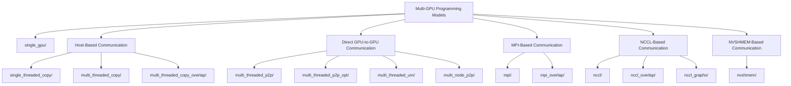
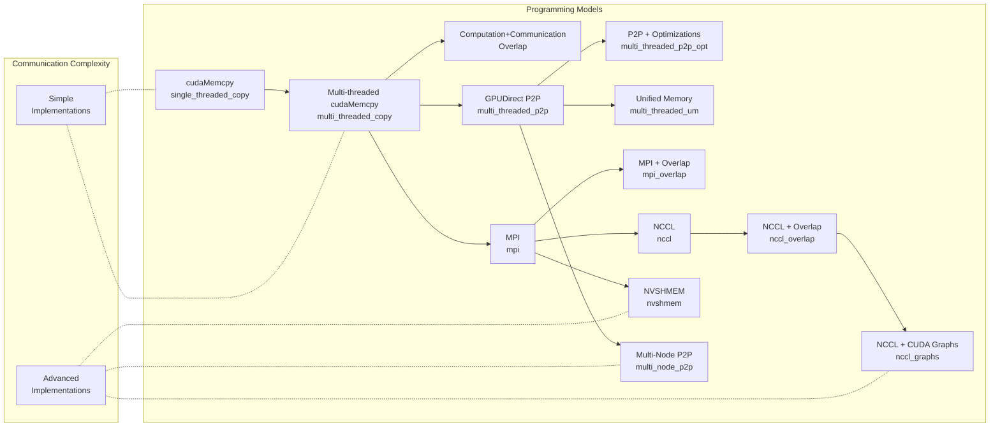
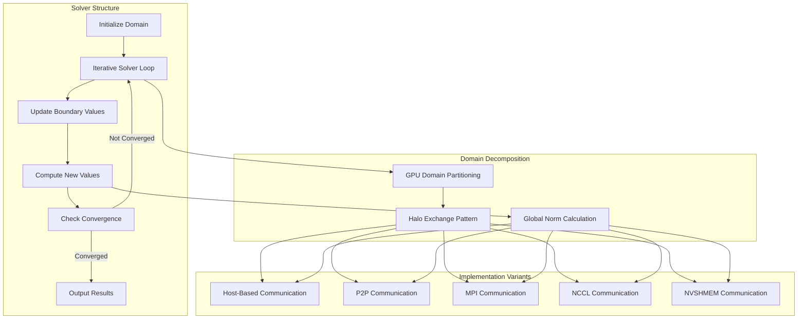

<!-- source: DeepWiki mcp.deepwiki.com · repo NVIDIA/multi-gpu-programming-models · page 1 Home · fetched 2026-10-26 -->

# Home

<details>
<summary>Relevant source files</summary>

The following files were used as context for generating this wiki page:

- [README.md](README.md)

</details>


## Overview and Purpose

This documentation covers the Multi-GPU Programming Models repository, which provides educational implementations of a Jacobi solver using various multi-GPU programming approaches. The repository serves as a practical guide to different techniques for distributing computational workloads across multiple GPUs, demonstrating performance characteristics and programming complexity trade-offs.

For detailed information on the Jacobi method theory, see [Jacobi Method Theory](#2).

Sources: [README.md:1-14]()

## Repository Structure

The repository contains multiple standalone implementations of the same Jacobi solver, each showcasing a different multi-GPU programming model:



Each implementation is a complete, standalone project with its own Makefile, demonstrating specific techniques and optimizations for multi-GPU programming.

Sources: [README.md:2-15]()

## Implementation Categories

The repository organizes implementations into five main categories, each representing a different approach to multi-GPU programming:

### 1. Host-Based Communication

These implementations use the host (CPU) as an intermediary for transferring data between GPUs:

- **Single-Threaded Copy**: Uses sequential `cudaMemcpy` operations for inter-GPU communication
- **Multi-Threaded Copy**: Parallelizes data transfers with OpenMP
- **Multi-Threaded Copy with Overlap**: Hides communication latency by overlapping computation and communication

For more details, see [Host-Based Communication](#3.1).

### 2. Direct GPU-to-GPU Communication

These implementations leverage direct GPU-to-GPU data transfer capabilities:

- **Multi-Threaded P2P**: Uses GPUDirect P2P for direct device-to-device transfers
- **Multi-Threaded P2P Optimized**: Enhances P2P with delayed norm calculation
- **Multi-Threaded Unified Memory**: Simplifies memory management using CUDA Unified Memory
- **Multi-Node P2P**: Demonstrates advanced cross-node communication using CUDA Driver APIs

For more details, see [Direct GPU-to-GPU Communication](#3.2).

### 3. MPI-Based Communication

These implementations use the Message Passing Interface (MPI) for inter-GPU communication:

- **MPI**: Basic implementation with CUDA-aware MPI
- **MPI with Overlap**: Enhanced version with overlapped computation and communication

For more details, see [MPI-Based Communication](#3.3).

### 4. NCCL-Based Communication

These implementations use NVIDIA's Collective Communications Library (NCCL):

- **NCCL**: Basic implementation using NCCL primitives
- **NCCL with Overlap**: Enhanced with computation-communication overlap
- **NCCL with CUDA Graphs**: Advanced implementation using CUDA Graphs for optimized kernel launches

For more details, see [NCCL-Based Communication](#3.4).

### 5. NVSHMEM-Based Communication

This implementation uses NVIDIA's Symmetric Hierarchical Memory (NVSHMEM) library:

- **NVSHMEM**: Implementation using NVSHMEM's PGAS (Partitioned Global Address Space) model

For more details, see [NVSHMEM-Based Communication](#3.5).

Sources: [README.md:3-15]()

## Implementation Evolution

The implementations in this repository demonstrate an evolution of multi-GPU programming techniques, from simple to more sophisticated approaches:



This progression demonstrates increasing levels of performance optimization and programming complexity, from simple host-based transfers to sophisticated distributed memory models.

Sources: [README.md:2-15]()

## Key Optimization Techniques

The repository demonstrates several key optimization techniques across the different implementations:

| Technique | Description | Implementations |
|-----------|-------------|----------------|
| Multi-threading | Uses OpenMP to parallelize host operations | `multi_threaded_*` |
| Computation-Communication Overlap | Hides communication latency by overlapping with computation | `multi_threaded_copy_overlap`, `mpi_overlap`, `nccl_overlap`, `nvshmem` (`norm_overlap`) |
| Direct P2P Transfers | Uses GPUDirect P2P for efficient GPU-to-GPU communication | `multi_threaded_p2p`, `multi_threaded_p2p_opt`, `multi_node_p2p` |
| CUDA Streams | Uses multiple streams for concurrent operations | All implementations |
| High-Priority Streams | Optimizes boundary kernels with high-priority streams | `mpi_overlap` (`use_hp_streams`) |
| CUDA Graphs | Reduces kernel launch overhead | `nccl_graphs` |
| Selective Norm Checking | Reduces synchronization overhead | All (via `nccheck` parameter) |
| Neighborhood Synchronization | Optimizes synchronization in NVSHMEM | `nvshmem` (`neighborhood_sync`) |
| User Buffer Registration | Avoids extra copies in NCCL communication | NCCL variants (`user_buffer_reg`) |

Sources: [README.md:44-61]()

## Anatomy of the Jacobi Solver

The core computational structure implemented across all variants is a Jacobi relaxation solver for a 2D Laplace equation, visualized below:



Each implementation maintains the same computational algorithm but differs in how data is exchanged between GPUs and how global operations like norm calculation are performed.

Sources: [README.md:2-61]()

## System Requirements

The different implementations have varying requirements:

| Requirement | Version | Needed For |
|-------------|---------|------------|
| CUDA | 11.0+ (9.2+ with `DISABLE_CUB=1`) | All variants |
| CUDA | 11.7+ and Driver 515.65.01+ | `nccl_graphs` |
| CUDA | 12.4+ and Driver 550.54.14+ with NVIDIA IMEX daemon | `multi_node_p2p` |
| OpenMP | Any recent version | Multi-threaded variants |
| MPI (CUDA-aware) | Any recent version | `mpi` and `mpi_overlap` |
| MPI (non CUDA-aware) | Any recent version | NVSHMEM, NCCL and `multi_node_p2p` |
| NVSHMEM | 0.4.1+ | `nvshmem` |
| NCCL | 2.8+ | NCCL variants |
| NCCL | 2.15.1+ | `nccl_graphs` |
| NCCL | 2.19.1+ (2.23.4+ for full support) | NCCL variants with `user_buffer_reg` |

For more detailed building and running instructions, see [Building and Running](#5).

Sources: [README.md:24-31]()

## Getting Started

Each implementation is a standalone project with its own Makefile. To build any variant, navigate to its directory and run `make`:

```bash
cd multi_threaded_copy
make
```

All implementations support common command-line options:

| Option | Description | Default |
|--------|-------------|---------|
| `-niter` | Number of iterations | 1000 |
| `-nccheck` | Convergence check frequency | 1 |
| `-nx` | Domain size in x direction | 16384 |
| `-ny` | Domain size in y direction | 16384 |
| `-csv` | Print results as CSV | - |

Some implementations provide additional options specific to their programming model.

For performance benchmarking, you can use the provided `bench.sh` script.

Sources: [README.md:33-63]()

## Historical Context

The implementations in this repository have been featured in several NVIDIA GTC presentations:

- GTC Europe 2017: Session 23031 - Multi GPU Programming Models
- GTC 2019: Session S9139 - Multi GPU Programming Models
- GTC 2021: Session A31140 - Multi-GPU Programming Models

Some examples also form the basis for an interactive tutorial available at: [FZJ-JSC/tutorial-multi-gpu](https://github.com/FZJ-JSC/tutorial-multi-gpu).

Sources: [README.md:17-22]()

---

