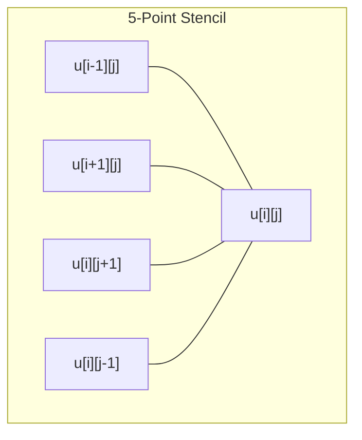
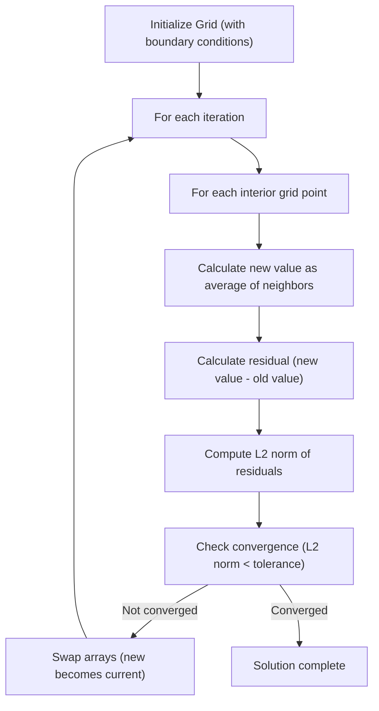
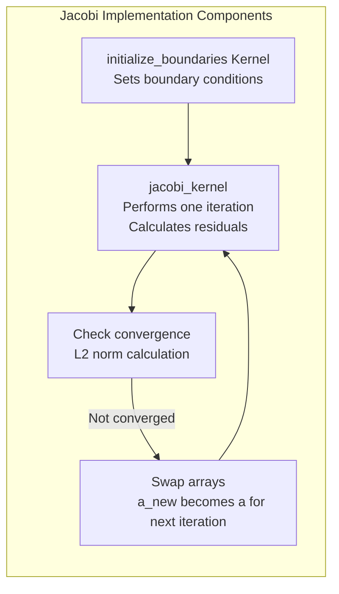
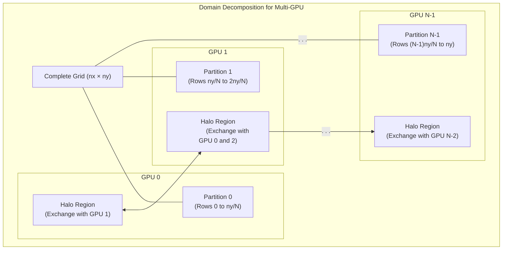

<!-- source: DeepWiki mcp.deepwiki.com · repo NVIDIA/multi-gpu-programming-models · page 2 Jacobi Method Theory · fetched 2026-10-26 -->

# Jacobi Method Theory

Relevant source files

The following files were used as context for generating this wiki page:

- [README.md](README.md)
- [single_gpu/jacobi.cu](single_gpu/jacobi.cu)

## Purpose and Scope

This document explains the mathematical basis and algorithmic approach of the Jacobi relaxation method, which forms the foundation for all implementations in the Multi-GPU Programming Models repository. The Jacobi method is an iterative technique for solving systems of linear equations, often applied to discretized partial differential equations (PDEs). For information about specific multi-GPU implementations, see [Multi-GPU Programming Models](#3).

## Mathematical Foundation

The Jacobi method is a classic iterative approach for solving a system of linear equations represented as Ax = b, where A is a square matrix, b is a known vector, and x is the solution vector we seek.

### Basic Iterative Formula

For a system of n linear equations, the Jacobi method can be formulated as:

$$x_i^{(k+1)} = \frac{1}{a_{ii}} \left( b_i - \sum_{j=1, j \neq i}^{n} a_{ij}x_j^{(k)} \right)$$

Where:
- $x_i^{(k+1)}$ is the i-th component of x in iteration k+1
- $a_{ii}$ is the diagonal element of matrix A
- $a_{ij}$ are the non-diagonal elements
- $x_j^{(k)}$ are the components from the previous iteration

The method requires the diagonal elements of A to be non-zero and, for guaranteed convergence, that A is diagonally dominant.

Sources: [single_gpu/jacobi.cu:98-136]()

### Matrix Formulation

Using matrix notation, each iteration of the Jacobi method can be expressed as:

$$x^{(k+1)} = D^{-1}(b - (L + U)x^{(k)})$$

Where D, L, and U are the diagonal, strictly lower triangular, and strictly upper triangular parts of matrix A, respectively.

## Application to PDEs

### Discretized Laplace Equation

The repository implements the Jacobi method to solve the 2D Laplace equation:

$$\nabla^2 u(x,y) = \frac{\partial^2 u}{\partial x^2} + \frac{\partial^2 u}{\partial y^2} = 0$$

Using finite differences on a uniform grid with spacing h, this equation is discretized as:

$$\frac{u_{i+1,j} + u_{i-1,j} + u_{i,j+1} + u_{i,j-1} - 4u_{i,j}}{h^2} = 0$$

Rearranging to match the Jacobi iteration format:

$$u_{i,j}^{(k+1)} = \frac{1}{4}(u_{i+1,j}^{(k)} + u_{i-1,j}^{(k)} + u_{i,j+1}^{(k)} + u_{i,j-1}^{(k)})$$

This is precisely what we see implemented in the Jacobi kernel in the codebase.

Sources: [single_gpu/jacobi.cu:113-114]()

### The 5-Point Stencil Pattern

The 5-point stencil is the computational pattern used in the Jacobi method for 2D PDEs. For each grid point, the new value is calculated as the average of its four neighboring points.

Sources: [single_gpu/jacobi.cu:98-136]()

## Algorithmic Implementation

### Core Algorithm Flow

The implementation follows this classic iterative approach, with parallel execution of the interior grid point calculations on the GPU.

Sources: [single_gpu/jacobi.cu:245-289]()

### Convergence Criteria

The algorithm monitors convergence by calculating the L2 norm of the residuals:

$$\textrm{L2 norm} = \sqrt{\sum_{i,j} (u_{i,j}^{(k+1)} - u_{i,j}^{(k)})^2}$$

The iterations continue until this norm falls below a specified tolerance (in the code, `tol = 1.0e-8`), or until the maximum number of iterations is reached.

Sources: [single_gpu/jacobi.cu:83](), [single_gpu/jacobi.cu:126-127](), [single_gpu/jacobi.cu:272-273]()

## Implementation in the Codebase

### Boundary Conditions

The code sets Dirichlet boundary conditions along the left and right borders of the grid:

$$u(0, y) = u(nx-1, y) = \sin(2\pi y/(ny-1))$$

These boundary values remain fixed throughout the computation.

Sources: [single_gpu/jacobi.cu:87-96]()

### Kernel Structure

The GPU implementation divides work into thread blocks, with each thread responsible for computing a single grid point. The codebase uses CUDA block reduction (via CUB library if available) to efficiently compute the L2 norm.

Sources: [single_gpu/jacobi.cu:98-136](), [single_gpu/jacobi.cu:87-96](), [single_gpu/jacobi.cu:245-289]()

## Multi-GPU Domain Decomposition

When implemented across multiple GPUs, the domain (grid) is partitioned, with each GPU handling a portion of the grid.

This domain decomposition requires communication between GPUs to exchange halo or ghost regions - the boundary rows that need to be shared between adjacent partitions. The different implementations in the repository use various communication methods for this exchange, ranging from simple host-based transfers to sophisticated GPU-direct approaches.

## Parallel Performance Considerations

The Jacobi method has several characteristics that make it well-suited for GPU implementation:

1. **High Arithmetic Intensity**: Each grid point calculation involves multiple arithmetic operations, which can be efficiently parallelized.

2. **Structured Grid**: The regular grid structure maps well to GPU thread organization.

3. **Local Computations**: Each new value depends only on immediate neighbors, leading to good cache locality.

4. **Regular Communication Pattern**: In multi-GPU implementations, the halo exchange follows a regular pattern, enabling optimization of communication.

However, there are also challenges:

1. **Memory Bandwidth Limitations**: The method is often memory-bound, as each grid point must read/write multiple memory locations.

2. **Synchronization Requirements**: Each iteration requires global synchronization, which can limit scaling.

3. **Convergence Rate**: The Jacobi method converges relatively slowly, making acceleration techniques important.

The different implementations in this repository explore various techniques to address these challenges in multi-GPU environments.

Sources: [README.md:1-72]()

## Variations and Optimizations

The repository implements several variations of the basic Jacobi method, including:

- Overlapping computation and communication to hide latency
- Delayed norm calculation to reduce synchronization overhead
- Various communication patterns for halo exchange

These optimizations are covered in other wiki pages specific to each implementation approach.

---

