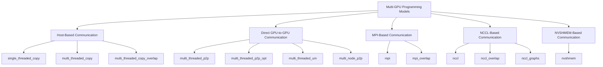
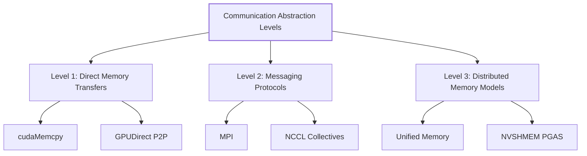
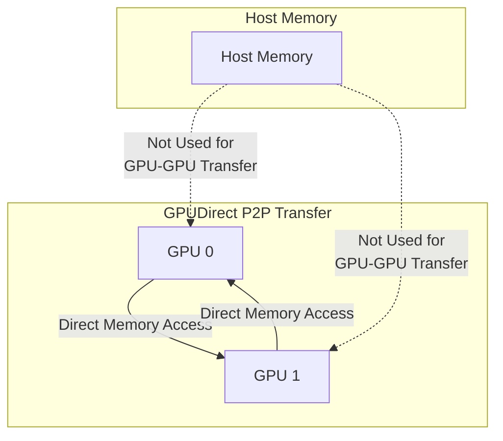
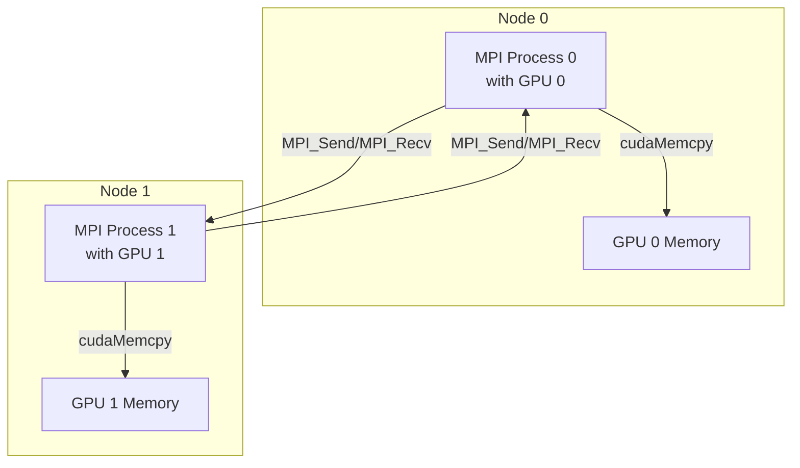
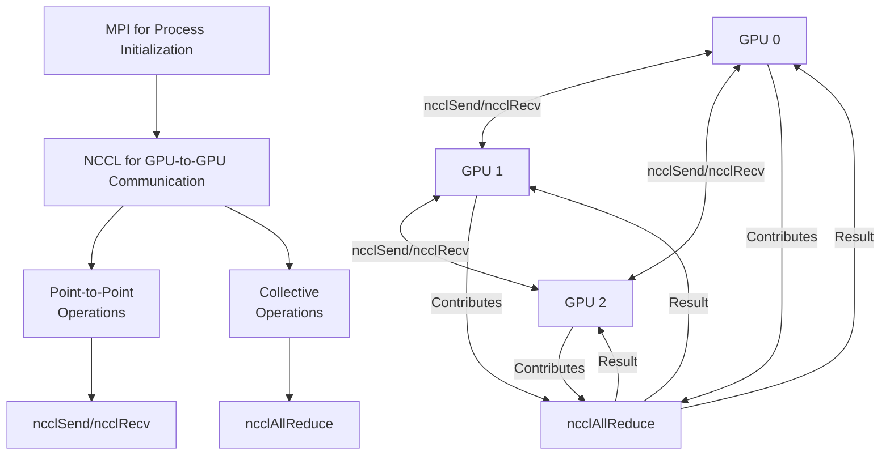
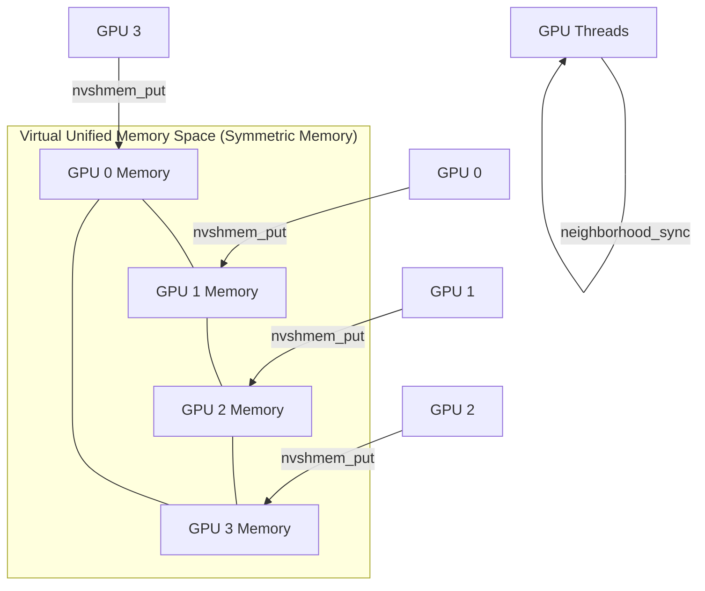
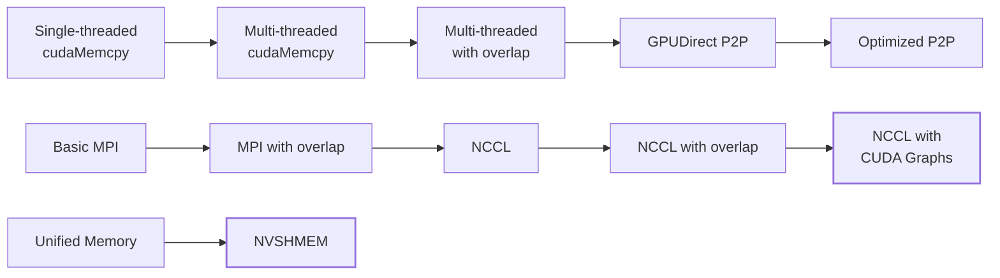

<!-- source: DeepWiki mcp.deepwiki.com · repo NVIDIA/multi-gpu-programming-models · page 3 Multi-GPU Programming Models · fetched 2026-10-26 -->

# Multi-GPU Programming Models

Relevant source files

The following files were used as context for generating this wiki page:

- [README.md](README.md)
- [bench.sh](bench.sh)
- [nccl/Makefile](nccl/Makefile)
- [nccl/jacobi_kernels.cu](nccl/jacobi_kernels.cu)
- [nccl_overlap/Makefile](nccl_overlap/Makefile)

This document provides an overview of the multi-GPU programming models implemented in the repository. These models demonstrate different approaches for distributing the Jacobi solver algorithm across multiple GPUs, each with distinct characteristics, performance trade-offs, and implementation complexity. For information about the mathematical background, see [Jacobi Method Theory](#2).

## Purpose and Scope

The repository contains multiple implementations of a Jacobi solver using different multi-GPU programming paradigms. Each implementation solves the same problem but uses a different approach to:

1. Distribute data across multiple GPUs
2. Manage communication between GPUs
3. Synchronize computations
4. Optimize performance through various techniques

This page provides a high-level overview of the programming models, while subsequent pages explore each model in detail.

Sources: [README.md:1-15]()

## Multi-GPU Programming Model Categories

The implementations in the repository are organized into five major categories:

Sources: [README.md:1-15]()

### Communication Abstraction Levels

The implementations demonstrate progressively more sophisticated communication mechanisms, from basic memory transfers to advanced distributed memory models:

Sources: [README.md:2-15]()

## Host-Based Communication Models

The host-based communication models use the CPU as an intermediary for transferring data between GPUs. Data must be copied from one GPU to the host memory and then to another GPU.

### Single-Threaded Copy

The simplest approach uses sequential `cudaMemcpy` operations managed by a single CPU thread to transfer halo regions between GPUs.

Key characteristics:
- Uses a single thread for managing all data transfers
- Simple implementation but limited scaling
- Becomes a bottleneck as GPU count increases

For more details, see [Single-Threaded Copy](#3.1.1).

### Multi-Threaded Copy

Improves upon the single-threaded approach by using OpenMP to parallelize the data transfers.

Key characteristics:
- One CPU thread per GPU for managing transfers
- Better scaling than single-threaded version
- Still requires host memory as intermediary

For more details, see [Multi-Threaded Copy](#3.1.2).

### Multi-Threaded Copy with Overlap

Further improves performance by overlapping computation and communication.

Key characteristics:
- Uses CUDA streams to execute communication and computation concurrently
- Interior points computed while boundary data transfers occur
- Reduces the effective communication overhead

For more details, see [Multi-Threaded Copy with Overlap](#3.1.3).

Sources: [README.md:3-5](), [bench.sh:95-155]()

## Direct GPU-to-GPU Communication Models

These models leverage hardware capabilities to enable direct communication between GPUs without host involvement, significantly reducing communication overhead.

Sources: [README.md:6-8]()

### Multi-Threaded P2P

Uses NVIDIA's GPUDirect Peer-to-Peer (P2P) technology to enable direct memory access between GPUs.

Key characteristics:
- Direct access to remote GPU memory
- Eliminates host memory copies
- Requires peer mapping capability between GPUs
- Significantly lower latency than host-based transfers

For more details, see [Multi-Threaded P2P](#3.2.1).

### Multi-Threaded P2P Optimized

Extends the P2P model with optimized norm calculation.

Key characteristics:
- Delayed norm calculation to reduce synchronization points
- Improved performance through fewer global synchronizations
- Same direct memory access benefits as basic P2P

For more details, see [Multi-Threaded P2P Optimized](#3.2.2).

### Unified Memory

Uses CUDA Unified Memory to automatically manage data transfers between GPUs.

Key characteristics:
- Simplified programming model
- Hardware-managed page migration
- Transparent peer mappings
- Can be less performant than explicit P2P in some cases

For more details, see [Unified Memory](#3.2.3).

### Multi-Node P2P

Advanced implementation for cross-node P2P communication.

Key characteristics:
- Uses low-level CUDA Driver APIs
- Virtual Memory Management and Multicast Object Management
- Enables P2P communication across compute nodes
- Demonstrates techniques used internally by libraries like NCCL and NVSHMEM

For more details, see [Multi-Node P2P](#3.2.4).

Sources: [README.md:6-8](), [README.md:15]()

## MPI-Based Communication Models

These models use Message Passing Interface (MPI) for inter-GPU communication, particularly beneficial in distributed memory environments.

Sources: [README.md:9-10]()

### Basic MPI Implementation

Uses CUDA-aware MPI to facilitate GPU-to-GPU communication.

Key characteristics:
- One MPI process per GPU
- CUDA-aware MPI for direct GPU buffer operations
- Works across compute nodes in a cluster
- Synchronous communication pattern

For more details, see [MPI Implementation](#3.3.1).

### MPI with Computation-Communication Overlap

Enhances the basic MPI implementation with overlapped communication and computation.

Key characteristics:
- Uses non-blocking MPI operations
- Dedicated CUDA streams for boundary exchanges
- Interior computation proceeds while boundaries are being exchanged
- Optional high-priority streams for boundary operations

For more details, see [MPI with Computation-Communication Overlap](#3.3.2).

Sources: [README.md:9-10](), [bench.sh:193-209]()

## NCCL-Based Communication Models

These models leverage NVIDIA's Collective Communications Library (NCCL) for optimized GPU-to-GPU communication, particularly efficient for collective operations.

Sources: [README.md:11-13](), [nccl/Makefile:1-44]()

### Basic NCCL Implementation

Uses NCCL for efficient GPU-to-GPU data exchange.

Key characteristics:
- Optimized communication paths based on hardware topology
- Uses MPI for process initialization
- Efficient handling of both point-to-point and collective operations
- Advanced support for NVLINK interconnect

For more details, see [NCCL Implementation](#3.4.1).

### NCCL with Overlap

Combines NCCL with computation-communication overlap.

Key characteristics:
- Uses NCCL's asynchronous operations
- Boundary exchanges occur concurrently with interior computation
- Reduced overall execution time
- Optional user buffer registration for reduced memory copies

For more details, see [NCCL with Overlap](#3.4.2).

### NCCL with CUDA Graphs

Integrates CUDA Graphs with NCCL for reduced kernel launch overhead.

Key characteristics:
- Captures sequence of CUDA operations in a graph
- Reduces CPU overhead for kernel launches
- Allows the driver to optimize execution
- Requires CUDA 11.7+ and newer NCCL versions

For more details, see [NCCL with CUDA Graphs](#3.4.3).

Sources: [README.md:11-13](), [nccl/Makefile:1-44](), [nccl_overlap/Makefile:1-44](), [nccl/jacobi_kernels.cu:1-116]()

## NVSHMEM-Based Communication

NVSHMEM implements a Partitioned Global Address Space (PGAS) programming model specifically for GPUs.

Sources: [README.md:14](), [bench.sh:238-258]()

Key characteristics:
- One-sided communication operations
- Remote memory access without remote process involvement
- GPU-initiated communication
- Global synchronization primitives
- Optional neighborhood synchronization for better performance
- Optional computation-communication overlap
- Block cooperative communication option

Advanced features:
- Neighborhood synchronization for reduced synchronization scope
- Delayed norm execution similar to P2P optimized version
- Configurable symmetric memory size

For more details, see [NVSHMEM-Based Communication](#3.5).

## Implementation and Performance Considerations

When choosing between multi-GPU programming models, consider:

| Programming Model | Advantages | Disadvantages | Best Use Cases |
|-------------------|------------|---------------|----------------|
| Host-Based Communication | Simple implementation Works with any GPU configuration | Host memory bottleneck Higher latency | Small scale (2-4 GPUs) When P2P not available |
| Direct P2P | Low latency High bandwidth | Requires P2P capability between GPUs Limited to single node | Single node with NVLink High performance requirements |
| MPI-Based | Works across multiple nodes Portable standard | Complex programming model May require CUDA-aware MPI | Multi-node clusters HPC environments |
| NCCL-Based | Optimized for NVIDIA GPUs Collective operations support | NVIDIA-specific Requires recent drivers | Deep learning Applications with collectives |
| NVSHMEM-Based | One-sided communication Low synchronization overhead | Requires symmetric memory allocation Newer technology | Irregular communication patterns Fine-grained communication |

Sources: [README.md:1-15](), [bench.sh:1-258]()

## Programming Model Evolution Path

The implementations in this repository demonstrate a natural evolution of multi-GPU programming techniques, from simple to more sophisticated approaches:

Sources: [README.md:1-15](), [bench.sh:1-258]()

## Summary of Required Technologies

The multi-GPU programming models in this repository rely on several key technologies:

- **CUDA**: Foundation for all implementations (version 11.0+ recommended)
- **OpenMP**: Required for multi-threaded implementations
- **MPI**: Required for distributed implementations (CUDA-aware MPI recommended)
- **NCCL**: Required for NCCL-based implementations (version 2.8+)
- **NVSHMEM**: Required for NVSHMEM implementation (version 0.4.1+)
- **CUDA Graphs**: Required for NCCL with CUDA Graphs (CUDA 11.7+)
- **CUDA Driver APIs**: Required for multi-node P2P (CUDA 12.4+)

For specific version requirements and compatibility information, see [Building and Running](#5).

Sources: [README.md:24-31]()

## Benchmarking

The repository includes a benchmarking script (`bench.sh`) that can evaluate the performance of all implementations with various GPU configurations. The script:

- Controls GPU visibility for different test configurations
- Manages thread and process pinning for consistent results
- Collects performance results in CSV format
- Automatically finds the best result from multiple runs

For detailed benchmarking results and comparative analysis, see [Performance Comparison and Benchmarking](#4).

Sources: [bench.sh:1-258]()

---

