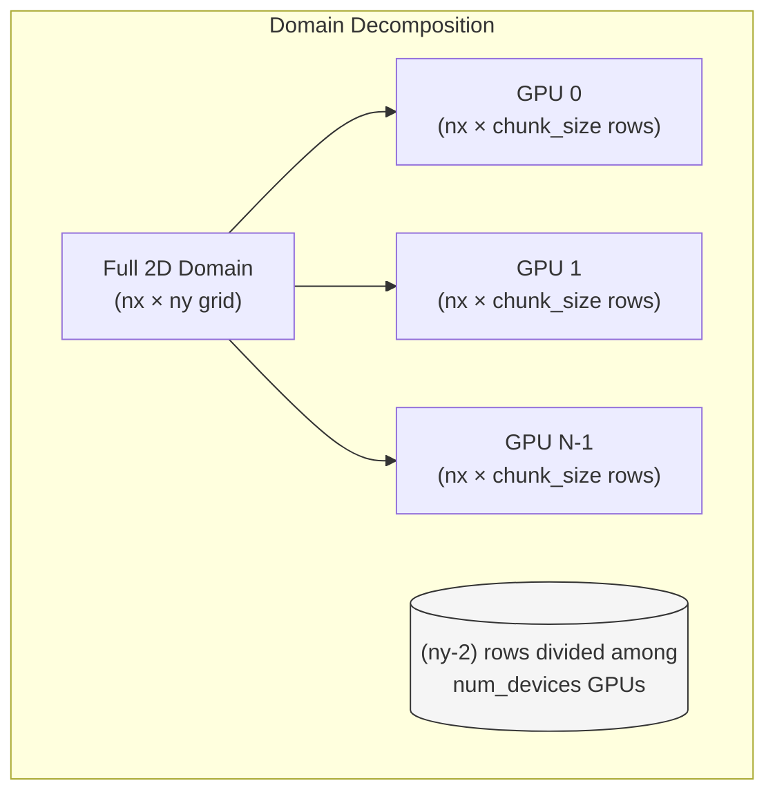
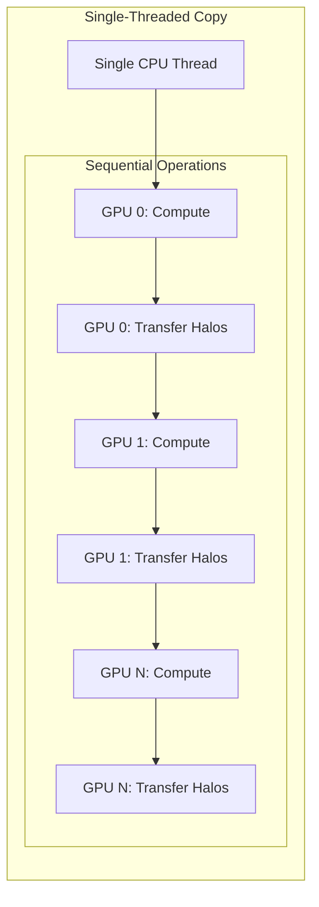
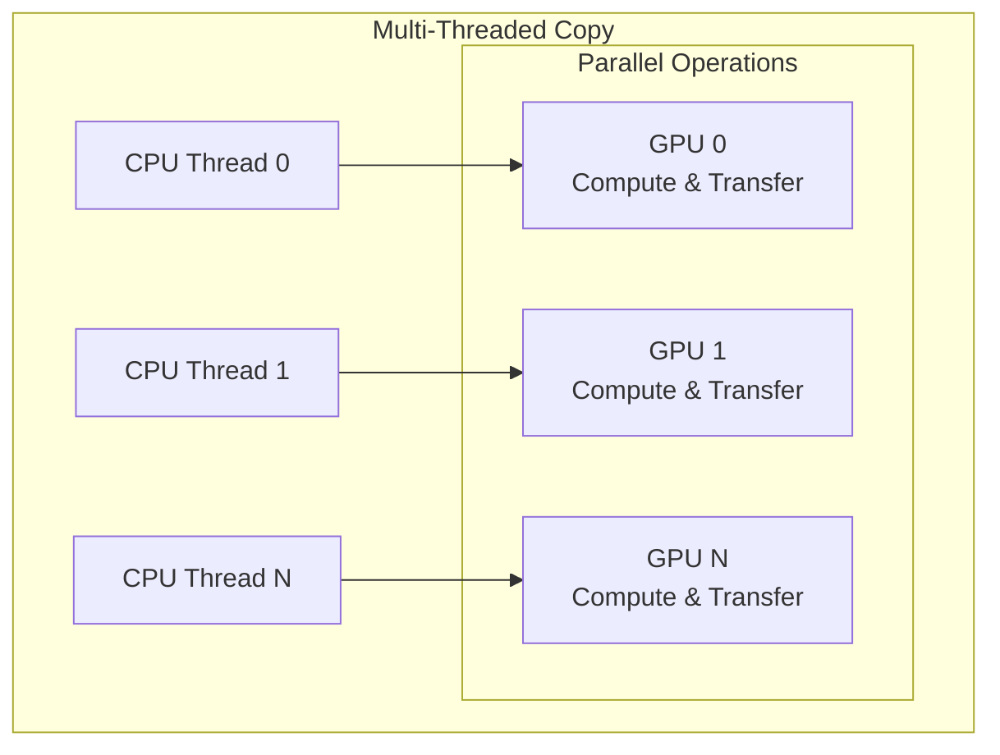
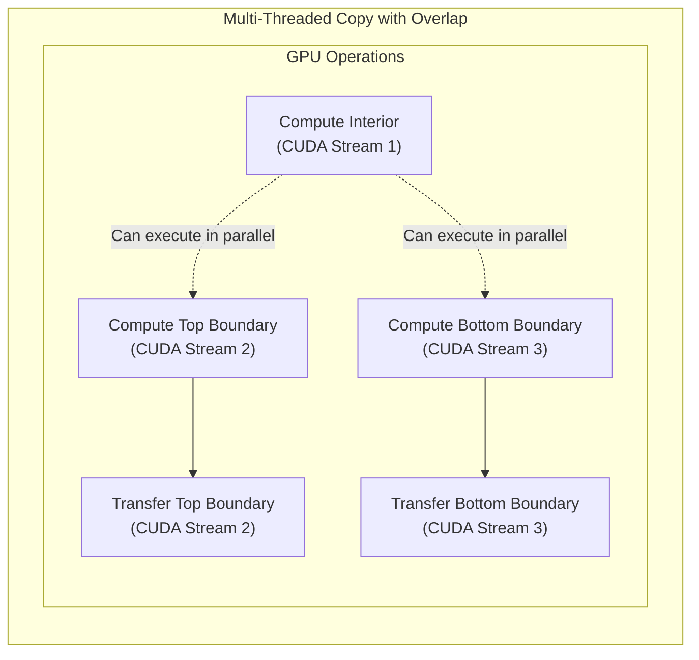
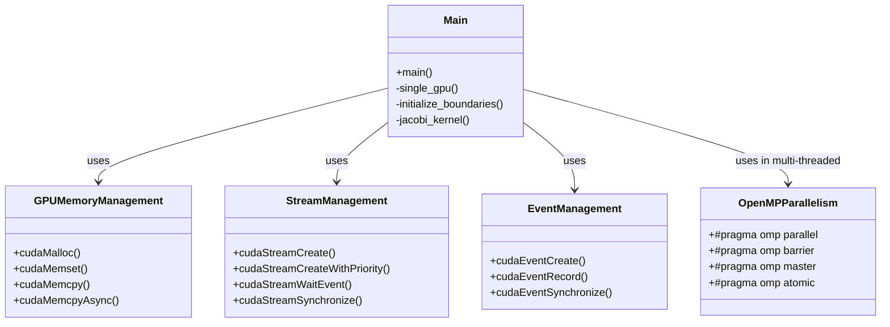

<!-- source: DeepWiki mcp.deepwiki.com · repo NVIDIA/multi-gpu-programming-models · page 3.1 Host-Based Communication · fetched 2026-10-26 -->

# Host-Based Communication

<details>
<summary>Relevant source files</summary>

The following files were used as context for generating this wiki page:

- [multi_threaded_copy/jacobi.cu](multi_threaded_copy/jacobi.cu)
- [multi_threaded_copy_overlap/jacobi.cu](multi_threaded_copy_overlap/jacobi.cu)
- [single_threaded_copy/jacobi.cu](single_threaded_copy/jacobi.cu)

</details>


This page provides detailed information about the Host-Based Communication model for multi-GPU programming used in the Jacobi solver implementations. Host-Based Communication refers to the approach where data is exchanged between GPUs by routing it through the host (CPU) memory rather than using direct GPU-to-GPU communication mechanisms.

For implementations that use direct GPU-to-GPU communication, see [Direct GPU-to-GPU Communication](#3.2).

## Overview

Host-Based Communication serves as the baseline multi-GPU approach in the repository, establishing a foundation for more advanced methods. It includes three implementations of increasing sophistication:

1. **Single-Threaded Copy**: Basic implementation with a single CPU thread coordinating all data transfers
2. **Multi-Threaded Copy**: Uses OpenMP to parallelize data transfers with one CPU thread per GPU
3. **Multi-Threaded Copy with Overlap**: Optimizes performance by overlapping computation with communication

All three approaches follow the same general pattern of domain decomposition and halo exchange, but differ in how they manage the CPU resources and coordinate the data transfers.

## Domain Decomposition

Each implementation divides the 2D Jacobi grid along the y-axis (rows) among available GPUs, with each GPU responsible for a portion of the domain. The decomposition aims to balance the workload by allocating approximately the same number of rows to each GPU, accounting for cases where the number of rows doesn't divide evenly.



Sources: [single_threaded_copy/jacobi.cu:194-226](), [multi_threaded_copy/jacobi.cu:197-226]()

## Communication Pattern

The Host-Based Communication model follows a standard halo exchange pattern where each GPU must share its boundary data with neighboring GPUs to enable the stencil computation. The key distinction of this approach is that these exchanges occur through host memory:

```mermaid
sequenceDiagram
    participant GPU_i-1 as "GPU i-1"
    participant Host
    participant GPU_i as "GPU i"
    participant GPU_i+1 as "GPU i+1"
    
    Note over GPU_i-1,GPU_i+1: Each iteration requires boundary exchange
    
    GPU_i->>Host: Copy bottom row
    Host->>GPU_i+1: Copy to top halo
    
    GPU_i->>Host: Copy top row
    Host->>GPU_i-1: Copy to bottom halo
    
    Note over GPU_i-1,GPU_i+1: Computation can proceed after exchanges
```

Sources: [single_threaded_copy/jacobi.cu:338-349](), [multi_threaded_copy/jacobi.cu:329-339]()

## Implementation Details

### Single-Threaded Copy

The Single-Threaded Copy is the simplest implementation that uses a single CPU thread to coordinate all operations. This approach may become a bottleneck when scaling to multiple GPUs as the CPU thread must sequentially handle all data transfers.



Key implementation characteristics:

- A single thread coordinates memory transfers for all GPUs sequentially
- Uses CUDA streams for asynchronous operations but still limited by single-thread coordination
- For each iteration, all devices wait for the previous device's operations to complete

Sources: [single_threaded_copy/jacobi.cu:306-365]()

### Multi-Threaded Copy

The Multi-Threaded Copy implementation uses OpenMP to parallelize the control of multiple GPUs, with one CPU thread per GPU. This avoids the sequential bottleneck of the single-threaded approach.



Key implementation characteristics:

- Uses `#pragma omp parallel num_threads(num_devices)` to create one thread per GPU
- Each thread controls a single GPU and its associated memory transfers
- Uses OpenMP barriers for synchronization at critical points
- All threads compute and communicate in parallel but still synchronize at specific points

Sources: [multi_threaded_copy/jacobi.cu:174-426]()

### Multi-Threaded Copy with Overlap

The Multi-Threaded Copy with Overlap implementation adds further optimization by dividing the computation into "bulk" and "boundary" regions, allowing computation and communication to occur simultaneously.



Key implementation characteristics:

- Uses stream priorities to optimize resource allocation
- Divides domain computation into:
  - Interior computation that doesn't depend on boundaries
  - Boundary computation that depends on halo exchanges
- Uses separate CUDA streams for:
  - Main computation (compute_stream)
  - Top boundary exchange (push_top_stream)
  - Bottom boundary exchange (push_bottom_stream)
- Enables overlapping of computation and communication

Sources: [multi_threaded_copy_overlap/jacobi.cu:237-356]()

## Code Structure and Key Components

The following diagram illustrates the key code components and their relationships in the Host-Based implementations:



Sources: [single_threaded_copy/jacobi.cu:152-552](), [multi_threaded_copy/jacobi.cu:152-547](), [multi_threaded_copy_overlap/jacobi.cu:152-571]()

## Key Data Structures and Variables

The Host-Based implementations share common data structures for managing multiple GPUs:

| Variable/Array | Purpose |
|----------------|---------|
| `a`, `a_new` | Arrays storing the Jacobi grid data on each GPU |
| `compute_stream` | CUDA stream for main computation |
| `push_top_stream`, `push_bottom_stream` | CUDA streams for halo exchanges |
| `push_top_done`, `push_bottom_done` | CUDA events to synchronize halo exchanges |
| `l2_norm_d`, `l2_norm_h` | Device and host pointers for convergence checking |
| `iy_start`, `iy_end` | Domain boundaries for each GPU |
| `chunk_size` | Number of rows assigned to each GPU |

Sources: [multi_threaded_copy/jacobi.cu:159-165](), [single_threaded_copy/jacobi.cu:161-180]()

## Performance Considerations

The three Host-Based Communication implementations demonstrate a progression in performance optimization:

1. **Single-Threaded Copy**: Simplest but limited by sequential operations
2. **Multi-Threaded Copy**: Improves performance by parallelizing GPU control
3. **Multi-Threaded Copy with Overlap**: Further improves performance by overlapping computation and communication

```mermaid
gantt
    title "Execution Timeline Comparison"
    dateFormat s
    axisFormat %S
    
    section Single-Threaded
    GPU0 Compute      :0, 1
    GPU0 Transfer     :1, 2
    GPU1 Compute      :2, 3
    GPU1 Transfer     :3, 4
    
    section Multi-Threaded  
    GPU0 Compute      :0, 1
    GPU0 Transfer     :1, 2
    GPU1 Compute      :0, 1
    GPU1 Transfer     :1, 2
    
    section With Overlap
    GPU0 Interior     :0, 1
    GPU0 Boundary+Transfer :crit, 0.5, 1.5
    GPU1 Interior     :0, 1
    GPU1 Boundary+Transfer :crit, 0.5, 1.5
```



Sources: [multi_threaded_copy_overlap/jacobi.cu:312-386](), [multi_threaded_copy/jacobi.cu:304-366](), [single_threaded_copy/jacobi.cu:306-365]()

## Common Limitations of Host-Based Communication

While these implementations provide a basis for multi-GPU programming, they have inherent limitations:

1. **Host Memory Bottleneck**: All data transfers must pass through host memory, which has lower bandwidth than direct GPU-to-GPU transfers
2. **PCIe Overhead**: Multiple PCIe transfers (GPU→Host→GPU) incur additional latency
3. **Synchronization Overheads**: Explicit synchronization required between computation and communication

For more advanced approaches that address these limitations, see:
- [Direct GPU-to-GPU Communication](#3.2) for P2P transfers that bypass host memory
- [MPI-Based Communication](#3.3) for scalable distributed memory communication
- [NCCL-Based Communication](#3.4) for optimized collective operations

## Summary

Host-Based Communication provides the foundation for multi-GPU programming in the Jacobi solver implementations. While not the most efficient approach for modern GPU systems, it demonstrates the basic concepts of domain decomposition, halo exchange, and the progressive optimization techniques that can be applied to improve performance.

The single-threaded, multi-threaded, and overlapped implementations represent increasing levels of sophistication in managing the CPU-GPU relationship and optimizing the coordination of computation and communication.

---

