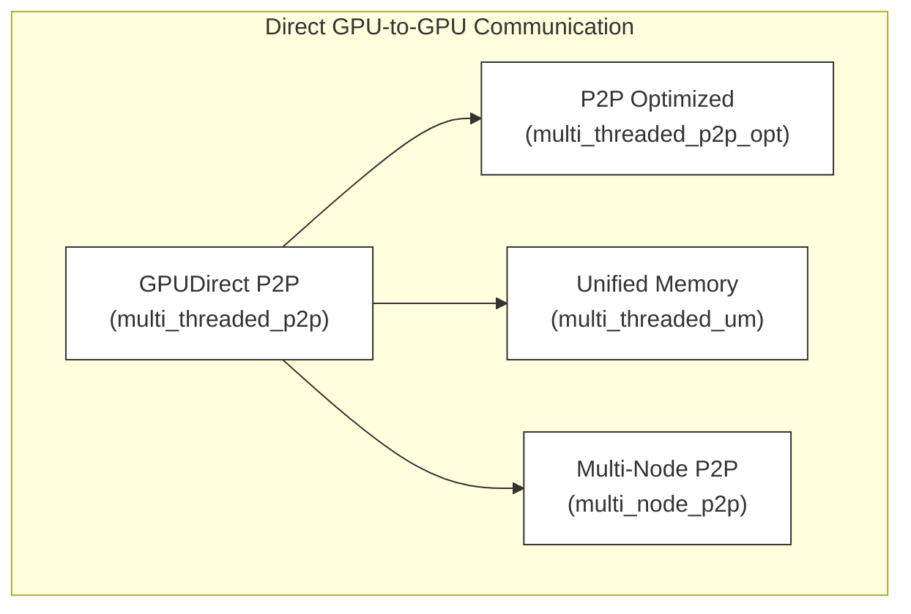
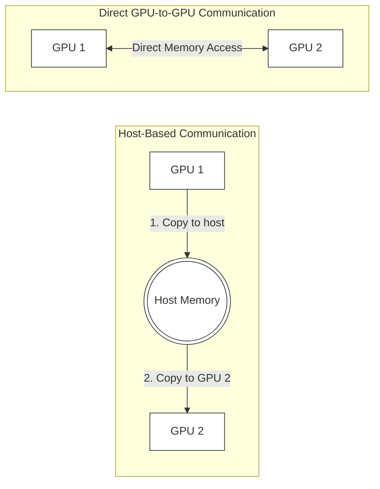
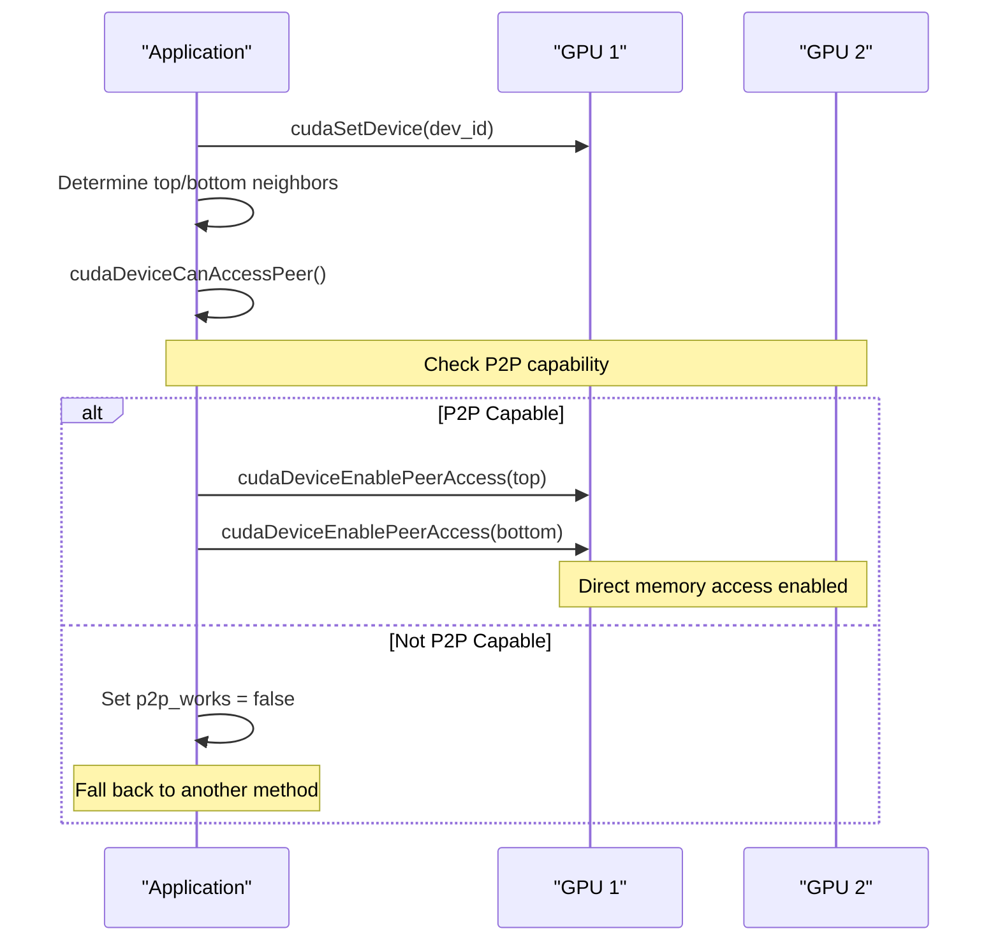
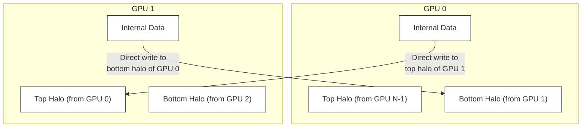
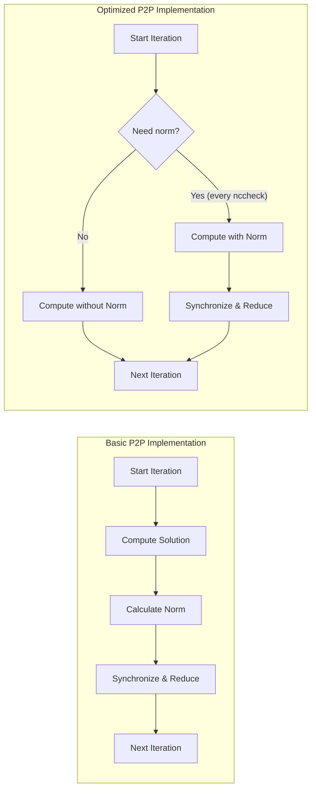
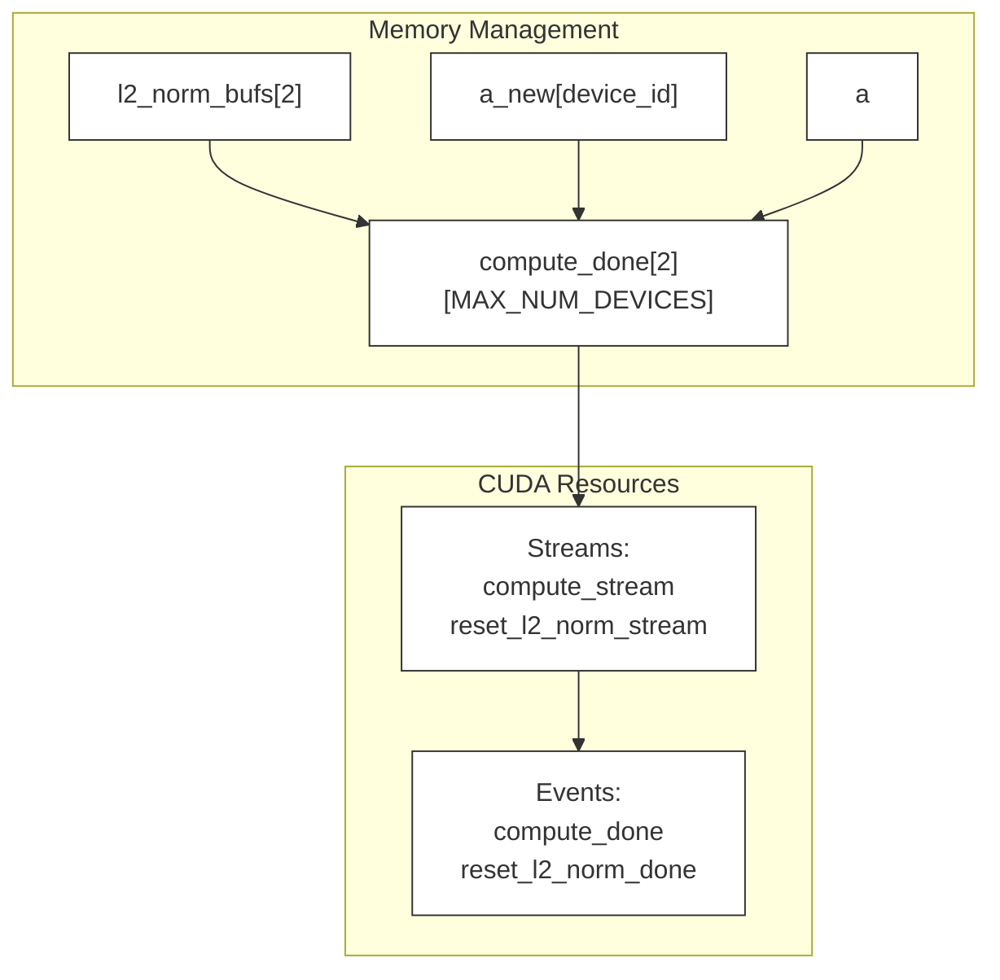
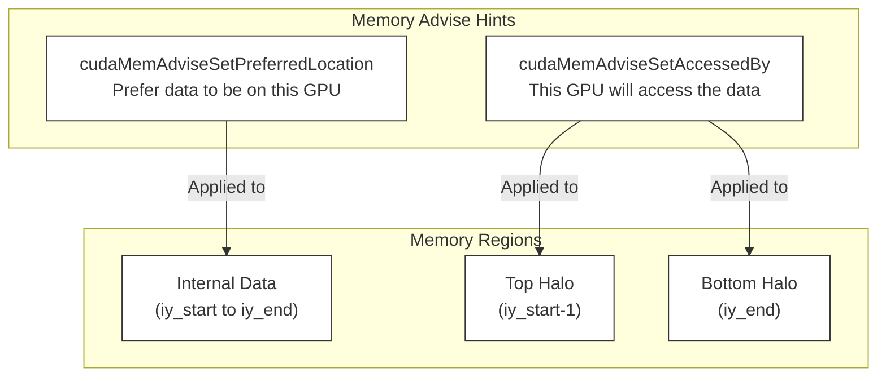
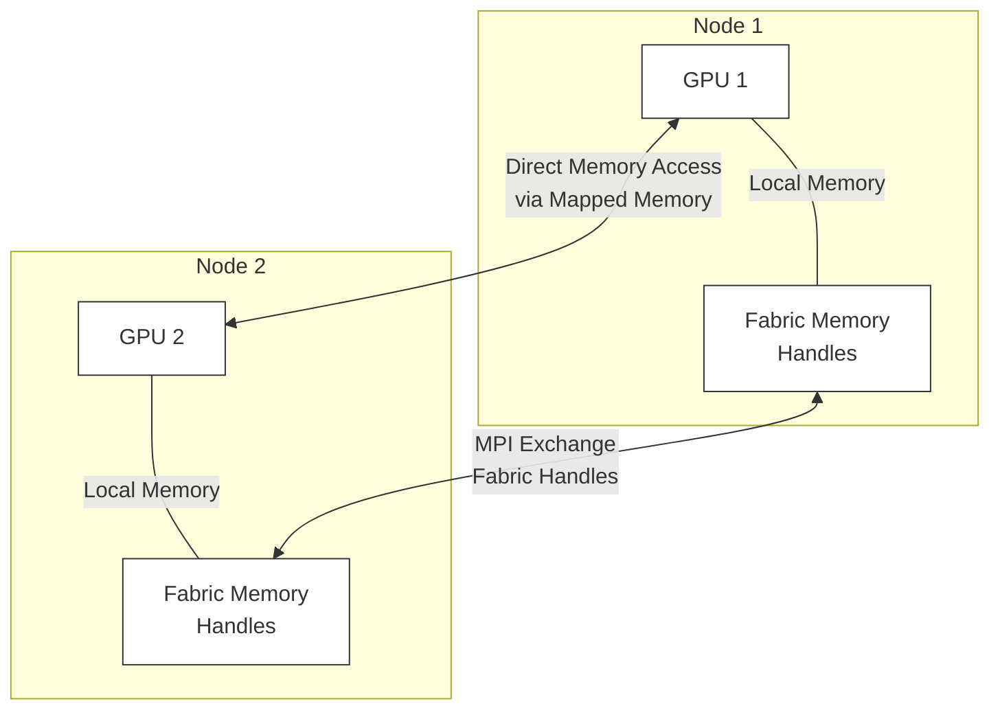
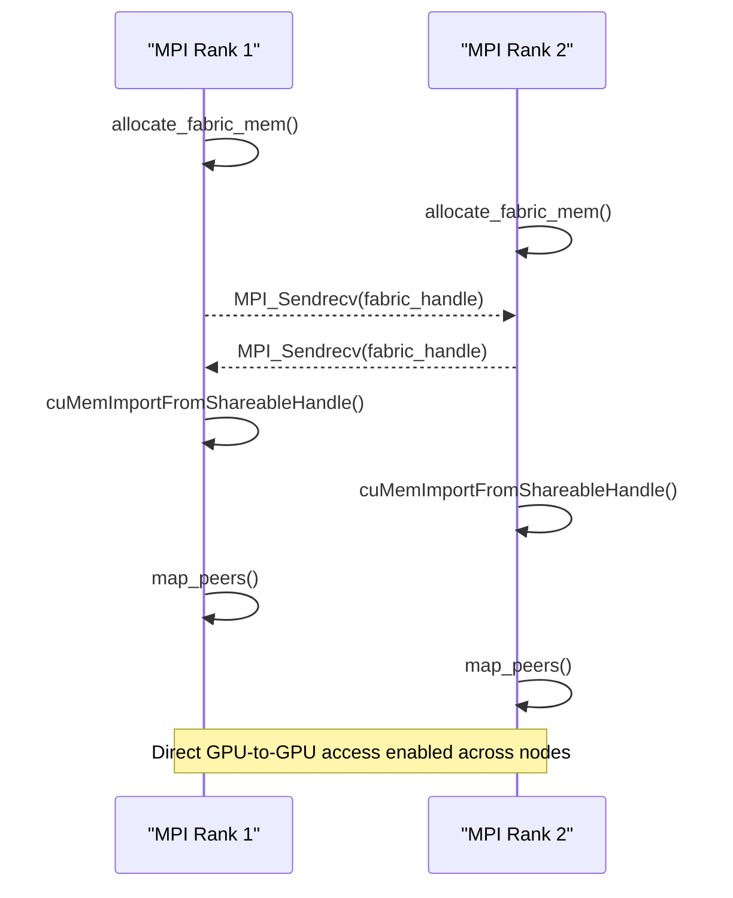

<!-- source: DeepWiki mcp.deepwiki.com · repo NVIDIA/multi-gpu-programming-models · page 3.2 Direct GPU-to-GPU Communication · fetched 2026-10-26 -->

# Direct GPU-to-GPU Communication

<details>
<summary>Relevant source files</summary>

The following files were used as context for generating this wiki page:

- [multi_node_p2p/Makefile](multi_node_p2p/Makefile)
- [multi_node_p2p/jacobi.cpp](multi_node_p2p/jacobi.cpp)
- [multi_node_p2p/jacobi_kernels.cu](multi_node_p2p/jacobi_kernels.cu)
- [multi_threaded_p2p/jacobi.cu](multi_threaded_p2p/jacobi.cu)
- [multi_threaded_p2p_opt/jacobi.cu](multi_threaded_p2p_opt/jacobi.cu)
- [multi_threaded_um/jacobi.cu](multi_threaded_um/jacobi.cu)

</details>


This page describes the direct GPU-to-GPU communication methods implemented in the multi-GPU Jacobi solver. These methods allow GPUs to exchange data without going through host memory, significantly reducing communication overhead. For host-based communication approaches, see [Host-Based Communication](#3.1).

## Introduction to GPU-to-GPU Communication

Direct GPU-to-GPU communication enables one GPU to access memory on another GPU directly without involving CPU memory, reducing latency and increasing bandwidth. This repository demonstrates several approaches to direct GPU-to-GPU communication:

1. **GPUDirect Peer-to-Peer (P2P)** - Allows direct memory access between GPUs on the same node
2. **P2P with Optimization** - Enhances the basic P2P approach with performance optimizations
3. **Unified Memory** - Leverages CUDA's managed memory system for simplified programming
4. **Multi-Node P2P** - Extends P2P communication across multiple compute nodes



Sources: [multi_threaded_p2p/jacobi.cu](), [multi_threaded_p2p_opt/jacobi.cu](), [multi_threaded_um/jacobi.cu](), [multi_node_p2p/jacobi.cpp]()

## Memory Access Patterns Comparison

The diagram below illustrates the difference between host-based communication and direct GPU-to-GPU communication:



Sources: [multi_threaded_p2p/jacobi.cu:228-254](), [multi_threaded_copy/jacobi.cu]()

## GPUDirect Peer-to-Peer (P2P)

GPUDirect P2P allows GPUs on the same PCIe bus to directly access each other's memory. The implementation follows these key steps:

1. **P2P Capability Detection**: Check if GPUs can access each other's memory
2. **P2P Access Enabling**: Enable direct memory access between GPUs
3. **Direct Memory Operations**: Write directly to the peer GPU's memory

### P2P Setup Process

The P2P setup process involves:



Sources: [multi_threaded_p2p/jacobi.cu:228-254]()

### Halo Exchange Implementation

In the Jacobi solver, direct GPU-to-GPU communication is used for "halo exchange" - sharing boundary data between GPUs. The `jacobi_kernel` writes directly to the neighboring GPU's memory:



Sources: [multi_threaded_p2p/jacobi.cu:98-139](), [multi_threaded_p2p/jacobi.cu:333-339]()

## Optimized P2P Implementation

The optimized P2P implementation enhances the basic P2P approach with two key optimizations:

1. **Delayed Norm Calculation**: Calculates the L2 norm less frequently to reduce synchronization overhead
2. **Double Buffering**: Uses a double-buffering approach for norm calculations to overlap computation and communication

### Norm Calculation Optimization



Sources: [multi_threaded_p2p_opt/jacobi.cu:360-399]()

### Memory Management Structure

The optimized implementation uses a structured approach to memory handling:



Sources: [multi_threaded_p2p_opt/jacobi.cu:157-160](), [multi_threaded_p2p_opt/jacobi.cu:291-306]()

## Unified Memory Approach

The Unified Memory implementation leverages CUDA's managed memory system to simplify programming while still enabling direct GPU-to-GPU communication.

### Key Characteristics

| Feature | Description |
|-|-|
| Memory Allocation | Uses `cudaMallocManaged` instead of `cudaMalloc` |
| Memory Management | CUDA runtime handles data transfer and coherence |
| P2P Access | Still enables P2P for direct GPU-GPU transfers |
| Memory Hints | Uses `cudaMemAdvise` to optimize data placement |

Sources: [multi_threaded_um/jacobi.cu:178-179](), [multi_threaded_um/jacobi.cu:250-263]()

### Memory Advise Hints

The implementation uses memory advise hints to guide the CUDA runtime on optimal data placement:



Sources: [multi_threaded_um/jacobi.cu:250-263]()

## Multi-Node P2P Communication

The multi-node P2P implementation extends GPU-to-GPU communication across multiple compute nodes using CUDA Driver APIs and fabric memory.

### Fabric Memory Architecture



Sources: [multi_node_p2p/jacobi.cpp:213-252](), [multi_node_p2p/jacobi.cpp:260-276]()

### Multi-Node P2P Setup Process

The setup process for multi-node P2P communication is more complex than single-node P2P:



Sources: [multi_node_p2p/jacobi.cpp:406-453]()

## Performance Considerations

### When to Use Direct GPU-to-GPU Communication

Direct GPU-to-GPU communication is most beneficial when:

1. **Frequent Halo Exchanges**: Applications require frequent boundary data exchanges
2. **Large Data Transfers**: The amount of data transferred between GPUs is significant
3. **Low Latency Requirements**: Application performance is sensitive to communication latency
4. **P2P Capable Hardware**: GPUs support peer-to-peer access (typically on the same PCIe switch)

### Comparison with Other Methods

| Communication Method | Latency | Bandwidth | Programming Complexity | Multi-Node Support |
|----------------------|---------|-----------|------------------------|-------------------|
| Host-Based Copy | High | Low | Low | Yes (via MPI) |
| GPUDirect P2P | Low | High | Medium | No |
| P2P Optimized | Low | High | Medium-High | No |
| Unified Memory | Medium | Medium-High | Low | No |
| Multi-Node P2P | Medium | Medium-High | High | Yes |
| NCCL | Low | High | Medium | Yes |
| NVSHMEM | Low | High | Medium-High | Yes |

Sources: [multi_threaded_p2p/jacobi.cu](), [multi_threaded_p2p_opt/jacobi.cu](), [multi_threaded_um/jacobi.cu](), [multi_node_p2p/jacobi.cpp]()

## Implementation Details

### Checking P2P Capability

The code checks if P2P access is possible between GPUs using `cudaDeviceCanAccessPeer()`:

```c++
int canAccessPeer = 0;
CUDA_RT_CALL(cudaDeviceCanAccessPeer(&canAccessPeer, dev_id, top));
if (canAccessPeer) {
    CUDA_RT_CALL(cudaDeviceEnablePeerAccess(top, 0));
} else {
    // P2P not supported between these GPUs
    p2p_works = false;
}
```

Sources: [multi_threaded_p2p/jacobi.cu:228-254]()

### Direct Memory Access in Jacobi Kernel

The Jacobi kernel directly writes to neighboring GPU memory:

```c++
if (iy_start == iy) {
    a_new_top[top_iy * nx + ix] = new_val;
}

if ((iy_end - 1) == iy) {
    a_new_bottom[bottom_iy * nx + ix] = new_val;
}
```

Sources: [multi_threaded_p2p/jacobi.cu:118-124](), [multi_threaded_p2p_opt/jacobi.cu:117-123]()

---

