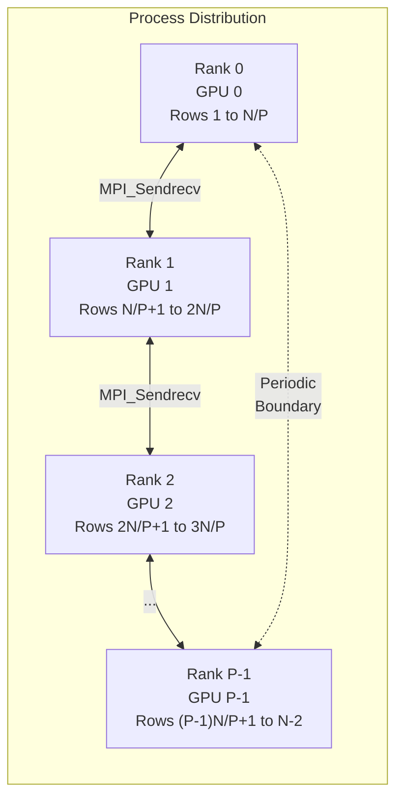
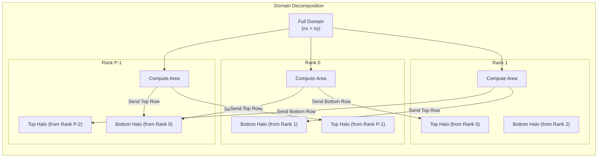
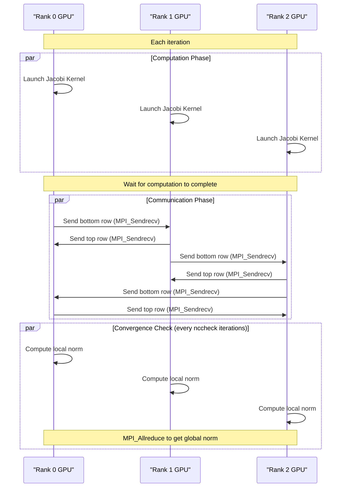
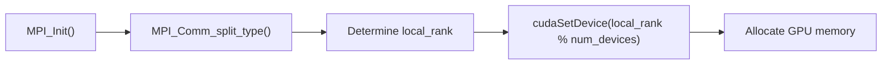

<!-- source: DeepWiki mcp.deepwiki.com · repo NVIDIA/multi-gpu-programming-models · page 3.3 MPI-Based Communication · fetched 2026-10-26 -->

# MPI-Based Communication

<details>
<summary>Relevant source files</summary>

The following files were used as context for generating this wiki page:

- [mpi/Makefile](mpi/Makefile)
- [mpi/jacobi.cpp](mpi/jacobi.cpp)
- [mpi/jacobi_kernels.cu](mpi/jacobi_kernels.cu)
- [mpi_overlap/Makefile](mpi_overlap/Makefile)
- [multi_threaded_copy_overlap/Makefile](multi_threaded_copy_overlap/Makefile)

</details>


This page provides an overview of the Message Passing Interface (MPI) based communication approach for implementing a multi-GPU Jacobi solver. MPI-based communication represents one of several programming models used for multi-GPU computation in this repository. For host-based communication implementations, see [Host-Based Communication](#3.1). For direct GPU-to-GPU communication, see [Direct GPU-to-GPU Communication](#3.2).

## Introduction to MPI for GPU Applications

Message Passing Interface (MPI) is a standardized communication protocol for parallel computing. When used with GPUs, MPI enables distributed memory parallelism across multiple devices, potentially spanning multiple nodes. The implementations in this repository showcase CUDA-aware MPI, which allows direct communication between GPU memory spaces without requiring explicit transfers to host memory.

Sources: [mpi/jacobi.cpp:34-41]()

## Implementation Architecture

The MPI-based Jacobi solver divides the 2D domain into 1D strips (rows) and assigns each strip to a separate MPI rank. Each rank manages its own GPU and is responsible for a portion of the computation.



Sources: [mpi/jacobi.cpp:193-222](), [mpi/jacobi.cpp:286-297]()

## Domain Decomposition

The MPI implementation performs a 1D domain decomposition, dividing work by rows of the 2D grid. It uses load balancing to handle cases where the number of rows is not evenly divisible by the number of processors.



The implementation uses a clever approach to balance the workload evenly across all ranks:

1. It calculates a baseline chunk size: `chunk_size_low = (ny - 2) / size`
2. Some ranks may get one extra row: `chunk_size_high = chunk_size_low + 1`
3. It determines how many ranks get the smaller chunk size
4. Each rank then calculates its starting and ending indices

This prevents any single rank from having significantly more work than others, ensuring better overall performance.

Sources: [mpi/jacobi.cpp:193-226]()

## Communication Pattern

The MPI implementation uses a nearest-neighbor communication pattern with periodic boundary conditions. Each rank exchanges boundary data with its adjacent ranks using `MPI_Sendrecv`.



Key aspects of the communication pattern:
- Each rank communicates only with its immediate neighbors
- Periodic boundary conditions connect the first and last ranks
- Communication happens after computation to ensure correct halo data
- CUDA-aware MPI enables direct device-to-device transfers
- Global synchronization only occurs during convergence checking

Sources: [mpi/jacobi.cpp:286-297](), [mpi/jacobi.cpp:299-307]()

## Key Implementation Components

### CUDA-Aware MPI Verification

The implementation verifies that the MPI implementation supports CUDA-aware communication, which is essential for direct GPU-to-GPU transfers:

```cpp
#if !defined(SKIP_CUDA_AWARENESS_CHECK) && defined(MPIX_CUDA_AWARE_SUPPORT)
if (1 != MPIX_Query_cuda_support()) {
    fprintf(stderr, "The used MPI Implementation does not have CUDA-aware support enabled!\n");
    MPI_CALL(MPI_Finalize());
    return -1;
}
#endif
```

Sources: [mpi/jacobi.cpp:36-42](), [mpi/jacobi.cpp:151-157]()

### Device Assignment Strategy

Each MPI rank is assigned to a GPU based on the local rank within a node:



This ensures efficient device utilization within each node, as multiple ranks on the same node will use different GPUs if available.

Sources: [mpi/jacobi.cpp:172-182]()

### Memory Management

The MPI implementation manages GPU memory for:
- The solution arrays (`a` and `a_new`)
- Convergence norm calculation (`l2_norm_d`)
- Temporary storage for MPI operations

Memory layout includes extra "halo" rows for communication:

```
|----------------|
| Halo (rank-1)  | ← Received from top neighbor
|----------------|
| Compute Region | ← Local computation area
|----------------|
| Halo (rank+1)  | ← Received from bottom neighbor
|----------------|
```

Sources: [mpi/jacobi.cpp:207-213](), [mpi/jacobi.cpp:237-240]()

## Computational Process

### Main Iteration Loop

The core computational loop of the MPI implementation has the following structure:

1. Reset the local norm value using `cudaMemsetAsync`
2. Launch the Jacobi kernel for computation on the interior points
3. Wait for computation to complete
4. Exchange boundary data with neighboring ranks
5. Periodically check for convergence using a global reduction
6. Swap solution arrays and proceed to the next iteration

Sources: [mpi/jacobi.cpp:271-311]()

### Boundary Exchange

Boundary exchange uses `MPI_Sendrecv` to simultaneously send and receive halo regions:

```cpp
// Send to top, receive from bottom
MPI_CALL(MPI_Sendrecv(a_new + iy_start * nx, nx, MPI_REAL_TYPE, top, 0,
                      a_new + (iy_end * nx), nx, MPI_REAL_TYPE, bottom, 0, 
                      MPI_COMM_WORLD, MPI_STATUS_IGNORE));
                      
// Send to bottom, receive from top
MPI_CALL(MPI_Sendrecv(a_new + (iy_end - 1) * nx, nx, MPI_REAL_TYPE, bottom, 0, 
                      a_new, nx, MPI_REAL_TYPE, top, 0, 
                      MPI_COMM_WORLD, MPI_STATUS_IGNORE));
```

This pattern implements periodic boundary conditions while ensuring efficient communication.

Sources: [mpi/jacobi.cpp:292-296]()

### Convergence Checking

The implementation periodically checks for convergence by:
1. Computing local norm values on each GPU
2. Using `MPI_Allreduce` to sum the norm values across all ranks
3. Taking the square root of the global sum to get the L2 norm
4. Comparing against the tolerance value

```cpp
if (calculate_norm) {
    CUDA_RT_CALL(cudaStreamSynchronize(compute_stream));
    MPI_CALL(MPI_Allreduce(l2_norm_h, &l2_norm, 1, MPI_REAL_TYPE, MPI_SUM, MPI_COMM_WORLD));
    l2_norm = std::sqrt(l2_norm);
    
    if (!csv && 0 == rank && (iter % 100) == 0) {
        printf("%5d, %0.6f\n", iter, l2_norm);
    }
}
```

Convergence checking is configurable to occur every `nccheck` iterations to reduce the overhead of global synchronization.

Sources: [mpi/jacobi.cpp:299-307]()

## Performance Considerations

### Communication-Computation Balance

The basic MPI implementation performs computation and communication sequentially, which can limit performance due to:

1. The GPU being idle during communication phases
2. Mandatory synchronization between computation and communication
3. Global synchronization overhead during convergence checking

This implementation provides a baseline for understanding MPI-based communication, but for better performance, see [MPI with Computation-Communication Overlap](#3.3.2).

### Error Handling

The implementation includes robust MPI error checking using a `MPI_CALL` macro that captures detailed error information:

```cpp
#define MPI_CALL(call)                                                                \
    {                                                                                 \
        int mpi_status = call;                                                        \
        if (MPI_SUCCESS != mpi_status) {                                              \
            char mpi_error_string[MPI_MAX_ERROR_STRING];                              \
            int mpi_error_string_length = 0;                                          \
            MPI_Error_string(mpi_status, mpi_error_string, &mpi_error_string_length); \
            /* ... error handling code ... */                                         \
            exit( mpi_status );                                                       \
        }                                                                             \
    }
```

This ensures that MPI errors are clearly reported with detailed error messages.

Sources: [mpi/jacobi.cpp:44-64]()

## Building and Running

The MPI implementation can be built and run using the provided Makefile:

```bash
# Build the MPI implementation
cd mpi
make

# Run with 4 MPI ranks
mpirun -np 4 ./jacobi
```

The implementation supports various command-line options:
- `-niter <n>`: Maximum number of iterations
- `-nccheck <n>`: Frequency of convergence checks
- `-nx <n>`, `-ny <n>`: Grid dimensions
- `-csv`: Output results in CSV format

Sources: [mpi/Makefile:1-46]()

## Profiling and Debugging

The Makefile includes targets for profiling and debugging:

```bash
# Run with Compute Sanitizer
make sanitize NP=4

# Profile with Nsight Systems
make profile NP=4
```

These tools can help identify performance bottlenecks and correctness issues in the MPI implementation.

Sources: [mpi/Makefile:38-45]()

## Summary

The MPI-based communication model provides a foundation for multi-GPU Jacobi solver implementations using standard message passing techniques. Key features include:

1. Domain decomposition by rows
2. Direct GPU-to-GPU communication through CUDA-aware MPI
3. Periodic boundary conditions
4. Load-balanced distribution of work
5. Configurable convergence checking

This implementation demonstrates how MPI can be used to coordinate computation across multiple GPUs in a distributed memory model. For an enhanced version with computation-communication overlap, see [MPI with Computation-Communication Overlap](#3.3.2).

---

