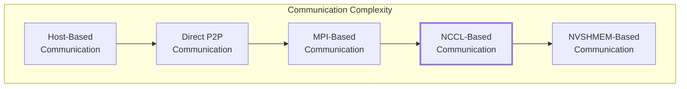
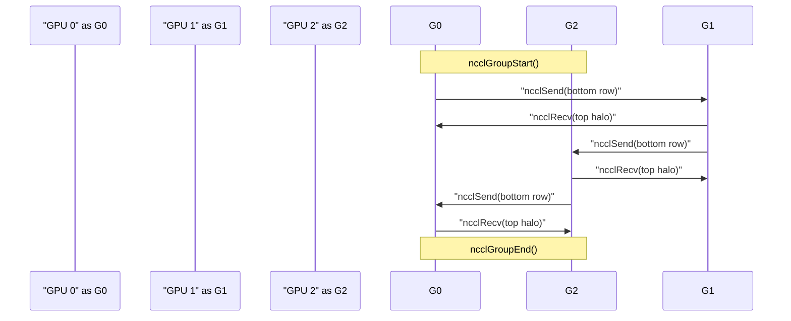
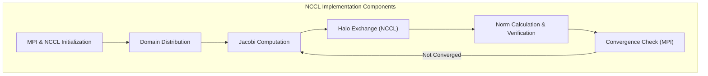
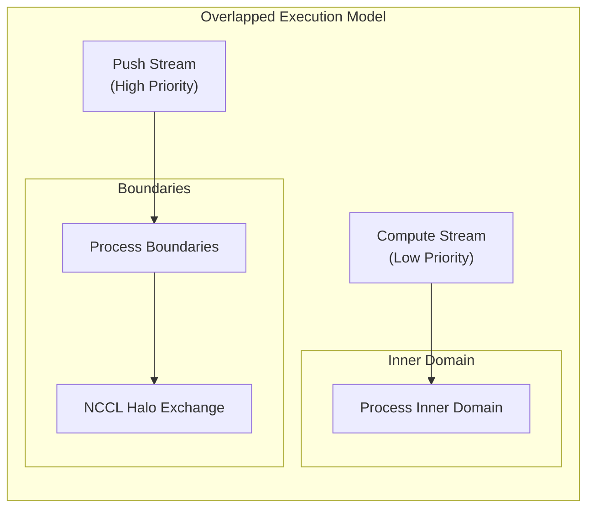
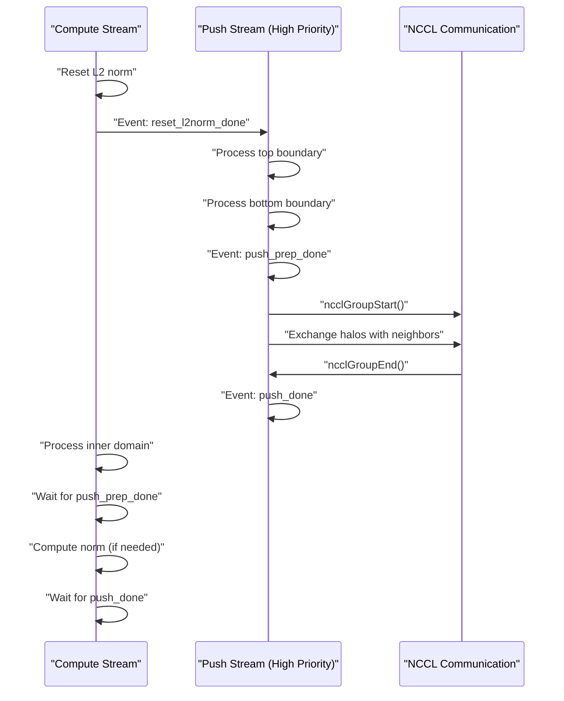
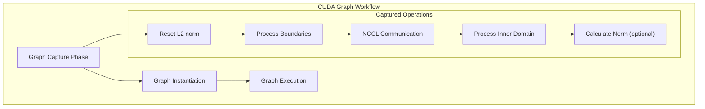
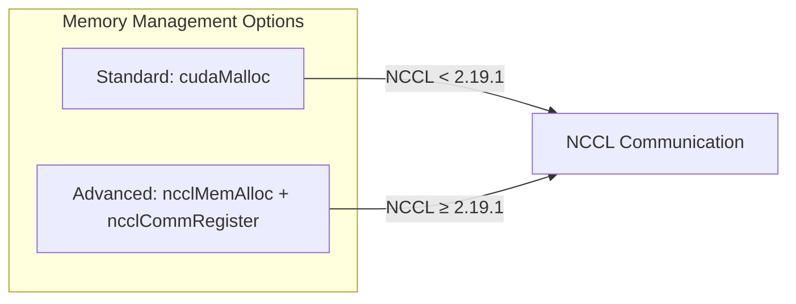
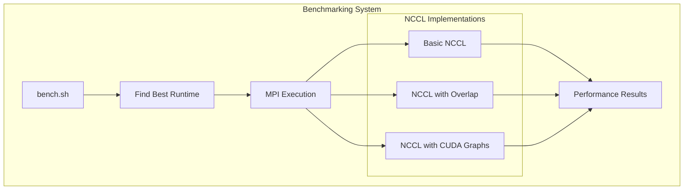

<!-- source: DeepWiki mcp.deepwiki.com · repo NVIDIA/multi-gpu-programming-models · page 3.4 NCCL-Based Communication · fetched 2026-10-26 -->

# NCCL-Based Communication

Relevant source files

The following files were used as context for generating this wiki page:

- [bench.sh](bench.sh)
- [nccl/Makefile](nccl/Makefile)
- [nccl/jacobi.cpp](nccl/jacobi.cpp)
- [nccl/jacobi_kernels.cu](nccl/jacobi_kernels.cu)
- [nccl_graphs/Makefile](nccl_graphs/Makefile)
- [nccl_graphs/jacobi.cpp](nccl_graphs/jacobi.cpp)
- [nccl_graphs/jacobi_kernels.cu](nccl_graphs/jacobi_kernels.cu)
- [nccl_overlap/Makefile](nccl_overlap/Makefile)
- [nccl_overlap/jacobi.cpp](nccl_overlap/jacobi.cpp)

This page provides an overview of the NVIDIA Collective Communications Library (NCCL) based implementations in the multi-GPU Jacobi solver. NCCL provides optimized collective communication primitives for NVIDIA GPUs, enabling efficient halo exchanges and data transfers between GPUs. The repository includes three NCCL-based implementations with varying levels of optimization: basic NCCL, NCCL with computation-communication overlap, and NCCL with CUDA Graphs.

## NCCL in the Programming Models Ecosystem

NCCL-based implementations occupy a specific position in the progression of multi-GPU programming models in this repository. They represent a step up from basic MPI and direct GPU-to-GPU communication techniques, offering specialized GPU-to-GPU communication.

Sources: [bench.sh:211-236](). [nccl/jacobi.cpp:99-112]()

## NCCL-Based Implementations Overview

There are three NCCL-based implementations in the repository, each building upon the previous with additional optimizations:

| Implementation | File | Key Feature |
|----------------|------|-------------|
| Basic NCCL | nccl/jacobi.cpp | Standard halo exchange using NCCL primitives |
| NCCL with Overlap | nccl_overlap/jacobi.cpp | Overlaps computation and communication using stream priorities |
| NCCL with CUDA Graphs | nccl_graphs/jacobi.cpp | Reduces kernel launch overhead through CUDA Graph capture and execution |

Sources: [bench.sh:211-236]()

## Basic NCCL Implementation

The basic NCCL implementation utilizes NCCL's point-to-point communication functions to exchange halo regions between neighboring GPUs in a multi-GPU setup. It leverages MPI for initialization and coordination between processes.

### Communication Pattern

The communication pattern follows these steps:
1. Initialize MPI and NCCL, with each MPI rank mapping to a GPU
2. Distribute the domain across GPUs
3. Use NCCL for boundary data exchange within ncclGroupStart/ncclGroupEnd blocks
4. Perform computation using CUDA kernels
5. Calculate norms and check convergence using MPI_Allreduce

Sources: [nccl/jacobi.cpp:347-356]()

### Key Components and Initialization

Key code elements:
- NCCL initialization with `ncclCommInitRank`
- Communication using `ncclSend` and `ncclRecv` within `ncclGroupStart`/`ncclGroupEnd` blocks
- Optional user buffer registration with newer NCCL versions (2.19.1+)

Sources: [nccl/jacobi.cpp:170-217](), [nccl/jacobi.cpp:251-268]()

### Code Structure

The main iteration loop in the basic NCCL implementation:

1. Reset L2 norm
2. Launch Jacobi kernel
3. Group NCCL operations for halo exchange
4. Calculate norm (if needed)
5. Swap buffers and proceed to next iteration

Sources: [nccl/jacobi.cpp:332-370]()

## NCCL with Computation-Communication Overlap

This implementation improves performance by overlapping computation and communication using CUDA streams with different priorities.

### Stream Organization

The implementation uses two primary streams:
- `compute_stream` (lower priority): Processes inner domain points
- `push_stream` (higher priority): Handles boundary points and communication

Sources: [nccl_overlap/jacobi.cpp:290-297]()

### Execution Flow

Benefits of this approach:
1. Communication starts earlier (higher priority stream processes boundaries first)
2. Computation of inner domain overlaps with communication
3. Better utilization of GPU resources

Sources: [nccl_overlap/jacobi.cpp:342-387]()

## NCCL with CUDA Graphs

The most advanced NCCL implementation uses CUDA Graphs to capture and replay the entire computation and communication pattern, reducing kernel launch overhead.

### Graph Capture and Execution

This implementation:
1. Captures four different graphs representing combinations of:
   - With or without norm calculation
   - Even or odd iterations (due to buffer swapping)
2. Instantiates the captured graphs for later execution
3. Runs the appropriate graph based on the current iteration

Sources: [nccl_graphs/jacobi.cpp:329-394](), [nccl_graphs/jacobi.cpp:429-442]()

### Requirements and Benefits

The CUDA Graphs version requires:
- NCCL 2.15.1 or newer
- CUDA Driver 11.7 or newer

Benefits:
- Reduced kernel launch overhead
- Optimized scheduling of operations
- Potential for better performance with complex iteration patterns

Sources: [nccl_graphs/jacobi.cpp:219-234]()

## NCCL Advanced Features

### User Buffer Registration

In newer versions of NCCL (2.19.1+), the implementation supports user buffer registration for potential performance improvements:

Buffer registration allows NCCL to potentially optimize memory accesses and transfers for registered buffers.

Sources: [nccl/jacobi.cpp:114-115](), [nccl/jacobi.cpp:251-268]()

## Performance Comparison Methodology

The repository includes benchmarking scripts that compare the performance of different implementations:

The benchmark script:
1. Runs each implementation multiple times
2. Selects the best runtime
3. Compares against a single GPU baseline
4. Reports speedup and efficiency metrics

Sources: [bench.sh:211-236]()

## Summary of NCCL-Based Implementations

| Feature | Basic NCCL | NCCL with Overlap | NCCL with CUDA Graphs |
|---------|------------|-------------------|------------------------|
| Main File | nccl/jacobi.cpp | nccl_overlap/jacobi.cpp | nccl_graphs/jacobi.cpp |
| Key Benefit | GPU-optimized communication | Computation-communication overlap | Reduced kernel launch overhead |
| NCCL Version Required | 2.8+ | 2.8+ | 2.15.1+ |
| Additional Requirements | - | - | CUDA Driver 11.7+ |
| Stream Usage | Single stream | Multiple prioritized streams | Multiple streams + CUDA Graphs |
| Complexity | Low | Medium | High |

Sources: [nccl/jacobi.cpp:219-225](), [nccl_graphs/jacobi.cpp:219-234]()

These NCCL-based implementations represent increasingly sophisticated approaches to multi-GPU programming, with each offering performance advantages in different scenarios. For even more advanced communication patterns, see the [NVSHMEM-Based Communication](#3.5) implementation.

---

