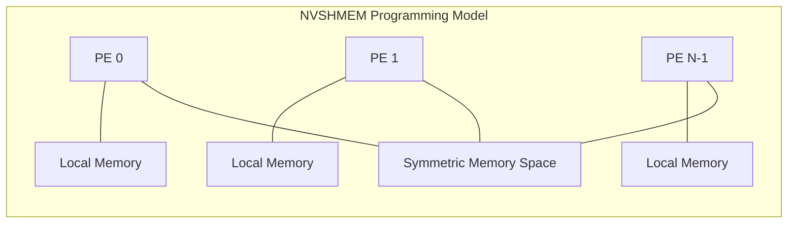
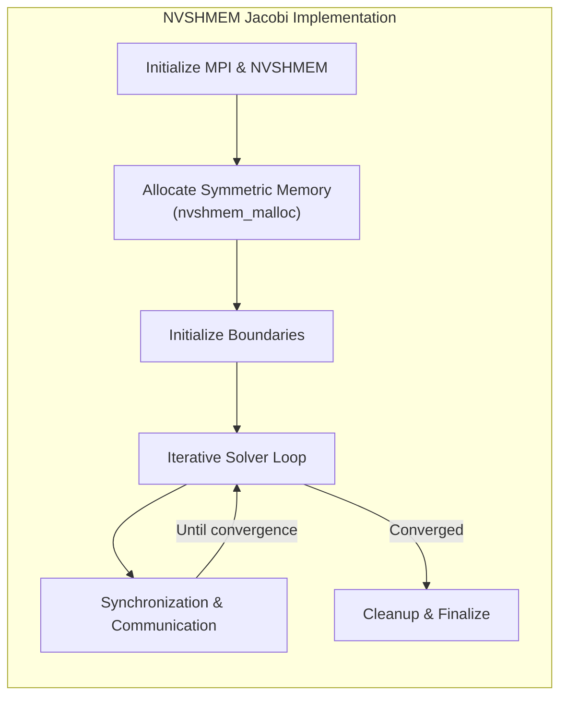
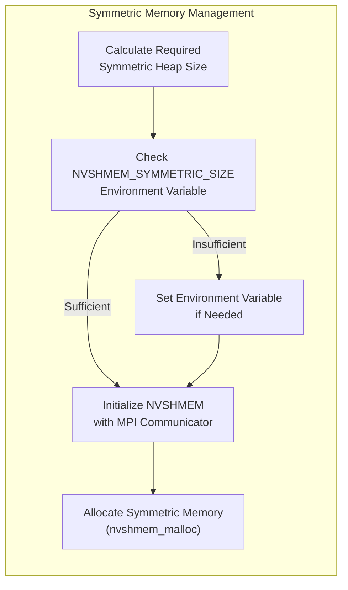
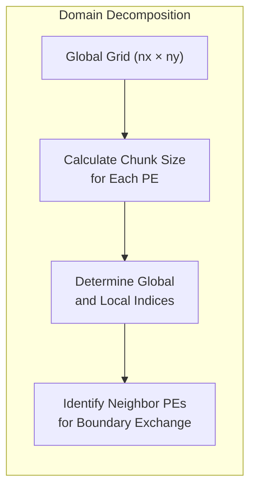
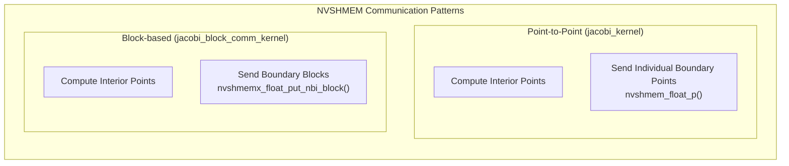
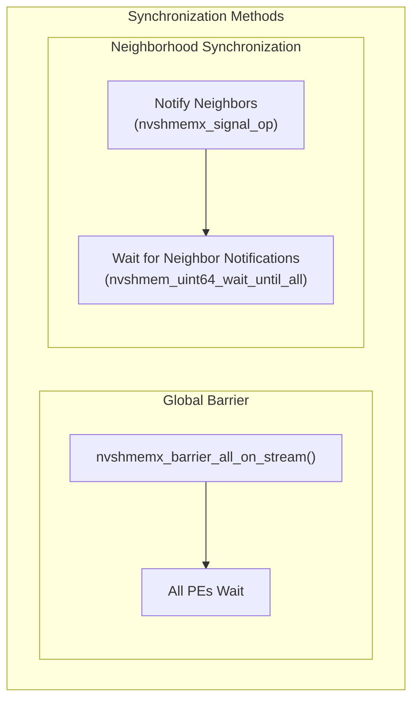
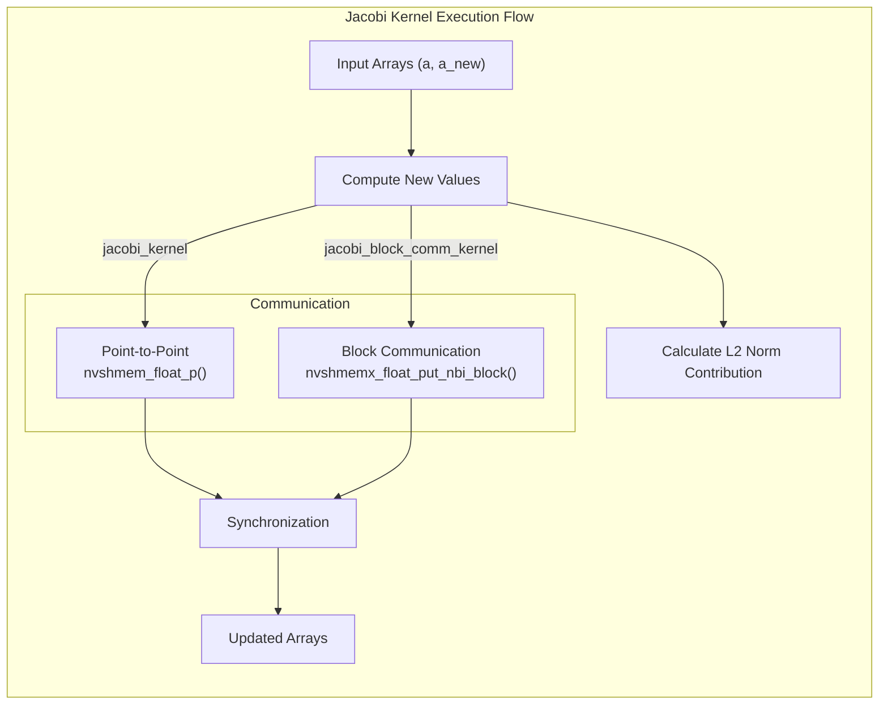
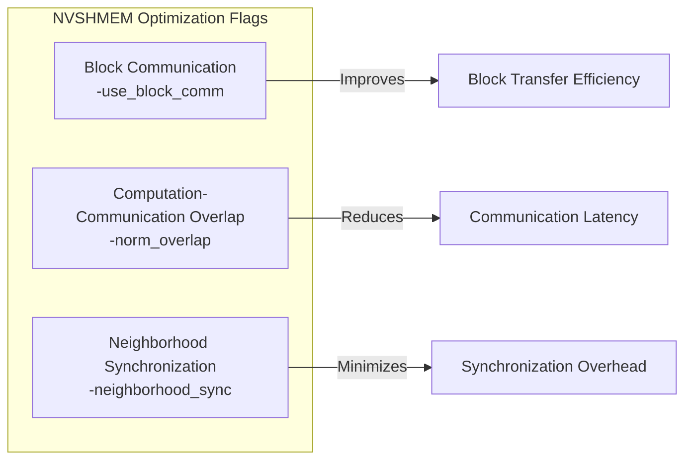

<!-- source: DeepWiki mcp.deepwiki.com · repo NVIDIA/multi-gpu-programming-models · page 3.5 NVSHMEM-Based Communication · fetched 2026-10-26 -->

# NVSHMEM-Based Communication

Relevant source files

The following files were used as context for generating this wiki page:

- [nvshmem/Makefile](nvshmem/Makefile)
- [nvshmem/jacobi.cu](nvshmem/jacobi.cu)

## Purpose and Overview

This document describes the NVSHMEM-based implementation of the Jacobi solver in the multi-GPU programming models repository. It explains how the NVSHMEM programming model is used to perform inter-GPU communication and the various optimizations applied to maximize performance. For information about other communication methods like MPI or NCCL, see the respective sections ([MPI-Based Communication](#3.3) and [NCCL-Based Communication](#3.4)).

Sources: [nvshmem/jacobi.cu:1-27]()

## What is NVSHMEM?

NVSHMEM (NVIDIA Symmetric Hierarchical Memory) is a parallel programming interface that implements the OpenSHMEM standard for NVIDIA GPUs. It provides a Partitioned Global Address Space (PGAS) programming model that allows GPU threads to directly access memory on remote GPUs.

Key NVSHMEM features used in this implementation:

1. **One-sided communication**: Operations initiated by one processor without explicit involvement of the target
2. **Symmetric memory allocation**: Memory allocated at same virtual address across all participating GPUs
3. **GPU-initiated communication**: Direct memory transfers without CPU involvement
4. **Synchronization primitives**: Barrier and quiet operations for coordinating execution

Sources: [nvshmem/jacobi.cu:27-30]()

## NVSHMEM Implementation Architecture

The NVSHMEM implementation of the Jacobi solver uses a distributed memory approach where each Processing Element (PE) operates on a portion of the global domain, exchanging boundary data with neighboring PEs.

Sources: [nvshmem/jacobi.cu:269-357](), [nvshmem/jacobi.cu:463-557]()

## Memory Management and Initialization

### Symmetric Memory Allocation

The implementation begins by calculating the required symmetric heap size based on the problem dimensions and allocating memory using `nvshmem_malloc()`. This creates memory regions that are accessible by all PEs in the NVSHMEM environment.

Key steps in memory initialization:

1. Calculate mesh size per rank and required symmetric heap size
2. Set the NVSHMEM_SYMMETRIC_SIZE environment variable if needed
3. Initialize NVSHMEM with MPI communicator
4. Allocate symmetric memory for arrays `a` and `a_new`

Sources: [nvshmem/jacobi.cu:332-397](), [nvshmem/jacobi.cu:103-123]()

### Domain Decomposition

The domain is decomposed along the y-dimension, with each PE handling a portion of the grid. The decomposition is designed to balance the workload by calculating an appropriate chunk size for each PE:

1. Divide the domain into chunks, handling the case where (ny - 2) % npes != 0
2. Calculate chunk sizes and global indices for each PE
3. Determine the neighbors (top_pe and bottom_pe) for halo exchange

Sources: [nvshmem/jacobi.cu:377-423]()

## Communication Patterns

### Halo Exchange Mechanisms

The implementation offers two mechanisms for halo exchange:

1. **Point-to-point communication** (`jacobi_kernel`): Uses `nvshmem_float_p()` to update individual boundary points
2. **Block-based communication** (`jacobi_block_comm_kernel`): Uses `nvshmemx_float_put_nbi_block()` for more efficient block-wise transfers

Sources: [nvshmem/jacobi.cu:158-239]()

### Synchronization Methods

Two synchronization approaches are implemented:

1. **Global barrier** (`nvshmemx_barrier_all_on_stream`): Synchronizes all PEs
2. **Neighborhood synchronization** (`syncneighborhood_kernel`): Optimized approach that only synchronizes with neighboring PEs

The neighborhood synchronization uses NVSHMEM signals to notify neighbors about completion and wait for their notifications, reducing synchronization overhead.

Sources: [nvshmem/jacobi.cu:132-144](), [nvshmem/jacobi.cu:507-518]()

## Kernel Implementations

### Jacobi Solver Kernels

The implementation includes two main computational kernels:

1. **`jacobi_kernel`**: Implements point-to-point communication for boundary exchange
   - Computes the new values for interior points
   - Uses `nvshmem_float_p()` to update boundary points on neighboring PEs
   - Calculates local contribution to L2 norm

2. **`jacobi_block_comm_kernel`**: Implements block-based communication
   - Similar computation as `jacobi_kernel`
   - Uses `nvshmemx_float_put_nbi_block()` for more efficient boundary transfers
   - Transfers entire blocks of data at once

Sources: [nvshmem/jacobi.cu:158-193](), [nvshmem/jacobi.cu:195-239]()

### Neighborhood Synchronization Kernel

The `syncneighborhood_kernel` implements an optimized synchronization mechanism:

1. Identifies the next and previous rank (neighboring PEs)
2. Ensures all prior NVSHMEM operations are completed using `nvshmem_quiet()`
3. Notifies neighbors about its completion using `nvshmemx_signal_op()`
4. Waits for notifications from neighbors using `nvshmem_uint64_wait_until_all()`

Sources: [nvshmem/jacobi.cu:132-144]()

## Optimization Techniques

The NVSHMEM implementation includes several optimization strategies to maximize performance:

### 1. Block-Based Communication

The `-use_block_comm` option enables block-based communication using `nvshmemx_float_put_nbi_block()`, which is more efficient than point-to-point transfers for boundary exchanges.

### 2. Computation-Communication Overlap

The `-norm_overlap` option enables overlapping computation and L2 norm calculation, reducing overall execution time by hiding communication latency.

### 3. Neighborhood Synchronization

The `-neighborhood_sync` option replaces global barriers with neighborhood synchronization, reducing synchronization overhead by only synchronizing with relevant PEs.

Sources: [nvshmem/jacobi.cu:275-277](), [nvshmem/jacobi.cu:463-551]()

## Performance Comparison

The implementation includes a benchmarking capability that compares the NVSHMEM implementation with a single-GPU reference implementation. The benchmark reports:

1. Execution time for single-GPU and multi-GPU implementations
2. Speedup ratio compared to single-GPU implementation
3. Parallel efficiency percentage

Each optimization flag can be enabled individually or in combination to evaluate their impact on performance.

Sources: [nvshmem/jacobi.cu:582-601]()

## Building and Running

The NVSHMEM implementation requires:

1. CUDA Toolkit
2. MPI library
3. NVSHMEM library

The Makefile in the nvshmem directory provides targets for:
- Building the implementation (`make`)
- Running the program (`make run`)
- Profiling with NVIDIA Nsight Systems (`make profile`)
- Running with Compute Sanitizer (`make sanitize`)

When running the program, you can specify various parameters:
- Problem dimensions (`-nx`, `-ny`)
- Maximum iterations (`-niter`)
- Norm check frequency (`-nccheck`)
- Optimization flags (`-use_block_comm`, `-norm_overlap`, `-neighborhood_sync`)

Sources: [nvshmem/Makefile:1-52]()

## Command Line Options

| Option | Description |
|--------|-------------|
| `-nx <value>` | Width of the domain (default: 16384) |
| `-ny <value>` | Height of the domain (default: 16384) |
| `-niter <value>` | Maximum number of iterations (default: 1000) |
| `-nccheck <value>` | Frequency of convergence checks (default: 1) |
| `-csv` | Output results in CSV format |
| `-use_block_comm` | Enable block-based communication |
| `-norm_overlap` | Enable computation-communication overlap for norm calculation |
| `-neighborhood_sync` | Enable neighborhood synchronization |

Sources: [nvshmem/jacobi.cu:270-277]()

## Environment Variables

The implementation uses the following environment variables:

| Variable | Description |
|----------|-------------|
| `NVSHMEM_SYMMETRIC_SIZE` | Size of symmetric memory heap (automatically calculated if not set) |
| `CUDA_VISIBLE_DEVICES` | Controls which GPUs are visible to the application |
| `OMPI_COMM_WORLD_RANK` | MPI rank (used in profiling) |

Sources: [nvshmem/jacobi.cu:332-354](), [nvshmem/Makefile:45-51]()

---

