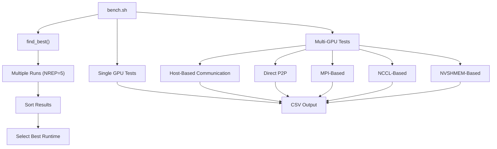
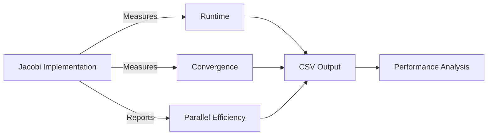
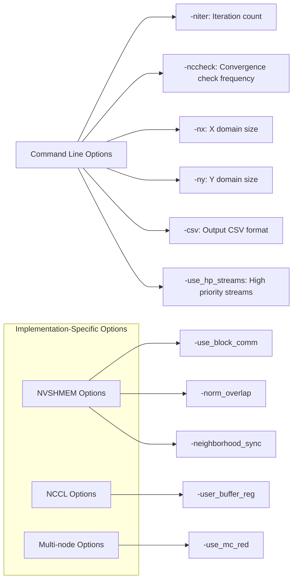
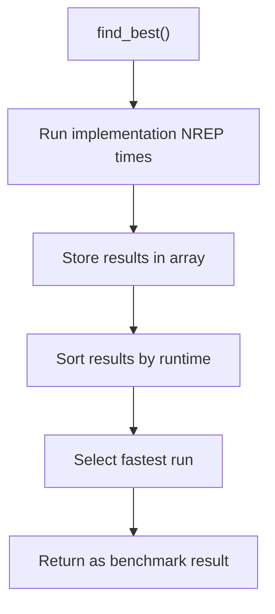
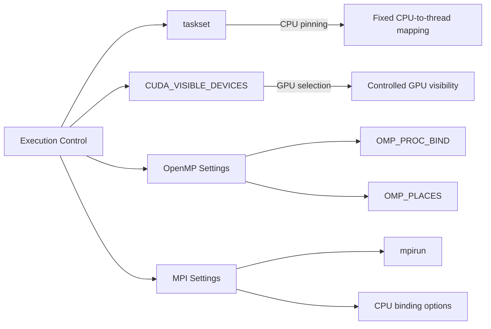
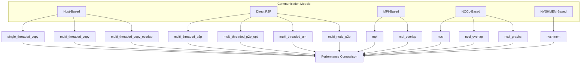
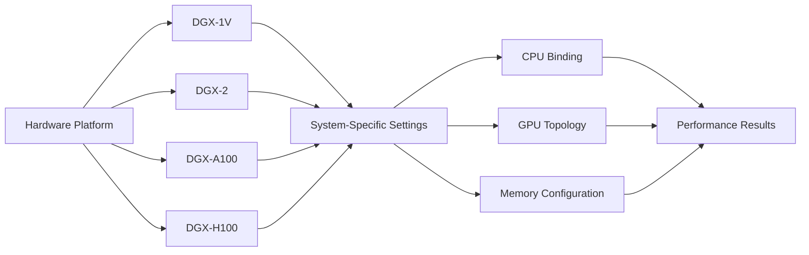

<!-- source: DeepWiki mcp.deepwiki.com · repo NVIDIA/multi-gpu-programming-models · page 4 Performance Comparison and Benchmarking · fetched 2026-10-26 -->

# Performance Comparison and Benchmarking

<details>
<summary>Relevant source files</summary>

The following files were used as context for generating this wiki page:

- [README.md](README.md)
- [bench.sh](bench.sh)
- [nccl/Makefile](nccl/Makefile)
- [nccl/jacobi_kernels.cu](nccl/jacobi_kernels.cu)
- [nccl_overlap/Makefile](nccl_overlap/Makefile)

</details>


This document explains how to benchmark the different Jacobi solver implementations in the multi-GPU programming models repository and how to analyze their performance characteristics. It covers the benchmarking framework, methodology, and techniques for comparing the efficiency of different programming models.

For information about the Jacobi method theory, see [Jacobi Method Theory](#2). For details on building and running specific implementations, see [Building and Running](#5).

## 1. Benchmarking Framework Overview

The repository includes a benchmarking framework based on the `bench.sh` script, which automates the process of executing each implementation with consistent parameters and collecting performance results for comparison.



The benchmarking framework:
- Executes each implementation multiple times to obtain reliable performance measurements
- Controls GPU and CPU affinities for consistent testing
- Configures problem sizes and iteration counts
- Collects and formats results in CSV format for easy analysis

Sources: [bench.sh:1-69](). [README.md:63-64]()

## 2. Key Metrics and Measurements

The Jacobi solver implementations report several performance metrics:

| Metric | Description |
|--------|-------------|
| Runtime | Total execution time of the solver |
| Runtime serial | Estimated serial execution time (for parallel efficiency calculation) |
| Convergence | Whether the solver converged to the solution |
| Iteration count | Number of iterations performed |

The primary performance metric is the runtime, which measures how long it takes to complete a fixed number of iterations or to converge to a solution within a specified tolerance.



Sources: [bench.sh:84-85]()

## 3. Running Benchmarks

### 3.1 Basic Usage

To run the benchmarks, execute the `bench.sh` script:

```bash
./bench.sh
```

By default, this will run all enabled benchmarks with the parameters configured in the script.

The script has configuration sections for different hardware platforms:
- DGX-1V
- DGX-2
- DGX-A100
- DGX-H100

You should uncomment the appropriate section for your hardware.

Sources: [bench.sh:30-58]()

### 3.2 Benchmark Parameters

You can modify these parameters at the top of `bench.sh`:

| Parameter | Description |
|-----------|-------------|
| NREP | Number of repetitions for each test (default: 5) |
| NXNY | Problem size (default: 20480) |
| CPUID | CPU ID range for thread binding |
| FIRST_CORE | Starting CPU core ID for thread binding |
| MAX_NUM_GPUS | Maximum number of GPUs to test |
| CUDA_VISIBLE_DEVICES_SETTING | GPU visibility settings for different runs |

Sources: [bench.sh:28-58]()

### 3.3 Individual Implementation Options

Each implementation accepts command-line arguments that can be modified in the script:



Sources: [README.md:44-62]()

## 4. Benchmarking Methodology

The benchmarking system uses several techniques to ensure accurate and consistent results:

### 4.1 Finding Best Performance

The `find_best()` function executes each implementation multiple times and selects the best result:



This approach helps minimize the impact of system noise and variability.

Sources: [bench.sh:60-67]()

### 4.2 CPU and GPU Pinning

The benchmarking framework uses CPU pinning and GPU visibility settings to ensure consistent hardware utilization:



Each implementation is tested with progressive GPU counts to evaluate scaling characteristics.

Sources: [bench.sh:89-189](), [bench.sh:193-257]()

## 5. Performance Analysis and Comparison

### 5.1 CSV Output Format

The benchmark results are output in CSV format with the following fields:

```
type, nx, ny, iter_max, nccheck, num_devices, p2p, runtime, runtime_serial
```

Where:
- `type`: Implementation type
- `nx`, `ny`: Problem dimensions
- `iter_max`: Maximum iterations
- `nccheck`: Convergence check frequency
- `num_devices`: Number of GPUs used
- `p2p`: Whether P2P communication was enabled
- `runtime`: Execution time in seconds
- `runtime_serial`: Serial execution time (for speedup calculation)

Sources: [bench.sh:84-85]()

### 5.2 Comparing Communication Models

The benchmarking framework allows systematic comparison of different communication models:



Typical performance patterns to analyze include:
- Strong scaling (fixed problem size, increasing GPU count)
- Communication overhead (comparing overlap vs. non-overlap versions)
- Programming model efficiency (comparing different models with the same GPU count)

Sources: [README.md:2-15]()

## 6. Advanced Benchmarking Techniques

### 6.1 Profiling

The Makefiles in various implementations include profiling targets using Nsight Systems:

```bash
make profile NP=<number_of_processes>
```

This generates detailed timeline traces showing kernel execution, memory transfers, and communication patterns.

Sources: [nccl/Makefile:42-43](), [nccl_overlap/Makefile:42-43]()

### 6.2 Compute Sanitizer

For debugging and validation, you can run implementations through NVIDIA Compute Sanitizer:

```bash
make sanitize NP=<number_of_processes>
```

This helps detect memory errors, race conditions, and other runtime issues.

Sources: [nccl/Makefile:36-37](), [nccl_overlap/Makefile:36-37]()

### 6.3 Hardware-Specific Optimizations

Different hardware platforms may require specific benchmarking strategies:



For optimal results, modify the hardware-specific settings in `bench.sh` to match your platform's topology.

Sources: [bench.sh:30-58]()

## 7. Interpreting Benchmark Results

When analyzing the results, consider these key factors:

1. **Scaling Efficiency**: How runtime changes as GPU count increases
2. **Communication Overhead**: Difference between overlapped and non-overlapped versions
3. **Programming Model Overhead**: Additional costs of higher-level abstractions
4. **Problem Size Sensitivity**: How performance varies with different problem sizes

The CSV output can be processed with data analysis tools to create visual comparisons and scaling charts.

For multi-GPU scenarios, pay particular attention to:
- Communication patterns (halo exchange efficiency)
- Load balancing across GPUs
- Synchronization overhead
- Memory transfer bandwidth

Sources: [bench.sh:193-257]()

---

