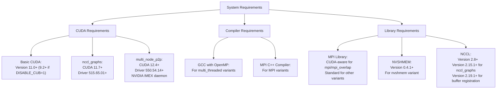
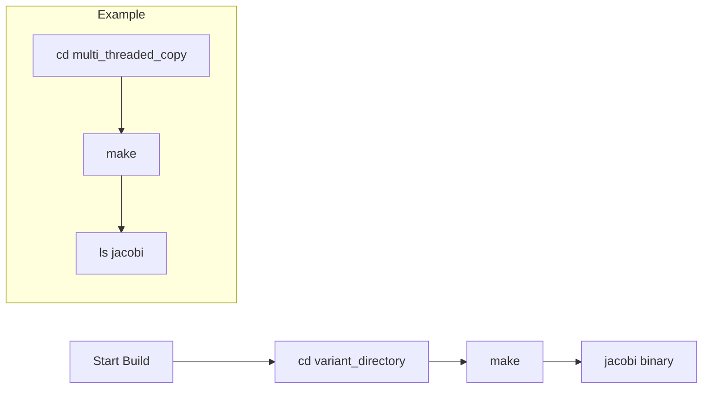
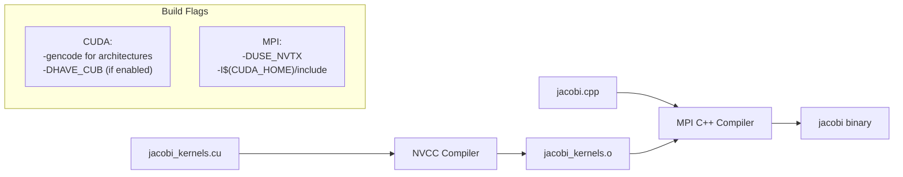
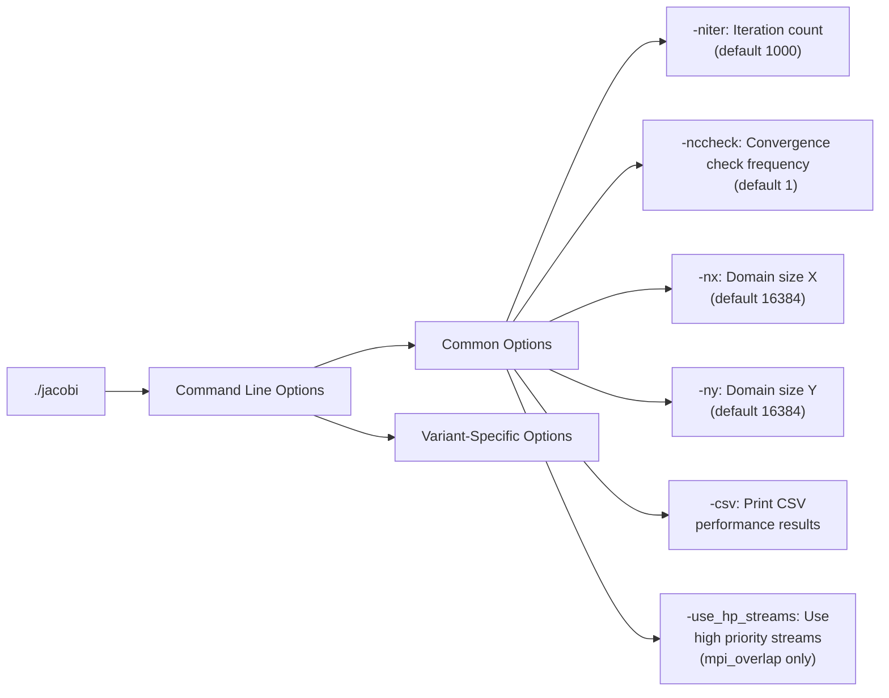
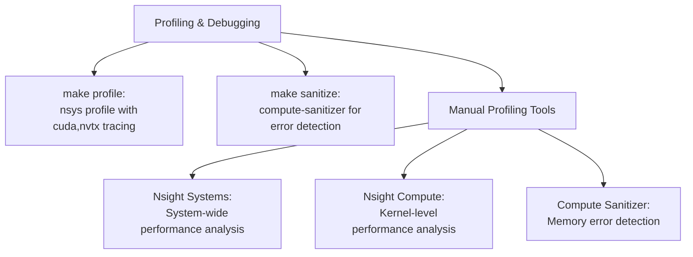

<!-- source: DeepWiki mcp.deepwiki.com · repo NVIDIA/multi-gpu-programming-models · page 5 Building and Running · fetched 2026-10-26 -->

# Building and Running

<details>
<summary>Relevant source files</summary>

The following files were used as context for generating this wiki page:

- [README.md](README.md)
- [mpi/Makefile](mpi/Makefile)
- [multi_threaded_copy/Makefile](multi_threaded_copy/Makefile)
- [nvshmem/Makefile](nvshmem/Makefile)

</details>


This document provides comprehensive instructions for building and executing the various Jacobi solver implementations in the Multi-GPU Programming Models repository. It covers compilation requirements, build processes, and execution options for all program variants.

## System Requirements

Before building any of the implementations, ensure your system meets the following requirements:



Sources: [README.md:24-31]()

### Core Requirements

* **CUDA**: Version 11.0 or later is required for all variants (9.2+ if built with `DISABLE_CUB=1`)
* **Compiler**: 
  * C++ compiler with OpenMP support (typically GCC) for the multi-threaded variants
  * MPI C++ compiler for the MPI-based variants

### Variant-Specific Requirements

* **nccl_graphs**: Requires NCCL 2.15.1, CUDA 11.7, and CUDA Driver 515.65.01 or newer
* **multi_node_p2p**: Requires CUDA 12.4, CUDA Driver 550.54.14 or newer, and the NVIDIA IMEX daemon running
* **MPI-based variants**:
  * **mpi** and **mpi_overlap**: Require CUDA-aware MPI implementation
  * **nvshmem**, **nccl**, and **multi_node_p2p**: Can work with non-CUDA-aware MPI
* **nvshmem**: Requires NVSHMEM library version 0.4.1 or later
* **nccl**: Requires NCCL library version 2.8 or later

Sources: [README.md:24-31]()

## Building the Implementations

Each implementation variant comes with its own `Makefile` located in its respective directory. The general build process is uniform across all variants.

### General Build Instructions



To build any implementation:

1. Navigate to the implementation directory
2. Run `make`

Example:
```
$ cd multi_threaded_copy
$ make
$ ls jacobi
jacobi
```

Sources: [README.md:33-41]()

### Common Build Options

Most Makefiles support the following build options:

| Option | Description |
|--------|-------------|
| `DISABLE_CUB=1` | Disable CUB library usage |
| `USE_LTO=1` | Enable Link Time Optimization (when supported) |
| `GENCODE_FLAGS` | Set specific CUDA architecture targets |

Sources: [multi_threaded_copy/Makefile:13-17](), [mpi/Makefile:17-21](), [nvshmem/Makefile:18-22]()

### Implementation-Specific Build Considerations

#### MPI-Based Implementations

MPI implementations require both NVCC for CUDA kernels and an MPI C++ compiler:



The MPI implementations can be built with `SKIP_CUDA_AWARENESS_CHECK=1` to bypass the CUDA-awareness check if your MPI implementation doesn't support it.

Sources: [mpi/Makefile:22-32]()

#### NVSHMEM Implementation

The NVSHMEM implementation requires setting the `NVSHMEM_HOME` environment variable before building:

```bash
export NVSHMEM_HOME=/path/to/nvshmem
cd nvshmem
make
```

The NVSHMEM variant links against both NVSHMEM and CUDA libraries with additional flags:

```
NVCC_LDFLAGS = -ccbin=mpic++ -L$(NVSHMEM_HOME)/lib -lnvshmem -L$(CUDA_HOME)/lib64 -lcuda -lcudart -ldl -lnvidia-ml
```

Sources: [nvshmem/Makefile:6-8](), [nvshmem/Makefile:31]()

## Running the Implementations

All implementations support a common set of command-line options, with some variants providing additional options.

### Common Command-Line Options



Sources: [README.md:44-50]()

### Variant-Specific Command-Line Options

#### NVSHMEM Options

| Option | Description |
|--------|-------------|
| `-use_block_comm` | Use block cooperative `nvshmemx_float_put_nbi_block` instead of `nvshmem_float_p` |
| `-norm_overlap` | Enable delayed norm execution (like in `multi_threaded_p2p_opt`) |
| `-neighborhood_sync` | Use custom neighbor-only sync instead of `nvshmemx_barrier_all_on_stream` |

#### Multi-node P2P Options

| Option | Description |
|--------|-------------|
| `-use_mc_red` | Use device-side barrier and allreduce with Multicast Objects instead of MPI |

#### NCCL Options

| Option | Description |
|--------|-------------|
| `-user_buffer_reg` | Avoid extra internal copies using NCCL User Buffer Registration (requires NCCL 2.19.1+) |

Sources: [README.md:52-61]()

### Multi-Process Execution

MPI-based implementations need to be launched using MPI's launcher (typically `mpirun`):

```bash
# Run with 4 processes
mpirun -np 4 ./jacobi
```

For NVSHMEM, MPI, NCCL, and multi-node variants:

```bash
# Export necessary environment variables
export NVSHMEM_SYMMETRIC_SIZE=1G  # For NVSHMEM

# Run with MPI
mpirun -np 4 ./jacobi -niter 1000 -nx 8192 -ny 8192
```

Sources: [nvshmem/Makefile:47-48](), [mpi/Makefile:41-42]()

## Benchmarking and Profiling

The repository includes a `bench.sh` script that demonstrates how to run and benchmark all the different implementations.

### Using the Benchmark Script

The `bench.sh` script handles the execution of all variants with appropriate parameters and environments. It's the recommended way to compare performance across implementations.

```bash
# Run all benchmarks
./bench.sh
```

Sources: [README.md:63-64]()

### Profiling Options

Most Makefiles include targets for profiling and debugging:

| Target | Description |
|--------|-------------|
| `make run` | Run the standard executable |
| `make profile` | Run with NVIDIA Nsight Systems profiling |
| `make sanitize` | Run with CUDA Compute Sanitizer to detect errors |

Examples:
```bash
# Inside an implementation directory
make profile  # Runs with Nsight Systems
make sanitize # Runs with Compute Sanitizer
```



Sources: [multi_threaded_copy/Makefile:26-33](), [mpi/Makefile:38-45](), [nvshmem/Makefile:44-51]()

## Environment Setup and Optimization

### CPU and GPU Affinity

For optimal performance, especially with multi-threaded and MPI implementations, control process and thread placement:

```bash
# Pin processes to specific CPU cores using taskset or MPI options
mpirun --bind-to core --map-by socket ./jacobi

# Control visible GPUs
CUDA_VISIBLE_DEVICES=0,1 ./jacobi  # Use only GPUs 0 and 1

# OpenMP thread control
export OMP_PROC_BIND=close  # Keep threads close to master thread
export OMP_PLACES=cores     # Place threads on cores, not hardware threads
```

### NVSHMEM-Specific Settings

For NVSHMEM implementations, set the symmetric heap size:

```bash
export NVSHMEM_SYMMETRIC_SIZE=1G  # Allocate 1GB symmetric heap
```

Sources: [README.md:52-54]()

## Troubleshooting

### Common Build Issues

1. **CUDA Compilation Errors**:
   - Ensure CUDA toolkit is installed and in PATH
   - Check for compatible compiler versions with your CUDA installation

2. **MPI Compilation Errors**:
   - Verify that your MPI implementation is CUDA-aware (for `mpi`/`mpi_overlap`)
   - If your MPI doesn't support CUDA awareness checks, set `SKIP_CUDA_AWARENESS_CHECK=1`

3. **NVSHMEM Build Errors**:
   - Ensure `NVSHMEM_HOME` is correctly set
   - Verify NVSHMEM version compatibility (0.4.1+)

4. **NCCL Build Errors**:
   - Ensure NCCL is installed and findable in the library path
   - Check version compatibility with required features

Sources: [README.md:72-73]()

---

