<!-- source: DeepWiki mcp.deepwiki.com · repo NVIDIA/multi-gpu-programming-models · page 6 Advanced Optimization Techniques · fetched 2026-10-26 -->

# Advanced Optimization Techniques

<details>
<summary>Relevant source files</summary>

The following files were used as context for generating this wiki page:

- [mpi/jacobi_kernels.cu](mpi/jacobi_kernels.cu)
- [multi_threaded_p2p_opt/jacobi.cu](multi_threaded_p2p_opt/jacobi.cu)
- [nccl_graphs/Makefile](nccl_graphs/Makefile)
- [nccl_graphs/jacobi.cpp](nccl_graphs/jacobi.cpp)
- [nccl_graphs/jacobi_kernels.cu](nccl_graphs/jacobi_kernels.cu)
- [nvshmem/jacobi.cu](nvshmem/jacobi.cu)

</details>


This page provides a detailed exploration of the advanced optimization techniques employed across the multi-GPU Jacobi solver implementations. It focuses on performance optimizations that can significantly improve computation speed and scalability of multi-GPU applications. For basic information about the different programming models, see [Multi-GPU Programming Models](#3).

## Table of Key Optimization Techniques

| Optimization Technique | Description | Applicable Models | Performance Impact |
|------------------------|-------------|-------------------|-------------------|
| Computation-Communication Overlap | Overlaps computation with communication to hide latency | All multi-GPU implementations | High |
| CUDA Graphs | Reduces kernel launch overhead by capturing and replaying kernel sequences | NCCL graphs | High |
| P2P Communication | Direct memory access between GPUs | P2P-based implementations | Medium-High |
| Stream Priorities | Prioritizes critical operations for better resource scheduling | MPI overlap, NCCL | Medium |
| Selective Norm Checking | Reduces frequency of global norm calculations | All implementations | Medium |
| Neighborhood Synchronization | Synchronizes only with neighbor ranks to reduce overhead | NVSHMEM | Medium |
| Block-based Communication | Communicates data in blocks rather than individual elements | NVSHMEM | Medium |
| User Buffer Registration | Pre-registers memory buffers with communication libraries | NCCL | Low-Medium |

## Computation-Communication Overlap

One of the most effective optimization techniques is overlapping computation with communication to hide latency. Instead of waiting for all boundary exchanges to complete before starting computation, interior points can be computed while boundary exchanges are in progress.

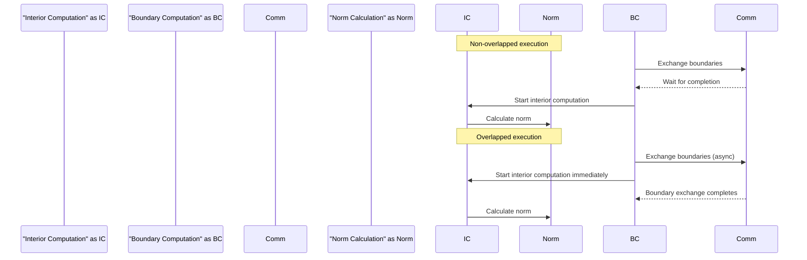

Sources: [multi_threaded_copy_overlap/jacobi.cu](), [nvshmem/jacobi.cu:487-500](), [nccl_overlap/jacobi.cpp]()

### Implementation Patterns

Different implementations achieve computation-communication overlap through various approaches:

1. **Stream-based overlap**: Using separate CUDA streams for computation and communication
   ```cpp
   // Launch boundary computations in communication stream
   launch_jacobi_kernel(a_new, a, l2_norm_d, iy_start, iy_start + 1, nx, calculate_norm, push_stream);
   launch_jacobi_kernel(a_new, a, l2_norm_d, iy_end - 1, iy_end, nx, calculate_norm, push_stream);
   
   // Exchange boundaries in communication stream
   // Apply periodic boundary conditions
   NCCL_CALL(ncclGroupStart());
   NCCL_CALL(ncclRecv(...));
   NCCL_CALL(ncclSend(...));
   NCCL_CALL(ncclGroupEnd());
   
   // Compute interior points in compute stream
   launch_jacobi_kernel(a_new, a, l2_norm_d, iy_start + 1, iy_end - 1, nx, calculate_norm, compute_stream);
   ```

2. **Norm calculation overlap**: Computing the L2 norm while preparing for the next iteration

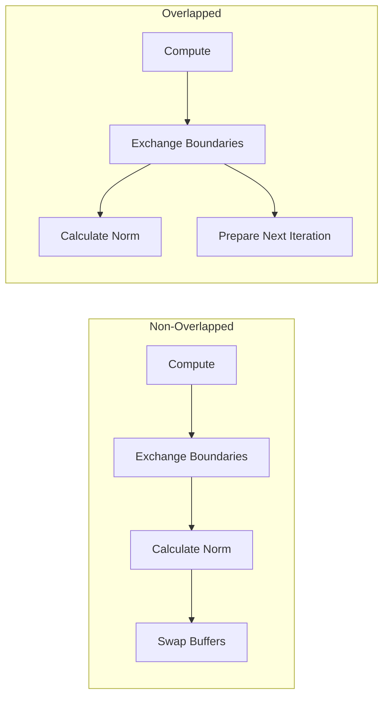

Sources: [nvshmem/jacobi.cu:487-546](), [multi_threaded_p2p_opt/jacobi.cu:339-402]()

## CUDA Graphs

CUDA Graphs significantly reduce kernel launch overhead by capturing and replaying sequences of operations. In the Jacobi solver, CUDA Graphs are used to record the entire iteration pattern, including kernel launches, memory operations, and synchronization events.

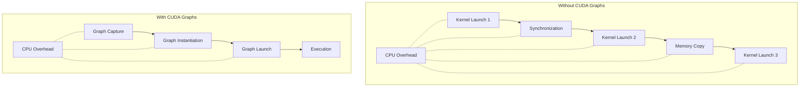

Sources: [nccl_graphs/jacobi.cpp:326-407]()

### Implementation in NCCL Graphs

The NCCL Graphs implementation captures four distinct graphs for the different execution paths:

1. Iteration with norm calculation (odd iteration)
2. Iteration with norm calculation (even iteration)
3. Iteration without norm calculation (odd iteration)
4. Iteration without norm calculation (even iteration)

The graphs are captured once and then repeatedly executed, eliminating the overhead of kernel launches, synchronization, and NCCL communication setup.

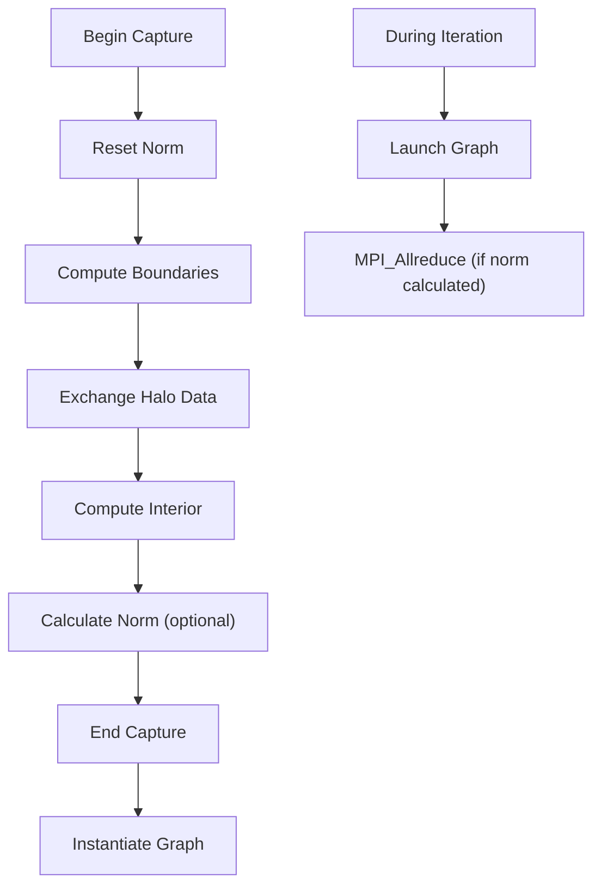

Sources: [nccl_graphs/jacobi.cpp:335-373](), [nccl_graphs/jacobi.cpp:429-443]()

## P2P Communication Optimization

Direct GPU-to-GPU communication through CUDA Peer-to-Peer (P2P) access eliminates the need for CPU involvement in transferring data between GPUs.

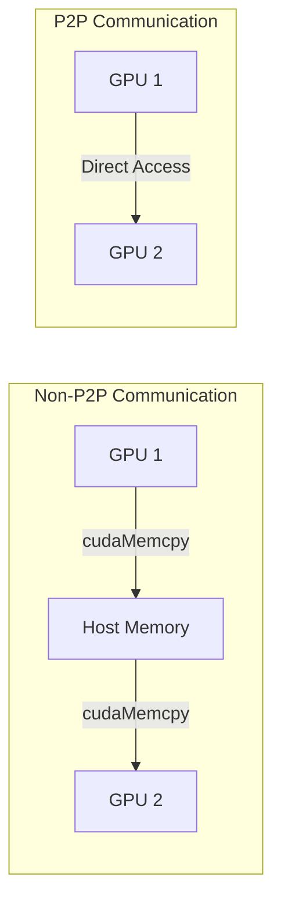

Sources: [multi_threaded_p2p/jacobi.cu](), [multi_threaded_p2p_opt/jacobi.cu:232-256]()

### P2P Optimized Implementation

The multi_threaded_p2p_opt implementation further optimizes P2P communication by:

1. Using CUDA events for synchronization between compute and communication
2. Delaying norm calculation to avoid unnecessary synchronization
3. Atomic operations for aggregating norm values across threads

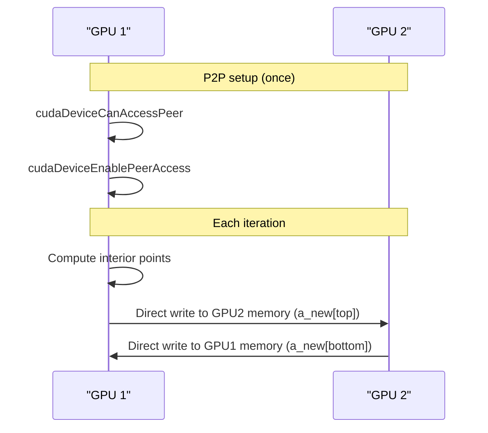

Sources: [multi_threaded_p2p_opt/jacobi.cu:117-123](), [multi_threaded_p2p_opt/jacobi.cu:339-402]()

## Stream Prioritization

CUDA stream priorities allow critical operations to be scheduled preferentially, improving overall execution efficiency.

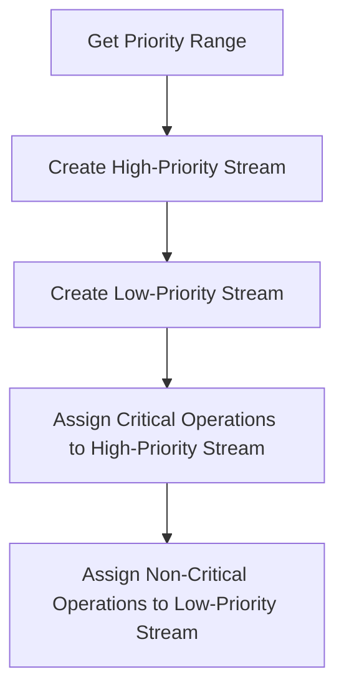

Sources: [nccl_graphs/jacobi.cpp:291-298](), [mpi_overlap/jacobi.cpp]()

### Implementation Example

In the NCCL Graphs implementation, boundary exchanges are assigned to a high-priority stream while interior computation uses a standard priority stream:

```cpp
// Get the range of stream priorities
int leastPriority = 0;
int greatestPriority = leastPriority;
CUDA_RT_CALL(cudaDeviceGetStreamPriorityRange(&leastPriority, &greatestPriority));

// Create streams with appropriate priorities
cudaStream_t compute_stream;
CUDA_RT_CALL(cudaStreamCreateWithPriority(&compute_stream, cudaStreamDefault, leastPriority));
cudaStream_t push_stream;
CUDA_RT_CALL(cudaStreamCreateWithPriority(&push_stream, cudaStreamDefault, greatestPriority));
```

Sources: [nccl_graphs/jacobi.cpp:291-298]()

## Neighborhood Synchronization

Instead of global barriers that synchronize all processes, neighborhood synchronization only synchronizes with the adjacent ranks, reducing synchronization overhead.

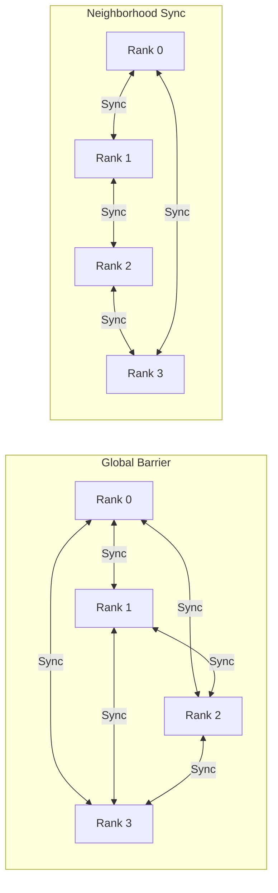

Sources: [nvshmem/jacobi.cu:132-144](), [nvshmem/jacobi.cu:508-518]()

### Implementation in NVSHMEM

The NVSHMEM implementation uses a custom neighborhood synchronization kernel:

```cpp
__global__ void syncneighborhood_kernel(int my_pe, int num_pes, uint64_t* sync_arr, long counter) {
    int next_rank = (my_pe + 1) % num_pes;
    int prev_rank = (my_pe == 0) ? num_pes - 1 : my_pe - 1;
    nvshmem_quiet(); /* To ensure all prior nvshmem operations have been completed */

    /* Notify neighbors about arrival */
    nvshmemx_signal_op(sync_arr, counter, NVSHMEM_SIGNAL_SET, next_rank);
    nvshmemx_signal_op(sync_arr + 1, counter, NVSHMEM_SIGNAL_SET, prev_rank);

    /* Wait for neighbors notification */
    nvshmem_uint64_wait_until_all(sync_arr, 2, NULL, NVSHMEM_CMP_GE, counter);
}
```

This approach performs better than a global barrier (`nvshmemx_barrier_all_on_stream`) as it reduces unnecessary synchronization.

Sources: [nvshmem/jacobi.cu:132-144](), [nvshmem/jacobi.cu:508-518]()

## Block-based Communication

Instead of communicating individual elements or entire rows, block-based communication divides the data into blocks that match the computation pattern for more efficient data transfers.

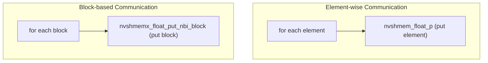

Sources: [nvshmem/jacobi.cu:196-239]()

### NVSHMEM Block Communication Implementation

The NVSHMEM implementation provides two kernels for the Jacobi iteration - a standard kernel and a block-based communication kernel:

```cpp
// Standard communication: One element at a time
if (iy_start == iy) {
    nvshmem_float_p(a_new + top_iy * nx + ix, new_val, top_pe);
}
if ((iy_end - 1) == iy) {
    nvshmem_float_p(a_new + bottom_iy * nx + ix, new_val, bottom_pe);
}

// Block-based communication: Block at a time
if ((block_iy <= iy_start) && (iy_start < block_iy + blockDim.y)) {
    nvshmemx_float_put_nbi_block(a_new + top_iy * nx + block_ix, 
                               a_new + iy_start * nx + block_ix,
                               min(blockDim.x, nx - 1 - block_ix), top_pe);
}
```

Sources: [nvshmem/jacobi.cu:180-182](), [nvshmem/jacobi.cu:224-231]()

## User Buffer Registration

Pre-registering memory buffers with communication libraries can reduce overhead for repeated communications.

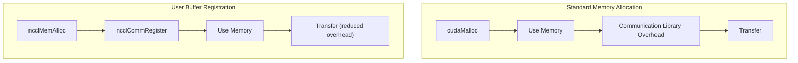

Sources: [nccl_graphs/jacobi.cpp:182-188](), [nccl_graphs/jacobi.cpp:260-276]()

### NCCL Buffer Registration

The NCCL implementation provides an option for using registered buffers:

```cpp
bool user_buffer_reg = get_arg(argv, argv + argc, "-user_buffer_reg");
#if NCCL_UB_SUPPORT
if (user_buffer_reg) {
    NCCL_CALL(ncclMemAlloc( (void**) &a    , nx * (chunk_size + 2) * sizeof(real)));
    NCCL_CALL(ncclMemAlloc( (void**) &a_new, nx * (chunk_size + 2) * sizeof(real)));
    // ncclCommRegister is not required when NCCL kernels are launched 
    // with a CUDA graph from a stream capture
    if ( nccl_version < 22304 ) {
        fprintf(stderr,"WARNING: -user_buffer_reg available, but Jacobi communication 
                pattern needs NCCL 2.23.4 or later.\n");
    }
}
#endif
```

Sources: [nccl_graphs/jacobi.cpp:182-188](), [nccl_graphs/jacobi.cpp:260-276]()

## Selective Norm Checking

Performing the convergence check (L2 norm calculation) less frequently reduces overhead while maintaining solution accuracy.

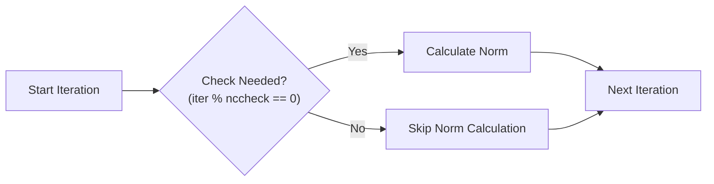

Sources: [nvshmem/jacobi.cu:521-547](), [multi_threaded_p2p_opt/jacobi.cu:361-399](), [nccl_graphs/jacobi.cpp:430-442]()

### Implementation

Most implementations use a command-line parameter `-nccheck` to control the frequency of norm checking:

```cpp
const int nccheck = get_argval<int>(argv, argv + argc, "-nccheck", 1);
// ...
// Within the main iteration loop
if ((iter % nccheck) == 0 || (!csv && (iter % 100) == 0)) {
    // Calculate and check norm
    CUDA_RT_CALL(cudaMemcpyAsync(l2_norm_bufs[curr].h, l2_norm_bufs[curr].d, 
        sizeof(real), cudaMemcpyDeviceToHost, compute_stream));
    // ...
}
```

The condition `(iter % nccheck) == 0` determines when to perform the norm calculation.

Sources: [nvshmem/jacobi.cu:273](), [nvshmem/jacobi.cu:521-547]()

## Memory Access Optimizations

### Block Reduction with CUB

The CUB (CUDA Unbound) library is used for efficient block-level reductions when calculating the L2 norm.

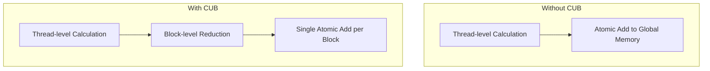

Sources: [nvshmem/jacobi.cu:163-168](), [nvshmem/jacobi.cu:187-192](), [multi_threaded_p2p_opt/jacobi.cu:104-131]()

### Implementation

The kernel implementation uses CUB for efficient reduction when available:

```cpp
#ifdef HAVE_CUB
typedef cub::BlockReduce<real, BLOCK_DIM_X, cub::BLOCK_REDUCE_WARP_REDUCTIONS, BLOCK_DIM_Y>
    BlockReduce;
__shared__ typename BlockReduce::TempStorage temp_storage;
// ...
#ifdef HAVE_CUB
real block_l2_norm = BlockReduce(temp_storage).Sum(local_l2_norm);
if (0 == threadIdx.y && 0 == threadIdx.x) atomicAdd(l2_norm, block_l2_norm);
#else
atomicAdd(l2_norm, local_l2_norm);
#endif  // HAVE_CUB
```

Sources: [multi_threaded_p2p_opt/jacobi.cu:104-131](), [nccl_graphs/jacobi_kernels.cu:77-102]()

## Optimization Technique Relationships

The following diagram illustrates the relationships between different optimization techniques and their impact on performance aspects:

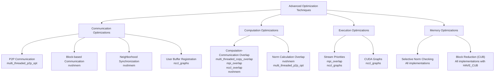

Sources: Multiple files across the repository

## Performance Impact of Optimizations

The following table summarizes the relative performance impact of different optimization techniques, based on the code comments and design patterns observed in the implementations:

| Optimization Technique | Function | Implementation | Performance Impact |
|------------------------|----------|----------------|-------------------|
| CUDA Graphs | Reduces kernel launch overhead | `nccl_graphs/jacobi.cpp` | High (eliminates CPU overhead) |
| Computation-Communication Overlap | Hides communication latency | Multiple implementations | High (improves GPU utilization) |
| P2P Communication | Removes CPU from data path | `multi_threaded_p2p*/jacobi.cu` | Medium-High (direct GPU-GPU transfers) |
| Block-based Communication | Reduces communication calls | `nvshmem/jacobi.cu` | Medium (more efficient transfers) |
| Neighborhood Synchronization | Reduces synchronization overhead | `nvshmem/jacobi.cu` | Medium (less waiting) |
| Stream Priorities | Schedules critical operations first | `nccl_graphs/jacobi.cpp` | Medium (better resource utilization) |
| Selective Norm Checking | Reduces convergence checking overhead | All implementations | Medium (fewer global reductions) |
| Block Reduction (CUB) | Efficient parallel reductions | All with `HAVE_CUB` | Low-Medium (faster reductions) |
| User Buffer Registration | Pre-registers communication buffers | `nccl_graphs/jacobi.cpp` | Low-Medium (reduces registration overhead) |

Sources: Multiple files across the repository

## Conclusion

The advanced optimization techniques described in this page form a comprehensive toolkit for improving the performance of multi-GPU applications. The Jacobi solver implementations demonstrate how these techniques can be combined to achieve significant speedups, with different programming models leveraging different combinations of optimizations.

When implementing multi-GPU applications, consider which of these techniques are applicable to your specific problem and programming model. The most significant gains typically come from overlapping computation and communication, using direct GPU-to-GPU transfers where possible, and reducing unnecessary synchronization.