# Page: Home

# Home

<details>
<summary>Relevant source files</summary>

The following files were used as context for generating this wiki page:

- [README.md](README.md)

</details>


## Overview and Purpose

This documentation covers the Multi-GPU Programming Models repository, which provides educational implementations of a Jacobi solver using various multi-GPU programming approaches. The repository serves as a practical guide to different techniques for distributing computational workloads across multiple GPUs, demonstrating performance characteristics and programming complexity trade-offs.

For detailed information on the Jacobi method theory, see [Jacobi Method Theory](#2).

Sources: [README.md:1-14]()

## Repository Structure

The repository contains multiple standalone implementations of the same Jacobi solver, each showcasing a different multi-GPU programming model:

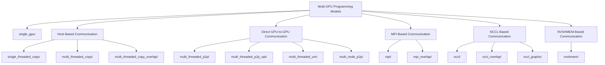

Each implementation is a complete, standalone project with its own Makefile, demonstrating specific techniques and optimizations for multi-GPU programming.

Sources: [README.md:2-15]()

## Implementation Categories

The repository organizes implementations into five main categories, each representing a different approach to multi-GPU programming:

### 1. Host-Based Communication

These implementations use the host (CPU) as an intermediary for transferring data between GPUs:

- **Single-Threaded Copy**: Uses sequential `cudaMemcpy` operations for inter-GPU communication
- **Multi-Threaded Copy**: Parallelizes data transfers with OpenMP
- **Multi-Threaded Copy with Overlap**: Hides communication latency by overlapping computation and communication

For more details, see [Host-Based Communication](#3.1).

### 2. Direct GPU-to-GPU Communication

These implementations leverage direct GPU-to-GPU data transfer capabilities:

- **Multi-Threaded P2P**: Uses GPUDirect P2P for direct device-to-device transfers
- **Multi-Threaded P2P Optimized**: Enhances P2P with delayed norm calculation
- **Multi-Threaded Unified Memory**: Simplifies memory management using CUDA Unified Memory
- **Multi-Node P2P**: Demonstrates advanced cross-node communication using CUDA Driver APIs

For more details, see [Direct GPU-to-GPU Communication](#3.2).

### 3. MPI-Based Communication

These implementations use the Message Passing Interface (MPI) for inter-GPU communication:

- **MPI**: Basic implementation with CUDA-aware MPI
- **MPI with Overlap**: Enhanced version with overlapped computation and communication

For more details, see [MPI-Based Communication](#3.3).

### 4. NCCL-Based Communication

These implementations use NVIDIA's Collective Communications Library (NCCL):

- **NCCL**: Basic implementation using NCCL primitives
- **NCCL with Overlap**: Enhanced with computation-communication overlap
- **NCCL with CUDA Graphs**: Advanced implementation using CUDA Graphs for optimized kernel launches

For more details, see [NCCL-Based Communication](#3.4).

### 5. NVSHMEM-Based Communication

This implementation uses NVIDIA's Symmetric Hierarchical Memory (NVSHMEM) library:

- **NVSHMEM**: Implementation using NVSHMEM's PGAS (Partitioned Global Address Space) model

For more details, see [NVSHMEM-Based Communication](#3.5).

Sources: [README.md:3-15]()

## Implementation Evolution

The implementations in this repository demonstrate an evolution of multi-GPU programming techniques, from simple to more sophisticated approaches:

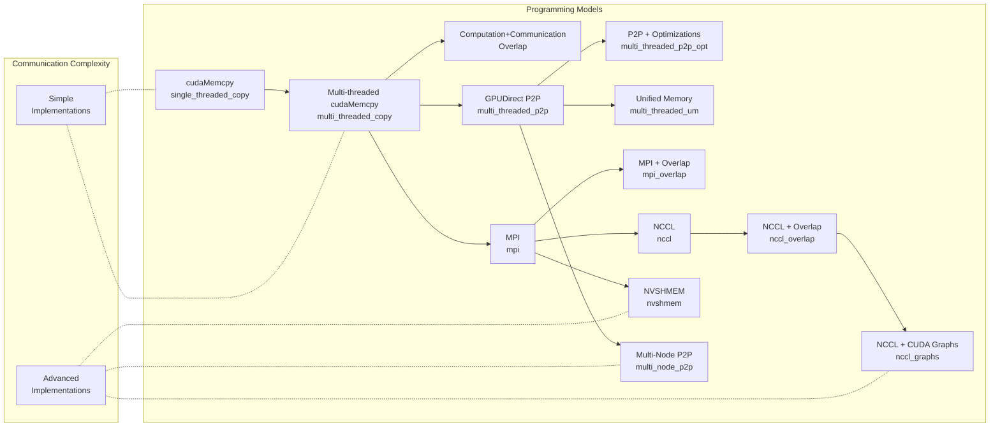

This progression demonstrates increasing levels of performance optimization and programming complexity, from simple host-based transfers to sophisticated distributed memory models.

Sources: [README.md:2-15]()

## Key Optimization Techniques

The repository demonstrates several key optimization techniques across the different implementations:

| Technique | Description | Implementations |
|-----------|-------------|----------------|
| Multi-threading | Uses OpenMP to parallelize host operations | `multi_threaded_*` |
| Computation-Communication Overlap | Hides communication latency by overlapping with computation | `multi_threaded_copy_overlap`, `mpi_overlap`, `nccl_overlap`, `nvshmem` (`norm_overlap`) |
| Direct P2P Transfers | Uses GPUDirect P2P for efficient GPU-to-GPU communication | `multi_threaded_p2p`, `multi_threaded_p2p_opt`, `multi_node_p2p` |
| CUDA Streams | Uses multiple streams for concurrent operations | All implementations |
| High-Priority Streams | Optimizes boundary kernels with high-priority streams | `mpi_overlap` (`use_hp_streams`) |
| CUDA Graphs | Reduces kernel launch overhead | `nccl_graphs` |
| Selective Norm Checking | Reduces synchronization overhead | All (via `nccheck` parameter) |
| Neighborhood Synchronization | Optimizes synchronization in NVSHMEM | `nvshmem` (`neighborhood_sync`) |
| User Buffer Registration | Avoids extra copies in NCCL communication | NCCL variants (`user_buffer_reg`) |

Sources: [README.md:44-61]()

## Anatomy of the Jacobi Solver

The core computational structure implemented across all variants is a Jacobi relaxation solver for a 2D Laplace equation, visualized below:

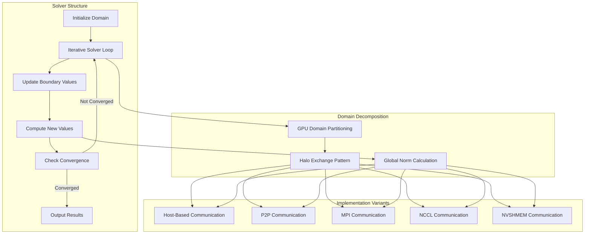

Each implementation maintains the same computational algorithm but differs in how data is exchanged between GPUs and how global operations like norm calculation are performed.

Sources: [README.md:2-61]()

## System Requirements

The different implementations have varying requirements:

| Requirement | Version | Needed For |
|-------------|---------|------------|
| CUDA | 11.0+ (9.2+ with `DISABLE_CUB=1`) | All variants |
| CUDA | 11.7+ and Driver 515.65.01+ | `nccl_graphs` |
| CUDA | 12.4+ and Driver 550.54.14+ with NVIDIA IMEX daemon | `multi_node_p2p` |
| OpenMP | Any recent version | Multi-threaded variants |
| MPI (CUDA-aware) | Any recent version | `mpi` and `mpi_overlap` |
| MPI (non CUDA-aware) | Any recent version | NVSHMEM, NCCL and `multi_node_p2p` |
| NVSHMEM | 0.4.1+ | `nvshmem` |
| NCCL | 2.8+ | NCCL variants |
| NCCL | 2.15.1+ | `nccl_graphs` |
| NCCL | 2.19.1+ (2.23.4+ for full support) | NCCL variants with `user_buffer_reg` |

For more detailed building and running instructions, see [Building and Running](#5).

Sources: [README.md:24-31]()

## Getting Started

Each implementation is a standalone project with its own Makefile. To build any variant, navigate to its directory and run `make`:

```bash
cd multi_threaded_copy
make
```

All implementations support common command-line options:

| Option | Description | Default |
|--------|-------------|---------|
| `-niter` | Number of iterations | 1000 |
| `-nccheck` | Convergence check frequency | 1 |
| `-nx` | Domain size in x direction | 16384 |
| `-ny` | Domain size in y direction | 16384 |
| `-csv` | Print results as CSV | - |

Some implementations provide additional options specific to their programming model.

For performance benchmarking, you can use the provided `bench.sh` script.

Sources: [README.md:33-63]()

## Historical Context

The implementations in this repository have been featured in several NVIDIA GTC presentations:

- GTC Europe 2017: Session 23031 - Multi GPU Programming Models
- GTC 2019: Session S9139 - Multi GPU Programming Models
- GTC 2021: Session A31140 - Multi-GPU Programming Models

Some examples also form the basis for an interactive tutorial available at: [FZJ-JSC/tutorial-multi-gpu](https://github.com/FZJ-JSC/tutorial-multi-gpu).

Sources: [README.md:17-22]()

---

# Page: Jacobi Method Theory

# Jacobi Method Theory

<details>
<summary>Relevant source files</summary>

The following files were used as context for generating this wiki page:

- [README.md](README.md)
- [single_gpu/jacobi.cu](single_gpu/jacobi.cu)

</details>


## Purpose and Scope

This document explains the mathematical basis and algorithmic approach of the Jacobi relaxation method, which forms the foundation for all implementations in the Multi-GPU Programming Models repository. The Jacobi method is an iterative technique for solving systems of linear equations, often applied to discretized partial differential equations (PDEs). For information about specific multi-GPU implementations, see [Multi-GPU Programming Models](#3).

## Mathematical Foundation

The Jacobi method is a classic iterative approach for solving a system of linear equations represented as Ax = b, where A is a square matrix, b is a known vector, and x is the solution vector we seek.

### Basic Iterative Formula

For a system of n linear equations, the Jacobi method can be formulated as:

$$x_i^{(k+1)} = \frac{1}{a_{ii}} \left( b_i - \sum_{j=1, j \neq i}^{n} a_{ij}x_j^{(k)} \right)$$

Where:
- $x_i^{(k+1)}$ is the i-th component of x in iteration k+1
- $a_{ii}$ is the diagonal element of matrix A
- $a_{ij}$ are the non-diagonal elements
- $x_j^{(k)}$ are the components from the previous iteration

The method requires the diagonal elements of A to be non-zero and, for guaranteed convergence, that A is diagonally dominant.

Sources: [single_gpu/jacobi.cu:98-136]()

### Matrix Formulation

Using matrix notation, each iteration of the Jacobi method can be expressed as:

$$x^{(k+1)} = D^{-1}(b - (L + U)x^{(k)})$$

Where D, L, and U are the diagonal, strictly lower triangular, and strictly upper triangular parts of matrix A, respectively.

## Application to PDEs

### Discretized Laplace Equation

The repository implements the Jacobi method to solve the 2D Laplace equation:

$$\nabla^2 u(x,y) = \frac{\partial^2 u}{\partial x^2} + \frac{\partial^2 u}{\partial y^2} = 0$$

Using finite differences on a uniform grid with spacing h, this equation is discretized as:

$$\frac{u_{i+1,j} + u_{i-1,j} + u_{i,j+1} + u_{i,j-1} - 4u_{i,j}}{h^2} = 0$$

Rearranging to match the Jacobi iteration format:

$$u_{i,j}^{(k+1)} = \frac{1}{4}(u_{i+1,j}^{(k)} + u_{i-1,j}^{(k)} + u_{i,j+1}^{(k)} + u_{i,j-1}^{(k)})$$

This is precisely what we see implemented in the Jacobi kernel in the codebase.

Sources: [single_gpu/jacobi.cu:113-114]()

### The 5-Point Stencil Pattern

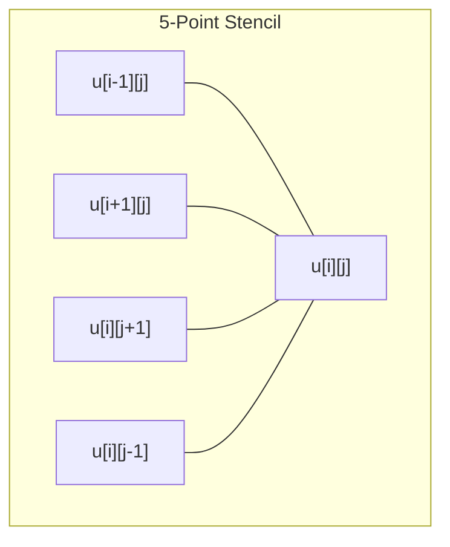

The 5-point stencil is the computational pattern used in the Jacobi method for 2D PDEs. For each grid point, the new value is calculated as the average of its four neighboring points.

Sources: [single_gpu/jacobi.cu:98-136]()

## Algorithmic Implementation

### Core Algorithm Flow

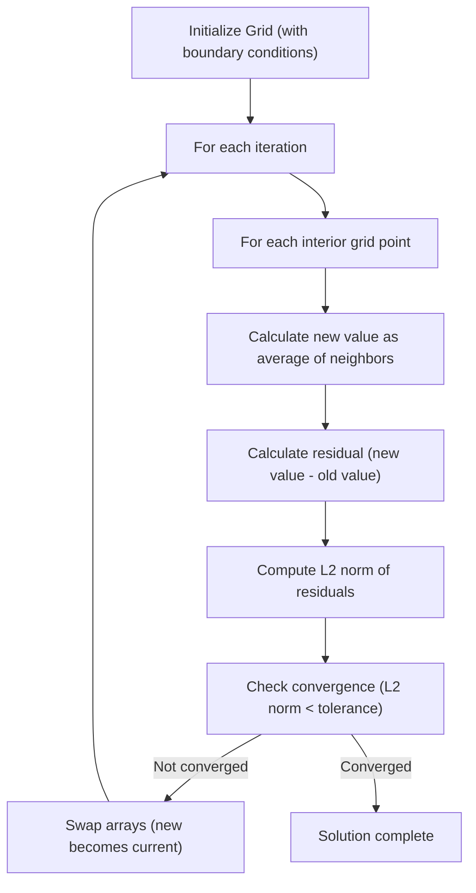

The implementation follows this classic iterative approach, with parallel execution of the interior grid point calculations on the GPU.

Sources: [single_gpu/jacobi.cu:245-289]()

### Convergence Criteria

The algorithm monitors convergence by calculating the L2 norm of the residuals:

$$\textrm{L2 norm} = \sqrt{\sum_{i,j} (u_{i,j}^{(k+1)} - u_{i,j}^{(k)})^2}$$

The iterations continue until this norm falls below a specified tolerance (in the code, `tol = 1.0e-8`), or until the maximum number of iterations is reached.

Sources: [single_gpu/jacobi.cu:83](), [single_gpu/jacobi.cu:126-127](), [single_gpu/jacobi.cu:272-273]()

## Implementation in the Codebase

### Boundary Conditions

The code sets Dirichlet boundary conditions along the left and right borders of the grid:

$$u(0, y) = u(nx-1, y) = \sin(2\pi y/(ny-1))$$

These boundary values remain fixed throughout the computation.

Sources: [single_gpu/jacobi.cu:87-96]()

### Kernel Structure

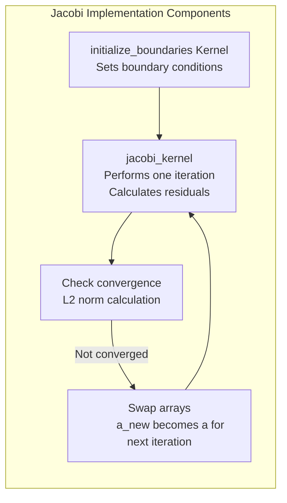

The GPU implementation divides work into thread blocks, with each thread responsible for computing a single grid point. The codebase uses CUDA block reduction (via CUB library if available) to efficiently compute the L2 norm.

Sources: [single_gpu/jacobi.cu:98-136](), [single_gpu/jacobi.cu:87-96](), [single_gpu/jacobi.cu:245-289]()

## Multi-GPU Domain Decomposition

When implemented across multiple GPUs, the domain (grid) is partitioned, with each GPU handling a portion of the grid.

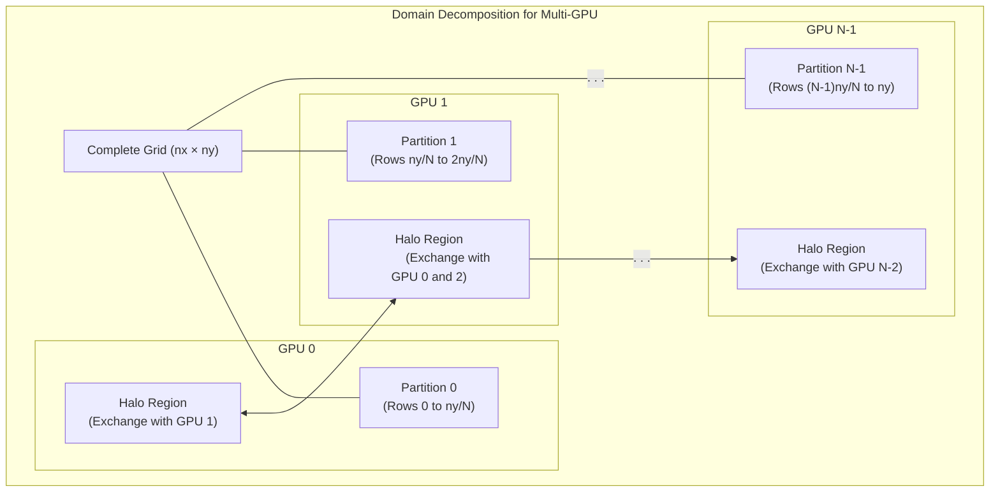

This domain decomposition requires communication between GPUs to exchange halo or ghost regions - the boundary rows that need to be shared between adjacent partitions. The different implementations in the repository use various communication methods for this exchange, ranging from simple host-based transfers to sophisticated GPU-direct approaches.

## Parallel Performance Considerations

The Jacobi method has several characteristics that make it well-suited for GPU implementation:

1. **High Arithmetic Intensity**: Each grid point calculation involves multiple arithmetic operations, which can be efficiently parallelized.

2. **Structured Grid**: The regular grid structure maps well to GPU thread organization.

3. **Local Computations**: Each new value depends only on immediate neighbors, leading to good cache locality.

4. **Regular Communication Pattern**: In multi-GPU implementations, the halo exchange follows a regular pattern, enabling optimization of communication.

However, there are also challenges:

1. **Memory Bandwidth Limitations**: The method is often memory-bound, as each grid point must read/write multiple memory locations.

2. **Synchronization Requirements**: Each iteration requires global synchronization, which can limit scaling.

3. **Convergence Rate**: The Jacobi method converges relatively slowly, making acceleration techniques important.

The different implementations in this repository explore various techniques to address these challenges in multi-GPU environments.

Sources: [README.md:1-72]()

## Variations and Optimizations

The repository implements several variations of the basic Jacobi method, including:

- Overlapping computation and communication to hide latency
- Delayed norm calculation to reduce synchronization overhead
- Various communication patterns for halo exchange

These optimizations are covered in other wiki pages specific to each implementation approach.

---

# Page: Multi-GPU Programming Models

# Multi-GPU Programming Models

<details>
<summary>Relevant source files</summary>

The following files were used as context for generating this wiki page:

- [README.md](README.md)
- [bench.sh](bench.sh)
- [nccl/Makefile](nccl/Makefile)
- [nccl/jacobi_kernels.cu](nccl/jacobi_kernels.cu)
- [nccl_overlap/Makefile](nccl_overlap/Makefile)

</details>


This document provides an overview of the multi-GPU programming models implemented in the repository. These models demonstrate different approaches for distributing the Jacobi solver algorithm across multiple GPUs, each with distinct characteristics, performance trade-offs, and implementation complexity. For information about the mathematical background, see [Jacobi Method Theory](#2).

## Purpose and Scope

The repository contains multiple implementations of a Jacobi solver using different multi-GPU programming paradigms. Each implementation solves the same problem but uses a different approach to:

1. Distribute data across multiple GPUs
2. Manage communication between GPUs
3. Synchronize computations
4. Optimize performance through various techniques

This page provides a high-level overview of the programming models, while subsequent pages explore each model in detail.

Sources: [README.md:1-15]()

## Multi-GPU Programming Model Categories

The implementations in the repository are organized into five major categories:

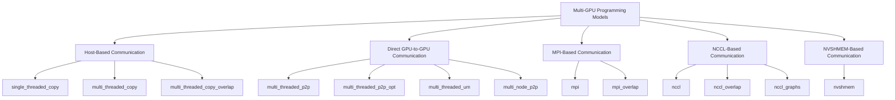

Sources: [README.md:1-15]()

### Communication Abstraction Levels

The implementations demonstrate progressively more sophisticated communication mechanisms, from basic memory transfers to advanced distributed memory models:

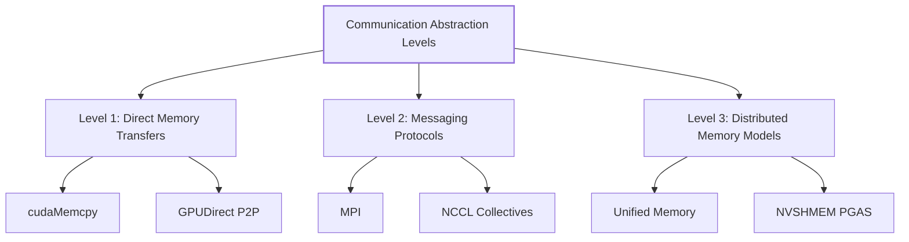

Sources: [README.md:2-15]()

## Host-Based Communication Models

The host-based communication models use the CPU as an intermediary for transferring data between GPUs. Data must be copied from one GPU to the host memory and then to another GPU.

### Single-Threaded Copy

The simplest approach uses sequential `cudaMemcpy` operations managed by a single CPU thread to transfer halo regions between GPUs.

Key characteristics:
- Uses a single thread for managing all data transfers
- Simple implementation but limited scaling
- Becomes a bottleneck as GPU count increases

For more details, see [Single-Threaded Copy](#3.1.1).

### Multi-Threaded Copy

Improves upon the single-threaded approach by using OpenMP to parallelize the data transfers.

Key characteristics:
- One CPU thread per GPU for managing transfers
- Better scaling than single-threaded version
- Still requires host memory as intermediary

For more details, see [Multi-Threaded Copy](#3.1.2).

### Multi-Threaded Copy with Overlap

Further improves performance by overlapping computation and communication.

Key characteristics:
- Uses CUDA streams to execute communication and computation concurrently
- Interior points computed while boundary data transfers occur
- Reduces the effective communication overhead

For more details, see [Multi-Threaded Copy with Overlap](#3.1.3).

Sources: [README.md:3-5](), [bench.sh:95-155]()

## Direct GPU-to-GPU Communication Models

These models leverage hardware capabilities to enable direct communication between GPUs without host involvement, significantly reducing communication overhead.

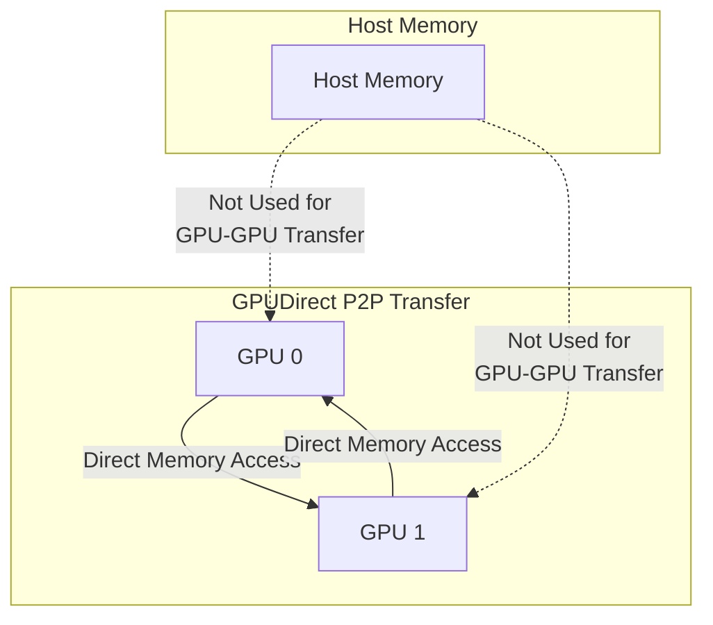

Sources: [README.md:6-8]()

### Multi-Threaded P2P

Uses NVIDIA's GPUDirect Peer-to-Peer (P2P) technology to enable direct memory access between GPUs.

Key characteristics:
- Direct access to remote GPU memory
- Eliminates host memory copies
- Requires peer mapping capability between GPUs
- Significantly lower latency than host-based transfers

For more details, see [Multi-Threaded P2P](#3.2.1).

### Multi-Threaded P2P Optimized

Extends the P2P model with optimized norm calculation.

Key characteristics:
- Delayed norm calculation to reduce synchronization points
- Improved performance through fewer global synchronizations
- Same direct memory access benefits as basic P2P

For more details, see [Multi-Threaded P2P Optimized](#3.2.2).

### Unified Memory

Uses CUDA Unified Memory to automatically manage data transfers between GPUs.

Key characteristics:
- Simplified programming model
- Hardware-managed page migration
- Transparent peer mappings
- Can be less performant than explicit P2P in some cases

For more details, see [Unified Memory](#3.2.3).

### Multi-Node P2P

Advanced implementation for cross-node P2P communication.

Key characteristics:
- Uses low-level CUDA Driver APIs
- Virtual Memory Management and Multicast Object Management
- Enables P2P communication across compute nodes
- Demonstrates techniques used internally by libraries like NCCL and NVSHMEM

For more details, see [Multi-Node P2P](#3.2.4).

Sources: [README.md:6-8](), [README.md:15]()

## MPI-Based Communication Models

These models use Message Passing Interface (MPI) for inter-GPU communication, particularly beneficial in distributed memory environments.

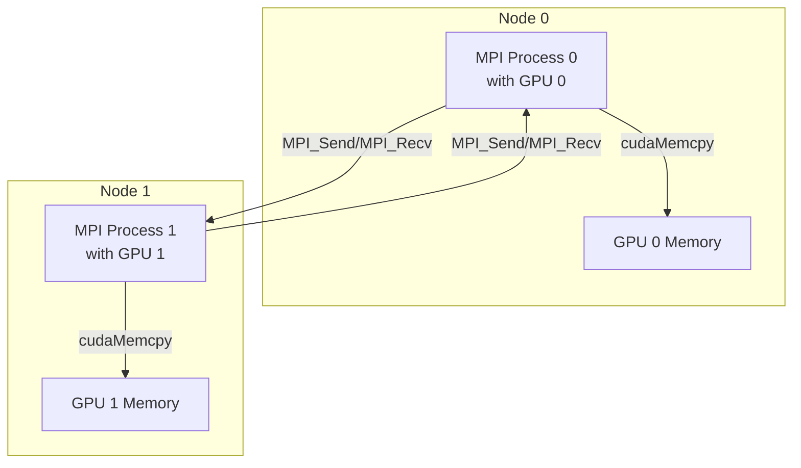

Sources: [README.md:9-10]()

### Basic MPI Implementation

Uses CUDA-aware MPI to facilitate GPU-to-GPU communication.

Key characteristics:
- One MPI process per GPU
- CUDA-aware MPI for direct GPU buffer operations
- Works across compute nodes in a cluster
- Synchronous communication pattern

For more details, see [MPI Implementation](#3.3.1).

### MPI with Computation-Communication Overlap

Enhances the basic MPI implementation with overlapped communication and computation.

Key characteristics:
- Uses non-blocking MPI operations
- Dedicated CUDA streams for boundary exchanges
- Interior computation proceeds while boundaries are being exchanged
- Optional high-priority streams for boundary operations

For more details, see [MPI with Computation-Communication Overlap](#3.3.2).

Sources: [README.md:9-10](), [bench.sh:193-209]()

## NCCL-Based Communication Models

These models leverage NVIDIA's Collective Communications Library (NCCL) for optimized GPU-to-GPU communication, particularly efficient for collective operations.

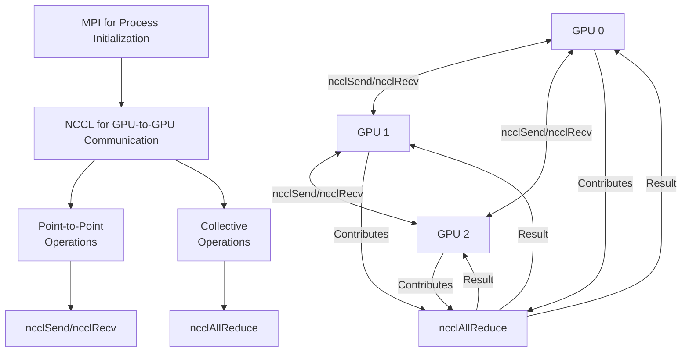

Sources: [README.md:11-13](), [nccl/Makefile:1-44]()

### Basic NCCL Implementation

Uses NCCL for efficient GPU-to-GPU data exchange.

Key characteristics:
- Optimized communication paths based on hardware topology
- Uses MPI for process initialization
- Efficient handling of both point-to-point and collective operations
- Advanced support for NVLINK interconnect

For more details, see [NCCL Implementation](#3.4.1).

### NCCL with Overlap

Combines NCCL with computation-communication overlap.

Key characteristics:
- Uses NCCL's asynchronous operations
- Boundary exchanges occur concurrently with interior computation
- Reduced overall execution time
- Optional user buffer registration for reduced memory copies

For more details, see [NCCL with Overlap](#3.4.2).

### NCCL with CUDA Graphs

Integrates CUDA Graphs with NCCL for reduced kernel launch overhead.

Key characteristics:
- Captures sequence of CUDA operations in a graph
- Reduces CPU overhead for kernel launches
- Allows the driver to optimize execution
- Requires CUDA 11.7+ and newer NCCL versions

For more details, see [NCCL with CUDA Graphs](#3.4.3).

Sources: [README.md:11-13](), [nccl/Makefile:1-44](), [nccl_overlap/Makefile:1-44](), [nccl/jacobi_kernels.cu:1-116]()

## NVSHMEM-Based Communication

NVSHMEM implements a Partitioned Global Address Space (PGAS) programming model specifically for GPUs.

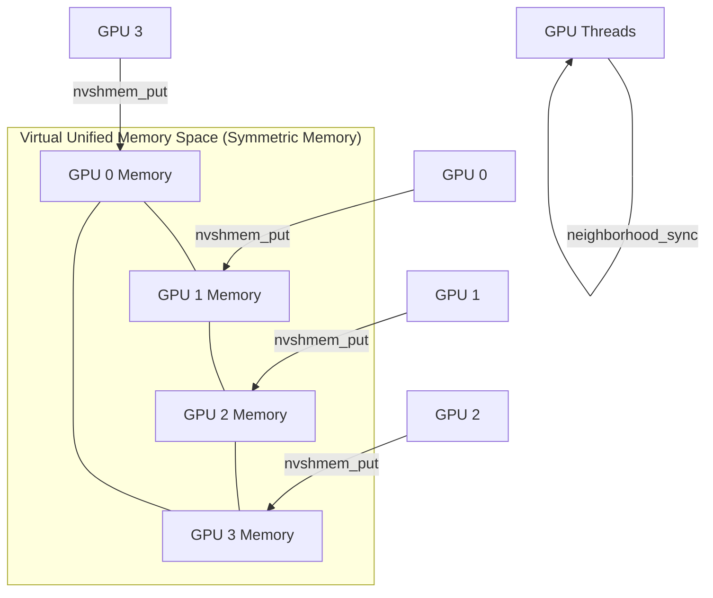

Sources: [README.md:14](), [bench.sh:238-258]()

Key characteristics:
- One-sided communication operations
- Remote memory access without remote process involvement
- GPU-initiated communication
- Global synchronization primitives
- Optional neighborhood synchronization for better performance
- Optional computation-communication overlap
- Block cooperative communication option

Advanced features:
- Neighborhood synchronization for reduced synchronization scope
- Delayed norm execution similar to P2P optimized version
- Configurable symmetric memory size

For more details, see [NVSHMEM-Based Communication](#3.5).

## Implementation and Performance Considerations

When choosing between multi-GPU programming models, consider:

| Programming Model | Advantages | Disadvantages | Best Use Cases |
|-------------------|------------|---------------|----------------|
| Host-Based Communication | Simple implementation<br>Works with any GPU configuration | Host memory bottleneck<br>Higher latency | Small scale (2-4 GPUs)<br>When P2P not available |
| Direct P2P | Low latency<br>High bandwidth | Requires P2P capability between GPUs<br>Limited to single node | Single node with NVLink<br>High performance requirements |
| MPI-Based | Works across multiple nodes<br>Portable standard | Complex programming model<br>May require CUDA-aware MPI | Multi-node clusters<br>HPC environments |
| NCCL-Based | Optimized for NVIDIA GPUs<br>Collective operations support | NVIDIA-specific<br>Requires recent drivers | Deep learning<br>Applications with collectives |
| NVSHMEM-Based | One-sided communication<br>Low synchronization overhead | Requires symmetric memory allocation<br>Newer technology | Irregular communication patterns<br>Fine-grained communication |

Sources: [README.md:1-15](), [bench.sh:1-258]()

## Programming Model Evolution Path

The implementations in this repository demonstrate a natural evolution of multi-GPU programming techniques, from simple to more sophisticated approaches:

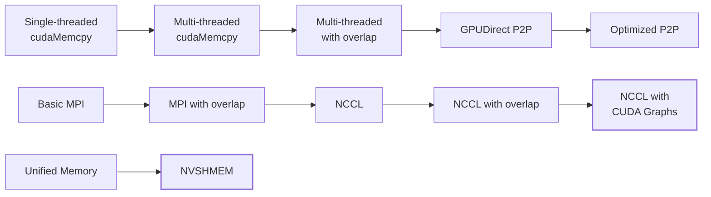

Sources: [README.md:1-15](), [bench.sh:1-258]()

## Summary of Required Technologies

The multi-GPU programming models in this repository rely on several key technologies:

- **CUDA**: Foundation for all implementations (version 11.0+ recommended)
- **OpenMP**: Required for multi-threaded implementations
- **MPI**: Required for distributed implementations (CUDA-aware MPI recommended)
- **NCCL**: Required for NCCL-based implementations (version 2.8+)
- **NVSHMEM**: Required for NVSHMEM implementation (version 0.4.1+)
- **CUDA Graphs**: Required for NCCL with CUDA Graphs (CUDA 11.7+)
- **CUDA Driver APIs**: Required for multi-node P2P (CUDA 12.4+)

For specific version requirements and compatibility information, see [Building and Running](#5).

Sources: [README.md:24-31]()

## Benchmarking

The repository includes a benchmarking script (`bench.sh`) that can evaluate the performance of all implementations with various GPU configurations. The script:

- Controls GPU visibility for different test configurations
- Manages thread and process pinning for consistent results
- Collects performance results in CSV format
- Automatically finds the best result from multiple runs

For detailed benchmarking results and comparative analysis, see [Performance Comparison and Benchmarking](#4).

Sources: [bench.sh:1-258]()

---

# Page: Host-Based Communication

# Host-Based Communication

<details>
<summary>Relevant source files</summary>

The following files were used as context for generating this wiki page:

- [multi_threaded_copy/jacobi.cu](multi_threaded_copy/jacobi.cu)
- [multi_threaded_copy_overlap/jacobi.cu](multi_threaded_copy_overlap/jacobi.cu)
- [single_threaded_copy/jacobi.cu](single_threaded_copy/jacobi.cu)

</details>


This page provides detailed information about the Host-Based Communication model for multi-GPU programming used in the Jacobi solver implementations. Host-Based Communication refers to the approach where data is exchanged between GPUs by routing it through the host (CPU) memory rather than using direct GPU-to-GPU communication mechanisms.

For implementations that use direct GPU-to-GPU communication, see [Direct GPU-to-GPU Communication](#3.2).

## Overview

Host-Based Communication serves as the baseline multi-GPU approach in the repository, establishing a foundation for more advanced methods. It includes three implementations of increasing sophistication:

1. **Single-Threaded Copy**: Basic implementation with a single CPU thread coordinating all data transfers
2. **Multi-Threaded Copy**: Uses OpenMP to parallelize data transfers with one CPU thread per GPU
3. **Multi-Threaded Copy with Overlap**: Optimizes performance by overlapping computation with communication

All three approaches follow the same general pattern of domain decomposition and halo exchange, but differ in how they manage the CPU resources and coordinate the data transfers.

## Domain Decomposition

Each implementation divides the 2D Jacobi grid along the y-axis (rows) among available GPUs, with each GPU responsible for a portion of the domain. The decomposition aims to balance the workload by allocating approximately the same number of rows to each GPU, accounting for cases where the number of rows doesn't divide evenly.

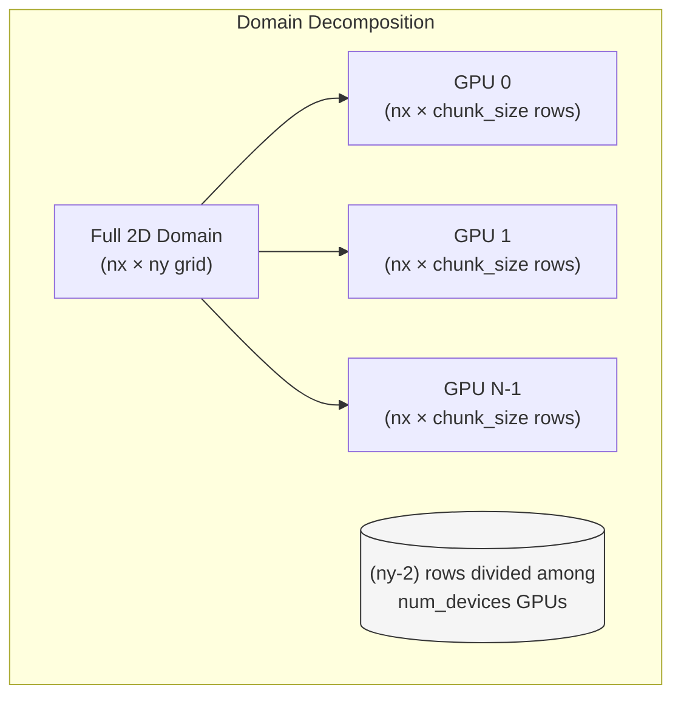

Sources: [single_threaded_copy/jacobi.cu:194-226](), [multi_threaded_copy/jacobi.cu:197-226]()

## Communication Pattern

The Host-Based Communication model follows a standard halo exchange pattern where each GPU must share its boundary data with neighboring GPUs to enable the stencil computation. The key distinction of this approach is that these exchanges occur through host memory:

```mermaid
sequenceDiagram
    participant GPU_i-1 as "GPU i-1"
    participant Host
    participant GPU_i as "GPU i"
    participant GPU_i+1 as "GPU i+1"
    
    Note over GPU_i-1,GPU_i+1: Each iteration requires boundary exchange
    
    GPU_i->>Host: Copy bottom row
    Host->>GPU_i+1: Copy to top halo
    
    GPU_i->>Host: Copy top row
    Host->>GPU_i-1: Copy to bottom halo
    
    Note over GPU_i-1,GPU_i+1: Computation can proceed after exchanges
```

Sources: [single_threaded_copy/jacobi.cu:338-349](), [multi_threaded_copy/jacobi.cu:329-339]()

## Implementation Details

### Single-Threaded Copy

The Single-Threaded Copy is the simplest implementation that uses a single CPU thread to coordinate all operations. This approach may become a bottleneck when scaling to multiple GPUs as the CPU thread must sequentially handle all data transfers.

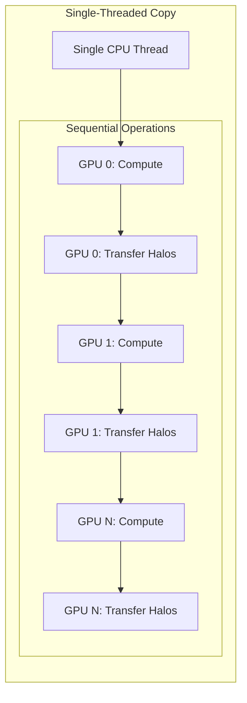

Key implementation characteristics:

- A single thread coordinates memory transfers for all GPUs sequentially
- Uses CUDA streams for asynchronous operations but still limited by single-thread coordination
- For each iteration, all devices wait for the previous device's operations to complete

Sources: [single_threaded_copy/jacobi.cu:306-365]()

### Multi-Threaded Copy

The Multi-Threaded Copy implementation uses OpenMP to parallelize the control of multiple GPUs, with one CPU thread per GPU. This avoids the sequential bottleneck of the single-threaded approach.

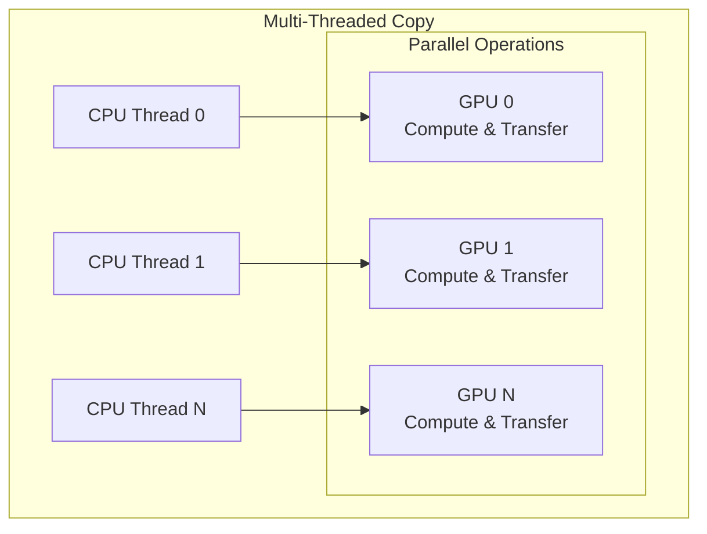

Key implementation characteristics:

- Uses `#pragma omp parallel num_threads(num_devices)` to create one thread per GPU
- Each thread controls a single GPU and its associated memory transfers
- Uses OpenMP barriers for synchronization at critical points
- All threads compute and communicate in parallel but still synchronize at specific points

Sources: [multi_threaded_copy/jacobi.cu:174-426]()

### Multi-Threaded Copy with Overlap

The Multi-Threaded Copy with Overlap implementation adds further optimization by dividing the computation into "bulk" and "boundary" regions, allowing computation and communication to occur simultaneously.

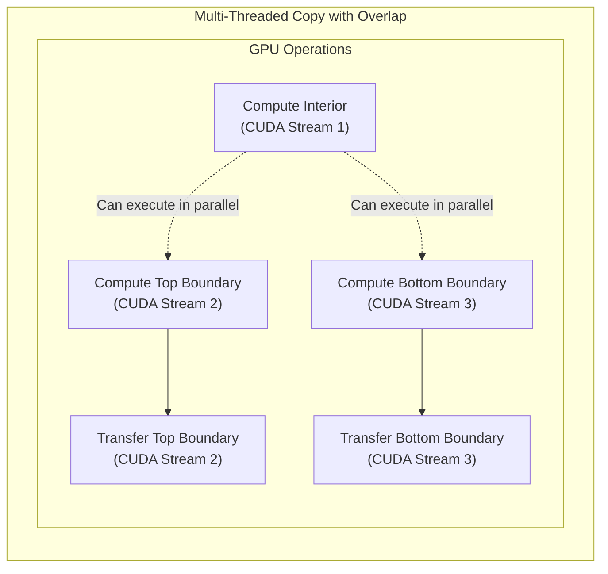

Key implementation characteristics:

- Uses stream priorities to optimize resource allocation
- Divides domain computation into:
  - Interior computation that doesn't depend on boundaries
  - Boundary computation that depends on halo exchanges
- Uses separate CUDA streams for:
  - Main computation (compute_stream)
  - Top boundary exchange (push_top_stream)
  - Bottom boundary exchange (push_bottom_stream)
- Enables overlapping of computation and communication

Sources: [multi_threaded_copy_overlap/jacobi.cu:237-356]()

## Code Structure and Key Components

The following diagram illustrates the key code components and their relationships in the Host-Based implementations:

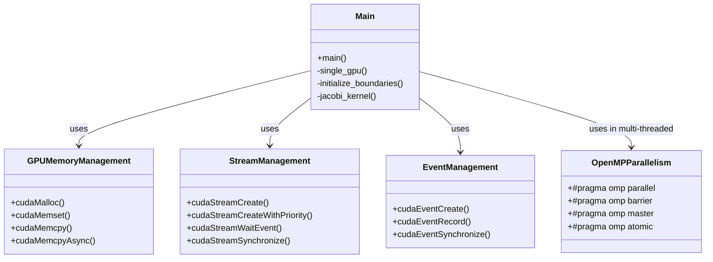

Sources: [single_threaded_copy/jacobi.cu:152-552](), [multi_threaded_copy/jacobi.cu:152-547](), [multi_threaded_copy_overlap/jacobi.cu:152-571]()

## Key Data Structures and Variables

The Host-Based implementations share common data structures for managing multiple GPUs:

| Variable/Array | Purpose |
|----------------|---------|
| `a`, `a_new` | Arrays storing the Jacobi grid data on each GPU |
| `compute_stream` | CUDA stream for main computation |
| `push_top_stream`, `push_bottom_stream` | CUDA streams for halo exchanges |
| `push_top_done`, `push_bottom_done` | CUDA events to synchronize halo exchanges |
| `l2_norm_d`, `l2_norm_h` | Device and host pointers for convergence checking |
| `iy_start`, `iy_end` | Domain boundaries for each GPU |
| `chunk_size` | Number of rows assigned to each GPU |

Sources: [multi_threaded_copy/jacobi.cu:159-165](), [single_threaded_copy/jacobi.cu:161-180]()

## Performance Considerations

The three Host-Based Communication implementations demonstrate a progression in performance optimization:

1. **Single-Threaded Copy**: Simplest but limited by sequential operations
2. **Multi-Threaded Copy**: Improves performance by parallelizing GPU control
3. **Multi-Threaded Copy with Overlap**: Further improves performance by overlapping computation and communication

```mermaid
gantt
    title "Execution Timeline Comparison"
    dateFormat s
    axisFormat %S
    
    section Single-Threaded
    GPU0 Compute      :0, 1
    GPU0 Transfer     :1, 2
    GPU1 Compute      :2, 3
    GPU1 Transfer     :3, 4
    
    section Multi-Threaded  
    GPU0 Compute      :0, 1
    GPU0 Transfer     :1, 2
    GPU1 Compute      :0, 1
    GPU1 Transfer     :1, 2
    
    section With Overlap
    GPU0 Interior     :0, 1
    GPU0 Boundary+Transfer :crit, 0.5, 1.5
    GPU1 Interior     :0, 1
    GPU1 Boundary+Transfer :crit, 0.5, 1.5
```

Sources: [multi_threaded_copy_overlap/jacobi.cu:312-386](), [multi_threaded_copy/jacobi.cu:304-366](), [single_threaded_copy/jacobi.cu:306-365]()

## Common Limitations of Host-Based Communication

While these implementations provide a basis for multi-GPU programming, they have inherent limitations:

1. **Host Memory Bottleneck**: All data transfers must pass through host memory, which has lower bandwidth than direct GPU-to-GPU transfers
2. **PCIe Overhead**: Multiple PCIe transfers (GPU→Host→GPU) incur additional latency
3. **Synchronization Overheads**: Explicit synchronization required between computation and communication

For more advanced approaches that address these limitations, see:
- [Direct GPU-to-GPU Communication](#3.2) for P2P transfers that bypass host memory
- [MPI-Based Communication](#3.3) for scalable distributed memory communication
- [NCCL-Based Communication](#3.4) for optimized collective operations

## Summary

Host-Based Communication provides the foundation for multi-GPU programming in the Jacobi solver implementations. While not the most efficient approach for modern GPU systems, it demonstrates the basic concepts of domain decomposition, halo exchange, and the progressive optimization techniques that can be applied to improve performance.

The single-threaded, multi-threaded, and overlapped implementations represent increasing levels of sophistication in managing the CPU-GPU relationship and optimizing the coordination of computation and communication.

---

# Page: Single-Threaded Copy

# Single-Threaded Copy

<details>
<summary>Relevant source files</summary>

The following files were used as context for generating this wiki page:

- [single_threaded_copy/jacobi.cu](single_threaded_copy/jacobi.cu)

</details>


## Purpose and Overview

This document covers the Single-Threaded Copy implementation of the Jacobi solver in the multi-GPU programming models repository. This implementation represents the most basic approach to distributing the Jacobi iteration across multiple GPUs, using sequential, host-coordinated memory transfers between devices. For more advanced communication approaches, see [Multi-Threaded Copy](#3.1.2) and [Multi-Threaded P2P](#3.2.1).

The single-threaded copy approach serves as a baseline implementation that demonstrates fundamental concepts of multi-GPU programming while being straightforward to understand.

Sources: [single_threaded_copy/jacobi.cu:1-554]()

## Implementation Architecture

### Domain Decomposition and Data Flow

This diagram illustrates how the 2D grid is divided among multiple GPUs and how data flows between them:

```mermaid
flowchart TD
    subgraph "Single-Threaded Copy Architecture"
        direction TB
        
        host["Host CPU Thread"]
        
        subgraph "Device Memory"
            gpu0["GPU 0 Domain"]
            gpu1["GPU 1 Domain"]
            gpuN["GPU N-1 Domain"]
        end
        
        host -->|"1. Launch compute kernels"| gpu0
        host -->|"1. Launch compute kernels"| gpu1
        host -->|"1. Launch compute kernels"| gpuN
        
        gpu0 -->|"2. Sequential boundary exchange"| host
        gpu1 -->|"2. Sequential boundary exchange"| host
        gpuN -->|"2. Sequential boundary exchange"| host
        
        host -->|"3. Distribute boundaries"| gpu0
        host -->|"3. Distribute boundaries"| gpu1 
        host -->|"3. Distribute boundaries"| gpuN
        
        host -->|"4. Convergence check"| host
    end
```

Sources: [single_threaded_copy/jacobi.cu:306-366]()

### Memory Management and Halo Regions

```mermaid
flowchart TB
    subgraph "Domain Distribution"
        direction TB
        fullDomain["Full 2D Domain (nx × ny)"]
        
        subgraph "GPU Memory Layout"
            direction TB
            gpu0[("GPU 0")]
            gpu1[("GPU 1")]
            gpuN[("GPU N-1")]
            
            subgraph "GPU 0 Memory"
                direction TB
                topHalo0["Top halo row (from GPU N-1)"]
                chunk0["Computational chunk (chunk_size[0] rows)"]
                bottomHalo0["Bottom halo row (from GPU 1)"]
            end
            
            subgraph "GPU 1 Memory"
                direction TB
                topHalo1["Top halo row (from GPU 0)"]
                chunk1["Computational chunk (chunk_size[1] rows)"]
                bottomHalo1["Bottom halo row (from GPU 2)"]
            end
            
            subgraph "GPU N-1 Memory"
                direction TB
                topHaloN["Top halo row (from GPU N-2)"]
                chunkN["Computational chunk (chunk_size[N-1] rows)"]
                bottomHaloN["Bottom halo row (from GPU 0)"]
            end
        end
        
        fullDomain --> gpu0
        fullDomain --> gpu1
        fullDomain --> gpuN
    end
```

Sources: [single_threaded_copy/jacobi.cu:209-213](), [single_threaded_copy/jacobi.cu:227-231]()

## Key Components

### Memory Allocation and Initialization

The implementation starts by allocating memory on each GPU for its portion of the grid plus halo regions. The allocation process includes:

1. Determining the chunk size for each GPU
2. Allocating memory on each GPU for the grid portion and halo regions
3. Initializing boundary conditions

Each GPU is allocated arrays `a` and `a_new` to hold the current and next iterations of the solution.

Sources: [single_threaded_copy/jacobi.cu:162-166](), [single_threaded_copy/jacobi.cu:209-213]()

### Load Balancing

The code uses a balanced distribution of rows across GPUs, ensuring optimal workload distribution:

```
// ny - 2 rows are distributed amongst `size` ranks in such a way
// that each rank gets either (ny - 2) / size or (ny - 2) / size + 1 rows.
// This optimizes load balancing when (ny - 2) % size != 0
```

If the number of rows doesn't divide evenly among GPUs, some GPUs will handle one additional row to balance the workload.

Sources: [single_threaded_copy/jacobi.cu:194-207]()

### CUDA Streams and Events

The implementation uses three CUDA streams per GPU:

| Stream | Purpose |
|--------|---------|
| `compute_stream` | Executes the Jacobi kernel |
| `push_top_stream` | Transfers data to the GPU above |
| `push_bottom_stream` | Transfers data to the GPU below |

CUDA events are used to synchronize these streams and ensure correct execution order:

| Event | Purpose |
|-------|---------|
| `compute_done` | Signals completion of computation |
| `push_top_done` | Signals completion of top boundary transfer |
| `push_bottom_done` | Signals completion of bottom boundary transfer |

Sources: [single_threaded_copy/jacobi.cu:167-172](), [single_threaded_copy/jacobi.cu:233-242]()

### Main Computation Loop

The main computation loop consists of these steps:

1. Reset norm calculation
2. Wait for boundary exchanges to complete
3. Launch Jacobi kernel on each GPU
4. Calculate the norm if needed
5. Exchange boundary data between GPUs
6. Check for convergence
7. Swap arrays for the next iteration

Sources: [single_threaded_copy/jacobi.cu:306-366]()

### Jacobi Kernel Implementation

The Jacobi kernel performs the stencil computation and optionally calculates the L2 norm of the residual:

```mermaid
flowchart LR
    subgraph "Jacobi Kernel Operation"
        direction TB
        input["Input Array (a)"]
        output["Output Array (a_new)"]
        norm["L2 Norm Calculation"]
        
        input -->|"5-point stencil"| output
        output -->|"If calculate_norm=true"| norm
    end
```

The kernel uses a 5-point stencil, calculating each point as the average of its four neighbors.

Sources: [single_threaded_copy/jacobi.cu:98-129]()

### Boundary Exchange Mechanism

After each iteration, boundary data is exchanged between GPUs using `cudaMemcpyAsync` in device-to-device mode:

```mermaid
flowchart LR
    subgraph "Boundary Exchange"
        direction LR
        gpu0["GPU 0"]
        gpu1["GPU 1"]
        gpu2["GPU 2"]
        
        gpu0 -->|"cudaMemcpyAsync\nbottom row to top halo"| gpu1
        gpu1 -->|"cudaMemcpyAsync\nbottom row to top halo"| gpu2
        gpu2 -->|"cudaMemcpyAsync\nbottom row to top halo"| gpu0
    end
```

The boundary exchange is coordinated by the host CPU thread, which sequentially executes each transfer operation.

Sources: [single_threaded_copy/jacobi.cu:336-349]()

## Performance Considerations

### Limitations of Single-Threaded Approach

The single-threaded copy implementation has several performance limitations:

1. **Sequential Transfers**: All data transfers are handled by a single thread, becoming a bottleneck as the number of GPUs increases
2. **No Communication-Computation Overlap**: Data transfers cannot overlap with computation
3. **High CPU-GPU Synchronization Overhead**: Frequent synchronization between CPU and GPU limits performance

### Comparison with Other Implementations

| Implementation | Strengths | Weaknesses |
|----------------|-----------|------------|
| Single-Threaded Copy | Simple, easy to understand | Limited scalability, sequential transfers |
| Multi-Threaded Copy | Parallel transfers between GPUs | Still uses host memory for data exchange |
| Direct P2P | Elimination of CPU involvement in transfers | Requires peer access capability |
| NCCL-based | Optimized collective operations | More complex programming model |

Sources: [single_threaded_copy/jacobi.cu:351-366](), [single_threaded_copy/jacobi.cu:396-408]()

## Optimizations and Techniques

Despite its basic approach, the single-threaded implementation incorporates several optimizations:

1. **Asynchronous Memory Transfers**: Uses `cudaMemcpyAsync` to potentially overlap transfers with other operations
2. **Periodic Norm Calculation**: Only calculates the norm every `nccheck` iterations to reduce overhead
3. **CUDA Stream Synchronization**: Uses events to synchronize different operations without blocking the host thread
4. **Load-Balanced Domain Decomposition**: Distributes work evenly across GPUs

Sources: [single_threaded_copy/jacobi.cu:320-328](), [single_threaded_copy/jacobi.cu:336-349]()

## GPU Peer Access

The implementation optionally enables peer access between GPUs using CUDA's peer access API. This allows direct memory transfers between GPU devices without CPU involvement:

```
if (!nop2p) {
    const int top = dev_id > 0 ? dev_id - 1 : (num_devices - 1);
    int canAccessPeer = 0;
    CUDA_RT_CALL(cudaDeviceCanAccessPeer(&canAccessPeer, dev_id, top));
    if (canAccessPeer) {
        CUDA_RT_CALL(cudaDeviceEnablePeerAccess(top, 0));
    }
    ...
}
```

Peer access is enabled by default but can be disabled with the `-nop2p` command-line flag.

Sources: [single_threaded_copy/jacobi.cu:247-262]()

## Summary

The Single-Threaded Copy implementation provides a baseline approach for multi-GPU Jacobi solver implementation. While not the most efficient method, it serves as a foundation for understanding more advanced approaches and provides a clear demonstration of basic multi-GPU programming concepts. The main performance bottleneck is the sequential nature of boundary exchanges, which are coordinated by a single CPU thread.

---

# Page: Multi-Threaded Copy

# Multi-Threaded Copy

<details>
<summary>Relevant source files</summary>

The following files were used as context for generating this wiki page:

- [multi_threaded_copy/Makefile](multi_threaded_copy/Makefile)
- [multi_threaded_copy/jacobi.cu](multi_threaded_copy/jacobi.cu)

</details>


## Purpose and Scope

This document describes the multi-threaded copy approach for multi-GPU Jacobi iteration, which uses OpenMP to parallelize host-based memory transfers between GPUs. This implementation improves upon the [Single-Threaded Copy](#3.1.1) model by leveraging multiple CPU threads to manage GPU communication in parallel, with each CPU thread controlling a dedicated GPU.

Sources: [multi_threaded_copy/jacobi.cu:1-548]()

## System Overview

The multi-threaded copy implementation employs OpenMP to create multiple CPU threads, each managing communication for a single GPU. Rather than using more advanced techniques like GPUDirect P2P (see [Multi-Threaded P2P](#3.2.1)) or NCCL (see [NCCL Implementation](#3.4.1)), this approach relies on standard `cudaMemcpy` operations but parallelizes them across multiple CPU threads.

```mermaid
flowchart TD
    subgraph "Multi-Threaded Communication System"
        direction TB
        CPU["CPU with OpenMP"]
        
        subgraph "Thread Management"
            Thread0["Thread 0"]
            Thread1["Thread 1"]
            ThreadN["Thread N"]
        end
        
        subgraph "GPU Devices"
            GPU0["GPU 0"]
            GPU1["GPU 1"]
            GPUN["GPU N"]
        end
        
        CPU --> Thread0 & Thread1 & ThreadN
        Thread0 --> GPU0
        Thread1 --> GPU1
        ThreadN --> GPUN
        
        GPU0 <--> |"cudaMemcpy"| GPU1
        GPU1 <--> |"cudaMemcpy"| GPUN
        GPUN <--> |"cudaMemcpy"| GPU0
    end
```

Sources: [multi_threaded_copy/jacobi.cu:34-35](), [multi_threaded_copy/jacobi.cu:174-426]()

## Domain Decomposition

The 2D domain is decomposed along the y-dimension (rows), distributing work across multiple GPUs. Each GPU is responsible for computing a chunk of rows from the complete domain. The algorithm carefully handles load balancing by optimizing the distribution of rows when the total number of rows is not evenly divisible by the number of GPUs.

```mermaid
flowchart TD
    subgraph "Domain Decomposition"
        direction TB
        domain["Complete Domain (nx × ny)"]
        
        subgraph "GPU Allocation"
            direction LR
            gpu0["GPU 0 Chunk"]
            gpu1["GPU 1 Chunk"]
            gpuN["GPU N Chunk"]
        end
        
        domain --> |"Split rows"| gpu0 & gpu1 & gpuN
        
        subgraph "Chunk Structure"
            direction TB
            top["Top Halo (from previous GPU)"]
            middle["Compute Region"]
            bottom["Bottom Halo (from next GPU)"]
        end
    end
```

Sources: [multi_threaded_copy/jacobi.cu:197-233]()

## Implementation Details

### Thread and Device Management

Each OpenMP thread manages one GPU device:

```mermaid
flowchart LR
    subgraph "Thread to GPU Mapping"
        direction TB
        omp["OpenMP Parallel Region"]
        tid0["Thread ID 0"]
        tid1["Thread ID 1"]
        tidN["Thread ID N"]
        
        dev0["cudaSetDevice(0)"]
        dev1["cudaSetDevice(1)"]
        devN["cudaSetDevice(N)"]
        
        omp --> tid0 & tid1 & tidN
        tid0 --> dev0
        tid1 --> dev1
        tidN --> devN
    end
```

The number of OpenMP threads is set to match the number of available CUDA devices, with each thread exclusively controlling one GPU:

```c
#pragma omp parallel num_threads(num_devices) shared(l2_norm)
{
    int dev_id = omp_get_thread_num();
    CUDA_RT_CALL(cudaSetDevice(dev_id));
    // Thread-specific code
}
```

Sources: [multi_threaded_copy/jacobi.cu:174-189]()

### Communication Pattern

The implementation uses CUDA streams to manage computation and communication, with separate streams for different operations:

1. `compute_stream`: For Jacobi kernel execution
2. `push_top_stream`: For sending data to the previous GPU
3. `push_bottom_stream`: For sending data to the next GPU

Data exchange happens in a circular pattern with each GPU communicating with its adjacent neighbors:

```mermaid
sequenceDiagram
    participant GPU0 as "GPU 0"
    participant GPU1 as "GPU 1"
    participant GPU2 as "GPU 2"
    
    Note over GPU0,GPU2: Iteration i
    par Halo Exchange
        GPU0->>GPU2: Send bottom row to GPU2 top halo
        GPU0->>GPU1: Send top row to GPU1 bottom halo
        GPU1->>GPU0: Send bottom row to GPU0 top halo
        GPU1->>GPU2: Send top row to GPU2 bottom halo
        GPU2->>GPU1: Send bottom row to GPU1 top halo
        GPU2->>GPU0: Send top row to GPU0 bottom halo
    end
    
    Note over GPU0,GPU2: Computation
    GPU0->>GPU0: Execute Jacobi kernel
    GPU1->>GPU1: Execute Jacobi kernel
    GPU2->>GPU2: Execute Jacobi kernel
    
    Note over GPU0,GPU2: Synchronization
    GPU0->>GPU0: Barrier wait
    GPU1->>GPU1: Barrier wait
    GPU2->>GPU2: Barrier wait
```

Sources: [multi_threaded_copy/jacobi.cu:237-246](), [multi_threaded_copy/jacobi.cu:311-339]()

### Memory Management

Each GPU allocates memory for:
- Input array `a`
- Output array `a_new`
- L2 norm calculation

The memory layout includes space for both the computational domain and halo regions:

```
|-------------------------------------------|
| Top halo (from previous GPU)              |
|-------------------------------------------|
| Computational domain                      |
| (rows iy_start to iy_end-1)               |
|-------------------------------------------|
| Bottom halo (from next GPU)               |
|-------------------------------------------|
```

Sources: [multi_threaded_copy/jacobi.cu:213-217]()

### Synchronization Strategy

The implementation uses both OpenMP synchronization and CUDA synchronization mechanisms:

1. **OpenMP Barriers**: Synchronize all CPU threads at critical points
   - Before starting the main loop
   - After halo exchanges
   - During norm calculation

2. **CUDA Events**: Coordinate operations between different CUDA streams
   - `compute_done`: Signals completion of the Jacobi kernel
   - `push_top_done`: Signals completion of data transfer to the previous GPU
   - `push_bottom_done`: Signals completion of data transfer to the next GPU

3. **Stream Synchronization**: Ensures proper ordering of operations
   - Wait for halo data to arrive before computing
   - Wait for computation to complete before exchanging halos

Sources: [multi_threaded_copy/jacobi.cu:240-246](), [multi_threaded_copy/jacobi.cu:311-342]()

## Computation Kernel

The Jacobi iteration is performed by the `jacobi_kernel` CUDA kernel:

```mermaid
flowchart LR
    subgraph "Jacobi Kernel Execution"
        direction TB
        thread["OpenMP Thread"]
        stream["compute_stream"]
        kernel["jacobi_kernel"]
        
        thread --> stream
        stream --> kernel
        
        subgraph "Kernel Operations"
            direction TB
            stencil["5-point stencil computation"]
            norm["L2 norm calculation (optional)"]
        end
        
        kernel --> stencil --> norm
    end
```

The kernel implements a 5-point stencil computation:
- Each interior point is updated as the average of its four neighbors
- Optionally calculates the L2 norm for convergence checking

Sources: [multi_threaded_copy/jacobi.cu:98-128](), [multi_threaded_copy/jacobi.cu:314-316]()

## Performance Considerations

### Communication Overhead

The multi-threaded copy implementation improves on the single-threaded version by parallelizing data transfers, but still has limitations:

1. Each `cudaMemcpy` operation requires data to pass through host memory
2. Multiple synchronization points are needed to ensure data coherence
3. OpenMP barriers can lead to thread idle time

Sources: [multi_threaded_copy/jacobi.cu:328-339]()

### Memory Transfer Optimization

To optimize memory transfers, the implementation:

1. Uses separate CUDA streams for computation and communication
2. Employs CUDA events to synchronize between streams
3. Performs periodic (not per-iteration) norm checks to reduce synchronization overhead

Sources: [multi_threaded_copy/jacobi.cu:309-316]()

## Compilation and Execution

The implementation is compiled with the following key flags:

- `-Xcompiler -fopenmp`: Enables OpenMP support
- `-DHAVE_CUB`: Optionally enables CUB library for optimized reductions
- `-DUSE_NVTX`: Enables NVIDIA Tools Extension for profiling

Sources: [multi_threaded_copy/Makefile:16-18]()

## Comparison with Related Approaches

| Feature | Multi-Threaded Copy | Single-Threaded Copy | Multi-Threaded P2P |
|---------|---------------------|----------------------|-------------------|
| Communication Method | Host-based `cudaMemcpy` | Host-based `cudaMemcpy` | GPUDirect P2P |
| Thread Management | One thread per GPU | Single thread for all GPUs | One thread per GPU |
| Parallelism | Parallel transfers | Sequential transfers | Parallel direct transfers |
| Memory Path | GPU → Host → GPU | GPU → Host → GPU | GPU → GPU (direct) |
| Scalability | Limited by host bandwidth | Limited by host bandwidth and serialization | Limited by PCIe topology |

Sources: [multi_threaded_copy/jacobi.cu:304-339]()

The multi-threaded copy approach represents an intermediate step between the basic single-threaded implementation and more advanced direct communication models. It offers better performance than the single-threaded version through parallelization but doesn't achieve the full potential of direct GPU-to-GPU communication methods like P2P or NVLink.

---

# Page: Multi-Threaded Copy with Overlap

# Multi-Threaded Copy with Overlap

<details>
<summary>Relevant source files</summary>

The following files were used as context for generating this wiki page:

- [multi_threaded_copy_overlap/jacobi.cu](multi_threaded_copy_overlap/jacobi.cu)

</details>


## Purpose and Scope

This document describes the Multi-Threaded Copy with Overlap implementation of the Jacobi solver. This implementation extends the [Multi-Threaded Copy](#3.1.2) approach by adding computation-communication overlap to improve performance. While the basic multi-threaded copy implementation uses sequential communication and computation, this version uses multiple CUDA streams to overlap these operations, hiding communication latency behind useful computation.

Sources: [multi_threaded_copy_overlap/jacobi.cu:1-5]()

## Overview

The Multi-Threaded Copy with Overlap implementation uses a combination of:

1. OpenMP for thread-level parallelism (one thread per GPU)
2. CUDA streams for managing overlapped operations
3. CUDA events for fine-grained synchronization
4. Asynchronous memory transfers between GPUs
5. Stream priorities to ensure proper ordering of operations

This approach allows halo exchanges to occur simultaneously with computation, reducing the overall execution time by hiding data transfer latency.

Sources: [multi_threaded_copy_overlap/jacobi.cu:173-186](), [multi_threaded_copy_overlap/jacobi.cu:237-254]()

## Execution Model

### Domain Decomposition and Thread Assignment

The implementation divides the computational domain among available GPUs, with each OpenMP thread managing one GPU. The domain is split along the y-dimension, with each GPU responsible for a chunk of rows.

```mermaid
flowchart TD
    subgraph "Domain Decomposition"
        direction TB
        
        subgraph "GPU0"
            direction TB
            g0_top["Top Halo (from GPU N-1)"]
            g0_interior["Interior Points"]
            g0_bottom["Bottom Halo (from GPU1)"]
        end
        
        subgraph "GPU1"
            direction TB
            g1_top["Top Halo (from GPU0)"]
            g1_interior["Interior Points"]
            g1_bottom["Bottom Halo (from GPU2)"]
        end
        
        subgraph "GPU N-1"
            direction TB
            gn_top["Top Halo (from GPU N-2)"]
            gn_interior["Interior Points"]
            gn_bottom["Bottom Halo (from GPU0)"]
        end
    end
    
    g0_bottom --- g1_top
    g1_bottom --- gn_top
    gn_bottom --- g0_top
```

Sources: [multi_threaded_copy_overlap/jacobi.cu:194-229]()

### Stream and Event Organization

The implementation uses three CUDA streams per GPU to manage different operations with appropriate priorities:

```mermaid
flowchart LR
    subgraph "GPU Streams and Events"
        direction TB
        
        subgraph "CUDA Streams"
            compute["compute_stream
            (lower priority)"]
            push_top["push_top_stream
            (higher priority)"]
            push_bottom["push_bottom_stream
            (higher priority)"]
        end
        
        subgraph "CUDA Events"
            reset_event["reset_l2norm_done"]
            top_events["push_top_done[2][N]
            (double buffered)"]
            bottom_events["push_bottom_done[2][N]
            (double buffered)"]
        end
    end
    
    compute --> reset_event
    push_top --> top_events
    push_bottom --> bottom_events
```

Sources: [multi_threaded_copy_overlap/jacobi.cu:237-254](), [multi_threaded_copy_overlap/jacobi.cu:167-169]()

## Implementation Details

### Stream Priority Management

The implementation uses CUDA stream priorities to ensure that communication operations (halo exchanges) have higher priority than computation operations. This helps minimize the latency of data transfers between GPUs.

```mermaid
flowchart TD
    subgraph "Stream Priority Assignment"
        getPriority["cudaDeviceGetStreamPriorityRange()"]
        computeStream["compute_stream
        (lowest priority)"]
        commStreams["push_top_stream & push_bottom_stream
        (highest priority)"]
        
        getPriority --> |"priorityRange"| computeStream
        getPriority --> |"priorityRange"| commStreams
    end
```

Sources: [multi_threaded_copy_overlap/jacobi.cu:237-246]()

### Peer Access Configuration

To allow direct memory transfers between GPUs, the implementation enables peer access between adjacent GPUs:

```mermaid
flowchart TD
    subgraph "GPU Peer Access Configuration"
        checkPeer["cudaDeviceCanAccessPeer()"]
        enablePeer["cudaDeviceEnablePeerAccess()"]
        
        checkPeer --> |"canAccessPeer == 1"| enablePeer
    end
```

Sources: [multi_threaded_copy_overlap/jacobi.cu:259-272]()

### Main Iteration Loop

The main iteration loop implements the overlapped computation and communication pattern:

```mermaid
flowchart TD
    subgraph "Iteration Loop with Overlap"
        reset["Reset Norm Counter"]
        
        subgraph "Computation"
            bulkComp["Compute Interior Points
            (on compute_stream)"]
            topComp["Compute Top Boundary
            (on push_top_stream)"]
            bottomComp["Compute Bottom Boundary
            (on push_bottom_stream)"]
        end
        
        subgraph "Communication"
            topExchange["Send Top Boundary to Top Neighbor
            (on push_top_stream)"]
            bottomExchange["Send Bottom Boundary to Bottom Neighbor
            (on push_bottom_stream)"]
        end
        
        normCalc["Calculate Global Norm (if needed)"]
        swap["Swap Buffers (a and a_new)"]
    end
    
    reset --> bulkComp & topComp & bottomComp
    topComp --> topExchange
    bottomComp --> bottomExchange
    bulkComp & topExchange & bottomExchange --> normCalc
    normCalc --> swap
```

Sources: [multi_threaded_copy_overlap/jacobi.cu:312-386]()

## Key Algorithm Components

### Synchronization Pattern

A key aspect of this implementation is the careful synchronization between computation and communication operations to ensure correctness while maximizing overlap:

1. Each iteration waits for halo exchanges from the previous iteration to complete
2. Boundary computations wait for the relevant neighboring halo transfers
3. Communication operations are started as soon as the relevant data is ready

This is implemented using CUDA events and stream wait operations:

```mermaid
flowchart TD
    subgraph "Synchronization Pattern"
        direction TB
        
        subgraph "Current Iteration N"
            waitEvents["Wait for push_top_done[N%2] and
            push_bottom_done[N%2]"]
            compBulk["Compute Interior Points"]
            compBoundaries["Compute Boundaries"]
            pushHalos["Push Halos to Neighbors"]
            recordEvents["Record push_top_done[(N+1)%2] and
            push_bottom_done[(N+1)%2]"]
        end
        
        subgraph "Next Iteration N+1"
            nextWait["Wait for push_top_done[(N+1)%2] and
            push_bottom_done[(N+1)%2]"]
        end
    end
    
    waitEvents --> compBulk
    compBulk --> compBoundaries
    compBoundaries --> pushHalos
    pushHalos --> recordEvents
    recordEvents --> nextWait
```

Sources: [multi_threaded_copy_overlap/jacobi.cu:321-323](), [multi_threaded_copy_overlap/jacobi.cu:332-343](), [multi_threaded_copy_overlap/jacobi.cu:347-356]()

### Double-Buffered Event Management

The implementation uses a double-buffering technique for CUDA events to allow overlapping iterations:

```
push_top_done[0][dev_id]    // Events for even iterations
push_bottom_done[0][dev_id] // Events for even iterations
push_top_done[1][dev_id]    // Events for odd iterations
push_bottom_done[1][dev_id] // Events for odd iterations
```

This allows the current iteration to record events that will be waited on in the next iteration without conflicts.

Sources: [multi_threaded_copy_overlap/jacobi.cu:167-168](), [multi_threaded_copy_overlap/jacobi.cu:248-253]()

## Norm Calculation

The implementation calculates the L2 norm periodically (either every `nccheck` iterations or every 100 iterations when printing progress):

1. Each GPU computes a partial L2 norm for its portion of the domain
2. These partial norms are gathered using OpenMP atomic operations
3. The global L2 norm is computed as the square root of the sum

```mermaid
flowchart TD
    subgraph "Norm Calculation Process"
        direction TB
        
        partial["Calculate Partial Norm
        on each GPU"]
        memcpy["cudaMemcpyAsync l2_norm from
        device to host"]
        barrier["OpenMP Barrier"]
        atomic["#pragma omp atomic
        l2_norm += *(l2_norm_h)"]
        sqrt["l2_norm = sqrt(l2_norm)"]
    end
    
    partial --> memcpy
    memcpy --> barrier
    barrier --> atomic
    atomic --> sqrt
```

Sources: [multi_threaded_copy_overlap/jacobi.cu:358-380]()

## Performance Considerations

### Communication-Computation Overlap Benefits

The primary advantage of this implementation over the basic multi-threaded copy approach is the overlap of computation and communication. This reduces the effective time spent on communication by hiding it behind computation, particularly beneficial when:

1. The communication time is significant but less than computation time
2. GPUs have sufficient resources to perform computation and communication simultaneously
3. The problem size is large enough to benefit from parallelism

### Stream Priority Optimization

Using different priorities for computation and communication streams helps ensure that communication operations are scheduled promptly, minimizing the latency between when data is ready to be transferred and when the transfer actually begins.

Sources: [multi_threaded_copy_overlap/jacobi.cu:237-246]()

## Differences from Multi-Threaded Copy (without Overlap)

The key differences from the basic [Multi-Threaded Copy](#3.1.2) implementation are:

1. **Multiple CUDA Streams**: Uses separate streams for computation and communication
2. **CUDA Events**: Uses events for fine-grained synchronization between operations
3. **Stream Priorities**: Assigns higher priority to communication streams
4. **Asynchronous Memory Operations**: Uses `cudaMemcpyAsync` for all data transfers
5. **Double-buffered Events**: Uses alternating sets of events for odd and even iterations

These differences enable the overlapping of computation and communication, which can significantly improve performance for large problem sizes.

Sources: [multi_threaded_copy_overlap/jacobi.cu:167-169](), [multi_threaded_copy_overlap/jacobi.cu:237-254](), [multi_threaded_copy_overlap/jacobi.cu:347-356]()

---

# Page: Direct GPU-to-GPU Communication

# Direct GPU-to-GPU Communication

<details>
<summary>Relevant source files</summary>

The following files were used as context for generating this wiki page:

- [multi_node_p2p/Makefile](multi_node_p2p/Makefile)
- [multi_node_p2p/jacobi.cpp](multi_node_p2p/jacobi.cpp)
- [multi_node_p2p/jacobi_kernels.cu](multi_node_p2p/jacobi_kernels.cu)
- [multi_threaded_p2p/jacobi.cu](multi_threaded_p2p/jacobi.cu)
- [multi_threaded_p2p_opt/jacobi.cu](multi_threaded_p2p_opt/jacobi.cu)
- [multi_threaded_um/jacobi.cu](multi_threaded_um/jacobi.cu)

</details>


This page describes the direct GPU-to-GPU communication methods implemented in the multi-GPU Jacobi solver. These methods allow GPUs to exchange data without going through host memory, significantly reducing communication overhead. For host-based communication approaches, see [Host-Based Communication](#3.1).

## Introduction to GPU-to-GPU Communication

Direct GPU-to-GPU communication enables one GPU to access memory on another GPU directly without involving CPU memory, reducing latency and increasing bandwidth. This repository demonstrates several approaches to direct GPU-to-GPU communication:

1. **GPUDirect Peer-to-Peer (P2P)** - Allows direct memory access between GPUs on the same node
2. **P2P with Optimization** - Enhances the basic P2P approach with performance optimizations
3. **Unified Memory** - Leverages CUDA's managed memory system for simplified programming
4. **Multi-Node P2P** - Extends P2P communication across multiple compute nodes

```mermaid
flowchart TB
    subgraph "Direct GPU-to-GPU Communication"
        direction LR
        P2P["GPUDirect P2P\n(multi_threaded_p2p)"]
        P2POpt["P2P Optimized\n(multi_threaded_p2p_opt)"]
        UM["Unified Memory\n(multi_threaded_um)"]
        MultiNode["Multi-Node P2P\n(multi_node_p2p)"]
    end

    P2P --> P2POpt
    P2P --> UM
    P2P --> MultiNode

    classDef box fill:white,stroke:#333,stroke-width:1px
    class P2P,P2POpt,UM,MultiNode box
```

Sources: [multi_threaded_p2p/jacobi.cu](), [multi_threaded_p2p_opt/jacobi.cu](), [multi_threaded_um/jacobi.cu](), [multi_node_p2p/jacobi.cpp]()

## Memory Access Patterns Comparison

The diagram below illustrates the difference between host-based communication and direct GPU-to-GPU communication:

```mermaid
flowchart LR
    subgraph "Host-Based Communication"
        GPU1["GPU 1"] --> |1. Copy to host| Host((("Host Memory")))
        Host --> |2. Copy to GPU 2| GPU2["GPU 2"]
    end

    subgraph "Direct GPU-to-GPU Communication"
        direction LR
        DGPU1["GPU 1"] <-->|"Direct Memory Access"| DGPU2["GPU 2"]
    end

    classDef box fill:white,stroke:#333,stroke-width:1px
    class GPU1,GPU2,DGPU1,DGPU2,Host box
```

Sources: [multi_threaded_p2p/jacobi.cu:228-254](), [multi_threaded_copy/jacobi.cu]()

## GPUDirect Peer-to-Peer (P2P)

GPUDirect P2P allows GPUs on the same PCIe bus to directly access each other's memory. The implementation follows these key steps:

1. **P2P Capability Detection**: Check if GPUs can access each other's memory
2. **P2P Access Enabling**: Enable direct memory access between GPUs
3. **Direct Memory Operations**: Write directly to the peer GPU's memory

### P2P Setup Process

The P2P setup process involves:

```mermaid
sequenceDiagram
    participant App as "Application"
    participant GPU1 as "GPU 1"
    participant GPU2 as "GPU 2"
    
    App->>GPU1: cudaSetDevice(dev_id)
    App->>App: Determine top/bottom neighbors
    App->>App: cudaDeviceCanAccessPeer()
    Note over App,GPU2: Check P2P capability
    
    alt P2P Capable
        App->>GPU1: cudaDeviceEnablePeerAccess(top)
        App->>GPU1: cudaDeviceEnablePeerAccess(bottom)
        Note over GPU1,GPU2: Direct memory access enabled
    else Not P2P Capable
        App->>App: Set p2p_works = false
        Note over App: Fall back to another method
    end
```

Sources: [multi_threaded_p2p/jacobi.cu:228-254]()

### Halo Exchange Implementation

In the Jacobi solver, direct GPU-to-GPU communication is used for "halo exchange" - sharing boundary data between GPUs. The `jacobi_kernel` writes directly to the neighboring GPU's memory:

```mermaid
flowchart TB
    subgraph "GPU 0"
        direction TB
        GPU0Data["Internal Data"]
        GPU0TopHalo["Top Halo (from GPU N-1)"]
        GPU0BottomHalo["Bottom Halo (from GPU 1)"]
    end
    
    subgraph "GPU 1"
        direction TB
        GPU1TopHalo["Top Halo (from GPU 0)"]
        GPU1Data["Internal Data"]
        GPU1BottomHalo["Bottom Halo (from GPU 2)"]
    end
    
    GPU0Data -->|"Direct write to\ntop halo of GPU 1"| GPU1TopHalo
    GPU1Data -->|"Direct write to\nbottom halo of GPU 0"| GPU0BottomHalo
    
    classDef data fill:white,stroke:#333,stroke-width:1px
    class GPU0Data,GPU0TopHalo,GPU0BottomHalo,GPU1TopHalo,GPU1Data,GPU1BottomHalo data
```

Sources: [multi_threaded_p2p/jacobi.cu:98-139](), [multi_threaded_p2p/jacobi.cu:333-339]()

## Optimized P2P Implementation

The optimized P2P implementation enhances the basic P2P approach with two key optimizations:

1. **Delayed Norm Calculation**: Calculates the L2 norm less frequently to reduce synchronization overhead
2. **Double Buffering**: Uses a double-buffering approach for norm calculations to overlap computation and communication

### Norm Calculation Optimization

```mermaid
flowchart LR
    subgraph "Basic P2P Implementation"
        BasicStart["Start Iteration"] --> BasicCompute["Compute Solution"]
        BasicCompute --> BasicNorm["Calculate Norm"]
        BasicNorm --> BasicSync["Synchronize & Reduce"]
        BasicSync --> BasicNext["Next Iteration"]
    end
    
    subgraph "Optimized P2P Implementation"
        OptStart["Start Iteration"] --> OptCheck{"Need norm?"}
        OptCheck -->|"Yes (every nccheck)"| OptCompute["Compute with Norm"]
        OptCheck -->|"No"| OptComputeNoNorm["Compute without Norm"]
        OptCompute --> OptSync["Synchronize & Reduce"]
        OptComputeNoNorm --> OptNext["Next Iteration"]
        OptSync --> OptNext
    end
```

Sources: [multi_threaded_p2p_opt/jacobi.cu:360-399]()

### Memory Management Structure

The optimized implementation uses a structured approach to memory handling:

```mermaid
flowchart TB
    subgraph "Memory Management"
        direction LR
        l2_norm_bufs["l2_norm_bufs[2]"]
        a_new["a_new[device_id]"]
        a["a"]
        events["compute_done[2][MAX_NUM_DEVICES]"]
    end
    
    subgraph "CUDA Resources"
        direction LR
        streams["Streams:\ncompute_stream\nreset_l2_norm_stream"]
        events_res["Events:\ncompute_done\nreset_l2_norm_done"]
    end
    
    l2_norm_bufs --> events
    a_new --> events
    a --> events
    events --> streams
    streams --> events_res
    
    classDef node fill:white,stroke:#333,stroke-width:1px
    class l2_norm_bufs,a_new,a,events,streams,events_res node
```

Sources: [multi_threaded_p2p_opt/jacobi.cu:157-160](), [multi_threaded_p2p_opt/jacobi.cu:291-306]()

## Unified Memory Approach

The Unified Memory implementation leverages CUDA's managed memory system to simplify programming while still enabling direct GPU-to-GPU communication.

### Key Characteristics

| Feature | Description |
|-|-|
| Memory Allocation | Uses `cudaMallocManaged` instead of `cudaMalloc` |
| Memory Management | CUDA runtime handles data transfer and coherence |
| P2P Access | Still enables P2P for direct GPU-GPU transfers |
| Memory Hints | Uses `cudaMemAdvise` to optimize data placement |

Sources: [multi_threaded_um/jacobi.cu:178-179](), [multi_threaded_um/jacobi.cu:250-263]()

### Memory Advise Hints

The implementation uses memory advise hints to guide the CUDA runtime on optimal data placement:

```mermaid
flowchart TB
    subgraph "Memory Advise Hints"
        direction TB
        prefer["cudaMemAdviseSetPreferredLocation\nPrefer data to be on this GPU"]
        access["cudaMemAdviseSetAccessedBy\nThis GPU will access the data"]
    end
    
    subgraph "Memory Regions"
        direction LR
        internal["Internal Data\n(iy_start to iy_end)"]
        halo_top["Top Halo\n(iy_start-1)"]
        halo_bottom["Bottom Halo\n(iy_end)"]
    end
    
    prefer -->|"Applied to"| internal
    access -->|"Applied to"| halo_top
    access -->|"Applied to"| halo_bottom
    
    classDef box fill:white,stroke:#333,stroke-width:1px
    class prefer,access,internal,halo_top,halo_bottom box
```

Sources: [multi_threaded_um/jacobi.cu:250-263]()

## Multi-Node P2P Communication

The multi-node P2P implementation extends GPU-to-GPU communication across multiple compute nodes using CUDA Driver APIs and fabric memory.

### Fabric Memory Architecture

```mermaid
flowchart TB
    subgraph "Node 1"
        GPU1["GPU 1"] --- |"Local Memory"| Fabric1["Fabric Memory\nHandles"]
    end
    
    subgraph "Node 2"
        GPU2["GPU 2"] --- |"Local Memory"| Fabric2["Fabric Memory\nHandles"]
    end
    
    Fabric1 <-->|"MPI Exchange\nFabric Handles"| Fabric2
    GPU1 <-->|"Direct Memory Access\nvia Mapped Memory"| GPU2
    
    classDef box fill:white,stroke:#333,stroke-width:1px
    class GPU1,GPU2,Fabric1,Fabric2 box
```

Sources: [multi_node_p2p/jacobi.cpp:213-252](), [multi_node_p2p/jacobi.cpp:260-276]()

### Multi-Node P2P Setup Process

The setup process for multi-node P2P communication is more complex than single-node P2P:

```mermaid
sequenceDiagram
    participant Rank1 as "MPI Rank 1"
    participant Rank2 as "MPI Rank 2"
    
    Rank1->>Rank1: allocate_fabric_mem()
    Rank2->>Rank2: allocate_fabric_mem()
    
    Rank1-->>Rank2: MPI_Sendrecv(fabric_handle)
    Rank2-->>Rank1: MPI_Sendrecv(fabric_handle)
    
    Rank1->>Rank1: cuMemImportFromShareableHandle()
    Rank2->>Rank2: cuMemImportFromShareableHandle()
    
    Rank1->>Rank1: map_peers()
    Rank2->>Rank2: map_peers()
    
    Note over Rank1,Rank2: Direct GPU-to-GPU access enabled across nodes
```

Sources: [multi_node_p2p/jacobi.cpp:406-453]()

## Performance Considerations

### When to Use Direct GPU-to-GPU Communication

Direct GPU-to-GPU communication is most beneficial when:

1. **Frequent Halo Exchanges**: Applications require frequent boundary data exchanges
2. **Large Data Transfers**: The amount of data transferred between GPUs is significant
3. **Low Latency Requirements**: Application performance is sensitive to communication latency
4. **P2P Capable Hardware**: GPUs support peer-to-peer access (typically on the same PCIe switch)

### Comparison with Other Methods

| Communication Method | Latency | Bandwidth | Programming Complexity | Multi-Node Support |
|----------------------|---------|-----------|------------------------|-------------------|
| Host-Based Copy | High | Low | Low | Yes (via MPI) |
| GPUDirect P2P | Low | High | Medium | No |
| P2P Optimized | Low | High | Medium-High | No |
| Unified Memory | Medium | Medium-High | Low | No |
| Multi-Node P2P | Medium | Medium-High | High | Yes |
| NCCL | Low | High | Medium | Yes |
| NVSHMEM | Low | High | Medium-High | Yes |

Sources: [multi_threaded_p2p/jacobi.cu](), [multi_threaded_p2p_opt/jacobi.cu](), [multi_threaded_um/jacobi.cu](), [multi_node_p2p/jacobi.cpp]()

## Implementation Details

### Checking P2P Capability

The code checks if P2P access is possible between GPUs using `cudaDeviceCanAccessPeer()`:

```c++
int canAccessPeer = 0;
CUDA_RT_CALL(cudaDeviceCanAccessPeer(&canAccessPeer, dev_id, top));
if (canAccessPeer) {
    CUDA_RT_CALL(cudaDeviceEnablePeerAccess(top, 0));
} else {
    // P2P not supported between these GPUs
    p2p_works = false;
}
```

Sources: [multi_threaded_p2p/jacobi.cu:228-254]()

### Direct Memory Access in Jacobi Kernel

The Jacobi kernel directly writes to neighboring GPU memory:

```c++
if (iy_start == iy) {
    a_new_top[top_iy * nx + ix] = new_val;
}

if ((iy_end - 1) == iy) {
    a_new_bottom[bottom_iy * nx + ix] = new_val;
}
```

Sources: [multi_threaded_p2p/jacobi.cu:118-124](), [multi_threaded_p2p_opt/jacobi.cu:117-123]()

---

# Page: Multi-Threaded P2P

# Multi-Threaded P2P

<details>
<summary>Relevant source files</summary>

The following files were used as context for generating this wiki page:

- [multi_threaded_p2p/Makefile](multi_threaded_p2p/Makefile)
- [multi_threaded_p2p/jacobi.cu](multi_threaded_p2p/jacobi.cu)

</details>


## Purpose and Scope

This page documents the Multi-Threaded P2P implementation of the Jacobi solver in the multi-GPU programming models repository. This implementation uses CUDA's peer-to-peer (P2P) memory access capabilities to allow direct GPU-to-GPU data transfers without going through host memory. This approach eliminates the host memory bottleneck seen in previous implementations.

For information about the basic multi-threaded implementation using host memory, see [Multi-Threaded Copy](#3.1.2). For the optimized P2P version with deferred norm calculation, see [Multi-Threaded P2P Optimized](#3.2.2).

Sources: [multi_threaded_p2p/jacobi.cu:1-551]()

## Technical Overview

The Multi-Threaded P2P implementation divides the 2D Jacobi domain across multiple GPUs using OpenMP to manage one CPU thread per GPU device. The key optimization is the use of CUDA's GPUDirect P2P technology, which enables direct memory transfers between GPUs over the PCIe bus (or NVLink if available).

### Key Features

- Peer-to-peer direct memory access between GPUs
- OpenMP for multi-threading (one thread per GPU)
- Domain decomposition with direct halo exchange
- Multiple CUDA streams for managing computation and communication
- CUDA events for synchronization between devices

Sources: [multi_threaded_p2p/jacobi.cu:185-427]()

## Domain Decomposition

The 2D domain is partitioned horizontally into slices, with each GPU processing a chunk of rows. The chunking algorithm ensures optimal load balancing by distributing rows as evenly as possible.

```mermaid
flowchart TD
    subgraph "Domain Decomposition"
        direction TB
        domain["Full 2D Domain (nx × ny)"]
        
        subgraph "GPU 0"
            direction LR
            chunk0["Chunk 0 + Halos"]
        end
        
        subgraph "GPU 1"
            direction LR
            chunk1["Chunk 1 + Halos"]
        end
        
        subgraph "GPU n-1"
            direction LR
            chunkn["Chunk n-1 + Halos"]
        end
        
        domain --> chunk0
        domain --> chunk1
        domain --> chunkn
        
        chunk0 -- "P2P Transfer" --> chunk1
        chunk1 -- "P2P Transfer" --> chunk0
        chunk1 -- "P2P Transfer" --> chunkn
        chunkn -- "P2P Transfer" --> chunk1
    end
```

Domain calculation is performed using a load-balancing algorithm:
- Calculate base chunk size: `chunk_size_low = (ny - 2) / num_devices`
- Some GPUs may get one additional row: `chunk_size_high = chunk_size_low + 1`
- Determine how many GPUs get the smaller chunk: `num_ranks_low`
- Assign appropriate chunk size to each GPU based on its ID

Sources: [multi_threaded_p2p/jacobi.cu:209-224](), [multi_threaded_p2p/jacobi.cu:264-276]()

## P2P Memory Access Setup

Before computation begins, the implementation checks and enables P2P access between GPUs. This is a critical step that determines whether direct GPU-to-GPU communication is possible.

```mermaid
sequenceDiagram
    participant "Main Thread" as main
    participant "OpenMP Thread 0" as omp0
    participant "OpenMP Thread 1" as omp1
    participant "OpenMP Thread n-1" as ompn
    participant "GPU 0" as gpu0
    participant "GPU 1" as gpu1
    participant "GPU n-1" as gpun
    
    main->>omp0: Create thread
    main->>omp1: Create thread
    main->>ompn: Create thread
    
    omp0->>gpu0: Set device
    omp1->>gpu1: Set device
    ompn->>gpun: Set device
    
    omp0->>gpu0: Check P2P access to neighbors
    omp1->>gpu1: Check P2P access to neighbors
    ompn->>gpun: Check P2P access to neighbors
    
    omp0->>gpu0: Enable P2P access to neighbors
    omp1->>gpu1: Enable P2P access to neighbors
    ompn->>gpun: Enable P2P access to neighbors
    
    Note over omp0,gpun: Barrier synchronization
    
    omp0->>gpu0: Allocate memory
    omp1->>gpu1: Allocate memory
    ompn->>gpun: Allocate memory
    
    omp0->>gpu0: Initialize boundaries
    omp1->>gpu1: Initialize boundaries
    ompn->>gpun: Initialize boundaries
```

The code checks for P2P support between each GPU and its neighbors:
- Each GPU needs access to its top and bottom neighbors
- If P2P access is not available, the implementation reports an error
- P2P access is enabled using `cudaDeviceEnablePeerAccess()`

Sources: [multi_threaded_p2p/jacobi.cu:225-253]()

## Memory Management and Data Structures

The implementation uses several key data structures for computation and communication:

1. `a` - Current iteration data array on each GPU
2. `a_new` - Next iteration data array (shared via P2P)
3. `l2_norm_d` - Device memory for norm calculation
4. `compute_done` - CUDA events for signaling completion

The arrays are allocated with space for the actual computational domain plus halo regions for boundary exchange:

```mermaid
graph TD
    subgraph "Memory Layout Per GPU"
        a["a[dev_id]<br>nx × (chunk_size+2)"]
        a_new["a_new[dev_id]<br>nx × (chunk_size+2)"]
        
        subgraph "Memory Regions"
            top_halo["Top Halo<br>(from previous GPU)"]
            computation["Computation Region<br>(chunk_size rows)"]
            bottom_halo["Bottom Halo<br>(from next GPU)"]
        end
        
        a_new --> top_halo
        a_new --> computation
        a_new --> bottom_halo
    end
```

Sources: [multi_threaded_p2p/jacobi.cu:258-262](), [multi_threaded_p2p/jacobi.cu:170-171]()

## Computation and Communication Pattern

The implementation uses a specific pattern for computation and communication:

1. Each GPU waits for compute completion from neighboring GPUs
2. The Jacobi kernel updates the interior points and writes to halo regions via P2P
3. CUDA events signal completion of computation to other GPUs
4. Norm calculation is performed when needed
5. Arrays are swapped for the next iteration

```mermaid
flowchart LR
    subgraph "Computation Flow"
        direction TB
        wait["Wait for neighbors<br>cudaStreamWaitEvent()"]
        compute["Compute Jacobi iteration<br>jacobi_kernel"]
        signal["Signal completion<br>cudaEventRecord()"]
        norm["Calculate norm<br>(if needed)"]
        swap["Swap arrays<br>std::swap(a_new, a)"]
        
        wait --> compute
        compute --> signal
        signal --> norm
        norm --> swap
        swap --> wait
    end
    
    subgraph "GPU 0"
        direction LR
        top0["Top Halo"]
        data0["Data"]
        bottom0["Bottom Halo"]
    end
    
    subgraph "GPU 1"
        direction LR
        top1["Top Halo"]
        data1["Data"]
        bottom1["Bottom Halo"]
    end
    
    bottom0 <-- "P2P Write" --> top1
    top0 <-- "P2P Write" --> bottom1
```

The key innovation in this implementation is that GPUs directly write to the halo regions of their neighbors through P2P memory access, eliminating the need for explicit copy operations through host memory.

Sources: [multi_threaded_p2p/jacobi.cu:323-363](), [multi_threaded_p2p/jacobi.cu:98-139]()

## Jacobi Kernel Implementation

The Jacobi kernel performs the main computation and handles the direct P2P memory updates:

```mermaid
graph TD
    subgraph "jacobi_kernel"
        direction TB
        init["Initialize local variables"]
        bounds["Check boundary conditions"]
        compute["Compute new value<br>(5-point stencil)"]
        write_local["Write to local array"]
        write_top["Write to top neighbor<br>(if at top boundary)"]
        write_bottom["Write to bottom neighbor<br>(if at bottom boundary)"]
        norm["Calculate norm contribution<br>(if needed)"]
        
        init --> bounds
        bounds --> compute
        compute --> write_local
        write_local --> write_top
        write_top --> write_bottom
        write_bottom --> norm
    end
```

Key aspects of the kernel:
- Calculates new values using the 5-point stencil pattern
- Directly writes to neighboring GPU memory for halo regions
- Optionally calculates the norm contribution
- Uses CUB library for efficient block reduction (if available)

Sources: [multi_threaded_p2p/jacobi.cu:98-139]()

## Synchronization Mechanisms

The implementation uses several synchronization mechanisms to coordinate work:

1. **CUDA Events**: Used to signal completion of computation to neighboring GPUs
   - `compute_done` events are recorded after kernel execution
   - Neighboring GPUs wait on these events before starting computation

2. **OpenMP Barriers**: Used to synchronize CPU threads at critical points
   - Before checking global convergence
   - Before accessing shared data structures

3. **Stream Synchronization**: Used to ensure memory operations are complete
   - `cudaStreamSynchronize()` called when waiting for norm calculation

Sources: [multi_threaded_p2p/jacobi.cu:328-341](), [multi_threaded_p2p/jacobi.cu:344-354]()

## Full Execution Flow

The complete execution flow combines all these elements:

```mermaid
flowchart TD
    start["Start"]
    init["Initialize OpenMP threads<br>One thread per GPU"]
    check_p2p["Check P2P access between GPUs"]
    alloc["Allocate memory on each GPU"]
    boundary["Initialize boundary conditions"]
    streams["Create CUDA streams and events"]
    
    iter_start["Start iterations"]
    
    memset["Reset norm counter<br>cudaMemsetAsync"]
    wait["Wait for neighbor events<br>cudaStreamWaitEvent"]
    kernel["Execute Jacobi kernel<br>Direct P2P updates"]
    record["Record completion event<br>cudaEventRecord"]
    
    calc_norm{"Calculate norm?"}
    copy_norm["Copy norm to host<br>cudaMemcpyAsync"]
    sync["Synchronize and reduce norm"]
    check_conv{"Converged?"}
    
    swap["Swap arrays<br>std::swap(a_new, a)"]
    cleanup["Clean up resources"]
    end_flow["End"]
    
    start --> init
    init --> check_p2p
    check_p2p --> alloc
    alloc --> boundary
    boundary --> streams
    streams --> iter_start
    
    iter_start --> memset
    memset --> wait
    wait --> kernel
    kernel --> record
    record --> calc_norm
    
    calc_norm -- "Yes" --> copy_norm
    calc_norm -- "No" --> swap
    
    copy_norm --> sync
    sync --> check_conv
    
    check_conv -- "Yes" --> cleanup
    check_conv -- "No" --> swap
    
    swap --> memset
    cleanup --> end_flow
```

Sources: [multi_threaded_p2p/jacobi.cu:185-427]()

## Build and Execution

The implementation is built using NVCC with OpenMP support and can be compiled with optional CUB library support for optimized reductions.

Relevant build flags:
- `-fopenmp`: Enable OpenMP support
- `-DHAVE_CUB`: Enable CUB library optimizations
- `-DUSE_NVTX`: Enable NVIDIA Tools Extension for profiling

Sources: [multi_threaded_p2p/Makefile:1-34]()

## Performance Considerations

The Multi-Threaded P2P implementation offers several performance advantages:

1. **Eliminates Host Memory Bottleneck**: By enabling direct GPU-to-GPU transfers, it avoids the costly round-trip through host memory seen in host-based implementations.

2. **Reduces PCIe Traffic**: Data transfers occur directly between GPUs over the PCIe bus (or NVLink if available).

3. **Overlap Potential**: The use of separate CUDA streams provides potential for overlapping computation and communication.

The implementation reports performance metrics including:
- Single-GPU baseline runtime
- Multi-GPU runtime
- Speedup relative to single-GPU
- Parallel efficiency

Sources: [multi_threaded_p2p/jacobi.cu:376-406]()

## Limitations

There are a few limitations to be aware of:

1. **P2P Compatibility**: Not all GPU combinations support P2P access. The code checks this but will fail if P2P is not supported.

2. **NUMA Considerations**: On multi-socket systems, GPUs on different CPU sockets may have reduced P2P performance.

3. **No Computation-Communication Overlap**: Unlike the [Multi-Threaded P2P Optimized](#3.2.2) version, this implementation doesn't actively overlap computation and communication.

Sources: [multi_threaded_p2p/jacobi.cu:227-250]()

## Summary

The Multi-Threaded P2P implementation represents a significant performance improvement over host-based communication methods by enabling direct GPU-to-GPU memory transfers. It uses OpenMP for CPU thread management and CUDA's peer-to-peer memory access capabilities to efficiently distribute and solve the Jacobi problem across multiple GPUs.

This approach eliminates the host memory bottleneck and reduces PCIe traffic, resulting in better scalability as the number of GPUs increases. However, it requires hardware support for P2P access between the GPUs used in the computation.

---

# Page: Multi-Threaded P2P Optimized

# Multi-Threaded P2P Optimized

<details>
<summary>Relevant source files</summary>

The following files were used as context for generating this wiki page:

- [multi_threaded_p2p_opt/Makefile](multi_threaded_p2p_opt/Makefile)
- [multi_threaded_p2p_opt/jacobi.cu](multi_threaded_p2p_opt/jacobi.cu)

</details>


## Overview

The Multi-Threaded P2P Optimized implementation is an enhanced version of the [Multi-Threaded P2P](#3.2.1) approach for the Jacobi solver. It maintains the direct GPU-to-GPU data transfer capabilities of the base P2P implementation but introduces optimizations to the L2 norm calculation process, improving overall performance by delaying norm calculation and reducing synchronization overhead.

This implementation represents an intermediate step in the evolution of multi-GPU programming models, focusing on optimizing the communication and synchronization aspects of the direct P2P approach.

Sources: [multi_threaded_p2p_opt/jacobi.cu:1-610]()

## Architecture Overview

```mermaid
flowchart TD
    subgraph "Host System"
        OpenMP["OpenMP Thread Pool"]
        Loop["Main Iteration Loop"]
        L2Calc["L2 Norm Calculation"]
    end

    subgraph "GPU Resources"
        P2P["P2P Communication"]
        JacobiKernel["Jacobi Kernel"]
        L2Buffers["L2 Norm Buffers"]
        CUDAEvents["CUDA Events"]
        CUDAStreams["CUDA Streams"]
    end

    OpenMP --> |"1. Initialize per-device"|GPU1["GPU 0"]
    OpenMP --> |"1. Initialize per-device"|GPU2["GPU 1"]
    OpenMP --> |"1. Initialize per-device"|GPUN["GPU N"]
    
    Loop --> |"2. Launch kernel"|JacobiKernel
    JacobiKernel --> |"3. Update boundaries"|P2P
    JacobiKernel --> |"4. Update L2 norm"|L2Buffers
    L2Buffers --> |"5. Copy async if check iteration"|L2Calc
    L2Calc --> |"6. Reset for next iteration"|L2Buffers
    
    CUDAEvents --> |"Synchronize computation"|JacobiKernel
    CUDAEvents --> |"Synchronize norm reset"|L2Buffers
    CUDAStreams --> |"Manage compute operations"|JacobiKernel
    CUDAStreams --> |"Manage reset operations"|L2Buffers
```

Sources: [multi_threaded_p2p_opt/jacobi.cu:156-160](), [multi_threaded_p2p_opt/jacobi.cu:179-184](), [multi_threaded_p2p_opt/jacobi.cu:287-289](), [multi_threaded_p2p_opt/jacobi.cu:290-297]()

## Key Optimizations

The Multi-Threaded P2P Optimized implementation introduces several key optimizations over the basic P2P approach:

1. **Delayed L2 Norm Calculation**: Instead of computing the L2 norm on every iteration, this implementation only performs the calculation on specific check iterations, reducing computational overhead.

2. **Asynchronous Norm Calculation**: L2 norm data is transferred asynchronously from device to host, allowing computation to continue without waiting for norm calculation to complete.

3. **Dual-Buffer Approach**: Two sets of L2 norm buffers are used in an alternating fashion to overlap norm calculation with computation.

4. **Efficient Event Synchronization**: CUDA events are used to precisely manage dependencies between computation and norm calculation streams.

```mermaid
sequenceDiagram
    participant CompStream as "Compute Stream"
    participant NormStream as "Reset L2 Norm Stream"
    participant Host as "Host Thread"
    participant Device as "Device Memory"

    Note over CompStream, Device: Iteration i (curr=1, prev=0)
    CompStream->>Device: Execute Jacobi kernel
    CompStream->>Host: Copy L2 norm if check iteration
    
    Note over CompStream, Device: Iteration i+1 (curr=0, prev=1)
    Host->>Host: Calculate global L2 norm from previous iter
    NormStream->>Device: Reset prev L2 norm buffer
    CompStream->>Device: Wait for prev norm reset
    CompStream->>Device: Execute Jacobi kernel
    
    Note over CompStream, Device: Cycle continues with swapped buffers
```

Sources: [multi_threaded_p2p_opt/jacobi.cu:339-403](), [multi_threaded_p2p_opt/jacobi.cu:360-397]()

## Implementation Details

### Thread Management

The implementation uses OpenMP to create one thread per GPU device. Each thread manages a portion of the computational domain and handles the communication with neighboring GPUs.

```mermaid
flowchart LR
    Host["Host System"]
    
    subgraph "OpenMP Thread Pool"
        Thread0["Thread 0\nManages GPU 0"]
        Thread1["Thread 1\nManages GPU 1"]
        ThreadN["Thread N\nManages GPU N"]
    end
    
    Host --> Thread0
    Host --> Thread1
    Host --> ThreadN
    
    Thread0 --> GPU0["GPU 0\nchunk_size rows"]
    Thread1 --> GPU1["GPU 1\nchunk_size rows"]
    ThreadN --> GPUN["GPU N\nchunk_size rows"]
    
    GPU0 <-- "P2P communication" --> GPU1
    GPU1 <-- "P2P communication" --> GPUN
    GPUN <-- "P2P communication" --> GPU0
```

Sources: [multi_threaded_p2p_opt/jacobi.cu:192-467](), [multi_threaded_p2p_opt/jacobi.cu:229-233]()

### Domain Decomposition and P2P Communication

The computational domain is divided into chunks, with each GPU handling a portion of the total rows:

1. The domain is split into `num_devices` chunks, with each chunk having either `chunk_size_low` or `chunk_size_high` rows to ensure balanced workload.
2. Each GPU is responsible for computing its assigned chunk.
3. For boundary exchanges, each GPU communicates directly with its top and bottom neighbors using GPUDirect P2P.
4. P2P capability is verified before execution and enabled between each pair of communicating GPUs.

Sources: [multi_threaded_p2p_opt/jacobi.cu:214-233](), [multi_threaded_p2p_opt/jacobi.cu:229-257]()

### L2 Norm Calculation Optimization

The L2 norm calculation optimization is a key feature of this implementation:

1. Two sets of L2 norm buffers are maintained (using the `l2_norm_buf` structure).
2. At each iteration, the code alternates between these buffers (prev and curr).
3. The L2 norm is calculated only on specific check iterations (controlled by `nccheck` parameter).
4. When calculated, the norm is transferred asynchronously from device to host.
5. The calculation of the actual norm value is delayed to the next iteration, allowing computation to continue without waiting.

```c
struct l2_norm_buf {
    cudaEvent_t copy_done;
    real* d;     // Device buffer
    real* h;     // Host buffer
};
```

Sources: [multi_threaded_p2p_opt/jacobi.cu:156-160](), [multi_threaded_p2p_opt/jacobi.cu:299-306](), [multi_threaded_p2p_opt/jacobi.cu:360-397]()

### CUDA Events and Streams Management

The implementation uses multiple CUDA streams and events to manage concurrency and dependencies:

1. **Compute Stream**: Used for executing the Jacobi kernel and L2 norm computation.
2. **Reset L2 Norm Stream**: Used for resetting the L2 norm buffers.
3. **Compute Done Events**: Signal the completion of the Jacobi kernel computation.
4. **Reset L2 Norm Done Events**: Signal the completion of L2 norm buffer reset.
5. **Copy Done Events**: Signal the completion of device-to-host L2 norm data transfer.

Sources: [multi_threaded_p2p_opt/jacobi.cu:179-184](), [multi_threaded_p2p_opt/jacobi.cu:287-289](), [multi_threaded_p2p_opt/jacobi.cu:290-297](), [multi_threaded_p2p_opt/jacobi.cu:299-306]()

## Jacobi Kernel Implementation

The Jacobi kernel is implemented to compute the next iteration values and update the L2 norm:

```mermaid
flowchart TD
    Start["jacobi_kernel"] --> CheckBounds["Check if thread is in bounds"]
    CheckBounds --> Compute["Compute new value\n(5-point stencil)"]
    Compute --> Store["Store new value in a_new"]
    Store --> UpdateBoundary["Update top/bottom boundary if needed"]
    UpdateBoundary --> CalculateResidue["Calculate residue"]
    CalculateResidue --> UpdateNorm["Update L2 norm via atomic add"]
    UpdateNorm --> End["End kernel"]
```

The kernel uses a 2D block configuration and implements a 5-point stencil computation for the Jacobi iteration. It also handles boundary updates for neighboring GPUs and contributes to the L2 norm calculation.

Sources: [multi_threaded_p2p_opt/jacobi.cu:98-132](), [multi_threaded_p2p_opt/jacobi.cu:353-358]()

## Iteration Loop and Synchronization

The main iteration loop includes several synchronized steps:

1. Wait for completion of boundary data from neighboring GPUs.
2. Wait for L2 norm buffer reset completion.
3. Launch the Jacobi kernel to compute the next iteration.
4. If it's a check iteration, copy L2 norm data asynchronously to host.
5. Process the L2 norm from the previous iteration.
6. Reset the L2 norm buffer for the next iteration.
7. Swap the solution arrays and continue to the next iteration.

Sources: [multi_threaded_p2p_opt/jacobi.cu:339-403]()

## Comparison with Other Implementations

The Multi-Threaded P2P Optimized implementation offers several advantages compared to other approaches:

| Implementation | Communication Method | Norm Calculation | Synchronization | Advantages |
|----------------|----------------------|------------------|-----------------|------------|
| Multi-Threaded P2P | Direct P2P | Immediate | Explicit barriers | Simple implementation |
| **Multi-Threaded P2P Optimized** | Direct P2P | Delayed, asynchronous | Event-based | Reduced synchronization overhead |
| Multi-Threaded Copy | Host-staged transfers | Immediate | Explicit barriers | No P2P requirement |
| MPI | Message passing | Implementation-dependent | MPI barriers | Greater scalability |

Sources: [multi_threaded_p2p_opt/jacobi.cu:339-403](), [multi_threaded_p2p_opt/jacobi.cu:360-397]()

## Building and Running

The implementation can be built using CUDA compiler with OpenMP support:

```bash
make -C multi_threaded_p2p_opt
```

Running the implementation:

```bash
./multi_threaded_p2p_opt/jacobi [options]
```

Common options include:
- `-niter <n>`: Maximum number of iterations
- `-nx <n>`, `-ny <n>`: Grid dimensions
- `-nccheck <n>`: Check L2 norm every n iterations
- `-csv`: Output results in CSV format

Sources: [multi_threaded_p2p_opt/Makefile:1-34](), [multi_threaded_p2p_opt/jacobi.cu:162-154]()

## Performance Considerations

The Multi-Threaded P2P Optimized implementation provides improved performance over the basic P2P implementation, primarily due to:

1. Reduced synchronization overhead from the delayed norm calculation
2. Better overlap of computation and communication
3. Efficient use of CUDA streams and events to manage dependencies

However, it still requires P2P support between GPUs and may not scale well beyond a single node. For multi-node deployments, consider using the [Multi-Node P2P](#3.2.4) or [MPI-Based Communication](#3.3) implementations.

Sources: [multi_threaded_p2p_opt/jacobi.cu:339-403](), [multi_threaded_p2p_opt/jacobi.cu:429-446]()

---

# Page: Unified Memory

# Unified Memory

<details>
<summary>Relevant source files</summary>

The following files were used as context for generating this wiki page:

- [multi_threaded_um/Makefile](multi_threaded_um/Makefile)
- [multi_threaded_um/jacobi.cu](multi_threaded_um/jacobi.cu)

</details>


This page documents the Unified Memory implementation of the Jacobi solver in the multi-GPU programming models repository. This implementation leverages CUDA's Unified Memory feature to simplify memory management across multiple GPUs while maintaining high performance. For other inter-GPU communication approaches, see [Direct GPU-to-GPU Communication](#3.2).

## Introduction to Unified Memory

Unified Memory is a CUDA programming model that provides a single, coherent memory space accessible by both CPU and GPU. Memory is automatically migrated between host and device as needed, eliminating the need for explicit memory transfers.

```mermaid
flowchart TB
    subgraph "Unified Memory Model"
        UM["Unified Memory Address Space"]
        CPU["CPU"] <--> UM
        GPU0["GPU 0"] <--> UM
        GPU1["GPU 1"] <--> UM
        GPU2["GPU 2"] <--> UM
    end

    subgraph "Key Benefits"
        Simple["Simplified Memory Model"]
        Auto["Automatic Data Migration"]
        PageFault["On-demand Page Faulting"]
        Coherent["Hardware-managed Coherence"]
    end
```

Sources: [multi_threaded_um/jacobi.cu:178-179]()

## Implementation Architecture

The multi-threaded Unified Memory implementation builds on the OpenMP threading model, but replaces explicit memory management with Unified Memory allocations. Each GPU operates on its portion of the domain, with the CPU coordinating the overall computation.

```mermaid
flowchart TB
    subgraph "Main Components"
        Memory["Memory Allocation\n(cudaMallocManaged)"]
        Threads["OpenMP Threads\n(One per GPU)"]
        PeerAccess["GPU Peer Access"]
        MemAdvise["Memory Access Hints\n(cudaMemAdvise)"]
        Sync["Event-based Synchronization"]
        Compute["Jacobi Computation"]
    end

    Memory --> Threads
    Threads --> PeerAccess
    PeerAccess --> MemAdvise
    MemAdvise --> Sync
    Sync --> Compute
    
    subgraph "Data Flow"
        Init["Initialize Arrays"]
        Decompose["Decompose Domain"]
        Iterate["Iterate Until Convergence"]
        Check["Check Residual Norm"]
        Result["Validate Results"]
    end
```

Sources: [multi_threaded_um/jacobi.cu:176-179](), [multi_threaded_um/jacobi.cu:202-372]()

## Memory Management

The implementation uses `cudaMallocManaged` for all primary data structures. This creates memory allocations that are accessible by all GPUs and the CPU without explicit transfers.

### Key Allocations

```mermaid
flowchart LR
    subgraph "Memory Allocations"
        a["a\nCurrent Solution"]
        a_new["a_new\nNext Iteration"]
        a_ref["a_ref\nReference Solution"]
        l2_norm["l2_norm\nResidual Norm"]
    end
    
    subgraph "Access Patterns"
        CPU["CPU\n- Initial setup\n- Result validation\n- Norm reduction"]
        GPU["GPUs\n- Jacobi iterations\n- Boundary exchanges\n- Local norm calculation"]
    end
    
    a --> CPU
    a --> GPU
    a_new --> CPU
    a_new --> GPU
    a_ref --> CPU
    l2_norm --> CPU
    l2_norm --> GPU
```

Sources: [multi_threaded_um/jacobi.cu:166-179](), [multi_threaded_um/jacobi.cu:270-274]()

## Memory Access Optimization

The implementation includes optional memory access hints to optimize data locality and reduce page faults:

### Memory Advice Hints (Optional)

When compiled with `UM_HINTS` defined, the implementation uses `cudaMemAdvise` to provide hints to the CUDA runtime about memory access patterns:

1. **Preferred Location**: Each GPU's primary computation region is set to prefer that GPU's memory
2. **Accessed By**: Boundary regions are marked as accessed by neighboring GPUs

These hints help reduce page faults and migration overhead during execution.

Sources: [multi_threaded_um/jacobi.cu:250-263]()

## Domain Decomposition

The 2D domain is partitioned horizontally into strips, with each GPU assigned a contiguous set of rows:

```mermaid
flowchart TB
    subgraph "Domain Partitioning"
        direction TB
        Full["Full Domain (nx × ny)"]
        
        Full --> GPU0["GPU 0\nRows: 0 to chunk_size-1"]
        Full --> GPU1["GPU 1\nRows: chunk_size to 2×chunk_size-1"]
        Full --> GPUn["GPU n\nRows: ...to ny-1"]
        
        subgraph "Row Distribution"
            direction LR
            Equal["Equal Distribution when ny % num_devices = 0"]
            Unequal["Unequal Distribution (+1 row to some GPUs)\nwhen ny % num_devices ≠ 0"]
        end
    end
```

The implementation uses a balanced load distribution algorithm that handles cases where the number of rows doesn't divide evenly by the number of GPUs. This is handled in lines 211-223 of jacobi.cu.

Sources: [multi_threaded_um/jacobi.cu:210-235]()

## Peer Access Configuration

The implementation enables peer access between GPUs where hardware supports it:

1. Each GPU enables access to its "top" neighbor (previous GPU or the last GPU if it's GPU 0)
2. Each GPU enables access to its "bottom" neighbor (next GPU or GPU 0 if it's the last GPU)

This creates a ring topology where each GPU can directly access its neighbors' memory.

Sources: [multi_threaded_um/jacobi.cu:237-248]()

## Synchronization Mechanism

The implementation uses CUDA events and OpenMP barriers for synchronization:

```mermaid
flowchart LR
    subgraph "Synchronization Model"
        CUDAEvents["CUDA Events\n- compute_done"]
        OpenMPBarriers["OpenMP Barriers\n- #pragma omp barrier"]
        WaitEvents["cudaStreamWaitEvent\n- Wait for neighbor completion"]
    end
    
    subgraph "Synchronization Points"
        BeforeCompute["Before Computation\n- Wait for neighbors"]
        AfterCompute["After Computation\n- Record completion"]
        BeforeNorm["Before Norm Reduction\n- Synchronize all threads"]
        AfterSwap["After Buffer Swap\n- Ensure consistency"]
    end
    
    CUDAEvents --> BeforeCompute
    CUDAEvents --> AfterCompute
    OpenMPBarriers --> BeforeNorm
    OpenMPBarriers --> AfterSwap
    WaitEvents --> BeforeCompute
```

The implementation uses two sets of events (`compute_done[0]` and `compute_done[1]`) that alternate between iterations to ensure proper ordering of operations.

Sources: [multi_threaded_um/jacobi.cu:276-277](), [multi_threaded_um/jacobi.cu:295-296](), [multi_threaded_um/jacobi.cu:302-303]()

## Computation Kernel

The `jacobi_kernel` implements the core computation:

1. Each thread computes a single point in the 2D grid
2. The stencil computation uses values from neighboring points (north, south, east, west)
3. Optionally calculates the local contribution to the global L2 norm
4. Uses block reduction (with CUB when available) to efficiently compute local sums

Sources: [multi_threaded_um/jacobi.cu:98-135](), [multi_threaded_um/jacobi.cu:299-300]()

## Boundary Handling

The implementation includes special handling for boundary conditions:

1. **Dirichlet boundaries**: Fixed values on left and right edges (initialized once at the beginning)
2. **Periodic boundaries**: Top and bottom rows are treated as connected

For periodic boundaries, the implementation includes logic to wrap around the domain (lines 115-120 in the kernel).

Sources: [multi_threaded_um/jacobi.cu:86-95](), [multi_threaded_um/jacobi.cu:115-120]()

## Convergence Checking

The L2 norm of the residual is computed periodically to check for convergence:

1. Each GPU computes its local contribution to the norm
2. Results are atomically added to a shared variable
3. The master thread takes the square root to get the final norm
4. The solver terminates when the norm falls below tolerance or maximum iterations are reached

Sources: [multi_threaded_um/jacobi.cu:305-323]()

## Compilation and Execution

The implementation is compiled with OpenMP support and optional CUB for optimized reductions:

```bash
nvcc -Xcompiler -fopenmp -DHAVE_CUB jacobi.cu -o jacobi
```

Additional compilation flags include:
- `-DUM_HINTS` to enable memory access hints
- `-DUSE_NVTX` to enable NVIDIA Tools Extension profiling markers

Sources: [multi_threaded_um/Makefile:16-18]()

## Advantages and Limitations

### Advantages
- Simplified memory management without explicit transfers
- Automatic handling of data coherence
- Reduced code complexity compared to explicit P2P implementations

### Limitations
- Potential performance overhead from page faults and data migrations
- Limited control over when data movement occurs
- Performance depends on hardware support for unified memory

## Performance Considerations

For best performance with Unified Memory:
1. Use memory advice hints when possible
2. Enable peer access between GPUs
3. Structure access patterns to minimize page faults
4. Consider using prefetching for predictable access patterns

---

# Page: Multi-Node P2P

# Multi-Node P2P

<details>
<summary>Relevant source files</summary>

The following files were used as context for generating this wiki page:

- [multi_node_p2p/Makefile](multi_node_p2p/Makefile)
- [multi_node_p2p/jacobi.cpp](multi_node_p2p/jacobi.cpp)
- [multi_node_p2p/jacobi_kernels.cu](multi_node_p2p/jacobi_kernels.cu)

</details>


This page documents the Multi-Node P2P (Peer-to-Peer) implementation of the Jacobi solver, which enables direct GPU-to-GPU communication across multiple compute nodes. Unlike single-node multi-GPU implementations which use GPUDirect P2P within a node (see [Multi-Threaded P2P](#3.2.1)), this implementation leverages CUDA Driver APIs with fabric memory handles to establish direct memory access between GPUs across different physical machines.

## Architecture Overview

The Multi-Node P2P implementation combines MPI for process coordination with CUDA Driver APIs for direct GPU memory access across physical nodes. This approach eliminates the need for staging data through host memory when communicating across node boundaries.

```mermaid
flowchart TD
    subgraph "Node 1"
        mpi1["MPI Process"]
        gpu1["GPU Memory"]
        mpi1 -- "CUDA Driver API" --> gpu1
    end

    subgraph "Node 2"
        mpi2["MPI Process"]
        gpu2["GPU Memory"]
        mpi2 -- "CUDA Driver API" --> gpu2
    end

    mpi1 <--> mpi2
    gpu1 <-- "Direct P2P via Fabric Handles" --> gpu2
```

Sources: [multi_node_p2p/jacobi.cpp:290-325]()

## Fabric Memory System

The key innovation in this implementation is the use of CUDA fabric memory handles to enable direct GPU memory access across nodes.

```mermaid
sequenceDiagram
    participant GPU1 as "GPU on Node 1"
    participant Process1 as "MPI Process on Node 1"
    participant Process2 as "MPI Process on Node 2"
    participant GPU2 as "GPU on Node 2"

    Note over Process1: Allocate GPU Memory
    Process1->>GPU1: 1. Create memory allocation (cuMemCreate)
    Process1->>Process1: 2. Export to fabric handle (cuMemExportToShareableHandle)
    Process1->>Process1: 3. Reserve address space (cuMemAddressReserve)
    Process1->>GPU1: 4. Map allocation (cuMemMap)
    Process1->>GPU1: 5. Set memory access (cuMemSetAccess)
    
    Process1->>Process2: Exchange fabric handles via MPI
    
    Note over Process2: Import remote memory
    Process2->>Process2: 1. Import from fabric handle (cuMemImportFromShareableHandle)
    Process2->>Process2: 2. Reserve address space (cuMemAddressReserve)
    Process2->>GPU2: 3. Map allocation (cuMemMap)
    Process2->>GPU2: 4. Set memory access (cuMemSetAccess)
    
    Note over GPU1,GPU2: Direct memory access established
    GPU1-->>GPU2: Direct memory access via mapped addresses
    GPU2-->>GPU1: Direct memory access via mapped addresses
```

Sources: [multi_node_p2p/jacobi.cpp:182-287](), [multi_node_p2p/jacobi.cpp:382-453]()

## Key Components

### 1. Fabric Memory Allocation and Sharing

The implementation uses a `fabric_mem` struct to encapsulate the details of allocatable and shareable GPU memory:

```mermaid
classDiagram
    class fabric_mem {
        CUdeviceptr ptr
        size_t size
        size_t aligned_size
        size_t granularity
        int device_id
        CUmemGenericAllocationHandle generic_handle
        CUmemFabricHandle fabric_handle
        CUdeviceptr ptr_top
        CUmemGenericAllocationHandle generic_handle_top
        CUdeviceptr ptr_bottom
        CUmemGenericAllocationHandle generic_handle_bottom
    }
```

The memory allocation process follows these steps:
1. Create a CUDA memory allocation (cuMemCreate)
2. Export the allocation to a shareable fabric handle (cuMemExportToShareableHandle)
3. Reserve an address range (cuMemAddressReserve)
4. Map the allocation into the address range (cuMemMap)
5. Set access permissions (cuMemSetAccess)

Sources: [multi_node_p2p/jacobi.cpp:182-194](), [multi_node_p2p/jacobi.cpp:213-252]()

### 2. Peer Memory Mapping

To enable direct access to peer GPUs' memory, the implementation:
1. Reserves local address ranges for the remote memory
2. Maps the remote memory into those address ranges
3. Sets appropriate access permissions

This process allows the local GPU to directly read from and write to the remote GPU's memory.

Sources: [multi_node_p2p/jacobi.cpp:260-287]()

### 3. MPI Process Coordination

MPI serves several crucial roles in this implementation:
- Identifying process ranks and distributing work
- Exchanging fabric memory handles between nodes
- Coordinating algorithm phases across nodes
- Optionally reducing norm values for convergence checks

Sources: [multi_node_p2p/jacobi.cpp:290-332](), [multi_node_p2p/jacobi.cpp:416-425]()

### 4. Optimized P2P Jacobi Kernel

The Jacobi kernel is specifically designed to directly write halo data to peer GPU memory:

```mermaid
flowchart LR
    subgraph "GPU on Node 1"
        a1["Array a"]
        a_new1["Array a_new"]
    end
    
    subgraph "GPU on Node 2"
        a2["Array a"]
        a_new2["Array a_new"]
    end
    
    a1 --> compute1["Jacobi Kernel"]
    compute1 --> a_new1
    compute1 --> a_new2_halo["Array a_new_top on Node 2"]
    
    a2 --> compute2["Jacobi Kernel"]
    compute2 --> a_new2
    compute2 --> a_new1_halo["Array a_new_bottom on Node 1"]
```

The `jacobi_p2p_kernel` performs three key operations:
1. Computes new values for the local domain
2. Directly writes boundary data to the mapped memory of neighboring GPUs
3. Calculates partial L2 norm for convergence checks when needed

Sources: [multi_node_p2p/jacobi_kernels.cu:126-183]()

## Multicast Reduction Optimization

An optional optimization uses CUDA Multicast Objects for efficient cross-node reductions of the L2 norm:

```mermaid
flowchart TD
    subgraph "Node 1"
        uc1["UC Pointer"]
        mc1["MC Pointer"]
        uc1 -->|"Write"| mc1
        mc1 -->|"Read"| uc1
    end
    
    subgraph "Node 2"
        uc2["UC Pointer"]
        mc2["MC Pointer"]
        uc2 -->|"Write"| mc2
        mc2 -->|"Read"| uc2
    end
    
    subgraph "Node 3"
        uc3["UC Pointer"]
        mc3["MC Pointer"]
        uc3 -->|"Write"| mc3
        mc3 -->|"Read"| uc3
    end
    
    mc1 <-->|"Multicast"| mc2
    mc2 <-->|"Multicast"| mc3
    mc3 <-->|"Multicast"| mc1
```

This optimization uses:
1. A paired unicast (UC) and multicast (MC) pointer structure
2. A specialized kernel for all-reduce operations using multicast
3. Atomic operations on the GPU to coordinate barrier synchronization

When enabled, this eliminates the need for MPI_Allreduce operations for convergence checking.

Sources: [multi_node_p2p/jacobi.cpp:467-543](), [multi_node_p2p/jacobi_kernels.cu:185-233]()

## Halo Exchange Implementation

The Multi-Node P2P implementation uses a direct halo exchange pattern where each GPU kernel writes its boundary data directly to the memory of its neighbors:

```mermaid
flowchart LR
    subgraph "Node 0"
        a0("a[chunk 0]")
        a_new0("a_new[chunk 0]")
    end
    
    subgraph "Node 1"
        a1("a[chunk 1]")
        a_new1("a_new[chunk 1]")
    end
    
    subgraph "Node 2"
        a2("a[chunk 2]")
        a_new2("a_new[chunk 2]")
    end
    
    kernel0["jacobi_p2p_kernel"] -- "Write top boundary" --> a_new2
    kernel0["jacobi_p2p_kernel"] -- "Write bottom boundary" --> a_new1
    
    kernel1["jacobi_p2p_kernel"] -- "Write top boundary" --> a_new0
    kernel1["jacobi_p2p_kernel"] -- "Write bottom boundary" --> a_new2
    
    kernel2["jacobi_p2p_kernel"] -- "Write top boundary" --> a_new1
    kernel2["jacobi_p2p_kernel"] -- "Write bottom boundary" --> a_new0
    
    a0 --> kernel0
    a1 --> kernel1
    a2 --> kernel2
    
    kernel0 --> a_new0
    kernel1 --> a_new1
    kernel2 --> a_new2
```

Key aspects:
1. Each process sets up peer memory mappings to its top and bottom neighbors
2. The kernel directly writes boundary data to these mapped regions
3. A cyclic boundary pattern ensures all processes have neighbors

Sources: [multi_node_p2p/jacobi_kernels.cu:142-153](), [multi_node_p2p/jacobi.cpp:416-453]()

## Implementation Details

### Data Distribution

The implementation divides the computational domain into roughly equal chunks across all available MPI ranks:

```mermaid
flowchart TD
    domain["Full Domain nx × ny"]
    chunk0["Chunk 0 (Rank 0): nx × chunk_size"]
    chunk1["Chunk 1 (Rank 1): nx × chunk_size"]
    chunkN["Chunk N (Rank N): nx × chunk_size"]
    
    domain --> |"Divide"| chunk0
    domain --> |"Divide"| chunk1
    domain --> |"Divide"| chunkN
    
    classDef boundary fill:#f9f9f9,stroke:#333
    class boundary boundary
```

Each chunk includes additional halo regions for the boundary data, which are updated through direct memory access to neighboring GPUs.

Sources: [multi_node_p2p/jacobi.cpp:364-401]()

### Algorithm Flow

The main iteration loop follows this pattern:

1. Optionally reset the L2 norm accumulator
2. Launch the `jacobi_p2p_kernel` to compute new values and directly update neighbor halos
3. If norm checking is enabled, either:
   - Use the multicast reduction to compute the global norm, or
   - Use MPI_Allreduce to compute the global norm
4. Swap pointers for the next iteration
5. Check for convergence or maximum iterations

Sources: [multi_node_p2p/jacobi.cpp:561-601]()

### Hardware Requirements

The implementation requires specific GPU capabilities:

1. Support for fabric handle export/import (CU_DEVICE_ATTRIBUTE_HANDLE_TYPE_FABRIC_SUPPORTED)
2. For the multicast optimization, support for multicast objects (CU_DEVICE_ATTRIBUTE_MULTICAST_SUPPORTED)

These features are available on NVIDIA GPUs supporting the necessary driver extensions.

Sources: [multi_node_p2p/jacobi.cpp:322-356]()

## Key Advantages

The Multi-Node P2P implementation offers several advantages compared to traditional MPI-based approaches:

1. **Reduced Communication Overhead**: Direct GPU-to-GPU communication eliminates host memory staging
2. **Simplified Programming Model**: The application can treat remote GPU memory similar to local GPU memory
3. **Overlap of Computation and Communication**: Direct memory writes can be overlapped with computation
4. **Optional Multicast Optimization**: Efficient cross-node reductions without MPI involvement

These advantages make this implementation particularly well-suited for large-scale multi-node GPU clusters with high-speed interconnects.

Sources: [multi_node_p2p/jacobi.cpp:561-601](), [multi_node_p2p/jacobi_kernels.cu:126-168]()

---

# Page: MPI-Based Communication

# MPI-Based Communication

<details>
<summary>Relevant source files</summary>

The following files were used as context for generating this wiki page:

- [mpi/Makefile](mpi/Makefile)
- [mpi/jacobi.cpp](mpi/jacobi.cpp)
- [mpi/jacobi_kernels.cu](mpi/jacobi_kernels.cu)
- [mpi_overlap/Makefile](mpi_overlap/Makefile)
- [multi_threaded_copy_overlap/Makefile](multi_threaded_copy_overlap/Makefile)

</details>


This page provides an overview of the Message Passing Interface (MPI) based communication approach for implementing a multi-GPU Jacobi solver. MPI-based communication represents one of several programming models used for multi-GPU computation in this repository. For host-based communication implementations, see [Host-Based Communication](#3.1). For direct GPU-to-GPU communication, see [Direct GPU-to-GPU Communication](#3.2).

## Introduction to MPI for GPU Applications

Message Passing Interface (MPI) is a standardized communication protocol for parallel computing. When used with GPUs, MPI enables distributed memory parallelism across multiple devices, potentially spanning multiple nodes. The implementations in this repository showcase CUDA-aware MPI, which allows direct communication between GPU memory spaces without requiring explicit transfers to host memory.

Sources: [mpi/jacobi.cpp:34-41]()

## Implementation Architecture

The MPI-based Jacobi solver divides the 2D domain into 1D strips (rows) and assigns each strip to a separate MPI rank. Each rank manages its own GPU and is responsible for a portion of the computation.

```mermaid
flowchart TD
    subgraph "Process Distribution"
        direction TB
        R0["Rank 0\nGPU 0\nRows 1 to N/P"]
        R1["Rank 1\nGPU 1\nRows N/P+1 to 2N/P"]
        R2["Rank 2\nGPU 2\nRows 2N/P+1 to 3N/P"]
        RN["Rank P-1\nGPU P-1\nRows (P-1)N/P+1 to N-2"]
    end

    R0 <-->|"MPI_Sendrecv"| R1
    R1 <-->|"MPI_Sendrecv"| R2
    R2 <-->|"..."| RN
    
    RN <-.->|"Periodic\nBoundary"| R0
```

Sources: [mpi/jacobi.cpp:193-222](), [mpi/jacobi.cpp:286-297]()

## Domain Decomposition

The MPI implementation performs a 1D domain decomposition, dividing work by rows of the 2D grid. It uses load balancing to handle cases where the number of rows is not evenly divisible by the number of processors.

```mermaid
flowchart TD
    subgraph "Domain Decomposition"
        direction TB
        Original["Full Domain\n(nx × ny)"]
        
        subgraph "Rank 0"
            R0["Compute Area"]
            BT0["Top Halo (from Rank P-1)"]
            BB0["Bottom Halo (from Rank 1)"]
        end
        
        subgraph "Rank 1"
            R1["Compute Area"]
            BT1["Top Halo (from Rank 0)"]
            BB1["Bottom Halo (from Rank 2)"]
        end
        
        subgraph "Rank P-1"
            RP["Compute Area"]
            BTP["Top Halo (from Rank P-2)"]
            BBP["Bottom Halo (from Rank 0)"]
        end
    end
    
    Original --> R0
    Original --> R1
    Original --> RP
    
    R0 -->|"Send Bottom Row"| BT1
    R1 -->|"Send Top Row"| BB0
    R1 -->|"Send Bottom Row"| BTP
    RP -->|"Send Top Row"| BBP
    RP -->|"Send Bottom Row"| BT0
    R0 -->|"Send Top Row"| BBP
```

The implementation uses a clever approach to balance the workload evenly across all ranks:

1. It calculates a baseline chunk size: `chunk_size_low = (ny - 2) / size`
2. Some ranks may get one extra row: `chunk_size_high = chunk_size_low + 1`
3. It determines how many ranks get the smaller chunk size
4. Each rank then calculates its starting and ending indices

This prevents any single rank from having significantly more work than others, ensuring better overall performance.

Sources: [mpi/jacobi.cpp:193-226]()

## Communication Pattern

The MPI implementation uses a nearest-neighbor communication pattern with periodic boundary conditions. Each rank exchanges boundary data with its adjacent ranks using `MPI_Sendrecv`.

```mermaid
sequenceDiagram
    participant R0 as "Rank 0 GPU"
    participant R1 as "Rank 1 GPU"
    participant R2 as "Rank 2 GPU"
    
    Note over R0,R2: Each iteration
    
    par Computation Phase
        R0->>R0: Launch Jacobi Kernel
        R1->>R1: Launch Jacobi Kernel
        R2->>R2: Launch Jacobi Kernel
    end
    
    Note over R0,R2: Wait for computation to complete
    
    par Communication Phase
        R0->>R1: Send bottom row (MPI_Sendrecv)
        R1->>R0: Send top row (MPI_Sendrecv)
        R1->>R2: Send bottom row (MPI_Sendrecv)
        R2->>R1: Send top row (MPI_Sendrecv)
        R2->>R0: Send bottom row (MPI_Sendrecv)
        R0->>R2: Send top row (MPI_Sendrecv)
    end
    
    par Convergence Check (every nccheck iterations)
        R0->>R0: Compute local norm
        R1->>R1: Compute local norm
        R2->>R2: Compute local norm
        Note over R0,R2: MPI_Allreduce to get global norm
    end
```

Key aspects of the communication pattern:
- Each rank communicates only with its immediate neighbors
- Periodic boundary conditions connect the first and last ranks
- Communication happens after computation to ensure correct halo data
- CUDA-aware MPI enables direct device-to-device transfers
- Global synchronization only occurs during convergence checking

Sources: [mpi/jacobi.cpp:286-297](), [mpi/jacobi.cpp:299-307]()

## Key Implementation Components

### CUDA-Aware MPI Verification

The implementation verifies that the MPI implementation supports CUDA-aware communication, which is essential for direct GPU-to-GPU transfers:

```cpp
#if !defined(SKIP_CUDA_AWARENESS_CHECK) && defined(MPIX_CUDA_AWARE_SUPPORT)
if (1 != MPIX_Query_cuda_support()) {
    fprintf(stderr, "The used MPI Implementation does not have CUDA-aware support enabled!\n");
    MPI_CALL(MPI_Finalize());
    return -1;
}
#endif
```

Sources: [mpi/jacobi.cpp:36-42](), [mpi/jacobi.cpp:151-157]()

### Device Assignment Strategy

Each MPI rank is assigned to a GPU based on the local rank within a node:

```mermaid
flowchart LR
    Start["MPI_Init()"] --> Split["MPI_Comm_split_type()"]
    Split --> Local["Determine local_rank"]
    Local --> Assign["cudaSetDevice(local_rank % num_devices)"]
    Assign --> Alloc["Allocate GPU memory"]
```

This ensures efficient device utilization within each node, as multiple ranks on the same node will use different GPUs if available.

Sources: [mpi/jacobi.cpp:172-182]()

### Memory Management

The MPI implementation manages GPU memory for:
- The solution arrays (`a` and `a_new`)
- Convergence norm calculation (`l2_norm_d`)
- Temporary storage for MPI operations

Memory layout includes extra "halo" rows for communication:

```
|----------------|
| Halo (rank-1)  | ← Received from top neighbor
|----------------|
| Compute Region | ← Local computation area
|----------------|
| Halo (rank+1)  | ← Received from bottom neighbor
|----------------|
```

Sources: [mpi/jacobi.cpp:207-213](), [mpi/jacobi.cpp:237-240]()

## Computational Process

### Main Iteration Loop

The core computational loop of the MPI implementation has the following structure:

1. Reset the local norm value using `cudaMemsetAsync`
2. Launch the Jacobi kernel for computation on the interior points
3. Wait for computation to complete
4. Exchange boundary data with neighboring ranks
5. Periodically check for convergence using a global reduction
6. Swap solution arrays and proceed to the next iteration

Sources: [mpi/jacobi.cpp:271-311]()

### Boundary Exchange

Boundary exchange uses `MPI_Sendrecv` to simultaneously send and receive halo regions:

```cpp
// Send to top, receive from bottom
MPI_CALL(MPI_Sendrecv(a_new + iy_start * nx, nx, MPI_REAL_TYPE, top, 0,
                      a_new + (iy_end * nx), nx, MPI_REAL_TYPE, bottom, 0, 
                      MPI_COMM_WORLD, MPI_STATUS_IGNORE));
                      
// Send to bottom, receive from top
MPI_CALL(MPI_Sendrecv(a_new + (iy_end - 1) * nx, nx, MPI_REAL_TYPE, bottom, 0, 
                      a_new, nx, MPI_REAL_TYPE, top, 0, 
                      MPI_COMM_WORLD, MPI_STATUS_IGNORE));
```

This pattern implements periodic boundary conditions while ensuring efficient communication.

Sources: [mpi/jacobi.cpp:292-296]()

### Convergence Checking

The implementation periodically checks for convergence by:
1. Computing local norm values on each GPU
2. Using `MPI_Allreduce` to sum the norm values across all ranks
3. Taking the square root of the global sum to get the L2 norm
4. Comparing against the tolerance value

```cpp
if (calculate_norm) {
    CUDA_RT_CALL(cudaStreamSynchronize(compute_stream));
    MPI_CALL(MPI_Allreduce(l2_norm_h, &l2_norm, 1, MPI_REAL_TYPE, MPI_SUM, MPI_COMM_WORLD));
    l2_norm = std::sqrt(l2_norm);
    
    if (!csv && 0 == rank && (iter % 100) == 0) {
        printf("%5d, %0.6f\n", iter, l2_norm);
    }
}
```

Convergence checking is configurable to occur every `nccheck` iterations to reduce the overhead of global synchronization.

Sources: [mpi/jacobi.cpp:299-307]()

## Performance Considerations

### Communication-Computation Balance

The basic MPI implementation performs computation and communication sequentially, which can limit performance due to:

1. The GPU being idle during communication phases
2. Mandatory synchronization between computation and communication
3. Global synchronization overhead during convergence checking

This implementation provides a baseline for understanding MPI-based communication, but for better performance, see [MPI with Computation-Communication Overlap](#3.3.2).

### Error Handling

The implementation includes robust MPI error checking using a `MPI_CALL` macro that captures detailed error information:

```cpp
#define MPI_CALL(call)                                                                \
    {                                                                                 \
        int mpi_status = call;                                                        \
        if (MPI_SUCCESS != mpi_status) {                                              \
            char mpi_error_string[MPI_MAX_ERROR_STRING];                              \
            int mpi_error_string_length = 0;                                          \
            MPI_Error_string(mpi_status, mpi_error_string, &mpi_error_string_length); \
            /* ... error handling code ... */                                         \
            exit( mpi_status );                                                       \
        }                                                                             \
    }
```

This ensures that MPI errors are clearly reported with detailed error messages.

Sources: [mpi/jacobi.cpp:44-64]()

## Building and Running

The MPI implementation can be built and run using the provided Makefile:

```bash
# Build the MPI implementation
cd mpi
make

# Run with 4 MPI ranks
mpirun -np 4 ./jacobi
```

The implementation supports various command-line options:
- `-niter <n>`: Maximum number of iterations
- `-nccheck <n>`: Frequency of convergence checks
- `-nx <n>`, `-ny <n>`: Grid dimensions
- `-csv`: Output results in CSV format

Sources: [mpi/Makefile:1-46]()

## Profiling and Debugging

The Makefile includes targets for profiling and debugging:

```bash
# Run with Compute Sanitizer
make sanitize NP=4

# Profile with Nsight Systems
make profile NP=4
```

These tools can help identify performance bottlenecks and correctness issues in the MPI implementation.

Sources: [mpi/Makefile:38-45]()

## Summary

The MPI-based communication model provides a foundation for multi-GPU Jacobi solver implementations using standard message passing techniques. Key features include:

1. Domain decomposition by rows
2. Direct GPU-to-GPU communication through CUDA-aware MPI
3. Periodic boundary conditions
4. Load-balanced distribution of work
5. Configurable convergence checking

This implementation demonstrates how MPI can be used to coordinate computation across multiple GPUs in a distributed memory model. For an enhanced version with computation-communication overlap, see [MPI with Computation-Communication Overlap](#3.3.2).

---

# Page: MPI Implementation

# MPI Implementation

<details>
<summary>Relevant source files</summary>

The following files were used as context for generating this wiki page:

- [mpi/Makefile](mpi/Makefile)
- [mpi/jacobi.cpp](mpi/jacobi.cpp)

</details>


This page documents the basic MPI-based implementation of the Jacobi solver using CUDA-aware MPI. This implementation distributes the computation across multiple GPUs by dividing the domain among separate MPI processes, with each process managing its own GPU. For the implementation that overlaps computation and communication, see [MPI with Computation-Communication Overlap](#3.3.2).

## Overview

The MPI implementation leverages the Message Passing Interface (MPI) framework with CUDA-aware MPI to enable direct GPU memory communication between processes. This approach uses a domain decomposition strategy where the 2D grid is divided into horizontal strips, with each MPI process handling a portion of the domain on its assigned GPU.

Key characteristics of this implementation:
- Uses CUDA-aware MPI to eliminate host-device transfer overhead
- Employs a row-wise domain decomposition with ghost cells
- Implements periodic boundary conditions
- Uses point-to-point communication for boundary exchanges
- Utilizes collective operations for convergence checking

## Architecture and Domain Decomposition

### Domain Decomposition Strategy

The implementation divides the 2D grid horizontally among MPI processes, with each process handling approximately the same number of rows:

Domain Decomposition Diagram
```mermaid
flowchart TB
    FullGrid["Full 2D Grid (nx × ny)"]
    
    subgraph "Process Distribution"
        direction TB
        P0["Process 0\nchunk_size rows"]
        P1["Process 1\nchunk_size rows"]
        Pdots["..."]
        PN["Process N-1\nchunk_size rows"]
    end
    
    FullGrid --> P0
    FullGrid --> P1
    FullGrid --> Pdots
    FullGrid --> PN
    
    subgraph "Memory Layout for Process 1"
        direction TB
        TopGhost["Top Ghost Row (from Process 0)"]
        LocalRows["Local Data Rows\n(chunk_size rows)"]
        BottomGhost["Bottom Ghost Row (from Process 2)"]
    end
    
    P1 -.-> TopGhost
    P1 -.-> LocalRows
    P1 -.-> BottomGhost
```

Sources: [mpi/jacobi.cpp:193-222]()

The load balancing algorithm ensures optimal distribution when the domain size is not perfectly divisible by the number of processes:

```mermaid
flowchart TD
    Start["Calculate Domain Distribution"]
    CalcLow["chunk_size_low = (ny - 2) / size"]
    CalcHigh["chunk_size_high = chunk_size_low + 1"]
    CalcRanksLow["num_ranks_low = size * chunk_size_low + size - (ny - 2)"]
    CheckRank["rank < num_ranks_low?"]
    AssignLow["chunk_size = chunk_size_low"]
    AssignHigh["chunk_size = chunk_size_high"]
    
    Start --> CalcLow
    CalcLow --> CalcHigh
    CalcHigh --> CalcRanksLow
    CalcRanksLow --> CheckRank
    CheckRank -- "Yes" --> AssignLow
    CheckRank -- "No" --> AssignHigh
```

Sources: [mpi/jacobi.cpp:193-205]()

### Process and Communication Architecture

The MPI implementation establishes a communication pattern between neighboring processes:

Process Communication Diagram
```mermaid
flowchart LR
    subgraph "Process 0"
        P0["GPU 0"]
        Data0["Local Data\n(a, a_new arrays)"]
        P0 --- Data0
    end
    
    subgraph "Process 1"
        P1["GPU 1"]
        Data1["Local Data\n(a, a_new arrays)"]
        P1 --- Data1
    end
    
    subgraph "Process N-1"
        PN["GPU N-1"]
        DataN["Local Data\n(a, a_new arrays)"]
        PN --- DataN
    end
    
    Data0 -- "MPI_Sendrecv\n(Boundary Exchange)" --> Data1
    Data1 -- "MPI_Sendrecv\n(Boundary Exchange)" --> Data0
    
    Data1 -- "..." --> DataN
    DataN -- "..." --> Data1
    
    Data0 -- "MPI_Sendrecv\n(Periodic Boundary)" --> DataN
    DataN -- "MPI_Sendrecv\n(Periodic Boundary)" --> Data0
    
    AllData["All Processes"] -- "MPI_Allreduce\n(l2_norm convergence)" --> AllData
```

Sources: [mpi/jacobi.cpp:286-302]()

## Implementation Details

### Initialization Process

The initialization phase consists of several critical steps:

1. **MPI Initialization**: Initialize the MPI environment and verify CUDA-aware MPI support
2. **Process Identification**: Determine process rank and size
3. **Device Selection**: Based on local rank within a node
4. **Domain Calculation**: Compute local domain boundaries
5. **Memory Allocation**: Allocate GPU memory for computation and communication
6. **Boundary Initialization**: Set initial conditions for boundaries

```mermaid
flowchart TD
    Init["MPI_Init"]
    CudaCheck["Check CUDA-aware MPI support"]
    CommRank["MPI_Comm_rank - Get process ID"]
    CommSize["MPI_Comm_size - Get total processes"]
    LocalRank["Calculate local_rank for device selection"]
    SetDevice["cudaSetDevice(local_rank % num_devices)"]
    AllocMem["Allocate GPU memory:\na, a_new, l2_norm_d"]
    CalcBounds["Calculate domain boundaries:\nchunk_size, iy_start, iy_end"]
    InitBounds["Initialize boundary conditions"]
    
    Init --> CudaCheck
    CudaCheck --> CommRank
    CommRank --> CommSize
    CommSize --> LocalRank
    LocalRank --> SetDevice
    SetDevice --> AllocMem
    AllocMem --> CalcBounds
    CalcBounds --> InitBounds
```

Sources: [mpi/jacobi.cpp:149-230]()

### Main Computation Loop

The main iteration loop follows this sequence:

1. Reset norm calculation buffer
2. Launch Jacobi kernel for the local domain
3. Synchronize and exchange boundary data with neighbors
4. Check convergence (if necessary) using a global reduction
5. Swap buffers and proceed to next iteration

```mermaid
flowchart TD
    LoopCheck["while l2_norm > tol && iter < iter_max"]
    ResetNorm["cudaMemsetAsync(l2_norm_d)"]
    CalcNorm["calculate_norm = (iter % nccheck == 0)"]
    Jacobi["launch_jacobi_kernel\n(Process local domain)"]
    RecordEvent["cudaEventRecord(compute_done)"]
    CopyNorm["cudaMemcpyAsync(l2_norm_h)\n(if calculating norm)"]
    SyncEvent["cudaEventSynchronize(compute_done)"]
    ExchangeTop["MPI_Sendrecv - Exchange with top neighbor"]
    ExchangeBottom["MPI_Sendrecv - Exchange with bottom neighbor"]
    SyncStream["cudaStreamSynchronize(compute_stream)\n(if calculating norm)"]
    GlobalReduce["MPI_Allreduce(l2_norm_h)\n(if calculating norm)"]
    CalcFinalNorm["l2_norm = sqrt(l2_norm)\n(if calculating norm)"]
    PrintStatus["Print status\n(if rank 0 and iter % 100 == 0)"]
    SwapBuffers["std::swap(a_new, a)"]
    Increment["iter++"]
    
    LoopCheck --> ResetNorm
    ResetNorm --> CalcNorm
    CalcNorm --> Jacobi
    Jacobi --> RecordEvent
    RecordEvent --> CopyNorm
    CopyNorm --> SyncEvent
    SyncEvent --> ExchangeTop
    ExchangeTop --> ExchangeBottom
    ExchangeBottom --> SyncStream
    SyncStream --> GlobalReduce
    GlobalReduce --> CalcFinalNorm
    CalcFinalNorm --> PrintStatus
    PrintStatus --> SwapBuffers
    SwapBuffers --> Increment
    Increment --> LoopCheck
```

Sources: [mpi/jacobi.cpp:272-311]()

### Boundary Exchange Mechanism

The implementation uses `MPI_Sendrecv` to perform boundary exchanges between neighboring processes:

```mermaid
flowchart LR
    subgraph "Process i"
        TopRow["Top Row - iy_start"]
        BottomRow["Bottom Row - (iy_end-1)"]
        TopGhost["Top Ghost Row - 0"]
        BottomGhost["Bottom Ghost Row - iy_end"]
    end
    
    subgraph "Process i-1"
        PrevBottom["Bottom Row"]
    end
    
    subgraph "Process i+1"
        NextTop["Top Row"]
    end
    
    TopRow -- "MPI_Sendrecv" --> PrevBottom
    PrevBottom -- "MPI_Sendrecv" --> TopGhost
    
    BottomRow -- "MPI_Sendrecv" --> NextTop
    NextTop -- "MPI_Sendrecv" --> BottomGhost
```

The code implements periodic boundary conditions by defining appropriate neighbor ranks:

```
const int top = rank > 0 ? rank - 1 : (size - 1);
const int bottom = (rank + 1) % size;
```

Sources: [mpi/jacobi.cpp:286-296]()

## Critical Code Sections

### MPI Communication Calls

The core communication is performed through two `MPI_Sendrecv` calls:

1. Send top row to top neighbor, receive bottom ghost from bottom neighbor:
```
MPI_CALL(MPI_Sendrecv(a_new + iy_start * nx, nx, MPI_REAL_TYPE, top, 0,
                      a_new + (iy_end * nx), nx, MPI_REAL_TYPE, bottom, 0, MPI_COMM_WORLD,
                      MPI_STATUS_IGNORE));
```

2. Send bottom row to bottom neighbor, receive top ghost from top neighbor:
```
MPI_CALL(MPI_Sendrecv(a_new + (iy_end - 1) * nx, nx, MPI_REAL_TYPE, bottom, 0, a_new, nx,
                      MPI_REAL_TYPE, top, 0, MPI_COMM_WORLD, MPI_STATUS_IGNORE));
```

Sources: [mpi/jacobi.cpp:292-296]()

### Convergence Checking

The convergence check is performed using a global reduction operation:

```
MPI_CALL(MPI_Allreduce(l2_norm_h, &l2_norm, 1, MPI_REAL_TYPE, MPI_SUM, MPI_COMM_WORLD));
l2_norm = std::sqrt(l2_norm);
```

Sources: [mpi/jacobi.cpp:301-302]()

## Building and Running

The implementation can be built using the provided Makefile:

```
make -C mpi
```

To run with a specific number of MPI processes:

```
mpirun -np <number_of_processes> ./mpi/jacobi [options]
```

Available command-line options:
- `-niter <N>`: Maximum number of iterations (default: 1000)
- `-nx <N>`, `-ny <N>`: Grid dimensions (default: 16384×16384)
- `-nccheck <N>`: Check convergence every N iterations (default: 1)
- `-csv`: Output results in CSV format

Sources: [mpi/Makefile:41-42]()

## Performance Considerations

Several factors impact the performance of the MPI implementation:

1. **Synchronization Barriers**:
   - The implementation synchronizes after computation before boundary exchange
   - Global synchronization during convergence checking

2. **Communication Overhead**:
   - Each iteration requires two `MPI_Sendrecv` operations per process
   - Convergence checking requires an `MPI_Allreduce` across all processes

3. **CUDA-aware MPI Requirements**:
   - Implementation requires CUDA-aware MPI for direct GPU-to-GPU communication
   - A compatibility check is performed at initialization [mpi/jacobi.cpp:36-42]()

4. **Load Balancing**:
   - The implementation distributes rows optimally when ny-2 is not divisible by the number of processes
   - Some processes may receive one additional row for better load balancing

## Comparison with Other Implementations

| Feature | MPI Implementation | MPI with Overlap | NCCL Implementation |
|---------|-------------------|------------------|---------------------|
| Communication Mechanism | CUDA-aware MPI | CUDA-aware MPI | NCCL Collectives |
| Computation-Communication Overlap | No | Yes | Varies by implementation |
| Boundary Exchange | Synchronous after computation | Asynchronous during computation | NCCL SendRecv |
| Memory Requirements | 2 arrays + ghost cells | 3 arrays + ghost cells | 2 arrays + communication buffers |
| Programming Complexity | Moderate | Higher | Moderate |

The main limitation of this basic MPI implementation is the lack of computation-communication overlap, which is addressed in the [MPI with Computation-Communication Overlap](#3.3.2) implementation.

Sources: [mpi/jacobi.cpp]()

---

# Page: MPI with Computation-Communication Overlap

# MPI with Computation-Communication Overlap

<details>
<summary>Relevant source files</summary>

The following files were used as context for generating this wiki page:

- [mpi/jacobi_kernels.cu](mpi/jacobi_kernels.cu)
- [mpi_overlap/Makefile](mpi_overlap/Makefile)
- [multi_threaded_copy_overlap/Makefile](multi_threaded_copy_overlap/Makefile)

</details>


This page details the optimized MPI implementation that overlaps computation and communication to hide communication latency in multi-GPU Jacobi solvers. For information about the basic MPI implementation without overlap, see [MPI Implementation](#3.3.1).

## Purpose

The MPI with computation-communication overlap implementation demonstrates how to:

1. Use non-blocking MPI communication to exchange boundary data between GPUs
2. Employ multiple CUDA streams to parallelize interior computation and boundary exchanges
3. Hide communication latency by performing useful computation while data transfers are in progress

This approach significantly improves performance compared to the basic MPI implementation, especially when the communication overhead is substantial relative to computation time.

Sources: [mpi_overlap/Makefile:1-5]()

## Concept of Computation-Communication Overlap

In traditional MPI implementations, computation and communication occur sequentially:
1. Compute on all data
2. Exchange boundaries with neighbors (communication)
3. Wait for communication to complete
4. Start next iteration

This creates idle GPU time during communication phases. The overlap pattern modifies this sequence to:
1. Start non-blocking boundary exchange with neighbors
2. Compute on interior points (not dependent on boundary data)
3. Wait for communication to complete
4. Compute on boundary-dependent points
5. Start next iteration

```mermaid
gantt
    title Traditional vs Overlapped Execution
    dateFormat s
    axisFormat %S
    
    section Traditional
    Computation      :a1, 0, 2s
    Communication    :a2, after a1, 1s
    Wait             :a3, after a2, 0.2s
    Next Computation :a4, after a3, 2s
    
    section Overlapped
    Start Communication :b1, 0, 0.1s
    Interior Computation :b2, after b1, 1.5s
    Wait Communication  :b3, after b2, 0.2s
    Boundary Computation :b4, after b3, 0.5s
    Next Iteration      :b5, after b4, 0.1s
```

Sources: [mpi/jacobi_kernels.cu:105-116]()

## Implementation Architecture

The MPI with overlap implementation divides the domain into interior and boundary regions and processes them separately to enable overlapping. The implementation uses multiple CUDA streams to achieve this parallelism.

```mermaid
flowchart TB
    subgraph "Process 0 (GPU 0)"
        direction TB
        P0["MPI Process 0"]
        P0 --> DS0["Default Stream"]
        P0 --> CS0["Communication Stream"]
        P0 --> HS0["High Priority Stream"]
        
        DS0 --> K0I["Interior Kernel"]
        CS0 --> T0["Boundary Exchange"]
        HS0 --> K0B["Boundary Kernel"]
    end
    
    subgraph "Process 1 (GPU 1)"
        direction TB
        P1["MPI Process 1"]
        P1 --> DS1["Default Stream"]
        P1 --> CS1["Communication Stream"]
        P1 --> HS1["High Priority Stream"]
        
        DS1 --> K1I["Interior Kernel"]
        CS1 --> T1["Boundary Exchange"]
        HS1 --> K1B["Boundary Kernel"]
    end
    
    T0 <--> T1
```

Sources: [mpi_overlap/Makefile:24-30]()

## Key Components

### Multiple CUDA Streams

The implementation uses three CUDA streams per MPI process:

1. **Default Stream**: Handles the main computation on interior points
2. **Communication Stream**: Manages data exchange with other MPI processes
3. **High-Priority Stream**: Processes boundary-dependent computations once communication completes

The high-priority stream ensures that boundary computations occur as soon as possible once boundary data is available.

Sources: [mpi_overlap/Makefile:24-27](), [mpi/jacobi_kernels.cu:106-115]()

### Domain Decomposition for Overlap

The computational domain is partitioned to facilitate the overlap pattern:

```mermaid
flowchart TB
    subgraph "Computation Domain Division"
        direction TB
        
        subgraph "Iteration N"
            I1["Interior Points"]
            B1["Top Boundary-dependent Points"]
            B2["Bottom Boundary-dependent Points"]
        end
        
        subgraph "Execution Strategy"
            S1["1. Launch interior computation"]
            S2["2. Start non-blocking MPI communication for boundaries"]
            S3["3. Wait for communication to complete"]
            S4["4. Compute boundary-dependent points"]
        end
    end
```

The Jacobi kernel is launched with different parameters to process different regions:

1. **Interior kernel**: Processes all points except those dependent on boundaries from neighboring GPUs
2. **Boundary kernels**: Process points that depend on halo data received from neighbors

Sources: [mpi/jacobi_kernels.cu:74-104]()

### Non-blocking MPI Communication

The implementation uses non-blocking MPI communication functions:

1. `MPI_Isend`: Start asynchronous send operations without waiting for completion
2. `MPI_Irecv`: Start asynchronous receive operations without waiting for completion
3. `MPI_Waitall`: Wait for all communications to complete when necessary

These non-blocking operations allow the code to continue execution (compute on interior points) while data transfers are in progress.

Sources: [mpi_overlap/Makefile:24-30]()

## Implementation Workflow

The main execution flow follows these steps:

```mermaid
sequenceDiagram
    participant CPU as CPU Thread
    participant DS as Default Stream
    participant CS as Communication Stream
    participant HS as High Priority Stream
    participant MPI as MPI Runtime
    
    Note over CPU,MPI: Iteration Start
    CPU->>DS: Launch interior Jacobi kernel
    CPU->>CS: Prepare boundary data (cudaMemcpy)
    CS->>MPI: MPI_Isend (top boundary)
    CS->>MPI: MPI_Irecv (top halo)
    CS->>MPI: MPI_Isend (bottom boundary)
    CS->>MPI: MPI_Irecv (bottom halo)
    
    Note over DS: Interior computation in progress
    Note over MPI: Communication in progress
    
    CPU->>CS: MPI_Waitall (wait for all exchanges)
    CS-->>CPU: Communication complete
    CPU->>HS: Launch top boundary Jacobi kernel
    CPU->>HS: Launch bottom boundary Jacobi kernel
    
    DS-->>CPU: Interior computation complete
    HS-->>CPU: Boundary computation complete
    
    Note over CPU,MPI: Iteration Complete
```

Sources: [mpi/jacobi_kernels.cu:105-116]()

## Performance Considerations

### When Overlap is Most Beneficial

The computation-communication overlap pattern provides the most benefit when:

1. Communication time is significant relative to computation time
2. There is enough interior computation to hide communication latency
3. The problem can be effectively split into interior and boundary regions

### Stream Priority Importance

Setting different priorities for the streams ensures that once communication completes, boundary computations are scheduled immediately:

```
cudaStreamCreateWithPriority(&boundary_stream, cudaStreamNonBlocking, highest_priority);
```

This prevents boundary computations from being delayed behind potentially lengthy interior calculations.

Sources: [mpi_overlap/Makefile:24-30]()

## Implementation Details

### Memory Layout and Boundary Exchange

Each MPI process manages a rectangular subdomain of the overall Jacobi grid. To enable efficient overlap:

1. Memory for boundary exchanges is allocated separately to enable independent handling
2. Explicit CUDA memory operations copy boundary data to/from host buffers for MPI exchange
3. Boundary data is exchanged with neighboring MPI processes using non-blocking operations

### Jacobi Kernel Launch Parameters

The implementation launches the Jacobi kernel with specific parameters to process different regions:

```
// Interior points computation (launched on default stream)
launch_jacobi_kernel(a_new, a, l2_norm, iy_start + 1, iy_end - 1, nx, calculate_norm, stream_default);

// Top boundary computation (launched on high-priority stream)
launch_jacobi_kernel(a_new, a, l2_norm, iy_start, iy_start + 1, nx, calculate_norm, stream_high_priority);

// Bottom boundary computation (launched on high-priority stream)
launch_jacobi_kernel(a_new, a, l2_norm, iy_end - 1, iy_end, nx, calculate_norm, stream_high_priority);
```

The kernel function itself is implemented in [mpi/jacobi_kernels.cu:74-104]() and designed to handle different regions of the grid based on start and end indices.

Sources: [mpi/jacobi_kernels.cu:105-116]()

## Comparison with Basic MPI Implementation

The primary differences between the basic MPI implementation and the MPI with overlap are:

| Feature | Basic MPI | MPI with Overlap |
|---------|-----------|------------------|
| CUDA Streams | Single stream | Multiple streams with priorities |
| Communication | Blocking operations | Non-blocking operations |
| Computation Pattern | Process entire domain at once | Split into interior and boundary regions |
| Execution Model | Sequential (compute→communicate→wait) | Overlapped (communicate→compute interior→wait→compute boundaries) |
| Performance | Limited by communication overhead | Communication overhead partially hidden |

Sources: [mpi_overlap/Makefile:1-46](), [mpi/jacobi_kernels.cu:74-116]()

## Compilation and Execution

The implementation is compiled using:

```
mpicxx $(MPICXX_FLAGS) jacobi.cpp jacobi_kernels.o $(LD_FLAGS) -o jacobi
```

And executed with:

```
mpirun -np $(NP) ./jacobi
```

Where `NP` specifies the number of MPI processes to use (typically matching the number of available GPUs).

Sources: [mpi_overlap/Makefile:28-42]()

## Summary

The MPI with computation-communication overlap implementation demonstrates an advanced technique for optimizing multi-GPU applications. By carefully structuring the computation and using non-blocking communication with multiple CUDA streams, the implementation effectively hides communication latency and achieves better performance than the basic MPI approach. This pattern is particularly valuable for large-scale problems where communication overhead would otherwise limit scalability.

---

# Page: NCCL-Based Communication

# NCCL-Based Communication

<details>
<summary>Relevant source files</summary>

The following files were used as context for generating this wiki page:

- [bench.sh](bench.sh)
- [nccl/Makefile](nccl/Makefile)
- [nccl/jacobi.cpp](nccl/jacobi.cpp)
- [nccl/jacobi_kernels.cu](nccl/jacobi_kernels.cu)
- [nccl_graphs/Makefile](nccl_graphs/Makefile)
- [nccl_graphs/jacobi.cpp](nccl_graphs/jacobi.cpp)
- [nccl_graphs/jacobi_kernels.cu](nccl_graphs/jacobi_kernels.cu)
- [nccl_overlap/Makefile](nccl_overlap/Makefile)
- [nccl_overlap/jacobi.cpp](nccl_overlap/jacobi.cpp)

</details>


This page provides an overview of the NVIDIA Collective Communications Library (NCCL) based implementations in the multi-GPU Jacobi solver. NCCL provides optimized collective communication primitives for NVIDIA GPUs, enabling efficient halo exchanges and data transfers between GPUs. The repository includes three NCCL-based implementations with varying levels of optimization: basic NCCL, NCCL with computation-communication overlap, and NCCL with CUDA Graphs.

## NCCL in the Programming Models Ecosystem

NCCL-based implementations occupy a specific position in the progression of multi-GPU programming models in this repository. They represent a step up from basic MPI and direct GPU-to-GPU communication techniques, offering specialized GPU-to-GPU communication.

```mermaid
flowchart LR
    subgraph "Communication Complexity"
        direction LR
        Basic["Host-Based\nCommunication"]
        P2P["Direct P2P\nCommunication"]
        MPI["MPI-Based\nCommunication"]
        NCCL["NCCL-Based\nCommunication"]
        NVSHMEM["NVSHMEM-Based\nCommunication"]
    end
    
    Basic --> P2P
    P2P --> MPI
    MPI --> NCCL
    NCCL --> NVSHMEM
    
    style NCCL stroke-width:3px
```

Sources: [bench.sh:211-236](). [nccl/jacobi.cpp:99-112]()

## NCCL-Based Implementations Overview

There are three NCCL-based implementations in the repository, each building upon the previous with additional optimizations:

| Implementation | File | Key Feature |
|----------------|------|-------------|
| Basic NCCL | nccl/jacobi.cpp | Standard halo exchange using NCCL primitives |
| NCCL with Overlap | nccl_overlap/jacobi.cpp | Overlaps computation and communication using stream priorities |
| NCCL with CUDA Graphs | nccl_graphs/jacobi.cpp | Reduces kernel launch overhead through CUDA Graph capture and execution |

Sources: [bench.sh:211-236]()

## Basic NCCL Implementation

The basic NCCL implementation utilizes NCCL's point-to-point communication functions to exchange halo regions between neighboring GPUs in a multi-GPU setup. It leverages MPI for initialization and coordination between processes.

### Communication Pattern

```mermaid
sequenceDiagram
    participant "GPU 0" as G0
    participant "GPU 1" as G1
    participant "GPU 2" as G2
    
    Note over G0,G2: ncclGroupStart()
    G0->>G1: "ncclSend(bottom row)"
    G1->>G0: "ncclRecv(top halo)"
    G1->>G2: "ncclSend(bottom row)"
    G2->>G1: "ncclRecv(top halo)"
    G2->>G0: "ncclSend(bottom row)"
    G0->>G2: "ncclRecv(top halo)"
    Note over G0,G2: ncclGroupEnd()
```

The communication pattern follows these steps:
1. Initialize MPI and NCCL, with each MPI rank mapping to a GPU
2. Distribute the domain across GPUs
3. Use NCCL for boundary data exchange within ncclGroupStart/ncclGroupEnd blocks
4. Perform computation using CUDA kernels
5. Calculate norms and check convergence using MPI_Allreduce

Sources: [nccl/jacobi.cpp:347-356]()

### Key Components and Initialization

```mermaid
flowchart TB
    subgraph "NCCL Implementation Components"
        init["MPI & NCCL Initialization"]
        domain["Domain Distribution"]
        compute["Jacobi Computation"]
        exchange["Halo Exchange (NCCL)"]
        norm["Norm Calculation & Verification"]
        check["Convergence Check (MPI)"]
    end
    
    init --> domain
    domain --> compute
    compute --> exchange
    exchange --> norm
    norm --> check
    check -->|"Not Converged"| compute
```

Key code elements:
- NCCL initialization with `ncclCommInitRank`
- Communication using `ncclSend` and `ncclRecv` within `ncclGroupStart`/`ncclGroupEnd` blocks
- Optional user buffer registration with newer NCCL versions (2.19.1+)

Sources: [nccl/jacobi.cpp:170-217](), [nccl/jacobi.cpp:251-268]()

### Code Structure

The main iteration loop in the basic NCCL implementation:

1. Reset L2 norm
2. Launch Jacobi kernel
3. Group NCCL operations for halo exchange
4. Calculate norm (if needed)
5. Swap buffers and proceed to next iteration

Sources: [nccl/jacobi.cpp:332-370]()

## NCCL with Computation-Communication Overlap

This implementation improves performance by overlapping computation and communication using CUDA streams with different priorities.

### Stream Organization

```mermaid
flowchart LR
    subgraph "Overlapped Execution Model"
        direction TB
        compute["Compute Stream\n(Low Priority)"]
        push["Push Stream\n(High Priority)"]
        
        subgraph "Inner Domain"
            inner["Process Inner Domain"]
        end
        
        subgraph "Boundaries"
            boundaries["Process Boundaries"]
            halo["NCCL Halo Exchange"]
        end
    end
    
    compute --> inner
    push --> boundaries
    boundaries --> halo
```

The implementation uses two primary streams:
- `compute_stream` (lower priority): Processes inner domain points
- `push_stream` (higher priority): Handles boundary points and communication

Sources: [nccl_overlap/jacobi.cpp:290-297]()

### Execution Flow

```mermaid
sequenceDiagram
    participant CS as "Compute Stream"
    participant PS as "Push Stream (High Priority)"
    participant NCCL as "NCCL Communication"
    
    CS->>CS: "Reset L2 norm"
    CS->>PS: "Event: reset_l2norm_done"
    PS->>PS: "Process top boundary"
    PS->>PS: "Process bottom boundary"
    PS->>PS: "Event: push_prep_done"
    PS->>NCCL: "ncclGroupStart()"
    PS->>NCCL: "Exchange halos with neighbors"
    NCCL->>PS: "ncclGroupEnd()"
    PS->>PS: "Event: push_done"
    CS->>CS: "Process inner domain"
    CS->>CS: "Wait for push_prep_done"
    CS->>CS: "Compute norm (if needed)"
    CS->>CS: "Wait for push_done"
```

Benefits of this approach:
1. Communication starts earlier (higher priority stream processes boundaries first)
2. Computation of inner domain overlaps with communication
3. Better utilization of GPU resources

Sources: [nccl_overlap/jacobi.cpp:342-387]()

## NCCL with CUDA Graphs

The most advanced NCCL implementation uses CUDA Graphs to capture and replay the entire computation and communication pattern, reducing kernel launch overhead.

### Graph Capture and Execution

```mermaid
flowchart TD
    subgraph "CUDA Graph Workflow"
        capture["Graph Capture Phase"]
        instantiate["Graph Instantiation"]
        launch["Graph Execution"]
        
        subgraph "Captured Operations"
            reset["Reset L2 norm"]
            boundary["Process Boundaries"]
            nccl["NCCL Communication"]
            inner["Process Inner Domain"]
            norm["Calculate Norm (optional)"]
        end
    end
    
    capture --> reset
    reset --> boundary
    boundary --> nccl
    nccl --> inner
    inner --> norm
    capture --> instantiate
    instantiate --> launch
```

This implementation:
1. Captures four different graphs representing combinations of:
   - With or without norm calculation
   - Even or odd iterations (due to buffer swapping)
2. Instantiates the captured graphs for later execution
3. Runs the appropriate graph based on the current iteration

Sources: [nccl_graphs/jacobi.cpp:329-394](), [nccl_graphs/jacobi.cpp:429-442]()

### Requirements and Benefits

The CUDA Graphs version requires:
- NCCL 2.15.1 or newer
- CUDA Driver 11.7 or newer

Benefits:
- Reduced kernel launch overhead
- Optimized scheduling of operations
- Potential for better performance with complex iteration patterns

Sources: [nccl_graphs/jacobi.cpp:219-234]()

## NCCL Advanced Features

### User Buffer Registration

In newer versions of NCCL (2.19.1+), the implementation supports user buffer registration for potential performance improvements:

```mermaid
flowchart LR
    subgraph "Memory Management Options"
        cudaMalloc["Standard: cudaMalloc"]
        ncclMem["Advanced: ncclMemAlloc + ncclCommRegister"]
    end
    
    cudaMalloc -->|"NCCL < 2.19.1"| usage["NCCL Communication"]
    ncclMem -->|"NCCL ≥ 2.19.1"| usage
```

Buffer registration allows NCCL to potentially optimize memory accesses and transfers for registered buffers.

Sources: [nccl/jacobi.cpp:114-115](), [nccl/jacobi.cpp:251-268]()

## Performance Comparison Methodology

The repository includes benchmarking scripts that compare the performance of different implementations:

```mermaid
flowchart TD
    subgraph "Benchmarking System"
        bench["bench.sh"]
        find_best["Find Best Runtime"]
        mpirun["MPI Execution"]
        
        subgraph "NCCL Implementations"
            nccl_basic["Basic NCCL"]
            nccl_overlap["NCCL with Overlap"]
            nccl_graphs["NCCL with CUDA Graphs"]
        end
        
        results["Performance Results"]
    end
    
    bench --> find_best
    find_best --> mpirun
    mpirun --> nccl_basic
    mpirun --> nccl_overlap
    mpirun --> nccl_graphs
    nccl_basic --> results
    nccl_overlap --> results
    nccl_graphs --> results
```

The benchmark script:
1. Runs each implementation multiple times
2. Selects the best runtime
3. Compares against a single GPU baseline
4. Reports speedup and efficiency metrics

Sources: [bench.sh:211-236]()

## Summary of NCCL-Based Implementations

| Feature | Basic NCCL | NCCL with Overlap | NCCL with CUDA Graphs |
|---------|------------|-------------------|------------------------|
| Main File | nccl/jacobi.cpp | nccl_overlap/jacobi.cpp | nccl_graphs/jacobi.cpp |
| Key Benefit | GPU-optimized communication | Computation-communication overlap | Reduced kernel launch overhead |
| NCCL Version Required | 2.8+ | 2.8+ | 2.15.1+ |
| Additional Requirements | - | - | CUDA Driver 11.7+ |
| Stream Usage | Single stream | Multiple prioritized streams | Multiple streams + CUDA Graphs |
| Complexity | Low | Medium | High |

Sources: [nccl/jacobi.cpp:219-225](), [nccl_graphs/jacobi.cpp:219-234]()

These NCCL-based implementations represent increasingly sophisticated approaches to multi-GPU programming, with each offering performance advantages in different scenarios. For even more advanced communication patterns, see the [NVSHMEM-Based Communication](#3.5) implementation.

---

# Page: NCCL Implementation

# NCCL Implementation

<details>
<summary>Relevant source files</summary>

The following files were used as context for generating this wiki page:

- [bench.sh](bench.sh)
- [nccl/Makefile](nccl/Makefile)
- [nccl/jacobi.cpp](nccl/jacobi.cpp)
- [nccl/jacobi_kernels.cu](nccl/jacobi_kernels.cu)
- [nccl_overlap/Makefile](nccl_overlap/Makefile)
- [nccl_overlap/jacobi.cpp](nccl_overlap/jacobi.cpp)

</details>


This page documents the NVIDIA Collective Communications Library (NCCL) implementation of the Jacobi solver in the multi-GPU programming models repository. This implementation showcases how to use NCCL for efficient GPU-to-GPU communication in a distributed stencil-based computation. For implementations with computation-communication overlap, see [NCCL with Overlap](#3.4.2), and for implementations using CUDA Graphs, see [NCCL with CUDA Graphs](#3.4.3).

## Overview

The NCCL implementation leverages NCCL's point-to-point communication primitives to exchange halo regions between neighboring GPUs during Jacobi iteration. It combines MPI for process management with NCCL for GPU communication, providing a high-performance solution for multi-GPU computation.

```mermaid
flowchart TD
    subgraph "NCCL Implementation Architecture"
        direction LR
        MPI["MPI Process Management"]
        NCCL["NCCL Communication Layer"]
        Jacobi["Jacobi Kernel Computation"]
        
        MPI --> |"Process coordination"| NCCL
        NCCL --> |"Boundary exchange"| Jacobi
        Jacobi --> |"New boundaries"| NCCL
    end
```

Sources: [nccl/jacobi.cpp:34-56](), [nccl/jacobi.cpp:99-112]()

## Implementation Components

The NCCL implementation consists of several key components that work together to solve the Jacobi iteration problem across multiple GPUs:

```mermaid
flowchart TD
    subgraph "NCCL Implementation Components"
        Init["Initialization"] --> Decomp["Domain Decomposition"]
        Decomp --> Memory["Memory Management"]
        Memory --> Compute["Computation"]
        Compute --> Exchange["Halo Exchange"]
        Exchange --> |"Until convergence"| Compute
    end
```

Sources: [nccl/jacobi.cpp:161-226](), [nccl/jacobi.cpp:332-371]()

### Initialization and Setup

The implementation begins with MPI and NCCL initialization, establishing the communication framework for multi-GPU execution.

```mermaid
sequenceDiagram
    participant Main as "Main Program"
    participant MPI as "MPI Layer"
    participant NCCL as "NCCL Layer"
    participant GPU as "GPU Devices"
    
    Main->>MPI: MPI_Init()
    Main->>MPI: MPI_Comm_rank()
    Main->>MPI: MPI_Comm_size()
    
    alt rank == 0
        Main->>NCCL: ncclGetUniqueId()
    end
    
    Main->>MPI: MPI_Bcast(nccl_uid)
    Main->>MPI: MPI_Barrier()
    
    Main->>GPU: cudaSetDevice()
    Main->>NCCL: ncclCommInitRank()
```

Sources: [nccl/jacobi.cpp:162-176](), [nccl/jacobi.cpp:190-225]()

Key steps in the initialization process:

1. **MPI initialization**: Sets up the distributed environment
   ```cpp
   MPI_CALL(MPI_Init(&argc, &argv));
   MPI_CALL(MPI_Comm_rank(MPI_COMM_WORLD, &rank));
   MPI_CALL(MPI_Comm_size(MPI_COMM_WORLD, &size));
   ```

2. **NCCL unique ID generation and distribution**: A core requirement for establishing NCCL communication
   ```cpp
   ncclUniqueId nccl_uid;
   if (rank == 0) NCCL_CALL(ncclGetUniqueId(&nccl_uid));
   MPI_CALL(MPI_Bcast(&nccl_uid, sizeof(ncclUniqueId), MPI_BYTE, 0, MPI_COMM_WORLD));
   ```

3. **GPU device selection**: Each MPI rank selects its corresponding GPU
   ```cpp
   if (1 == num_devices) {
       CUDA_RT_CALL(cudaSetDevice(0));
   } else {
       CUDA_RT_CALL(cudaSetDevice(local_rank));
   }
   ```

4. **NCCL communicator initialization**: Establishes the NCCL communication context
   ```cpp
   NCCL_CALL(ncclCommInitRank(&nccl_comm, size, nccl_uid, rank));
   ```

5. **Version compatibility check**: Ensures NCCL 2.8+ is available
   ```cpp
   int nccl_version = 0;
   NCCL_CALL(ncclGetVersion(&nccl_version));
   if (nccl_version < 2800) {
       // Error handling
   }
   ```

Sources: [nccl/jacobi.cpp:162-225]()

### Domain Decomposition

The 2D domain is divided among available GPUs, with each GPU handling a horizontal strip of the domain.

```mermaid
flowchart LR
    subgraph "Domain Decomposition"
        direction TB
        
        subgraph "Global Domain"
            direction TB
            D["2D Grid (nx × ny)"]
        end
        
        subgraph "Local Domains"
            direction TB
            R0["Rank 0: Rows 1 to chunk_size"]
            R1["Rank 1: Rows chunk_size+1 to 2×chunk_size"]
            RN["Rank N: Remaining rows"]
        end
        
        D --> R0
        D --> R1
        D --> RN
    end
```

Sources: [nccl/jacobi.cpp:233-247](), [nccl/jacobi.cpp:274-284]()

Domain decomposition highlights:

1. **Chunk size calculation**: Each rank gets an equal or nearly equal portion of the domain
   ```cpp
   int chunk_size;
   int chunk_size_low = (ny - 2) / size;
   int chunk_size_high = chunk_size_low + 1;
   int num_ranks_low = size * chunk_size_low + size - (ny - 2);
   if (rank < num_ranks_low)
       chunk_size = chunk_size_low;
   else
       chunk_size = chunk_size_high;
   ```

2. **Global index calculation**: Maps local indices to global domain positions
   ```cpp
   int iy_start_global;
   if (rank < num_ranks_low) {
       iy_start_global = rank * chunk_size_low + 1;
   } else {
       iy_start_global = num_ranks_low * chunk_size_low + (rank - num_ranks_low) * chunk_size_high + 1;
   }
   int iy_end_global = iy_start_global + chunk_size - 1;
   ```

3. **Local work boundaries**: Defines the actual computation range for each rank
   ```cpp
   int iy_start = 1;
   int iy_end = iy_start + chunk_size;
   ```

Sources: [nccl/jacobi.cpp:233-284]()

### Memory Management

The implementation allocates memory for the computation grid and handles halo regions for boundary exchanges, with optional support for NCCL's user buffer registration feature.

```mermaid
flowchart LR
    subgraph "Memory Layout"
        direction TB
        
        subgraph "Grid Memory"
            HaloTop["Halo (received from top)"]
            ComputeDomain["Computation Domain"]
            HaloBottom["Halo (received from bottom)"]
        end
        
        RegMem["Regular Memory Allocation"] --> |"cudaMalloc()"| Grid1["Grid Buffers (a, a_new)"]
        UBR["User Buffer Registration"] --> |"ncclMemAlloc()"| Grid2["Grid Buffers (a, a_new)"]
        UBR --> |"ncclCommRegister()"| RegHandles["Registration Handles"]
    end
```

Sources: [nccl/jacobi.cpp:251-268]()

Key memory management features:

1. **Conditional user buffer registration**: Uses NCCL's memory management if available and requested
   ```cpp
   #if NCCL_UB_SUPPORT
   if (user_buffer_reg) {
       NCCL_CALL(ncclMemAlloc((void**) &a, nx * (chunk_size + 2) * sizeof(real)));
       NCCL_CALL(ncclMemAlloc((void**) &a_new, nx * (chunk_size + 2) * sizeof(real)));
       NCCL_CALL(ncclCommRegister(nccl_comm, a, nx * (chunk_size + 2) * sizeof(real), &a_reg_handle));
       NCCL_CALL(ncclCommRegister(nccl_comm, a_new, nx * (chunk_size + 2) * sizeof(real), &a_new_reg_handle));
   }
   else
   #endif //NCCL_UB_SUPPORT
   {
       CUDA_RT_CALL(cudaMalloc(&a, nx * (chunk_size + 2) * sizeof(real)));
       CUDA_RT_CALL(cudaMalloc(&a_new, nx * (chunk_size + 2) * sizeof(real)));
   }
   ```

2. **Memory layout**: Includes space for halo regions (ghost cells)
   - The array has `chunk_size + 2` rows
   - Position 0 stores the top halo from the neighbor above
   - Positions 1 to chunk_size store the actual domain data
   - Position chunk_size+1 stores the bottom halo from the neighbor below

3. **Boundary initialization**: Sets up Dirichlet boundary conditions on left and right borders
   ```cpp
   launch_initialize_boundaries(a, a_new, PI, iy_start_global - 1, nx, (chunk_size + 2), ny);
   ```

Sources: [nccl/jacobi.cpp:251-288]()

### Computation and Communication

The core of the implementation alternates between computation and communication phases until convergence criteria are met.

```mermaid
sequenceDiagram
    participant Jacobi as "Jacobi Iteration"
    participant Compute as "Computation Kernel"
    participant NCCL as "NCCL Exchange"
    participant MPI as "MPI (convergence check)"
    
    Note over Jacobi: Start iteration
    loop Until convergence or max iterations
        Jacobi->>Compute: Reset L2 norm
        Jacobi->>Compute: Launch Jacobi kernel
        Jacobi->>NCCL: ncclGroupStart()
        Jacobi->>NCCL: Send/Receive top boundary
        Jacobi->>NCCL: Send/Receive bottom boundary
        Jacobi->>NCCL: ncclGroupEnd()
        
        alt Calculate norm
            Jacobi->>MPI: MPI_Allreduce(l2_norm)
            Jacobi->>Jacobi: Check convergence
        end
        
        Jacobi->>Jacobi: Swap buffers (a, a_new)
    end
    Note over Jacobi: End iteration
```

Sources: [nccl/jacobi.cpp:332-371]()

Key aspects of the computation and communication flow:

1. **Main iteration loop**: Continues until convergence or maximum iterations
   ```cpp
   while (l2_norm > tol && iter < iter_max) {
       // Reset norm
       CUDA_RT_CALL(cudaMemsetAsync(l2_norm_d, 0, sizeof(real), compute_stream));
       
       // Determine if norm calculation is needed
       calculate_norm = (iter % nccheck) == 0 || (!csv && (iter % 100) == 0);
       
       // Launch Jacobi kernel
       launch_jacobi_kernel(a_new, a, l2_norm_d, iy_start, iy_end, nx, calculate_norm, compute_stream);
       
       // Boundary exchange with NCCL
       NCCL_CALL(ncclGroupStart());
       // ... send/receive operations
       NCCL_CALL(ncclGroupEnd());
       
       // Check convergence if needed
       if (calculate_norm) {
           // ... norm calculation and checking
       }
       
       // Swap buffers for next iteration
       std::swap(a_new, a);
       iter++;
   }
   ```

2. **Jacobi kernel launch**: Performs the stencil computation on each domain
   ```cpp
   launch_jacobi_kernel(a_new, a, l2_norm_d, iy_start, iy_end, nx, calculate_norm, compute_stream);
   ```

3. **NCCL halo exchange**: Implements periodic boundary conditions
   ```cpp
   const int top = rank > 0 ? rank - 1 : (size - 1);
   const int bottom = (rank + 1) % size;
   
   NCCL_CALL(ncclGroupStart());
   NCCL_CALL(ncclRecv(a_new,                     nx, NCCL_REAL_TYPE, top,    nccl_comm, compute_stream));
   NCCL_CALL(ncclSend(a_new + (iy_end - 1) * nx, nx, NCCL_REAL_TYPE, bottom, nccl_comm, compute_stream));
   NCCL_CALL(ncclRecv(a_new + (iy_end * nx),     nx, NCCL_REAL_TYPE, bottom, nccl_comm, compute_stream));
   NCCL_CALL(ncclSend(a_new + iy_start * nx,     nx, NCCL_REAL_TYPE, top,    nccl_comm, compute_stream));
   NCCL_CALL(ncclGroupEnd());
   ```

Sources: [nccl/jacobi.cpp:332-371](), [nccl/jacobi_kernels.cu:106-116]()

## NCCL Communication Pattern

The NCCL implementation uses a specific communication pattern for exchanging halo regions between GPUs:

```mermaid
flowchart LR
    subgraph "NCCL Communication Pattern"
        direction TB
        
        subgraph "Rank 0"
            Send0Top["Send top row"]
            Recv0Top["Receive into top halo"]
            Send0Bottom["Send bottom row"]
            Recv0Bottom["Receive into bottom halo"]
        end
        
        subgraph "Rank 1"
            Send1Top["Send top row"]
            Recv1Top["Receive into top halo"]
            Send1Bottom["Send bottom row"]
            Recv1Bottom["Receive into bottom halo"]
        end
        
        Send0Bottom --> Recv1Top
        Send1Top --> Recv0Bottom
        Send1Bottom --> |"Periodic boundary"| Recv0Top
        Send0Top --> |"Periodic boundary"| Recv1Bottom
    end
```

Sources: [nccl/jacobi.cpp:346-357](), [nccl/jacobi.cpp:300-312]()

Key characteristics of the NCCL communication pattern:

1. **Grouping operations**: Using NCCL's grouping mechanism to optimize communication
   ```cpp
   NCCL_CALL(ncclGroupStart());
   // All send/receive operations
   NCCL_CALL(ncclGroupEnd());
   ```

2. **Periodic boundary implementation**: 
   - Top rank (`rank == 0`) communicates with bottom rank (`rank == size-1`)
   - Establishes wrap-around communication for periodic boundaries
   ```cpp
   const int top = rank > 0 ? rank - 1 : (size - 1);
   const int bottom = (rank + 1) % size;
   ```

3. **Communication pairing**: Each rank performs two sends and two receives
   - Send top row to rank above, receive from rank above into top halo
   - Send bottom row to rank below, receive from rank below into bottom halo

4. **Memory addressing**: Precise pointer arithmetic for accessing rows
   ```cpp
   NCCL_CALL(ncclRecv(a_new,                     nx, NCCL_REAL_TYPE, top,    nccl_comm, compute_stream));
   NCCL_CALL(ncclSend(a_new + (iy_end - 1) * nx, nx, NCCL_REAL_TYPE, bottom, nccl_comm, compute_stream));
   ```

Sources: [nccl/jacobi.cpp:346-357]()

## Advanced Features

The NCCL implementation includes several advanced features for performance optimization:

### User Buffer Registration

```mermaid
flowchart LR
    subgraph "User Buffer Registration Flow"
        direction TB
        CmdLine["Command Line Argument"] --> |"-user_buffer_reg"| CheckVer["Check NCCL Version"]
        CheckVer --> |"≥ 2.19.1"| UBR["Use Buffer Registration APIs"]
        CheckVer --> |"< 2.19.1"| NoUBR["Use Standard cudaMalloc"]
        UBR --> AllocMem["ncclMemAlloc()"]
        UBR --> RegBuf["ncclCommRegister()"]
        UBR --> Cleanup["ncclCommDeregister()"]
    end
```

Sources: [nccl/jacobi.cpp:182-188](), [nccl/jacobi.cpp:251-268](), [nccl/jacobi.cpp:417-429]()

User buffer registration enables NCCL to optimize memory handling:

1. **Feature detection**: Checks NCCL version before enabling the feature
   ```cpp
   #define NCCL_VERSION_UB NCCL_VERSION(2,19,1)
   #define NCCL_UB_SUPPORT NCCL_VERSION_CODE >= NCCL_VERSION_UB
   
   bool user_buffer_reg = get_arg(argv, argv + argc, "-user_buffer_reg");
   #if NCCL_UB_SUPPORT == 0
   if (user_buffer_reg) {
       fprintf(stderr,"WARNING: Ignoring -user_buffer_reg, required NCCL APIs are provided by NCCL 2.19.1 or later.\n");
       user_buffer_reg = false;
   }
   #endif
   ```

2. **API usage**: Uses `ncclMemAlloc` and `ncclCommRegister` when available
   ```cpp
   #if NCCL_UB_SUPPORT
   if (user_buffer_reg) {
       NCCL_CALL(ncclMemAlloc((void**) &a, nx * (chunk_size + 2) * sizeof(real)));
       NCCL_CALL(ncclCommRegister(nccl_comm, a, nx * (chunk_size + 2) * sizeof(real), &a_reg_handle));
   }
   #endif
   ```

3. **Proper cleanup**: Deregisters and frees memory at program end
   ```cpp
   #if NCCL_UB_SUPPORT
   if (user_buffer_reg) {
       NCCL_CALL(ncclCommDeregister(nccl_comm, a_new_reg_handle));
       NCCL_CALL(ncclCommDeregister(nccl_comm, a_reg_handle));
       NCCL_CALL(ncclMemFree(a_new));
       NCCL_CALL(ncclMemFree(a));
   }
   #endif
   ```

Sources: [nccl/jacobi.cpp:114-116](), [nccl/jacobi.cpp:182-188](), [nccl/jacobi.cpp:251-268](), [nccl/jacobi.cpp:417-429]()

### Warmup and Performance Optimizations

```mermaid
flowchart TD
    subgraph "Performance Optimizations"
        direction TB
        Warmup["NCCL Warmup"] --> |"10 iterations"| CommInit["Communication Initialization"]
        SelNorm["Selective Norm Checking"] --> |"Reduces synchronization"| PerformGain["Performance Gain"]
        Buffers["Buffer Swapping"] --> |"Avoids memcpy"| MemOpt["Memory Optimization"]
    end
```

Sources: [nccl/jacobi.cpp:300-313](), [nccl/jacobi.cpp:335-336](), [nccl/jacobi.cpp:369]()

Notable performance optimization techniques:

1. **NCCL warmup**: Performs initial iterations to prime the communication system
   ```cpp
   PUSH_RANGE("NCCL_Warmup", 5)
   for (int i = 0; i < 10; ++i) {
       const int top = rank > 0 ? rank - 1 : (size - 1);
       const int bottom = (rank + 1) % size;
       NCCL_CALL(ncclGroupStart());
       // Communication pattern
       NCCL_CALL(ncclGroupEnd());
       CUDA_RT_CALL(cudaStreamSynchronize(compute_stream));
       std::swap(a_new, a);
   }
   POP_RANGE
   ```

2. **Selective norm calculation**: Only computes the convergence norm periodically
   ```cpp
   calculate_norm = (iter % nccheck) == 0 || (!csv && (iter % 100) == 0);
   ```

3. **Buffer swapping**: Uses pointer swapping instead of memory copying
   ```cpp
   std::swap(a_new, a);
   ```

4. **Stream management**: Uses a dedicated stream for computation
   ```cpp
   cudaStream_t compute_stream;
   CUDA_RT_CALL(cudaStreamCreate(&compute_stream));
   ```

Sources: [nccl/jacobi.cpp:290-313](), [nccl/jacobi.cpp:335-369]()

## Comparison with Other Implementations

The NCCL implementation provides several advantages compared to other multi-GPU approaches:

| Implementation | Communication Mechanism | Key Characteristics | Relative Performance |
|----------------|-------------------------|---------------------|----------------------|
| NCCL | NCCL point-to-point | Single compute stream, synchronous communication | Baseline |
| NCCL with Overlap | NCCL point-to-point | Multiple streams, prioritized communication, overlapped computation | Better than baseline |
| NCCL with CUDA Graphs | NCCL + CUDA Graphs | Reduced kernel launch overhead, captured iteration pattern | Better for long-running applications |
| MPI | MPI Send/Recv | Standard MPI approach, compatible with many systems | Generally lower than NCCL |

Sources: [nccl/jacobi.cpp:161-438](), [nccl_overlap/jacobi.cpp:161-461]()

```mermaid
flowchart TD
    subgraph "Implementation Comparison"
        direction TB
        
        NCCL["NCCL Implementation"] --> |"Uses"| NCCLFeatures["Single stream\nGrouped communication\nPeriodic boundaries"]
        
        NCCL_Overlap["NCCL with Overlap"] --> |"Extends with"| OverlapFeatures["Multiple streams\nStream priorities\nEvent synchronization"]
        
        MPI["MPI Implementation"] --> |"Replaces with"| MPIFeatures["MPI communication\nStandard MPI patterns"]
    end
```

Sources: [nccl/jacobi.cpp:290-294](), [nccl_overlap/jacobi.cpp:290-302]()

Key differences from other implementations:

1. **Compared to NCCL with Overlap**:
   - Basic NCCL uses a single compute stream
   - No stream priorities or fine-grained event synchronization
   - Computation fully synchronizes with communication

2. **Compared to MPI-based approach**:
   - Uses NCCL's optimized GPU-aware communication
   - Lower latency for GPU-to-GPU transfers
   - Native support for CUDA device pointers

Sources: [nccl/jacobi.cpp:290-371](), [nccl_overlap/jacobi.cpp:290-377]()

## Conclusion

The NCCL implementation provides an efficient way to distribute the Jacobi solver across multiple GPUs using NCCL's communication primitives. Key advantages include:

1. High-performance GPU-to-GPU communication using NCCL
2. Support for advanced features like user buffer registration
3. Simple and effective domain decomposition
4. Well-defined halo exchange pattern

This implementation forms the foundation for more advanced versions that add computation-communication overlap or CUDA Graphs integration.

Sources: [nccl/jacobi.cpp:1-549]()

---

# Page: NCCL with Overlap

# NCCL with Overlap

<details>
<summary>Relevant source files</summary>

The following files were used as context for generating this wiki page:

- [nccl/jacobi.cpp](nccl/jacobi.cpp)
- [nccl_overlap/jacobi.cpp](nccl_overlap/jacobi.cpp)

</details>


## Purpose and Scope

This page documents the NCCL with Overlap implementation of the Jacobi solver, which enhances performance by overlapping computation and communication operations. This approach allows the solver to perform interior grid computations while simultaneously handling boundary exchanges with neighboring GPUs. For the basic NCCL implementation without overlap, see [NCCL Implementation](#3.4.1).

The NCCL with Overlap implementation leverages CUDA stream priorities and careful event synchronization to optimize the performance of multi-GPU Jacobi solvers by minimizing the time GPUs spend waiting for data.

Sources: [nccl_overlap/jacobi.cpp:1-460]()

## Key Concepts and Implementation Approach

The key innovation in this implementation is separating computation into boundary and interior regions and using separate CUDA streams with different priorities to enable effective overlap.

### Stream Prioritization

The implementation creates two CUDA streams with different priorities:
1. A high-priority stream for boundary computations and communication
2. A low-priority stream for interior computations

This prioritization ensures that operations critical for inter-GPU communication receive execution preference on the GPU.

```mermaid
flowchart TB
    subgraph "Stream Creation and Priority Assignment"
        GetPriority["Get stream priority range"]
        CreateCompute["Create compute_stream with lowest priority"]
        CreatePush["Create push_stream with highest priority"]
        CreateEvents["Create synchronization events"]
    end
    
    GetPriority --> CreateCompute
    GetPriority --> CreatePush
    CreateCompute --> CreateEvents
    CreatePush --> CreateEvents
```

Sources: [nccl_overlap/jacobi.cpp:290-304]()

### Domain Decomposition Strategy

The NCCL with Overlap implementation splits the grid domain into distinct regions for effective overlapping:

```mermaid
flowchart TD
    subgraph "Domain Decomposition"
        direction LR
        subgraph "Rank n-1"
            Top["Top Boundary (Received)"]
            Interior1["Interior Region"]
            BottomHalo1["Bottom Halo (Sent)"]
        end
        
        subgraph "Rank n"
            TopHalo["Top Halo (Sent)"]
            Interior["Interior Region"]
            Bottom["Bottom Boundary (Received)"]
        end
        
        subgraph "Rank n+1"
            TopHalo1["Top Halo (Sent)"]
            Interior2["Interior Region"]
            Bottom1["Bottom Boundary (Received)"]
        end
    end
    
    BottomHalo1 --"NCCL Send/Recv"--> Top
    TopHalo --"NCCL Send/Recv"--> Bottom1
    Bottom --"NCCL Send/Recv"--> TopHalo1
```

Sources: [nccl_overlap/jacobi.cpp:273-284]()

## Computation-Communication Overlap Technique

The implementation achieves overlap through a three-step process:

1. Compute boundary regions first (high-priority stream)
2. Start communication of boundary data (high-priority stream)
3. Compute interior region in parallel (low-priority stream)

This technique minimizes GPU idle time by allowing interior computation to proceed while boundary exchanges occur.

### Execution Pattern

```mermaid
sequenceDiagram
    participant Comp as "Compute Stream (low priority)"
    participant Push as "Push Stream (high priority)"
    participant Device as "GPU Device"
    participant Neighbor as "Neighboring GPUs"
    
    Comp->>Device: Reset L2 norm
    Comp->>Push: Signal reset_l2norm_done
    Push->>Device: Compute top boundary
    Push->>Device: Compute bottom boundary
    Push->>Comp: Signal push_prep_done
    Comp->>Device: Compute interior region
    Push->>Neighbor: Send/Receive boundaries (NCCL)
    Push->>Comp: Signal push_done
    Comp->>Device: Continue to next iteration
```

Sources: [nccl_overlap/jacobi.cpp:342-387]()

## Implementation Details

### Key Code Components

| Component | Purpose | Location |
|-----------|---------|----------|
| Stream Creation | Creates prioritized streams for computation and communication | [nccl_overlap/jacobi.cpp:290-298]() |
| Event Creation | Creates events for synchronization between streams | [nccl_overlap/jacobi.cpp:299-304]() |
| Boundary Computation | Computes outer rows that will be exchanged | [nccl_overlap/jacobi.cpp:348-353]() |
| Interior Computation | Computes inner rows of the domain | [nccl_overlap/jacobi.cpp:355-356]() |
| NCCL Communication | Performs boundary exchanges between GPUs | [nccl_overlap/jacobi.cpp:369-376]() |
| Synchronization | Coordinates between computation and communication | [nccl_overlap/jacobi.cpp:359-362](), [nccl_overlap/jacobi.cpp:387]() |

### Split Kernel Execution

The core computational work is split into three parts:

```mermaid
flowchart LR
    subgraph "Kernel Execution Pattern"
        direction TB
        subgraph "High Priority (push_stream)"
            TopRow["Process Row iy_start"]
            BottomRow["Process Row (iy_end-1)"]
        end
        
        subgraph "Low Priority (compute_stream)"
            Interior["Process Interior Rows
            (iy_start+1) to (iy_end-2)"]
        end
    end
    
    TopRow --> Comm
    BottomRow --> Comm
    
    subgraph "Communication (push_stream)"
        Comm["NCCL GroupStart
        Send/Recv Boundaries
        NCCL GroupEnd"]
    end
```

Sources: [nccl_overlap/jacobi.cpp:348-356](), [nccl_overlap/jacobi.cpp:369-375]()

## Communication Pattern

The implementation uses NCCL for boundary exchanges with a specific communication pattern:

1. Receive from top neighbor into top boundary
2. Send bottom boundary to bottom neighbor
3. Receive from bottom neighbor into bottom boundary
4. Send top boundary to top neighbor

This pattern is executed in the high-priority push stream to ensure it completes as quickly as possible.

```mermaid
flowchart TB
    subgraph "NCCL Communication Pattern"
        Group["ncclGroupStart()"]
        RecvTop["ncclRecv(a_new, nx, NCCL_REAL_TYPE, top, nccl_comm, push_stream)"]
        SendBottom["ncclSend(a_new + (iy_end-1)*nx, nx, NCCL_REAL_TYPE, bottom, nccl_comm, push_stream)"]
        RecvBottom["ncclRecv(a_new + (iy_end*nx), nx, NCCL_REAL_TYPE, bottom, nccl_comm, push_stream)"]
        SendTop["ncclSend(a_new + iy_start*nx, nx, NCCL_REAL_TYPE, top, nccl_comm, push_stream)"]
        GroupEnd["ncclGroupEnd()"]
    end
    
    Group --> RecvTop
    RecvTop --> SendBottom
    SendBottom --> RecvBottom
    RecvBottom --> SendTop
    SendTop --> GroupEnd
```

Sources: [nccl_overlap/jacobi.cpp:369-375]()

## Synchronization Mechanism

Proper synchronization between streams is crucial for the overlap strategy to work correctly. The implementation uses CUDA events for this purpose:

1. `reset_l2norm_done`: Signals when L2 norm reset is complete
2. `push_prep_done`: Signals when boundary computation is complete
3. `push_done`: Signals when communication is complete

These events control the dependencies between operations in different streams.

```mermaid
flowchart TD
    subgraph "Stream Synchronization Pattern"
        ResetL2["Reset L2 norm (compute_stream)"]
        RecordReset["Record reset_l2norm_done"]
        WaitForReset["push_stream waits for reset_l2norm_done"]
        BoundaryComp["Compute boundaries (push_stream)"]
        RecordPrep["Record push_prep_done"]
        InteriorComp["Compute interior (compute_stream)"]
        CommOps["NCCL communication (push_stream)"]
        RecordPush["Record push_done"]
        WaitForPush["compute_stream waits for push_done"]
    end
    
    ResetL2 --> RecordReset
    RecordReset --> WaitForReset
    WaitForReset --> BoundaryComp
    BoundaryComp --> RecordPrep
    RecordPrep --> InteriorComp
    BoundaryComp --> CommOps
    CommOps --> RecordPush
    RecordPush --> WaitForPush
    WaitForPush --> ResetL2
```

Sources: [nccl_overlap/jacobi.cpp:343-387]()

## Optional User Buffer Registration

The implementation optionally supports NCCL's user buffer registration API for potentially improved communication performance:

```mermaid
flowchart LR
    subgraph "User Buffer Registration"
        CheckVersion["Check NCCL version support"]
        Allocate["ncclMemAlloc()"]
        Register["ncclCommRegister()"]
        Use["Use registered buffers for communication"]
        Deregister["ncclCommDeregister()"]
        Free["ncclMemFree()"]
    end
    
    CheckVersion -->|"Supported"| Allocate
    Allocate --> Register
    Register --> Use
    Use --> Deregister
    Deregister --> Free
```

Sources: [nccl_overlap/jacobi.cpp:251-262](), [nccl_overlap/jacobi.cpp:440-452]()

## Performance Considerations

The NCCL with Overlap implementation offers several performance advantages:

1. **Reduced Idle Time**: By overlapping computation and communication, the GPU spends less time idle
2. **Stream Prioritization**: Ensures critical communication tasks are executed first
3. **Boundary Optimization**: Processes boundary data early to minimize communication latency

It is particularly effective for large problem sizes where the interior computation takes significant time compared to boundary exchanges.

The main trade-off is increased code complexity due to the need for careful stream and event management.

Sources: [nccl_overlap/jacobi.cpp:418-430]()

---

# Page: NCCL with CUDA Graphs

# NCCL with CUDA Graphs

<details>
<summary>Relevant source files</summary>

The following files were used as context for generating this wiki page:

- [nccl_graphs/Makefile](nccl_graphs/Makefile)
- [nccl_graphs/jacobi.cpp](nccl_graphs/jacobi.cpp)
- [nccl_graphs/jacobi_kernels.cu](nccl_graphs/jacobi_kernels.cu)

</details>


## Purpose and Scope

This document covers the implementation of the Jacobi relaxation solver that combines NVIDIA Collective Communication Library (NCCL) with CUDA Graphs. This implementation represents an advanced optimization approach that builds upon the standard NCCL implementation ([NCCL Implementation](#3.4.1)) and NCCL with computation-communication overlap ([NCCL with Overlap](#3.4.2)) by adding CUDA Graphs to reduce kernel launch overhead and further optimize performance.

Sources: [nccl_graphs/jacobi.cpp:1-26](), [nccl_graphs/jacobi.cpp:160-169]()

## Technical Overview

The NCCL with CUDA Graphs implementation uses CUDA Graphs to capture and replay sequences of GPU operations, including both computation kernels and NCCL communication operations. This approach reduces CPU overhead, minimizes kernel launch latency, and enables more efficient execution by allowing the GPU to schedule work more optimally.

```mermaid
flowchart TB
    subgraph "Implementation Evolution"
        direction LR
        NCCL["Standard NCCL (3.4.1)"] --> NCCLOverlap["NCCL with Overlap (3.4.2)"]
        NCCLOverlap --> NCCLGraphs["NCCL with CUDA Graphs (3.4.3)"]
    end

    subgraph "Main Components"
        MPI["MPI Process Coordination"]
        NCCLComm["NCCL Communication"]
        CUDAGraphs["CUDA Graphs Execution"]
        StreamPriority["Stream Prioritization"]
    end
    
    NCCLGraphs --- MPI
    NCCLGraphs --- NCCLComm
    NCCLGraphs --- CUDAGraphs
    NCCLGraphs --- StreamPriority
```

Sources: [nccl_graphs/jacobi.cpp:291-303](), [nccl_graphs/jacobi.cpp:326-407]()

## Implementation Architecture

The NCCL with CUDA Graphs implementation combines several technologies:

1. **MPI**: Used for process coordination and global synchronization
2. **NCCL**: Provides optimized communication primitives for GPU-to-GPU data exchange
3. **CUDA Graphs**: Captures sequences of CUDA operations for efficient replay
4. **Stream Prioritization**: Ensures critical operations are scheduled first

```mermaid
flowchart TB
    subgraph "Process Structure"
        direction TB
        MPI_Init["MPI Process Initialization"] --> NCCL_Init["NCCL Communicator Setup"]
        NCCL_Init --> Graph_Build["Build CUDA Graphs"]
        Graph_Build --> Solver_Loop["Jacobi Solver Loop"]
        Solver_Loop --> Cleanup["Resource Cleanup"]
    end

    subgraph "Graph Structure"
        direction TB
        Graph_Capture["Graph Capture (Stream Capture)"] --> Norm_Reset["L2 Norm Reset"]
        Norm_Reset --> Boundary_Compute["Compute Boundary Regions"]
        Boundary_Compute --> NCCL_Comm["NCCL Communication Group"]
        NCCL_Comm --> Interior_Compute["Compute Interior Region"]
        Interior_Compute --> Check_Norm["Check Norm (Optional)"]
    end
```

Sources: [nccl_graphs/jacobi.cpp:160-226](), [nccl_graphs/jacobi.cpp:326-394]()

## CUDA Graph Construction

The implementation captures four distinct CUDA Graphs to handle the different execution paths in the Jacobi solver:

1. Two graphs for iterations without norm calculation (for both buffer states)
2. Two graphs for iterations with norm calculation (for both buffer states)

This approach allows for efficient execution regardless of which buffer is being updated (`a` or `a_new`) and whether norm calculation is required for the current iteration.

```mermaid
flowchart TB
    subgraph "Graph Construction"
        direction TB
        Begin["Begin Capture"] --> MemSetNorm["Memset L2 Norm"]
        MemSetNorm --> EventRecord["Event Record (reset_l2norm_done)"]
        EventRecord --> Compute_Boundaries["Compute Boundary Regions"] 
        Compute_Boundaries --> Event_Push["Event Record (push_prep_done)"]
        Event_Push --> NCCL_Group["NCCL Group Communication"]
        NCCL_Group --> Event_Done["Event Record (push_done)"]
        Event_Done --> Compute_Interior["Compute Interior Region"]
        Compute_Interior --> Check_Norm{"Calculate Norm?"}
        Check_Norm -- "Yes" --> Copy_Norm["Copy Norm to Host"]
        Check_Norm -- "No" --> Wait_Event["Wait for push_done Event"]
        Copy_Norm --> Wait_Event
        Wait_Event --> End_Capture["End Capture"]
    end
```

Sources: [nccl_graphs/jacobi.cpp:326-394]()

### Graph Variant Management

The implementation manages different graph variants using an array structure:

```mermaid
flowchart LR
    subgraph "Graph Instances"
        direction TB
        Graph_Execs["graph_exec[2]"] --- No_Norm["Without Norm Calculation"]
        Graph_Calc_Norm_Execs["graph_calc_norm_exec[2]"] --- With_Norm["With Norm Calculation"]
    end
    
    subgraph "Selection Logic"
        Iteration["Iteration Counter"] --> Mod_Check["iter % 2"]
        Need_Norm["Need Norm Check?"] --> Select_Graph["Select Appropriate Graph"]
        Mod_Check --> Select_Graph
    end
    
    Graph_Execs --> Select_Graph
    Graph_Calc_Norm_Execs --> Select_Graph
```

Sources: [nccl_graphs/jacobi.cpp:326-388](), [nccl_graphs/jacobi.cpp:430-442]()

## Communication Pattern

The NCCL with CUDA Graphs implementation uses a neighborhood communication pattern where each GPU communicates with its neighbors (top and bottom ranks) using `ncclSend` and `ncclRecv` operations grouped with `ncclGroupStart` and `ncclGroupEnd`.

```mermaid
flowchart LR
    subgraph "Inter-GPU Communication Pattern"
        direction TB
        GPU0["GPU 0"] 
        GPU1["GPU 1"]
        GPU2["GPU 2"]
        
        GPU0 -- "Send bottom row" --> GPU1
        GPU1 -- "Send top row" --> GPU0
        GPU1 -- "Send bottom row" --> GPU2
        GPU2 -- "Send top row" --> GPU1
    end
    
    subgraph "NCCL Operations in Graph"
        GroupStart["ncclGroupStart()"]
        Recv1["ncclRecv (from top)"]
        Send1["ncclSend (to bottom)"]
        Recv2["ncclRecv (from bottom)"]
        Send2["ncclSend (to top)"]
        GroupEnd["ncclGroupEnd()"]
        
        GroupStart --> Recv1 --> Send1 --> Recv2 --> Send2 --> GroupEnd
    end
```

Sources: [nccl_graphs/jacobi.cpp:351-360]()

## Graph Execution and Performance Benefits

The main solver loop executes the appropriate CUDA graph based on whether norm calculation is needed. This approach provides several performance benefits:

1. **Reduced CPU Overhead**: Launching a CUDA graph is much more efficient than launching individual operations
2. **Optimized GPU Scheduling**: The GPU can better manage dependencies within the graph
3. **Minimized Kernel Launch Latency**: Kernel launches within the graph have minimal overhead
4. **Stream Priority Preservation**: The graph maintains stream priority relationships

```mermaid
flowchart TB
    subgraph "Solver Main Loop"
        direction TB
        Iteration["Iteration Start"] --> Check_Norm{"Calculate Norm?"}
        Check_Norm -- "Yes" --> Launch_Norm["Launch graph_calc_norm_exec[iter%2]"]
        Check_Norm -- "No" --> Launch_No_Norm["Launch graph_exec[iter%2]"]
        Launch_Norm --> MPI_Reduce["MPI_Allreduce (Sum Norm)"] 
        MPI_Reduce --> Norm_Output{"Print Norm?"}
        Launch_No_Norm --> Increment["Increment Iteration"]
        Norm_Output --> Increment
    end
```

Sources: [nccl_graphs/jacobi.cpp:428-444]()

## Implementation Details

### Stream Prioritization

The implementation uses stream prioritization to ensure that communication operations take precedence over computation:

```mermaid
flowchart LR
    subgraph "Stream Priority Scheme"
        direction TB
        leastPriority["Compute Stream (Low Priority)"]
        greatestPriority["Push Stream (High Priority)"]
    end
    
    subgraph "Stream Usage"
        Compute_Stream["Compute Interior Operations"]
        Push_Stream["Boundary Computation & Communication"]
    end
    
    leastPriority --- Compute_Stream
    greatestPriority --- Push_Stream
```

Sources: [nccl_graphs/jacobi.cpp:291-303]()

### User Buffer Registration Support

The implementation includes support for NCCL's user buffer registration feature for versions that support it (NCCL 2.19.1 or later):

```mermaid
flowchart TB
    subgraph "Memory Allocation Options"
        direction LR
        UserBufferReg["User Buffer Registration (NCCL 2.19.1+)"]
        StandardAlloc["Standard cudaMalloc"]
    end
    
    VersionCheck{"NCCL Version >= 2.19.1?"} -- "Yes" --> CheckFlag{"user_buffer_reg flag?"}
    VersionCheck -- "No" --> StandardAlloc
    CheckFlag -- "Yes" --> UserBufferReg
    CheckFlag -- "No" --> StandardAlloc
    
    UserBufferReg --> NCCL_MemAlloc["ncclMemAlloc()"]
    StandardAlloc --> CUDA_Malloc["cudaMalloc()"]
```

Sources: [nccl_graphs/jacobi.cpp:258-276](), [nccl_graphs/jacobi.cpp:499-511]()

## GPU Synchronization with Events

The implementation uses CUDA events to synchronize operations between streams:

- `reset_l2norm_done`: Signals completion of L2 norm reset
- `push_prep_done`: Signals completion of boundary region computation
- `push_done`: Signals completion of NCCL communication

```mermaid
flowchart LR
    subgraph "Event Synchronization"
        direction TB
        Compute_Stream["Compute Stream"]
        Push_Stream["Push Stream"]
        
        Compute_Stream -- "reset_l2norm_done" --> Push_Stream
        Push_Stream -- "push_prep_done" --> Compute_Stream
        Push_Stream -- "push_done" --> Compute_Stream
    end
```

Sources: [nccl_graphs/jacobi.cpp:300-305](), [nccl_graphs/jacobi.cpp:341-372]()

## Performance Considerations

The NCCL with CUDA Graphs implementation offers several performance advantages:

1. **Lower CPU Overhead**: By capturing and replaying entire sequences of GPU work
2. **Improved GPU Utilization**: Better scheduling of dependent operations
3. **Reduced Kernel Launch Latency**: Minimized driver overhead for launches within the graph
4. **Preserved Optimization Techniques**: Retains benefits from stream prioritization and computation-communication overlap

When compared to other implementations, this approach is particularly beneficial for problems requiring many iterations, as the upfront cost of graph creation is amortized across multiple executions.

Sources: [nccl_graphs/jacobi.cpp:428-447](), [nccl_graphs/jacobi.cpp:326-394]()

## Compilation and Execution

The NCCL with CUDA Graphs implementation can be built and run using the provided Makefile:

```bash
make
mpirun -np <number_of_gpus> ./jacobi [options]
```

Key command-line options include:
- `-niter <iterations>`: Maximum number of iterations (default: 1000)
- `-nccheck <frequency>`: Frequency of convergence checks (default: 1)
- `-nx <size>`, `-ny <size>`: Problem dimensions (default: 16384)
- `-user_buffer_reg`: Enable NCCL user buffer registration (requires NCCL 2.19.1+)

For profiling, the implementation includes NVTX ranges and supports CUDA profiling tools:

```bash
make profile NP=<number_of_gpus>
```

Sources: [nccl_graphs/Makefile:1-44](), [nccl_graphs/jacobi.cpp:160-183]()

---

# Page: NVSHMEM-Based Communication

# NVSHMEM-Based Communication

<details>
<summary>Relevant source files</summary>

The following files were used as context for generating this wiki page:

- [nvshmem/Makefile](nvshmem/Makefile)
- [nvshmem/jacobi.cu](nvshmem/jacobi.cu)

</details>


## Purpose and Overview

This document describes the NVSHMEM-based implementation of the Jacobi solver in the multi-GPU programming models repository. It explains how the NVSHMEM programming model is used to perform inter-GPU communication and the various optimizations applied to maximize performance. For information about other communication methods like MPI or NCCL, see the respective sections ([MPI-Based Communication](#3.3) and [NCCL-Based Communication](#3.4)).

Sources: [nvshmem/jacobi.cu:1-27]()

## What is NVSHMEM?

NVSHMEM (NVIDIA Symmetric Hierarchical Memory) is a parallel programming interface that implements the OpenSHMEM standard for NVIDIA GPUs. It provides a Partitioned Global Address Space (PGAS) programming model that allows GPU threads to directly access memory on remote GPUs.

Key NVSHMEM features used in this implementation:

1. **One-sided communication**: Operations initiated by one processor without explicit involvement of the target
2. **Symmetric memory allocation**: Memory allocated at same virtual address across all participating GPUs
3. **GPU-initiated communication**: Direct memory transfers without CPU involvement
4. **Synchronization primitives**: Barrier and quiet operations for coordinating execution

```mermaid
flowchart LR
    subgraph "NVSHMEM Programming Model"
        direction TB
        PE1["PE 0"] --- PE1_Local["Local Memory"]
        PE2["PE 1"] --- PE2_Local["Local Memory"]
        PE3["PE N-1"] --- PE3_Local["Local Memory"]
        
        SharedMem["Symmetric Memory Space"]
        
        PE1 --- SharedMem
        PE2 --- SharedMem
        PE3 --- SharedMem
    end
```

Sources: [nvshmem/jacobi.cu:27-30]()

## NVSHMEM Implementation Architecture

The NVSHMEM implementation of the Jacobi solver uses a distributed memory approach where each Processing Element (PE) operates on a portion of the global domain, exchanging boundary data with neighboring PEs.

```mermaid
flowchart TB
    subgraph "NVSHMEM Jacobi Implementation"
        direction TB
        init["Initialize MPI & NVSHMEM"]
        allocSym["Allocate Symmetric Memory\n(nvshmem_malloc)"]
        initBound["Initialize Boundaries"]
        solveLoop["Iterative Solver Loop"]
        syncComm["Synchronization & Communication"]
        cleanup["Cleanup & Finalize"]
        
        init --> allocSym
        allocSym --> initBound
        initBound --> solveLoop
        solveLoop --> syncComm
        syncComm -->|"Until convergence"| solveLoop
        solveLoop -->|"Converged"| cleanup
    end
```

Sources: [nvshmem/jacobi.cu:269-357](), [nvshmem/jacobi.cu:463-557]()

## Memory Management and Initialization

### Symmetric Memory Allocation

The implementation begins by calculating the required symmetric heap size based on the problem dimensions and allocating memory using `nvshmem_malloc()`. This creates memory regions that are accessible by all PEs in the NVSHMEM environment.

Key steps in memory initialization:

1. Calculate mesh size per rank and required symmetric heap size
2. Set the NVSHMEM_SYMMETRIC_SIZE environment variable if needed
3. Initialize NVSHMEM with MPI communicator
4. Allocate symmetric memory for arrays `a` and `a_new`

```mermaid
flowchart LR
    subgraph "Symmetric Memory Management"
        direction TB
        calcSize["Calculate Required\nSymmetric Heap Size"]
        checkEnv["Check NVSHMEM_SYMMETRIC_SIZE\nEnvironment Variable"]
        setEnv["Set Environment Variable\nif Needed"]
        initNVSHMEM["Initialize NVSHMEM\nwith MPI Communicator"]
        allocMem["Allocate Symmetric Memory\n(nvshmem_malloc)"]
        
        calcSize --> checkEnv
        checkEnv -->|"Insufficient"| setEnv
        checkEnv -->|"Sufficient"| initNVSHMEM
        setEnv --> initNVSHMEM
        initNVSHMEM --> allocMem
    end
```

Sources: [nvshmem/jacobi.cu:332-397](), [nvshmem/jacobi.cu:103-123]()

### Domain Decomposition

The domain is decomposed along the y-dimension, with each PE handling a portion of the grid. The decomposition is designed to balance the workload by calculating an appropriate chunk size for each PE:

1. Divide the domain into chunks, handling the case where (ny - 2) % npes != 0
2. Calculate chunk sizes and global indices for each PE
3. Determine the neighbors (top_pe and bottom_pe) for halo exchange

```mermaid
flowchart LR
    subgraph "Domain Decomposition"
        direction TB
        grid["Global Grid (nx × ny)"]
        chunks["Calculate Chunk Size\nfor Each PE"]
        indices["Determine Global\nand Local Indices"]
        neighbors["Identify Neighbor PEs\nfor Boundary Exchange"]
        
        grid --> chunks
        chunks --> indices
        indices --> neighbors
    end
```

Sources: [nvshmem/jacobi.cu:377-423]()

## Communication Patterns

### Halo Exchange Mechanisms

The implementation offers two mechanisms for halo exchange:

1. **Point-to-point communication** (`jacobi_kernel`): Uses `nvshmem_float_p()` to update individual boundary points
2. **Block-based communication** (`jacobi_block_comm_kernel`): Uses `nvshmemx_float_put_nbi_block()` for more efficient block-wise transfers

```mermaid
flowchart LR
    subgraph "NVSHMEM Communication Patterns"
        direction TB
        subgraph "Point-to-Point (jacobi_kernel)"
            direction TB
            compP["Compute Interior Points"]
            commP["Send Individual Boundary Points\nnvshmem_float_p()"]
        end
        
        subgraph "Block-based (jacobi_block_comm_kernel)"
            direction TB
            compB["Compute Interior Points"]
            commB["Send Boundary Blocks\nnvshmemx_float_put_nbi_block()"]
        end
    end
```

Sources: [nvshmem/jacobi.cu:158-239]()

### Synchronization Methods

Two synchronization approaches are implemented:

1. **Global barrier** (`nvshmemx_barrier_all_on_stream`): Synchronizes all PEs
2. **Neighborhood synchronization** (`syncneighborhood_kernel`): Optimized approach that only synchronizes with neighboring PEs

The neighborhood synchronization uses NVSHMEM signals to notify neighbors about completion and wait for their notifications, reducing synchronization overhead.

```mermaid
flowchart TB
    subgraph "Synchronization Methods"
        direction LR
        subgraph "Global Barrier"
            globalBarr["nvshmemx_barrier_all_on_stream()"]
            allPEs["All PEs Wait"]
        end
        
        subgraph "Neighborhood Synchronization"
            notifyNeigh["Notify Neighbors\n(nvshmemx_signal_op)"]
            waitNeigh["Wait for Neighbor Notifications\n(nvshmem_uint64_wait_until_all)"]
        end
        
        globalBarr --> allPEs
        notifyNeigh --> waitNeigh
    end
```

Sources: [nvshmem/jacobi.cu:132-144](), [nvshmem/jacobi.cu:507-518]()

## Kernel Implementations

### Jacobi Solver Kernels

The implementation includes two main computational kernels:

1. **`jacobi_kernel`**: Implements point-to-point communication for boundary exchange
   - Computes the new values for interior points
   - Uses `nvshmem_float_p()` to update boundary points on neighboring PEs
   - Calculates local contribution to L2 norm

2. **`jacobi_block_comm_kernel`**: Implements block-based communication
   - Similar computation as `jacobi_kernel`
   - Uses `nvshmemx_float_put_nbi_block()` for more efficient boundary transfers
   - Transfers entire blocks of data at once

```mermaid
flowchart TD
    subgraph "Jacobi Kernel Execution Flow"
        direction TB
        input["Input Arrays (a, a_new)"]
        compute["Compute New Values"]
        norm["Calculate L2 Norm Contribution"]
        
        subgraph "Communication"
            direction TB
            ptpComm["Point-to-Point\nnvshmem_float_p()"]
            blockComm["Block Communication\nnvshmemx_float_put_nbi_block()"]
        end
        
        sync["Synchronization"]
        output["Updated Arrays"]
        
        input --> compute
        compute --> norm
        compute -->|"jacobi_kernel"| ptpComm
        compute -->|"jacobi_block_comm_kernel"| blockComm
        ptpComm --> sync
        blockComm --> sync
        sync --> output
    end
```

Sources: [nvshmem/jacobi.cu:158-193](), [nvshmem/jacobi.cu:195-239]()

### Neighborhood Synchronization Kernel

The `syncneighborhood_kernel` implements an optimized synchronization mechanism:

1. Identifies the next and previous rank (neighboring PEs)
2. Ensures all prior NVSHMEM operations are completed using `nvshmem_quiet()`
3. Notifies neighbors about its completion using `nvshmemx_signal_op()`
4. Waits for notifications from neighbors using `nvshmem_uint64_wait_until_all()`

Sources: [nvshmem/jacobi.cu:132-144]()

## Optimization Techniques

The NVSHMEM implementation includes several optimization strategies to maximize performance:

### 1. Block-Based Communication

The `-use_block_comm` option enables block-based communication using `nvshmemx_float_put_nbi_block()`, which is more efficient than point-to-point transfers for boundary exchanges.

### 2. Computation-Communication Overlap

The `-norm_overlap` option enables overlapping computation and L2 norm calculation, reducing overall execution time by hiding communication latency.

### 3. Neighborhood Synchronization

The `-neighborhood_sync` option replaces global barriers with neighborhood synchronization, reducing synchronization overhead by only synchronizing with relevant PEs.

```mermaid
flowchart LR
    subgraph "NVSHMEM Optimization Flags"
        direction TB
        blockComm["Block Communication\n-use_block_comm"]
        normOverlap["Computation-Communication Overlap\n-norm_overlap"]
        neighSync["Neighborhood Synchronization\n-neighborhood_sync"]
    end
    
    blockComm -->|"Improves"| perfBlockTx["Block Transfer Efficiency"]
    normOverlap -->|"Reduces"| perfLatency["Communication Latency"]
    neighSync -->|"Minimizes"| perfSync["Synchronization Overhead"]
```

Sources: [nvshmem/jacobi.cu:275-277](), [nvshmem/jacobi.cu:463-551]()

## Performance Comparison

The implementation includes a benchmarking capability that compares the NVSHMEM implementation with a single-GPU reference implementation. The benchmark reports:

1. Execution time for single-GPU and multi-GPU implementations
2. Speedup ratio compared to single-GPU implementation
3. Parallel efficiency percentage

Each optimization flag can be enabled individually or in combination to evaluate their impact on performance.

Sources: [nvshmem/jacobi.cu:582-601]()

## Building and Running

The NVSHMEM implementation requires:

1. CUDA Toolkit
2. MPI library
3. NVSHMEM library

The Makefile in the nvshmem directory provides targets for:
- Building the implementation (`make`)
- Running the program (`make run`)
- Profiling with NVIDIA Nsight Systems (`make profile`)
- Running with Compute Sanitizer (`make sanitize`)

When running the program, you can specify various parameters:
- Problem dimensions (`-nx`, `-ny`)
- Maximum iterations (`-niter`)
- Norm check frequency (`-nccheck`)
- Optimization flags (`-use_block_comm`, `-norm_overlap`, `-neighborhood_sync`)

Sources: [nvshmem/Makefile:1-52]()

## Command Line Options

| Option | Description |
|--------|-------------|
| `-nx <value>` | Width of the domain (default: 16384) |
| `-ny <value>` | Height of the domain (default: 16384) |
| `-niter <value>` | Maximum number of iterations (default: 1000) |
| `-nccheck <value>` | Frequency of convergence checks (default: 1) |
| `-csv` | Output results in CSV format |
| `-use_block_comm` | Enable block-based communication |
| `-norm_overlap` | Enable computation-communication overlap for norm calculation |
| `-neighborhood_sync` | Enable neighborhood synchronization |

Sources: [nvshmem/jacobi.cu:270-277]()

## Environment Variables

The implementation uses the following environment variables:

| Variable | Description |
|----------|-------------|
| `NVSHMEM_SYMMETRIC_SIZE` | Size of symmetric memory heap (automatically calculated if not set) |
| `CUDA_VISIBLE_DEVICES` | Controls which GPUs are visible to the application |
| `OMPI_COMM_WORLD_RANK` | MPI rank (used in profiling) |

Sources: [nvshmem/jacobi.cu:332-354](), [nvshmem/Makefile:45-51]()

---

# Page: Performance Comparison and Benchmarking

# Performance Comparison and Benchmarking

<details>
<summary>Relevant source files</summary>

The following files were used as context for generating this wiki page:

- [README.md](README.md)
- [bench.sh](bench.sh)
- [nccl/Makefile](nccl/Makefile)
- [nccl/jacobi_kernels.cu](nccl/jacobi_kernels.cu)
- [nccl_overlap/Makefile](nccl_overlap/Makefile)

</details>


This document explains how to benchmark the different Jacobi solver implementations in the multi-GPU programming models repository and how to analyze their performance characteristics. It covers the benchmarking framework, methodology, and techniques for comparing the efficiency of different programming models.

For information about the Jacobi method theory, see [Jacobi Method Theory](#2). For details on building and running specific implementations, see [Building and Running](#5).

## 1. Benchmarking Framework Overview

The repository includes a benchmarking framework based on the `bench.sh` script, which automates the process of executing each implementation with consistent parameters and collecting performance results for comparison.

```mermaid
flowchart TD
    A["bench.sh"]
    A --> B["find_best()"]
    B --> C["Multiple Runs (NREP=5)"]
    C --> D["Sort Results"]
    D --> E["Select Best Runtime"]
    A --> F["Single GPU Tests"]
    A --> G["Multi-GPU Tests"]
    G --> H["Host-Based Communication"]
    G --> I["Direct P2P"]
    G --> J["MPI-Based"]
    G --> K["NCCL-Based"]
    G --> L["NVSHMEM-Based"]
    F --> M["CSV Output"]
    H --> M
    I --> M
    J --> M
    K --> M
    L --> M
```

The benchmarking framework:
- Executes each implementation multiple times to obtain reliable performance measurements
- Controls GPU and CPU affinities for consistent testing
- Configures problem sizes and iteration counts
- Collects and formats results in CSV format for easy analysis

Sources: [bench.sh:1-69](). [README.md:63-64]()

## 2. Key Metrics and Measurements

The Jacobi solver implementations report several performance metrics:

| Metric | Description |
|--------|-------------|
| Runtime | Total execution time of the solver |
| Runtime serial | Estimated serial execution time (for parallel efficiency calculation) |
| Convergence | Whether the solver converged to the solution |
| Iteration count | Number of iterations performed |

The primary performance metric is the runtime, which measures how long it takes to complete a fixed number of iterations or to converge to a solution within a specified tolerance.

```mermaid
flowchart LR
    A["Jacobi Implementation"]
    A -->|"Measures"| B["Runtime"]
    A -->|"Measures"| C["Convergence"]
    A -->|"Reports"| D["Parallel Efficiency"]
    B --> E["CSV Output"]
    C --> E
    D --> E
    E --> F["Performance Analysis"]
```

Sources: [bench.sh:84-85]()

## 3. Running Benchmarks

### 3.1 Basic Usage

To run the benchmarks, execute the `bench.sh` script:

```bash
./bench.sh
```

By default, this will run all enabled benchmarks with the parameters configured in the script.

The script has configuration sections for different hardware platforms:
- DGX-1V
- DGX-2
- DGX-A100
- DGX-H100

You should uncomment the appropriate section for your hardware.

Sources: [bench.sh:30-58]()

### 3.2 Benchmark Parameters

You can modify these parameters at the top of `bench.sh`:

| Parameter | Description |
|-----------|-------------|
| NREP | Number of repetitions for each test (default: 5) |
| NXNY | Problem size (default: 20480) |
| CPUID | CPU ID range for thread binding |
| FIRST_CORE | Starting CPU core ID for thread binding |
| MAX_NUM_GPUS | Maximum number of GPUs to test |
| CUDA_VISIBLE_DEVICES_SETTING | GPU visibility settings for different runs |

Sources: [bench.sh:28-58]()

### 3.3 Individual Implementation Options

Each implementation accepts command-line arguments that can be modified in the script:

```mermaid
flowchart LR
    A["Command Line Options"]
    A --> B["-niter: Iteration count"]
    A --> C["-nccheck: Convergence check frequency"]
    A --> D["-nx: X domain size"]
    A --> E["-ny: Y domain size"]
    A --> F["-csv: Output CSV format"]
    A --> G["-use_hp_streams: High priority streams"]
    
    subgraph "Implementation-Specific Options"
    H["NVSHMEM Options"]
    I["NCCL Options"]
    J["Multi-node Options"]
    end
    
    H --> H1["-use_block_comm"]
    H --> H2["-norm_overlap"]
    H --> H3["-neighborhood_sync"]
    
    I --> I1["-user_buffer_reg"]
    
    J --> J1["-use_mc_red"]
```

Sources: [README.md:44-62]()

## 4. Benchmarking Methodology

The benchmarking system uses several techniques to ensure accurate and consistent results:

### 4.1 Finding Best Performance

The `find_best()` function executes each implementation multiple times and selects the best result:

```mermaid
flowchart TD
    A["find_best()"]
    A --> B["Run implementation NREP times"]
    B --> C["Store results in array"]
    C --> D["Sort results by runtime"]
    D --> E["Select fastest run"]
    E --> F["Return as benchmark result"]
```

This approach helps minimize the impact of system noise and variability.

Sources: [bench.sh:60-67]()

### 4.2 CPU and GPU Pinning

The benchmarking framework uses CPU pinning and GPU visibility settings to ensure consistent hardware utilization:

```mermaid
flowchart LR
    A["Execution Control"]
    A --> B["taskset"]
    B -->|"CPU pinning"| B1["Fixed CPU-to-thread mapping"]
    A --> C["CUDA_VISIBLE_DEVICES"]
    C -->|"GPU selection"| C1["Controlled GPU visibility"]
    A --> D["OpenMP Settings"]
    D --> D1["OMP_PROC_BIND"]
    D --> D2["OMP_PLACES"]
    A --> E["MPI Settings"]
    E --> E1["mpirun"]
    E --> E2["CPU binding options"]
```

Each implementation is tested with progressive GPU counts to evaluate scaling characteristics.

Sources: [bench.sh:89-189](), [bench.sh:193-257]()

## 5. Performance Analysis and Comparison

### 5.1 CSV Output Format

The benchmark results are output in CSV format with the following fields:

```
type, nx, ny, iter_max, nccheck, num_devices, p2p, runtime, runtime_serial
```

Where:
- `type`: Implementation type
- `nx`, `ny`: Problem dimensions
- `iter_max`: Maximum iterations
- `nccheck`: Convergence check frequency
- `num_devices`: Number of GPUs used
- `p2p`: Whether P2P communication was enabled
- `runtime`: Execution time in seconds
- `runtime_serial`: Serial execution time (for speedup calculation)

Sources: [bench.sh:84-85]()

### 5.2 Comparing Communication Models

The benchmarking framework allows systematic comparison of different communication models:

```mermaid
flowchart TB
    subgraph "Communication Models"
        A["Host-Based"]
        B["Direct P2P"]
        C["MPI-Based"]
        D["NCCL-Based"]
        E["NVSHMEM-Based"]
    end
    
    A --> A1["single_threaded_copy"]
    A --> A2["multi_threaded_copy"]
    A --> A3["multi_threaded_copy_overlap"]
    
    B --> B1["multi_threaded_p2p"]
    B --> B2["multi_threaded_p2p_opt"]
    B --> B3["multi_threaded_um"]
    B --> B4["multi_node_p2p"]
    
    C --> C1["mpi"]
    C --> C2["mpi_overlap"]
    
    D --> D1["nccl"]
    D --> D2["nccl_overlap"]
    D --> D3["nccl_graphs"]
    
    E --> E1["nvshmem"]
    
    A1 --> P["Performance Comparison"]
    A2 --> P
    A3 --> P
    B1 --> P
    B2 --> P
    B3 --> P
    B4 --> P
    C1 --> P
    C2 --> P
    D1 --> P
    D2 --> P
    D3 --> P
    E1 --> P
```

Typical performance patterns to analyze include:
- Strong scaling (fixed problem size, increasing GPU count)
- Communication overhead (comparing overlap vs. non-overlap versions)
- Programming model efficiency (comparing different models with the same GPU count)

Sources: [README.md:2-15]()

## 6. Advanced Benchmarking Techniques

### 6.1 Profiling

The Makefiles in various implementations include profiling targets using Nsight Systems:

```bash
make profile NP=<number_of_processes>
```

This generates detailed timeline traces showing kernel execution, memory transfers, and communication patterns.

Sources: [nccl/Makefile:42-43](), [nccl_overlap/Makefile:42-43]()

### 6.2 Compute Sanitizer

For debugging and validation, you can run implementations through NVIDIA Compute Sanitizer:

```bash
make sanitize NP=<number_of_processes>
```

This helps detect memory errors, race conditions, and other runtime issues.

Sources: [nccl/Makefile:36-37](), [nccl_overlap/Makefile:36-37]()

### 6.3 Hardware-Specific Optimizations

Different hardware platforms may require specific benchmarking strategies:

```mermaid
flowchart LR
    A["Hardware Platform"]
    A --> B["DGX-1V"]
    A --> C["DGX-2"]
    A --> D["DGX-A100"]
    A --> E["DGX-H100"]
    
    B --> F["System-Specific Settings"]
    C --> F
    D --> F
    E --> F
    
    F --> G["CPU Binding"]
    F --> H["GPU Topology"]
    F --> I["Memory Configuration"]
    
    G --> J["Performance Results"]
    H --> J
    I --> J
```

For optimal results, modify the hardware-specific settings in `bench.sh` to match your platform's topology.

Sources: [bench.sh:30-58]()

## 7. Interpreting Benchmark Results

When analyzing the results, consider these key factors:

1. **Scaling Efficiency**: How runtime changes as GPU count increases
2. **Communication Overhead**: Difference between overlapped and non-overlapped versions
3. **Programming Model Overhead**: Additional costs of higher-level abstractions
4. **Problem Size Sensitivity**: How performance varies with different problem sizes

The CSV output can be processed with data analysis tools to create visual comparisons and scaling charts.

For multi-GPU scenarios, pay particular attention to:
- Communication patterns (halo exchange efficiency)
- Load balancing across GPUs
- Synchronization overhead
- Memory transfer bandwidth

Sources: [bench.sh:193-257]()

---

# Page: Building and Running

# Building and Running

<details>
<summary>Relevant source files</summary>

The following files were used as context for generating this wiki page:

- [README.md](README.md)
- [mpi/Makefile](mpi/Makefile)
- [multi_threaded_copy/Makefile](multi_threaded_copy/Makefile)
- [nvshmem/Makefile](nvshmem/Makefile)

</details>


This document provides comprehensive instructions for building and executing the various Jacobi solver implementations in the Multi-GPU Programming Models repository. It covers compilation requirements, build processes, and execution options for all program variants.

## System Requirements

Before building any of the implementations, ensure your system meets the following requirements:

```mermaid
flowchart TD
    Requirements["System Requirements"]
    Requirements --> CUDA["CUDA Requirements"]
    Requirements --> Compilers["Compiler Requirements"]
    Requirements --> Libraries["Library Requirements"]
    
    CUDA --> BasicCUDA["Basic CUDA:
    Version 11.0+ (9.2+ if DISABLE_CUB=1)"]
    CUDA --> NCCLGraphs["nccl_graphs:
    CUDA 11.7+
    Driver 515.65.01+"]
    CUDA --> MultiNode["multi_node_p2p:
    CUDA 12.4+
    Driver 550.54.14+
    NVIDIA IMEX daemon"]
    
    Compilers --> GCC["GCC with OpenMP:
    For multi_threaded variants"]
    Compilers --> MPICXX["MPI C++ Compiler:
    For MPI variants"]
    
    Libraries --> MPILib["MPI Library:
    CUDA-aware for mpi/mpi_overlap
    Standard for other variants"]
    Libraries --> NVSHMEM["NVSHMEM:
    Version 0.4.1+
    For nvshmem variant"]
    Libraries --> NCCL["NCCL:
    Version 2.8+
    Version 2.15.1+ for nccl_graphs
    Version 2.19.1+ for buffer registration"]
```

Sources: [README.md:24-31]()

### Core Requirements

* **CUDA**: Version 11.0 or later is required for all variants (9.2+ if built with `DISABLE_CUB=1`)
* **Compiler**: 
  * C++ compiler with OpenMP support (typically GCC) for the multi-threaded variants
  * MPI C++ compiler for the MPI-based variants

### Variant-Specific Requirements

* **nccl_graphs**: Requires NCCL 2.15.1, CUDA 11.7, and CUDA Driver 515.65.01 or newer
* **multi_node_p2p**: Requires CUDA 12.4, CUDA Driver 550.54.14 or newer, and the NVIDIA IMEX daemon running
* **MPI-based variants**:
  * **mpi** and **mpi_overlap**: Require CUDA-aware MPI implementation
  * **nvshmem**, **nccl**, and **multi_node_p2p**: Can work with non-CUDA-aware MPI
* **nvshmem**: Requires NVSHMEM library version 0.4.1 or later
* **nccl**: Requires NCCL library version 2.8 or later

Sources: [README.md:24-31]()

## Building the Implementations

Each implementation variant comes with its own `Makefile` located in its respective directory. The general build process is uniform across all variants.

### General Build Instructions

```mermaid
flowchart LR
    Start["Start Build"] --> CD["cd variant_directory"]
    CD --> Make["make"]
    Make --> Binary["jacobi binary"]
    
    subgraph "Example"
        direction TB
        cmd1["cd multi_threaded_copy"]
        cmd2["make"]
        cmd3["ls jacobi"]
        cmd1 --> cmd2 --> cmd3
    end
```

To build any implementation:

1. Navigate to the implementation directory
2. Run `make`

Example:
```
$ cd multi_threaded_copy
$ make
$ ls jacobi
jacobi
```

Sources: [README.md:33-41]()

### Common Build Options

Most Makefiles support the following build options:

| Option | Description |
|--------|-------------|
| `DISABLE_CUB=1` | Disable CUB library usage |
| `USE_LTO=1` | Enable Link Time Optimization (when supported) |
| `GENCODE_FLAGS` | Set specific CUDA architecture targets |

Sources: [multi_threaded_copy/Makefile:13-17](), [mpi/Makefile:17-21](), [nvshmem/Makefile:18-22]()

### Implementation-Specific Build Considerations

#### MPI-Based Implementations

MPI implementations require both NVCC for CUDA kernels and an MPI C++ compiler:

```mermaid
flowchart LR
    source1["jacobi.cpp"]
    source2["jacobi_kernels.cu"]
    
    source2 --> NVCC["NVCC Compiler"]
    NVCC --> obj["jacobi_kernels.o"]
    
    source1 --> MPICXX["MPI C++ Compiler"]
    obj --> MPICXX
    MPICXX --> Binary["jacobi binary"]
    
    subgraph "Build Flags"
        direction TB
        CUDA_FLAGS["CUDA: 
        -gencode for architectures
        -DHAVE_CUB (if enabled)"]
        MPI_FLAGS["MPI:
        -DUSE_NVTX
        -I$(CUDA_HOME)/include"]
    end
```

The MPI implementations can be built with `SKIP_CUDA_AWARENESS_CHECK=1` to bypass the CUDA-awareness check if your MPI implementation doesn't support it.

Sources: [mpi/Makefile:22-32]()

#### NVSHMEM Implementation

The NVSHMEM implementation requires setting the `NVSHMEM_HOME` environment variable before building:

```bash
export NVSHMEM_HOME=/path/to/nvshmem
cd nvshmem
make
```

The NVSHMEM variant links against both NVSHMEM and CUDA libraries with additional flags:

```
NVCC_LDFLAGS = -ccbin=mpic++ -L$(NVSHMEM_HOME)/lib -lnvshmem -L$(CUDA_HOME)/lib64 -lcuda -lcudart -ldl -lnvidia-ml
```

Sources: [nvshmem/Makefile:6-8](), [nvshmem/Makefile:31]()

## Running the Implementations

All implementations support a common set of command-line options, with some variants providing additional options.

### Common Command-Line Options

```mermaid
flowchart LR
    Executable["./jacobi"] --> Options["Command Line Options"]
    
    Options --> BasicOpts["Common Options"]
    Options --> SpecificOpts["Variant-Specific Options"]
    
    BasicOpts --> niter["-niter: Iteration count
    (default 1000)"]
    BasicOpts --> nccheck["-nccheck: Convergence check frequency
    (default 1)"]
    BasicOpts --> nx["-nx: Domain size X
    (default 16384)"]
    BasicOpts --> ny["-ny: Domain size Y
    (default 16384)"]
    BasicOpts --> csv["-csv: Print CSV
    performance results"]
    BasicOpts --> hp_streams["-use_hp_streams: Use
    high priority streams
    (mpi_overlap only)"]
```

Sources: [README.md:44-50]()

### Variant-Specific Command-Line Options

#### NVSHMEM Options

| Option | Description |
|--------|-------------|
| `-use_block_comm` | Use block cooperative `nvshmemx_float_put_nbi_block` instead of `nvshmem_float_p` |
| `-norm_overlap` | Enable delayed norm execution (like in `multi_threaded_p2p_opt`) |
| `-neighborhood_sync` | Use custom neighbor-only sync instead of `nvshmemx_barrier_all_on_stream` |

#### Multi-node P2P Options

| Option | Description |
|--------|-------------|
| `-use_mc_red` | Use device-side barrier and allreduce with Multicast Objects instead of MPI |

#### NCCL Options

| Option | Description |
|--------|-------------|
| `-user_buffer_reg` | Avoid extra internal copies using NCCL User Buffer Registration (requires NCCL 2.19.1+) |

Sources: [README.md:52-61]()

### Multi-Process Execution

MPI-based implementations need to be launched using MPI's launcher (typically `mpirun`):

```bash
# Run with 4 processes
mpirun -np 4 ./jacobi
```

For NVSHMEM, MPI, NCCL, and multi-node variants:

```bash
# Export necessary environment variables
export NVSHMEM_SYMMETRIC_SIZE=1G  # For NVSHMEM

# Run with MPI
mpirun -np 4 ./jacobi -niter 1000 -nx 8192 -ny 8192
```

Sources: [nvshmem/Makefile:47-48](), [mpi/Makefile:41-42]()

## Benchmarking and Profiling

The repository includes a `bench.sh` script that demonstrates how to run and benchmark all the different implementations.

### Using the Benchmark Script

The `bench.sh` script handles the execution of all variants with appropriate parameters and environments. It's the recommended way to compare performance across implementations.

```bash
# Run all benchmarks
./bench.sh
```

Sources: [README.md:63-64]()

### Profiling Options

Most Makefiles include targets for profiling and debugging:

| Target | Description |
|--------|-------------|
| `make run` | Run the standard executable |
| `make profile` | Run with NVIDIA Nsight Systems profiling |
| `make sanitize` | Run with CUDA Compute Sanitizer to detect errors |

Examples:
```bash
# Inside an implementation directory
make profile  # Runs with Nsight Systems
make sanitize # Runs with Compute Sanitizer
```

```mermaid
flowchart TD
    Profile["Profiling & Debugging"]
    
    Profile --> NSYSTarget["make profile:
    nsys profile with cuda,nvtx tracing"]
    
    Profile --> Sanitizer["make sanitize:
    compute-sanitizer for error detection"]
    
    Profile --> ManualTools["Manual Profiling Tools"]
    
    ManualTools --> NSYS["Nsight Systems:
    System-wide performance analysis"]
    ManualTools --> ComputeProf["Nsight Compute:
    Kernel-level performance analysis"]
    ManualTools --> MemCheck["Compute Sanitizer:
    Memory error detection"]
```

Sources: [multi_threaded_copy/Makefile:26-33](), [mpi/Makefile:38-45](), [nvshmem/Makefile:44-51]()

## Environment Setup and Optimization

### CPU and GPU Affinity

For optimal performance, especially with multi-threaded and MPI implementations, control process and thread placement:

```bash
# Pin processes to specific CPU cores using taskset or MPI options
mpirun --bind-to core --map-by socket ./jacobi

# Control visible GPUs
CUDA_VISIBLE_DEVICES=0,1 ./jacobi  # Use only GPUs 0 and 1

# OpenMP thread control
export OMP_PROC_BIND=close  # Keep threads close to master thread
export OMP_PLACES=cores     # Place threads on cores, not hardware threads
```

### NVSHMEM-Specific Settings

For NVSHMEM implementations, set the symmetric heap size:

```bash
export NVSHMEM_SYMMETRIC_SIZE=1G  # Allocate 1GB symmetric heap
```

Sources: [README.md:52-54]()

## Troubleshooting

### Common Build Issues

1. **CUDA Compilation Errors**:
   - Ensure CUDA toolkit is installed and in PATH
   - Check for compatible compiler versions with your CUDA installation

2. **MPI Compilation Errors**:
   - Verify that your MPI implementation is CUDA-aware (for `mpi`/`mpi_overlap`)
   - If your MPI doesn't support CUDA awareness checks, set `SKIP_CUDA_AWARENESS_CHECK=1`

3. **NVSHMEM Build Errors**:
   - Ensure `NVSHMEM_HOME` is correctly set
   - Verify NVSHMEM version compatibility (0.4.1+)

4. **NCCL Build Errors**:
   - Ensure NCCL is installed and findable in the library path
   - Check version compatibility with required features

Sources: [README.md:72-73]()

---

# Page: Advanced Optimization Techniques

# Advanced Optimization Techniques

<details>
<summary>Relevant source files</summary>

The following files were used as context for generating this wiki page:

- [mpi/jacobi_kernels.cu](mpi/jacobi_kernels.cu)
- [multi_threaded_p2p_opt/jacobi.cu](multi_threaded_p2p_opt/jacobi.cu)
- [nccl_graphs/Makefile](nccl_graphs/Makefile)
- [nccl_graphs/jacobi.cpp](nccl_graphs/jacobi.cpp)
- [nccl_graphs/jacobi_kernels.cu](nccl_graphs/jacobi_kernels.cu)
- [nvshmem/jacobi.cu](nvshmem/jacobi.cu)

</details>


This page provides a detailed exploration of the advanced optimization techniques employed across the multi-GPU Jacobi solver implementations. It focuses on performance optimizations that can significantly improve computation speed and scalability of multi-GPU applications. For basic information about the different programming models, see [Multi-GPU Programming Models](#3).

## Table of Key Optimization Techniques

| Optimization Technique | Description | Applicable Models | Performance Impact |
|------------------------|-------------|-------------------|-------------------|
| Computation-Communication Overlap | Overlaps computation with communication to hide latency | All multi-GPU implementations | High |
| CUDA Graphs | Reduces kernel launch overhead by capturing and replaying kernel sequences | NCCL graphs | High |
| P2P Communication | Direct memory access between GPUs | P2P-based implementations | Medium-High |
| Stream Priorities | Prioritizes critical operations for better resource scheduling | MPI overlap, NCCL | Medium |
| Selective Norm Checking | Reduces frequency of global norm calculations | All implementations | Medium |
| Neighborhood Synchronization | Synchronizes only with neighbor ranks to reduce overhead | NVSHMEM | Medium |
| Block-based Communication | Communicates data in blocks rather than individual elements | NVSHMEM | Medium |
| User Buffer Registration | Pre-registers memory buffers with communication libraries | NCCL | Low-Medium |

## Computation-Communication Overlap

One of the most effective optimization techniques is overlapping computation with communication to hide latency. Instead of waiting for all boundary exchanges to complete before starting computation, interior points can be computed while boundary exchanges are in progress.

```mermaid
sequenceDiagram
    participant "Interior Computation" as IC
    participant "Boundary Computation" as BC
    participant "Communication" as Comm
    participant "Norm Calculation" as Norm
    
    Note over IC,Norm: Non-overlapped execution
    BC->>Comm: Exchange boundaries
    Comm-->>BC: Wait for completion
    BC->>IC: Start interior computation
    IC->>Norm: Calculate norm
    
    Note over IC,Norm: Overlapped execution
    BC->>Comm: Exchange boundaries (async)
    BC->>IC: Start interior computation immediately
    Comm-->>BC: Boundary exchange completes
    IC->>Norm: Calculate norm
```

Sources: [multi_threaded_copy_overlap/jacobi.cu](), [nvshmem/jacobi.cu:487-500](), [nccl_overlap/jacobi.cpp]()

### Implementation Patterns

Different implementations achieve computation-communication overlap through various approaches:

1. **Stream-based overlap**: Using separate CUDA streams for computation and communication
   ```cpp
   // Launch boundary computations in communication stream
   launch_jacobi_kernel(a_new, a, l2_norm_d, iy_start, iy_start + 1, nx, calculate_norm, push_stream);
   launch_jacobi_kernel(a_new, a, l2_norm_d, iy_end - 1, iy_end, nx, calculate_norm, push_stream);
   
   // Exchange boundaries in communication stream
   // Apply periodic boundary conditions
   NCCL_CALL(ncclGroupStart());
   NCCL_CALL(ncclRecv(...));
   NCCL_CALL(ncclSend(...));
   NCCL_CALL(ncclGroupEnd());
   
   // Compute interior points in compute stream
   launch_jacobi_kernel(a_new, a, l2_norm_d, iy_start + 1, iy_end - 1, nx, calculate_norm, compute_stream);
   ```

2. **Norm calculation overlap**: Computing the L2 norm while preparing for the next iteration

```mermaid
flowchart LR
    subgraph "Non-Overlapped"
        A["Compute"]
        B["Exchange Boundaries"]
        C["Calculate Norm"]
        D["Swap Buffers"]
        
        A --> B --> C --> D
    end
    
    subgraph "Overlapped"
        A2["Compute"] 
        B2["Exchange Boundaries"]
        C2["Calculate Norm"]
        D2["Prepare Next Iteration"]
        
        A2 --> B2
        B2 --> C2
        B2 --> D2
    end
```

Sources: [nvshmem/jacobi.cu:487-546](), [multi_threaded_p2p_opt/jacobi.cu:339-402]()

## CUDA Graphs

CUDA Graphs significantly reduce kernel launch overhead by capturing and replaying sequences of operations. In the Jacobi solver, CUDA Graphs are used to record the entire iteration pattern, including kernel launches, memory operations, and synchronization events.

```mermaid
flowchart TD
    A["Kernel Launch 1"] --> B["Synchronization"]
    B --> C["Kernel Launch 2"]
    C --> D["Memory Copy"]
    D --> E["Kernel Launch 3"]
    
    subgraph "Without CUDA Graphs"
        F["CPU Overhead"] -.- A
        F -.- B
        F -.- C
        F -.- D
        F -.- E
    end
    
    subgraph "With CUDA Graphs"
        G["Graph Capture"] --> H["Graph Instantiation"]
        H --> I["Graph Launch"]
        I --> J["Execution"]
        
        K["CPU Overhead"] -.- G
        K -.- H
        K -.- I
    end
```

Sources: [nccl_graphs/jacobi.cpp:326-407]()

### Implementation in NCCL Graphs

The NCCL Graphs implementation captures four distinct graphs for the different execution paths:

1. Iteration with norm calculation (odd iteration)
2. Iteration with norm calculation (even iteration)
3. Iteration without norm calculation (odd iteration)
4. Iteration without norm calculation (even iteration)

The graphs are captured once and then repeatedly executed, eliminating the overhead of kernel launches, synchronization, and NCCL communication setup.

```mermaid
flowchart TD
    A["Begin Capture"] --> B["Reset Norm"]
    B --> C["Compute Boundaries"]
    C --> D["Exchange Halo Data"]
    D --> E["Compute Interior"]
    E --> F["Calculate Norm (optional)"]
    F --> G["End Capture"]
    G --> H["Instantiate Graph"]
    
    I["During Iteration"] --> J["Launch Graph"]
    J --> K["MPI_Allreduce (if norm calculated)"]
```

Sources: [nccl_graphs/jacobi.cpp:335-373](), [nccl_graphs/jacobi.cpp:429-443]()

## P2P Communication Optimization

Direct GPU-to-GPU communication through CUDA Peer-to-Peer (P2P) access eliminates the need for CPU involvement in transferring data between GPUs.

```mermaid
flowchart LR
    subgraph "Non-P2P Communication"
        A["GPU 1"] -->|"cudaMemcpy"| B["Host Memory"]
        B -->|"cudaMemcpy"| C["GPU 2"]
    end
    
    subgraph "P2P Communication"
        D["GPU 1"] -->|"Direct Access"| E["GPU 2"]
    end
```

Sources: [multi_threaded_p2p/jacobi.cu](), [multi_threaded_p2p_opt/jacobi.cu:232-256]()

### P2P Optimized Implementation

The multi_threaded_p2p_opt implementation further optimizes P2P communication by:

1. Using CUDA events for synchronization between compute and communication
2. Delaying norm calculation to avoid unnecessary synchronization
3. Atomic operations for aggregating norm values across threads

```mermaid
sequenceDiagram
    participant GPU1 as "GPU 1"
    participant GPU2 as "GPU 2"
    
    Note over GPU1,GPU2: P2P setup (once)
    GPU1->>GPU1: cudaDeviceCanAccessPeer
    GPU1->>GPU1: cudaDeviceEnablePeerAccess
    
    Note over GPU1,GPU2: Each iteration
    GPU1->>GPU1: Compute interior points
    GPU1->>GPU2: Direct write to GPU2 memory (a_new[top])
    GPU2->>GPU1: Direct write to GPU1 memory (a_new[bottom])
```

Sources: [multi_threaded_p2p_opt/jacobi.cu:117-123](), [multi_threaded_p2p_opt/jacobi.cu:339-402]()

## Stream Prioritization

CUDA stream priorities allow critical operations to be scheduled preferentially, improving overall execution efficiency.

```mermaid
flowchart TD
    A["Get Priority Range"] --> B["Create High-Priority Stream"]
    B --> C["Create Low-Priority Stream"]
    C --> D["Assign Critical Operations to High-Priority Stream"]
    D --> E["Assign Non-Critical Operations to Low-Priority Stream"]
```

Sources: [nccl_graphs/jacobi.cpp:291-298](), [mpi_overlap/jacobi.cpp]()

### Implementation Example

In the NCCL Graphs implementation, boundary exchanges are assigned to a high-priority stream while interior computation uses a standard priority stream:

```cpp
// Get the range of stream priorities
int leastPriority = 0;
int greatestPriority = leastPriority;
CUDA_RT_CALL(cudaDeviceGetStreamPriorityRange(&leastPriority, &greatestPriority));

// Create streams with appropriate priorities
cudaStream_t compute_stream;
CUDA_RT_CALL(cudaStreamCreateWithPriority(&compute_stream, cudaStreamDefault, leastPriority));
cudaStream_t push_stream;
CUDA_RT_CALL(cudaStreamCreateWithPriority(&push_stream, cudaStreamDefault, greatestPriority));
```

Sources: [nccl_graphs/jacobi.cpp:291-298]()

## Neighborhood Synchronization

Instead of global barriers that synchronize all processes, neighborhood synchronization only synchronizes with the adjacent ranks, reducing synchronization overhead.

```mermaid
flowchart LR
    subgraph "Global Barrier"
        A["Rank 0"] <-->|"Sync"| B["Rank 1"]
        A <-->|"Sync"| C["Rank 2"]
        A <-->|"Sync"| D["Rank 3"]
        B <-->|"Sync"| C
        B <-->|"Sync"| D
        C <-->|"Sync"| D
    end
    
    subgraph "Neighborhood Sync"
        E["Rank 0"] <-->|"Sync"| F["Rank 1"]
        F <-->|"Sync"| G["Rank 2"]
        G <-->|"Sync"| H["Rank 3"]
        H <-->|"Sync"| E
    end
```

Sources: [nvshmem/jacobi.cu:132-144](), [nvshmem/jacobi.cu:508-518]()

### Implementation in NVSHMEM

The NVSHMEM implementation uses a custom neighborhood synchronization kernel:

```cpp
__global__ void syncneighborhood_kernel(int my_pe, int num_pes, uint64_t* sync_arr, long counter) {
    int next_rank = (my_pe + 1) % num_pes;
    int prev_rank = (my_pe == 0) ? num_pes - 1 : my_pe - 1;
    nvshmem_quiet(); /* To ensure all prior nvshmem operations have been completed */

    /* Notify neighbors about arrival */
    nvshmemx_signal_op(sync_arr, counter, NVSHMEM_SIGNAL_SET, next_rank);
    nvshmemx_signal_op(sync_arr + 1, counter, NVSHMEM_SIGNAL_SET, prev_rank);

    /* Wait for neighbors notification */
    nvshmem_uint64_wait_until_all(sync_arr, 2, NULL, NVSHMEM_CMP_GE, counter);
}
```

This approach performs better than a global barrier (`nvshmemx_barrier_all_on_stream`) as it reduces unnecessary synchronization.

Sources: [nvshmem/jacobi.cu:132-144](), [nvshmem/jacobi.cu:508-518]()

## Block-based Communication

Instead of communicating individual elements or entire rows, block-based communication divides the data into blocks that match the computation pattern for more efficient data transfers.

```mermaid
flowchart TD
    subgraph "Element-wise Communication"
        A["for each element"] --> B["nvshmem_float_p (put element)"]
    end
    
    subgraph "Block-based Communication"
        C["for each block"] --> D["nvshmemx_float_put_nbi_block (put block)"]
    end
```

Sources: [nvshmem/jacobi.cu:196-239]()

### NVSHMEM Block Communication Implementation

The NVSHMEM implementation provides two kernels for the Jacobi iteration - a standard kernel and a block-based communication kernel:

```cpp
// Standard communication: One element at a time
if (iy_start == iy) {
    nvshmem_float_p(a_new + top_iy * nx + ix, new_val, top_pe);
}
if ((iy_end - 1) == iy) {
    nvshmem_float_p(a_new + bottom_iy * nx + ix, new_val, bottom_pe);
}

// Block-based communication: Block at a time
if ((block_iy <= iy_start) && (iy_start < block_iy + blockDim.y)) {
    nvshmemx_float_put_nbi_block(a_new + top_iy * nx + block_ix, 
                               a_new + iy_start * nx + block_ix,
                               min(blockDim.x, nx - 1 - block_ix), top_pe);
}
```

Sources: [nvshmem/jacobi.cu:180-182](), [nvshmem/jacobi.cu:224-231]()

## User Buffer Registration

Pre-registering memory buffers with communication libraries can reduce overhead for repeated communications.

```mermaid
flowchart TD
    subgraph "Standard Memory Allocation"
        A["cudaMalloc"] --> B["Use Memory"]
        B --> C["Communication Library Overhead"]
        C --> D["Transfer"]
    end
    
    subgraph "User Buffer Registration"
        E["ncclMemAlloc"] --> F["ncclCommRegister"]
        F --> G["Use Memory"]
        G --> H["Transfer (reduced overhead)"]
    end
```

Sources: [nccl_graphs/jacobi.cpp:182-188](), [nccl_graphs/jacobi.cpp:260-276]()

### NCCL Buffer Registration

The NCCL implementation provides an option for using registered buffers:

```cpp
bool user_buffer_reg = get_arg(argv, argv + argc, "-user_buffer_reg");
#if NCCL_UB_SUPPORT
if (user_buffer_reg) {
    NCCL_CALL(ncclMemAlloc( (void**) &a    , nx * (chunk_size + 2) * sizeof(real)));
    NCCL_CALL(ncclMemAlloc( (void**) &a_new, nx * (chunk_size + 2) * sizeof(real)));
    // ncclCommRegister is not required when NCCL kernels are launched 
    // with a CUDA graph from a stream capture
    if ( nccl_version < 22304 ) {
        fprintf(stderr,"WARNING: -user_buffer_reg available, but Jacobi communication 
                pattern needs NCCL 2.23.4 or later.\n");
    }
}
#endif
```

Sources: [nccl_graphs/jacobi.cpp:182-188](), [nccl_graphs/jacobi.cpp:260-276]()

## Selective Norm Checking

Performing the convergence check (L2 norm calculation) less frequently reduces overhead while maintaining solution accuracy.

```mermaid
flowchart LR
    A["Start Iteration"] --> B{"Check Needed?<br>(iter % nccheck == 0)"}
    B -->|"Yes"| C["Calculate Norm"]
    B -->|"No"| D["Skip Norm Calculation"]
    C --> E["Next Iteration"]
    D --> E
```

Sources: [nvshmem/jacobi.cu:521-547](), [multi_threaded_p2p_opt/jacobi.cu:361-399](), [nccl_graphs/jacobi.cpp:430-442]()

### Implementation

Most implementations use a command-line parameter `-nccheck` to control the frequency of norm checking:

```cpp
const int nccheck = get_argval<int>(argv, argv + argc, "-nccheck", 1);
// ...
// Within the main iteration loop
if ((iter % nccheck) == 0 || (!csv && (iter % 100) == 0)) {
    // Calculate and check norm
    CUDA_RT_CALL(cudaMemcpyAsync(l2_norm_bufs[curr].h, l2_norm_bufs[curr].d, 
        sizeof(real), cudaMemcpyDeviceToHost, compute_stream));
    // ...
}
```

The condition `(iter % nccheck) == 0` determines when to perform the norm calculation.

Sources: [nvshmem/jacobi.cu:273](), [nvshmem/jacobi.cu:521-547]()

## Memory Access Optimizations

### Block Reduction with CUB

The CUB (CUDA Unbound) library is used for efficient block-level reductions when calculating the L2 norm.

```mermaid
flowchart TD
    subgraph "Without CUB"
        A["Thread-level Calculation"] --> B["Atomic Add to Global Memory"]
    end
    
    subgraph "With CUB"
        C["Thread-level Calculation"] --> D["Block-level Reduction"]
        D --> E["Single Atomic Add per Block"]
    end
```

Sources: [nvshmem/jacobi.cu:163-168](), [nvshmem/jacobi.cu:187-192](), [multi_threaded_p2p_opt/jacobi.cu:104-131]()

### Implementation

The kernel implementation uses CUB for efficient reduction when available:

```cpp
#ifdef HAVE_CUB
typedef cub::BlockReduce<real, BLOCK_DIM_X, cub::BLOCK_REDUCE_WARP_REDUCTIONS, BLOCK_DIM_Y>
    BlockReduce;
__shared__ typename BlockReduce::TempStorage temp_storage;
// ...
#ifdef HAVE_CUB
real block_l2_norm = BlockReduce(temp_storage).Sum(local_l2_norm);
if (0 == threadIdx.y && 0 == threadIdx.x) atomicAdd(l2_norm, block_l2_norm);
#else
atomicAdd(l2_norm, local_l2_norm);
#endif  // HAVE_CUB
```

Sources: [multi_threaded_p2p_opt/jacobi.cu:104-131](), [nccl_graphs/jacobi_kernels.cu:77-102]()

## Optimization Technique Relationships

The following diagram illustrates the relationships between different optimization techniques and their impact on performance aspects:

```mermaid
flowchart TD
    OptimizationTechniques["Advanced Optimization Techniques"] --> Communication["Communication Optimizations"]
    OptimizationTechniques --> Computation["Computation Optimizations"]
    OptimizationTechniques --> Execution["Execution Optimizations"]
    OptimizationTechniques --> Memory["Memory Optimizations"]
    
    Communication --> P2P["P2P Communication<br>multi_threaded_p2p_opt"]
    Communication --> Block["Block-based Communication<br>nvshmem"]
    Communication --> Neighborhood["Neighborhood Synchronization<br>nvshmem"]
    Communication --> UserBufferReg["User Buffer Registration<br>nccl_graphs"]
    
    Computation --> Overlap["Computation-Communication Overlap<br>multi_threaded_copy_overlap<br>mpi_overlap<br>nccl_overlap<br>nvshmem"]
    Computation --> NormOverlap["Norm Calculation Overlap<br>nvshmem<br>multi_threaded_p2p_opt"]
    
    Execution --> Priorities["Stream Priorities<br>mpi_overlap<br>nccl_graphs"]
    Execution --> Graphs["CUDA Graphs<br>nccl_graphs"]
    
    Memory --> SelectiveNorm["Selective Norm Checking<br>All implementations"]
    Memory --> BlockReduction["Block Reduction (CUB)<br>All implementations with HAVE_CUB"]
```

Sources: Multiple files across the repository

## Performance Impact of Optimizations

The following table summarizes the relative performance impact of different optimization techniques, based on the code comments and design patterns observed in the implementations:

| Optimization Technique | Function | Implementation | Performance Impact |
|------------------------|----------|----------------|-------------------|
| CUDA Graphs | Reduces kernel launch overhead | `nccl_graphs/jacobi.cpp` | High (eliminates CPU overhead) |
| Computation-Communication Overlap | Hides communication latency | Multiple implementations | High (improves GPU utilization) |
| P2P Communication | Removes CPU from data path | `multi_threaded_p2p*/jacobi.cu` | Medium-High (direct GPU-GPU transfers) |
| Block-based Communication | Reduces communication calls | `nvshmem/jacobi.cu` | Medium (more efficient transfers) |
| Neighborhood Synchronization | Reduces synchronization overhead | `nvshmem/jacobi.cu` | Medium (less waiting) |
| Stream Priorities | Schedules critical operations first | `nccl_graphs/jacobi.cpp` | Medium (better resource utilization) |
| Selective Norm Checking | Reduces convergence checking overhead | All implementations | Medium (fewer global reductions) |
| Block Reduction (CUB) | Efficient parallel reductions | All with `HAVE_CUB` | Low-Medium (faster reductions) |
| User Buffer Registration | Pre-registers communication buffers | `nccl_graphs/jacobi.cpp` | Low-Medium (reduces registration overhead) |

Sources: Multiple files across the repository

## Conclusion

The advanced optimization techniques described in this page form a comprehensive toolkit for improving the performance of multi-GPU applications. The Jacobi solver implementations demonstrate how these techniques can be combined to achieve significant speedups, with different programming models leveraging different combinations of optimizations.

When implementing multi-GPU applications, consider which of these techniques are applicable to your specific problem and programming model. The most significant gains typically come from overlapping computation and communication, using direct GPU-to-GPU transfers where possible, and reducing unnecessary synchronization.