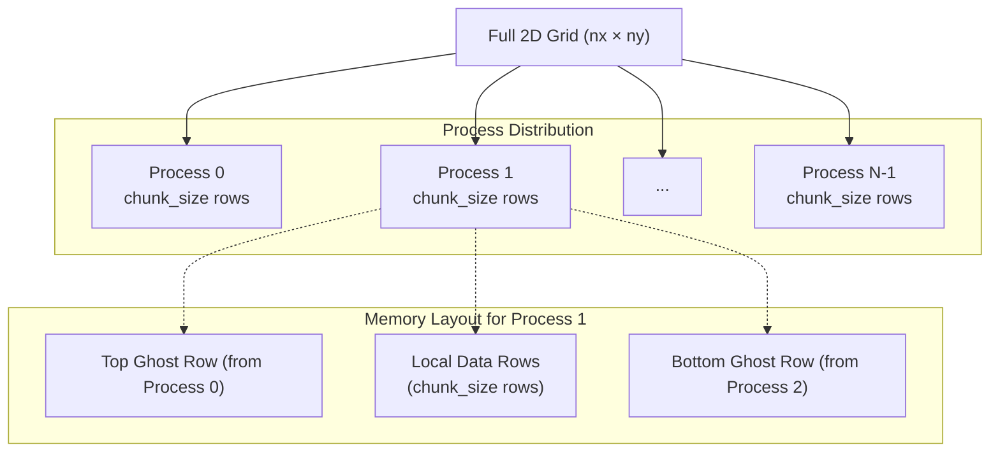
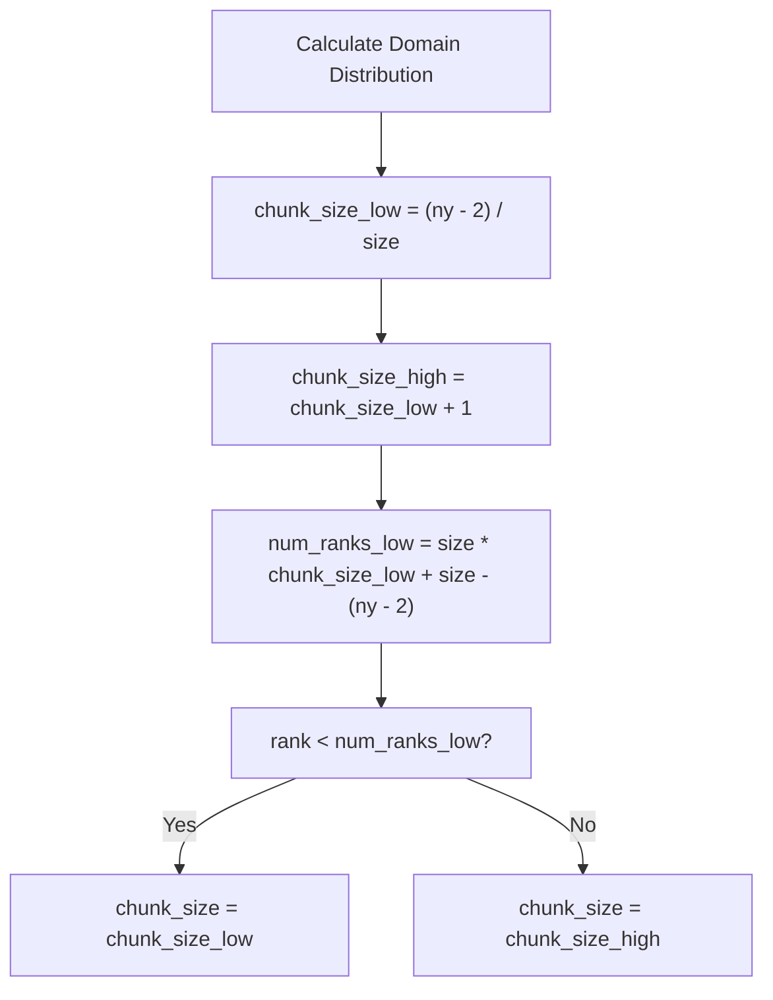
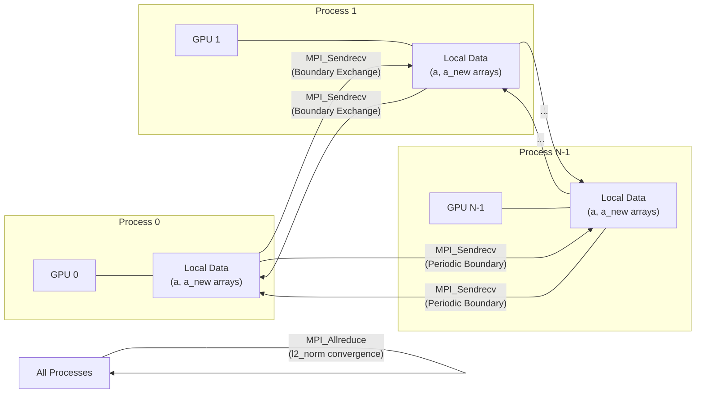
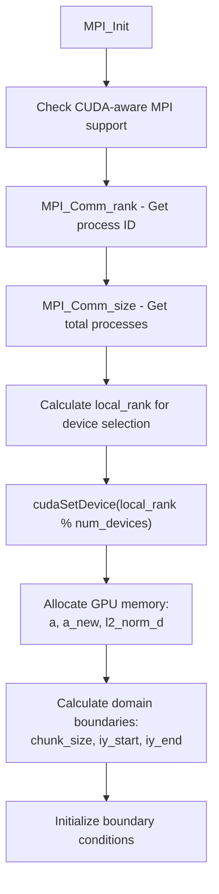
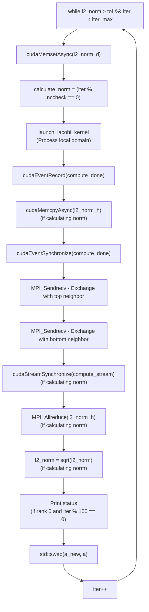
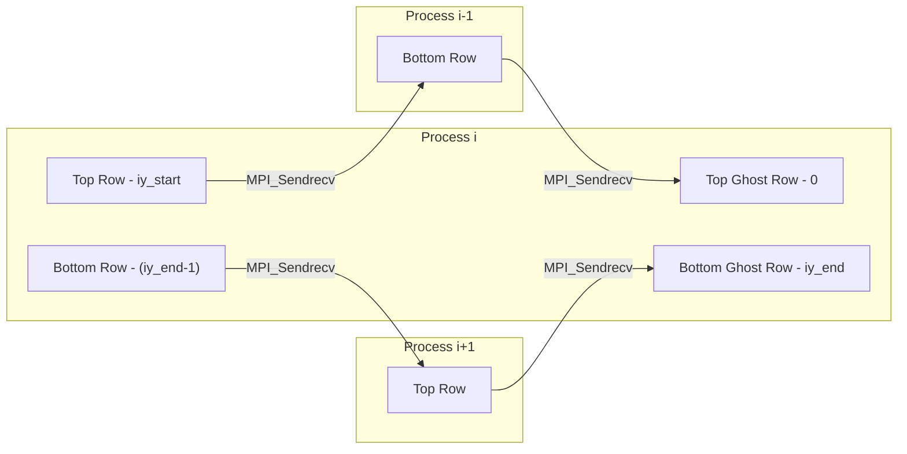

<!-- source: DeepWiki mcp.deepwiki.com · repo NVIDIA/multi-gpu-programming-models · extra page MPI Implementation · fetched 2026-10-26 -->

# MPI Implementation

<details>
<summary>Relevant source files</summary>

The following files were used as context for generating this wiki page:

- [mpi/Makefile](mpi/Makefile)
- [mpi/jacobi.cpp](mpi/jacobi.cpp)

</details>


This page documents the basic MPI-based implementation of the Jacobi solver using CUDA-aware MPI. This implementation distributes the computation across multiple GPUs by dividing the domain among separate MPI processes, with each process managing its own GPU. For the implementation that overlaps computation and communication, see [MPI with Computation-Communication Overlap](#3.3.2).

## Overview

The MPI implementation leverages the Message Passing Interface (MPI) framework with CUDA-aware MPI to enable direct GPU memory communication between processes. This approach uses a domain decomposition strategy where the 2D grid is divided into horizontal strips, with each MPI process handling a portion of the domain on its assigned GPU.

Key characteristics of this implementation:
- Uses CUDA-aware MPI to eliminate host-device transfer overhead
- Employs a row-wise domain decomposition with ghost cells
- Implements periodic boundary conditions
- Uses point-to-point communication for boundary exchanges
- Utilizes collective operations for convergence checking

## Architecture and Domain Decomposition

### Domain Decomposition Strategy

The implementation divides the 2D grid horizontally among MPI processes, with each process handling approximately the same number of rows:

Domain Decomposition Diagram


Sources: [mpi/jacobi.cpp:193-222]()

The load balancing algorithm ensures optimal distribution when the domain size is not perfectly divisible by the number of processes:



Sources: [mpi/jacobi.cpp:193-205]()

### Process and Communication Architecture

The MPI implementation establishes a communication pattern between neighboring processes:

Process Communication Diagram


Sources: [mpi/jacobi.cpp:286-302]()

## Implementation Details

### Initialization Process

The initialization phase consists of several critical steps:

1. **MPI Initialization**: Initialize the MPI environment and verify CUDA-aware MPI support
2. **Process Identification**: Determine process rank and size
3. **Device Selection**: Based on local rank within a node
4. **Domain Calculation**: Compute local domain boundaries
5. **Memory Allocation**: Allocate GPU memory for computation and communication
6. **Boundary Initialization**: Set initial conditions for boundaries



Sources: [mpi/jacobi.cpp:149-230]()

### Main Computation Loop

The main iteration loop follows this sequence:

1. Reset norm calculation buffer
2. Launch Jacobi kernel for the local domain
3. Synchronize and exchange boundary data with neighbors
4. Check convergence (if necessary) using a global reduction
5. Swap buffers and proceed to next iteration



Sources: [mpi/jacobi.cpp:272-311]()

### Boundary Exchange Mechanism

The implementation uses `MPI_Sendrecv` to perform boundary exchanges between neighboring processes:



The code implements periodic boundary conditions by defining appropriate neighbor ranks:

```
const int top = rank > 0 ? rank - 1 : (size - 1);
const int bottom = (rank + 1) % size;
```

Sources: [mpi/jacobi.cpp:286-296]()

## Critical Code Sections

### MPI Communication Calls

The core communication is performed through two `MPI_Sendrecv` calls:

1. Send top row to top neighbor, receive bottom ghost from bottom neighbor:
```
MPI_CALL(MPI_Sendrecv(a_new + iy_start * nx, nx, MPI_REAL_TYPE, top, 0,
                      a_new + (iy_end * nx), nx, MPI_REAL_TYPE, bottom, 0, MPI_COMM_WORLD,
                      MPI_STATUS_IGNORE));
```

2. Send bottom row to bottom neighbor, receive top ghost from top neighbor:
```
MPI_CALL(MPI_Sendrecv(a_new + (iy_end - 1) * nx, nx, MPI_REAL_TYPE, bottom, 0, a_new, nx,
                      MPI_REAL_TYPE, top, 0, MPI_COMM_WORLD, MPI_STATUS_IGNORE));
```

Sources: [mpi/jacobi.cpp:292-296]()

### Convergence Checking

The convergence check is performed using a global reduction operation:

```
MPI_CALL(MPI_Allreduce(l2_norm_h, &l2_norm, 1, MPI_REAL_TYPE, MPI_SUM, MPI_COMM_WORLD));
l2_norm = std::sqrt(l2_norm);
```

Sources: [mpi/jacobi.cpp:301-302]()

## Building and Running

The implementation can be built using the provided Makefile:

```
make -C mpi
```

To run with a specific number of MPI processes:

```
mpirun -np <number_of_processes> ./mpi/jacobi [options]
```

Available command-line options:
- `-niter <N>`: Maximum number of iterations (default: 1000)
- `-nx <N>`, `-ny <N>`: Grid dimensions (default: 16384×16384)
- `-nccheck <N>`: Check convergence every N iterations (default: 1)
- `-csv`: Output results in CSV format

Sources: [mpi/Makefile:41-42]()

## Performance Considerations

Several factors impact the performance of the MPI implementation:

1. **Synchronization Barriers**:
   - The implementation synchronizes after computation before boundary exchange
   - Global synchronization during convergence checking

2. **Communication Overhead**:
   - Each iteration requires two `MPI_Sendrecv` operations per process
   - Convergence checking requires an `MPI_Allreduce` across all processes

3. **CUDA-aware MPI Requirements**:
   - Implementation requires CUDA-aware MPI for direct GPU-to-GPU communication
   - A compatibility check is performed at initialization [mpi/jacobi.cpp:36-42]()

4. **Load Balancing**:
   - The implementation distributes rows optimally when ny-2 is not divisible by the number of processes
   - Some processes may receive one additional row for better load balancing

## Comparison with Other Implementations

| Feature | MPI Implementation | MPI with Overlap | NCCL Implementation |
|---------|-------------------|------------------|---------------------|
| Communication Mechanism | CUDA-aware MPI | CUDA-aware MPI | NCCL Collectives |
| Computation-Communication Overlap | No | Yes | Varies by implementation |
| Boundary Exchange | Synchronous after computation | Asynchronous during computation | NCCL SendRecv |
| Memory Requirements | 2 arrays + ghost cells | 3 arrays + ghost cells | 2 arrays + communication buffers |
| Programming Complexity | Moderate | Higher | Moderate |

The main limitation of this basic MPI implementation is the lack of computation-communication overlap, which is addressed in the [MPI with Computation-Communication Overlap](#3.3.2) implementation.

Sources: [mpi/jacobi.cpp]()

---

