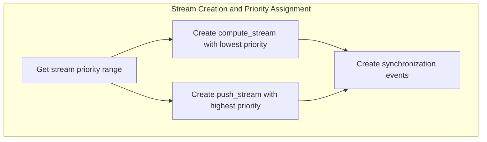
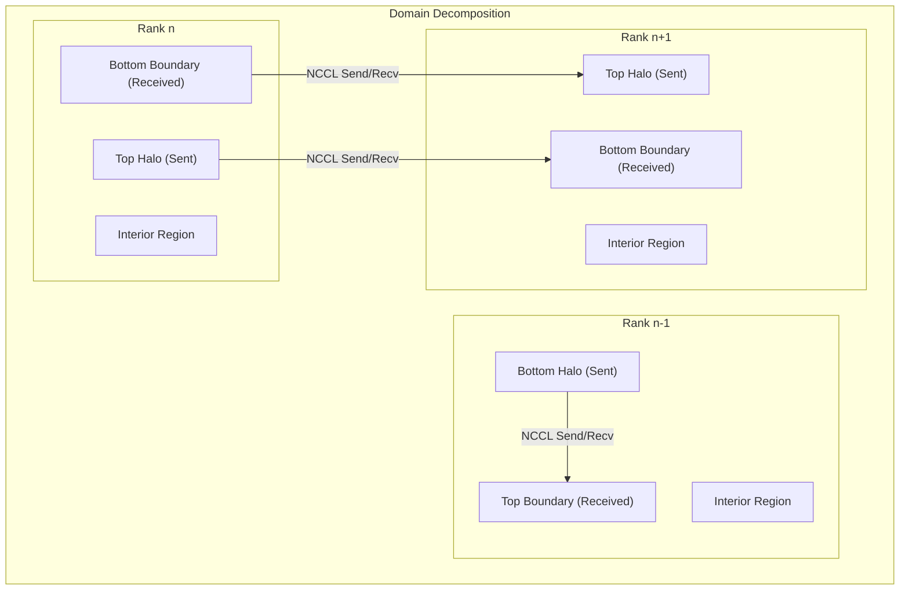
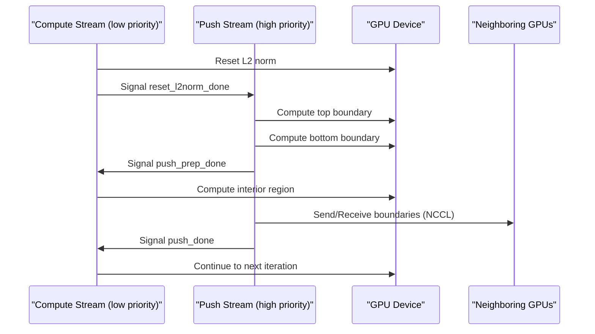
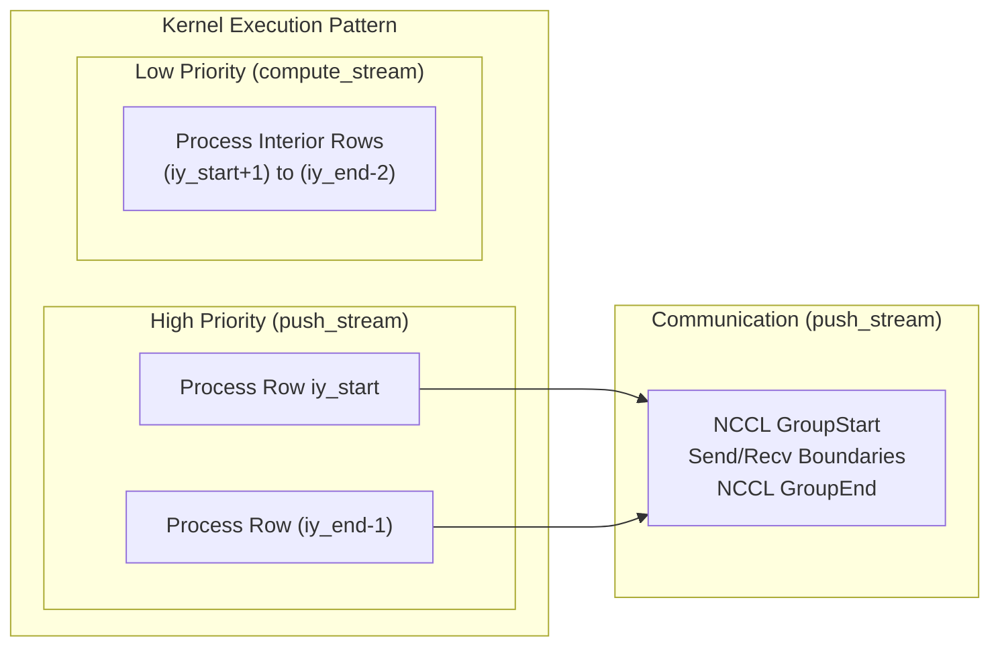
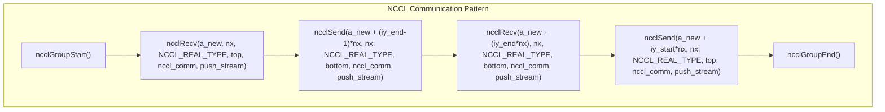
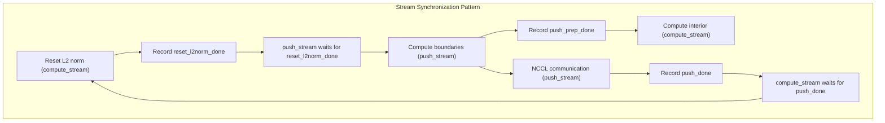
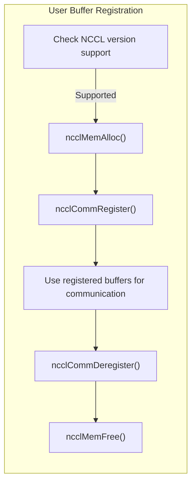

<!-- source: DeepWiki mcp.deepwiki.com · repo NVIDIA/multi-gpu-programming-models · extra page NCCL with Overlap · fetched 2026-10-26 -->

# NCCL with Overlap

Relevant source files

The following files were used as context for generating this wiki page:

- [nccl/jacobi.cpp](nccl/jacobi.cpp)
- [nccl_overlap/jacobi.cpp](nccl_overlap/jacobi.cpp)

## Purpose and Scope

This page documents the NCCL with Overlap implementation of the Jacobi solver, which enhances performance by overlapping computation and communication operations. This approach allows the solver to perform interior grid computations while simultaneously handling boundary exchanges with neighboring GPUs. For the basic NCCL implementation without overlap, see [NCCL Implementation](#3.4.1).

The NCCL with Overlap implementation leverages CUDA stream priorities and careful event synchronization to optimize the performance of multi-GPU Jacobi solvers by minimizing the time GPUs spend waiting for data.

Sources: [nccl_overlap/jacobi.cpp:1-460]()

## Key Concepts and Implementation Approach

The key innovation in this implementation is separating computation into boundary and interior regions and using separate CUDA streams with different priorities to enable effective overlap.

### Stream Prioritization

The implementation creates two CUDA streams with different priorities:
1. A high-priority stream for boundary computations and communication
2. A low-priority stream for interior computations

This prioritization ensures that operations critical for inter-GPU communication receive execution preference on the GPU.

Sources: [nccl_overlap/jacobi.cpp:290-304]()

### Domain Decomposition Strategy

The NCCL with Overlap implementation splits the grid domain into distinct regions for effective overlapping:

Sources: [nccl_overlap/jacobi.cpp:273-284]()

## Computation-Communication Overlap Technique

The implementation achieves overlap through a three-step process:

1. Compute boundary regions first (high-priority stream)
2. Start communication of boundary data (high-priority stream)
3. Compute interior region in parallel (low-priority stream)

This technique minimizes GPU idle time by allowing interior computation to proceed while boundary exchanges occur.

### Execution Pattern

Sources: [nccl_overlap/jacobi.cpp:342-387]()

## Implementation Details

### Key Code Components

| Component | Purpose | Location |
|-----------|---------|----------|
| Stream Creation | Creates prioritized streams for computation and communication | [nccl_overlap/jacobi.cpp:290-298]() |
| Event Creation | Creates events for synchronization between streams | [nccl_overlap/jacobi.cpp:299-304]() |
| Boundary Computation | Computes outer rows that will be exchanged | [nccl_overlap/jacobi.cpp:348-353]() |
| Interior Computation | Computes inner rows of the domain | [nccl_overlap/jacobi.cpp:355-356]() |
| NCCL Communication | Performs boundary exchanges between GPUs | [nccl_overlap/jacobi.cpp:369-376]() |
| Synchronization | Coordinates between computation and communication | [nccl_overlap/jacobi.cpp:359-362](), [nccl_overlap/jacobi.cpp:387]() |

### Split Kernel Execution

The core computational work is split into three parts:

Sources: [nccl_overlap/jacobi.cpp:348-356](), [nccl_overlap/jacobi.cpp:369-375]()

## Communication Pattern

The implementation uses NCCL for boundary exchanges with a specific communication pattern:

1. Receive from top neighbor into top boundary
2. Send bottom boundary to bottom neighbor
3. Receive from bottom neighbor into bottom boundary
4. Send top boundary to top neighbor

This pattern is executed in the high-priority push stream to ensure it completes as quickly as possible.

Sources: [nccl_overlap/jacobi.cpp:369-375]()

## Synchronization Mechanism

Proper synchronization between streams is crucial for the overlap strategy to work correctly. The implementation uses CUDA events for this purpose:

1. `reset_l2norm_done`: Signals when L2 norm reset is complete
2. `push_prep_done`: Signals when boundary computation is complete
3. `push_done`: Signals when communication is complete

These events control the dependencies between operations in different streams.

Sources: [nccl_overlap/jacobi.cpp:343-387]()

## Optional User Buffer Registration

The implementation optionally supports NCCL's user buffer registration API for potentially improved communication performance:

Sources: [nccl_overlap/jacobi.cpp:251-262](), [nccl_overlap/jacobi.cpp:440-452]()

## Performance Considerations

The NCCL with Overlap implementation offers several performance advantages:

1. **Reduced Idle Time**: By overlapping computation and communication, the GPU spends less time idle
2. **Stream Prioritization**: Ensures critical communication tasks are executed first
3. **Boundary Optimization**: Processes boundary data early to minimize communication latency

It is particularly effective for large problem sizes where the interior computation takes significant time compared to boundary exchanges.

The main trade-off is increased code complexity due to the need for careful stream and event management.

Sources: [nccl_overlap/jacobi.cpp:418-430]()

---

