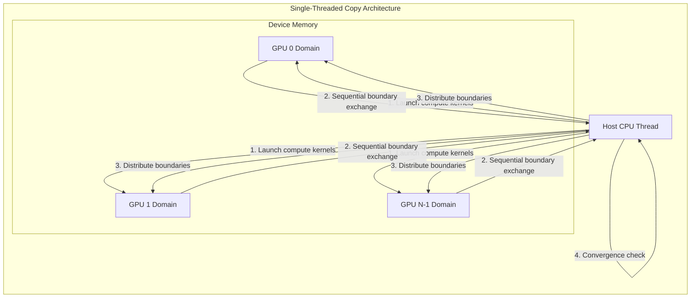
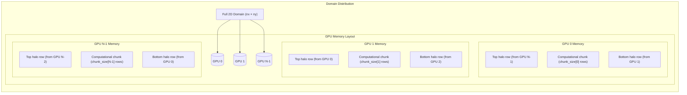
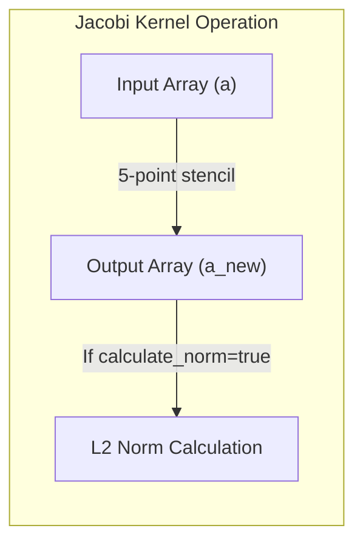
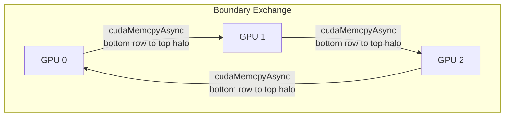

<!-- source: DeepWiki mcp.deepwiki.com · repo NVIDIA/multi-gpu-programming-models · extra page Single-Threaded Copy · fetched 2026-10-26 -->

# Single-Threaded Copy

<details>
<summary>Relevant source files</summary>

The following files were used as context for generating this wiki page:

- [single_threaded_copy/jacobi.cu](single_threaded_copy/jacobi.cu)

</details>


## Purpose and Overview

This document covers the Single-Threaded Copy implementation of the Jacobi solver in the multi-GPU programming models repository. This implementation represents the most basic approach to distributing the Jacobi iteration across multiple GPUs, using sequential, host-coordinated memory transfers between devices. For more advanced communication approaches, see [Multi-Threaded Copy](#3.1.2) and [Multi-Threaded P2P](#3.2.1).

The single-threaded copy approach serves as a baseline implementation that demonstrates fundamental concepts of multi-GPU programming while being straightforward to understand.

Sources: [single_threaded_copy/jacobi.cu:1-554]()

## Implementation Architecture

### Domain Decomposition and Data Flow

This diagram illustrates how the 2D grid is divided among multiple GPUs and how data flows between them:



Sources: [single_threaded_copy/jacobi.cu:306-366]()

### Memory Management and Halo Regions



Sources: [single_threaded_copy/jacobi.cu:209-213](), [single_threaded_copy/jacobi.cu:227-231]()

## Key Components

### Memory Allocation and Initialization

The implementation starts by allocating memory on each GPU for its portion of the grid plus halo regions. The allocation process includes:

1. Determining the chunk size for each GPU
2. Allocating memory on each GPU for the grid portion and halo regions
3. Initializing boundary conditions

Each GPU is allocated arrays `a` and `a_new` to hold the current and next iterations of the solution.

Sources: [single_threaded_copy/jacobi.cu:162-166](), [single_threaded_copy/jacobi.cu:209-213]()

### Load Balancing

The code uses a balanced distribution of rows across GPUs, ensuring optimal workload distribution:

```
// ny - 2 rows are distributed amongst `size` ranks in such a way
// that each rank gets either (ny - 2) / size or (ny - 2) / size + 1 rows.
// This optimizes load balancing when (ny - 2) % size != 0
```

If the number of rows doesn't divide evenly among GPUs, some GPUs will handle one additional row to balance the workload.

Sources: [single_threaded_copy/jacobi.cu:194-207]()

### CUDA Streams and Events

The implementation uses three CUDA streams per GPU:

| Stream | Purpose |
|--------|---------|
| `compute_stream` | Executes the Jacobi kernel |
| `push_top_stream` | Transfers data to the GPU above |
| `push_bottom_stream` | Transfers data to the GPU below |

CUDA events are used to synchronize these streams and ensure correct execution order:

| Event | Purpose |
|-------|---------|
| `compute_done` | Signals completion of computation |
| `push_top_done` | Signals completion of top boundary transfer |
| `push_bottom_done` | Signals completion of bottom boundary transfer |

Sources: [single_threaded_copy/jacobi.cu:167-172](), [single_threaded_copy/jacobi.cu:233-242]()

### Main Computation Loop

The main computation loop consists of these steps:

1. Reset norm calculation
2. Wait for boundary exchanges to complete
3. Launch Jacobi kernel on each GPU
4. Calculate the norm if needed
5. Exchange boundary data between GPUs
6. Check for convergence
7. Swap arrays for the next iteration

Sources: [single_threaded_copy/jacobi.cu:306-366]()

### Jacobi Kernel Implementation

The Jacobi kernel performs the stencil computation and optionally calculates the L2 norm of the residual:



The kernel uses a 5-point stencil, calculating each point as the average of its four neighbors.

Sources: [single_threaded_copy/jacobi.cu:98-129]()

### Boundary Exchange Mechanism

After each iteration, boundary data is exchanged between GPUs using `cudaMemcpyAsync` in device-to-device mode:



The boundary exchange is coordinated by the host CPU thread, which sequentially executes each transfer operation.

Sources: [single_threaded_copy/jacobi.cu:336-349]()

## Performance Considerations

### Limitations of Single-Threaded Approach

The single-threaded copy implementation has several performance limitations:

1. **Sequential Transfers**: All data transfers are handled by a single thread, becoming a bottleneck as the number of GPUs increases
2. **No Communication-Computation Overlap**: Data transfers cannot overlap with computation
3. **High CPU-GPU Synchronization Overhead**: Frequent synchronization between CPU and GPU limits performance

### Comparison with Other Implementations

| Implementation | Strengths | Weaknesses |
|----------------|-----------|------------|
| Single-Threaded Copy | Simple, easy to understand | Limited scalability, sequential transfers |
| Multi-Threaded Copy | Parallel transfers between GPUs | Still uses host memory for data exchange |
| Direct P2P | Elimination of CPU involvement in transfers | Requires peer access capability |
| NCCL-based | Optimized collective operations | More complex programming model |

Sources: [single_threaded_copy/jacobi.cu:351-366](), [single_threaded_copy/jacobi.cu:396-408]()

## Optimizations and Techniques

Despite its basic approach, the single-threaded implementation incorporates several optimizations:

1. **Asynchronous Memory Transfers**: Uses `cudaMemcpyAsync` to potentially overlap transfers with other operations
2. **Periodic Norm Calculation**: Only calculates the norm every `nccheck` iterations to reduce overhead
3. **CUDA Stream Synchronization**: Uses events to synchronize different operations without blocking the host thread
4. **Load-Balanced Domain Decomposition**: Distributes work evenly across GPUs

Sources: [single_threaded_copy/jacobi.cu:320-328](), [single_threaded_copy/jacobi.cu:336-349]()

## GPU Peer Access

The implementation optionally enables peer access between GPUs using CUDA's peer access API. This allows direct memory transfers between GPU devices without CPU involvement:

```
if (!nop2p) {
    const int top = dev_id > 0 ? dev_id - 1 : (num_devices - 1);
    int canAccessPeer = 0;
    CUDA_RT_CALL(cudaDeviceCanAccessPeer(&canAccessPeer, dev_id, top));
    if (canAccessPeer) {
        CUDA_RT_CALL(cudaDeviceEnablePeerAccess(top, 0));
    }
    ...
}
```

Peer access is enabled by default but can be disabled with the `-nop2p` command-line flag.

Sources: [single_threaded_copy/jacobi.cu:247-262]()

## Summary

The Single-Threaded Copy implementation provides a baseline approach for multi-GPU Jacobi solver implementation. While not the most efficient method, it serves as a foundation for understanding more advanced approaches and provides a clear demonstration of basic multi-GPU programming concepts. The main performance bottleneck is the sequential nature of boundary exchanges, which are coordinated by a single CPU thread.

---

